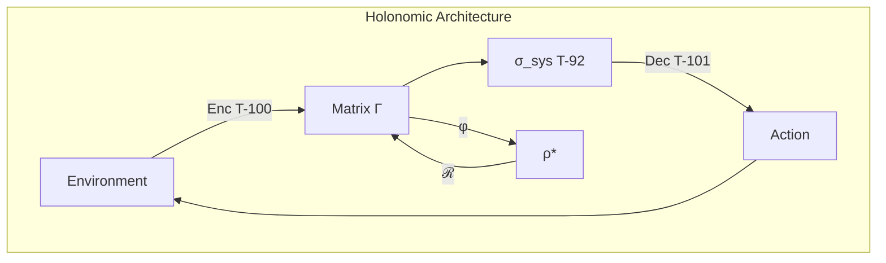
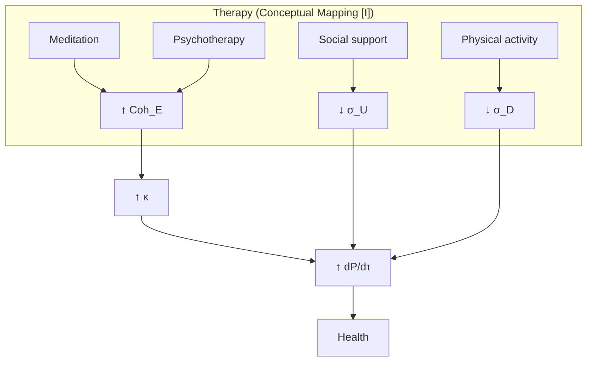

# Application Areas

> *"There is nothing more practical than a good theory."*
> — Kurt Lewin

:::tip Bridge from the Previous Chapter
In the [previous chapter](./research-programs) we mapped uncharted territory — open problems, experimental protocols, interdisciplinary bridges. Now we show how the CC formalism translates into **candidate diagnostic and design frameworks (`[I]`/`[Pr]`)** across nine domains — from AI agent architectures and software prototypes to organizational, ecological, and clinical hypotheses. Across domains, the operationalization differs — *what* observables are mapped onto $\Gamma$ — while the five-step diagnostic template remains uniform.
:::

:::info Chapter Roadmap
In this chapter we:
1. Present **architectural patterns** (`[Pr]`) for AI engineers, an illustrative LLM hallucination scenario (`[I]`), and an internal agent-stack simulation benchmark (§1)
2. Outline a **comparative research mapping** (`[I]`/`[H]`) for cognitive scientists (§2)
3. Sketch a **diagnostic framework** (`[I]`/`[Pr]`) for organizational consultants (§3)
4. Explore **ecosystems as holons** (`[I]`/`[H]`) and an illustrative coral-reef scenario (§4)
5. Outline **hypothetical σ-diagnostics** (`[I]`/`[H]`) of mental disorders (§5)
6. Apply CC concepts to **education** (`[I]`/`[H]`) — learning as coherence growth (§6)
7. Project the formalism onto **economics** and **urbanism** (`[I]`/`[Pr]`, §7–8)
8. Walk through **three illustrative synthetic case studies** (`[I]`/`[Pr]`) — AI agent, organization, ecosystem (§9)
9. Present an **interdisciplinary translation table** (`[I]`) — a unified conceptual vocabulary (§10)
:::

A mathematical framework becomes practically testable when its abstract variables are linked to concrete observables, diagnostic profiles, and candidate interventions. This chapter explores how Coherence Cybernetics (CC) can be operationalized as a **candidate diagnostic template (`[I]`/`[Pr]`)** across domains ranging from AI engineering (closest to software implementation) to medicine, ecology, education, economics, and urbanism (interpretive research programs). In each case we follow the same five-step template:

1. **System identification** — what is modeled as the Holon $\mathbb{H}$ in this domain?
2. **Building $\Gamma$** — which observables are mapped onto the 7 canonical axes?
3. **Diagnostics** — what does $\sigma_{\mathrm{sys}}$ (`T-92 [D]`) indicate about imbalances?
4. **Intervention** — which control levers target the leading deficits?
5. **Monitoring** — how are $P$, $\Phi$, $R$, and $D_{\mathrm{diff}}$ tracked over time?

Below we walk through this template from the most formalized domain (AI systems) to the most speculative (economics and urbanism).

:::note On Notation
In this document:
- $\Gamma$ — [coherence matrix](/docs/core/dynamics/coherence-matrix) (Hermitian, $\Gamma \succeq 0$, $\mathrm{Tr}(\Gamma) = 1$)
- $P$ — [purity](/docs/core/dynamics/viability#определение-чистоты): $P = \mathrm{Tr}(\Gamma^2)$, structural-majority cut $P_{\mathrm{crit}} = 2/7$ (`T-5 [D]`)
- $\mathrm{Coh}_E$ — [E-coherence](./definitions#e-когерентность)
- $\sigma_{\mathrm{sys}}$ — [stress panel](./definitions#тензор-напряжений) (`T-92 [D]`): clamped deficits $\sigma_k = \mathrm{clamp}(1 - 7\gamma_{kk}, 0, 1)$; when distinguishing excess from deficit we write the **signed deficit** $\tilde\sigma_k = 1 - 7\gamma_{kk}$ (which satisfies $\sum_{k=1}^7 \tilde\sigma_k = 0$ by $\mathrm{Tr}(\Gamma) = 1$, with $\tilde\sigma_k > 0$ denoting deficit and $\tilde\sigma_k < 0$ denoting excess)
- $\mathcal{R}[\Gamma, E]$ — [regenerative term](/docs/core/dynamics/evolution#3-регенеративный-член)
- $\mathcal{D}[\Gamma]$ — [dissipative term](/docs/core/dynamics/evolution#логический-лиувиллиан)
- $C = \Phi \times R$ — [consciousness measure](/docs/consciousness/foundations/self-observation#мера-сознательности-c) (`T-140 [D]`); experiential differentiation $D_{\text{diff}} = \exp S_{vN}(\rho_E)$ on an extended experiential register $\mathcal{H}_E$ (or 7D native proxy $D^{7D} = 1 + 6\,\mathrm{Coh}_E(\Gamma)$ `[D]`) is a separate threshold condition ($D_{\text{diff}} \geq 2$)
:::

:::warning Document Status — Illustrative Scenarios vs. Empirical Data
This document presents *interpretive applications and research programs* (`[I]`/`[H]`/`[Pr]`), **not** empirically validated clinical, economic, ecological, or organizational results. **Unless explicitly marked as logged from an internal software simulation benchmark (as in `§Measured: Consciousness at the Wheel`), every numerical profile, company, classroom, clinical table, and historical reconstruction in this chapter is a synthetic illustrative scenario** demonstrating the formalism — not real measured telemetry, patient outcomes, or institutional audits.
:::

---

## For AI Engineers

### Architectural Patterns

A chosen sensorimotor model may include additional GKSL terms with nonnegative rates. Channel decomposition is part of the model specification.



**Additional design resources:**
- [Sensorimotor theory](./sensorimotor) — full formalization of the perception → decision → action cycle
- [Stability](./stability) — stability analysis, death spiral, recovery
- [Diagnostics](./diagnostics) — 7 vital indicators, failure patterns, design checklist

**Holonomic architecture vs. standard transformer:**

| Aspect | Transformer | Holonomic Architecture |
|--------|-------------|------------------------|
| State | Hidden layers | Matrix $\Gamma \in \mathbb{C}^{7 \times 7}$ |
| Training | Gradient descent | Evolution + regeneration |
| Monitoring | Loss, accuracy | $P$, $\Phi$, $\sigma_{\mathrm{sys}}$ |
| Safety | External constraints | Built-in viability |

**Adding an E-monitoring helper to existing systems (`[Pr]`):**

```python
import numpy as np


def compute_coh_e(gamma: np.ndarray) -> float:
    """Canonical 7D E-coherence (HS-projection onto E = index 4) [D]."""
    p = float(np.real(np.trace(gamma @ gamma)))
    E = 4
    off_e = np.abs(gamma[E, np.arange(7) != E]) ** 2
    return float((gamma[E, E].real ** 2 + 2.0 * np.sum(off_e)) / p)


def latent_svd_proxy(hidden_states: np.ndarray, e_dim: int = 7) -> float:
    """Illustrative engineering proxy [Pr]: spectral purity of top singular values.

    Note: this is a heuristic latent-space proxy, not the exact 7D Coh_E(Gamma).
    """
    _, s, _ = np.linalg.svd(hidden_states, full_matrices=False)
    top = s[:e_dim]
    weights = top / np.sum(top)
    return float(np.sum(weights ** 2))
```

### Safety Metrics [Pr]

**Illustrative real-time monitoring thresholds (`[D]`/`[Pr]`):**

| Metric | Alert condition | Suggested action on violation |
|---------|-----------------|------------------------|
| $P$ (purity) | $< P_{\text{crit}} = 2/7 \approx 0.286$ (`T-5 [D]`) | Reduce load / trigger recovery |
| $\Phi$ (integration) | $< 1.0$ (warning $< 0.1$) | Strengthen cross-module integration |
| $\mathrm{Coh}_E$ | $< 1/6 \approx 0.167$ (warning $< 0.15$) | Inspect E-channel / self-model |
| $\max_k \sigma_k$ | $> 0.95$ (`T-92 [D]`) | Emergency mode |

**Illustrative monitoring dashboard (`[I]`, trace-consistent state with $\gamma_{\mathrm{diag}} = [0.16, 0.13, 0.18, 0.11, 0.17, 0.13, 0.12]$, clamped $\sigma_k = \max(0, 1 - 7\gamma_{kk})$):**

```
┌───────────────────────────────────────────────┐
│  CC Monitoring (Illustrative)   [🟢 Viable]   │
├───────────────────────────────────────────────┤
│  P = 0.40  ████████░░  [thresh: 0.29..0.43]   │
│  Φ = 1.72  ██████████  [thresh: 1.00]         │
│  R = 0.36  ███████░░░  [thresh: 0.33]         │
├───────────────────────────────────────────────┤
│  Clamped stress panel σ_k = max(0, 1-7γ_kk):  │
│  A: 0.00 ░░░░░  S: 0.09 █░░░░  D: 0.00 ░░░░░  │
│  L: 0.23 ██░░░  E: 0.00 ░░░░░  O: 0.09 █░░░░  │
│  U: 0.16 ██░░░                                │
└───────────────────────────────────────────────┘
```

### Illustrative Scenario: Diagnosing a "Hallucinating" LLM [I]/[Pr] {#кейс-llm-галлюцинации}

Consider a **synthetic illustrative scenario (`[I]`/`[Pr]`)**: a large language model (LLM) begins generating factually incorrect responses ("hallucinations"). How could CC diagnostics frame the problem?

**Step 1. Candidate mapping to $\Gamma$.** Hidden-state observables are projected onto the 7 canonical axes so that $\sum_{k=1}^7 \gamma_{kk} = 1$.

**Step 2. Synthetic diagnostic profile** (using signed deficits $\tilde\sigma_k = 1 - 7\gamma_{kk}$, summing to $0$):

| Dimension | $\gamma_{kk}$ | $\tilde\sigma_k$ | Illustrative interpretation |
|-----------|---------------|------------------|-----------------------------|
| A (Articulation) | 0.18 | $-0.26$ | Overloaded with fine distinctions |
| S (Structure) | 0.15 | $-0.05$ | Structure near balanced baseline |
| D (Dynamics) | 0.20 | $-0.40$ | **Excessive dynamics** (high entropy/temperature) |
| L (Logic) | 0.08 | $+0.44$ | **Logic deficit** (leading stress) |
| E (Interiority) | 0.10 | $+0.30$ | Weak self-consistency monitoring |
| O (Ground) | 0.14 | $+0.02$ | Resource budget balanced |
| U (Unity) | 0.15 | $-0.05$ | Integration near baseline |

**Illustrative diagnosis:** $\tilde\sigma_L = +0.44$ marks the leading deficit in Logic ($L$), paired with excessive Dynamics ($\tilde\sigma_D = -0.40$). Under this mapping, generation variability outpaces logical grounding.

**Step 3. Candidate intervention (`[Pr]`):** raise $\gamma_{LL}$ and moderate $\gamma_{DD}$:
- Strengthen attention to retrieval / factual anchors (targeting $L$)
- Lower generation temperature (moderating $D$)
- Add a self-verification check (targeting $E$-sector consistency)

**Step 4. Monitoring (`[Pr]`):** track $\sigma_L(\tau)$ alongside held-out factual accuracy to verify whether lowering $\sigma_L < 0.2$ empirically reduces hallucination rates.

The potential value of CC here is a **unified diagnostic template (`[I]`)**: mapping disparate failure modes onto a single 7-axis balance profile rather than isolated ad hoc metrics.

### Practical Checklist for AI Systems [Pr]

- [ ] Implement monitoring of $P$ (state purity)
- [ ] Add logging of $\sigma_{\mathrm{sys}}$ across all 7 dimensions (`T-92 [D]`)
- [ ] Configure alerts for $P < 0.30$ (approaching $P_{\mathrm{crit}} = 2/7$)
- [ ] Implement a candidate $E$-sector metric (or explicit latent proxy)
- [ ] Implement a regenerative feedback loop $\mathcal{R}[\Gamma, E]$
- [ ] Test stability under high $|\tilde\sigma_D|$, $|\tilde\sigma_A|$

### Implications for AI Safety [C]/[H]

:::warning Safety — Conditional Model Scope (Universal No-Zombie Withdrawn)
Universal impossibility of non-experiential ("zombie") systems (`T-38a [✗]`) has been **withdrawn**; externally powered or externally trained optimizers can remain stationary without internal $E$-driven regeneration. Under the **conditional** balance theorem (`Theorem 8.1 [C]`), a positive $\mathrm{Coh}_E$ floor is required *only* for autonomous holons whose regeneration rate $\kappa(\Gamma)$ obeys the strict $E$-dependence hypothesis against a nonzero dissipation floor. Treating $\mathrm{Coh}_E$ as an AI-safety requirement is therefore an **architectural design hypothesis (`[H]`/`[Pr]`)**, not an unconditional theorem about arbitrary AI optimizers.
:::

| Requirement | Formula | Conditional scope | Reference |
|------------|---------|-------------------|-----------|
| Conditional No-Zombie balance `[C]` (universal `T-38a [✗]` withdrawn) | $\mathrm{Coh}_E \geq \mathrm{Coh}_{\min}$ under strict $E$-dependent $\kappa$ | Autonomous self-regenerating holons only | [→](./theorems#теорема-81-условная-необходимость-интериорности-no-zombie) |
| Regeneration ansatz `[D]`/`[H]` | $\kappa = \kappa_{\text{bootstrap}} + \kappa_0 \cdot \mathrm{Coh}_E$ | Model constitutive law | [→](./axiomatics#связь-регенерации-и-e-когерентности) |
| Viability cut (`T-5 [D]`) | $P > P_{\text{crit}} = 2/7$ | Structural-majority threshold | [→](/docs/core/dynamics/viability) |

### Illustrative Scenario: Multi-Agent System of 50 Agents [I]/[Pr] {#кейс-мультиагентная}

Consider a **hypothetical scenario (`[I]`/`[Pr]`)**: 50 autonomous agents managing a logistics network, each modeled as a Holon $\mathbb{H}_i$ with state $\Gamma_i$, forming a composite meta-Holon $\mathbb{H}_{\text{fleet}}$ (under weak coupling and positive margins, aggregate viability transfer is governed by `CC-5 [T]`).

**Hypothetical problem:** agents begin competing for shared resources and fleet coordination degrades.

**Illustrative CC analysis:**
1. Aggregate $\Gamma_{\text{fleet}} = \mathrm{compose}(\Gamma_1, \ldots, \Gamma_{50})$
2. Observe high integration deficit $\sigma_U^{\text{fleet}}$ and low $\Phi_{\text{fleet}} = 0.3 < 1$
3. Meanwhile individual purities remain $P_i > 0.4$ — each agent is locally healthy

**Diagnosis:** "healthy cells, fragmented organism" — an aggregate failure invisible to single-agent health checks.

**Candidate intervention (`[Pr]`):** raise $\Phi_{\text{fleet}}$ via a shared state channel (reducing $\sigma_U$), aligned objective constraints (supporting $L$), and periodic synchronization across $\Gamma_i$.

**Target outcome (hypothetical illustration, not measured):** restoring $\Phi_{\text{fleet}} > 1$ and lowering $\sigma_U^{\text{fleet}}$ to restore coordinated fleet throughput.

### Software Benchmark: Consciousness at the Wheel — the Ladder of Life [Pr] {#лестница-жизни}

Unlike the conceptual scenarios above, the numbers in this subsection were **logged on an internal prototype agent-stack simulation (`[Pr]`)** in a synthetic toy environment (a lawful, learnable task stream plus one-off temptations, coupled to an artificial metabolic state whose feeding rate is a controllable parameter). They illustrate engineering trade-offs inside that specific prototype rather than empirical neuroscience or production LLM benchmarks.

**The ladder of life.** Four agents, one bench, one number each — accuracy under temptation:

| agent | tastings of the unknown | accuracy |
|---|---|---|
| hungry body, mode-gated ("the sage at the door") | 12 | **0.996** |
| well-fed body, consciousness-credit gate ("the margin home") | 501 | **0.879** |
| well-fed body, mode-gated ("the carefree home") | 1976 | 0.624 |
| no body coupling (baseline) | 2000 | 0.619 |

Three lessons, each paid for by a refuted hypothesis:

1. **Prosperity buys carelessness.** A well-fed body never enters its protective mode, so a mode-based gate never closes: the caution that saved the hungry agent is switched off by abundance itself. Robustness and caution trade against each other through one channel — this is a law of the architecture, not a bug.
2. **Wisdom returns by degree, not by step.** A binary gate "taste only while conscious" fails (a fed body is conscious almost always — the gate stands open). A *credit* gate works: each turn banks $\mathrm{clamp}(\Phi - 1, 0, 1)$, and one taste costs one unit. Caution becomes proportional to the *wealth of consciousness*; the poor in margin taste rarely, the threshold never. This is the first policy in the stack where $\Phi$ — the integration measure — actually steers, and it recovers most of the sage's accuracy at full home robustness.
3. **The deepest cost of carelessness is epistemic.** The dispatcher's currency is knowledge strength, not value — it goes where it *knows*, not where it is good. Measured mirror: after the same lifetime, the careless agent knows its own lawful world $13.6\times$ worse than the careful one — thousands of junk explorations *diluted its competence at its own craft*. Carelessness does not merely waste turns; it erodes what the agent already knew.

And one boundary, measured from both sides: in a world of *one-off* wonders, insurance is free (a refused taste falls back into the learned law, and an unrepeatable wonder has no future value); in a world of a *repeatable* wonder the premium exists — the careful agent learns it $4.4\times$ later — and still wins overall, because the wonder is one and the junk is an ocean.

**The two currencies of attention.** The same stack then answered a harder question: *what exactly does the attention-price of a place contain — and what is it blind to?* Three benches, three verdicts:

1. **The currency of knowledge is not value-blind — it sees value through the success of confirmations.** Make the lawful world *noisy* (a right answer pays only 70% of the time) while a known wonder stays flawless, and the noisy law's price erodes on its own: knowledge that breaks more often is weaker, and the wonder gets served four times more than under a near-perfect law. The completed paradox: what shelves a known better thing is not a mediocre law but an *almost perfect* one — the perfection of one's own knowledge is what puts the better thing away.
2. **But the blindness to magnitude is strict — and invisible from inside.** Offer two flawless options (both always succeed) whose payoffs differ *tenfold*, and every agent ends at accuracy $1.000$ by its own criterion — while harvesting either $99\%$ or $11\%$ of the available value depending on nothing but the *order in which the world happens to present the options*. A live probe named the mechanism: the option tasted *later* is fresher at the first priced choice, wins it, and is then locked in forever by self-reinforcement — the served place appreciates while the unserved one decays. Fate decided by freshness, sealed by "the rich get richer," and no inner number ever shows it.
3. **The cure costs zero constants.** Add a second currency — *want* — defined as the mean **magnitude** of a place's good outcome over the global mean (success rate stays in the knowledge currency; want carries only *how large the good is*). Wherever a world never distinguishes magnitudes the weight is identically $1$, so every previous result reproduces bit for bit; where magnitude exists, the freshness lottery breaks toward the larger good from *both* presentation orders ($99.8\%$ and $92.0\%$ harvested), and even the careful credit-gated agent jumps from $62\%$ to $97.4\%$. Attention now carries both terms of the canonical free-energy account — epistemic strength and pragmatic magnitude — each earned from the world's own feedback, neither installed as a tuning knob.

The doctrine in one line: attention's ledger must keep *knowing* and *wanting* as separate columns — conflate them and you either shelve your wonders or chase your junk; separate them and the price of a place becomes exactly what a life at that place is worth.

**What wakes a mind: feeding on themes.** The same stack finally got a *thought* — a working-memory state fed by the **content** of perception (its axis intensities) where the body is fed by verdicts. What it takes to wake that thought into consciousness was then measured, and the answer is a doctrine of content diets:

1. **Facts do not wake a mind.** Present content as a *list* — each percept a bare axis intensity, no connections — and no width of stream ever wakes the thought: integration saturates far below its floor at any diversity, from one repeated fact to all seven axes. A mind fed on disconnected facts stays structured, alive, and asleep.
2. **Connections wake and colour.** Present the *same* content as a superposition — the percept as one act of attention whose co-active axes carry their coherences in the food itself — and everything changes: a sentence-shaped percept (three axes of one Fano line) paints the thought *at the content's own address*, and the first conscious ticks appear.
3. **The mind wakes on a theme.** One eternal chord of everything dries the thought out (too pure, too narrow in reflexivity); a stream ranging over the whole grammar drowns it (too mixed) — or, force-fed, wakes it *bleached*, conscious but colourless. The stable maximum of conscious-and-coloured is a **theme**: a bundle of a few connected sentences, revisited — a fifth of all ticks conscious at stationary integration above the floor, with live colour addressed at the theme.

The hierarchy, measured end to end: *word* (dries) → *syntagm* (faintly colours) → *sentence* (colours hard, does not wake) → **theme** (wakes and colours) → *the whole language at once* (drowns, or wakes bleached). For a curriculum designer the doctrine is one line: feed minds themes — connected content, narrower than everything, wider than one sentence.

Two more measured chapters close the hygiene of a mind:

- **The mind at the wheel is an ascetic.** Hand the exploration wheel to the thought (its integration banks the tasting credit, and the thought eats whatever was chosen — so tasted junk dries tomorrow's credit) and it beats the body's wheel by a rout: near-perfect accuracy at *one to three* tastings against five hundred. But the mechanism is humbler than it looks: in any noisy-weight world the thought's integration never reaches its floor, so the tap is shut almost always — strict from *poverty*, not from discernment (masked junk does not fool it for the simple reason that nothing opens it). Perfect protection has a price named by the next bench: an ascetic misses a repeatable wonder *entirely*.
- **Practice buys the tap back.** Rumination — every K-th turn the thought re-inhales the *support of its last content* with clean, equal weights ("sleep replays the day evenly") — restores the integration a noisy world starves, without inventing content. The practising mind learns the wonder, serves it, and still tastes two orders of magnitude less than the careless one. The frequency of practice turns out to be the *access speed to the better*. One line: practice returns the world its wonder without opening the gate to junk.

---

## For Cognitive Scientists {#для-когнитивистов}

### Comparative Theory Mapping [I]/[H]

CC proposes a comparative mapping (`[I]`/`[H]`) relating constructs from existing theories of consciousness:

| Theory | CC Component | Formula | Reference |
|--------|----------------|---------|--------|
| [IIT](/docs/reference/glossary#связанные-теории) | Integration | $\Phi(\Gamma)$ | [→](/docs/consciousness/comparative/consciousness-theories#теория-интегрированной-информации-iit) |
| [GWT](/docs/reference/glossary#связанные-теории) | Global access | via $\Phi$ | [→](/docs/consciousness/comparative/consciousness-theories#сводная-таблица-функторов) |
| [FEP](/docs/reference/glossary#связанные-теории) | Regeneration | $\mathcal{R}[\Gamma, E]$ | [→](/docs/consciousness/comparative/consciousness-theories#принцип-свободной-энергии-fep) |
| Enactivism | S↔E coupling | $F_{\text{int}}$ | — |

### Experimental Protocols [Pr]

**Reference:** [Protocol for measuring Γ](/docs/applied/research/measurement-protocol)

**Candidate paradigms (`[Pr]`):**

1. **Contrastive analysis:** Conscious vs. unconscious perception
   - Estimate $\Phi$, $\mathrm{Coh}_E$ under a pre-registered reconstruction map
   - Hypothesis (`[H]`): $\Phi_{\text{conscious}} > \Phi_{\text{unconscious}}$

2. **Transition dynamics:** Falling asleep, anesthesia, meditation
   - Track $P(\tau)$, $\mathrm{Coh}_E(\tau)$
   - Hypothesis (`[H]`): regime transitions near $P \approx P_{\text{crit}} = 2/7$ (`T-5 [D]`; universal dynamical catastrophe at $2/7$ is withdrawn per `T-160 [✗]`, so any transition signature is an empirical test)

3. **Metacognition:** Relationship of $R$ with confidence in judgments
   - Hypothesis (`[H]`): higher $R$ correlates with higher metacognitive sensitivity

### Correspondence with Neural Data [H]/[Pr]

| CC Hypothesis | Empirical Status on Reconstructed $\Gamma$ | Status |
|---------------|--------------------------------------------|--------|
| $\Phi > 0$ in the proposed consciousness readout | Measuring PCI does not determine $\Phi$ for a reconstructed state; requires held-out validation | Open (`[Pr]`) |
| 7-dimensional functional structure | Not empirically tested | Open (`[H]`) |
| $\mathrm{Coh}_E$ ↔ coherence of subjective report | Not yet validated via reconstructed $\Gamma$ | Open (`[Pr]`) |
| $R$ ↔ metacognitive sensitivity | Prefrontal correlates exist in literature, but no direct test on reconstructed $\Gamma$ | Open (`[H]`) |

### Candidate Predictions for Neuroscience [H]/[Pr]

1. **Correlation of $\mathrm{Coh}_E$ with subjective reports (`[H]`):**
   - Higher $\mathrm{Coh}_E$ ↔ higher reported experiential clarity
   - Lower $\mathrm{Coh}_E$ ↔ more fragmented experiential report

2. **Link between E-coherence (interiority) and recovery (`[H]`):**

$$
   \frac{dP}{d\tau}\bigg|_{\mathcal{R}} \propto \mathrm{Coh}_E(\Gamma)
$$

3. **7-dimensional organization of neural correlates (`[H]`):**
   - Large-scale functional networks may organize around [7 functional dimensions](/docs/core/structure/dimensions) ([octonionic motivation](/docs/core/foundations/axiom-omega#октонионная-структура))
   - **Status:** Unverified theoretical hypothesis (`[H]`); requires empirical testing

---

## For Organizational Consultants [I]/[Pr] {#for-organizational-consultants}

### Organizations as Meta-Holons [I]

$$
\mathbb{H}_{\text{org}} = \mathrm{compose}(\mathbb{H}_1, \ldots, \mathbb{H}_n)
$$

where $\mathbb{H}_i$ are [Holons](/docs/core/structure/holon) of individual agents.

### Diagnostic Framework: 7-Dimensional Organizational Profile [I]

| Dimension | Organizational Aspect | Candidate Indicators | Tools |
|-----------|------------------------|----------------------|-------|
| A (Articulation) | Market sensing | NPS, market research | Customer surveys |
| S (Structure) | Organizational design | Org chart, processes | Structure audit |
| D (Dynamics) | Operational efficiency | Velocity, throughput | Agile metrics |
| L (Logic) | Strategy and decision-making | Decision quality | Retrospectives |
| E (Interiority) | Culture and engagement | eNPS, engagement | Pulse surveys |
| O (Ground) | Resources and sustainability | Runway, reserves | Financial analysis |
| U (Unity) | Integration and coordination | Cross-team projects | Network analysis |

### Candidate Interventions by Dimension [I]/[Pr]

| Problem | Symptoms | Candidate Dimension | Intervention |
|----------|----------|---------------------|-------------|
| Silos | Duplication, conflicts | High $\sigma_U$ | Cross-functional teams, shared goals |
| Burnout | High turnover, low productivity | High $\sigma_D$ or $\sigma_O$ | Workload management, boundaries |
| Toxicity | Conflicts, complaints | High $\sigma_E$ | Cultural initiatives, mediation |
| Rigidity | Slow change | Low $R_{\text{org}}$ | Retrospectives, learning |
| Disorientation | No strategy | High $\sigma_L$ | Strategy sessions |

### Organizational Health [I]/[H]

:::info Candidate Health Criterion [I]/[H]

$$
\mathrm{Viable}(\mathbb{H}_{\text{org}}) \Leftrightarrow P(\Gamma_{\text{org}}) > P_{\text{crit}} = 2/7
$$

:::

In the formal model, weak-coupling margin transfer to an aggregate state is given by [Theorem 9.1 (Fractal Closure, `CC-5 [T]`)](./theorems#теорема-91-фрактальное-замыкание); its organizational operationalization is an interpretive hypothesis (`[H]`).

### Organizational Consciousness [I]/[H]

$$
C(\mathbb{H}_{\text{org}}) = \Phi_{\text{org}} \times R_{\text{org}} \quad \text{(T-140 [D])}
$$

| Component | Definition | Interpretive Analog | Candidate Indicators |
|-----------|-------------|---------------------|---------------------|
| $\Phi_{\text{org}}$ | [Integration](/docs/core/structure/dimension-u#мера-интеграции-φ) | Connectivity | Coordination, communication |
| $R_{\text{org}}$ | [Reflection](/docs/consciousness/foundations/self-observation#мера-рефлексии-r) | Self-knowledge | Culture, strategy |

Separate structural condition (`[D]`): $D_{\text{diff}}^{\text{org}} \geq 2$ (interpretively mapped to diversity of roles and specializations `[I]`).

**Interpretive hypothesis (`[H]`):** Organizations maintaining higher $\Phi_{\text{org}}$ and $R_{\text{org}}$ are expected to exhibit higher adaptive coordination.

### Illustrative Scenario: A 120-Person Startup [I]/[Pr] {#кейс-стартап}

Consider a **synthetic illustrative scenario (`[I]`/`[Pr]`)**: a hypothetical technology startup experiencing scaling friction while growing from 30 to 120 employees.

**Step 1. Synthetic $\Gamma_{\text{org}}$ diagonal profile** (signed deficits $\tilde\sigma_k = 1 - 7\gamma_{kk}$, summing to $0$):

| Dimension | $\gamma_{kk}$ | $\tilde\sigma_k$ | Illustrative comment |
|-----------|---------------|------------------|----------------------|
| A (Articulation) | 0.17 | $-0.19$ | Strong market sensing (excess relative to baseline) |
| S (Structure) | 0.10 | $+0.30$ | **Structure lagging behind growth** (leading deficit) |
| D (Dynamics) | 0.20 | $-0.40$ | Excessive parallel initiatives |
| L (Logic) | 0.12 | $+0.16$ | Blurred strategy |
| E (Interiority) | 0.16 | $-0.12$ | Culture active, under strain |
| O (Ground) | 0.11 | $+0.23$ | Tight resource runway |
| U (Unity) | 0.14 | $+0.02$ | Integration near baseline |

**Illustrative diagnosis:** diagonal purity is $\sum \gamma_{kk}^2 = 0.1506$; with off-diagonal coherence norm squared $0.1394$, total $P_{\text{org}} = 0.290$ sits just above $P_{\text{crit}} = 2/7 \approx 0.286$ (`T-5 [D]`), with $\Phi_{\text{org}} = 0.93 < 1$. The leading signed imbalances are $\tilde\sigma_D = -0.40$ (chaotic over-activity) and $\tilde\sigma_S = +0.30$ (structural deficit).

**Candidate intervention (prioritized by $|\tilde\sigma_k|$):**
1. **Moderate $D$:** freeze secondary initiatives, focus on core priorities
2. **Strengthen $S$:** introduce clear processes, documentation, and role boundaries
3. **Clarify $L$:** align quarterly OKRs
4. **Protect $E$:** preserve cultural alignment while adding structure

**Monitoring target (illustrative `[Pr]`):** track whether $P_{\text{org}}$ moves comfortably into the viability band (e.g. $\approx 0.35$) with $\Phi_{\text{org}} \ge 1$ over a quarter.

---

## Ecology and Sustainable Development [I]/[H]

### Ecosystems as Holons [I]

$$
\mathbb{H}_{\text{eco}} = \mathrm{compose}(\mathbb{H}_1, \ldots, \mathbb{H}_m)
$$

where $\mathbb{H}_i$ are [Holons](/docs/core/structure/holon) of individual species or populations.

### Ecological Sustainability [H]

:::info Candidate Sustainability Criterion [H]

$$
\mathrm{Sustainable}(\mathbb{H}_{\text{eco}}) \Leftrightarrow \frac{dP}{d\tau} \geq 0 \text{ on average}
$$

:::

:::warning Hypothesis
The definition of ecological sustainability via $dP/d\tau$ is a *research hypothesis (`[H]`)* requiring empirical validation.
:::

### Biodiversity Proxy [I]

$$
\mathcal{D}_{\text{eff}}(\Gamma_{\text{eco}}) := \exp\!\big(S_{vN}(\Gamma_{\text{eco}})\big) \in [1, 7]
$$

where $S_{vN}(\Gamma_{\text{eco}})$ is the [von Neumann entropy](/docs/reference/notation) of the 7D ecological matrix.

:::note On Notation
$\mathcal{D}_{\text{eff}} \in [1, 7]$ is an **illustrative domain-specific entropy-diversity proxy (`[I]`)** on the 7-axis ecological matrix. It must **not** be confused with $D$ ([Dynamics dimension](/docs/core/structure/dimension-d)) or with experiential differentiation $D_{\text{diff}} = \exp S_{vN}(\rho_E)$ on an extended experiential register $\mathcal{H}_E$ (or 7D proxy $D^{7D} = 1 + 6\,\mathrm{Coh}_E$).
:::

| Indicator | Formula | Interpretive Mapping (`[I]`) |
|------------|---------|------------------------------|
| Diversity proxy | $\mathcal{D}_{\text{eff}} = e^{S_{vN}(\Gamma_{\text{eco}})}$ | Effective functional balance (max 7) |
| Sustainability | $dP/d\tau \geq 0$ | Non-declining coherence trend |
| Integration | $\Phi_{\text{eco}}$ | Food-web connectivity |

### Illustrative Scenario: Coral Reef Under Thermal Stress [I]/[Pr] {#кейс-коралловый-риф}

Consider a **conceptual illustrative scenario (`[I]`/`[Pr]`)** mapping coral-reef bleaching dynamics onto the 7 canonical axes:

**Candidate operationalization of ASDLEOU for a reef:**

| Dimension | Ecological Analog | Candidate Observables |
|-----------|---------------------|-----------------------|
| A (Articulation) | Niche biodiversity | Number of ecological niches, species spectrum |
| S (Structure) | Physical structure | Volume of carbonate skeleton, 3D complexity |
| D (Dynamics) | Metabolic dynamics | Calcification rate, productivity |
| L (Logic) | Trophic connections | Food web density and stability |
| E (Interiority) | Ecosystem sensitivity | Responsiveness to perturbations (chemotaxis, symbiosis) |
| O (Ground) | Resource flux | Nutrient flux, thermal/solar regime |
| U (Unity) | Symbiotic integration | Coral-zooxanthellae, cleaner-client relationships |

**Illustrative bleaching cascade (`[H]`):** under sustained thermal anomaly (+1–2°C):

1. $\sigma_O$ rises (energetic/thermal stress — zooxanthellae exit symbiosis)
2. $\sigma_U$ rises (symbiotic connectivity degrades)
3. $\gamma_{EE}$ drops (ecosystem recovery sensitivity weakens)
4. $P_{\text{eco}}$ drifts downward toward $P_{\text{crit}} = 2/7$ (`T-5 [D]`)

**Research hypothesis (`[H]`/`[Pr]`):** Whether a sustained ecological $\sigma_O$ excursion predicts a regime shift to an algae-dominated degraded state (`P < 2/7` as a formal analogy; universal bifurcation at $2/7$ is withdrawn per `T-160 [✗]`) is an open empirical calibration question requiring real ecological time-series data.

**Potential added value (`[I]`):** Rather than tracking a single scalar (e.g. live-coral cover or Shannon diversity), a 7-axis profile integrates structural, metabolic, trophic, and symbiotic indicators into one comparative balance vector.

---

## For Psychologists and Clinicians [I]/[H]

:::warning Hypothesis — Not a Clinical Tool
Medical and clinical mappings below are an *interpretive research program (`[I]`/`[H]`/`[Pr]`)*, **not** clinically validated diagnostic criteria or treatment guidelines.
:::

### Conceptual Clinical Mappings [I]/[H]

**Hypothetical consciousness-state mapping (`[I]`/`[H]`):**

| State | Hypothetical CC Indicators | Clinical Picture |
|-----------|---------------|---------------------|
| Coma | $P \approx P_{\text{crit}}$, $\Phi \ll 1$ | Absence of responses |
| Minimal consciousness | $P > P_{\text{crit}}$, $\Phi$ low | Fluctuating responses |
| Locked-in | $P$ viable, high $\sigma_D$ (motor output block) | Preserved consciousness, paralysis |
| Conscious | $P \in (2/7, 3/7]$, $\Phi \geq 1$, $R \geq 1/3$, $D_{\mathrm{diff}} \geq 2$ | Full interaction |

**Hypothetical psychotherapy trajectory (`[I]`/`[H]`):**

| Therapy stage | Hypothetical $\mathrm{Coh}_E$ dynamics | Interpretive mapping |
|--------------|---------------------------|---------------|
| Beginning | Low, fluctuating | Fragmented experience |
| Progress | Growing, stabilizing | Integration of trauma |
| Completion | Stably high | Integrated experience |

**Hypothetical mental-health profile mappings (`[I]`/`[H]` — signed deficits $\tilde\sigma_k = 1 - 7\gamma_{kk}$, where $\tilde\sigma_k > 0$ = deficit and $\tilde\sigma_k < 0$ = hypertrophy):**

| Disorder | Hypothetical $\tilde\sigma_{\mathrm{sys}}$ signature | Candidate therapeutic focus |
|--------------|--------------------------------|---------------------|
| Anxiety | $\tilde\sigma_A < 0$ (Articulation hypertrophy), $\tilde\sigma_E > 0$, $\tilde\sigma_L > 0$ | Reduce hyper-arousal, CBT, somatic regulation |
| Depression | $\tilde\sigma_O > 0$ (Ground deficit), $\tilde\sigma_D > 0$ (Dynamics deficit), $\tilde\sigma_E > 0$ | Behavioral activation, resource/social support |
| PTSD | Fluctuating $\mathrm{Coh}_E$ / $\tilde\sigma_E$, $\tilde\sigma_L > 0$ | Trauma integration, stabilization |
| Burnout | $\tilde\sigma_O > 0$, $\tilde\sigma_U > 0$ (depletion & disconnection) | Load reduction, boundary restoration |

### Mapping Established Interventions onto Candidate CC Metrics [I]/[H]

| Intervention | Candidate CC target (`[H]`) | Proposed mechanism (`[I]`) | Clinical evidence (standard outcomes) | CC metric validation |
|-------------|-----------------|----------|-----------------|----------------------|
| Mindfulness meditation | ↑ $\mathrm{Coh}_E$ | Attentional stability | Established for standard scales | Unvalidated (`[H]`) |
| EMDR | ↓ $\sigma_E$, stabilize $\mathrm{Coh}_E$ | Trauma integration | Established for PTSD scales | Unvalidated (`[H]`) |
| CBT | ↓ $\sigma_L$ | Cognitive restructuring | Established for symptom scales | Unvalidated (`[H]`) |
| Group therapy | ↓ $\sigma_U$ | Social integration | Moderate–established | Unvalidated (`[H]`) |
| Somatic practices | ↓ $\sigma_D$, $\sigma_O$ | Autonomic regulation | Emerging–moderate | Unvalidated (`[H]`) |

### Health as Purity (Interpretive Analogy) [I]/[H]

$$
\mathrm{Health}(\mathbb{H}) \propto P(\Gamma) \quad \text{(within the Goldilocks band } P \in (2/7, 3/7]\text{)}
$$

where $P$ is the [purity](/docs/core/dynamics/viability#определение-чистоты) (`T-5 [D]`).

### Disease (Interpretive Analogy) [I]/[H]

:::info Candidate Formal Analogy [I]/[H]

$$
\mathrm{Disease} \Leftrightarrow \frac{dP}{d\tau} < 0 \text{ consistently (or departure from viability band)}
$$

:::

This is an interpretive analogy with violation of the [viability condition](/docs/core/dynamics/viability) (`T-5 [D]`).

### Candidate Therapeutic Strategies [I]/[H]

| Strategy | Mechanism | Formula | Reference |
|-----------|----------|---------|--------|
| Increasing $\kappa$ | Raising $\mathrm{Coh}_E$ | $\kappa = \kappa_{\text{bootstrap}} + \kappa_0 \cdot \mathrm{Coh}_E$ | [→](./axiomatics#связь-регенерации-и-e-когерентности) |
| Reducing dissipation | Decreasing $\mathcal{D}[\Gamma]$ | Environment stabilization | [→](/docs/core/dynamics/evolution#логический-лиувиллиан) |
| Restoring $\Gamma$ | Regeneration | $\mathcal{R}[\Gamma, E]$ | [→](/docs/core/dynamics/evolution#3-регенеративный-член) |

**Illustrative mappings (`[I]`):**
- **Meditation** — candidate lever for $\mathrm{Coh}_E$
- **Psychotherapy** — candidate lever for integration ($\Phi$)
- **Social support** — candidate lever for reducing $\sigma_U$ ([U-stress](./definitions#тензор-напряжений))
- **Physical activity** — candidate lever for reducing $\sigma_D$ ([D-stress](./definitions#тензор-напряжений))

### Diagram of Therapeutic Influence [I]



---

## Mental Health: Hypothetical σ-Diagnostics of Disorders [I]/[H] {#психическое-здоровье}

:::warning Hypothesis
Everything below is an *interpretive extrapolation (`[I]`/`[H]`)* of the CC formalism onto psychiatry. **No clinical validation has been conducted, and all parameter ranges below are synthetic schematic illustrations — not clinical diagnostic cutoffs.**
:::

Mental disorders, from the interpretive CC perspective, are hypothesized as persistent deformations of the $\sigma_{\mathrm{sys}}$ profile (`T-92 [D]`) in which internal regeneration $\mathcal{R}$ cannot compensate dissipation $\mathcal{D}$.

### Depression: Hypothetical σ-Collapse of Dynamics [I]/[H] {#депрессия}

In this conceptual model, depression is mapped onto deficits in Dynamics ($D$), Ground ($O$), and Interiority ($E$):

| Parameter (illustrative schematic `[I]`) | Schematic baseline | Hypothetical mild | Hypothetical severe |
|----------|-------|---------------------|---------------------|
| $\sigma_D$ (clamped deficit) | 0.0–0.2 | 0.4–0.6 | 0.7–0.9 |
| $\sigma_O$ (clamped deficit) | 0.0–0.2 | 0.4–0.5 | 0.6–0.8 |
| $\sigma_E$ (clamped deficit) | 0.0–0.2 | 0.3–0.4 | 0.5–0.7 |
| $P$ | 0.35–0.42 | 0.30–0.35 | $\approx P_{\text{crit}}$ |
| $\mathrm{Coh}_E$ | 0.3–0.5 | 0.15–0.25 | $< 0.15$ |

*(Note: in any valid trace-normalized $\Gamma$, deficits on $D, O, E$ are necessarily accompanied by excess $\gamma_{kk} > 1/7$, i.e. $\sigma_k = 0$ / $\tilde\sigma_k < 0$, on one or more remaining axes such as rigid rumination in $L$ or $S$.)*

**Proposed mechanism (`[H]`):** Resource depletion (high $\sigma_O$) suppresses dynamical mobilization (high $\sigma_D$ — anhedonia, psychomotor slowing) and lowers $\mathrm{Coh}_E$, which weakens $\kappa = \kappa_{\text{bootstrap}} + \kappa_0 \cdot \mathrm{Coh}_E$ and reduces $\mathcal{R}$. This hypothesized feedback loop ("depressive spiral") corresponds to sustained $dP/d\tau < 0$.

**Proposed research motivation (`[Pr]`):** Whereas categorical manuals such as DSM-5 apply symptom-count thresholds (e.g. 5 of 9 criteria), a continuous 7-axis profile could — if operationalized and validated empirically — stratify heterogeneous clinical presentations that share one categorical label.

### Anxiety Disorders: Hypothetical Hypertrophy of Articulation [I]/[H] {#тревожность}

Anxiety is mapped onto excessive weight in Articulation ($A$): hyper-vigilant discrimination that flags benign stimuli as threats.

**Hypothetical signed profile (`[I]`):** $\tilde\sigma_A < -0.3$ (negative signed deficit = hypertrophy of $A$), accompanied by positive deficits $\tilde\sigma_E > 0.4$ and $\tilde\sigma_L > 0.3$ (Logic overloaded by false alarms).

**Candidate intervention mapping (`[I]`):** reduce excess in $A$ by moderating stimulation; strengthen $L$ via CBT; stabilize $E$ via somatic regulation.

### PTSD: Hypothetical Fragmentation of E-Coherence [I]/[H] {#птср}

Post-traumatic stress disorder is conceptually mapped onto acute context-triggered drops in $\mathrm{Coh}_E$ and oscillatory stress in $E$ (intrusion vs. avoidance).

**Schematic parameterization (`[I]`/`[H]`):**

$$
\mathrm{Coh}_E(\tau) = \mathrm{Coh}_E^{\text{base}} - \Delta_{\text{trigger}} \cdot f(\text{stimulus}, \tau)
$$

where $\Delta_{\text{trigger}}$ is the schematic dip amplitude upon trigger exposure and $f$ models traumatic memory activation.

**Research hypothesis (`[H]`/`[Pr]`):** Established trauma-focused therapies such as EMDR and prolonged exposure show substantial symptom reductions on standard clinical scales (e.g., CAPS/PCL) in published clinical meta-analyses. Whether a reconstructed $\mathrm{Coh}_E(\tau)$ tracks those clinical gains — i.e., whether $\Delta_{\text{trigger}} \to 0$ over treatment — is an open empirical question (`[Pr]`), **not** a measured result of those meta-analyses.

---

## Education: Learning as Coherence Growth [I]/[H] {#образование}

:::warning Hypothesis
Educational applications are an *interpretive extrapolation (`[I]`/`[H]`)*, not proven consequences of CC.
:::

### Fundamental Idea [I]

Learning in the interpretive CC model is framed not merely as fact accumulation but as **coordinated growth of purity $P$ and integration $\Phi$** across dimensions. Rote memorization without comprehension corresponds conceptually to elevated $\gamma_{SS}$ with deficits in $\gamma_{LL}$ (logical structure) and $\gamma_{EE}$ (experiential grasp).

### Operationalization of ASDLEOU for the Learning Process [I]

| Dimension | Pedagogical Analog | Candidate Observables |
|-----------|----------------------|-----------------------|
| A (Articulation) | Concept discrimination | Classification accuracy, discriminative tests |
| S (Structure) | Knowledge retention | Retention after a week/month, spaced repetition |
| D (Dynamics) | Cognitive flexibility | Transfer to new tasks, adaptation |
| L (Logic) | Logical linking | Problem solving, argumentation, proofs |
| E (Interiority) | Experiential meaning | Engagement, comprehension insight |
| O (Ground) | Resource base | Prior knowledge, motivation, physical state |
| U (Unity) | Knowledge integration | Interdisciplinary connections, holistic picture |

### Formal Learning Bounds and Pedagogical Analogy (T-109 — T-113) [T]/[H]

In the formal [learning bounds framework](./learning-bounds):
- `T-109 [T]` establishes binary Helstrom / quantum Chernoff discrimination bounds $n_{\text{info}}$;
- `T-110 [T]` derives a scalar/collinear dynamical crossing bound $n_{\text{dyn}}$ (incorporating the Fano off-diagonal dephasing factor $2/3$ from `T-2 [T]`);
- `T-111 [T]` bounds sufficient admissible update amplitudes under a declared feasible region ($n_{\text{stab}}$ under conditional Gaussian SNR assumptions);
- `T-112 [T]` observes that for one specified task, the maximum of valid necessary bounds
$$
n_{\text{lower}} = \max(n_{\text{info}}, n_{\text{dyn}}, n_{\text{stab}})
$$
is itself necessary (while attainability, exact optimality, and uniqueness do **not** automatically follow);
- `T-113 [H]` (universal 7D minimality for autonomous learning) remains an **unproved hypothesis**.

**Pedagogical hypothesis (`[H]`/`[I]`):** Translating $n_{\text{lower}}$ into human classroom pedagogy is an *interpretive analogy*, not a physical law of education. Intuitively, cramming attempts to bypass stabilization constraints, risking brittle retention that decays rapidly under stress.

### Illustrative Scenario: A Mathematics Course for 30 Students [I]/[Pr] {#кейс-образование}

**Synthetic scenario (`[I]`/`[Pr]`):** Consider a hypothetical linear-algebra class in which 40% of students struggle by mid-semester.

**Illustrative synthetic diagnostic profiles** (partial diagonal slice across $S, L, E$ alongside total $P$):

| Hypothetical group | $\gamma_{SS}$ | $\gamma_{LL}$ | $\gamma_{EE}$ | $P$ | Illustrative diagnosis |
|--------------------|---------------|---------------|---------------|-----|------------------------|
| High-performing (20%) | 0.18 | 0.20 | 0.17 | 0.41 | Inside Goldilocks zone $(2/7, 3/7]$ |
| Mid-tier (40%) | 0.16 | 0.12 | 0.14 | 0.32 | $\tilde\sigma_L = +0.16$ — logic lagging |
| Struggling (40%) | 0.14 | 0.08 | 0.09 | 0.27 | $P < P_{\text{crit}} = 2/7$ (`T-5 [D]`) |

**Candidate pedagogical focus (`[Pr]`):**
1. **Struggling group:** rebuild prerequisite foundations ($O$) and accessible mastery experiences ($E$)
2. **Mid-tier group:** targeted proof and reasoning drills ($L$)
3. **High-performing group:** cross-domain synthesis projects linking algebra, geometry, and physics ($U$)

**Conceptual principle (`[I]`):** stabilize foundational coherence above the viability threshold before accelerating abstract load.

---

## Economics: Coherence of Markets {#экономика}

:::warning Hypothesis
Economic applications are the most speculative domain of CC. Everything below is a research program.
:::

### Market as a Meta-Holon

A financial market is a meta-Holon $\mathbb{H}_{\text{market}} = \mathrm{compose}(\mathbb{H}_1, \ldots, \mathbb{H}_n)$, where $\mathbb{H}_i$ are market participants (traders, funds, algorithms). The market has its own $\Gamma_{\text{market}}$ — a coherence matrix reflecting the collective "belief state" of participants.

### Operationalization of ASDLEOU for the Market

| Dimension | Market Analog | Observables |
|-----------|----------------|-------------|
| A | Price discovery | Bid-ask spread, liquidity, order book depth |
| S | Institutional structure | Regulations, contracts, clearing |
| D | Volatility | VIX, realized volatility, trading volumes |
| L | Pricing rationality | Deviation from fundamental valuations, arbitrage spreads |
| E | Market sentiment | Fear/Greed Index, investor surveys, news sentiment |
| O | Liquidity and capital | Money supply, reserves, margins |
| U | Systemic connectivity | Cross-asset correlation, network structure |

### Financial Crises as Loss of Coherence [I]/[H]

A financial crisis is conceptually mapped to $P_{\text{market}} \to P_{\text{crit}} = 2/7$ (`T-5 [D]`). Schematic dynamics (`[H]`):

**Pre-crisis phase (signed deficits $\tilde\sigma_k = 1 - 7\gamma_{kk}$):**
- $\tilde\sigma_D < 0$ (excessive compression/suppression of realized volatility vs. structural risk — "the great moderation")
- $\tilde\sigma_U < 0$ (excessive herding / cross-asset correlation)
- $\tilde\sigma_L > 0$ (pricing rationality deficit — bubble)

**Moment of crisis:**
- $\tilde\sigma_D$ flips positive ($\tilde\sigma_D > 0.8$, liquidity/order-flow breakdown)
- $\tilde\sigma_U$ flips positive ($\tilde\sigma_U > 0.7$, correlations fracture and market fragments)
- $P_{\text{market}}$ drops below $P_{\text{crit}}$

**Research hypothesis (`[H]`/`[Pr]`):** Whether the joint build-up of $|\tilde\sigma_D + \tilde\sigma_U|$ predicts systemic stress better than univariate volatility indicators (e.g. VIX) is an open empirical backtesting question.

### Candidate Systemic Risk Indicator [D]/[I]

$$
\mathrm{SysRisk}(\tau) := \frac{1}{P(\Gamma_{\text{market}})} \cdot \max_k |\tilde\sigma_k(\tau)|
$$

This heuristic index grows when $P$ decreases and/or the maximum signed imbalance grows. Heuristic alert scale: $\mathrm{SysRisk} > 3.5$ (matching $1/P_{\text{crit}} = 7/2$ at $\max_k |\tilde\sigma_k| = 1$).

---

## Urbanism: Coherence of Cities [I]/[Pr] {#урбанистика}

:::warning Hypothesis
Urban applications are a *speculative extrapolation (`[I]`/`[Pr]`)* requiring substantial domain modeling before any empirical use.
:::

### City as a Holon [I]

A city is modeled conceptually as a meta-Holon composed of neighborhoods, institutions, and communities, with $\Gamma_{\text{city}}$ summarizing social and infrastructural coherence.

### Operationalization of ASDLEOU for the City [I]

| Dimension | Urban Analog | Candidate Indicators |
|-----------|-----------------|------------|
| A (Articulation) | Information environment | Information accessibility, media, connectivity |
| S (Structure) | Physical infrastructure | Condition of buildings, roads, utilities |
| D (Dynamics) | Transport mobility | Average commute time, traffic congestion |
| L (Logic) | Governance and law | Rule-of-law index, regulatory quality |
| E (Interiority) | Cultural life | Cultural events, community vitality |
| O (Ground) | Economic base | GDP per capita, employment level, budget |
| U (Unity) | Social connectivity | Social capital index, civic trust |

### Illustrative Example: Diagnosing a "Dying" Neighborhood [I]

In a synthetic non-viable neighborhood profile ($P < P_{\text{crit}}$), the leading positive deficits might be (with compensating negative signed deficits on inactive/over-concentrated axes so $\sum_{k=1}^7 \tilde\sigma_k = 0$):

- $\tilde\sigma_O = +0.7$ — economic base depleted
- $\tilde\sigma_U = +0.6$ — social connectivity severed
- $\tilde\sigma_D = +0.5$ — transport isolation
- $\tilde\sigma_E = +0.4$ — cultural life faded

**Illustrative prioritization (`[I]`):** Address leading deficits in $O$ and $U$ (economic revitalization and social cohesion) alongside rather than after physical concrete ($S$).

---

## Three Illustrative Synthetic Case Studies [I]/[Pr] {#три-кейс-стади}

:::warning Synthetic Walkthroughs — Not Real Measured Deployments
All three case studies below are **illustrative synthetic walkthroughs (`[I]`/`[Pr]`)** constructed to demonstrate the five-step CC diagnostic workflow on mathematically valid ($\mathrm{Tr}(\Gamma) = 1$, $\sum_{k=1}^7 \tilde\sigma_k = 0$) profiles. None of them reports real measured customer telemetry, corporate audits, or historical $\Gamma_{\text{eco}}$ measurements.
:::

### Case Study 1: AI Agent — Synthetic Walkthrough from Building Γ to Intervention [I]/[Pr] {#кейс-ии-агент}

**Hypothetical system:** A customer-support chatbot (3B transformer + prototype $\Gamma$-monitoring wrapper) exhibiting mid-conversation "context loss".

**Step 1. Candidate mapping onto $\Gamma$** (raw observables are normalized so $\sum_{k=1}^7 \gamma_{kk} = 1$):

| Dimension | Candidate operationalization | Heuristic proxy |
|-----------|-------------------|-------|
| A (Articulation) | Softmax sharpness at the final layer | $1 - H(\text{softmax})/\log V$ |
| S (Structure) | Step-to-step stability of attention patterns | $\text{cos\_sim}(\text{attn}_t, \text{attn}_{t-1})$ |
| D (Dynamics) | Activation/step volatility | $1/(1 + \|\Delta h\|/\theta_D)$ |
| L (Logic) | Paraphrase self-consistency | $\text{consistency\_score}$ |
| E (Interiority) | Self-monitoring / verifier activation | $\langle\text{verifier heads}\rangle$ |
| O (Ground) | Remaining free context-window capacity | $1 - \text{tokens\_used}/\text{ctx\_max}$ |
| U (Unity) | Cross-layer mutual information | $I(\text{layer}_1; \text{layer}_L)/\log N$ |

**Step 2. Synthetic diagnostic profile** (trace-consistent: $\sum \gamma_{kk} = 1.000$, $\sum \tilde\sigma_k = 0.00$, $P_{\mathrm{diag}} = 0.234$, total $P = 0.270 < 2/7$, $\Phi = 0.153$):

| Axis | $\gamma_{kk}$ | Signed $\tilde\sigma_k = 1 - 7\gamma_{kk}$ | Clamped $\sigma_k$ (`T-92 [D]`) | Illustrative zone |
|------|---------------|--------------------------------------------|----------------------------------|-------------------|
| A (Articulation) | 0.320 | $-1.24$ | $0.00$ | Overloaded token discrimination |
| S (Structure) | 0.060 | $+0.58$ | $0.58$ | **Attention** — unstable attention patterns |
| D (Dynamics) | 0.314 | $-1.20$ | $0.00$ | High surface token churn |
| L (Logic) | 0.120 | $+0.16$ | $0.16$ | Mild consistency drift |
| E (Interiority) | 0.110 | $+0.23$ | $0.23$ | Weak self-monitoring |
| O (Ground) | 0.026 | $+0.82$ | $0.82$ | **Critical** — context window nearly full |
| U (Unity) | 0.050 | $+0.65$ | $0.65$ | **Warning** — cross-layer coherence degraded |

**Illustrative diagnosis:** $\sigma_O = 0.82$ identifies **context-resource starvation** as the leading deficit, starving cross-layer integration ($\sigma_U = 0.65$) and attention stability ($\sigma_S = 0.58$) while surface token churn ($A, D$) dominates the state budget — matching the synthetic **energy death** pattern ([Diagnostics](./diagnostics#энергетическая-смерть)).

**Step 3. Candidate intervention (`[Pr]`):**
1. **$\Delta F$-replenishment ($O$):** introduce periodic context summarization to free window capacity.
2. **$h^{(R)}$-strengthening ($U$):** add cross-layer anchor/residual routing to preserve long-range state binding.
3. **$h^{(H)}$-correction ($S$):** pin key entity slots (order ID, user constraints) in structured memory.

**Step 4. Monitoring targets (illustrative `[Pr]`, not measured deployment data):** evaluate on a held-out dialogue benchmark whether bringing $\sigma_O < 0.35$, $\sigma_U < 0.45$, and $\sigma_S < 0.40$ (and restoring $P > 2/7$, $\Phi \ge 1$) measurably reduces context-loss failure rates.

---

### Case Study 2: Organization — Synthetic σ-Profile Walkthrough [I]/[Pr] {#кейс-организация-полный}

**Hypothetical system:** A fictional 200-person medical-AI company experiencing slowing execution and elevated engineering attrition three months after an executive transition.

**Step 1. Candidate data sources for $\Gamma_{\text{org}}$** (normalized to $\sum_{k=1}^7 \gamma_{kk} = 1$):

| Dimension | Candidate data source | Example indicator |
|-----------|----------------|---------|
| A (Articulation) | Market research, NPS | Responsiveness to customer feedback |
| S (Structure) | HR audit, documentation | Process formalization share |
| D (Dynamics) | Delivery telemetry | Sustainable shipping throughput |
| L (Logic) | Strategic planning | Cross-team OKR alignment |
| E (Interiority) | Pulse surveys, 1-on-1s | Perceived purpose and meaning score |
| O (Ground) | Financial reporting | Capital runway / reserves |
| U (Unity) | Communication network analysis | Cross-team collaboration ratio |

**Step 2. Synthetic σ-profile** (trace-consistent: $\sum \gamma_{kk} = 1.000$, $\sum \tilde\sigma_k = 0.00$, $P_{\mathrm{diag}} = 0.220$, total $P = 0.280 < 2/7$, $\Phi = 0.271$):

| Axis | $\gamma_{kk}$ | Signed $\tilde\sigma_k$ | Clamped $\sigma_k$ (`T-92 [D]`) | Illustrative comment |
|------|---------------|-------------------------|----------------------------------|----------------------|
| A (Articulation) | 0.190 | $-0.33$ | $0.00$ | Market demand well understood |
| S (Structure) | 0.339 | $-1.37$ | $0.00$ | Over-formalized process overhead |
| D (Dynamics) | 0.050 | $+0.65$ | $0.65$ | **Warning** — delivery stalled |
| L (Logic) | 0.070 | $+0.51$ | $0.51$ | **Attention** — frequent priority churn |
| E (Interiority) | 0.031 | $+0.78$ | $0.78$ | **Warning** — leading meaning/engagement deficit |
| O (Ground) | 0.230 | $-0.61$ | $0.00$ | Capital runway adequate |
| U (Unity) | 0.090 | $+0.37$ | $0.37$ | Cross-team coordination weakening |

**$\|\sigma\|_\infty = 0.78$ ($\sigma_E$) — illustrative "Warning" zone.**

**Illustrative diagnosis:** The synthetic profile places excess weight on formal process ($S$) and capital reserves ($O$) while starving shared purpose ($E$), execution flow ($D$), and strategic clarity ($L$) — illustrating the schematic **death spiral** pattern ($\sigma_E \uparrow \to \kappa \downarrow \to \sigma_D \uparrow, \sigma_U \uparrow$).

**Step 3. Candidate intervention sequence (`[Pr]`):**
1. **$h^{(R)}$ for $E$:** restore patient-impact demos and leadership 1-on-1 dialogue.
2. **$h^{(H)}$ for $L$:** lock quarterly priorities and curb bi-weekly re-planning.
3. **$h^{(D)}$ for $D$:** cap work-in-progress per team to restore flow.
4. **$h^{(R)}$ for $U$:** reinstate cross-team engineering syncs.

**Step 4. Monitoring target (illustrative `[Pr]`, not an empirical forecast):** track whether lowering $\sigma_E < 0.5$ and restoring $P > 2/7$, $\Phi \ge 1$ coincides with stabilized attrition and delivery velocity.

---

### Case Study 3: Ecosystem — Retrospective Conceptual Mapping of Lake Balaton [I]/[Pr] {#кейс-экосистема-полный}

**Historical context vs. synthetic mapping:** Lake Balaton (Central Europe) experienced well-documented severe eutrophication in the 1970s–1980s followed by multi-decade ecological recovery after Hungarian phosphate-detergent bans (1983), wastewater upgrades (1990s), and shoreline wetland restoration. **No historical $7 \times 7$ matrix $\Gamma_{\text{eco}}$ was measured during 1970–2020**; the numerical tables below are a **synthetic retrospective conceptual mapping (`[I]`/`[Pr]`)** illustrating how the 7-axis formalism represents documented ecological phases.

**Candidate operationalization of ASDLEOU for a freshwater lake:**

| Dimension | Ecological Analog | Candidate Observable | Units |
|-----------|---------------------|--------|---------|
| A (Articulation) | Phytoplankton spectral diversity | Taxonomic richness | count |
| S (Structure) | Water-column structure | Thermal/habitat stratification | °C |
| D (Dynamics) | Biological productivity | Primary production | g C/m²/day |
| L (Logic) | Trophic connectivity | Food-web connectance | fraction |
| E (Interiority) | Perturbation sensitivity | Post-storm recovery timescale | days |
| O (Ground) | Nutrient loading | External N, P loading | tons/year |
| U (Unity) | Symbiotic / habitat integration | Benthic–pelagic coupling | bits |

**Synthetic schematic profiles across three documented epochs** (every column satisfies $\sum_{k=1}^7 \gamma_{kk} = 1.00$, $\sum_{k=1}^7 \tilde\sigma_k = 0.00$, and $P_{\mathrm{diag}} \le P_{\mathrm{eco}} \le 1$):

| Indicator (synthetic `[I]`) | 1970s (eutrophication) | 1990s (recovery) | 2020s (stabilized) |
|------------|--------------------|-----------------------|---------------------|
| $\tilde\sigma_A$ ($\gamma_{AA}$) | $+0.51$ ($0.07$) | $+0.23$ ($0.11$) | $+0.02$ ($0.14$) |
| $\tilde\sigma_S$ ($\gamma_{SS}$) | $+0.23$ ($0.11$) | $+0.09$ ($0.13$) | $+0.02$ ($0.14$) |
| $\tilde\sigma_D$ ($\gamma_{DD}$) | $-0.96$ ($0.28$, bloom excess) | $-0.26$ ($0.18$) | $-0.05$ ($0.15$) |
| $\tilde\sigma_L$ ($\gamma_{LL}$) | $+0.44$ ($0.08$) | $+0.16$ ($0.12$) | $+0.02$ ($0.14$) |
| $\tilde\sigma_E$ ($\gamma_{EE}$) | $+0.65$ ($0.05$) | $+0.30$ ($0.10$) | $+0.02$ ($0.14$) |
| $\tilde\sigma_O$ ($\gamma_{OO}$) | $-1.31$ ($0.33$, P excess) | $-0.54$ ($0.22$) | $-0.05$ ($0.15$) |
| $\tilde\sigma_U$ ($\gamma_{UU}$) | $+0.44$ ($0.08$) | $+0.02$ ($0.14$) | $+0.02$ ($0.14$) |
| **$P_{\text{eco}}$ (schematic)** | **$0.24$** ($< 2/7$, $\Phi \approx 0.09$) | **$0.33$** ($\Phi \approx 1.15$) | **$0.40$** ($\Phi \approx 1.80$) |

**Conceptual interpretation (`[I]`):** In the 1970s eutrophication phase, extreme nutrient excess ($\tilde\sigma_O = -1.31$) and algal-bloom dominance ($\tilde\sigma_D = -0.96$) absorbed most of the normalized state budget while collapsing biodiversity ($A$), trophic web structure ($L$), recovery sensitivity ($E$), and cross-habitat coupling ($U$) — yielding low off-diagonal coherence ($\Phi \approx 0.09$) and sub-threshold $P_{\text{eco}} = 0.24 < 2/7$.

:::note Trace Conservation and Excess Imbalance [T]/[I]
By trace conservation $\sum_{k=1}^7 \gamma_{kk} = 1$, signed deficits obey $\sum_{k=1}^7 \tilde\sigma_k = 0$. Therefore a large **excess** ($\tilde\sigma_O < 0$, $\gamma_{OO} \gg 1/7$) inevitably induces **deficits** ($\tilde\sigma_k > 0$) on the other axes, destroying balanced off-diagonal coherence across the 7-axis system. Viable coherence in the Goldilocks zone $P \in (2/7, 3/7]$ requires *balanced* diagonal weights supported by strong off-diagonal couplings ($\Phi \ge 1$), rather than maximizing any single axis.
:::

**Historical interventions (real Hungarian policy actions mapped retrospectively onto CC levers `[I]`):**
- 1983: phosphate-detergent restrictions ($\Delta F$-regulation reducing excess $|\tilde\sigma_O|$)
- 1990s: wastewater-treatment modernization ($h^{(D)}$-load reduction moderating $D, O$)
- 2000s: shoreline and Kis-Balaton wetland restoration ($h^{(R)}$-strengthening of trophic and habitat integration $U, L, E$)

**Conceptual takeaway (`[I]`/`[Pr]`):** Rather than claiming a historical $\Gamma_{\text{eco}}$ measurement, this retrospective mapping illustrates a testable ecological research program: constructing normalized multi-indicator ecological matrices from real limnological time series and checking whether $P_{\text{eco}}$ and $\tilde\sigma_k$ provide useful early-warning summaries.

---

## Interdisciplinary Translation Table {#таблица-перевода}

Below is a summary table showing how key CC concepts map onto the terminology of six applied disciplines. Each row is the same mathematical concept; each column is its "name" in a specific domain.

| CC Concept | AI Engineering | Medicine / Psychiatry | Ecology | Organizations | Education | Economics |
|---|---|---|---|---|---|---|
| $\Gamma$ | Latent state | Neuro-psychiatric profile | Ecosystem matrix | Organizational map | Competence profile | Market state |
| $P = \mathrm{Tr}(\Gamma^2)$ | Representation quality | Health level | Ecosystem integrity | Organizational health | Depth of understanding | Market stability |
| $P_{\text{crit}} = 2/7$ | Meaningfulness threshold | Norm boundary | Sustainability threshold | Viability threshold | Learnability threshold | Liquidity threshold |
| $\sigma_k$ | Anomaly in channel $k$ | Stress in domain $k$ | Pressure on niche $k$ | Dysfunction in aspect $k$ | Gap in competence $k$ | Imbalance in sector $k$ |
| $\mathrm{Coh}_E$ | Self-model quality | Unity of experience | Ecosystem sensitivity | Culture and engagement | Meaningfulness of learning | Market sentiment |
| $\Phi$ | Module connectivity | Integration of consciousness | Food web connectivity | Coordination of units | Interdisciplinary connections | Systemic correlation |
| $R$ | Self-monitoring depth | Metacognition | Ecosystem reflexivity | Organizational reflection | Metacognitive skills | Market efficiency |
| $\mathcal{R}[\Gamma, E]$ | Self-correction | Regeneration / healing | Ecological resilience | Organizational learning | Self-directed learning | Market self-regulation |
| $\mathcal{D}[\Gamma]$ | Model degradation | Disease, aging | Anthropogenic pressure | Entropy, bureaucracy | Forgetting | Crisis, recession |
| $\kappa$ | Self-recovery rate | Immunity, resilience | Recovery rate | Adaptability | Learning rate | Shock recovery rate |
| $C = \Phi \times R$ | AI "consciousness" level | Consciousness level (PCI) | — | Organizational consciousness | Reflective competence | — |
| $D_{\text{diff}}$ | Module diversity | Functional differentiation | Biodiversity | Role diversity | Breadth of competences | Diversification |

---

## Summary Table of Applications

| Domain | Holon | Key Indicator | Goal |
|---------|---------|---------------------|------|
| AI | $\mathbb{H}_{\text{AI}}$ | $\mathrm{Spec}(\Gamma_E) \neq \{0\}$ | Safety |
| Cognitive science | $\mathbb{H}_{\text{mind}}$ | $C = \Phi \times R$ | Understanding |
| Organizations | $\mathbb{H}_{\text{org}}$ | $P_{\text{org}} > P_{\text{crit}}$ | Efficiency |
| Ecology | $\mathbb{H}_{\text{eco}}$ | $dP/d\tau \geq 0$ | Sustainability |
| Medicine | $\mathbb{H}_{\text{human}}$ | $\mathrm{Health} \propto P$ | Health |
| Education | $\mathbb{H}_{\text{student}}$ | $n_{\text{lower}}$, $P > P_{\text{crit}}$ | Effective learning |
| Mental health | $\mathbb{H}_{\text{psyche}}$ | $\sigma_{\mathrm{sys}}$ profile | Diagnostics and therapy |
| Economics | $\mathbb{H}_{\text{market}}$ | $\mathrm{SysRisk}(\tau)$ | Financial stability |
| Urbanism | $\mathbb{H}_{\text{city}}$ | $P_{\text{city}} > P_{\text{crit}}$ | Social coherence |

---

## Conclusion: A Unified Research Language {#заключение}

We have mapped nine application domains — from AI engineering to urbanism — onto a shared 7-axis conceptual template governed by the formal evolution equation

$$
\frac{d\Gamma}{d\tau} = -i[H_{\text{eff}}, \Gamma] + \mathcal{D}[\Gamma] + \mathcal{R}[\Gamma, E]
$$

Within the formal 7D density-matrix model, structural results (`T-5 [D]` viability cut $P_{\text{crit}} = 2/7$, `T-92 [D]` stress panel, `T-100 [D]`/`T-101 [D]` sensorimotor interface, `T-140 [D]` measure $C$, `Theorem 8.1 [C]` conditional $E$-balance with universal `T-38a [✗]` withdrawn, and `CC-5 [T]` weak-coupling margin transfer) are mathematically explicit. Extending them to neural networks, brains, organizations, ecosystems, classrooms, markets, and cities is a **cross-domain interpretive and empirical research program (`[I]`/`[H]`/`[Pr]`)** whose empirical validity must be tested domain by domain.

What does this shared diagnostic template offer as a research program?

1. **Cross-domain hypotheses (`[I]`/`[H]`).** Patterns formalized in one domain (e.g. deficit cascades or excess-induced imbalance) suggest testable structural analogies in others.

2. **Unified diagnostic vocabulary (`[I]`).** Engineers, cognitive scientists, and ecologists share common notation ($\Gamma$, $P$, $\Phi$, $R$, $\sigma_k$) once each domain specifies and validates its own observation map.

3. **Structured prioritization (`[Pr]`).** Ordering candidate levers by leading stress $|\tilde\sigma_k|$ yields falsifiable intervention sequences rather than ad hoc heuristics.

4. **Explicit quantitative thresholds (`[D]`/`[Pr]`).** Model gates ($P > 2/7$, $\Phi \ge 1$, $R \ge 1/3$, $D_{\mathrm{diff}} \ge 2$, $\sigma_k < 0.95$) provide crisp benchmarks for prototype verification and empirical falsification.

### What We Have Learned {#что-мы-узнали-приложения}

1. **One formal template — nine candidate domains (`[I]`/`[Pr]`).** From AI prototypes to urbanism, the same five-step workflow (identification → candidate $\Gamma$ mapping → $\sigma$-diagnostics → candidate intervention → monitoring) organizes cross-domain modeling.

2. **Three synthetic illustrative walkthroughs** demonstrated how trace-consistent profiles ($\sum \gamma_{kk} = 1$, $\sum \tilde\sigma_k = 0$) represent: (a) context-window starvation in an AI agent; (b) process overhead vs. meaning deficit in an organization; (c) a retrospective conceptual mapping of Lake Balaton's documented eutrophication and recovery.

3. **Key structural constraint** — by trace conservation, **excess on one axis inevitably induces deficits on others** ($\sum \tilde\sigma_k = 0$). Viable coherence is balanced integration, not maximizing a single metric.

4. **Varying maturity across domains.** AI agent prototypes (including the internal benchmark in §1 and [SYNARC](./implementation)) are closest to software testing; neuroscience and psychiatry are at the stage of pre-registered experimental protocols (`[Pr]`); organizations, ecology, education, economics, and urbanism remain conceptual research programs (`[I]`/`[H]`).

:::tip Bridge to the Next Chapter
We have mapped *where* CC might be applied and verified. In the [next chapter](./implementation) we move to *how* the mathematical core is implemented in software — data structures, numerical integrators, verification tests, and prototype architectures.
:::

---

**Related documents:**
- [Implementation](./implementation) — computational methods
- [Predictions](./predictions) — verifiable consequences
- [Theorems](./theorems) — conditional No-Zombie (`Theorem 8.1 [C]`), weak-coupling closure (`CC-5 [T]`)
- [Definitions](./definitions) — $\mathrm{Coh}_E$, $\sigma_{\mathrm{sys}}$, $C$
- [Axiomatics](./axiomatics) — connection of $\kappa$ and $\mathrm{Coh}_E$
- [Consciousness theories](/docs/consciousness/comparative/consciousness-theories) — comparative mapping with IIT, FEP, GWT
- [Holon](/docs/core/structure/holon) — definition of $\mathbb{H}$
- [Viability](/docs/core/dynamics/viability) — measure $P$ and $P_{\text{crit}}$ (`T-5 [D]`)
- [Evolution](/docs/core/dynamics/evolution) — $\mathcal{D}[\Gamma]$, $\mathcal{R}[\Gamma, E]$
- [Self-observation](/docs/consciousness/foundations/self-observation) — measures $\Phi$, $R$, $C$ (`T-140 [D]`)
- [Glossary](/docs/reference/glossary#связанные-теории) — IIT, FEP, GWT
- [Learning bounds](./learning-bounds) — `T-109 [T]` – `T-112 [T]`, `T-113 [H]`
- [Interdisciplinary bridge](./interdisciplinary) — unified conceptual language
- [Measurement methodology](./measurement) — from theory to experiment
- [Diagnostics](./diagnostics) — practical monitoring guide
- [Exercises](./exercises) — interdisciplinary problems (block 5)
