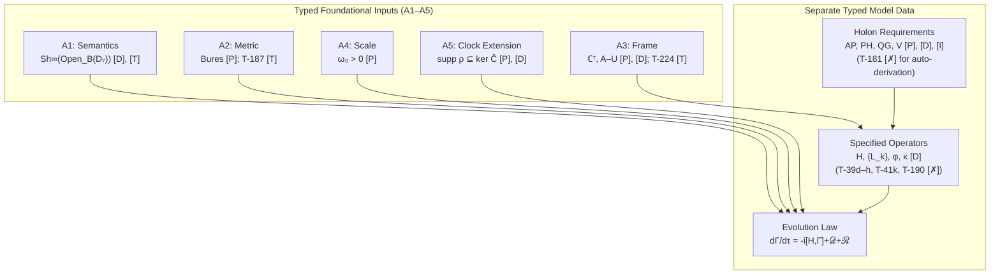
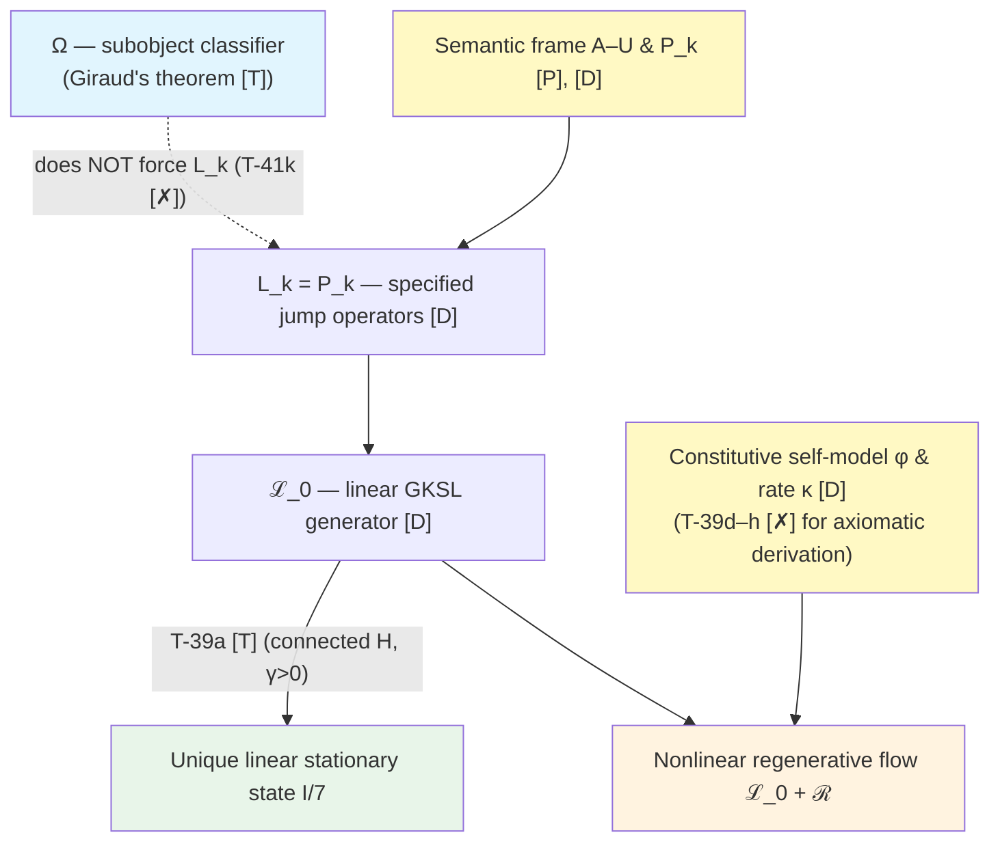
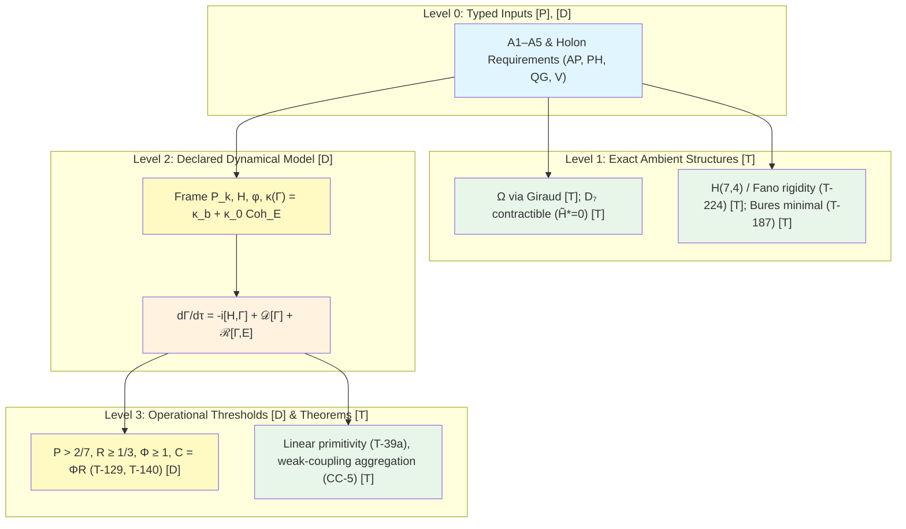

# Axiomatics of Coherence Cybernetics

:::info Bridge from the Previous Chapter
In the [previous chapter](./introduction) we learned *what* Coherence Cybernetics is: a unified formalism describing dynamics, structure, and interiority through the coherence matrix $\Gamma$. We saw the evolution equation, the seven dimensions, the viability thresholds, and the hierarchy of interiority. But where does all of this come from? Why are the formulas exactly as they are? Now we must look into the **foundation** — the axiomatic base from which all CC constructions are derived.
:::

:::tip Chapter Roadmap
In this chapter we:
1. **Understand why axiomatics is needed** — the lesson of Euclid, Kolmogorov, and Hilbert (section "Why Is Axiomatics Needed?")
2. **Examine three levels of rigor** in derivation: deductive, categorical, constructive (section "[What Does 'Strictly Derived' Mean?](#что-значит-строго-выводится)")
3. **Meet the typed foundational architecture** — the sheaf $\infty$-topos envelope and explicit model record (section "[The Typed Architecture](#единственный-примитив)")
4. **Walk through the five axioms** of Ω⁷ (`A1`–`A5`) and the separate Holon requirements (`AP`, `PH`, `QG`, `V`) (section "[Axiomatic Base](#аксиоматическая-база-краткая-справка)")
5. **Audit the construction chain** — clearly distinguishing proved theorems `[T]` from explicit operator/rate definitions `[D]` and withdrawn derivations `[✗]` (section "[Construction Chain](#цепочка-вывода)")
6. **Examine the bootstrap rate convention** and how $\kappa_{\text{bootstrap}} > 0$ operates dynamically `[D]` (section "[Bootstrap Paradox](#bootstrap-парадокс)")
7. **Audit E-accentuation** — explaining why the former diagonal-only proof fails for coherent states and what actually holds (section "[E-Accentuation](#e-акцентуация)")
:::

:::note On Notation
In this document:
- $\Gamma$ — [coherence matrix](/docs/core/dynamics/coherence-matrix)
- $\mathcal{H} = \mathbb{C}^7$ — Hilbert space
- $\mathcal{D}[\Gamma]$ — [dissipative term](/docs/core/dynamics/evolution#логический-лиувиллиан)
- $\mathcal{R}[\Gamma, E]$ — [regenerative term](/docs/core/dynamics/evolution#3-регенеративный-член)
- $\varphi$ — [self-modeling operator](/docs/proofs/categorical/formalization-phi)
:::

## Why Is Axiomatics Needed?

### The Lesson of Euclid

Two and a half thousand years ago, Euclid accomplished one of the greatest intellectual feats in history: he took geometry, which the Egyptians and Babylonians knew as a collection of practical recipes, and showed that all of it grows from **five** statements accepted without proof. Five postulates — and from them, like a tree from a seed, the whole of plane geometry grew.

This was not merely a systematization of knowledge. It was the first time humanity discovered **the power of the axiomatic method**: if the foundation is chosen correctly, all consequences are strictly necessary. Not "we think so" and not "this seems plausible," but **it cannot be otherwise**, as long as the axioms hold.

### Kolmogorov and Probability

In 1933 Kolmogorov did for probability theory what Euclid did for geometry. Before Kolmogorov, probability was a collection of intuitions: the frequency approach, geometric probability, Bayesian degree of belief. Kolmogorov proposed three axioms (a sigma-algebra of events, normalization, additivity) — and from them derived the whole of probability theory. All paradoxes evaporated. All schools unified within a single language.

Kolmogorov's lesson: **axiomatics does not constrain but liberates**. It allows one to separate substantive questions from terminological disputes.

### The Hilbert Program and Its Legacy

The Hilbert program (1920s) attempted to axiomatize all of mathematics. Gödel in 1931 showed that this was impossible in full: any sufficiently rich consistent system contains undecidable statements. But Hilbert's program was not in vain — it gave rise to the modern understanding of **what it means** to build a theory rigorously.

That understanding is as follows: a theory is considered rigorous if:
1. **Primitives** (undefined concepts) are named explicitly
2. **Axioms** (statements accepted without proof) are listed exhaustively
3. **Everything else** is derived from the axioms by the rules of logic
4. **There are no hidden assumptions** — every assumption is noted and labeled

### Why Does Coherence Cybernetics Need Axiomatics?

Cybernetics, unlike physics and mathematics, has largely remained a **pre-axiomatic** discipline to this day. Wiener's cybernetics, Ashby's cybernetics, von Foerster's second-order cybernetics — all of these are valuable conceptual frameworks, but none has a formal axiomatics from which all statements would be derived.

**Coherence Cybernetics (CC)** aims to formalize cybernetics with explicit status stratification. Every statement in CC carries one of the canonical registry markers — **[T]** (theorem), **[C]** (conditional), **[H]** (hypothesis), **[P]** (postulate), **[Pr]** (research programme), **[D]** (definition), **[I]** (interpretation), or **[✗]** (retracted) — separating what is postulated or defined from what is strictly proven. The complete status system is maintained in the [Status Registry](/docs/reference/status-registry).

---

## What Does "Strictly Derived" Mean? {#что-значит-строго-выводится}

Before diving into the axioms, let us clarify what is strictly derived vs. what is explicitly supplied as typed input in the current revision of UHM ([Axiom Ω⁷](/docs/core/foundations/axiom-omega)).

### Three Levels of "Derivation"

1. **Deductive derivation** (the most rigorous): Statement B follows logically from explicitly stated premises A. Example: once structural majority $\|\Gamma - I/7\|_F^2 > 1/7$ `[D]` is chosen, $P(\Gamma) > 2/7$ follows deductively `[T]`.

2. **Categorical construction**: Construction B is determined up to equivalence by a specified categorical structure A. Example: by **Giraud's theorem** `[T]`, a Grothendieck topos of sheaves on a small site (such as the Bures open-cover site $\operatorname{Open}_B(D_7)$) possesses a subobject classifier $\Omega$. *(Crucially, as audited below, $\Omega$ does **not** force specific Lindblad operators $L_k$ without additional operator/instrument inputs: `T-41k [✗]`, `T-190 [✗]`.)*

3. **Constructive specification**: An explicit dynamical or operator model (such as a Lindblad generator $\mathcal{L}_0$, a self-model $\varphi$, or a constitutive rate function $\kappa(\Gamma)$) is specified `[D]` and analyzed constructively.

### What Derivation Does NOT Mean

Derivation **does not mean** collapsing independent modelling choices into a single slogan. Choosing a threshold (such as $P_{\text{crit}} = 2/7$, $R_{\text{th}} = 1/3$, or $\Phi_{\text{th}} = 1$) is a **definitional convention `[D]`**, not a free-standing deduction from pure topology; and mathematical consistency does not by itself establish empirical truth.

---

## Metatheoretical Status

**Coherence Cybernetics (CC)** is the unique complete cybernetics strictly derivable from Unitary Holonomic Monism (UHM). It is not yet another cybernetics in the line of existing ones — it is a **metatheory** from which all particular cybernetics are derived as projections.

What does this mean in practice? Imagine white light. Pass it through a prism — and you get red, orange, yellow... each of these colors is real and useful, but none of them is complete light. Wiener's cybernetics is the "red ray" of CC (feedback, information). Maturana and Varela's autopoiesis is the "green ray" (self-organization, boundary). Tononi's Integrated Information Theory is the "violet ray" (integration, $\Phi$). CC is the white light from which all of them are obtained by restriction to a subset of dimensions.

:::info Key Statement
Any correct theory of systems described by $\Gamma$ is a projection of CC onto a subset of dimensions or dynamic regimes.
:::

This statement is not a declaration but a **theorem** (more precisely, a family of theorems), proven for each specific theory by explicitly constructing the projection. For more detail: [Comparative Analysis of Consciousness Theories](/docs/consciousness/comparative/consciousness-theories).

---

## The Typed Primitive and Explicit Model Record {#единственный-примитив}

### From an Untyped "Single Primitive" to a Typed Model Record

Earlier presentations summarized UHM as deriving all of space, time, dynamics, dissipation, regeneration, and consciousness automatically from a single untyped category $\mathcal{C}$. As established in [Axiom Ω⁷](/docs/core/foundations/axiom-omega) and the [Status Registry](/docs/reference/status-registry), that untyped collapse has been replaced by an **explicit typed model record**:

$$
\mathfrak{T} = (\mathcal{E}_7,\, D_7,\, d_B,\, \text{frame},\, \mathcal{L}_0,\, \varphi,\, a,\, \text{clock extension},\, \text{observation law})
$$

where $\mathcal{E}_7 = \operatorname{Sh}_\infty(\operatorname{Open}_B(D_7), J_{\mathrm{open}}) \simeq \operatorname{Sh}_\infty(B^{48})$ is the sheaf $\infty$-topos envelope over the Bures open-cover site of $D_7 = \mathcal{D}(\mathbb{C}^7)$ (a locally contractible topological envelope, blind to $\mathbb{C}$, convexity, and metric), while the quantum realization **(QG)** ($\mathbb{C}^7$, density matrices $\mathcal{D}(\mathbb{C}^7)$, Born rule, CPTP channels), semantic frame, generator $\mathcal{L}_0$, self-model $\varphi$, clock extension, and observation law are **explicitly declared typed fields** `[P]/[D]`.

### Audited Status of Each Construction

| Construction | Actual mathematical source | Status |
|-------------|----------------------------|--------|
| Base space $D_7 = \mathcal{D}(\mathbb{C}^7)$ | Convex compact state space; contractible via $\rho \mapsto (1-t)\rho + t\,I/7$ | `[T]` |
| Reduced / positive-degree cohomology | $\tilde{H}^*(D_7; \mathbb{Z}) = 0$, i.e. $H^k(D_7; \mathbb{Z}) = 0$ for all $k \geq 1$, while $H^0(D_7; \mathbb{Z}) \cong \mathbb{Z}$ (never $H^*(X) = 0$!) | `[T]` |
| Classifier $\Omega$ of sheaf 1-topos | **Giraud's theorem** for Grothendieck topoi ($\Omega(U) = \operatorname{Open}(U)$ on the open-cover site) | `[T]` |
| Projective instrument $L_k = P_k$ | Specified operator/instrument data `[D]` (classifier-forced derivation withdrawn: `T-41k [✗]`, `T-190 [✗]`) | `[D]` / `T-41k [✗]` |
| Linear GKSL generator $\mathcal{L}_0$ | Constructed from specified $H$ and $\{L_k\}$; linear primitivity gives unique stationary $I/7$ (`T-39a`) | `[T]` (at supplied connected $H$ and rate) |
| Self-model $\varphi$ & regeneration $\mathcal{R}$ | Explicitly specified constitutive model `[D]` (fully axiomatic derivations withdrawn: `T-39d–h [✗]`) | `[D]` / `T-39d–h [✗]` |
| Clock time $\tau$ | Conditional Page–Wootters clock extension (`A5`) | `[P]/[D]` |

### Ontological Status vs. Mathematical Facts

- **Contractibility and cohomology (`[T]`):** Because $D_7$ is convex and nonempty, it is contractible, so its **reduced** constant-coefficient cohomology vanishes ($\tilde{H}^*(D_7; \mathbb{Z}) = 0$, equivalently $H^k(D_7; \mathbb{Z}) = 0$ for every $k \geq 1$, while $H^0(D_7; \mathbb{Z}) \cong \mathbb{Z}$). Calling a nonempty space's unreduced cohomology "$H^*(X) = 0$" is a mathematical error since $H^0(X; \mathbb{Z}) \cong \mathbb{Z}$ for every nonempty path-connected space. Moreover, this topological fact is independent of the terminal object of $\mathcal{E}_7$ and does not imply vanishing for arbitrary coefficient sheaves or ontological monism without an explicit interpretive postulate `[I]`.
- **Monist thesis `[I]`:** Reading the typed record $\mathfrak{T}$ as a single unified ontology of physical and experiential phenomena is an explicit **monist postulate/interpretation `[P]/[I]`**, not a theorem deduced from a terminal object (`T-181 [✗]`).

---

## Axiomatic Base (Brief Reference) {#аксиоматическая-база-краткая-справка}

:::tip DRY: Full Axiomatics
The complete typed specification of `A1`–`A5` is in [Axiom Ω⁷](/docs/core/foundations/axiom-omega). Holon requirements (`AP`, `PH`, `QG`, `V`) are in [Holon Requirements](/docs/core/foundations/axiom-septicity). The canonical evolution equation is in [Evolution](/docs/core/dynamics/evolution).
:::

CC is built on five explicit foundational inputs **`A1`–`A5`** together with the explicit quantum realization **(QG)** and Holon requirements **`AP`, `PH`, `QG`, `V`**:

| No. | Input | Content | Status |
|---|---------|---------|--------|
| A1 | Semantics ($\infty$-topos) | $\mathcal{E}_7 = \operatorname{Sh}_\infty(\operatorname{Open}_B(D_7), J_{\mathrm{open}})$ (topological envelope) | Construction `[D]`, existence `[T]`, ontology `[P]/[I]` |
| A2 | Metric (Bures) | Chordal Bures distance $d_B$ on states; SLD/Bures tensor on full-rank strata (`T-187`) | Choice `[P]`, CPTP monotonicity `[T]` |
| A3 | Frame ($N = 7$) | $\mathcal{H} = \mathbb{C}^7$ with semantic frame `A, S, D, L, E, O, U` and Fano/octonion data | `[P]/[D]`; conditional diagnosability rigidity `T-224 [T]` |
| A4 | Scale ($\omega_0 > 0$) | Calibrated inverse-time scale $\omega_0 > 0$ (Hamiltonian/dissipative rates supplied separately) | `[P]` |
| A5 | Clock extension | Extended tensor realization, clock readout, and constraint $\operatorname{supp}\rho \subseteq \ker\hat{C}$ | `[P]/[D]` |

Let us examine each input accurately.

### Axiom 1 (`A1`): Semantics — Sheaf $\infty$-Topos Envelope

**Formally:** $\mathcal{E}_7 = \operatorname{Sh}_\infty(\operatorname{Open}_B(D_7), J_{\mathrm{open}}) \simeq \operatorname{Sh}_\infty(B^{48})$ over the Bures open-cover site of $D_7$.

**What follows from it `[T]`:** By **Giraud's theorem** for Grothendieck topoi, the underlying sheaf 1-topos possesses a subobject classifier $\Omega$ (with $\Omega(U) = \operatorname{Open}(U)$). What does **not** follow automatically: $\Omega$ is a classifier of open subobjects, NOT a Hilbert space, density matrix, or forced set of Lindblad operators (`T-41k [✗]`, `T-181 [✗]`, `T-190 [✗]`).

### Axiom 2 (`A2`): Metric — Bures Geometry (`T-187`)

**Formally:** Chordal Bures distance $d_B$ on $D_7$ and the Bures/SLD monotone Riemannian tensor on full-rank states.

**Exact status (`T-187`):** Classically (Chentsov 1982) the Fisher–Rao metric is the unique monotone metric. Quantum-mechanically (Petz 1996) there is a family of monotone metrics. By **`T-187`** (`[T]` under the normalized Petz family on full-rank states), Bures/SLD is the pointwise **minimal** monotone tensor; choosing monotonicity and a minimal-tensor selector are explicit inputs `[P]`. Importantly, uniform bi-Lipschitz comparison across Petz metrics requires a **compact positive-eigenvalue floor** — it does **not** hold globally at the rank-deficient boundary $\partial D_7$ and does not by itself establish universal robustness of predictions (`T-187`).

### Axiom 3 (`A3`): Frame — Seven Dimensions ($N = 7$)

**Formally:** $\mathcal{H} = \mathbb{C}^7$ equipped with the canonical semantic orthonormal frame **A (Articulation), S (Structure), D (Dynamics), L (Logic), E (Interiority), O (Ground), U (Unity)** and specified Fano/octonion structure.

**Exact status:** Fixing $\mathcal{H} = \mathbb{C}^7$ is a frame postulate `[P]/[D]`. Unconditional seven-role minimality (`T-40f [✗]`) and automatic operational derivation of seven roles (`T-190 [✗]`) are withdrawn; what stands rigorously is **diagnosability rigidity (`T-224 [T]`)**: requiring perfect single-fault localizability together with a nontrivial state grammar forces $n = 2^r - 1 \ge 7$ and selects the unique Hamming $H(7,4)$ / Fano plane $\mathrm{PG}(2,2)$ grammar at $n = 7$.

### Axiom 4 (`A4`): Scale — Calibrated Frequency $\omega_0 > 0$

**Formally:** A calibrated inverse-time scale $\omega_0 > 0$, bridging dimensionless internal evolution parameter $\tau$ and physical time $t$, with Hamiltonian and dissipative rates specified separately `[P]` (not inferred from terminality or positivity of the Hamiltonian).

### Axiom 5 (`A5`): Page–Wootters — Clock Extension

**Formally:** A chosen extended tensor realization, clock readout, and support constraint $\operatorname{supp}\rho \subseteq \ker\hat{C}$ (`[P]/[D]`), yielding conditional Page–Wootters dynamics relative to the clock register.

### Visual Map

### Holon Requirements: `AP`, `PH`, `QG`, `V` (Explicit Inputs, Not Automatic Corollaries)

Per **`T-181 [✗]`**, the Holon requirements `AP`, `PH`, `QG`, `V` do **not** follow automatically from `A1`–`A4` (terminal topos objects do not select quantum states, biological viability, or phenomenal content). Rather, a [Holon](/docs/core/structure/holon) $\mathbb{H}$ is defined by explicitly supplying these four typed requirements ([Holon Requirements](/docs/core/foundations/axiom-septicity)):

- **(AP) Autopoiesis `[P]/[I]`:** a declared self-model $\varphi: D_7 \to D_7$ and organisation-maintaining dynamics.
- **(PH) Phenomenology `[P]/[I]`:** a declared experiential realization and interpretive bridge to observation.
- **(QG) Quantum Ground `[P]/[D]`:** positive trace-one states $\Gamma \in \mathcal{D}(\mathbb{C}^7)$, Born rule, and a declared quantum process model.
- **(V) Viability `[D]/[H]`:** structural majority $P(\Gamma) > P_{\text{crit}} = 2/7$ (`[T]` after choosing $\|\Gamma - I/7\|_F^2 > 1/7$ `[D]`) together with trajectory survival conditions.

**See:** [Full typed specification](/docs/core/foundations/axiom-septicity)

---

## The Evolution Equation: The Heart of CC

### Compact Form

$$
\frac{d\Gamma(\tau)}{d\tau} = -i[H_{\text{eff}}, \Gamma] + \mathcal{D}[\Gamma] + \mathcal{R}[\Gamma, E]
$$

### Three Forces That Shape Life

The evolution equation is not merely a formula. It is a description of **three fundamental forces** acting on any coherent system:

**1. Unitary term: $-i[H_{\text{eff}}, \Gamma]$**

This is the system's "inertia" — free evolution preserving coherence. If only this term were active, the system would rotate forever, neither gaining nor losing organization. Like a planet in an ideal orbit: neither accelerating nor decelerating.

**2. Dissipative term: $\mathcal{D}[\Gamma]$**

This is "friction" — the loss of coherence due to the system's interaction with its own structure of distinctions. Without opposition, dissipation turns any state into the maximally mixed $I/N$ (heat death). Like a house without maintenance: it gradually deteriorates and crumbles.

**3. Regenerative term: $\mathcal{R}[\Gamma, E]$**

This is "repair" — the restoration of coherence. It is precisely this term that distinguishes the living from the non-living. A stone obeys only the first two terms. A cell, an organism, a society — add the third.

Complete derivation and description of each term: [Evolution](/docs/core/dynamics/evolution).

### Evolution in Metaphors

Imagine a fountain. Water (coherence) jets upward (regeneration), gravity pulls it down (dissipation), and the shape of the stream is determined by the geometry of the nozzle (unitary evolution). A living system is a fountain that **itself** builds its own nozzle and **itself** pumps the water. If the pressure drops below a critical level — the fountain runs dry (the system exits the viability region $\mathcal{V}$).

---

## CC Specifics: Projective Instrument, Rate Convention, and E-Accentuation

### Projective Instrument and Audit of Former L-Unification (`T-41k [✗]`, `T-190 [✗]`) {#l-унификация-вывод-l_k-из-ω}

:::warning Withdrawn classifier-to-Lindblad derivation (`T-41k [✗]`, `T-190 [✗]`)
Earlier editions claimed that the Lindblad operators $L_k = P_k = |k\rangle\langle k|$ are forced automatically as "atoms of the subobject classifier $\Omega$" via $L_k = \sqrt{\chi_{S_k}}$. That derivation is **withdrawn (`T-41k [✗]`, `T-190 [✗]`)**:
- On the open-cover site $\operatorname{Open}_B(D_7)$, $\Omega(U) = \operatorname{Open}(U)$ is a Heyting algebra of open subsets; the open sets $\{\rho : \rho_{ii} > 0\}$ overlap on every full-rank state (they are not disjoint atoms), and connected $D_7$ has only two clopen sets ([Axiom Ω⁷ §Internal logic](/docs/core/foundations/axiom-omega#атомы-классификатора)).
- Choosing the seven orthonormal frame projectors $P_k = |k\rangle\langle k|$ ($\sum_k P_k = I$) and the pinching channel $\rho \mapsto \sum_k P_k \rho P_k$ is **explicitly specified operator/instrument data `[D]`** (`[T]` that such projectors define a unital CPTP pinching channel once the frame is declared).
:::

Once the semantic orthonormal frame `A, S, D, L, E, O, U` (`A3`) and projective jump operators $L_k = P_k$ (`[D]`) are declared, the Lindblad dissipator $\mathcal{D}[\Gamma] = \sum_k \gamma_k (L_k \Gamma L_k^\dagger - \frac{1}{2}\{L_k^\dagger L_k, \Gamma\})$ implements dephasing in the declared basis (`[T]`).

---

### Dependency Hierarchy {#иерархия-зависимостей}

The audited architecture separates **Giraud's theorem** for $\Omega$ `[T]` from **explicitly declared operator/constitutive inputs `[D]`** and **conditional linear primitivity (`T-39a`)**:

**See:** [Axiom Ω⁷ — Typed Realization](/docs/core/foundations/axiom-omega#примитив)

### Construction Chain (Audited) {#цепочка-вывода}

Instead of a single theorem-only chain from $\Omega$ to a viable $\Gamma^*$, the verified structure has explicit typed inputs at each interface:

1. **Sheaf topos & classifier `[T]`:** By **Giraud's theorem**, $\operatorname{Sh}(\operatorname{Open}_B(D_7), J_{\mathrm{open}})$ is a Grothendieck topos with subobject classifier $\Omega$ ($\Omega(U) = \operatorname{Open}(U)$).
2. **Projective instrument `[D]`:** Frame projectors $L_k = P_k$ are supplied operator data (`T-41k [✗]`, `T-190 [✗]`).
3. **Linear primitivity (`T-39a [T]`):** Given a connected Hamiltonian graph and positive dephasing rate, the linear generator $\mathcal{L}_0$ is primitive with unique stationary state $I/7$ (it does **not** prove uniqueness of a nonlinear viable fixed point $\Gamma^* \neq I/7$).
4. **Regeneration & self-model `[D]`:** The nonlinear self-model $\varphi$ and regenerative rate $\kappa(\Gamma)$ are selected constitutive functions (`T-39d [✗]`, `T-39e [✗]`, `T-39f [✗]`, `T-39g [✗]`, `T-39h [✗]`).

:::info Canonical Definition
Full audited dependency interface: [Axiom Ω⁷](/docs/core/foundations/axiom-omega).
:::

---

## Bootstrap Rate Convention and Dynamics {#bootstrap-парадокс}

### The Problem: Baron Münchhausen

If a regenerative rate depended *purely* on $\mathrm{Coh}_E(\Gamma)$ with $\kappa(\Gamma) = \kappa_0\,\mathrm{Coh}_E(\Gamma)$, a state starting near $\mathrm{Coh}_E = 0$ would experience vanishing regeneration and could never self-ignite. Adding a positive baseline rate $\kappa_{\text{bootstrap}} > 0$ avoids this degeneracy in dynamical models.

### Connection Between Regeneration and E-Coherence {#связь-регенерации-и-e-когерентности}

The retained constitutive rate convention **`[D]`** ([Holon Requirements §Rate model](/docs/core/foundations/axiom-septicity#структурный-анзац-kappa0)) is:

$$
\kappa(\Gamma) = \kappa_{\text{bootstrap}} + \kappa_0 \cdot \mathrm{Coh}_E(\Gamma), \qquad \kappa_{\text{bootstrap}} = \frac{\omega_0}{7}, \qquad \kappa_0 = \omega_0\,\frac{|\Gamma_{OE}|\,|\Gamma_{OU}|}{\Gamma_{OO}} \quad (\Gamma_{OO} > 0)
$$

where:
- $\kappa_{\text{bootstrap}} = \omega_0 / 7 > 0$ is a **chosen baseline rate convention `[D]`** (the former categorical derivation $\kappa_{\text{bootstrap}} = \|\mathrm{unit}(\mathcal{D}_\Omega \dashv \mathcal{R})\|$ and $\kappa_0 = \|\mathrm{Nat}(\mathcal{D}_\Omega, \mathcal{R})\|$ is **withdrawn `[✗]`** per `T-39f [✗]`, `T-39g [✗]`, `T-39h [✗]` and [Holon Requirements](/docs/core/foundations/axiom-septicity#структурный-анзац-kappa0): a categorical adjunction does not define a norm on a hom-set of natural transformations).
- $\mathrm{Coh}_E(\Gamma) \in [0, 1]$ is the Hilbert–Schmidt share of the $E$ row and column ([definitions](./definitions#e-когерентность)). Note per **`T-38a [✗]`** that the former universal floor $\mathrm{Coh}_E(\Gamma) > 1/7$ on all viable states (universal No-Zombie necessity) is **withdrawn**: stationary externally supported counterexamples exist, and an interiority lower bound holds only under explicitly restricted purity-flux hypotheses.

### Dynamical Role of $\kappa_{\text{bootstrap}} > 0$

In model simulations ([model systems](/docs/applied/coherence-cybernetics/model-systems)), setting $\kappa_{\text{bootstrap}} > 0$ as a constitutive input `[D]` provides a positive baseline drift even when $\mathrm{Coh}_E$ is small, allowing a three-stage numerical trajectory (inception $\to$ positive-feedback amplification $\to$ balance against dissipation) whenever the target state and total regeneration exceed the dissipation threshold.

---

## E-Accentuation: Audit of the Former Diagonal-Only Claim {#e-акцентуация}

### Why the Former "Theorem 2.2" ($w_E > 1/7$ from L2) Is Invalid

Earlier versions of this chapter stated a "Theorem 2.2 (E-Accentuation from the Definition of L2)" claiming that $w_E := \Gamma_{EE} > 1/7$ is a proved theorem `[T]` deduced from the definition of L2-consciousness ($P \in (2/7, 3/7]$, $R = 1/(7P) \ge 1/3$, $\Phi \ge 1$, $D_{\text{diff}} \ge D_{\min}$, with the scalar product $C = \Phi \times R \ge 1/3$ from **`T-140 [D]`**). That diagonal-only proof is **mathematically broken and withdrawn** for two exact reasons:

:::warning Refutation of the former diagonal-only "Theorem 2.2" (`T-334 [T]`)
1. **Diagonal states cannot be L2-conscious, and non-diagonal L2 states need NOT have $w_E > 1/7$!**
   - The former proof evaluated purity via $P = \sum_{i=1}^7 w_i^2$, which holds **only for diagonal states** ($\gamma_{ij} = 0$ for all $i \neq j$). Yet every diagonal state has $\Phi(\Gamma) = 0 < 1$, violating the L2 integration criterion!
   - Conversely, for **coherent** (non-diagonal) states, **uniform diagonal populations $w_i = 1/7$ for ALL seven axes — including $w_E = 1/7$ — are fully compatible with $P \in (2/7, 3/7]$, $R \ge 1/3$, and $\Phi \ge 1$!** Specifically, consider the collineation-covariant family $\Gamma(t) = (1 - t)\,I/7 + t\,uu^\dagger$ ($u = \frac{1}{\sqrt{7}}(1,\ldots,1)^T$, **`T-334 [T]`**):
     $$
     w_i = \Gamma_{ii}(t) = \frac{1}{7} \;\; \forall i, \qquad P(t) = \frac{1 + 6t^2}{7}, \qquad \Phi(t) = 6t^2.
     $$
     For any $t \in \left(\frac{1}{\sqrt{6}}, \frac{1}{\sqrt{3}}\right]$, we obtain $P(t) \in (2/7, 3/7]$, $R(t) = 1/(7P(t)) \in [1/3, 1/2)$, and $\Phi(t) \in (1, 2]$ — all with **$w_E = 1/7$ identically**!
2. **Non-uniformity does not select the $E$-axis.** Even restricted to diagonal states, $\sum_i w_i^2 > 2/7 \implies \max_i w_i > 1/7$ only yields *some* index $i$, never specifically $i = E$, without an additional semantic postulate.
:::

### What Actually Holds

- **Exact algebraic fact `[T]`:** On a *purely diagonal* density matrix, $P > 2/7$ implies $\max_i w_i > 1/7$ (and $\Phi = 0$). On general coherent density matrices in $\mathcal{D}(\mathbb{C}^7)$, uniform diagonal $w_i = 1/7$ is compatible with every purity $P \in [1/7, 1]$ and with the entire Goldilocks window $P \in (2/7, 3/7], \Phi \ge 1$ (`T-334 [T]`).
- **Role of $E$-accentuation `[D]/[I]`:** Requiring an excess population $w_E > 1/7$ (or a specific floor on $\mathrm{Coh}_E$) is therefore a **model-specific or interpretive choice `[D]/[I]`**, NOT a theorem derived from $P > 2/7$ or the definition of L2.

---

## From Rosen to CC: The Evolution of (M,R)-Systems {#от-розена-к-кк}

### Rosen: Closure to Efficient Causes

In 1958 Robert Rosen proposed the formalism of (M,R)-systems for describing living organisation as closure with respect to efficient causes:
- **M (metabolism):** transformation of inputs into outputs
- **R (repair):** restoration of the metabolic machinery
- **$\beta$ (closure):** production of the repair machinery

Rosen's set-theoretic formalism did not incorporate quantum density matrices, integration measures, or experiential registers.

### CC as an Interpretive Extension of (M,R)-Systems [I]

In an interpretive mapping `[I]`, CC extends the (M,R)-scheme with a 7D quantum carrier $\Gamma \in \mathcal{D}(\mathbb{C}^7)$ and canonical semantic axes:

| Rosen | CC (canonical axes) | Interpretive role [I] |
|-------|---------------------|-----------------------|
| M (metabolism) | D (Dynamics) | Transformation / process |
| R (repair) | A (Articulation) + L (Logic) | Distinction and rule-governed restoration |
| $\beta$ (closure) | U (Unity) | Global integration |
| — | E (Interiority), O (Ground), S (Structure) | Additional canonical axes |

### Canonical Roles of E, O, S

The three remaining canonical dimensions are **E (Interiority)**, **O (Ground)**, and **S (Structure)**:
- **E (Interiority)** represents the experiential/interiority axis;
- **O (Ground)** represents the foundational/grounding axis (and reference axis in clock/ground couplings);
- **S (Structure)** represents the structural/organisational axis.

---

## Theory Structure

### CC Architecture

The typed architecture separates foundational inputs, explicit operator/constitutive conventions, and derived theorems:

### Closure of Composition (Weak-Coupling Result `CC-5`) {#замкнутость-композиции-следствие-из-ap}

For a product state, $1+\Phi(\Gamma_1\otimes\Gamma_2)=(1+\Phi_1)(1+\Phi_2)$. A high $\Phi$ for the pair can therefore coexist with zero mutual information. To test correlation, use $I(1{:}2)$ relative to the current margins. To test viability of a collective, specify an aggregation channel and its gate. By **`CC-5`** (`[T]` under weak coupling, the stated mean marginal, and positive margins), trace-norm control transfers the corresponding viability margins to the aggregate. [Composition results](./theorems#теорема-95-каноническая-агрегация)

---

## Overview of Audited Axiomatic Statuses

Let us summarize accurately what is a **theorem `[T]`**, what is a **definitional convention `[D]`** or **postulate `[P]`**, and which former derivations are **withdrawn `[✗]`**:

| Item | Actual Source | Verified Status | Reference |
|------|---------------|-----------------|-----------|
| Classifier $\Omega$ of $\operatorname{Sh}(\operatorname{Open}_B(D_7))$ | **Giraud's theorem** | **[T]** | [Typed Primitive](#единственный-примитив) |
| Reduced cohomology $\tilde{H}^*(D_7; \mathbb{Z}) = 0$ ($H^0 \cong \mathbb{Z}$, $H^{k\ge 1} = 0$) | Contractibility of convex $D_7$ | **[T]** | [Typed Primitive](#единственный-примитив) |
| $L_k = P_k$ projective jump operators | Declared frame & instrument | **[D]** (classifier derivation withdrawn: `T-41k [✗]`, `T-190 [✗]`) | [Projective Instrument](#l-унификация-вывод-l_k-из-ω) |
| $P_{\text{crit}} = 2/7$ | Structural majority $\|\Gamma - I/7\|_F^2 > 1/7$ `[D]` | **[D]+[T]** (algebraic `[T]` *after* choosing majority `[D]`) | [Critical purity](/docs/proofs/dynamics/theorem-purity-critical) |
| $R_{\text{th}} = 1/3$ | Selected access cut on $R = 1/(7P)$ | **[D]** | [Reflection measure](/docs/consciousness/foundations/self-observation#мера-рефлексии-r) |
| $\Phi_{\text{th}} = 1$ | Selected coherent-majority gate | **[D]** (`T-129 [D]`) | [Integration measure](/docs/core/structure/dimension-u#мера-интеграции-φ) |
| $C = \Phi \times R \ge 1/3$ | Selected scalar product (necessary, not sufficient for $R\ge 1/3 \land \Phi\ge 1$) | **[D]** (`T-140 [D]`) | [Self-observation](/docs/consciousness/foundations/self-observation#мера-сознательности-c) |
| $w_E > 1/7$ from L2 (former Theorem 2.2) | Counterexample: uniform-diagonal coherent L2 states (`T-334`) | **[✗]** as `[T]` (optional model input `[D]/[I]`) | [E-Accentuation Audit](#e-акцентуация) |
| $\kappa_{\text{bootstrap}} = \omega_0 / 7$, $\kappa = \kappa_b + \kappa_0\mathrm{Coh}_E$ | Constitutive rate convention | **[D]** (adjunction-norm derivation withdrawn: `T-39f–h [✗]`) | [Bootstrap Rate Convention](#bootstrap-парадокс) |
| Universal $E$-floor / No-Zombie necessity | Stationary externally supported counterexamples exist | **[✗]** (`T-38a [✗]`) | [CC Theorems](./theorems) |
| $N = 7$ | Frame postulate `A3` `[P]`; conditional diagnosability rigidity `T-224 [T]` | **[P]** / **`T-224 [T]`** (unconditional `T-40f [✗]`, `T-181 [✗]`, `T-190 [✗]` withdrawn) | [Axiom Ω⁷](/docs/core/foundations/axiom-omega) |
| Bures/SLD minimal monotone tensor | Normalized Petz family on full-rank states (`T-187`) | **[T]** (pointwise minimal on full-rank; compact floor needed for uniform comparison) | [Axiom 2](#аксиоматическая-база-краткая-справка) |
| Composition closure (`CC-5`) | Weak coupling + stated mean marginal + positive margins | **[T]** (under stated weak-coupling hypotheses) | [Composition](#замкнутость-композиции-следствие-из-ap) |

---

## What We Have Learned

Let us summarize the audited axiomatic foundations of CC:

1. **Explicit status discipline** separates foundational postulates (`A1`–`A5`, `AP`, `PH`, `QG`, `V`), definitional conventions (`[D]`), proved theorems (`[T]`), and withdrawn derivations (`[✗]`).

2. **Typed model record, not an untyped black box:** By **Giraud's theorem** `[T]`, the sheaf topos on $\operatorname{Open}_B(D_7)$ has a subobject classifier $\Omega$, and convex $D_7$ is contractible with reduced cohomology $\tilde{H}^*(D_7; \mathbb{Z}) = 0$ ($H^0 \cong \mathbb{Z}$, $H^{k\ge 1} = 0$). However, `AP, PH, QG, V` (`T-181 [✗]`), projective jump operators $L_k$ (`T-41k [✗]`, `T-190 [✗]`), and regeneration laws (`T-39d–h [✗]`) are explicitly supplied typed inputs `[P]/[D]`, not automatic consequences of $\Omega$.

3. **Definitional thresholds `[D]` vs. theorems `[T]`:** $R_{\text{th}} = 1/3$, $\Phi_{\text{th}} = 1$ (`T-129`), $C = \Phi R$ (`T-140`), and $\kappa_{\text{bootstrap}} = \omega_0/7$ are **definitional/constitutive conventions `[D]`**; $P_{\text{crit}} = 2/7$ is an algebraic `[T]` *after* choosing structural majority `[D]`; while `T-224`, `T-187`, `T-39a`, `T-334`, and `CC-5` are genuine theorems `[T]` with explicitly stated hypotheses.

4. **Refutation of diagonal-only E-accentuation:** Coherent states with uniform diagonal $w_i = 1/7$ (such as the `T-334 [T]` anchor family) satisfy all L2 conditions $P \in (2/7, 3/7]$, $R \ge 1/3$, $\Phi \ge 1$, refuting the former diagonal-only "Theorem 2.2", while the universal $E$-floor `T-38a [✗]` is withdrawn.

5. **Canonical seven axes:** Throughout CC, the seven axes are **A (Articulation), S (Structure), D (Dynamics), L (Logic), E (Interiority), O (Ground), U (Unity)**.

:::info Bridge to the Next Chapter
Axiomatics gave us the foundation — the primitive, the axioms, and the derivation chain. But to *work* with the theory, precise definitions are needed: what exactly we measure, what measures we use, how we interpret numbers. In the [next chapter](./definitions) we will systematically define all key CC concepts — from the Holon and coherence measures to the stress tensor and the attractor hierarchy. These definitions will be the "bricks" from which the entire edifice will be constructed in the [chapter on theorems](./theorems).
:::

---

**Related documents:**
- [Definitions](./definitions) — basic definitions of CC
- [Theorems](./theorems) — fundamental theorems of CC
- [Axiom Ω⁷](/docs/core/foundations/axiom-omega) — typed foundational architecture of $\mathcal{E}_7$
- [Holon Requirements (AP+PH+QG+V)](/docs/core/foundations/axiom-septicity) — typed requirements for a Holon
- [Evolution](/docs/core/dynamics/evolution) — equation $d\Gamma(\tau)/d\tau$
- [Viability](/docs/core/dynamics/viability) — measure $P$ and $P_{\text{crit}}$
- [Formalization of operator φ](/docs/proofs/categorical/formalization-phi) — CPTP channels
- [Comparative Analysis of Consciousness Theories](/docs/consciousness/comparative/consciousness-theories) — CC in the context of IIT, GWT, AST
- [Model systems](/docs/applied/coherence-cybernetics/model-systems) — numerical verification of bootstrap dynamics
- [Philosophical foundations](./philosophy) — ontological status of the axioms
- [Comparison with alternatives](./comparison) — how CC axioms relate to IIT, FEP
- [Exercises](./exercises) — problems on axiomatics
