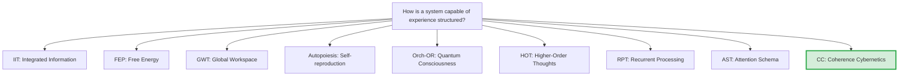

# Comparison with Alternative Theories

> *"The real test of a theory is not whether it can explain known facts, but whether it predicts new ones."*
> — Imre Lakatos

:::info Who This Chapter Is For
A systematic comparison of CC with eight competing theories of consciousness: IIT, FEP, GWT, autopoiesis, Orch-OR, HOT, RPT, and AST.
:::

In the previous chapter we explored the philosophical foundation of CC — two-aspect monism, formal capability conditions, and the ethics of thresholds. All of this sounds ambitious, but a scientific framework does not live in a vacuum. Its value is determined not only by internal coherence, but by *what it can formalize and test that alternatives cannot*. It is time to place CC alongside its competitors — honestly, noting both the advantages and the limitations of each.

If you are a scientist working in one of these traditions, this section will show how to translate your ideas into the language of CC — and vice versa. If you are a newcomer, it will help you understand the intellectual landscape in which CC exists.

:::info Chapter Roadmap
In this chapter we:
1. Sketch the **theoretical landscape** — a master table of 9 theories (section 1)
2. Show **CC bridges to each theory** with compact comparisons (section 2). Extended analysis of all 42 theories: [Theories of Consciousness](/docs/consciousness/comparative/consciousness-theories)
3. Consolidate everything into a **predictions table** (section 3) and honestly assess the **limitations of CC** (section 4)
:::

---

## 1. Overview of the Theoretical Landscape {#обзор}

### 1.1 Nine Theories at One Table

Imagine nine theories seated around a round table. Each of them tries to answer the question: "How is a system capable of experience structured?"

These theories can be divided into four families:

- **Informational:** IIT, GWT, RPT — focus on information processing and integration
- **Biological:** FEP, autopoiesis — focus on survival and self-organization
- **Cognitive:** HOT, AST — focus on representations and attention
- **Physical:** Orch-OR — ties consciousness to quantum gravity
- **CC** — aims to connect all four perspectives within one 7-dimensional model

### 1.2 Master Comparison Table

| Characteristic | IIT (Tononi) | FEP (Friston) | GWT (Baars) | Autopoiesis (Maturana) | Orch-OR (Penrose) | HOT (Rosenthal) | RPT (Lamme) | AST (Graziano) | **CC** |
|---|---|---|---|---|---|---|---|---|---|
| **Central object** | Structure $\Phi$ | Model $q(\theta)$ | Workspace | Living cell | Microtubules | 2nd-order thought | Recurrent loops | Attention model | **$\Gamma \in \mathcal{D}(\mathbb{C}^7)$** |
| **Measure of consciousness** | $\Phi_{\text{IIT}}$ | None explicit | GW access | None quant. | Objective reduction | None quant. | None quant. | None quant. | **Four margins ($P, R, \Phi, D_{\text{diff}}$); scalar $C = \Phi R$ `[D]` (`T-140`)** |
| **Dynamics** | None | Var. inference | None | Qualitative | Quantum gravity | None | None | None | **$\mathcal{L}_\Omega + \mathcal{R}$ (open + nonlinear)** |
| **Threshold** | $\Phi > 0$ | None | Access | Autopoiesis | OR-event | HOT of HOT | Rec. loop | Model | **$P{>}2/7 \land R{\geq}1/3 \land \Phi{\geq}1 \land D_{\text{diff}}{\geq}2$ `[D]`** |
| **Falsifiability** | Weak | Weak | Moderate | Weak | Weak | Moderate | Moderate | Moderate | **Conditional (given calibrated bridge)** |
| **Computability** | NP-hard | Approx. | None | None | Unclear | None | None | None | **$O(N^3)$, $N{=}7$** |

---

## 2. Detailed Comparison with Each Theory {#детальное-сравнение}

:::info Detailed Analysis
Full analysis of 42 theories of consciousness (including the 8 below) with history, formalism, and critique: [Theories of Consciousness → 42 theories](/docs/consciousness/comparative/consciousness-theories). Here — **only the bridges** between each theory and CC.
:::

### 2.1 IIT (Tononi) {#iit}

**Bridge `[I]`:** $\Phi_{\text{CC}} = P/d - 1$ (`[D]`) is a basis-dependent spectral ratio that plays an integration role qualitatively analogous to $\Phi_{\text{IIT}}$ in high-coherence regimes, though the two quantities are mathematically distinct (not an identity). PCI in the laboratory is not a proxy for $P$: $P$ is read from the reconstruction $\widehat\Gamma$ ([Measurement Methodology](./measurement#измерение-чистоты)), and PCI supplies an independent verdict compared with $\mathrm{Cons}(\widehat\Gamma)$ by Cohen's $\kappa$ ([P8.4](/docs/applied/research/measurement-protocol#substitution-position)).

| Aspect | IIT | CC |
|---|---|---|
| **Measure** | $\Phi_{\text{IIT}}$ (NP-hard) | $\Phi_{\text{CC}}$ ($O(N^2)$) `[D]` |
| **Threshold** | $\Phi > 0$ | $P > 2/7 \land R \geq 1/3 \land \Phi \geq 1 \land D_{\text{diff}} \geq 2$ `[D]` |
| **Dynamics** | None | Open + nonlinear ($\mathcal{L}_\Omega + \mathcal{R}$) |
| **IIT advantage** | Experimental base (PCI) | — |

---

### 2.2 FEP (Friston) {#fep}

FEP (Friston, 2010) models adaptive systems as minimizing variational free energy $F$. CC shares the idea of active self-maintenance and uses an explicit observation interface (`Enc`-estimator, `T-100` `[D]`). The canonical $\Delta F$ of the holon ([definition](/docs/core/dynamics/evolution#каноническое-delta-f) `[D]`) is formally analogous to a free-energy difference (note that the earlier free-energy weight-selection claim `T-39e` is withdrawn `[✗]`).

**Interpretation `[I]`.** A comparison with the free-energy principle needs a generative model, a variational family and an objective. A formal analogy between objectives does not supply these objects.

| Aspect | FEP | CC |
|---|---|---|
| **Consciousness** | Not explained | Explicit capability gates ($P, R, \Phi, D_{\text{diff}}$) and $\mathrm{Coh}_E$ `[D]` |
| **Scope** | Any stable system with Markov blanket | $\Gamma \in \mathcal{D}(\mathbb{C}^7)$, structural cut $P > 2/7$ `[D]` (`T-5`) |
| **Learning** | No general dimension bounds | `T-109` `[T]` (binary testing bounds); `T-113` `[H]` ($N=7$ optimality hypothesis) |
| **FEP advantage** | Scalability, hundreds of experiments, predictive coding | — |

:::info Detailed Comparison
Extended analysis of FEP (formalism, active inference, Markov blanket): [Theories of Consciousness — FEP](/docs/consciousness/comparative/consciousness-theories#fep).
:::

---

### 2.3 GWT (Baars, Dehaene) {#gwt}

GWT (Baars, 1988; GNWT — Dehaene, Changeux, 2001) ties consciousness to global broadcasting of information ("theatre of consciousness"). In CC this resonates interpretively (`[I]`) with high $\Phi$ (off-diagonal coherences linking all 7 dimensions). CC formalizes the comparison through $\Gamma$, $\mathcal{L}_\Omega$, and continuous metrics instead of binary "on stage / backstage." GWT surpasses CC in neural specificity (GNWT: "ignition," P300) and clinical application.

:::info Detailed Comparison
[Theories of Consciousness — GWT](/docs/consciousness/comparative/consciousness-theories#gwt).
:::

---

### 2.4 Autopoiesis (Maturana, Varela) {#autopoeisis}

In CC, autopoiesis (1972) is modeled via fixed-point self-maintenance $\varphi(\Gamma^*) = \Gamma^*$ of a chosen self-model (`CC-4` `[T]` for a specified mirror family) together with the viability cut $P > 2/7$ (`T-5` `[D]`), whereas L2 capability additionally requires $R \ge 1/3$, $\Phi \ge 1$, and $D_{\mathrm{diff}} \ge 2$ (`[D]`). Note that universal necessity of a self-model (`CC-3`) is withdrawn `[✗]`. CC draws conceptually on operational closure, structural coupling (modeled via a specified observation interface `T-100` `[D]`), and the organization/structure distinction (`[I]`). Autopoiesis surpasses CC in biological concreteness and social theory (Luhmann, Varela's enactivism).

:::info Detailed Comparison
[Theories of Consciousness — Autopoiesis](/docs/consciousness/comparative/consciousness-theories#автопоэзис).
:::

---

### 2.5 Orch-OR (Penrose, Hameroff) {#orch-or}

Orch-OR (1996) ties consciousness to quantum gravity in microtubules. CC uses quantum-like density-matrix formalism ($\Gamma \in \mathcal{D}(\mathbb{C}^7)$) without binding it to microtubules: substrate-neutral modeling, $O(N^3)$ computability, and testing via calibrated macro-observables (`[Pr]`). Orch-OR proposes a concrete biophysical locus (microtubules) and a link to gravitational collapse, whereas CC treats the physical substrate as an empirical calibration layer.

:::info Detailed Comparison
[Theories of Consciousness — Orch-OR](/docs/consciousness/comparative/consciousness-theories#orch-or).
:::

---

### 2.6 HOT (Rosenthal) {#hot}

HOT (1986) is a conceptual precursor to reflection $R$ and recursive self-observation depth (SAD). Orders of thought in HOT correspond interpretively (`[I]`) to recursive self-modeling steps (`T-150` `[D]`). CC defines quantitative reflection $R \in [0,1]$ with the L2 gate $R \geq 1/3$ (`[D]`), while noting that earlier claims of universal SAD-to-level equivalence (`T-136`) and a universal depth ceiling $\mathrm{SAD}_{\max} = 3$ (`T-217`) are withdrawn `[✗]`; higher-order L3 capability instead requires an independent predictive metamodel certificate (`[D]`, see [Pred 12](./predictions#предсказание-12)). HOT surpasses CC in 40 years of philosophical development and connection to metacognition.

:::info Detailed Comparison
[Theories of Consciousness — HOT](/docs/consciousness/comparative/consciousness-theories#hot).
:::

---

### 2.7 RPT (Lamme) {#rpt}

RPT (Lamme, 2003) identifies consciousness with recurrent processing. In CC recurrence corresponds interpretively (`[I]`) to off-diagonal coherences $\gamma_{ij}$ entering $P$ and $\Phi$, with the explicit structural-majority cut $P > 2/7$ (`T-5` `[D]`). RPT surpasses CC in temporal predictions (feedforward ~100 ms, recurrence ~200+ ms) and neural concreteness (V1→V4→IT→PFC→V1).

:::info Detailed Comparison
[Theories of Consciousness — RPT](/docs/consciousness/comparative/consciousness-theories#rpt).
:::

---

### 2.8 AST (Graziano) {#ast}

AST (2013) proposes that consciousness is a model of one's own attention. This resonates interpretively (`[I]`) with the self-model $\varphi(\Gamma)$ in CC, where $R$ measures reflection (`[D]`) across all 7 dimensions rather than attention alone. Note that universal self-model necessity (`CC-3`) and universal No-Zombie (`T-38a`) are withdrawn `[✗]`; within CC, E-coherence lower bounds hold conditionally under explicit closed purity-flux balance hypotheses (`[C]`, [Theorems](./theorems#теорема-81-условная-необходимость-интериорности-no-zombie)). AST surpasses CC in explaining consciousness illusions and theory of mind.

:::info Detailed Comparison
[Theories of Consciousness — AST](/docs/consciousness/comparative/consciousness-theories#ast).
:::

---

## 3. Summary Predictions Table {#сводная-таблица}

What does each theory claim or test, and with what epistemic status in CC? This table separates proved mathematical theorems from definitions, conditional results, hypotheses, and withdrawn claims.

| Prediction / Structural Claim | IIT | FEP | GWT | Autopoiesis | Orch-OR | HOT | RPT | AST | **CC** |
|---|:---:|:---:|:---:|:---:|:---:|:---:|:---:|:---:|:---:|
| Conditional E-balance / No-Zombie | ? | No | No | No | Yes | No | No | No | **Conditional `[C]`** (`T-38a` `[✗]`) |
| Quantitative capability thresholds | ~Yes | No | No | No | No | No | No | No | **Defined `[D]`** (non-emptiness `[T]`, `T-124`) |
| Seven-sector diagnostic panel | No | No | No | No | No | No | No | No | **Defined `[D]`** (`T-92`) |
| E-coherence–regeneration coupling | No | No | No | No | No | No | No | No | **Hypothesis `[H]`** (`T-39h` `[✗]`) |
| Universal SAD ceiling = 3 | No | No | No | No | No | No | No | No | **Withdrawn `[✗]`** (`T-136`, `T-217`) |
| Pre-linguistic cognition | Yes | Yes | No | Yes | ? | No | Yes | No | **Yes `[I]`** |
| Neural oscillations from gap | No | No | No | No | ? | No | No | No | **Yes `[H]`** |
| Optimality N=7 for learning | No | No | No | No | No | No | No | No | **Hypothesis `[H]`** (`T-113`) |
| Operating window $P \in (2/7, 3/7]$ | No | No | No | No | No | No | No | No | **Defined `[D]`** (non-emptiness `[T]`, `T-124`) |
| Recurrent processing time ~200 ms | No | No | ~Yes | No | No | No | **Yes** | No | No |
| Theory of mind | No | Partially | No | No | No | Partially | No | **Yes** | No |
| Neural implementation (specific pathways) | No | **Yes** | **Yes** | No | **Yes** | No | **Yes** | Partially | No |

:::tip How to Read This Table
- **`[T]`** = strictly proved theorem in CC
- **`[C]`** = proved conditionally under explicitly stated assumptions
- **`[D]`** = formal definition / convention in CC
- **`[H]`** = testable or mathematical hypothesis
- **`[I]`** = philosophical / semantic interpretation
- **`[✗]`** = withdrawn universal claim (retained explicitly for transparency)
- **Yes** (no marker) = the alternative theory predicts or models this feature
- **~Yes** = predicts with caveats
- **No** = the theory does not address this question
:::

---

## 4. Honest Assessment of CC's Limitations {#ограничения}

No theory is perfect. Here is what CC currently **cannot** do:

1. **Empirical verification.** The main weakness is the absence of experimental confirmation. CC formulates testable hypotheses, but none of them have yet been confirmed in the laboratory. IIT, FEP, GWT, and RPT are significantly ahead of CC in experimental data.

2. **Calibration and uncertainty remain conditional.** The monitoring bands have a **`[D]`** structure and **`[C]`** calibrated thresholds depending on the declared system ([T-106](./diagnostics#вывод-порогов)). A fixed channel embedding and observation contract admit consistent moment reconstruction; bounded i.i.d. observations admit the explicit finite-sample bounds in [section 6.4](./measurement#оценка-gamma). Same-sample centering changes the target and dependence; energy-based effective sample size does not automatically transfer those bounds. The normalized pair ratio is not generally unbiased. Embedding semantics, temporal dependence, statistical coverage and cross-substrate transfer require separate validation. The [reference module](pathname:///code/gamma_tomography.py) makes these contracts explicit.

3. **Scaling.** The composition of holons is theoretically described, but practical work with large systems (a society of millions of agents) is computationally complex.

4. **Phenomenological adequacy.** Whether 7 dimensions *adequately* describe real subjective experience remains an open empirical and philosophical question `[H]` / `[Pr]`. Real phenomenology may be richer — and 7 dimensions merely a coarse approximation.

5. **Neural substrate.** CC does not propose specific neural mechanisms — this is both a strength (substrate neutrality) and a weakness (requires an explicit observation bridge to test in neuroscience).

6. **Social cognition.** CC is not developed in the direction of social cognition, theory of mind, empathy — domains where AST and FEP have interesting results.

These limitations are not hidden flaws, but **open problems** defining the research program (see [Research Programs](./research-programs)).

:::note Honesty as a Principle
This section is written with deliberate honesty. CC is a young framework, and it would be misleading to overstate proved theorems or hide empirical gaps. Every competing theory faces serious trade-offs: IIT struggles with computability, FEP with empirical specificity of generative models, GWT and autopoiesis with mathematical formalization, Orch-OR with biological decoherence. A complete, experimentally validated theory of consciousness does not yet exist; CC trades neural concreteness and existing laboratory validation for finite-dimensional tractability ($N=7$) and explicit separation between formal theorems `[T]`, definitions `[D]`, hypotheses `[H]`, and interpretations `[I]`.
:::

---

## 5. Conclusion: CC as a Comparative Framework {#заключение}

Modern science of consciousness and self-organization resembles the Tower of Babel: many languages, little mutual understanding. IIT speaks the language of information, FEP — the language of Bayesian inference, GWT — the language of cognitive architecture, autopoiesis — the language of biological organization, HOT — the language of representations.

CC proposes a **common modeling vocabulary `[I]`** in which ideas from other frameworks can be mapped onto specific components of the 7-axis record:

| Theory | CC Component `[I]` |
|--------|--------------------|
| IIT | $\Phi$-component |
| FEP | $\Delta F$ (variational formulation, requires generative model) |
| GWT | Global integration ($\Phi \geq 1$) |
| Autopoiesis | $\varphi(\Gamma^*) = \Gamma^*$ (fixed-point self-maintenance) |
| HOT | $R$ and higher-order predictive certificates |
| RPT | Formation of off-diagonal $\gamma_{ij}$ (coherences) |
| AST | $\varphi(\Gamma)$ (self-model) |

Whether CC succeeds as a unifying language depends on constructing explicit formal bridges (such as generative models for FEP and calibrated observation laws for neural data) and subjecting its hypotheses to experimental tests (`[Pr]`).

### What We Have Learned {#итоги}

1. We compared CC with **8 alternative theories** — from IIT to AST.
2. CC **draws conceptually** on key ideas from each: integration (IIT), active self-maintenance (FEP), global accessibility (GWT), self-production (autopoiesis), reflection (HOT), recurrence (RPT), and self-modeling (AST).
3. CC **offers** explicit finite-dimensional formalization ($N=7$, $O(N^3)$ computability) and strict separation of theorems `[T]`, conditional results `[C]`, definitions `[D]`, hypotheses `[H]`, and withdrawn claims `[✗]`.
4. Each alternative theory **surpasses** CC in its own established strengths: experimental base, neural concreteness, or philosophical development.
5. CC can be compared to other descriptions through specified projections `[I]`. A formal reduction of FEP to CC would require an explicit construction of the generative model and its dynamics (§2.2).

---

In the next chapter we move from theory to practice: [Measurement Methodology](./measurement) will show *how* to translate CC formulas into concrete experiments, tests, and audits.

---

**Further Reading:**
- [Unique Predictions](./predictions) — the complete list of falsifiable predictions
- [Philosophical Foundations](./philosophy) — the ontological status of CC
- [Comparison of Theories of Consciousness](/docs/consciousness/comparative/consciousness-theories) — detailed analysis
- [Panpsychism: A Critical Analysis](/docs/consciousness/comparative/panpsychism-analysis) — why CC ≠ panpsychism
- [Variational Formulation](./variational) — the CC — FEP bridge

---

**Related documents:**
- [Philosophical Foundations](/docs/applied/coherence-cybernetics/philosophy)
- [Unique Predictions of CC](/docs/applied/coherence-cybernetics/predictions)
- [Measurement Methodology](/docs/applied/coherence-cybernetics/measurement)
- [Introduction to CC](/docs/applied/coherence-cybernetics/introduction)
