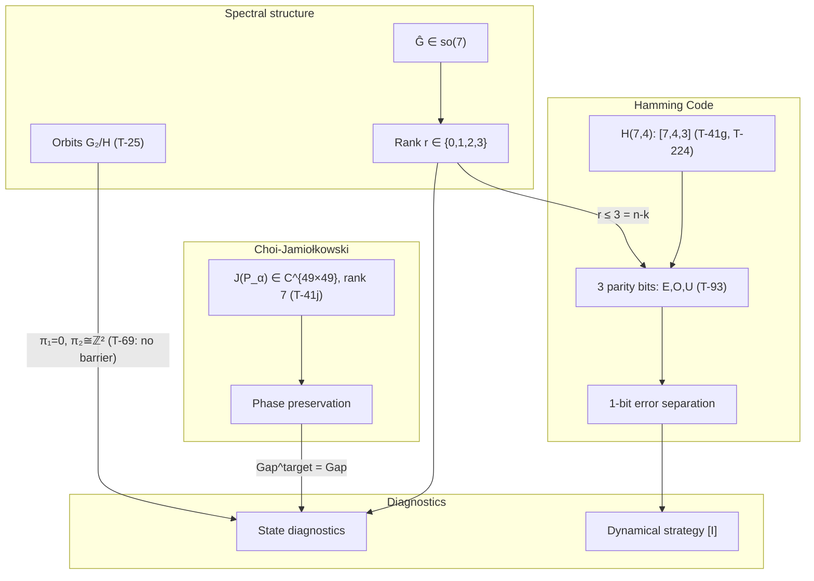

# Algebra of the Gap Operator

:::info Bridge from the Previous Chapter
In the previous chapter — [Model Theory of CC](./model-theory) — we built the formal specification and categorical semantics of Coherence Cybernetics. We saw how categorical constructions define the language in which self-modeling is described. Now we move from abstract semantics to **concrete algebra**: we examine the internal structure of the Gap operator — the central object measuring the system's opacity to itself.
:::

### Chapter Roadmap

In this chapter we:

1. **Introduce the Choi-Jamiołkowski representation** — learn how to turn the process of self-modeling into an object amenable to spectral analysis (section 1)
2. **Classify Gap configurations by rank** — discover that all the complexity of opacity in a 7-dimensional system compresses into three spectral numbers, and clarify the exact $G_2$-orbit topology (`T-25`, `T-69`) without false barrier claims (section 2)
3. **See the triple coincidence with Hamming code H(7,4)** — understand why 7 dimensions split into 4 informational and 3 check dimensions, and how this is related to the self-correction of consciousness (section 3)
4. **Apply these results to clinical practice** — from the opacity rank to therapeutic strategy (sections 4–5)

---

## What Opacity Is and Why It Is Inevitable {#непрозрачность}

Imagine you are standing in front of a mirror. You see your face, but you do not see the one who is looking. You can describe your thoughts, but the act of description already changes what is being described. You can observe your emotions, but the observer always remains "off-camera" from the observation.

This ineliminable gap between what the system *is* and how it *represents* itself is not a malfunction or a defect. It is a fundamental property of any system that possesses a self-model. In Coherence Cybernetics it receives a precise mathematical expression through the **Gap operator**.

Gap — literally "gap" — measures the degree of **opacity** of the system to itself. Zero Gap would mean absolute self-transparency: all coherences are fully transparent (Gap = 0 for all channels). Maximum Gap means complete opacity: the internal representation diverges radically from reality. Between these poles lies the entire palette of possible coherent configurations — from minimal to maximal opacity.

But here is the paradox that this document reveals: **opacity is a necessary condition for consciousness**. A system fully transparent to itself would be static — no opaque channels, no gradient for further evolution. Precisely the gap between "I as I am" and "I as I know myself" generates the dynamics of self-knowledge, inner life, the striving toward wholeness. Gap is not a crack in the edifice of consciousness, but the arch on which it stands.

This document presents a **cybernetic perspective** on the algebraic structure of the [Gap operator](/docs/core/dynamics/gap-operator), organizing the material around three interconnected constructions:

1. **Choi-Jamiołkowski representation** — complete description of the channel $\varphi$ as a state in $\mathbb{C}^{49 \times 49}$
2. **Spectral rank structure** — classification of Gap configurations by opacity rank
3. **Hamming code H(7,4)** — information-theoretic interpretation of the 7-dimensional structure

All three constructions converge on the single number **3**: three pairs of spectral parameters, three check dimensions, three parity bits. This triple coincidence is not accidental, but the expression of a deep structural regularity that we will unfold step by step.

---

## 1. Choi-Jamiołkowski Representation for $\varphi$ {#чой-ямиолковский}

### 1.0 Choi-Jamiołkowski for Non-Mathematicians {#чой-для-нематематиков}

Before diving into formalism, let us explain the essence of the Choi-Jamiołkowski construction at an intuitive level.

**The problem.** A channel $\varphi$ is a *process* — a transformation of one state into another. Processes are hard to analyze directly: they have no "shape," "spectrum," or "rank." To study a process, one needs to turn it into an *object*.

**Choi's idea.** Take the maximally entangled state — one in which every dimension is ideally correlated with itself. This is a kind of "perfect mirror" in which the system sees itself without distortion. Now pass only one half of this mirror through the channel $\varphi$. The result — the matrix $J(\varphi)$ — contains *all the information* about how the channel distorts the reflection.

**Analogy.** Imagine testing a photo printer. The best approach is to print an *ideal test page* containing all possible colors and gradients. From the printout you can fully reconstruct the printer's characteristics: which colors it shifts, which it loses, where it adds noise. The maximally entangled state $|\Omega\rangle$ is such a "test page," and the Choi matrix $J(\varphi)$ is its "printout."

A remarkable property of the construction: the map $\varphi \mapsto J(\varphi)$ is **bijective**. Knowing $J(\varphi)$, we can exactly reconstruct the action of the channel on any state. The process is completely "frozen" into the object.

Even more important: the condition of complete positivity of the channel (a physical requirement guaranteeing that probabilities remain non-negative) translates into the simple condition $J(\varphi) \geq 0$ — positive semi-definiteness of the matrix. Instead of verifying an abstract property of a process, it suffices to verify a concrete property of a matrix.

For the Gap operator this means: all the information about *how* the system distorts its self-image is encoded in one $49 \times 49$ matrix. This matrix can be spectrally decomposed, classified by rank, visualized — the full arsenal of linear algebra becomes available.

### 1.1 Choi State $J(\varphi)$

For a CPTP channel $\varphi: \mathcal{D}(\mathbb{C}^7) \to \mathcal{D}(\mathbb{C}^7)$ the **Choi state** completely describes the action of the channel:

$$
J(\varphi) := (\varphi \otimes \mathrm{id})(|\Omega\rangle\langle\Omega|) \in \mathbb{C}^{49 \times 49}
$$

where $|\Omega\rangle = \frac{1}{\sqrt{7}} \sum_{i=1}^{7} |i\rangle \otimes |i\rangle$ is the maximally entangled state.

Intuition behind the formula: $|\Omega\rangle\langle\Omega|$ is the "perfect mirror," a perfect correlation of each dimension with itself. The channel $\varphi$ acts only on the first copy (the system), leaving the second (the reference) untouched. The resulting matrix $J(\varphi)$ shows which correlations the channel preserves, which it weakens, and which it rotates.

The Choi matrix $J(\varphi) \in \mathbb{C}^{49 \times 49}$ is Hermitian, positive semi-definite, with $\mathrm{Tr}_1(J(\varphi)) = I/7$. The channel is fully recoverable from $J(\varphi)$, and complete positivity is equivalent to $J(\varphi) \geq 0$ (Choi's theorem).

:::info Canonical Definition
Complete proof of the properties of the Choi matrix for the canonical $\varphi$: [Fano Channel](/docs/proofs/gap/fano-channel).
:::

**What this means for self-knowledge.** The "imprint" of the self-modeling channel is a legitimate quantum density matrix. A system modeling itself generates a *state* in the extended space — literally "an image of itself in a mirror." This image fully determines the self-modeling process — there is no hidden information.

### 1.2 Block Structure and Choi Rank of the Linear Dephasing Part $\mathcal{P}_\alpha$

The linear dephasing component $\mathcal{P}_\alpha$ of the canonical coherent self-model $\varphi_{\text{coh}}(\rho) = (1 - R(\rho))\,\mathcal{P}_\alpha(\rho) + R(\rho)\,I/7$ ([definition](/docs/proofs/gap/fano-channel#phi-coh), `T-334`) has a convex block structure:

$$
\mathcal{P}_\alpha = \alpha\,\mathcal{P}_{\text{base}} + (1 - \alpha)\,\mathcal{P}_{\text{Fano}}, \qquad J(\mathcal{P}_\alpha) = \alpha \cdot J(\mathcal{P}_{\text{base}}) + (1 - \alpha) \cdot J(\mathcal{P}_{\text{Fano}})
$$

Here two linear CPTP channels play complementary roles:
- $\mathcal{P}_{\text{base}}(\rho) = \sum_{i=1}^{7} |i\rangle\langle i|\,\rho\,|i\rangle\langle i|$ is the "atomic" pinching channel that erases all off-diagonal coherences and retains only the diagonal populations. Its 7 Kraus operators $\{|i\rangle\langle i|\}_{i=1}^7$ are linearly independent, so its Choi rank is **7**.
- $\mathcal{P}_{\text{Fano}}(\rho) = \frac{1}{3}\sum_{p=1}^{7} \Pi_p\,\rho\,\Pi_p$ (where $\Pi_p = \sum_{i \in \ell_p} |i\rangle\langle i|$ are the 7 rank-3 projectors onto the 7 canonical Fano lines) preserves coherences uniformly by the factor $1/3$ across all pairs. Because its 7 Kraus operators $\{\Pi_p/\sqrt{3}\}_{p=1}^7$ are linearly independent and diagonal in the semantic basis, the Choi matrix $J(\mathcal{P}_{\text{Fano}})$ is supported inside the 7-dimensional subspace $\operatorname{span}\{|i\rangle\otimes|i\rangle\}_{i=1}^7 \subset \mathbb{C}^{49}$ and has **Choi rank 7** (nonzero eigenvalues $3/7$ with multiplicity 1 and $2/21$ with multiplicity 6) — **NOT** 28! By **`T-41j [T]`**, 7 is the minimal number of Kraus operators for the Fano channel.

Consequently, for every $\alpha \in [0, 1]$, the linear dephasing channel $\mathcal{P}_\alpha$ has **Choi rank 7** (while adding the state-dependent full-rank anchor term $R\,I/7$ in $\varphi_{\text{coh}}$ populates the full 49-dimensional Choi space whenever $R > 0$). The parameter $\alpha$ governs the balance between full atomization ($\alpha = 1$) and Fano-structured dephasing ($\alpha = 0$).

:::info Canonical Definition
Choi-rank theorem (`T-41j`), block structure, and collineation-anchor analysis (`T-334`): [Fano Channel](/docs/proofs/gap/fano-channel#phi-coh).
:::

### 1.3 Phase Properties: How the Choi Matrix Encodes Gap

A key property of the Choi matrix: **the phases of block elements** $J_{(ij),(kl)}$ at $i \neq j$ or $k \neq l$ directly encode the Gap structure of the channel.

To understand this, let us return to the mirror analogy. Coherence $\gamma_{ij}$ is a complex number with a modulus (strength of the connection) and a phase (orientation of the connection). Gap is, roughly speaking, the difference between the phase the system "sees" and the phase that actually exists. If the channel $\varphi$ preserves phases, then Gap is determined not by the self-modeling channel, but by external factors: precession and dissipation.

:::tip Theorem 1.3 (Phase Encoding of Gap in the Choi Matrix) [T]
**(a)** For the Fano channel: all nonzero elements of $J(\mathcal{P}_{\text{Fano}})$ are **real and positive** — the Fano channel introduces no phase shift.

**(b)** For the atomic channel: $J(\mathcal{P}_{\text{base}})$ is diagonal with real elements — the atomic channel also introduces no phase shift.

**(c)** Consequently, the canonical $\varphi_{\text{coh}}$ **preserves the phases of coherences**:

$$
\arg([\varphi_{\text{coh}}(\Gamma)]_{ij}) = \arg(\gamma_{ij})
$$

and the target Gap coincides with the current one: $\mathrm{Gap}^{\text{target}}(i,j) = \mathrm{Gap}(i,j)$.
:::

**Corollary.** The stationary Gap is determined not by the channel $\varphi$ (which is phase-preserving), but by the competition between unitary precession ($\Delta\omega_{ij}$) and dissipative decay ($\Gamma_2 + \kappa$):

$$
\mathrm{Gap}^{(\infty)}(i,j) = \left|\sin\left(\theta_{ij} - \arctan\frac{\Delta\omega_{ij}}{\Gamma_2 + \kappa}\right)\right|
$$

Details: [Gap Dynamics](/docs/core/dynamics/gap-dynamics#единая-теорема).

**The deep meaning of phase preservation.** The self-modeling channel $\varphi$ does not *create* distortions — it merely *inherits* those that already exist. Distortions arise from "precession" — autonomous oscillations of coherence phases driven by the internal dynamics of the system. This is analogous to a situation where the mirror itself is perfect, but the room in which you stand sways slightly.

---

## 2. Rank Structure of the Gap Operator {#структура-рангов}

### 2.0 Geometry of Ranks: From Transparency to Crisis {#геометрия-рангов}

Before giving a formal definition, let us describe the qualitative picture.

Imagine the 7-dimensional space of consciousness. It contains 21 pairs of dimensions, and each pair is connected by coherence — a complex number that can be real (transparent connection) or have an imaginary part (opaque connection). The Gap operator collects all imaginary parts into a single antisymmetric matrix.

An antisymmetric matrix in an odd number of dimensions is guaranteed to have a zero eigenvalue — one direction is always "free" from opacity. The remaining 6 directions pair up, and each pair generates one "opacity channel" — a plane of rotation in which the phases of coherences diverge from reality.

The number of active channels is the **opacity rank**:

- **Rank 0**: all 21 coherences are real. The system is completely transparent to itself. This is an ideal but unstable point — the slightest perturbation creates Gap.
- **Rank 1**: one opacity channel. One pair of dimensions does not "see" its connection correctly. The system is healthy overall; the defect is local and amenable to correction.
- **Rank 2**: two independent channels. The system has a complex, multidimensional disruption of self-understanding. Simple focus on one aspect does not solve the problem.
- **Rank 3**: all three skew-eigenvalue pairs are active ($\lambda_1, \lambda_2, \lambda_3 > 0$). Maximum spectral opacity — three independent planes of imaginary coherence are simultaneously active. (Note that inside the convex state space $\mathcal{D}(\mathbb{C}^7)$ even a rank-3 state still connects smoothly to $r = 0$ along $(1-t)\Gamma + t\,I/7$; see `T-69 [T]` below.)

Transitions between ranks are not merely quantitative changes. Each transition changes the *quality* of opacity, opening a new dimension of the gap between "being" and "knowing oneself."

### 2.1 Gap Operator as an Element of $\mathfrak{so}(7)$

Gap operator $\hat{\mathcal{G}} = \mathrm{Im}(\Gamma) \in \mathfrak{so}(7)$ — a real antisymmetric $7 \times 7$ matrix (full definition: [Gap operator](/docs/core/dynamics/gap-operator#определение)).

Why $\mathfrak{so}(7)$? Because the imaginary parts of coherences form an antisymmetric matrix ($\mathrm{Im}(\gamma_{ij}) = -\mathrm{Im}(\gamma_{ji})$), and the set of all antisymmetric $7 \times 7$ matrices is the Lie algebra of the rotation group $\mathrm{SO}(7)$. The Gap operator is literally an *infinitesimal rotation* in the space of consciousness, "spinning" the system's self-image relative to reality.

### 2.2 Spectral Structure

:::tip Theorem 2.1 (Eigenspectrum of the Gap Operator) [T]
Spectrum of $\hat{\mathcal{G}}$ for $N = 7$ (odd dimension):

$$
\mathrm{spec}(\hat{\mathcal{G}}) = \{0, \pm i\lambda_1, \pm i\lambda_2, \pm i\lambda_3\}, \quad \lambda_k \in \mathbb{R}_{\geq 0}
$$

**(a)** The zero eigenvalue is **guaranteed** by the odd dimension ($\det(\hat{\mathcal{G}}) = \det(-\hat{\mathcal{G}}^T) = (-1)^7 \det(\hat{\mathcal{G}}) = -\det(\hat{\mathcal{G}}) \Rightarrow \det(\hat{\mathcal{G}}) = 0$).

**(b)** The paired structure $\pm i\lambda_k$ follows from antisymmetry: if $v$ is an eigenvector with eigenvalue $i\lambda$, then $v^*$ is an eigenvector with eigenvalue $-i\lambda$.

**(c)** Total Gap via spectral parameters:

$$
\mathcal{G}_{\text{total}} = \|\hat{\mathcal{G}}\|_F^2 = 2(\lambda_1^2 + \lambda_2^2 + \lambda_3^2)
$$
:::

**Proof.** (a) For a real antisymmetric matrix: $\hat{\mathcal{G}}^T = -\hat{\mathcal{G}}$, hence $\det(\hat{\mathcal{G}}) = \det(\hat{\mathcal{G}}^T) = \det(-\hat{\mathcal{G}}) = (-1)^7 \det(\hat{\mathcal{G}}) = -\det(\hat{\mathcal{G}})$, giving $\det(\hat{\mathcal{G}}) = 0$. (b) Standard property of antisymmetric matrices. (c) $\|\hat{\mathcal{G}}\|_F^2 = \mathrm{Tr}(\hat{\mathcal{G}}^T \hat{\mathcal{G}}) = -\mathrm{Tr}(\hat{\mathcal{G}}^2) = -\sum_k \mu_k^2$, where $\mu_k$ are the eigenvalues; for spectrum $\{0, \pm i\lambda_1, \pm i\lambda_2, \pm i\lambda_3\}$ we have $\sum \mu_k^2 = -2\sum \lambda_k^2$. $\square$

**Three numbers — and nothing more.** The entire complexity of opacity in a 7-dimensional system compresses into three non-negative numbers $(\lambda_1, \lambda_2, \lambda_3)$. This is a colossal reduction: from 21 imaginary parts of coherences down to 3 essential parameters. Is it any wonder that this triple appears everywhere — in the spectrum, in Hamming, in Fano?

### 2.3 Opacity Rank and $G_2$-Orbit Geometry (`T-25`, `T-69`)

**Opacity rank** $r \in \{0, 1, 2, 3\}$ — the number of nonzero spectral parameters $\lambda_k$.

:::tip Theorem 2.2 ($G_2$-Orbit Dimension and Homotopy, `T-25`, `T-69`) [T at specified orbit]
For a specified element $\hat{\mathcal{G}} \in \mathfrak{so}(7)$ with $G_2$-stabilizer $H_{\hat{\mathcal{G}}} = \{g \in G_2 : g\hat{\mathcal{G}}g^{-1} = \hat{\mathcal{G}}\}$, the orbit dimension is $\dim(G_2/H_{\hat{\mathcal{G}}}) = 14 - \dim(H_{\hat{\mathcal{G}}})$. Representative stabilizer strata of $G_2$ on $\mathfrak{so}(7) = G_{14} \oplus G_7$ are:

| Representative stratum | Stabilizer $H$ | $\dim(H)$ | Orbit $G_2/H$ | $\pi_1(G_2/H)$ | $\pi_2(G_2/H)$ |
|------------------------|:--------------:|:---------:|:-------------:|:--------------:|:--------------:|
| Trivial ($\hat{\mathcal{G}} = 0$, $r = 0$) | $G_2$ | 14 | $\{\text{pt}\}$ | 0 | 0 |
| Pure $G_7$-vector ($r = 1$ in $G_7$) | $\mathrm{SU}(3)$ | 8 | $S^6$ | 0 | 0 |
| Intermediate stratum | $\mathrm{SU}(2) \times \mathrm{U}(1)$ | 4 | 10-dim. | 0 | $\mathbb{Z}$ |
| Degenerate stratum | $\mathrm{SU}(2)$ | 3 | 11-dim. | 0 | 0 |
| Generic $T^2$-orbit (generic $r = 3$) | $T^2$ | 2 | 12-dim. flag manifold | 0 | $\mathbb{Z}^2$ |

*Scope note (`T-25`):* While $\dim(G_2/H) = 14 - \dim(H)$, $\pi_1(G_2/T^2) = 0$, and $\pi_2(G_2/T^2) \cong \mathbb{Z}^2$ are exact `[T]` for a specified orbit, the former claim that the stabilizer $H$ is uniquely determined by opacity rank $r$ alone is **withdrawn** (see the retraction note in `T-25 [T]`) — it depends on the full $G_7 + G_{14}$ decomposition of $\hat{\mathcal{G}}$.
:::

**Exact homotopy vs. false topological barriers (`T-69 [T]`):** Because $G_2$ is simply connected ($\pi_1(G_2) = 0$) and every listed stabilizer $H$ is connected ($\pi_0(H) = 0$), **every one of these orbits is simply connected ($\pi_1(G_2/H) = 0$)** — there are **no** non-contractible 1D loops! For the generic flag manifold $G_2/T^2$, the second homotopy group is $\pi_2(G_2/T^2) \cong \pi_1(T^2) \cong \mathbb{Z}^2$, classifying continuous maps from a **2-sphere** $S^2 \to G_2/T^2$. Crucially, by **`T-69 [T]`**, **topological classes of maps into $G_2/T^2$ supply NO physical energy barrier**!

### 2.4 Interpretation of Ranks

| Rank | Opacity | Physical interpretation | Cybernetic meaning [I] |
|------|:-------:|------------------------|------------------------|
| 0 | Absent | All coherences are real | Full self-transparency; no imaginary coherence |
| 1 | One-dimensional | One active skew-eigenvalue pair | Local single-plane opacity (e.g., alexithymia model) |
| 2 | Two-dimensional | Two independent skew-eigenvalue pairs | Multi-channel opacity; coupled dissociation |
| 3 | Full | All three skew-eigenvalue pairs active | Globally distributed multi-plane opacity |

:::warning Clarification: Why $\pi_2(G_2/T^2) \cong \mathbb{Z}^2$ Does NOT Forbid Smooth Relaxation (`T-69 [T]`)
Earlier versions asserted that $\pi_2(G_2/T^2) \cong \mathbb{Z}^2$ makes a rank-3 Gap profile "topologically protected" so that it cannot be smoothly deformed to $r = 0$ without passing through a singularity. That claim is **mathematically incorrect**:
1. The density-matrix space $\mathcal{D}(\mathbb{C}^7)$ is **convex and contractible**: for *any* rank-3 state $\Gamma$, the straight-line homotopy $\Gamma(t) = (1-t)\Gamma + t\,I/7$ ($t \in [0, 1]$) smoothly scales $\hat{\mathcal{G}}(t) = (1-t)\hat{\mathcal{G}}$ continuously to $r = 0$ with no topological obstruction!
2. $\pi_2(G_2/T^2) \cong \mathbb{Z}^2$ classifies maps of a **2-sphere** into a *fixed* $G_2$-orbit, NOT a single point $\Gamma \in \mathcal{D}(\mathbb{C}^7)$ or a 1D time trajectory, and by **`T-69 [T]`** it supplies **no physical energy barrier**.
3. If deep clinical crises resist gradual resolution, that resistance arises dynamically from attractor barriers or hysteresis in a nonlinear reduced model (see [Bifurcations](./bifurcation)), **not** from $\pi_1$ or $\pi_2$ topology.
:::

### 2.5 Connection with Purity

:::tip Theorem 2.3 (Purity Decomposition via Rank) [T]
The purity of the holon decomposes into contributions from the symmetric and antisymmetric parts of the coherence matrix:

$$
P = \mathrm{Tr}(\Gamma^2) = P_{\text{sym}} + \mathcal{G}_{\text{total}} = P_{\text{sym}} + 2(\lambda_1^2 + \lambda_2^2 + \lambda_3^2)
$$

where $P_{\text{sym}} = \mathrm{Tr}(\mathrm{Re}(\Gamma)^2)$.
:::

**Corollary.** At fixed symmetric purity $P_{\text{sym}}$, an increase in opacity rank **increases** total purity $P$. The paradox: Gap (opacity) *raises* purity. Resolution: antisymmetric coherences make a positive contribution to $\mathrm{Tr}(\Gamma^2)$ (detailed proof: [Gap operator](/docs/core/dynamics/gap-operator#связь-чистота)).

**The paradox of opacity raising purity.** This is one of the most counter-intuitive results in the theory and deserves a detailed explanation.

Purity $P = \mathrm{Tr}(\Gamma^2)$ measures the "focusedness" of a state. The maximally mixed state $I/7$ has $P = 1/7$; a pure state has $P = 1$. It might seem that opacity (inability to see oneself) should *decrease* the definiteness of the state.

But recall that coherences $\gamma_{ij}$ are complex numbers, and their imaginary parts make a positive contribution to $P$. An opaque system whose coherence phases are "twisted" relative to the reference can be *more definite* than a transparent one. Analogy: a person gripped by an obsessive idea may have a more "focused" consciousness than a calm meditator — but this focus is unproductive and energetically costly.

This is precisely why purity by itself is not an indicator of health. Health is determined by the *balance* between $P_{\text{sym}}$ (productive coherence) and $\mathcal{G}_{\text{total}}$ (opacity). The consciousness threshold $P > 2/7$ can be reached both through "healthy" symmetric purity and through "pathological" opacity — but the cybernetic properties of these two states are radically different.

---

## 3. Hamming Code H(7,4) {#код-хэмминга}

### 3.0 Perfect Code and Self-Knowledge {#совершенный-код}

Before introducing the formalism, let us discuss a striking structural analogy.

The Hamming code H(7,4) was invented by Richard Hamming in 1950 for error correction in data transmission. The idea is simple: add 3 check bits to 4 information bits so that any single error is detected and corrected. For 7 bits the code turned out to be **perfect**: not a single bit can be removed without losing the ability to correct, nor can one be added without redundancy.

The holon in UHM has 7 canonical dimensions. Four of them — **A (Articulation)**, **S (Structure)**, **D (Dynamics)**, **L (Logic)** — describe structural/operational roles, while three — **E (Interiority)**, **O (Ground)**, **U (Unity)** — form a non-collinear Fano basis triangle that can serve as systematic check bits in the Hamming $H(7,4)$ representation.

The coincidence $4 + 3 = 7$ matches the parameters of the binary Hamming code $H(7,4)$:
- **Information theory (`T-41g [T]`, `T-224 [T]`):** 4 information bits + 3 parity bits = the unique perfect single-error-correcting binary code of length 7, uniquely selected by perfect single-fault localizability together with a nontrivial state grammar (`T-224 [T]`; whereas earlier unconditional seven-role minimality `T-40f [✗]` is withdrawn).
- **Cybernetic analogy `[I]`:** 4 content dimensions (`A, S, D, L`) + 3 check dimensions (`E, O, U`).

### 3.1 Code Structure

Hamming code H(7,4) is a linear block code with parameters $[n, k, d] = [7, 4, 3]$:

- **$n = 7$** — codeword length (= number of holon [dimensions](/docs/core/structure/dimensions))
- **$k = 4$** — number of information bits
- **$d = 3$** — minimum Hamming distance

Code H(7,4): 16 codewords of length 7, detection of 2 errors, correction of 1 error, **perfect** (Hamming bound achieved with equality).

:::info Canonical Definition
Formal parameters and proofs: [Gap Dynamics](/docs/core/dynamics/gap-dynamics#код-хэмминга).
:::

**Perfection is a rare property.** Among all linear codes only a few are perfect. For binary codes, perfect codes are repetition codes, Hamming codes, and the Golay code. Perfection means that every word in $\mathbb{F}_2^7$ is at distance exactly $\leq 1$ from some codeword. No "gap" between codewords is wasted: every error is attributed to a unique "culprit."

Transferring this intuition to consciousness: the perfection of code H(7,4) means that the 7-dimensional holon architecture has no "dead zones" — any coherence violation is detected by the check dimensions, and for each violation there exists a unique correction strategy.

### 3.2 Informational and Check Dimensions

In the context of UHM, the seven holon dimensions divide into two groups:

| Role | Dimensions | Count | Nature |
|------|:----------:|:-----:|--------|
| **Informational** | A (Articulation), S (Structure), D (Dynamics), L (Logic) | 4 | Carry the structural/operational content |
| **Check** | E (Interiority), O (Ground), U (Unity) | 3 | Systematic parity-check coordinates (non-collinear Fano triangle) |

:::info Interpretation (Informational Architecture) [I]
The four structural dimensions (A, S, D, L) describe **what** the system articulates, structures, dynamically transforms, and logically orders. The three meta-structural dimensions (E, O, U) describe **how** the system registers interiority, grounds itself, and integrates unity. Analogy with H(7,4): content bits require parity bits to separate single faults.
:::

**Why E, O, U form a valid check triple `[T]`:** In the canonical Singer cyclic Fano plane (`{A,S,L}`, `{S,D,E}`, `{D,L,U}`, `{L,E,O}`, `{E,U,A}`, `{U,O,S}`, `{O,A,D}`), the three points `{E, O, U}` are **not** collinear — they form a basis triangle of $\mathrm{PG}(2,2)$! Consequently, the complements of the three Fano lines `{U,O,S}`, `{E,U,A}`, `{L,E,O}` give three independent weight-4 dual codewords each containing exactly one of `E, O, U`:

- $s_E$: $A \oplus D \oplus L \oplus E = 0$
- $s_O$: $S \oplus D \oplus L \oplus O = 0$
- $s_U$: $A \oplus S \oplus D \oplus U = 0$

### 3.3 Parity-Check Matrix and Canonical Fano Plane (`T-41h`, `T-93`)

Ordering columns as $(A, S, D, L \mid E, O, U)$, the systematic parity-check matrix $H$ of $H(7,4)$ whose kernel is spanned by the **7 canonical Singer cyclic Fano lines** is:

$$
H = \begin{pmatrix}
1 & 0 & 1 & 1 & 1 & 0 & 0 \\
0 & 1 & 1 & 1 & 0 & 1 & 0 \\
1 & 1 & 1 & 0 & 0 & 0 & 1
\end{pmatrix}
$$

:::tip Connection of $H$ with $\mathrm{PG}(2,2)$ (`T-41g`, `T-41h`, `T-93`) [T]
**(a)** The 7 columns of $H$ are all seven distinct nonzero vectors of $\mathbb{F}_2^3$, which coincide with the **points** of $\mathrm{PG}(2, \mathbb{F}_2)$ and uniquely separate single bit flips (`T-93 [T]`).

**(b)** The weight-3 codewords of $\ker(H) = H(7,4)$ are **precisely the 7 canonical Singer Fano lines** `{A,S,L}`, `{S,D,E}`, `{D,L,U}`, `{L,E,O}`, `{E,U,A}`, `{U,O,S}`, `{O,A,D}` (`T-41h [T]`).

**(c)** The condition $Hx^T = 0 \pmod 2$ is equivalent to the three systematic parity checks $s_E = s_O = s_U = 0$ above, with `{E, O, U}` occupying the $3 \times 3$ identity block.
:::

**Proof.** Direct multiplication modulo 2 verifies $H v_\ell^T = 0$ for each of the 7 canonical line indicator vectors $v_\ell$, and all 7 columns of $H$ are distinct nonzero vectors in $\mathbb{F}_2^3$. $\square$

:::info Remark (Fano Plane in UHM)
In the [Fano selection rules formalism](/docs/physics/gauge-symmetry/fano-selection-rules) the same 7 points are identified with the 7 canonical dimensions (`A, S, D, L, E, O, U`), and the 7 lines with the 7 Singer cyclic Fano triples defining octonion multiplication and Fano-structured [Lindblad operators](/docs/core/operators/lindblad-operators).
:::

**Triple coincidence.** One and the same finite geometry — the Fano plane $\mathrm{PG}(2,2)$ — appears in three contexts:

1. **Algebra**: multiplication table of octonions $\mathbb{O}$ (7 Fano triples).
2. **Coding theory**: parity-check matrix of the unique perfect binary code $H(7,4)$ (`T-41g`, `T-41h`, `T-93`, `T-224 [T]`).
3. **7D Holon structure**: the rank-minimal Fano channel $\mathcal{P}_{\text{Fano}}$ of Choi rank 7 (`T-41j [T]`).

### 3.4 Minimum Distance $d = 3$ vs. Withdrawn Continuous-Gap Bound (`T-90 [✗]`)

:::tip Coding Theorem vs. Withdrawn Gap Lower Bound (`T-41g`, `T-90 [✗]`)
**(a) Exact binary coding theorem [T] (`T-41g`):** For binary $H(7,4)$, the minimum Hamming distance is $d = 3$ (any two distinct codewords differ in at least 3 positions), and $H(7,4)$ saturates the binary Hamming sphere-packing bound with equality:
$$
\sum_{j=0}^{1}\binom{7}{j} = 1 + 7 = 8 = 2^3.
$$

**(b) Withdrawn universal Gap-count lower bound (`T-90 [✗]`):** The earlier claim that $d = 3$ or sphere-packing forces at least 3 of the 21 continuous phase Gaps $\mathrm{Gap}(i,j) = |\sin\theta_{ij}|$ to be nonzero — or yields a universal clinical psychosis diagnosis — is **withdrawn (`T-90 [✗]`)**. Without a specified binary encoder, noise law, and decoder mapping continuous coherence matrices into binary words, sphere-packing imposes **no** lower bound on the number of nonzero continuous phase Gaps.
:::

### 3.5 Syndrome Decoding Analogy [I]

:::info Analogy (Binary Syndrome Table via Canonical $H(7,4)$) [I]
Under a **declared binary error model and syndrome instrument** (`T-93 [T]` for binary separation; `[I]` as a continuous-coherence analogy):
- **(a) Detection:** Up to $d - 1 = 2$ binary axis flips produce a nonzero syndrome $s = (s_E, s_O, s_U) \in \mathbb{F}_2^3$.
- **(b) Single-fault localization:** A single binary flip at axis $X$ yields the exact column of $H$ for $X$ as its unique syndrome $s = H e_X^T$.
:::

**Exact syndrome table for canonical Singer $H$ (cybernetic interpretation `[I]`):**

| Syndrome $(s_E, s_O, s_U)$ | Defective dimension | Interpretive disorder type [I] |
|:--------------------------:|:-------------------:|--------------------------------|
| $(0, 0, 0)$ | None | Binary parity consistent |
| $(1, 0, 1)$ | **A** (Articulation) | Articulation failure |
| $(0, 1, 1)$ | **S** (Structure) | Structural disruption |
| $(1, 1, 1)$ | **D** (Dynamics) | Dynamic dysfunction |
| $(1, 1, 0)$ | **L** (Logic) | Logical disintegration |
| $(1, 0, 0)$ | **E** (Interiority) | Interiority check fault |
| $(0, 1, 0)$ | **O** (Ground) | Grounding check fault |
| $(0, 0, 1)$ | **U** (Unity) | Unity check fault |

**Reading the syndrome table.** Each nonzero syndrome is the unique column of the canonical parity-check matrix $H$: for example, syndrome $(0, 1, 1)$ triggers the check rows $s_O$ and $s_U$ (and not $s_E$), uniquely pinpointing **S (Structure)**. The three unit-weight syndromes $(1,0,0)$, $(0,1,0)$, $(0,0,1)$ correspond directly to single faults on the three systematic check coordinates **E, O, U** themselves.

:::warning Limitations of the Analogy (`T-90 [✗]`, `T-93`) [I]
Applying binary $H(7,4)$ syndrome decoding to continuous coherence dynamics is an **analogy `[I]`** unless an explicit binary encoder, discrete noise law, and syndrome readout instrument are specified (`T-90 [✗]`, `T-93`):

1. Coherences $\gamma_{ij}$ are continuous complex numbers, not bits in $\mathbb{F}_2$
2. Phase Gaps $\mathrm{Gap}(i,j) \in [0, 1]$ vary continuously, not by discrete bit flips
3. The regenerative operator $\mathcal{R}$ acts continuously, not by bitwise inversion

Nevertheless, the underlying algebraic coincidence $\mathrm{PG}(2,2) \leftrightarrow H(7,4) \leftrightarrow \mathbb{O}$ is exact (`T-41g`, `T-41h`, `T-93`, `T-224 [T]`). Detailed analysis: [Fano Channel](/docs/proofs/gap/fano-channel).
:::

---

## 4. Connection with Clinical Practice [I] {#клиническая-практика}

### 4.1 Opacity Rank as an Interpretive Clinical Marker [I]

The spectral rank $r \in \{0, 1, 2, 3\}$ of $\hat{\mathcal{G}} = \operatorname{Im}\Gamma$ counts the number of independent skew-eigenvalue planes of imaginary coherence. As an interpretive classification `[I]` (without invoking nonexistent topological barriers):

| Rank | Clinical analogy [I] | Subjective description [I] | Dynamical character |
|:----:|----------------------|----------------------------|---------------------|
| 0 | Complete phase alignment / flatness | Minimal imaginary phase offset | All $\gamma_{ij} \in \mathbb{R}$; no skew-planes active |
| 1 | Local single-plane disruption (e.g., alexithymia model) | Disruption localized to one plane | One nonzero $\lambda_1$; single-axis intervention focus |
| 2 | Multi-domain dissociation | Two independent skew-planes active | Two nonzero $(\lambda_1, \lambda_2)$; coupled multi-axis dynamics |
| 3 (generic) | Global multi-plane crisis | All three skew-planes active with distinct weights | Full spectral rank $(\lambda_1, \lambda_2, \lambda_3)$; no topological barrier (`T-69`), resistance arises dynamically if trapped in a nonlinear attractor |
| 3 (degenerate) | Isotropic multi-plane crisis | Three equal skew-eigenvalues $(\lambda, \lambda, \lambda)$ | Full rank with enhanced symmetry; requires differentiating channels |

**Rank 0 — zero imaginary coherence.** All coherences are real ($r = 0$, $\hat{\mathcal{G}} = 0$). In clinical interpretation `[I]`, lack of phase structure may correspond to flat, undifferentiated states rather than dynamic engagement.

**Rank 1 — single skew-plane.** One nonzero $\lambda_1$: a localized phase offset (e.g. along $S \leftrightarrow E$ in the alexithymia toy model).

**Rank 2 — two skew-planes.** Two independent nonzero $(\lambda_1, \lambda_2)$: addressing one plane leaves the orthogonal skew-plane active.

**Rank 3 — full spectral rank.** All three skew-eigenvalue pairs $(\lambda_1, \lambda_2, \lambda_3)$ are nonzero. Crucially, by **`T-69 [T]`**, there is **no topological energy barrier** forbidding smooth reduction of rank inside $\mathcal{D}(\mathbb{C}^7)$; clinical difficulty in resolving global crises reflects multi-channel coupling and potential attractor hysteresis (see [Bifurcations](./bifurcation)), not $\pi_1/\pi_2$ topology.

### 4.2 Generic vs. Degenerate Rank 3 [I]

- **Generic $r = 3$** ($\lambda_1 > \lambda_2 > \lambda_3 > 0$): one dominant skew-plane sets a clear priority ordering for targeted intervention.
- **Degenerate $r = 3$** ($\lambda_1 = \lambda_2 = \lambda_3 > 0$): all three skew-planes carry equal weight, suggesting an initial structuring step `[I]` to differentiate which dimensions dominate.

---

## 5. Cybernetic Interpretation {#кибернетическая-интерпретация}

### 5.1 Spectral Rank and the Number 3

:::tip Proposition 4.1 (Spectral Rank Upper Bound) [T]
For any $7 \times 7$ real skew-symmetric matrix $\hat{\mathcal{G}} = \operatorname{Im}\Gamma \in \mathfrak{so}(7)$ of opacity rank $r$:

**(a)** $r$ equals the number of nonzero skew-eigenvalue pairs $\pm i\lambda_k$ in the real Schur normal form of $\hat{\mathcal{G}}$.

**(b)** $r \leq \lfloor 7/2 \rfloor = 3$ (which numerically coincides with the $n - k = 3$ parity bits of $H(7,4)$).

**(c)** Increasing $r \to r + 1$ activates an additional orthogonal 2-plane of imaginary coherence.
:::

### 5.2 E, O, U as Systematic Parity Checks [I]

Aligned with the exact canonical Singer parity-check matrix $H$ of section 3.3:

| Check dimension | Canonical parity check ($H$) | Interpretive error domain [I] | Interpretive intervention [I] |
|:---------------:|------------------------------|-------------------------------|-------------------------------|
| **E** (Interiority) | $A \oplus D \oplus L \oplus E = 0$ | Experiential–articulation/logic decoupling | Experiential / somatic integration |
| **O** (Ground) | $S \oplus D \oplus L \oplus O = 0$ | Structural–dynamic ungrounding, dissociation | Grounding, stabilization |
| **U** (Unity) | $A \oplus S \oplus D \oplus U = 0$ | Fragmentation across articulation, structure, dynamics | Integrative practices |

:::info Interpretation (Restoration Sequence) [I]
In clinical crisis work, stabilization is often sequenced from global unity (**U**) and grounding (**O**) to experiential processing (**E**): first minimal safety and integrity, then grounding, then working through interior experience.
:::

### 5.3 Practical Diagnostic Summary

**Gap-rank diagnostic checklist:**

| Step | Metric | Meaning | Status |
|:----:|--------|---------|--------|
| 1 | $\mathcal{G}_{\text{total}} = \|\hat{\mathcal{G}}\|_F^2 = 2\sum \lambda_k^2$ | Total squared imaginary coherence | `[D]/[T]` |
| 2 | Rank $r \in \{0,1,2,3\}$ | Number of nonzero skew-eigenvalue pairs | `[T]` |
| 3 | $\lambda_{\max}$ | Largest skew-eigenvalue | `[T]` |
| 4 | $G_2$-decomposition: $\mathfrak{so}(7) = G_{14} \oplus G_7$ | Projection onto $\mathfrak{g}_2$ vs. complement ([Gap operator](/docs/core/dynamics/gap-operator#g2-разложение)) | `[T]` |
| 5 | Binary syndrome $(s_E, s_O, s_U)$ | Applies only with a declared binary encoder & instrument (`T-93`, `T-90 [✗]`) | `[C]/[I]` |

:::tip Example: Single-Pair Alexithymia Toy Model [T / I]
Consider a state with a single purely imaginary off-diagonal entry $\gamma_{SE} = i|\gamma_{SE}|$ (all other $\gamma_{ij} \in \mathbb{R}$):

**(a) `[T]`:** $\hat{\mathcal{G}}$ has only two nonzero antisymmetric entries $\hat{\mathcal{G}}_{SE} = -\hat{\mathcal{G}}_{ES} = |\gamma_{SE}|$, hence opacity rank $r = 1$.

**(b) `[T]`:** Skew-eigenvalue spectrum is $\{0, \pm i|\gamma_{SE}|, 0, 0, 0, 0\}$, i.e. $(\lambda_1, 0, 0)$ with $\lambda_1 = |\gamma_{SE}|$.

**(c) `[I]`:** Interpretively, this localizes imaginary coherence to the Structure–Interiority ($S \leftrightarrow E$) pair; in a binary single-fault encoding (`T-93`), an isolated fault on $S$ triggers syndrome $(0, 1, 1)$ and on $E$ triggers $(1, 0, 0)$.
:::

### 5.4 Summary of Three Perspectives

---

## 6. Status Summary {#статусы}

| Result | Status | Reference / Section |
|--------|:------:|:-------------------:|
| Properties of Choi matrix for linear CPTP channel $\mathcal{P}_\alpha$ | **[T]** | [1.1](#чой-ямиолковский) |
| Choi rank of $\mathcal{P}_{\text{base}}$, $\mathcal{P}_{\text{Fano}}$, and $\mathcal{P}_\alpha$ equals **7** (not 28) | **[T]** | `T-41j`, [1.2](#чой-ямиолковский) |
| Phase preservation of $\mathcal{P}_\alpha$ and $\varphi_{\text{coh}}$ | **[T]** | `T-334`, [1.3](#чой-ямиолковский) |
| Skew-eigenvalue spectrum $\{0, \pm i\lambda_1, \pm i\lambda_2, \pm i\lambda_3\}$ of $\hat{\mathcal{G}} \in \mathfrak{so}(7)$ | **[T]** | [2.2](#структура-рангов) |
| Orbit dimension $\dim(G_2/H) = 14 - \dim H$; $\pi_1(G_2/T^2) = 0$, $\pi_2(G_2/T^2) \cong \mathbb{Z}^2$ | **[T]** (specified orbit) | `T-25`, `T-69`, [2.3](#структура-рангов) |
| Rank-only stabilizer classification & $\pi_1/\pi_2$ physical barrier claims | **[✗]** (withdrawn; `T-69`: no energy barrier) | `T-25`, `T-69`, [2.3–2.4](#структура-рангов) |
| Purity decomposition $P = P_{\text{sym}} + 2(\lambda_1^2 + \lambda_2^2 + \lambda_3^2)$ | **[T]** | [2.5](#структура-рангов) |
| Binary $H(7,4)$ perfection, Fano supports, 3-bit syndrome separation, diagnosability rigidity | **[T]** | `T-41g`, `T-41h`, `T-93`, `T-224`, [3.1–3.3](#код-хэмминга) |
| Universal lower bound $\ge 3$ nonzero continuous phase Gaps & psychosis diagnosis | **[✗]** (withdrawn) | `T-90 [✗]`, [3.4](#код-хэмминга) |
| Continuous-coherence Hamming analogy, syndrome clinical reading, and E/O/U parity metaphor | **[I]** | [3.5](#код-хэмминга), [4–5](#клиническая-практика) |

---

:::warning Computational Complexity
The computational scaling of the algorithms described in this document **has not been analyzed**. In particular:
- Computing the Choi matrix $J(\varphi) \in \mathbb{C}^{49 \times 49}$ requires $O(N^4)$ operations for $N = 7$, but scaling for composite systems ($N = 7^k$) is unknown.
- Spectral decomposition of the Gap operator $\hat{\mathcal{G}} \in \mathfrak{so}(7)$ is $O(N^3)$, but for large $N$ approximate spectroscopy may be required.
- Binary syndrome decoding (section 3.5) applies to $N = 7$ under a declared binary encoding (`T-93`, `T-224`).
:::

---

### What We Learned {#что-мы-узнали}

Let us summarize the chapter — from exact algebra to honest scope limits:

1. **Choi–Jamiołkowski representation (`T-41j`, `T-334`):** Both $\mathcal{P}_{\text{base}}$ and $\mathcal{P}_{\text{Fano}}$, as well as their mixture $\mathcal{P}_\alpha$, have **Choi rank 7** (not 28) and strictly preserve coherence phases $\arg(\gamma_{ij})$.

2. **Three spectral parameters:** Any real skew-symmetric Gap operator $\hat{\mathcal{G}} = \operatorname{Im}\Gamma \in \mathfrak{so}(7)$ has spectrum $\{0, \pm i\lambda_1, \pm i\lambda_2, \pm i\lambda_3\}$ and opacity rank $r \in \{0, 1, 2, 3\}$.

3. **Exact orbit topology (`T-25`, `T-69`):** Every $G_2/H$ orbit listed is **simply connected** ($\pi_1 = 0$), and for the generic flag manifold $\pi_2(G_2/T^2) \cong \mathbb{Z}^2$; crucially, by **`T-69 [T]`**, $\pi_2$ supplies **no physical energy barrier** and does not prevent smooth contraction inside the convex space $\mathcal{D}(\mathbb{C}^7)$.

4. **Purity decomposition:** $P = \operatorname{Tr}(\Gamma^2) = P_{\text{sym}} + 2(\lambda_1^2 + \lambda_2^2 + \lambda_3^2)$ — imaginary coherences contribute positively to total purity $P$.

5. **Canonical Hamming code $H(7,4)$ (`T-41g`, `T-41h`, `T-93`, `T-224`):** With the 7 canonical Singer Fano lines as weight-3 codewords, `(E, O, U)` form a systematic non-collinear check triple separating single binary faults — while the former universal continuous-Gap count bound ($\ge 3$ nonzero Gaps) is **withdrawn (`T-90 [✗]`)** without a declared binary encoder and noise law.

6. **Canonical 7 axes:** All algebraic and interpretive mappings use the canonical basis **A (Articulation), S (Structure), D (Dynamics), L (Logic), E (Interiority), O (Ground), U (Unity)**.

:::tip Bridge to the Next Chapter
We have explored the *static* algebra of the Gap operator — its spectrum, ranks, and topology. But Gap does not stand still: it evolves, and its evolution contains **qualitative transitions** — bifurcations. In the [next chapter](./bifurcation) we will see how, as parameters change smoothly, the Gap landscape reorganizes abruptly: stable states disappear, oscillations are born, bistability with hysteresis emerges. Bifurcations are the "forks of fate" of a coherent system.
:::

---

## Related Documents

- [Gap Operator](/docs/core/dynamics/gap-operator) — definition of $\hat{\mathcal{G}}$, spectrum, G₂-decomposition, stabilizers
- [Gap Dynamics](/docs/core/dynamics/gap-dynamics) — Choi-Jamiołkowski, bifurcations, non-Markovian effects, model systems
- [Fano Channel and Gap Theorems](/docs/proofs/gap/fano-channel) — rigorous proofs: Fano channel, covariance groups (Theorem 5.1b), $\varphi_{\text{coh}}$
- [Fano Selection Rules](/docs/physics/gauge-symmetry/fano-selection-rules) — Fano plane $\mathrm{PG}(2,2)$, Yukawa texture
- [G₂-Structure](/docs/physics/gauge-symmetry/g2-structure) — $G_2 = \mathrm{Aut}(\mathbb{O})$, gauge reduction
- [CC Definitions](./definitions) — basic definitions of Coherence Cybernetics
- [CC Theorems](./theorems) — fundamental theorems
- [Status Registry](/docs/reference/status-registry) — classification of all results
- [Interdisciplinary Bridge](./interdisciplinary) — translation of Gap algebra into the languages of different disciplines
- [Exercises](./exercises) — problems on Gap and coherence
