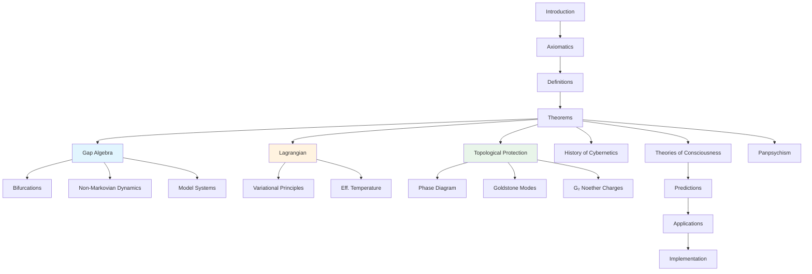

# Introduction to Coherence Cybernetics

> *"We are drowning in information and starving for wisdom."*
> — Edward Osborne Wilson

:::info Who this chapter is for
An introduction to Coherence Cybernetics — a unified mathematical formalism for the dynamics, integrity, and interiority of systems. The reader will learn why a new cybernetics is needed and how the central object of the theory is structured.
:::

A physicist writes down the Schrödinger equation. A biologist draws a homeostasis loop. A psychologist constructs a scale of subjective well-being. A philosopher asks: "Why is anything experienced from the inside at all?" An AI engineer trains a neural network and wonders: does it have even a shadow of experience?

All of them are describing **the same reality** — a system that maintains itself, adapts, and sometimes **experiences** its own activity. But their languages do not intersect. The physicist's equations say nothing about the subjective. The psychologist's metaphors do not convert into differential equations. The philosopher and the engineer talk as though they live in different universes.

**Coherence Cybernetics** (CC) is an attempt to give them a common language. Not an analogy, not a metaphor, but a unified mathematical formalism in which the dynamics of a system, its structural integrity, and its interiority turn out to be **different projections of one and the same object** — the coherence matrix $\Gamma$.

This chapter is an invitation to a journey. We will begin with the question "why?", then show how the central object of the theory is structured, and finish with a map of the entire section — so that every reader can find their own route.

:::tip Chapter Roadmap
In this chapter we:
1. **Understand why a new cybernetics is needed** — three waves of cybernetics and their open questions (section "Why Is a New Cybernetics Needed?")
2. **Get acquainted with the central object** — the coherence matrix $\Gamma$ and the evolution equation (section "What Is Coherence Cybernetics")
3. **See how one formalism works for all sciences** — table of interdisciplinary correspondences (section "A Unified Language for All Sciences")
4. **Master the key concepts** — seven dimensions ASDLEOU, purity $P$, viability thresholds, interiority hierarchy L0-L4 (section "Key Concepts")
5. **Understand what distinguishes CC from alternatives** — comparison with IIT, FEP, panpsychism (section "Why CC?")
6. **Receive the documentation map** — reading routes for different audiences (section "Documentation Map")
:::

:::note On notation
In this document:
- $\Gamma$ — [coherence matrix](/docs/core/dynamics/coherence-matrix)
- $P$ — [purity](/docs/core/dynamics/viability#определение-чистоты): $P = \mathrm{Tr}(\Gamma^2)$
- $\mathcal{H} = \mathbb{C}^7$ — Hilbert state space
- L0, L1, L2, L3, L4 — [interiority levels](/docs/proofs/consciousness/interiority-hierarchy)
:::

---

## Why Is a New Cybernetics Needed?

### Three Epochs of Cybernetics and Their Open Questions

In the 20th century cybernetics went through three waves:

1. **Cybernetics-I (Wiener, 1948)** discovered feedback — the mechanism by which a thermostat holds temperature and an anti-aircraft missile finds an aircraft. This was a breakthrough: for the first time machines and living beings were described in one language. But Wiener looked only at **dynamics** — at flows of signals. He did not ask who or what *observes* those signals.

2. **Cybernetics-II (von Foerster, 1970s)** introduced the observer. "Cybernetics of cybernetics" — the science of how systems model themselves. This was an important step: self-reference, recursion, and autopoiesis (Maturana and Varela) appeared. But the formalism remained qualitative. What exactly does "a system models itself" mean? In what units do we measure the depth of self-observation?

3. **Cybernetics-III (Luhmann, 1990s)** scaled these ideas to social systems: law, economy, art. Luhmann showed that society is a network of communications that reproduces its own boundaries. But the mathematical apparatus was more sociological than physico-mathematical.

Each wave expanded the horizon but left fundamental questions open:

- **Where does subjectivity come from?** None of the three cybernetics could explain why some systems *experience* their activity from the inside, rather than simply processing information.
- **Where is the mathematics?** Autopoiesis is beautiful as a concept, but how do you write it as an equation that can be solved?
- **How to connect scales?** Neuron, brain, society — can they be described with one formalism without losing the specifics of each level?

### Parallel Attempts — and Their Limitations

Besides cybernetics, these questions were approached from other sides:

- **Integrated Information Theory (IIT, Tononi)** proposed a measure of consciousness $\Phi$ and postulated that consciousness is integrated information. But IIT contains no dynamics: it says *what* consciousness equals at a given moment, but not *how* it arises and evolves.

- **The Free Energy Principle (FEP, Friston)** described living systems as minimising variational free energy. This is a powerful framework for perception and action. But FEP does not explain why minimisation of free energy is sometimes accompanied by *experience* and sometimes not.

- **Panpsychism** postulates that experience is fundamental. But without a mathematical formalism this remains a philosophical position, not a theory with predictions.

Each of these approaches illuminates part of the picture, but none covers the whole. **CC aims to assemble these fragments into a unified mathematical framework** built on a compact set of axioms and explicit model assumptions.

---

## What Is Coherence Cybernetics {#что-такое-кибернетика-когерентности}

**Coherence Cybernetics (CC)** is the applied cybernetic formalism developed within Unitary Holonomic Monism (UHM). It models the dynamics of diverse systems — from quantum subsystems to biological organisms and social structures — through the evolution of a 7-dimensional coherence matrix:

$$
\frac{d\Gamma(\tau)}{d\tau} = -i[H_{eff}, \Gamma] + \mathcal{D}[\Gamma] + \mathcal{R}[\Gamma, E]
$$

Before analysing this equation, let us understand its meaning at the intuitive level. Imagine an orchestra:

- $-i[H_{eff}, \Gamma]$ — the **Hamiltonian** — is the conductor. It sets the unitary, reversible dynamics: oscillations, rhythm, the internal frequencies of the system. A physicist will recognise the von Neumann equation here. A biologist will see circadian rhythms. A psychologist — rhythms of attention and wakefulness.

- $\mathcal{D}[\Gamma]$ — the **dissipator** — is the hall absorbing the sound. These are irreversible processes: decoherence, dissipation, loss of structure. Without it the orchestra would play forever. With it — the sound dies away if it is not replenished.

- $\mathcal{R}[\Gamma, E]$ — the **regenerator** — is the musicians themselves, who breathe and play again. This term is characteristic of CC: it models how the system *restores* its coherence toward a self-model target. In the standard constitutive choice, the restoration rate depends on $E$ — on the degree of interiority coherence $\mathrm{Coh}_E(\Gamma)$. An orchestra that *hears* itself plays more coherently.

**These three terms correspond structurally to the three modes of thermodynamic exchange.** The first law of thermodynamics splits exchange into *work*, *heat*, and *matter*, and under an explicitly specified thermodynamic process (`T-258` `[C]` / `[T]` at specified process; see [thermodynamic trichotomy](./sensorimotor#термодинамическая-трихотомия)), the three terms behave as:

- the Hamiltonian term as **work** — it rotates the state without changing entropy or purity (unitary entropy contribution is zero);
- the unital dissipator as **heat** — it can only increase or preserve von Neumann entropy;
- the regenerator as **matter / negentropic input** — it imports order from an external or target reservoir.

Note carefully the formal scope: positive sums of GKSL generators are always admissible, so grouping the dynamics into three terms is a modeling convention rather than an exhaustive theorem prohibiting a fourth channel (the earlier exhaustion claim `T-102` is withdrawn `[✗]`, and the thermal/chemical-potential reading is a model input `[I]`). Geometrically, at the specified dephasing model (`T-262` `[T]`), unitary spectral invariance, dephasing entropy production, and a positive-semidefinite Onsager identity hold; however, the dephasing operator has a diagonal kernel and is not a Riemannian metric on the full state space, so no universal trichotomy follows automatically. Even with those caveats, the physical picture is clear: an open viable system lives in the ongoing balance between unitary rotation, dissipative decay, and regenerative replenishment.

:::note Two roads, three doors [I]
Interestingly, a parallel threefold split — work, heat, matter — also appears in Vitaly Vanchurin's *self-learning universe* from a very different starting point: a learning system operating under resource constraints. Comparing the top-down open-quantum formalism with bottom-up learning thermodynamics provides a suggestive interpretive dictionary ([dictionary](./sensorimotor#гранд-канонический-словарь) `[I]`).
:::

In CC, this evolution equation combines standard open-quantum-system dynamics (unitary + Lindblad dissipation) with a chosen nonlinear regenerative feedback term anchored to a self-model $\varphi$ and a constitutive rate function $\kappa(\Gamma)$ (well-posedness and density-matrix preservation are proved under explicit regularity, target, and rate hypotheses in `CC-1` and `CC-2` `[T]`; earlier claims of a fully axiomatic, unique derivation of regeneration `T-39h` and three-type exhaustion `T-40a`, `T-57`, `T-102` are withdrawn `[✗]`). Working with CC does not require deep category theory — it is enough to keep track of which elements are proved theorems `[T]`, which are definitions `[D]`, and which are explicit model inputs.

CC is proposed as a comparative **metatheoretical language `[I]`**, in which earlier cybernetics (Wiener, von Foerster, Luhmann) can be interpreted as restricted projections onto subsets of dimensions.

---

## A Unified Language for All Sciences

Why can one formalism be applied across physics, biology, psychology, and engineering? Because CC operates at the level of **structural invariants** of a density matrix $\Gamma \in \mathcal{D}(\mathbb{C}^7)$, independent of physical substrate. Turning those formal invariants into empirical claims in any concrete discipline requires an explicit observation law and calibration (`[I]` / `[H]`; see [Diagnosis with Uncertainty](./diagnostics)).

Here is how different disciplines interpret the same mathematical objects (`[I]`):

| CC Concept | Physicist sees | Biologist sees | Psychologist sees | AI Engineer sees |
|------------|----------------|----------------|-------------------|-----------------|
| $\Gamma$ | Density matrix | Homeostasis state | Profile of mental functions | Agent's internal state |
| $P = \mathrm{Tr}(\Gamma^2)$ | Purity of quantum state | Degree of organisation | Level of personality integration | Concentration of latent representation |
| $\tilde\sigma_k = 1 - 7\gamma_{kk}$ `[D]` | Diagonal deficit from $I/7$ | Sector deficit in a subsystem | Tension indicator in a life domain | Anomaly score in a channel |
| $\mathcal{R}[\Gamma, E]$ | Non-unital feedback channel | Tissue regeneration | Mental recovery | Model self-correction |
| $P_{\text{crit}} = 2/7$ `[D]` | Structural-majority cut (`T-5`) | Candidate viability cut `[H]` | Candidate boundary of norm/pathology `[H]` | Candidate operational threshold `[H]` |

Each correspondence is a structured **interpretive bridge `[I]`**: the underlying matrix theorems (`[T]`) hold identically for any valid $\Gamma \in \mathcal{D}(\mathbb{C}^7)$, while empirical applicability to a specific physical, biological, psychological, or AI system must be tested through calibrated reconstruction protocols (`[H]` / `[Pr]`).

---

## Key Concepts

### Coherence Matrix Γ

The central object of the theory is the [coherence matrix](/docs/core/dynamics/coherence-matrix) $\Gamma$, describing the state of a system in a 7-dimensional space. It is a Hermitian positive-semidefinite matrix with unit trace.

What does this mean in plain terms? Imagine a system of seven "voices," each responsible for its own function (more detail below). The diagonal elements $\gamma_{kk}$ show how active each voice is. The off-diagonal $\gamma_{ij}$ show how much these voices are **coordinated** with each other — hence the word *coherence*.

If all voices sound equally quiet and are uncorrelated, $\Gamma = I/7$ — maximum entropy, complete chaos. If one voice dominates and all others have adjusted to it — $\Gamma$ is close to a pure state. Real systems live between these poles, and exactly *where* they are — determines their viability, consciousness, and stability.

For a physicist $\Gamma$ is an ordinary density matrix, only not in the Hilbert space of spins or photons, but in the space of semantic dimensions. For a biologist — a multidimensional homeostasis profile. For a psychologist — the state of mental functions in seven dimensions.

**See:** [Coherence Matrix](/docs/core/dynamics/coherence-matrix)

### Seven Dimensions ASDLEOU

Any system described by a holonom $\Gamma \in \mathcal{D}(\mathbb{C}^7)$ exists in [seven dimensions](/docs/core/structure/dimensions):

| Symbol | Dimension | Function |
|--------|-----------|----------|
| $A$ | [Articulation](/docs/core/structure/dimension-a) | Discriminate |
| $S$ | [Structure](/docs/core/structure/dimension-s) | Retain |
| $D$ | [Dynamics](/docs/core/structure/dimension-d) | Change |
| $L$ | [Logic](/docs/core/structure/dimension-l) | Coordinate |
| $E$ | [Interiority](/docs/core/structure/dimension-e) | Experience |
| $O$ | [Ground](/docs/core/structure/dimension-o) | Nourish |
| $U$ | [Unity](/docs/core/structure/dimension-u) | Integrate |

These seven dimensions are not an arbitrary list of labels; each represents a distinct functional role in the model record:

- **A — Articulation**: *Can the system draw a boundary?* Distinguish "self" from "non-self," signal from noise, figure from ground. Without this there is no subject. A bacterium distinguishes sugar from acid. A neural network distinguishes classes. Consciousness distinguishes "before" from "after."

- **S — Structure**: *Can it remember?* Hold a shape, a pattern, an identity. DNA stores the blueprint of the organism. A neural network stores weights. Culture stores narratives.

- **D — Dynamics**: *Can it change?* Adapt, evolve, learn. A stone does not learn — it is not dynamic in this sense. A bacterium switches its metabolism. The brain rewires synapses.

- **L — Logic**: *Can it be consistent?* Coordinate its parts, eliminate internal conflicts. The immune system distinguishes self from foreign (when logic works) or attacks its own tissues (when it breaks down).

- **E — Interiority**: *Does this system have an inner aspect?* The most distinctive dimension of CC. Within the model, the E-sector is defined for any 7-dimensional state (L0+), while higher-order conscious experience is associated interpretively (`[I]`) with level L2+. It is precisely the explicit inclusion of $E$ that distinguishes CC from classical cybernetics.

- **O — Ground**: *Where does it get its resources?* Energy, nutrition, information — what the system consumes to sustain itself. Cell metabolism. Data consumption by a neural network. The economy of society.

- **U — Unity**: *Is it something whole?* Not merely a collection of parts, but an integrated system where off-diagonal coherences bind the sectors together. The integration measure $\Phi$ reflects this global binding.

**Model basis and bounds:** In CC, the 7-dimensional Hilbert space $\mathbb{C}^7$ with basis $\{A,S,D,L,E,O,U\}$ is part of the formal specification (`[P]` / `[D]`), supported by conditional lower bounds for perfect diagnosability and faithful representation under explicit task/algebra premises (see [Minimality Proof](/docs/proofs/minimality/theorem-minimality-7)). Earlier claims of unconditional seven-role minimality (`T-40f` `[✗]`), automatic derivation of AP+PH+QG+V from A1–A4 (`T-181` `[✗]`), and unconditional selection of $N=7$ from abstract operational axioms (`T-190` `[✗]`) have been withdrawn; universal $N=7$ optimality for autonomous learning remains an open hypothesis (`T-113` `[H]`).

### Viability: P greater than P_crit

Within CC, the static **structural-majority viability cut `[D]`** (`T-5`) is defined by:

$$
\mathrm{Viable}(\mathbb{H}) := P(\Gamma) > P_{\text{crit}} = \frac{2}{7} \approx 0.286
$$

The value $P_{\text{crit}} = 2/7$ is the **structural-majority cut `[D]`** (`T-5`) of 7-dimensional Hilbert–Schmidt geometry: since $\Gamma = I/7 + \Delta$ with $\mathrm{Tr}(\Delta) = 0$ and $\langle I/7, \Delta\rangle_F = 0$, we have the exact orthogonal decomposition $P(\Gamma) = \|I/7\|_F^2 + \|\Delta\|_F^2 = 1/7 + \|\Delta\|_F^2$. Hence $P(\Gamma) > 2/7$ holds if and only if $\|\Delta\|_F^2 > \|I/7\|_F^2 = 1/7$, i.e. the structured traceless component exceeds the uniform background norm (`[T]` for the algebraic identity; `[D]` for choosing $2/7$ as the cut; `[H]` for biological survival correspondence). **See:** [Theorem on Critical Purity](/docs/proofs/dynamics/theorem-purity-critical)

What is purity $P$ intuitively? Recall the orchestra analogy. If all 7 instruments play independently and at equal volume, $P = 1/7 \approx 0.143$ — maximum entropy. If the whole orchestra merges into a single pure state, $P = 1$ — maximum purity (and minimal spectral spread).

A viable state lies in $P \in (2/7, 1]$, and the designated **Goldilocks window `[D]`** is $P \in (2/7, 3/7]$ — the operating band of the canonical consciousness window $\mathcal{V}_{\mathrm{full}}$, whose non-emptiness is proved constructively in `T-124` `[T]`.

Note two important precision points: (1) states with $P \le 2/7$ are *not* statistically indistinguishable from $I/7$ — they can still exhibit nonzero Helstrom advantage (`T-109` `[T]` under binary testing); rather, $2/7$ is the algebraic majority cut where $\|\Gamma - I/7\|_F = 1/\sqrt{7}$; (2) a static purity cut alone does not prove dynamical catastrophe or biological survival (`T-160` `[✗]` withdrawn; dynamical viability requires specifying the full controlled flow and invariant domain).

### Interiority Hierarchy L0 — L4

One of the central organizing constructions of CC is the **capability / interiority ladder `[D]`**: five nested predicate levels on the augmented model record, each adding a stronger structural certificate.

| Level | Name | Formal condition `[D]` | Structural layer |
|-------|------|------------------------|------------------|
| L0 | Interiority | Specified state $\Gamma$ with E-sector / $\rho_E$ | $\mathrm{Cap}_0$ |
| L1 | Phenomenal Geometry | $\mathrm{rank}(\rho_E) > 1$ on specified experiential register | $\mathrm{Cap}_1$ |
| L2 | Cognitive Qualia | $P > 2/7$, $R \geq 1/3$, $\Phi \geq 1$, $D_{\text{diff}} \geq 2$ | $\mathrm{Cap}_2$ |
| L3 | Meta-Reflective Consciousness | $\mathrm{Cap}_2$ + independent predictive metamodel certificate with calibrated nonconstant probes | $\mathrm{Cap}_3$ |
| L4 | Unitary Consciousness | Compatible tower of predictive certificates of all orders | $\mathrm{Cap}_\infty$ |

Here $D_{\mathrm{diff}} = \exp S_{vN}(\rho_E)$ is computed on a specified experiential register $\mathcal{H}_E$ (or, when working strictly inside $\mathbb{C}^7$, via the declared native proxy $D^{7D} = 1 + 6\,\mathrm{Coh}_E(\Gamma)$ `[D]`; never $\exp S_{vN}(\Gamma)$ on the full $7\times 7$ matrix). Note that the earlier universal L3 numerical cut $R^{(2)} \ge 1/4$ (`T-67`) and universal L4 unreachability theorem (`T-86`) have been withdrawn `[✗]`; the L0–L4 criteria above are formal capability definitions `[D]`, while their phenomenal reading as subjective experience is a separate interpretive bridge `[I]`.

What does each level mean interpretively (`[I]`)?

- **L0**: the system admits a 7-axis state representation with an E-sector. This is **not** conscious experience — only a minimal structural slot from which higher organization may develop.

- **L1**: the experiential register $\rho_E$ has non-trivial rank ($\mathrm{rank}(\rho_E) > 1$), allowing distinguishable internal states rather than a single degenerate point.

- **L2**: all four canonical access gates hold simultaneously — structural purity ($P > 2/7$), reflection ($R \geq 1/3$), integration ($\Phi \geq 1$), and differentiation ($D_{\text{diff}} \geq 2$). In CC's interpretive bridge `[I]`, this corresponds to conscious access: the system does not merely register states, it integrates and reflects on them.

- **L3**: beyond L2, the system possesses an independent predictive metamodel certificate verified by calibrated nonconstant probes (`[D]`), corresponding interpretively to meta-cognitive or higher-order monitoring (and, in coupled multi-agent systems under `CC-7`, collective experiential claims require independent evidence `[H]`).

- **L4**: the limiting case — a compatible inverse tower of predictive certificates of all orders (`[D]`). Convergence requires Postnikov completeness of the specified tower (`T-86` `[✗]` withdrawn for universal unreachability); whether any physical system realizes L4 remains an open question (`[Pr]`).

**See:** [Interiority Hierarchy](/docs/proofs/consciousness/interiority-hierarchy)

---

## Why CC?

### A Comparative Metatheoretical Framework

:::info Metatheoretical Scope [H] / [I]
CC is formulated as a unified 7-dimensional model framework aiming to connect:
1. Open-quantum state dynamics on $\mathcal{D}(\mathbb{C}^7)$ with explicit self-modeling and feedback
2. Quantitative viability and capability gates ($P, R, \Phi, D_{\mathrm{diff}}$) `[D]`
3. Explicit interpretive bridges `[I]` to phenomenology, biology, and autonomous AI
:::

In this comparative reading `[I]`, several established frameworks correspond to projections onto subsets of CC's seven functional dimensions:

| Theory | Primary dimension focus `[I]` | What lies outside its core scope |
|--------|-------------------------------|----------------------------------|
| Cybernetics-I (Wiener) | $D$ | Self-reference, phenomenology |
| Cybernetics-II (von Foerster) | $D$, $L$ | Formal open-quantum dynamics, phenomenology |
| Cybernetics-III (Luhmann) | $D$, $L$, $U$ | Quantitative state-space equations |
| IIT (Tononi) | $U$, $E$ | Continuous state dynamics, viability |
| FEP (Friston) | $D$, $O$, $S$ | Explicit E-sector metrics |
| **CC** | **All 7** | **Requires calibrated observation bridges & empirical tests** |

Analogy: imagine that each theory is a torch illuminating part of a dark room. Wiener illuminated dynamics. Von Foerster added the logic of self-observation. Tononi focused on unity and experience. Friston focused on dynamics, Ground, and structure. CC attempts to provide a single coordinate chart for the whole room — while recognizing that any empirical claim still requires measuring the room itself.

**See:** [History of Cybernetics](./cybernetics-history), [Theories of Consciousness](/docs/consciousness/comparative/consciousness-theories)

### Modelling the Connection Between Interiority and Dynamics

A distinctive constitutive feature of CC is an explicit coupling between the regeneration rate and E-coherence (`[D]` / `[H]`):

$$
\kappa(\Gamma) = \kappa_{\text{bootstrap}} + \kappa_0 \cdot \mathrm{Coh}_E(\Gamma)
$$

In this constitutive ansatz, the regeneration rate $\kappa$ depends on $\mathrm{Coh}_E(\Gamma)$ — the Hilbert–Schmidt share of the E-row and E-column in the coherence matrix (`[D]`, see [Definitions](./definitions#coh-e-7d)).

Let us break down this formula:

- $\kappa_{\text{bootstrap}}$ — **base regeneration rate**. It represents baseline structural restoration independent of E-coherence.

- $\kappa_0 \cdot \mathrm{Coh}_E(\Gamma)$ — **the E-coherence coupling term**. Within the model, a system with higher $\mathrm{Coh}_E(\Gamma)$ receives a larger regenerative rate — a computable quantity defined directly from $\Gamma$.

Within the dynamical equations, this makes $\mathrm{Coh}_E$ functionally active rather than epiphenomenal: all else equal, higher E-coherence accelerates recovery after perturbation. Whether real biological or artificial systems obey this constitutive law — and whether $\mathrm{Coh}_E$ corresponds to subjective experience — are explicit empirical and interpretive hypotheses (`[H]` / `[I]`, since fully axiomatic derivation of the regeneration law `T-39h` is withdrawn `[✗]`).

**See:** [Axiomatics — Connection Between Regeneration and E-Coherence](./axiomatics#связь-регенерации-и-e-когерентности)

### Testable Model Predictions

CC formulates concrete structural predictions, each tied to explicit model premises and falsification criteria. Four prominent examples:

1. **Conditional E-coherence balance (`Theorem 8.1` `[C]`):** Under explicitly stated closed purity-flux balance bounds (where external support cannot sustain purity independently), sustaining $P > 2/7$ requires a positive lower bound on $\mathrm{Coh}_E(\Gamma)$. *(Note: the earlier unconditional "No-Zombie" claim `T-38a` is withdrawn `[✗]` because stationary externally supported counterexamples exist.)*
2. **E-coupled regeneration `[H]`:** If a physical or biological system instantiates the constitutive law $\kappa(\Gamma) = \kappa_{\mathrm{bootstrap}} + \kappa_0\,\mathrm{Coh}_E(\Gamma)$, then systems differing in calibrated E-coherence should exhibit predictable differences in recovery rate.
3. **Four-gate capability window (`T-124` `[T]`) & seven-sector diagnostic panel (`T-92` `[D]`):** Within $\mathcal{D}(\mathbb{C}^7)$, the joint window $\mathcal{V}_{\mathrm{full}}$ is provably non-empty (`T-124`), and sector deficits can be monitored via the chosen seven-component panel (`T-92` `[D]`, `T-158` `[D]`) alongside the exact four gate margins.
4. **Rank-7 decoherence anisotropy (`T-2` `[T]` + `[H]`):** For a system governed by the canonical Fano dissipator (`T-2`: Fano dephasing is $2/3$ of atomic dephasing on the selected frame), the 21 pairwise decoherence rates lie in a 7-dimensional subspace obeying 14 exact linear sum-rules — a sharply falsifiable structural test `[H]` of Fano-wired dissipation.

Each prediction clarifies what would refute its corresponding model hypothesis:

- **Conditional E-balance** tests whether real autonomous systems operate in the closed-balance regime where E-coupled regeneration sustains viability (`[C]` / `[H]`).
- **E-regeneration** is falsified if two comparably calibrated systems with distinct $\mathrm{Coh}_E$ show no recovery-rate dependence (`[H]`).
- **Four-gate & seven-sector diagnostics** are falsified as empirical bridges if calibrated reconstructions systematically contradict independent behavioural/clinical verdicts (`[H]`).
- **Rank-7 anisotropy** is falsified for a given substrate by any statistically significant violation of the 14 Fano sum-rules among measured pairwise dephasing rates (`[H]`).

**See:** [Unique Predictions](./predictions)

---

## Bridges to Your Discipline

### For the Physicist

If you are accustomed to quantum mechanics, you are at home. $\Gamma$ is a density matrix. The evolution equation is a Lindblad master equation augmented by a nonlinear regenerative feedback term. Purity $P = \mathrm{Tr}(\Gamma^2)$ is a familiar measure, and $P_{\text{crit}} = 2/7$ is the structural-majority cut (`T-5` `[D]`; note that universal bifurcation at $2/7$ `T-160` is withdrawn `[✗]`).

What is new: the Hilbert space $\mathbb{C}^7$ represents **functional/semantic** axes rather than spins or momenta. On a specified octonionic three-form, the unitary stabilizer acts as $G_2$ on states (`T-42e` `[T]`), while the canonical Fano dissipator links dephasing rates to the Fano plane (`T-2` `[T]`). Any identification with physical gauge fields or particles requires additional field-theoretic structure (`[H]` / `[I]`).

### For the Biologist

Maturana and Varela's autopoiesis is modeled in CC via fixed-point self-maintenance $\varphi(\Gamma^*) = \Gamma^*$ of a chosen self-model (`CC-4` `[T]` for a specified mirror family) together with maintaining $P > P_{\text{crit}}$ (`[D]`). Allostasis corresponds interpretively to shifting the target state in response to environmental changes (`[I]`).

What is new: the biologist obtains a quantitative modelling vocabulary. Sector deficits can be tracked via a calibrated seven-component panel (`T-92` `[D]`), structural organization via $P$, and recovery via $\mathcal{R}[\Gamma, E]$ — with all biological mappings explicitly marked as empirical hypotheses `[H]` requiring experimental validation.

### For the Psychologist

The seven CC dimensions resonate interpretively with core psychological constructs (`[I]`): $E$ with interiority ("what it is like to be," Nagel), the L0–L4 hierarchy with graded levels of access and meta-cognition, and the diagnostic panel with structured stress profiling.

What is new: CC replaces ad hoc scores with explicit mathematical definitions (`[D]`): $P > 2/7$, $R \geq 1/3$, $\Phi \geq 1$, $D_{\text{diff}} \geq 2$, whose joint window is provably non-empty (`T-124` `[T]`). Mapping these formal gates onto clinical or subjective scales remains an empirical calibration program (`[Pr]`).

### For the AI Engineer

If you are building autonomous systems, CC provides a compact 7-axis diagnostic architecture. Maintaining $P > 2/7$ and positive gate margins sets formal operational targets (`[D]`), while the sector panel (`T-92` `[D]`) highlights which functional axis is degrading.

What is new: instead of ad hoc "AI consciousness" heuristics, CC specifies an explicit reconstruction contract (`T-100` `[D]`; see [Diagnosis with Uncertainty](./diagnostics)): define the observation law $p_\rho(y\mid u)$, check identifiability, compute the four gate margins with uncertainty bounds, and distinguish formal model capability (`Cap2`) from any claim of subjective experience (`[I]`).

### For the Philosopher

CC is formulated as a mathematical two-aspect monism (`[I]`): it neither postulates Cartesian substance dualism nor eliminates the E-sector by fiat, instead representing dynamics ($D$) and interiority ($E$) as projections of one coherence matrix $\Gamma$.

What is new: longstanding debates receive a sharper formal framing. The "hard problem" (Chalmers) is separated into (a) formal dynamical conditions on $\Gamma$ and $\mathrm{Coh}_E$ (`[T]` / `[C]`) and (b) the interpretive bridge linking E-sector structure to phenomenology (`[I]`). For the "zombie argument," universal No-Zombie necessity (`T-38a` `[✗]`) is withdrawn because stationary externally supported counterexamples exist, whereas under explicitly stated closed purity-flux balance hypotheses (`Theorem 8.1` `[C]`) sustaining purity requires positive E-coupled regeneration.

---

## Documentation Map

### For Different Audiences

| Audience | Start with | Then | For deeper study |
|----------|-----------|-------|----------------|
| **AI Engineers** | [Sensorimotor Theory](./sensorimotor) | [Implementation](./implementation) → [Diagnostics](./diagnostics) | [Stability](./stability) → [Theorems](./theorems) |
| **Cognitive Scientists** | [Theories of Consciousness](/docs/consciousness/comparative/consciousness-theories) | [Cognitive Hierarchy](/docs/consciousness/comparative/cognitive-hierarchy) → [Bifurcations](./bifurcation) | [Non-Markovian Dynamics](./non-markovian) → [Predictions](./predictions) |
| **Psychologists / Clinicians** | [Phase Diagram](./phase-diagram-cc) | [Non-Markovian Dynamics](./non-markovian) → [Predictions](./predictions) | [Goldstone Modes](./goldstone-modes) |
| **Theorists / Philosophers** | [Axiomatics](./axiomatics) | [Gap Algebra](./gap-algebra) → [Lagrangian](./lagrangian) | [Topological Protection](./topological-protection) → [G₂ Charges](./g2-noether-cc) |
| **AGI Researchers** | [Theories of Consciousness](/docs/consciousness/comparative/consciousness-theories) | [Model Systems](./model-systems) → [Implementation](./implementation) | [Variational Principles](./variational) → [Research Programs](./research-programs) |

### What to Expect from This Section

The CC documentation is organised as **concentric circles**, from the foundation to applications:

1. **Foundation** ([Axiomatics](./axiomatics) → [Definitions](./definitions) → [Theorems](./theorems)): the formal basis. Here you will find all definitions, axioms, and proved results. If you are a theorist — start here.

2. **Mathematical Apparatus** ([Gap Algebra](./gap-algebra), [Lagrangian](./lagrangian), [Topological Protection](./topological-protection)): advanced tools. Gap algebra describes the structure of the "gap" between conscious and unconscious states. The Lagrangian gives a variational principle. Topological protection explains the stability of consciousness.

3. **Dynamics and Transitions** ([Bifurcations](./bifurcation), [Non-Markovian Dynamics](./non-markovian), [Phase Diagram](./phase-diagram-cc)): how systems are born, die, and transform. Phase transitions, bifurcations, and memory effects live here.

4. **Structural Invariants** ([Goldstone Modes](./goldstone-modes), [G₂ Charges](./g2-noether-cc), [Effective Temperature](./effective-temperature)): deep symmetries and conserved quantities. For those interested in the mathematical beauty of the theory.

5. **Context and Comparisons** ([History of Cybernetics](./cybernetics-history), [Model Systems](./model-systems)): how CC relates to what came before it.

6. **Applications** ([Sensorimotor Theory](./sensorimotor), [Implementation](./implementation), [Diagnostics](./diagnostics), [Stability](./stability), [Learning Bounds](./learning-bounds)): practical use of CC for building and analysing systems.

7. **Horizon** ([Predictions](./predictions), [Research Programs](./research-programs)): what CC predicts and what still needs to be verified.

### Documentation Structure

---

## Reader's Guide

You are not obliged to read everything in order. Here are several routes — choose yours:

**"Quick Start" Route (1-2 hours)**:
Introduction (you are here) → [Definitions](./definitions) → [Predictions](./predictions) → [Comparison with Alternatives](./comparison). You will understand what CC asserts, how it differs from IIT/FEP/GWT, and be able to judge whether it is worth digging deeper.

**"Engineer" Route (4-6 hours)**:
Introduction → [Definitions](./definitions) → [Sensorimotor Theory](./sensorimotor) → [Implementation](./implementation) → [Diagnostics](./diagnostics) → [Stability](./stability) → [Measurement Methodology](./measurement). You will be able to start building CC-compatible systems and measuring them.

**"Theorist" Route (10+ hours)**:
Introduction → [Axiomatics](./axiomatics) → [Theorems](./theorems) → [Gap Algebra](./gap-algebra) → [Lagrangian](./lagrangian) → [Topological Protection](./topological-protection) → [G₂ Charges](./g2-noether-cc) → [Variational Principles](./variational) → [Learning Bounds](./learning-bounds). You will master the full mathematical apparatus.

**"Philosopher" Route (3-4 hours)**:
Introduction → [Philosophical Foundations](./philosophy) → [History of Cybernetics](./cybernetics-history) → [Comparison with Alternatives](./comparison) → [Predictions](./predictions). You will understand the ontological status of CC, its place in intellectual history, and its falsifiable consequences.

**"Interdisciplinary" Route (2-3 hours)**:
Introduction → [Interdisciplinary Bridge](./interdisciplinary) → [Applications](./applications) → [Exercises](./exercises). You will find your discipline in CC and try the problems.

**"Self-Check" Route**:
At any stage refer to [Exercises and Problems](./exercises) — they are sorted by difficulty from ★ to ★★★★.

---

## Connection to UHM

CC is built on the conceptual foundation of [Axiom Ω⁷](/docs/core/foundations/axiom-omega) and the $\infty$-topos setting $\text{Sh}_\infty(\mathcal{C})$, augmented by explicit model choices (frame, Hamiltonian, dissipator, self-model, regeneration gate, and observation law; see [Definitions](./definitions)):

$$
\Omega \;\longrightarrow\; \{S_k\} \;\longrightarrow\; \chi_{S_k} \;\longrightarrow\; L_k \;\longrightarrow\; \mathcal{L}_\Omega \;\longrightarrow\; \varphi \;\longrightarrow\; \Gamma^*
$$

This conceptual architecture traces how a specified model record moves from the semantic sectors $\{S_k\}$ and chosen Lindblad/dissipator operators $L_k$ to the evolution generator $\mathcal{L}_\Omega$, the chosen self-modelling operator $\varphi$, and stationary or viable states $\Gamma^*$. Because earlier claims of automatic derivation of all dynamical parameters, gates, and observers purely from A1–A4 have been withdrawn (`T-39d`, `T-39f`, `T-39g`, `T-39h`, `T-41k`, `T-173`, `T-181`, `T-190` `[✗]`), CC explicitly separates axiomatic structure from declared model inputs.

**See:** [Axiomatics — Dependency Hierarchy](./axiomatics#иерархия-зависимостей)

---

## What We Learned

Let us summarise this introductory chapter. We have travelled from general motivation to a specific formalism:

1. **Coherence Cybernetics (CC)** is a unified 7-dimensional mathematical formalism modelling the dynamics, structure, and interiority of systems through a coherence matrix $\Gamma \in \mathcal{D}(\mathbb{C}^7)$, separating proved theorems `[T]`, definitions `[D]`, empirical hypotheses `[H]`, and interpretations `[I]`.

2. **The central equation** $d\Gamma/d\tau = -i[H_{\text{eff}}, \Gamma] + \mathcal{D}[\Gamma] + \mathcal{R}[\Gamma, E]$ combines unitary evolution, dissipation, and nonlinear regeneration (`CC-1`, `CC-2` `[T]` under stated regularity/target hypotheses). Under an explicitly specified thermodynamic process, these play the structural roles of **work, heat, and negentropic input** (`T-258` `[C]`/`[T]`), with dephasing Onsager identities at the specified model (`T-262` `[T]`), while three-group exhaustion (`T-102` `[✗]`) is withdrawn. Coupling regeneration to $\mathrm{Coh}_E(\Gamma)$ is a constitutive model choice `[D]`/`[H]`.

3. **The seven dimensions** ASDLEOU define the functional basis of the model: Articulation ($A$), Structure ($S$), Dynamics ($D$), Logic ($L$), Interiority ($E$), Ground ($O$), and Unity ($U$), supported by conditional diagnosability/representation bounds rather than unconditional seven-role minimality (`T-40f` `[✗]`).

4. **The structural-majority cut** $P_{\text{crit}} = 2/7$ (`T-5` `[D]`) separates high-coherence from low-coherence regimes, and the Goldilocks window $P \in (2/7, 3/7]$ is the purity band of the provably non-empty capability window $\mathcal{V}_{\mathrm{full}}$ (`T-124` `[T]`).

5. **The interiority hierarchy** L0–L4 defines nested capability certificates (`[D]`): from the presence of an E-sector (L0) and non-trivial experiential register rank (L1) through the four access gates of L2 ($P>2/7$, $R\ge 1/3$, $\Phi\ge 1$, $D_{\mathrm{diff}}\ge 2$) to independent metamodel prediction (L3) and compatible towers of all orders (L4), with phenomenal readings treated as explicit interpretive bridges `[I]`.

6. **CC as a comparative framework `[I]`**: earlier cybernetics and theories of consciousness (IIT, FEP, GWT, autopoiesis) can be mapped onto specific subsets of CC's 7-axis record, while empirical validation requires calibrated reconstruction protocols (`[Pr]`).

:::info Bridge to the Next Chapter
We have seen *what* CC models and *why* a unified 7-axis language is useful. In the [next chapter](./axiomatics) we examine the **axiomatics** and explicit model premises — distinguishing precisely what is strictly proved from what is chosen by specification or proposed as a testable hypothesis.
:::

---

**Related Documents:**
- [Axiomatics](./axiomatics) — formal foundations of CC
- [Definitions](./definitions) — basic concepts and formulas
- [Theorems](./theorems) — key results
- [Philosophical Foundations](./philosophy) — ontology, epistemology, and metaphysics of CC
- [Comparison with Alternatives](./comparison) — CC vs. IIT, FEP, GWT, autopoiesis, Orch-OR
- [Measurement Methodology](./measurement) — from formulas to experiments
- [Interdisciplinary Bridge](./interdisciplinary) — a unified language for all sciences
- [Exercises and Problems](./exercises) — practice from ★ to ★★★★
- [Axiom Ω⁷](/docs/core/foundations/axiom-omega) — ∞-topos as primitive
- [Axiom of Septicity](/docs/core/foundations/axiom-septicity) — AP+PH+QG+V requirements
- [Holon](/docs/core/structure/holon) — definition of $\mathbb{H}$
- [Seven Dimensions](/docs/core/structure/dimensions) — basis $\mathcal{H}$
