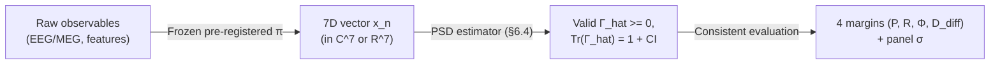

# Measurement Methodology

> *"Measurement is the assignment of numerals to objects or events according to rules."*
> — Stanley Smith Stevens

:::info Who this chapter is for
A bridge between the CC formalism and experiment: protocols for measuring purity $P$, the stress tensor $\sigma$, and the consciousness measures $R$, $\Phi$, $C$.
:::

In the previous chapter we saw that CC surpasses competing theories in computability and falsifiability ([Comparison with Alternatives](./comparison)). But computability is useless without data. The most beautiful theory is useless if it cannot be tested. CC generates precise numerical predictions — but how do we measure them? How do we map the matrix $\Gamma$ onto a real biological, social, or artificial system?

This section is the **bridge between formalism and experiment**. We will show how each CC quantity can be estimated in various contexts: from neuroimaging to organisational audits, from simulations to psychometric tests.

:::info Chapter Roadmap
In this chapter we:
1. Establish the **principles of measurement** in CC: what we measure, the hierarchy of observables, calibration (section 1)
2. Show concrete **protocols for measuring purity** $P$ for different systems (section 2)
3. Describe the **seven-dimensional audit** — measurement of the stress tensor $\sigma$ (section 3)
4. Discuss **measurement of consciousness measures** $R$, $\Phi$, $C$ (section 4)
5. Provide **complete experimental protocols** for neuroscience, AI, and organisations (section 5)
6. Work through **calibration with numerical examples** (section 6)
7. Honestly discuss **limitations** (section 7)
:::

---

## 1. Principles of Measurement in CC {#принципы}

### 1.1 What We Measure

In CC, model functionals ($P$, $R$, $\Phi$, $D_{\mathrm{diff}}$, $\sigma_{\mathrm{sys}}$) are evaluated on a $7 \times 7$ density matrix $\Gamma \in \mathcal{D}(\mathbb{C}^7)$. In empirical settings we do not observe $\Gamma$ directly; we observe physical, neural, behavioral, or software measurements and map them to an estimate $\widehat{\Gamma}$ through a **declared, pre-registered observation model** $\pi$ (see the formal estimation contract in [§6.4](#оценка-gamma)).

:::warning Two Separate Contracts (Aligned with §6.4)
Constructing a valid density matrix $\widehat{\Gamma} \succeq 0$, $\mathrm{Tr}\,\widehat{\Gamma} = 1$ from data (an algebraic/statistical contract) is strictly separate from claiming that $\widehat{\Gamma}$ measures biological viability, consciousness, or a clinical state (an empirical/semantic hypothesis `[H/I]`). Because universal $G_2$-uniqueness of state encoders is withdrawn (`T-42a [✗]`), the choice of encoder $\pi$, target (second moment vs. covariance), and axis frame is an explicit part of every tested hypothesis.
:::

### 1.2 Hierarchy of Observables

Not all CC quantities require the same observational data:

| Level | Quantities | Data requirements | Limitations |
|-------|------------|-------------------|-------------|
| **L1: Global** | $P = \mathrm{Tr}(\Gamma^2)$, $\|\sigma\|_\infty$ | Full matrix $\widehat{\Gamma}$ for $P$; 7 panel scores for $\|\sigma\|_\infty$ | Scalar $P$ alone does not determine $\Phi$, $R$, or $D_{\mathrm{diff}}$ |
| **L2: Diagonal** | $\gamma_{kk}$, diagonal scores $\sigma_k$ | 7 normalized axis populations ($\sum_k \gamma_{kk} = 1$) | Supplies at most **6 of 48** real parameters; carries zero coherence/phase information |
| **L3: Off-diagonal** | $\lvert\gamma_{ij}\rvert$, phases $\theta_{ij}$ | Complex cross-channel second moments ([§6.4](#оценка-gamma)) | Requires phase-preserving estimation and PSD enforcement |
| **L4: Derived** | $R$, $\Phi$, $C$, $\mathrm{Coh}_E$, $D_{\mathrm{diff}}$ | Same reconstructed $\widehat{\Gamma}$ plus declared $D_{\mathrm{diff}}$ readout | Must check all four margins over the reconstruction uncertainty set |

:::tip Practical rule
Fix the observation model $\pi$ and target ($M/\mathrm{Tr}\,M$ vs. $C/\mathrm{Tr}\,C$) **before** inspecting evaluation outcomes, verify PSD and positive trace, and evaluate all functionals ($P$, $R$, $\Phi$, $D_{\mathrm{diff}}$) from the **same** reconstructed matrix $\widehat{\Gamma}$ with uncertainty bounds ([§6.4](#оценка-gamma)).
:::

### 1.3 Calibration Principle

:::warning Key principle
Within the formalism, thresholds such as $P_{\mathrm{crit}} = 2/7$, $R_{\mathrm{th}} = 1/3$, $\Phi_{\mathrm{th}} = 1$, and $D_{\mathrm{diff}} \ge 2$ are dimensionless definitions on $\mathcal{D}(\mathbb{C}^7)$. Mapping physical recordings to $\mathcal{D}(\mathbb{C}^7)$ requires empirical calibration on an **independent training split** — never fitted to the evaluation threshold itself ([§6.3](#калибровка)).
:::

| What independent calibration provides | What calibration does **not** provide |
|---|---|
| Frozen parameters of $\pi_\theta$ for a specified measurement modality | A unique universal encoder for every brain or AI (`T-42a [✗]`) |
| Reproducible mapping into $\mathcal{D}(\mathbb{C}^7)$ on held-out sessions | Automatic clinical diagnosis or phenomenal certification |
| Uncertainty intervals under declared statistical assumptions ([§6.4](#оценка-gamma)) | Coverage guarantees when dependence or stopping assumptions fail |

---

## 2. Measuring Purity P {#измерение-чистоты}

### 2.1 What P Is Mathematically

[Purity](/docs/core/dynamics/viability#определение-чистоты) $P = \mathrm{Tr}(\Gamma^2) = \sum_{k=1}^7 \gamma_{kk}^2 + \sum_{i \neq j} |\gamma_{ij}|^2$ measures concentration of the spectrum of $\Gamma$:
- **Minimum:** $P_{\min} = 1/7 \approx 0.143$, uniquely attained at the maximally mixed state $\Gamma = I/7$.
- **Maximum:** $P_{\max} = 1$, attained at **any** pure state $\Gamma = |\psi\rangle\langle\psi|$ (including a pure diagonal basis state $\Gamma = |k\rangle\langle k|$!).
- **Diagonal vs. off-diagonal roles:** A diagonal matrix ($\gamma_{ij} = 0$ for $i \neq j$) spans the full range $P \in [1/7, 1]$, **NOT** $[0, 1/7]$! However, a diagonal matrix always has **zero integration** ($\Phi = (P - P_{\mathrm{diag}})/P_{\mathrm{diag}} = 0 < 1$). Passing the full consciousness window requires both $P \in (2/7, 3/7]$ and off-diagonal coherences large enough to satisfy $\Phi \ge 1$.

### 2.2 Candidate Biological Modalities `[H]`

Relating neural signals to $\Gamma$ is an empirical hypothesis `[H]` requiring an explicit encoder $\pi_{\mathrm{bio}}$:

| Modality / Signal | What it measures physically | Role in CC measurement |
|-------------------|-----------------------------|------------------------|
| **Complex EEG/MEG analytic signals** | Multi-channel complex envelopes & cross-spectra | Natural input $x_n \in \mathbb{C}^7$ for the PSD second-moment estimator $\widehat{\Gamma}_N = \widehat{\Sigma}_N / \mathrm{Tr}\,\widehat{\Sigma}_N$ ([§6.4](#оценка-gamma)) |
| **fMRI BOLD time series** | Slow hemodynamic co-fluctuations | Real-valued covariance proxy (loses fast complex phases $\theta_{ij}$) |
| **PCI (TMS-EEG)** | Lempel–Ziv complexity of perturbational response | **Independent clinical benchmark**, NOT an estimator of $P$ ([§6.3](#калибровка)) |
| **Lempel–Ziv entropy** | Compressibility of single-channel/multi-channel signal | Separate complexity descriptor; no automatic algebraic equality with $P$ |

### 2.3 PSD-Preserving Protocol for Neural Data `[Pr]`

A naive block average of unsigned pairwise spectral coherences $\bar{C}_{ij} \in [0, 1]$ loses complex phase signs and **does not guarantee positive semidefiniteness** ($\tilde{\gamma} \succeq 0$). To obtain a valid density matrix $\widehat{\Gamma}_N \in \mathcal{D}(\mathbb{C}^7)$ aligned with [§6.4](#оценка-gamma):

**Step 1.** Record multi-channel EEG/MEG (e.g., $\ge 19$–$64$ channels) under a pre-registered preprocessing and artifact-rejection pipeline.

**Step 2.** Apply a **pre-registered, frozen** channel-to-axis projection (calibrated on independent data, never tuned on test labels) mapping sensor signals into a 7-component complex analytic vector $x_n \in \mathbb{C}^7$ (e.g., via Hilbert transform or complex wavelet coefficients in a pre-registered band) across the canonical axes $\{A, S, D, L, E, O, U\}$:

| Canonical axis | Exploratory anatomical grouping `[H]` (must be pre-registered) |
|----------------|----------------------------------------------------------------|
| **A** (Articulation) | Sensory / occipital-perceptual channels (e.g., O1, O2, Oz) |
| **S** (Structure) | Temporal / representational channels (e.g., T3, T4, T5, T6) |
| **D** (Dynamics) | Sensorimotor / executive-action channels (e.g., C3, C4, Cz) |
| **L** (Logic) | Dorsolateral prefrontal channels (e.g., F3, F4) |
| **E** (Interiority) | Midline / interoceptive-self channels (e.g., Fz, Pz) |
| **O** (Ground) | Frontopolar / autonomic-coupled channels (e.g., Fp1, Fp2 + HRV) |
| **U** (Unity) | Parietal / cross-network hubs (e.g., P3, P4) |

**Step 3.** Declare whether the target is the uncentered second moment $M = \mathbb{E}[x x^\dagger]$ or centered covariance $C = \mathbb{E}[(x-\mu)(x-\mu)^\dagger]$ ([§6.4](#оценка-gamma)), and form the guaranteed Hermitian PSD matrix:

$$
\widehat{\Sigma}_N = \frac{1}{N}\sum_{n=1}^{N} x_n x_n^\dagger, \qquad \widehat{\Gamma}_N = \frac{\widehat{\Sigma}_N}{\mathrm{Tr}(\widehat{\Sigma}_N)} \quad (\text{when } \mathrm{Tr}\,\widehat{\Sigma}_N > 0).
$$

**Step 4.** Compute $P_{\mathrm{plug}} = \mathrm{Tr}(\widehat{\Gamma}_N^2)$, $R = 1/(7P_{\mathrm{plug}})$, $\Phi = (P_{\mathrm{plug}} - P_{\mathrm{diag}})/P_{\mathrm{diag}}$, and the declared $D_{\mathrm{diff}}$ readout **from the same $\widehat{\Gamma}_N$**, together with reconstruction uncertainty bounds ([§6.4](#оценка-gamma)).

:::warning Validation caveat
The channel-to-axis grouping above is an exploratory hypothesis `[H]` requiring independent validation and source-space control for volume conduction. An algebraically valid density matrix $\widehat{\Gamma}_N$ does not by itself validate the neurobiological mapping.
:::

### 2.4 Illustrative Synthetic Calculation: Diagonal vs. Coherent Contributions

*(Note: The numbers below are an **illustrative mathematical calculation**, not measured clinical patient data.)*

Suppose a reconstructed density matrix has a nearly uniform diagonal:
$\mathrm{diag}(\Gamma) = (0.16, 0.15, 0.14, 0.14, 0.15, 0.13, 0.13)$ (summing to $1.00$).

- **Diagonal purity contribution:**
  $$P_{\mathrm{diag}} = 0.16^2 + 0.15^2 + 0.14^2 + 0.14^2 + 0.15^2 + 0.13^2 + 0.13^2 = 0.1462.$$
  Recall that for **any** diagonal density matrix $\Gamma = \mathrm{diag}(\gamma_{11}, \ldots, \gamma_{77})$, **$P_{\min} = 1/7 \approx 0.1429$** is the *minimum* (achieved at uniform $\gamma_{kk} = 1/7$), while **$P_{\max} = 1$** is the *maximum* (achieved at a pure basis state $\Gamma = |k\rangle\langle k|$). Thus a diagonal matrix *can* exceed $2/7$ if one axis dominates, **but** any diagonal matrix has $\Phi = 0 < 1$ (failing the integration gate!). When populations are balanced near $1/7$, $P_{\mathrm{diag}} \approx 0.1462$ stays near $P_{\min} = 1/7$, so off-diagonal coherences are required both to lift $P$ above $2/7$ and to achieve $\Phi \ge 1$.
- **Weak off-diagonal coherence ($|\gamma_{ij}| \approx 0.03$ across 42 off-diagonal entries, subject to $\Gamma \succeq 0$):**
  $P_{\mathrm{off}} = \sum_{i \neq j}|\gamma_{ij}|^2 \approx 42 \times 0.0009 = 0.0378$, giving $P \approx 0.184 < 2/7$ and $\Phi = P_{\mathrm{off}}/P_{\mathrm{diag}} \approx 0.26 < 1$.
- **Stronger off-diagonal coherence ($|\gamma_{ij}| \approx 0.06$, PSD-verified):**
  $P_{\mathrm{off}} \approx 42 \times 0.0036 = 0.1512$, giving $P \approx 0.297 \in (2/7, 3/7]$ and $\Phi \approx 1.03 \ge 1$ (while $R = 1/(7P) \approx 0.48 \ge 1/3$).
- **Near-maximally mixed state ($|\gamma_{ij}| \approx 0.01$, nearly uniform diagonal):**
  $P \approx 0.143 + 0.004 = 0.147 \approx P_{\min}$, $\Phi \approx 0.03$.

:::info Clinical bridge scope `[H]`
Whether longitudinal changes in reconstructed $\widehat{P}(t)$ and the four-gate verdict $\mathrm{Cons}(\widehat{\Gamma}(t))$ track clinical recovery better than standard neurological scales (such as GCS or PCI) is an untested empirical hypothesis `[H]` requiring prospective clinical studies with frozen encoders and uncertainty sets ([§6.3–6.4](#калибровка)).
:::

### 2.5 Exploratory Proxies for Organisations `[I/H]`

| Candidate organizational metric | What it measures | Exploratory CC mapping `[I/H]` |
|---------------------------------|------------------|--------------------------------|
| **Alignment / engagement indices** | Agreement across team objectives | Candidate input for a declared 7-axis encoder (not directly equal to $P$) |
| **Cross-functional interaction matrices** | Structured inter-unit communication | Candidate source for off-diagonal covariance $\widehat{\Sigma}_N$ |
| **Operational viability metrics** | Sustained margin, retention | External validation outcome, NOT an algebraic proxy for $P$ |

### 2.6 Exploratory Proxies for AI Systems `[I/H]`

| Candidate AI metric | Mathematical behavior | Correction & CC mapping `[I/H]` |
|---------------------|-----------------------|---------------------------------|
| **Effective rank of normalized hidden covariance** | Higher uniform rank $r$ gives **lower** purity $P = \mathrm{Tr}(\rho^2) = 1/r$ (lower rank / more concentrated spectrum gives **higher** $P$) | Note: a 7D normalized covariance $\widehat{\Gamma}_N = \widehat{\Sigma}_N/\mathrm{Tr}\,\widehat{\Sigma}_N$ naturally stays in the window $P \in (2/7, 3/7]$ at intermediate effective rank ($\approx 2.3\text{–}3.5$), neither rank-1 collapse ($P = 1$) nor uniform noise ($P = 1/7$) |
| **Attention concentration** | Lower entropy corresponds to sharper weights | Candidate feature for an explicit encoder $\pi$, not equal to $P$ by itself |
| **Loss landscape curvature** | Local Hessian spectrum | Optimization geometry; distinct from state-space purity $P$ |

---

## 3. Measuring the Stress Panel σ {#измерение-напряжений}

### 3.1 Seven Selected Scores (`T-92 [D]`)

T-92 `[D]` specifies a diagnostic panel, not a unique tensor derived from the axioms. The population score $s_k = 1 - 7\gamma_{kk}$ lies in $[-6, 1]$; its clamped version $\sigma_k = \max(0, s_k)$ lies in $[0, 1]$. The **unclamped** scores always sum to zero ($\sum_{k=1}^7 s_k = 7 - 7\sum_{k=1}^7 \gamma_{kk} = 0$). A full panel may contain selected functions of $R$, $\Phi$, the regeneration rate, and an independently specified extended readout $D_{\mathrm{diff}}$.

Populations and their deficits do not reconstruct complex coherences: diagonal measurement supplies at most six independent parameters out of 48. Equivalence of the panel to the full window is unproved (`CC-8 [D]`). Test the four separate margins over a reconstruction uncertainty set; see [identifiability](/docs/applied/research/reconstruction-identifiability).

### 3.2 Seven-Dimensional Audit Protocol `[I/H]`

For an organisation or team (exploratory mapping `[I/H]`):

| Dimension | Exploratory audit question | Candidate instrument |
|-----------|----------------------------|----------------------|
| $\sigma_A$ (Articulation) | "Can you clearly formulate what your department does?" | Interviews, documentation analysis |
| $\sigma_S$ (Structure) | "Are there stable processes and roles?" | Org structure analysis, tenure analysis |
| $\sigma_D$ (Dynamics) | "Can you adapt to change?" | Agility assessment, cycle time |
| $\sigma_L$ (Logic) | "Are there internal contradictions in the rules?" | Policy audit, consistency check |
| $\sigma_E$ (Interiority) | "Is there a culture of reflection?" | Psychological safety survey |
| $\sigma_O$ (Ground) | "Are resources sufficient?" | Budget audit, burnout survey |
| $\sigma_U$ (Unity) | "Do you feel part of a whole?" | Network analysis, NPS |

### 3.3 Illustrative Domain Readings of $\sigma_D$ (Dynamics) `[I]`

Interpretive mappings of the Dynamics axis ($D$) across domains `[I]` (hypotheses requiring domain-specific validation):
- **Biology:** Metabolic throughput / energetic capacity for action (e.g., cellular ATP/ADP balance).
- **Psychology:** Behavioral initiation and executive switching (e.g., Trail Making Test latency).
- **Organisations:** Decision-to-execution latency (e.g., approval lead time).

### 3.4 Exploratory Psychometric Mapping `[H/I]`

Mapping seven standardized psychometric instruments onto the canonical axes $\{A, S, D, L, E, O, U\}$ is an exploratory research hypothesis `[H/I]`, not a validated clinical diagnostic system:

| Axis | Exploratory psychometric construct `[I]` | Existing instrument |
|------|------------------------------------------|---------------------|
| $\sigma_A$ (Articulation) | Sensory / perceptual load | Sensory Profile (Dunn) |
| $\sigma_S$ (Structure) | Cognitive rigidity / set shifting | WCST (Wisconsin Card Sorting Test) |
| $\sigma_D$ (Dynamics) | Executive task switching | Trail Making Test (TMT-B) |
| $\sigma_L$ (Logic) | Cognitive distortions | Cognitive Distortion Scale |
| $\sigma_E$ (Interiority) | Difficulty identifying feelings | TAS-20 (Toronto Alexithymia Scale) |
| $\sigma_O$ (Ground) | Exhaustion / resource depletion | MBI (Maslach Burnout Inventory) |
| $\sigma_U$ (Unity) | Social disconnection | UCLA Loneliness Scale |

### 3.5 Worked Calculation: Why Clamped Stress Scores Cannot Be Inverted Directly to $\gamma_{kk}$

Suppose seven psychometric instruments are normalized to $[0, 1]$ (illustrative synthetic values):

| Test | Raw score | Normalized $\sigma_k \in [0, 1]$ |
|------|-----------|----------------------------------|
| Sensory Profile ($\sigma_A$) | 42/80 | 0.53 |
| WCST errors ($\sigma_S$) | 12/60 | 0.20 |
| TMT-B time ($\sigma_D$) | 180 s (norm 75 s) | 0.70 |
| Cognitive distortions ($\sigma_L$) | 15/50 | 0.30 |
| TAS-20 ($\sigma_E$) | 65/100 | 0.65 |
| MBI emotional exhaustion ($\sigma_O$) | 28/54 | 0.52 |
| UCLA loneliness ($\sigma_U$) | 45/80 | 0.56 |

Profile: $\sigma = [0.53,\; 0.20,\; 0.70,\; 0.30,\; 0.65,\; 0.52,\; 0.56]$, with $\|\sigma\|_\infty = 0.70$ (highest exploratory load on $D$ and $E$; clinical interpretation and intervention require standard clinical evaluation, not matrix scores alone).

:::warning Mathematical Correction: Trace Never Lives in Off-Diagonals!
Attempting naive "inverse conversion" via $\tilde{\gamma}_{kk} = (1 - \sigma_k)/7$ gives:

$$
\tilde{\gamma} = \left(\frac{0.47}{7},\; \frac{0.80}{7},\; \frac{0.30}{7},\; \frac{0.70}{7},\; \frac{0.35}{7},\; \frac{0.48}{7},\; \frac{0.44}{7}\right) = (0.067,\; 0.114,\; 0.043,\; 0.100,\; 0.050,\; 0.069,\; 0.063),
$$

whose sum is $\sum_{k=1}^7 \tilde{\gamma}_{kk} = 0.506 \neq 1$.

**Why this fails (correcting an earlier error):** For **every** density matrix $\Gamma$, the trace equals the sum of its **diagonal entries alone** ($\mathrm{Tr}\,\Gamma = \sum_{k=1}^7 \gamma_{kk} = 1$). Off-diagonal elements contribute **zero** to the trace — the missing $0.494$ is **never** "distributed across off-diagonal elements"! Rather, $\sum_k \tilde{\gamma}_{kk} < 1$ is mathematically inevitable whenever all seven inputs are positive ($\sigma_k > 0$), because the clamping map $\sigma_k = \max(0, 1 - 7\gamma_{kk})$ discards all negative deficits ($s_k < 0$, where $\gamma_{kk} > 1/7$) and is therefore **non-invertible**: for a genuine density matrix, $\sum_{k=1}^7 (1 - 7\gamma_{kk}) = 0$, so at least one axis must satisfy $\gamma_{kk} \ge 1/7$ ($\sigma_k = 0$).

To construct valid diagonal populations $\gamma_{kk} \ge 0$ with $\sum_k \gamma_{kk} = 1$ from nonnegative availability scores $a_k = 1 - \sigma_k > 0$, one must explicitly **normalize on the probability simplex**:

$$
\gamma_{kk} = \frac{1 - \sigma_k}{\sum_{j=1}^7 (1 - \sigma_j)} \approx (0.133,\; 0.226,\; 0.085,\; 0.198,\; 0.099,\; 0.136,\; 0.124), \qquad \sum_{k=1}^7 \gamma_{kk} = 1.000.
$$

Even after simplex normalization, this vector supplies only the **6 independent diagonal degrees of freedom** — it determines none of the 21 complex off-diagonal coherences $\gamma_{ij}$ and therefore cannot estimate $\Phi$ or full $P$ ([§3.1](#измерение-напряжений), [§6.4](#оценка-gamma)).
:::

---

## 4. Measuring Consciousness Measures {#измерение-сознательности}

### 4.1 Canonical Reflection Measure $R$ vs. Self-Model Fidelity $R_\varphi$

Within the formalism, two distinct quantities appear ([the three working forms of R](/docs/consciousness/foundations/self-observation#формы-r)):
- **Canonical state reflexivity:** $R(\Gamma) = 1/(7P(\Gamma)) \in [1/7, 1]$, which determines the upper purity ceiling ($R \ge 1/3 \iff P \le 3/7$) and enters $C = \Phi \times R$. In the consciousness window $P \in (2/7, 3/7]$, canonical $R$ lies strictly in $[1/3, 1/2)$.
- **Self-model fidelity:** $R_\varphi(\Gamma) = F(\Gamma, \varphi(\Gamma)) \in [0, 1]$, which additionally requires specifying a concrete self-model map $\varphi$.

**Exploratory behavioral proxies `[H]`:** Behavioral measures such as metacognitive sensitivity ($\text{meta-}d'$), self-report calibration, or mirror recognition are **external empirical correlates `[H]`**, not direct measurements of $R(\Gamma) = 1/(7P)$. Whenever $\widehat{\Gamma}_N$ is reconstructed per [§6.4](#оценка-gamma), canonical $\widehat{R} = 1/(7\widehat{P})$ must be computed directly from that same matrix $\widehat{\Gamma}_N$, rather than substituted by an ad hoc heuristic such as $\text{meta-}d'/3$.

### 4.2 Integration Measure $\Phi$

[Integration measure](/docs/core/structure/dimension-u#мера-интеграции-φ) $\Phi(\Gamma) = (P(\Gamma) - P_{\mathrm{diag}}(\Gamma))/P_{\mathrm{diag}}(\Gamma)$ quantifies the ratio of off-diagonal coherent weight to diagonal purity in the fixed frame $\{A,S,D,L,E,O,U\}$.

**External benchmarks vs. matrix computation:**
- **PCI (Perturbational Complexity Index):** On its clinical benchmark, $\mathrm{PCI}^* = 0.31$ separates states with and without subjective report (Casali et al., 2013; Casarotto et al., 2016: 36/38 minimally conscious patients and 9/43 vegetative-state patients above $0.31$). PCI is an **independent clinical benchmark**, NOT an algebraic proxy for $\Phi$ or $P$ ([§6.3](#калибровка)).
- **Graph spectral gaps & mutual information:** External exploratory correlates `[H]`; they do not replace computing $\widehat{\Phi}$ directly from the reconstructed PSD density matrix $\widehat{\Gamma}_N$.

### 4.3 Consciousness Measure $C$ (`T-140 [D]`)

$C = \Phi \times R$ (`T-140 [D]`) is a selected scalar summary of integration and canonical reflexivity.

**Exact threshold relations:**
- $C = 0$ means the selected scalar score is zero; a phenomenal interpretation requires a separate bridge `[I]`.
- $0 < C < 1/3$ fails the selected window's necessary product inequality; it does not by itself classify bacteria, animals, or AI.
- $C \geq C_{\mathrm{th}} = 1/3$ (`T-140`) is **necessary but NOT sufficient** for the full four-gate capability predicate ($P > 2/7$, $R \geq 1/3$, $\Phi \geq 1$, $D_{\mathrm{diff}} \geq 2$). On the uniform-diagonal stratum ($\gamma_{kk} = 1/7$), $P = (1 + \Phi)/7$, so the window gives $C = \Phi/(1 + \Phi) \in (1/2, 2/3]$.

Choose and pre-register all thresholds before viewing evaluation labels.

**Illustrative consistent matrix calculation.** Suppose a reconstructed $\widehat{\Gamma}_N$ on the uniform-diagonal stratum yields $\widehat{P} = 0.35 \in (2/7, 3/7]$ and $\widehat{\Phi} = 7\widehat{P} - 1 = 1.45 \ge 1$. From the **same matrix**:

$$
\widehat{R} = \frac{1}{7\widehat{P}} \approx 0.408 \in [1/3, 1/2), \qquad \widehat{C} = \widehat{\Phi} \times \widehat{R} = 1.45 \times 0.408 \approx 0.592 \in (1/2, 2/3].
$$

Notice that $\widehat{R} \in [1/3, 1/2)$ and $\widehat{C} \in (1/2, 2/3]$ follow automatically when both quantities come from one consistent $\widehat{\Gamma}_N$; mixing an uncalibrated behavioral proxy (e.g., $\text{meta-}d'/2 = 0.6$) with matrix $\widehat{\Phi}$ violates the canonical band $[1/3, 1/2)$ of $R = 1/(7P)$.

---

## 5. Experimental Protocols `[Pr]` {#протоколы}

### 5.1 Protocol for a Neuroscientific Experiment (Aligned with §6.3–6.4)

**Goal:** Test held-out concordance between the reconstructed four-gate verdict $\mathrm{Cons}(\widehat{\Gamma}_N)$ and independent clinical markers ($\mathrm{PCI}_{\max} > 0.31$ and behavioral/report benchmarks, P8.4). *(Correction: universal No-Zombie necessity `T-38a [✗]` is withdrawn; externally supported states with $P > 2/7$ and low $\mathrm{Coh}_E$ do not refute the density-matrix formalism. See [Pred 1](./predictions#предсказание-1) and [Pred 21](./predictions#предсказание-21).)*

**Pre-registered design (`SUB-1`–`SUB-6`):**
1. Pre-register the encoder $\pi_{\mathrm{bio}}$, preprocessing, target ($M/\mathrm{Tr}\,M$ vs. $C/\mathrm{Tr}\,C$), and $D_{\mathrm{diff}}$ readout; calibrate parameters strictly on independent wakefulness training sessions with no viability penalty ($\lambda_2 = 0$), and freeze $\pi_{\mathrm{bio}}$.
2. Record held-out EEG/MEG + TMS-EEG + HRV sessions across wakefulness, REM sleep, NREM3 sleep, and anaesthesia (e.g., propofol, ketamine).
3. Reconstruct $\widehat{\Gamma}_N \in \mathcal{D}(\mathbb{C}^7)$ per [§6.4](#оценка-gamma), verifying PSD, positive trace, and uncertainty bounds on all **four** capability margins ($P - 2/7$, $3/7 - P$, $\Phi - 1$, $D_{\mathrm{diff}} - 2$).
4. Evaluate Cohen's $\kappa$ between the four-gate verdict $\mathrm{Cons}(\widehat{\Gamma}_N)$ and independent $\mathrm{PCI}_{\max} > 0.31$ (or verified report states) strictly on held-out sessions ([§6.3](#калибровка)).

**Falsification criterion (scoped to $\pi_{\mathrm{bio}}$ / P8.4):** Non-PSD outputs, failure of test–retest reproducibility outside tomography confidence intervals, or held-out concordance $\kappa < 0.4$ falsifies the tested biological readout hypothesis $\pi_{\mathrm{bio}}$ `[H]`.

### 5.2 Protocol for an AI / LLM Experiment

**Goal:** Evaluate the reconstructed four-gate trajectory $\widehat{\Gamma}_N(t)$ of an AI system under a fixed, declared 7-axis embedding $\pi$.

**Design:**
1. Fix a frozen 7-axis readout $\pi$ mapping hidden activations to $x_n \in \mathbb{C}^7$ (or $\mathbb{R}^7$ when phases are absent), and explicitly declare whether the target is the uncentered second moment $M/\mathrm{Tr}\,M$ or centered covariance $C/\mathrm{Tr}\,C$ ([§6.4](#оценка-gamma)).
2. Compute $\widehat{\Gamma}_N = \widehat{\Sigma}_N / \mathrm{Tr}\,\widehat{\Sigma}_N$ over evaluation batches with uncertainty bounds, evaluating all four margins ($P$, $R$, $\Phi$, $D_{\mathrm{diff}}$) rather than $P$ alone.
3. Track trajectories across training or prompt regimes. *(Note: crossing the defined cut $P = 2/7$ is an algebraic threshold crossing `[D]`, NOT an automatic thermodynamic phase transition — universal purity-cut bifurcation `T-160 [✗]` is withdrawn.)*

**Illustrative 7-axis feature mapping for a transformer `[H]`** (one candidate design, not unique under `T-42a [✗]`):
- **A** (Articulation): attention / sensory-input discrimination features
- **S** (Structure): representational stability across perturbations
- **D** (Dynamics): output-generation / state-update dynamics
- **L** (Logic): internal consistency across inference checks
- **E** (Interiority): self-monitoring / metacognitive calibration signals
- **O** (Ground): context/resource grounding
- **U** (Unity): cross-layer representational integration

### 5.3 Protocol for an Organisational Audit `[I/H]`

**Goal:** Exploratory seven-axis organizational monitoring via the defined stress panel (`T-92 [D]`).

**Steps:**
1. Collect standardized indicators for all 7 canonical axes $\{A, S, D, L, E, O, U\}$ and evaluate the panel $\sigma = (\sigma_A, \ldots, \sigma_U)$ (`T-92 [D]`).
2. Identify the largest panel component $\|\sigma\|_\infty$ for prioritized review.
3. Track panel dynamics longitudinally. *(Note: diagonal audit scores alone cannot compute matrix purity $P$ or integration $\Phi$; estimating $P$ additionally requires cross-axis interaction data forming a PSD matrix $\widehat{\Gamma}_N$ per [§6.4](#оценка-gamma), and $\|\sigma\|_\infty < 1$ is not universally equivalent to $P > 2/7$, `CC-8 [D]`.)*

**Illustrative panel report (synthetic example):**

```
=== Exploratory 7-Axis Panel: "Example" LLC ===
Date: 2026-01-15

σ-panel: [0.3, 0.2, 0.6, 0.4, 0.7, 0.3, 0.5]
           A    S    D    L    E    O    U

‖σ‖∞ = 0.7 (E: Interiority — highest panel load)
Note: Panel scores track diagonal indicators only; full P, R, Φ require
cross-unit interaction covariance reconstruction (§6.4).
```

---

## 6. Calibration: from Observables to $\Gamma$ {#калибровка}

### 6.1 General Reconstruction Pipeline

Aligned with [§6.4](#оценка-gamma), translating raw observables into $\widehat{\Gamma}_N$ separates feature mapping from PSD matrix estimation:



### 6.2 Simplex Normalization vs. Full Matrix Estimation

Element-wise linear or logistic transforms applied independently to 7 scalar indicators (such as $\tilde{\gamma}_{kk} = \frac{1}{7} + \alpha_k(x_k - \bar{x}_k)$) do **not** automatically satisfy nonnegativity ($\gamma_{kk} \ge 0$) or unit trace ($\sum_k \gamma_{kk} = 1$) unless followed by explicit simplex normalization — and they never recover off-diagonal coherences $\gamma_{ij}$. Whenever full $\Gamma$-functionals ($P, R, \Phi$) are needed, use the guaranteed PSD rank-1 average $\widehat{\Gamma}_N = \widehat{\Sigma}_N / \mathrm{Tr}\,\widehat{\Sigma}_N$ of [§6.4](#оценка-gamma), with all encoder parameters fitted strictly on an independent training split and frozen prior to testing.

### 6.3 Numerical Example: Testing Against PCI Without Calibrating to It

A line through $(0,1/7)$ and $(c,2/7)$ returns $P=2/7$ at $\mathrm{PCI}=c$ for any positive $c$. Choosing $c=0.31$ builds in the threshold agreement. Test the model on independent sessions with the estimator fixed before collecting the comparison labels.

The nearness of $\mathrm{PCI}^* = 0.31$ to $2/7 \approx 0.286$ is a coincidence of two unrelated scales: PCI is a normalised Lempel–Ziv complexity of a binarised response to TMS, $P$ is a function of $\Gamma$.

**What replaces it — a concordance of verdicts** (P8.4 and pre-registration SUB-1 … SUB-6 of the [measurement protocol](/docs/applied/research/measurement-protocol#substitution-position)):
1. Freeze the reconstruction $\pi_\theta$ on wakefulness sessions only; no viability penalty in the estimator ($\lambda_2 = 0$).
2. On held-out sessions compute the UHM verdict $\mathrm{Cons}(\widehat\Gamma)$ and the PCI verdict $\mathrm{PCI}_{\max} > 0.31$ independently.
3. Report Cohen's $\kappa = (p_o - p_e)/(1 - p_e)$, where $p_o$ is the observed agreement and $p_e$ the agreement expected from the two marginal rates. $\kappa \geq 0.8$ corroborates, $\kappa < 0.4$ falsifies.

**Worked example** (illustrative counts, not data). 40 sessions: both verdicts "conscious" in 18, both "not conscious" in 16, disagreement in $3 + 3$. Then $p_o = 34/40 = 0.85$; each verdict says "conscious" 21 times, so $p_e = (21/40)^2 + (19/40)^2 = 0.501$ and $\kappa = (0.85 - 0.501)/(1 - 0.501) = 0.70$ — inconclusive. With the same 34 agreements split as $33 + 1$ (both marginals 36 of 40), $p_e = 0.82$ and $\kappa = 0.17$ — falsifying. Raw agreement does not decide; $\kappa$ does (`test_verdict_concordance_is_judged_by_kappa_not_by_raw_agreement`).

**Reference values** — Casarotto et al. (2016), Table 1, $\mathrm{PCI}_{\max}$ median [min–max]: wakefulness 0.53 [0.39–0.70] (102 subjects), REM sleep 0.48 [0.36–0.56] (8), ketamine 0.43 [0.36–0.52] (6), NREM sleep 0.25 [0.15–0.31] (18), midazolam 0.30 [0.23–0.31], xenon 0.23 [0.11–0.31], propofol 0.26 [0.23–0.31] (6 each). The decisive sessions are REM and ketamine: consciousness without behaviour at the time, out of sample when $\theta$ is frozen on wakefulness.

:::tip What this means
The CC threshold $P = 2/7$ is not a number on the PCI scale and is not tested by matching one. It is tested by whether the verdict computed from $\widehat\Gamma$ agrees with the independently validated PCI verdict on sessions that did not fix the reconstruction.
:::

## 6.4 Conditional $\Gamma$ estimation: target, consistency and uncertainty {#оценка-gamma}

A matrix estimator and an interpretation of that matrix are separate contracts. Fix the channel map $\pi$ before evaluating its predictions. For $x=\pi(\mathrm{state})\in\mathbb C^7$, define the **second-moment target**
$$
M=\mathbb E[xx^\dagger],\qquad \tau=\operatorname{Tr}M>0,\qquad \Gamma=M/\tau.
$$
This constructs a density matrix from a declared observation model; it does not prove that the model measures consciousness, wellbeing or a clinical state. Unless $\mathbb E x=0$, the second moment is **not** the covariance.

**Centering changes the target.** With $\mu=\mathbb E x$, the covariance target is $C=\mathbb E[(x-\mu)(x-\mu)^\dagger]$. Subtracting the same sample's mean estimates $C$, not $M$. Its residuals share the estimated mean and are dependent even when the raw observations are i.i.d. An independently fixed baseline instead defines another fixed second-moment target. Record which of these experiments is intended.

**(1) Algebra and consistency.** For fixed embedded observations,
$$
\widehat\Sigma_N=\frac1N\sum_n x_nx_n^\dagger,\qquad
\widehat\Gamma_N=\widehat\Sigma_N/\operatorname{Tr}\widehat\Sigma_N.
$$
When the observed trace is positive, $\widehat\Gamma_N$ is Hermitian, positive semidefinite and unit trace. At zero trace the normalized estimate is **undefined**, regardless of the sample count. For a stationary ergodic source with $\mathbb E\|x\|^2<\infty$, the ergodic law and continuity give almost-sure convergence to $\Gamma$. The analogous covariance estimator is consistent when $\operatorname{Tr}C>0$. These facts alone provide neither a convergence rate nor a confidence interval.

**(2) A finite-sample bound for a fixed i.i.d. embedding [T under these premises].** Additionally assume independent identically distributed observations and a **population** bound $\|x\|^2\le B$ almost surely. A bound verified only on the observed sample does not establish this premise. For $Z_n=x_nx_n^\dagger-M$,
$$
\|Z_n\|_{\rm op}\le2B,\qquad
v^2=\|\mathbb EZ_n^2\|_{\rm op}\le B^2,
$$
because $\mathbb EZ_n^2=\mathbb E[(xx^\dagger)^2]-M^2\preceq BM$. Matrix Bernstein therefore gives
$$
\Pr(\|\widehat\Sigma_N-M\|_{\rm op}\ge t)
\le 14\exp\!\left(-\frac{Nt^2}{2B^2+(4B/3)t}\right).
$$
See [Tropp, Theorem 1.4](https://tropp.caltech.edu/papers/Tro11-User-Friendly-preprint.pdf); independence, bounded summands and the variance parameter are part of its contract.

For any positive semidefinite $A,M$ with positive traces, putting $E=A-M$ gives the **exact** normalization bound
$$
\left\|\frac A{\operatorname{Tr}A}-\frac M\tau\right\|_{\rm op}
\le\frac{\|E\|_{\rm op}+|\operatorname{Tr}E|}{\tau}
\le\frac{8}{\tau}\|E\|_{\rm op}.
$$
Indeed, subtract the matrices as $E/\tau-(A/\operatorname{Tr}A)\operatorname{Tr}E/\tau$ and use $\|A/\operatorname{Tr}A\|_{\rm op}\le1$ and $|\operatorname{Tr}E|\le7\|E\|_{\rm op}$. The former factor $2/\tau$ was not valid for the **operator norm**.

Given a declared population trace lower bound $0<\tau_0\le\tau$ and $0<\varepsilon\le1$, set $t=\tau_0\varepsilon/8$. The sufficient budget
$$
N\ge\left\lceil
\log(14/\delta)\frac{2B^2+(4B/3)t}{t^2}
\right\rceil
$$
then ensures normalized operator error at most $\varepsilon$ with probability at least $1-\delta$. On this event the observed trace is positive, since $7t<\tau$. This is a conservative sufficient bound, not an optimum; no unspecified constant is silently set to one.

A data-dependent region can also use the positive root $t_N$ of
$$
Nt_N^2=\log(14/\delta)\,[2B^2+(4B/3)t_N].
$$
On the same event $\tau\ge\ell=\max(0,\operatorname{Tr}\widehat\Sigma_N-7t_N)$. For a defined estimate, use $r=\min(1,8t_N/\ell)$ when $\ell>0$ and $r=1$ otherwise. Density matrices differ by at most one in operator norm. With $P_{\rm plug}=\operatorname{Tr}\widehat\Gamma_N^2$,
$$
P=\operatorname{Tr}\Gamma^2
\in [\,P_{\rm plug}-2r,\ P_{\rm plug}+2r\,]\cap[1/7,1],
$$
because $|\operatorname{Tr}(\widehat\Gamma_N^2-\Gamma^2)|\le2r$. At zero observed trace, return the full target set without a matrix center; do not silently condition the coverage claim on having returned a point estimate. A full physical interval is uninformative, not evidence for a threshold verdict. The reference uses floating-point evaluation, not certified interval arithmetic.

:::caution Dependent observations and estimated baselines need another uncertainty argument
Stationary ergodicity is enough for the consistency statement above, but not for a central limit theorem or Bernstein concentration. Replacing $N$ by an estimated $N_{\rm eff}$ does **not** transfer these guarantees verbatim. Autocorrelation of window energy does not determine uncertainty of directional covariance or purity; energy may stay constant while directions remain dependent. Returning zero estimated autocorrelation for a short or constant series is not evidence of independence.

For asymptotic intervals, specify a dependence model, a suitable central limit theorem and a consistent long-run variance estimator for the **actual statistic**, including its estimated denominator and baseline. Batch-means consistency requires appropriate growing batch sizes/counts and process assumptions; a fixed twenty-batch diagnostic is not that contract. See [Flegal–Jones](https://arxiv.org/pdf/0811.1729). Repeated looks, overlapping windows, missingness and adaptive stopping also belong to the observation protocol. The module supplies no automatic 95% interval for these cases.
:::

**(3) Pair statistic versus matrix purity.** For $N\ge2$ and positive observed trace, retain the diagnostic
$$
\widehat P_{\rm pair}
=\frac{\sum_{m\ne n}|x_m^\dagger x_n|^2}
 {N(N-1)(\operatorname{Tr}\widehat\Sigma_N)^2}.
$$
For **i.i.d. fixed embedded observations**, the pair average in its numerator is exactly unbiased for $\operatorname{Tr}M^2$: independence factors the two second moments. Its ratio with an estimated denominator is not generally unbiased. Neither a universal bias sign nor a threefold improvement follows from one Gaussian simulation. Same-sample centering invalidates even that numerator argument. For two independent Rademacher observations, sample-centering gives expected pair numerator $1/2$, whereas the population variance squared is $1$.

For the real covariance target with unknown mean, distinct **independent** raw observations admit the unbiased numerator kernel
$$
h(X_i,X_j,X_k,X_l)
=\tfrac14[(X_i-X_j)^\top(X_k-X_l)]^2,\qquad
\mathbb Eh=\operatorname{Tr}C^2.
$$
The two differences are independent with second moment $2C$. This is a possible construction, not a guarantee for dependent diaries or a claim that a normalized ratio becomes unbiased.

The exact finite-data identity
$$
\widehat P_{\rm pair}
=\frac N{N-1}P_{\rm plug}
-\frac{\sum_n\|x_n\|^4}{N(N-1)(\operatorname{Tr}\widehat\Sigma_N)^2}
$$
shows why the pair statistic need not equal the purity of the constructed matrix or lie in $[1/7,1]$. Do not hide this by clamping it. Two copies of the seven one-hot rating vectors, with baseline two and same-sample centering, give $P_{\rm plug}=1/6$ and $\widehat P_{\rm pair}=4/39$. Adding five to every rating leaves both unchanged. These centered statistics cannot identify the absolute rating level. Constant centered ratings have zero trace and no estimate.

**(4) Threshold decisions and interpretation.** Under the fixed-i.i.d. contract, a population-purity interval wholly above or below a predeclared threshold supports that **statistical** comparison. A comparison of point estimates alone does not. It is not a clinical or consciousness classification without a validated semantic bridge.

[T-109](./learning-bounds#информационная-граница) describes another experiment: optimal discrimination of known physical quantum states with collective measurements. Its Chernoff count is sufficient for that optimal test. It does not establish the former $2c^2\Delta^{-2}\log(1/\delta)$ diary budget, the assertion that $c=1$ is conservative, or a necessary lower count for this estimator.

#### Reference implementation {#эталонная-реализация}

[**gamma_tomography.py**](pathname:///code/gamma_tomography.py) separates the normalized second moment, explicitly requested sample covariance, matrix purity and pair ratio. Default analysis is descriptive. A finite-sample region is available only under an explicitly declared fixed-i.i.d. population-bound contract; same-sample centering rejects that option. Model functionals are evaluated from the same constructed matrix. The old energy-based confidence shortcut and automatic L2 verdict have been removed.

Running the module checks the translation/centering example above. The repository regression check, scripts/verify_measurement_tomography.py, also covers exact finite counterexamples, complex phase orientation, degeneracy and confidence-contract rejection. These tests are not a population coverage study, a clinical validation, or a Lean/Verum proof of the probability theorem.

**Revision note (6 November 2026).** This replaces the previous unconditional confidence/debiasing claims and simulated “theorem guarantees.” Their historical numerical examples remain in Git history; they are not evidence of general validity.


---

## 7. Limitations and Honest Warnings {#ограничения}

### 7.1 Calibration and statistical assumptions

The channel map and the target (second moment or covariance) are modeling choices. Statistical guarantees additionally require the observation, dependence, baseline, denominator and stopping assumptions stated in [section 6.4](#оценка-gamma). An algebraically valid density matrix does not validate those assumptions or its semantic interpretation. Cross-substrate transfer, clinical meaning and confidence coverage on the intended population require separate independent evidence.

### 7.2 The Validation Problem

Even with good calibration, **validation** of CC predictions requires:
- Independent measurements (do not use the same data for calibration and testing)
- Blind protocols (the experimenter does not know the prediction prior to analysis)
- Reproducibility (the result must replicate across different laboratories)

### 7.3 What Is NOT a Measurement

:::danger Common errors
- **Subjective "eyeball" assessment — is not a measurement.** Operationalised scales are required.
- **A single indicator — is not the full $\Gamma$.** ALL 7 components are needed for a complete picture.
- **A static snapshot — is not dynamics.** $P$ must be tracked over time: $dP/d\tau$ is no less important than $P$.
- **Correlation — is not calibration.** The fact that PCI correlates with the level of consciousness does not mean that $P = f(\text{PCI})$ is the correct formula. Calibration requires *independent* predictions.
:::

---

## 8. Conclusion {#заключение}

Measurement methodology is where formal matrix functionals meet empirical data. Computing $P, R, \Phi, C$ on a $7 \times 7$ density matrix is algebraically straightforward; the decisive scientific challenge is specifying an identifiable, frozen observation model $\pi$, quantifying uncertainty ([§6.4](#оценка-gamma)), and testing held-out concordance against independent benchmarks ([§6.3](#калибровка)).

### What We Learned {#итоги}

1. **Separate contracts ([§6.4](#оценка-gamma)):** Constructing a valid PSD density matrix $\widehat{\Gamma}_N = \widehat{\Sigma}_N/\mathrm{Tr}\,\widehat{\Sigma}_N$ from data is distinct from statistical coverage guarantees and from phenomenal or clinical interpretation.
2. **Exact purity bounds:** For every $7 \times 7$ density matrix — including diagonal ones — $P \in [1/7, 1]$ ($P_{\min} = 1/7$, $P_{\max} = 1$); off-diagonal coherences are essential for integration ($\Phi \ge 1$), not merely for $P > 1/7$.
3. **Trace lives strictly on the diagonal:** Clamped nonnegative stress scores $\sigma_k = \max(0, 1 - 7\gamma_{kk})$ (`T-92 [D]`) are non-invertible and supply at most 6 diagonal parameters (never off-diagonal coherences); valid populations require simplex normalization.
4. **Consistent evaluation:** Compute $\widehat{P}$, canonical $\widehat{R} = 1/(7\widehat{P})$, $\widehat{\Phi}$, and $\widehat{C} = \widehat{\Phi}\widehat{R}$ (`T-140 [D]`) from the **same** reconstructed $\widehat{\Gamma}_N$ with uncertainty sets, testing all four margins separately (`CC-8 [D]`).
5. **Independent validation:** Freeze $\pi$ on calibration data and test verdict concordance against external benchmarks such as PCI via Cohen's $\kappa$ on held-out sessions.

---

In the next chapter we will show how the language of CC unites *different disciplines*: [Interdisciplinary Bridge](./interdisciplinary) — a translation dictionary for physicists, biologists, psychologists, engineers, and philosophers.

---

**Further Reading:**
- [Diagnostics](./diagnostics) — practical guide to monitoring
- [Implementation](./implementation) — computational implementation
- [Unique Predictions](./predictions) — what to test
- [Research Programs](./research-programs) — experimental plan

---

**Related Documents:**
- [Measurement Protocol](/docs/applied/research/measurement-protocol)
- [Unique CC Predictions](/docs/applied/coherence-cybernetics/predictions)
- [Comparison with Alternative Theories](/docs/applied/coherence-cybernetics/comparison)
- [Interdisciplinary Bridge](/docs/applied/coherence-cybernetics/interdisciplinary)
