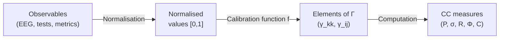

# Measurement Methodology

> *"Measurement is the assignment of numerals to objects or events according to rules."*
> — Stanley Smith Stevens

:::info Who this chapter is for
A bridge between the CC formalism and experiment: protocols for measuring purity $P$, the stress tensor $\sigma$, and the consciousness measures $R$, $\Phi$, $C$.
:::

In the previous chapter we saw that CC surpasses competing theories in computability and falsifiability ([Comparison with Alternatives](./comparison)). But computability is useless without data. The most beautiful theory is useless if it cannot be tested. CC generates precise numerical predictions — but how do we measure them? How do we map the matrix $\Gamma$ onto a real biological, social, or artificial system?

This section is the **bridge between formalism and experiment**. We will show how each CC quantity can be estimated in various contexts: from neuroimaging to organisational audits, from simulations to psychometric tests.

:::info Chapter Roadmap
In this chapter we:
1. Establish the **principles of measurement** in CC: what we measure, the hierarchy of observables, calibration (section 1)
2. Show concrete **protocols for measuring purity** $P$ for different systems (section 2)
3. Describe the **seven-dimensional audit** — measurement of the stress tensor $\sigma$ (section 3)
4. Discuss **measurement of consciousness measures** $R$, $\Phi$, $C$ (section 4)
5. Provide **complete experimental protocols** for neuroscience, AI, and organisations (section 5)
6. Work through **calibration with numerical examples** (section 6)
7. Honestly discuss **limitations** (section 7)
:::

---

## 1. Principles of Measurement in CC {#принципы}

### 1.1 What We Measure

In CC all observables are functions of the coherence matrix $\Gamma$. But $\Gamma$ is an abstract object. In practice we have no direct access to it. We have access to **observables** — projections of $\Gamma$ onto measurement bases.

The situation is analogous to quantum mechanics: we do not see the wave function of the electron, but we can measure its projections (spin up/down, coordinate, momentum). Each measurement is a projection of $\Gamma$ onto a specific operator.

**Analogy.** Imagine $\Gamma$ as a 3D object (say, a statuette), and we can only see its shadows on the walls. The shadow on one wall is $P$ (total "area" of the shadow = organisation). The shadow on another — $\sigma_k$ (stress profile). From several shadows we reconstruct the object — but the reconstruction is always approximate.

### 1.2 Hierarchy of Observables

Not all CC observables are equally easy to measure. We distinguish four levels:

| Level | Observables | Measurement complexity | Examples |
|---------|-------------|---------------------|---------|
| **L1: Global** | $P$ (purity), $\|\sigma\|_\infty$ | Low — only the overall picture is needed | Health index, total test score |
| **L2: Sectoral** | $\gamma_{kk}$ (diagonal), $\sigma_k$ | Medium — 7 independent measurements | Subscale scores, neural network activity |
| **L3: Coherent** | $\|\gamma_{ij}\|$ (off-diagonal), $\theta_{ij}$ | High — pairwise correlations | Functional brain connectivity, organisational links |
| **L4: Derived** | $R$, $\Phi$, $C$, $\mathrm{Coh}_E$ | High — require $\varphi(\Gamma)$ | Reflection, integration, consciousness measures |

:::tip Practical rule
Start with L1 (is there a problem at all?), then L2 (which dimension is suffering?), then L3 (where are connections disrupted?), and only if necessary — L4 (what is the level of consciousness?). There is no point computing $C$ if even $P$ has not been measured.
:::

### 1.3 Calibration Principle

:::warning Key principle
The mathematics of CC gives **relative** relations (e.g., $P_{\text{crit}} = 2/7$). But absolute calibration — which physical indicators correspond to $\gamma_{EE} = 0.2$ — depends on the specific system and requires empirical anchoring.
:::

This is not a weakness of the theory, but normal practice: in physics too there is a difference between Maxwell's equations (universal) and the specific values of $\varepsilon$ and $\mu$ for each material.

**What calibration gives and what it does not:**

| What calibration gives | What it does not give |
|---|---|
| Numerical values of $\gamma_{kk}$ for a specific system | Universal values for "any brain" |
| Correspondence of test scales with the diagonal of $\Gamma$ | Automatic conversion of scores to $\Gamma$ |
| Estimate of measurement accuracy (error) | Guarantee that the measurement is accurate |

---

## 2. Measuring Purity P {#измерение-чистоты}

### 2.1 What P Is in Practice

[Purity](/docs/core/dynamics/viability#определение-чистоты) $P = \mathrm{Tr}(\Gamma^2)$ is a measure of the organisation of the system. Intuitively: how coherently all 7 dimensions are working together.

**Analogy.** Imagine an orchestra of 7 instruments. If all play one melody in synchrony — $P$ is close to 1 (pure state). If each plays on its own — $P$ is close to $1/7$ (maximum chaos). If most are coordinated but one is out of tune — $P$ is intermediate, and $\sigma_k$ for the out-of-tune instrument is high.

### 2.2 Proxies for Biological Systems

In neuroscience the direct analogue of purity is **coherence of neural activity**:

| Method | What it measures | How it relates to P |
|-------|-------------|-----------------|
| **EEG coherence** | Synchronisation of electrical activity between brain regions | High coherence → high P |
| **fMRI functional connectivity** | Correlation of BOLD signals between regions | Strong connectivity → high $\|\gamma_{ij}\|$ → high P |
| **PCI** | Complexity of the recorded TMS response | Clinical comparison requires a separate model reconstruction and held-out outcomes. |
| **Lempel-Ziv entropy** | Compressibility of the neural signal | Low entropy → high P |

### 2.3 L1 Protocol for Neural Data

Step-by-step protocol for estimating $P$ from EEG:

**Step 1.** Record EEG from 19 channels (10-20 system) for 5 minutes at rest (eyes closed).

**Step 2.** Compute the spectral coherence matrix $C_{ij}(f)$ for each pair of channels $(i, j)$ in the range 1–40 Hz.

**Step 3.** Average coherence over frequencies, obtaining $\bar{C}_{ij} = \frac{1}{f_{\max} - f_{\min}} \int C_{ij}(f)\,df$.

**Step 4.** Assign each of the 19 channels to one of 7 dimensions (grouping by functional zones):

| Dimension | EEG channels | Rationale |
|-----------|-----------|-------------|
| A (Articulation) | O1, O2, Oz | Visual cortex — sensory input |
| S (Structure) | T3, T4, T5, T6 | Temporal — long-term memory |
| D (Dynamics) | C3, C4, Cz | Motor cortex — action |
| L (Logic) | F3, F4 | Dorsolateral PFC — reasoning |
| E (Interiority) | Fz, Pz | Midline structures — self-reference |
| O (Ground) | Fp1, Fp2 | Orbitofrontal — resource evaluation |
| U (Unity) | P3, P4 | Parietal — integration |

**Step 5.** Aggregate $\bar{C}_{ij}$ across groups, obtaining a $7 \times 7$ matrix:

$$
\tilde{\gamma}_{kl} = \frac{1}{|G_k| \cdot |G_l|} \sum_{i \in G_k} \sum_{j \in G_l} \bar{C}_{ij}
$$

**Step 6.** Normalise: $\Gamma_{\text{approx}} = \tilde{\gamma} / \mathrm{Tr}(\tilde{\gamma})$.

**Step 7.** Compute $P = \mathrm{Tr}(\Gamma_{\text{approx}}^2)$.

:::warning Calibration caveat
This protocol gives a *proxy* for $P$, not an exact value. The grouping of channels by dimensions is hypothetical and requires validation. Nevertheless, even a crude proxy allows the key prediction to be tested: $P_{\text{wakefulness}} > P_{\text{coma}}$.
:::

### 2.4 Numerical Example: ICU Patient

Let us consider a concrete example. A patient in intensive care. EEG recorded in three states:

**State 1: Wakefulness (before trauma)**

Aggregated matrix (diagonal): $\gamma = (0.16, 0.15, 0.14, 0.14, 0.15, 0.13, 0.13)$

$P = 0.16^2 + 0.15^2 + 0.14^2 + 0.14^2 + 0.15^2 + 0.13^2 + 0.13^2 = 0.1462$

This is below $2/7 \approx 0.286$, but remember: for a diagonal matrix $P_{\max} = 1/7 \approx 0.143$ is achieved at uniform distribution. Our $P = 0.1462 > 1/7$ — the system is slightly organised, but without off-diagonal elements $P$ cannot exceed $1/7$ significantly. Coherences are needed!

**Including coherences:** Let the average off-diagonal coherence $|\gamma_{ij}| \approx 0.03$. Then $P$ increases by $\sum_{i \neq j} |\gamma_{ij}|^2 \approx 42 \times 0.0009 = 0.038$, giving $P \approx 0.184$.

This is still below $2/7$. To reach $P > 2/7$, *strong* coherence is needed ($|\gamma_{ij}| \approx 0.05{-}0.08$).

**State 2: Deep coma (GCS = 3)**

Coherence drops significantly: $|\gamma_{ij}| \to 0.01$, diagonal tends to uniform.

$P \approx 1/7 + 42 \times 0.0001 \approx 0.147$ — practically the maximally mixed state.

**State 3: Recovery (GCS = 12)**

Coherence partially restored: $|\gamma_{ij}| \approx 0.04$, diagonal non-uniform.

$P \approx 0.150 + 42 \times 0.0016 \approx 0.217$ — below the threshold, but closer.

:::info Clinical conclusion
The transition $P < 2/7 \to P > 2/7$ is a potential marker of consciousness recovery. Tracking $P(\tau)$ dynamically may be clinically more informative than a one-time GCS score.
:::

### 2.5 Proxies for Organisations

| Method | What it measures | How it relates to P |
|-------|-------------|-----------------|
| **Engagement index (eNPS)** | Alignment of employee goals | High eNPS → high P |
| **Cross-functional coordination** | Frequency and quality of inter-departmental interactions | Strong coordination → high $\|\gamma_{ij}\|$ |
| **Financial indicators** | Margin, growth | Sustained growth → P > P_crit |

### 2.6 Proxies for AI Systems

| Method | What it measures | How it relates to P |
|-------|-------------|-----------------|
| **Rank of latent representation** | Effective dimensionality of the hidden space | High rank → high P |
| **Attention entropy** | Entropy of attention weights | Focused attention → high P |
| **Loss landscape curvature** | Curvature of the loss landscape | Sharp minima → high P (but brittle) |

---

## 3. Measuring the Stress Tensor σ {#измерение-напряжений}

### 3.1 Seven selected scores

T-92 [D] specifies a diagnostic panel, not a unique tensor derived from the axioms. The population score $s_k=1-7\gamma_{kk}$ lies in $[-6,1]$; its clamped version $\sigma_k=\max(0,s_k)$ lies in $[0,1]$. The unclamped scores sum to zero. A full panel may contain selected functions of $R$, $\Phi$, the regeneration rate and an independently specified extended readout $D_{\mathrm{diff}}$.

Populations and their deficits do not reconstruct complex coherences: diagonal measurement supplies at most six independent parameters out of 48. Equivalence of the panel to the full window is unproved. Test the four separate margins over a reconstruction uncertainty set; see [identifiability](/docs/applied/research/reconstruction-identifiability).

### 3.2 Seven-Dimensional Audit Protocol

For an organisation or team:

| Dimension | What to ask | Instrument |
|-----------|----------------|------------|
| $\sigma_A$ (Articulation) | "Can you clearly formulate what your department does?" | Interviews, documentation analysis |
| $\sigma_S$ (Structure) | "Are there stable processes and roles?" | Org structure analysis, tenure analysis |
| $\sigma_D$ (Dynamics) | "Can you adapt to change?" | Agility assessment, cycle time |
| $\sigma_L$ (Logic) | "Are there internal contradictions in the rules?" | Policy audit, consistency check |
| $\sigma_E$ (Interiority) | "Is there a culture of reflection?" | Psychological safety survey |
| $\sigma_O$ (Ground) | "Are resources sufficient?" | Budget audit, burnout survey |
| $\sigma_U$ (Unity) | "Do you feel part of a whole?" | Network analysis, NPS |

### 3.3 Detailed Breakdown: from σ_D to Metabolic Load

Consider $\sigma_D$ — stress in the Dynamics dimension. In different contexts:

**Biology.** $\sigma_D$ is metabolic load. Why? Dimension D is responsible for the system's capacity for *action* — changing its state. In biology, action requires energy: muscle contraction, nerve impulse, protein synthesis. If $\sigma_D$ is high — the cell/organism finds it *difficult to act*: metabolism is overloaded, ATP is deficient, mitochondria are working at their limit.

Concrete proxy: ADP/ATP ratio. Under normal metabolism ATP/ADP > 10 ($\sigma_D$ low). Under depletion ATP/ADP < 3 ($\sigma_D$ high).

**Psychology.** $\sigma_D$ is procrastination and paralysis of will. The person *knows* what needs to be done, but *cannot* force themselves. This is not laziness — it is a deficit of D-resource. Proxy: Trail Making Test (task-switching time).

**Organisation.** $\sigma_D$ is bureaucracy. A decision has been made, but cannot be executed: approvals, sign-offs, regulations. Proxy: lead time (time from decision to implementation).

### 3.4 For the Individual (Psychometrics)

The same 7 dimensions can be assessed through psychometric scales:

| Dimension | Psychometric proxy | Existing instrument |
|-----------|-------------------------|------------------------|
| $\sigma_A$ | Perceptual load | Sensory Profile (Dunn) |
| $\sigma_S$ | Cognitive rigidity/flexibility | WCST (Wisconsin Card Sorting Test) |
| $\sigma_D$ | Executive functions | Trail Making Test |
| $\sigma_L$ | Cognitive distortions | Cognitive Distortion Scale |
| $\sigma_E$ | Alexithymia (experience deficit) | TAS-20 (Toronto Alexithymia Scale) |
| $\sigma_O$ | Vital exhaustion | MBI (Maslach Burnout Inventory) |
| $\sigma_U$ | Social isolation | UCLA Loneliness Scale |

### 3.5 Numerical Example: from Psychometrics to σ-Profile

A patient has completed 7 tests. Results are normalised to the scale [0, 1], where 0 = normal, 1 = maximum impairment:

| Test | Raw score | Normalised |
|------|-----------|----------------|
| Sensory Profile ($\sigma_A$) | 42/80 | 0.53 |
| WCST errors ($\sigma_S$) | 12/60 | 0.20 |
| TMT-B time ($\sigma_D$) | 180 s (norm 75 s) | 0.70 |
| Cognitive distortions ($\sigma_L$) | 15/50 | 0.30 |
| TAS-20 ($\sigma_E$) | 65/100 | 0.65 |
| MBI emotional exhaustion ($\sigma_O$) | 28/54 | 0.52 |
| UCLA loneliness ($\sigma_U$) | 45/80 | 0.56 |

Profile: $\sigma = [0.53,\; 0.20,\; 0.70,\; 0.30,\; 0.65,\; 0.52,\; 0.56]$

$\|\sigma\|_\infty = 0.70$ (Dynamics — the most loaded dimension).

**Interpretation:** Maximum stress in D (action) and E (interiority). This is a profile characteristic of depression: the person *cannot act* ($\sigma_D$ high) and *does not understand what they feel* ($\sigma_E$ high). CC recommendation: priority — reducing $\sigma_D$ (behavioural activation) and $\sigma_E$ (psychoeducation, mindfulness).

Inverse conversion to $\gamma_{kk}$: if $\sigma_k = 1 - 7\gamma_{kk}$, then $\gamma_{kk} = (1 - \sigma_k)/7$.

$$
\gamma = \left(\frac{0.47}{7},\; \frac{0.80}{7},\; \frac{0.30}{7},\; \frac{0.70}{7},\; \frac{0.35}{7},\; \frac{0.48}{7},\; \frac{0.44}{7}\right)
$$

$$
= (0.067,\; 0.114,\; 0.043,\; 0.100,\; 0.050,\; 0.069,\; 0.063)
$$

Check: $\sum \gamma_{kk} = 0.506$. This is less than 1 — meaning the remaining 0.494 is "distributed" across off-diagonal elements or lost during normalisation. In practice $\sum \gamma_{kk}$ should be close to 1 (for the diagonal approximation), which points to a limitation of the method: psychometric proxies are *crude* estimates requiring calibration coefficients.

---

## 4. Measuring Consciousness Measures {#измерение-сознательности}

### 4.1 Reflection Measure R

[Reflection measure](/docs/consciousness/foundations/self-observation#мера-рефлексии-r) $R = F(\Gamma, \varphi(\Gamma))$ shows how well the system models itself.

**Proxies:**
- **Metacognitive accuracy:** ability to evaluate the quality of one's own decisions (confidence calibration). Example: after answering a question, rate confidence from 0 to 100%. Ideal calibration: questions in which confidence = 70% are actually correct in 70% of cases.
- **Self-report accuracy:** agreement of self-report with objective indicators. Example: "How anxious are you?" (subjective) vs. cortisol level (objective).
- **Mirror test** (for animals): does it recognise itself in the mirror? Passed: primates, dolphins, elephants, magpies. Not passed: most others.

**How to translate into $R$?** Metacognitive sensitivity (meta-d') — a standard measure in experimental psychology — gives a value from 0 (no metacognition) to 1+ (ideal). Proposed calibration:

$$
R \approx \frac{\text{meta-d'}}{3}
$$

Rationale: at meta-d' = 1 (average healthy adult) we get $R \approx 0.33 \approx 1/3$ — right at the threshold. This is consistent with the intuition: a typical person *barely* clears the reflection threshold.

### 4.2 Integration Measure Φ

[Integration measure](/docs/core/structure/dimension-u#мера-интеграции-φ) $\Phi$ shows how unified the system is — whether it breaks down into independent subsystems.

**Proxies:**
- **PCI (Perturbational Complexity Index):** the brain's response to TMS stimulation — integrated systems give a complex, widespread response. On its benchmark the cut-off $\mathrm{PCI}^* = 0.31$ separates states with a subjective report from states without one (Casarotto et al., 2016); in patients, 36 of 38 in a minimally conscious state and 9 of 43 in a vegetative state lie above it (index introduced by Casali et al., 2013).
- **Mutual Information** between subsystems
- **Spectral gap** of the functional connectivity graph

**How to translate into $\Phi$?** The spectral gap $\lambda_2 - \lambda_1$ of the functional connectivity graph of the brain is a direct analogue of $\Phi$ in CC. Proposed calibration:

$$
\Phi \approx \frac{\lambda_2 - \lambda_1}{\lambda_{\text{norm}}}
$$

where $\lambda_{\text{norm}}$ is a normalising coefficient fixed on wakefulness sessions only ([SUB-1](/docs/applied/research/measurement-protocol#substitution-position)).

### 4.3 Consciousness Measure C

$C = \Phi \times R$ (T-140 [D]) — the product of integration and reflection.

**Critical thresholds:**
- $C=0$ means the selected score is zero; a phenomenal interpretation requires a separate bridge [I].
- $0<C<1/3$ fails the selected window’s necessary product condition; it does not classify bacteria or AI.
- $C \geq C_{\text{th}} = 1/3$ (T-140) is necessary for a conscious system; the full predicate is $P > 2/7$, $R \geq 1/3$, $\Phi \geq 1$, $D_{\text{diff}} \geq 2$, which implies $C \geq 1/3$. On the uniform-diagonal stratum the window gives $C = \Phi/(1+\Phi) \in (1/2, 2/3]$.

Choose and report thresholds before looking at evaluation labels.

**Numerical example.** Healthy adult: meta-d' = 1.2, reconstructed $\widehat\Phi = 1.45$ (illustrative values).

$$
R \approx \frac{1.2}{3} = 0.40 \geq 1/3 \quad \checkmark
$$

$$
\widehat\Phi = 1.45 \geq 1 \quad \checkmark \qquad (\text{from the reconstructed } \widehat\Gamma,\ \text{not from PCI})
$$

$$
C = 1.45 \times 0.40 = 0.58
$$

$C = 0.58 \geq C_{\text{th}} = 1/3$ ✓, and it lies in $(1/2, 2/3]$, where the window puts $C$ on the uniform diagonal — a value below 1 is what the window predicts, not a calibration failure. An alternative $R \approx \text{meta-d'}/2$ would give $R = 0.6$, a value outside the canonical band $[1/3, 1/2)$ that the conscious window imposes on $R = 1/(7P)$: a "reflection" of $0.6$ can only be the self-model quality $R_\varphi$, not the canonical $R$ that enters $C = \Phi \times R$ ([the three working forms of R](/docs/consciousness/foundations/self-observation#формы-r)). The calibration must map meta-d' into the canonical band.

:::note Lesson
Calibration is an empirical task. The theoretical CC thresholds ($P = 2/7$, $R = 1/3$, $\Phi = 1$) are precise *within the formalism*. But translating neural data into the formalism requires experimental fitting. The formulas given are starting points, not final answers.
:::

---

## 5. Experimental Protocols {#протоколы}

### 5.1 Protocol for a Neuroscientific Experiment

**Goal:** Test prediction Pred 1 (No-Zombie) on neural data.

**Design:**
1. Record EEG/MEG during wakefulness, sleep, anaesthesia, coma
2. For each state, reconstruct the approximation $\Gamma$ from the functional connectivity matrix (protocol of section 2.3)
3. Compute $P$, $\mathrm{Coh}_E$, $\sigma_{\mathrm{sys}}$
4. Check: does $P > 2/7$ coincide with the presence of subjective report?

**Expected result (CC):**
- Wakefulness: $P > 2/7$, $\mathrm{Coh}_E > 1/7$
- Deep sleep: $P < 2/7$
- REM sleep: $P > 2/7$ (there are dreams — there is experience)
- Vegetative state: $P \approx 2/7$ (borderline)

**Falsification criterion:** If a state with $P > 2/7$ and absence of subjective report (with confirmed capacity for report) is found — CC is falsified. If subjective report is found at $P < 2/7$ — similarly.

### 5.2 Protocol for an AI Experiment

**Goal:** Test whether the CC thresholds are satisfied for LLMs.

**Design:**
1. For a language model, define an operationalisation of 7 dimensions through hidden states
2. Compute $\Gamma$ as the covariance matrix of projections onto 7 semantic axes
3. Track $P(\tau)$ during training
4. Check: is there a phase transition at $P = 2/7$?

**Concretisation for a transformer:** Hidden states of the model are projected onto 7 directions:
- A: attention entropy (diversity of attention)
- S: weight persistence (stability of weights)
- D: output diversity (diversity of generation)
- L: consistency score (consistency of responses)
- E: self-reference frequency (frequency of self-reference)
- O: context utilization (use of context)
- U: cross-layer coherence (coherence across layers)

### 5.3 Protocol for an Organisational Audit

**Goal:** Diagnosis of organisational "health" through 7 vital indicators.

**Steps:**
1. Conduct a [seven-dimensional audit](#измерение-напряжений) — obtain estimates $\sigma_A, \ldots, \sigma_U$
2. Compute $\|\sigma\|_\infty$ — maximum stress
3. If $\|\sigma\|_\infty > 0.8$: urgent intervention (see [Diagnostics](./diagnostics))
4. Track $P$ dynamically (monthly audits)

**Example report:**

```
=== Coherence Audit: "Example" LLC ===
Date: 2026-01-15

σ-profile: [0.3, 0.2, 0.6, 0.4, 0.7, 0.3, 0.5]
             A     S     D     L     E     O     U

‖σ‖∞ = 0.7 (E: Interiority)
Status: WARNING — E-stress approaching critical

Recommendations:
1. PRIORITY: Strengthen culture of reflection (σ_E = 0.7)
   → Retrospectives after each sprint
   → Anonymous psych safety surveys
2. Reduce bureaucracy (σ_D = 0.6)
   → Shorten approval chains
3. Increase integration (σ_U = 0.5)
   → Cross-functional projects

P dynamics:
  2025-10: 0.22 (↓)
  2025-11: 0.21 (↓)
  2025-12: 0.23 (→)
  2026-01: 0.24 (↑)  ← current
  Target:  0.29 (> P_crit)
```

---

## 6. Calibration: from Proxies to Γ {#калибровка}

### 6.1 General Calibration Scheme

Calibration is the translation of observables (test scores, neural signals, organisational metrics) into elements of $\Gamma$. General scheme:



### 6.2 Calibration Function

The simplest calibration function is linear:

$$
\gamma_{kk} = \frac{1}{7} + \alpha_k \cdot (x_k - \bar{x}_k)
$$

where $x_k$ is the observable, $\bar{x}_k$ is the population mean, $\alpha_k$ is the calibration coefficient.

More realistic — logistic:

$$
\gamma_{kk} = \frac{1}{7} \cdot \frac{1 + \beta_k \tanh(\alpha_k (x_k - x_k^0))}{1 + \beta_k}
$$

Parameters $\alpha_k$, $\beta_k$, $x_k^0$ are fitted empirically from a training sample.

### 6.3 Numerical Example: Testing Against PCI Without Calibrating to It

A line through $(0,1/7)$ and $(c,2/7)$ returns $P=2/7$ at $\mathrm{PCI}=c$ for any positive $c$. Choosing $c=0.31$ builds in the threshold agreement. Test the model on independent sessions with the estimator fixed before collecting the comparison labels.

The nearness of $\mathrm{PCI}^* = 0.31$ to $2/7 \approx 0.286$ is a coincidence of two unrelated scales: PCI is a normalised Lempel–Ziv complexity of a binarised response to TMS, $P$ is a function of $\Gamma$.

**What replaces it — a concordance of verdicts** (P8.4 and pre-registration SUB-1 … SUB-6 of the [measurement protocol](/docs/applied/research/measurement-protocol#substitution-position)):
1. Freeze the reconstruction $\pi_\theta$ on wakefulness sessions only; no viability penalty in the estimator ($\lambda_2 = 0$).
2. On held-out sessions compute the UHM verdict $\mathrm{Cons}(\widehat\Gamma)$ and the PCI verdict $\mathrm{PCI}_{\max} > 0.31$ independently.
3. Report Cohen's $\kappa = (p_o - p_e)/(1 - p_e)$, where $p_o$ is the observed agreement and $p_e$ the agreement expected from the two marginal rates. $\kappa \geq 0.8$ corroborates, $\kappa < 0.4$ falsifies.

**Worked example** (illustrative counts, not data). 40 sessions: both verdicts "conscious" in 18, both "not conscious" in 16, disagreement in $3 + 3$. Then $p_o = 34/40 = 0.85$; each verdict says "conscious" 21 times, so $p_e = (21/40)^2 + (19/40)^2 = 0.501$ and $\kappa = (0.85 - 0.501)/(1 - 0.501) = 0.70$ — inconclusive. With the same 34 agreements split as $33 + 1$ (both marginals 36 of 40), $p_e = 0.82$ and $\kappa = 0.17$ — falsifying. Raw agreement does not decide; $\kappa$ does (`test_verdict_concordance_is_judged_by_kappa_not_by_raw_agreement`).

**Reference values** — Casarotto et al. (2016), Table 1, $\mathrm{PCI}_{\max}$ median [min–max]: wakefulness 0.53 [0.39–0.70] (102 subjects), REM sleep 0.48 [0.36–0.56] (8), ketamine 0.43 [0.36–0.52] (6), NREM sleep 0.25 [0.15–0.31] (18), midazolam 0.30 [0.23–0.31], xenon 0.23 [0.11–0.31], propofol 0.26 [0.23–0.31] (6 each). The decisive sessions are REM and ketamine: consciousness without behaviour at the time, out of sample when $\theta$ is frozen on wakefulness.

:::tip What this means
The CC threshold $P = 2/7$ is not a number on the PCI scale and is not tested by matching one. It is tested by whether the verdict computed from $\widehat\Gamma$ agrees with the independently validated PCI verdict on sessions that did not fix the reconstruction.
:::

## 6.4 Conditional $\Gamma$ estimation: target, consistency and uncertainty {#оценка-gamma}

A matrix estimator and an interpretation of that matrix are separate contracts. Fix the channel map $\pi$ before evaluating its predictions. For $x=\pi(\mathrm{state})\in\mathbb C^7$, define the **second-moment target**
$$
M=\mathbb E[xx^\dagger],\qquad \tau=\operatorname{Tr}M>0,\qquad \Gamma=M/\tau.
$$
This constructs a density matrix from a declared observation model; it does not prove that the model measures consciousness, wellbeing or a clinical state. Unless $\mathbb E x=0$, the second moment is **not** the covariance.

**Centering changes the target.** With $\mu=\mathbb E x$, the covariance target is $C=\mathbb E[(x-\mu)(x-\mu)^\dagger]$. Subtracting the same sample's mean estimates $C$, not $M$. Its residuals share the estimated mean and are dependent even when the raw observations are i.i.d. An independently fixed baseline instead defines another fixed second-moment target. Record which of these experiments is intended.

**(1) Algebra and consistency.** For fixed embedded observations,
$$
\widehat\Sigma_N=\frac1N\sum_n x_nx_n^\dagger,\qquad
\widehat\Gamma_N=\widehat\Sigma_N/\operatorname{Tr}\widehat\Sigma_N.
$$
When the observed trace is positive, $\widehat\Gamma_N$ is Hermitian, positive semidefinite and unit trace. At zero trace the normalized estimate is **undefined**, regardless of the sample count. For a stationary ergodic source with $\mathbb E\|x\|^2<\infty$, the ergodic law and continuity give almost-sure convergence to $\Gamma$. The analogous covariance estimator is consistent when $\operatorname{Tr}C>0$. These facts alone provide neither a convergence rate nor a confidence interval.

**(2) A finite-sample bound for a fixed i.i.d. embedding [T under these premises].** Additionally assume independent identically distributed observations and a **population** bound $\|x\|^2\le B$ almost surely. A bound verified only on the observed sample does not establish this premise. For $Z_n=x_nx_n^\dagger-M$,
$$
\|Z_n\|_{\rm op}\le2B,\qquad
v^2=\|\mathbb EZ_n^2\|_{\rm op}\le B^2,
$$
because $\mathbb EZ_n^2=\mathbb E[(xx^\dagger)^2]-M^2\preceq BM$. Matrix Bernstein therefore gives
$$
\Pr(\|\widehat\Sigma_N-M\|_{\rm op}\ge t)
\le 14\exp\!\left(-\frac{Nt^2}{2B^2+(4B/3)t}\right).
$$
See [Tropp, Theorem 1.4](https://tropp.caltech.edu/papers/Tro11-User-Friendly-preprint.pdf); independence, bounded summands and the variance parameter are part of its contract.

For any positive semidefinite $A,M$ with positive traces, putting $E=A-M$ gives the **exact** normalization bound
$$
\left\|\frac A{\operatorname{Tr}A}-\frac M\tau\right\|_{\rm op}
\le\frac{\|E\|_{\rm op}+|\operatorname{Tr}E|}{\tau}
\le\frac{8}{\tau}\|E\|_{\rm op}.
$$
Indeed, subtract the matrices as $E/\tau-(A/\operatorname{Tr}A)\operatorname{Tr}E/\tau$ and use $\|A/\operatorname{Tr}A\|_{\rm op}\le1$ and $|\operatorname{Tr}E|\le7\|E\|_{\rm op}$. The former factor $2/\tau$ was not valid for the **operator norm**.

Given a declared population trace lower bound $0<\tau_0\le\tau$ and $0<\varepsilon\le1$, set $t=\tau_0\varepsilon/8$. The sufficient budget
$$
N\ge\left\lceil
\log(14/\delta)\frac{2B^2+(4B/3)t}{t^2}
\right\rceil
$$
then ensures normalized operator error at most $\varepsilon$ with probability at least $1-\delta$. On this event the observed trace is positive, since $7t<\tau$. This is a conservative sufficient bound, not an optimum; no unspecified constant is silently set to one.

A data-dependent region can also use the positive root $t_N$ of
$$
Nt_N^2=\log(14/\delta)\,[2B^2+(4B/3)t_N].
$$
On the same event $\tau\ge\ell=\max(0,\operatorname{Tr}\widehat\Sigma_N-7t_N)$. For a defined estimate, use $r=\min(1,8t_N/\ell)$ when $\ell>0$ and $r=1$ otherwise. Density matrices differ by at most one in operator norm. With $P_{\rm plug}=\operatorname{Tr}\widehat\Gamma_N^2$,
$$
P=\operatorname{Tr}\Gamma^2
\in [\,P_{\rm plug}-2r,\ P_{\rm plug}+2r\,]\cap[1/7,1],
$$
because $|\operatorname{Tr}(\widehat\Gamma_N^2-\Gamma^2)|\le2r$. At zero observed trace, return the full target set without a matrix center; do not silently condition the coverage claim on having returned a point estimate. A full physical interval is uninformative, not evidence for a threshold verdict. The reference uses floating-point evaluation, not certified interval arithmetic.

:::caution Dependent observations and estimated baselines need another uncertainty argument
Stationary ergodicity is enough for the consistency statement above, but not for a central limit theorem or Bernstein concentration. Replacing $N$ by an estimated $N_{\rm eff}$ does **not** transfer these guarantees verbatim. Autocorrelation of window energy does not determine uncertainty of directional covariance or purity; energy may stay constant while directions remain dependent. Returning zero estimated autocorrelation for a short or constant series is not evidence of independence.

For asymptotic intervals, specify a dependence model, a suitable central limit theorem and a consistent long-run variance estimator for the **actual statistic**, including its estimated denominator and baseline. Batch-means consistency requires appropriate growing batch sizes/counts and process assumptions; a fixed twenty-batch diagnostic is not that contract. See [Flegal–Jones](https://arxiv.org/pdf/0811.1729). Repeated looks, overlapping windows, missingness and adaptive stopping also belong to the observation protocol. The module supplies no automatic 95% interval for these cases.
:::

**(3) Pair statistic versus matrix purity.** For $N\ge2$ and positive observed trace, retain the diagnostic
$$
\widehat P_{\rm pair}
=\frac{\sum_{m\ne n}|x_m^\dagger x_n|^2}
 {N(N-1)(\operatorname{Tr}\widehat\Sigma_N)^2}.
$$
For **i.i.d. fixed embedded observations**, the pair average in its numerator is exactly unbiased for $\operatorname{Tr}M^2$: independence factors the two second moments. Its ratio with an estimated denominator is not generally unbiased. Neither a universal bias sign nor a threefold improvement follows from one Gaussian simulation. Same-sample centering invalidates even that numerator argument. For two independent Rademacher observations, sample-centering gives expected pair numerator $1/2$, whereas the population variance squared is $1$.

For the real covariance target with unknown mean, distinct **independent** raw observations admit the unbiased numerator kernel
$$
h(X_i,X_j,X_k,X_l)
=\tfrac14[(X_i-X_j)^\top(X_k-X_l)]^2,\qquad
\mathbb Eh=\operatorname{Tr}C^2.
$$
The two differences are independent with second moment $2C$. This is a possible construction, not a guarantee for dependent diaries or a claim that a normalized ratio becomes unbiased.

The exact finite-data identity
$$
\widehat P_{\rm pair}
=\frac N{N-1}P_{\rm plug}
-\frac{\sum_n\|x_n\|^4}{N(N-1)(\operatorname{Tr}\widehat\Sigma_N)^2}
$$
shows why the pair statistic need not equal the purity of the constructed matrix or lie in $[1/7,1]$. Do not hide this by clamping it. Two copies of the seven one-hot rating vectors, with baseline two and same-sample centering, give $P_{\rm plug}=1/6$ and $\widehat P_{\rm pair}=4/39$. Adding five to every rating leaves both unchanged. These centered statistics cannot identify the absolute rating level. Constant centered ratings have zero trace and no estimate.

**(4) Threshold decisions and interpretation.** Under the fixed-i.i.d. contract, a population-purity interval wholly above or below a predeclared threshold supports that **statistical** comparison. A comparison of point estimates alone does not. It is not a clinical or consciousness classification without a validated semantic bridge.

[T-109](./learning-bounds#информационная-граница) describes another experiment: optimal discrimination of known physical quantum states with collective measurements. Its Chernoff count is sufficient for that optimal test. It does not establish the former $2c^2\Delta^{-2}\log(1/\delta)$ diary budget, the assertion that $c=1$ is conservative, or a necessary lower count for this estimator.

#### Reference implementation {#эталонная-реализация}

[**gamma_tomography.py**](pathname:///code/gamma_tomography.py) separates the normalized second moment, explicitly requested sample covariance, matrix purity and pair ratio. Default analysis is descriptive. A finite-sample region is available only under an explicitly declared fixed-i.i.d. population-bound contract; same-sample centering rejects that option. Model functionals are evaluated from the same constructed matrix. The old energy-based confidence shortcut and automatic L2 verdict have been removed.

Running the module checks the translation/centering example above. The repository regression check, scripts/verify_measurement_tomography.py, also covers exact finite counterexamples, complex phase orientation, degeneracy and confidence-contract rejection. These tests are not a population coverage study, a clinical validation, or a Lean/Verum proof of the probability theorem.

**Revision note (6 November 2026).** This replaces the previous unconditional confidence/debiasing claims and simulated “theorem guarantees.” Their historical numerical examples remain in Git history; they are not evidence of general validity.


---

## 7. Limitations and Honest Warnings {#ограничения}

### 7.1 Calibration and statistical assumptions

The channel map and the target (second moment or covariance) are modeling choices. Statistical guarantees additionally require the observation, dependence, baseline, denominator and stopping assumptions stated in [section 6.4](#оценка-gamma). An algebraically valid density matrix does not validate those assumptions or its semantic interpretation. Cross-substrate transfer, clinical meaning and confidence coverage on the intended population require separate independent evidence.

### 7.2 The Validation Problem

Even with good calibration, **validation** of CC predictions requires:
- Independent measurements (do not use the same data for calibration and testing)
- Blind protocols (the experimenter does not know the prediction prior to analysis)
- Reproducibility (the result must replicate across different laboratories)

### 7.3 What Is NOT a Measurement

:::danger Common errors
- **Subjective "eyeball" assessment — is not a measurement.** Operationalised scales are required.
- **A single indicator — is not the full $\Gamma$.** ALL 7 components are needed for a complete picture.
- **A static snapshot — is not dynamics.** $P$ must be tracked over time: $dP/d\tau$ is no less important than $P$.
- **Correlation — is not calibration.** The fact that PCI correlates with the level of consciousness does not mean that $P = f(\text{PCI})$ is the correct formula. Calibration requires *independent* predictions.
:::

---

## 8. Conclusion {#заключение}

Measurement methodology is the place where theory meets reality. CC is at a stage analogous to nineteenth-century thermodynamics: the formalism is ready, but the calibration experiments are only beginning.

Critically, CC **allows** itself to be measured. This distinguishes it from purely philosophical theories (panpsychism) and from theories with NP-hard computations (IIT). A $7 \times 7$ matrix is computationally trivial. What remains is to learn to fill it with real data.

### What We Learned {#итоги}

1. CC observables form a **4-level hierarchy**: L1 (global) → L2 (sectoral) → L3 (coherent) → L4 (derived).
2. Purity $P$ can be estimated through **EEG coherence** and fMRI connectivity — by a reconstruction whose parameters are frozen before the test; PCI is the independent verdict it is compared with, not an estimator of $P$.
3. The stress tensor $\sigma$ is measured through **psychometric scales** (for the individual) or **organisational audits** (for companies).
4. $P$ and PCI use different scales. An independent calibration and held-out comparison are needed to assess concordance.
5. All measurements are **approximate**: calibration coefficients require empirical fitting.

---

In the next chapter we will show how the language of CC unites *different disciplines*: [Interdisciplinary Bridge](./interdisciplinary) — a translation dictionary for physicists, biologists, psychologists, engineers, and philosophers.

---

**Further Reading:**
- [Diagnostics](./diagnostics) — practical guide to monitoring
- [Implementation](./implementation) — computational implementation
- [Unique Predictions](./predictions) — what to test
- [Research Programs](./research-programs) — experimental plan

---

**Related Documents:**
- [Measurement Protocol](/docs/applied/research/measurement-protocol)
- [Unique CC Predictions](/docs/applied/coherence-cybernetics/predictions)
- [Comparison with Alternative Theories](/docs/applied/coherence-cybernetics/comparison)
- [Interdisciplinary Bridge](/docs/applied/coherence-cybernetics/interdisciplinary)
