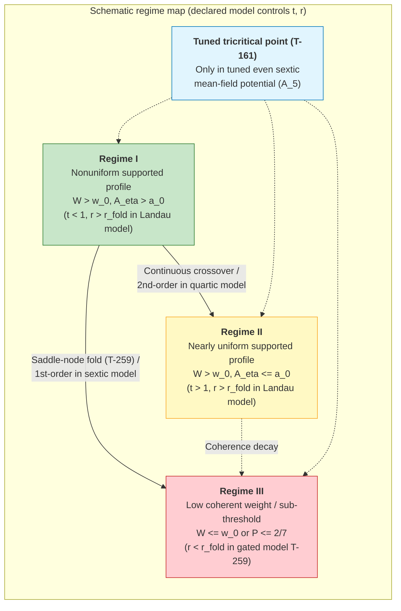
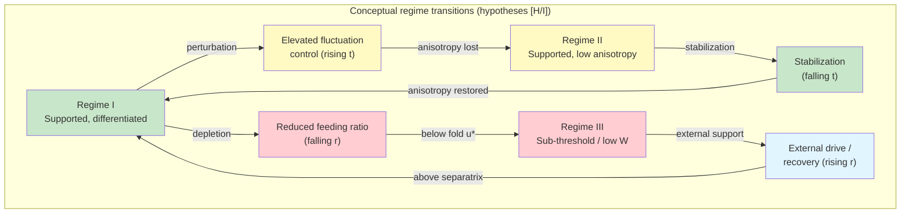

# Phase Diagram: Conditional Regimes and Cybernetic Interpretation

:::info Scope and Revision
This chapter presents the phase-regime analysis of Coherence Cybernetics (CC). It separates **strictly proved** model results — notably the exact feeding window and saddle-node fold in the isotropic first-order flow (`T-259`) — from **conditional** Landau mean-field constructions (`T-161`), **defined** descriptive regimes and stress panels (`T-92`, `CC-8`), and **empirical/interpretive hypotheses** (`[H]`/`[I]`) linking matrix regimes to clinical states. Universal swallowtail/three-phase claims (`T-28 [✗]`), dimensionally inconsistent reduced temperatures, and universal clinical critical exponents ($\beta = 1/4$ for BPD) are withdrawn.
:::

---

### Bridge from the Previous Chapter

In the [previous chapter](./topological-protection) we analysed structural mechanisms that can protect or stabilize coherence in specified models. Even when stabilization mechanisms are active, changing control parameters — increasing noise/fluctuation amplitude or lowering regenerative drive relative to dephasing — drives a system across qualitatively different operating regimes. This chapter organizes those regimes, identifies what is **exact** versus **model-dependent**, and states the operational conditions needed for any empirical bridge.

---

### Chapter Roadmap

In this chapter we:

1. **Clarify the control coordinates** $(t, r)$ with exact dimensional consistency, aligned with [Effective Temperature](./effective-temperature) (sections "State map", "Two parameters", and §1).
2. **State the exact isotropic feeding window (`T-259`)** — the proven lower and upper bounds in $x = \kappa_{\mathrm{eff}}/\Gamma_2$ and the self-consistent $S_5$-quintic fold (§1.3).
3. **Define descriptive Gap regimes** — nonuniform supported profile, nearly uniform supported profile, and low-coherence regime — without conflating descriptive cuts with universal thermodynamic phases (§2).
4. **Distinguish conditional bifurcations and Landau normal forms** — ordinary quartic mean field vs. the tuned even sextic tricritical model (`T-161`), correcting the withdrawn $A_4$ swallowtail claim (`T-28 [✗]`) (§3).
5. **Frame clinical mappings and control levers as testable hypotheses `[H/I]`** — requiring independent clinical labels and identifiable reconstruction (§4).
6. **Correct the stress-panel relation (`T-92`, `CC-8`)** — marking $\|\sigma_{\mathrm{sys}}\|_\infty < 1$ as a defined panel `[D]` distinct from the four exact capability margins, using canonical axis names $\{A, S, D, L, E, O, U\}$ (§5).
7. **State the true scope of physical analogies** — qualitative parallels vs. formal model dictionaries (`T-258`) (section "Analogies").

---

:::note On Notation
In this document:
- $\Gamma \in \mathcal{D}(\mathbb{C}^7)$ — [coherence matrix](/docs/core/dynamics/coherence-matrix) in the canonical 7-axis basis $\{A, S, D, L, E, O, U\}$ (Articulation $A$, Structure $S$, Dynamics $D$, Logic $L$, Interiority $E$, Ground $O$, Unity $U$)
- $t = T_{\mathrm{eff}}/T_c$ — dimensionless reduced temperature, **valid only after independently specifying positive $T_{\mathrm{eff}}$ and $T_c$ in the same temperature/energy units** (see [Effective Temperature §8](./effective-temperature#фазовая-диаграмма))
- $r = \kappa/\Gamma_2$ — dimensionless ratio of regeneration rate $\kappa$ to dephasing rate $\Gamma_2 > 0$ (in the same reciprocal-time units)
- $\Gamma_2$ — off-diagonal decoherence rate ($= 2\gamma/3$ for uniform Fano dephasing)
- $\kappa$ — total regeneration rate (e.g., $\kappa = \kappa_{\mathrm{bootstrap}} + \kappa_0 \cdot \mathrm{Coh}_E$ in the chosen kinetic ansatz)
- $P = \mathrm{Tr}(\Gamma^2)$ — [purity](/docs/core/dynamics/viability#определение-чистоты), with chosen HS-majority threshold $P_{\mathrm{crit}} = 2/7$ `[D]`
- $\sigma_{\mathrm{sys}}$ — chosen 7-component [stress panel](./definitions#тензор-напряжений) (`T-92 [D]`)
:::

This document provides the cybernetic analysis aligned with [Gap Regimes and Conditional Phase Models](/docs/core/dynamics/gap-phase-diagram) and [Effective Temperature](./effective-temperature).

---

## Map of Operating Regimes {#карта-состояний}

A phase diagram summarizes how stationary regimes of a specified dynamical or statistical model change as control parameters vary. In Coherence Cybernetics, it is helpful to visualize regimes in a two-parameter plane comparing **fluctuation/disorder control** ($t$) against **regenerative-to-dissipative balance** ($r$), while keeping carefully in mind that the actual phase boundaries depend on the **selected potential, kinetics, and noise model** ([Effective Temperature §8](./effective-temperature#фазовая-диаграмма)).

### Heuristic Analogy with Thermodynamic Phase Diagrams `[I]`

In thermodynamics, water's $(T, P)$ diagram separates crystalline solid, liquid, and vapor phases across coexistence curves meeting at a triple point. By heuristic analogy `[I]`, conditional CC phase models organize three qualitative operating regimes:

| Thermodynamic analogy | Descriptive CC regime `[D/I]` |
|-----------------------|-------------------------------|
| Temperature $T$ | Dimensionless fluctuation ratio $t = T_{\mathrm{eff}}/T_c$ (when defined in matched units) |
| Pressure / chemical potential | Dimensionless feeding ratio $r = \kappa/\Gamma_2$ |
| **Ordered phase** (crystalline anisotropy) | **Regime I** — nonuniform supported Gap profile with viable purity |
| **Disordered phase** (isotropic fluid) | **Regime II** — nearly uniform supported Gap profile ($W > w_0$, low anisotropy) |
| **Collapsed / depleted phase** | **Regime III** — low coherent weight ($W \le w_0$) / sub-threshold purity ($P \le 2/7$) |

Crucially, unlike thermodynamic phases in an infinite-volume limit ($N \to \infty$), a single finite $7 \times 7$ density matrix has no automatic thermodynamic singularity: sharp bifurcations or mean-field transitions arise only within an **explicitly specified dynamical or statistical model** (such as the saddle-node fold of `T-259` or a chosen Landau potential).

---

## Two Controls and Three Descriptive Regimes {#два-параметра}

### Fluctuation control $t$ and rate balance $r$

- **Fluctuation ratio $t = T_{\mathrm{eff}}/T_c$ `[D]`:** Requires an independently calibrated effective temperature $T_{\mathrm{eff}}$ (either via stationary FDT $T_{\mathrm{eff}} = \mathrm{Var}(x)/(k_B \chi(0))$ or a declared rate-ratio convention $T_{\mathrm{ratio}} = (\Gamma_2/\kappa_0)T_{\mathrm{phys}}$) and a reference scale $T_c$ in the **same units** ([Effective Temperature §§1–3](./effective-temperature)).
- **Feeding/regeneration ratio $r = \kappa/\Gamma_2$ `[D]`:** Measures the dimensionless ratio of regenerative rate $\kappa$ to off-diagonal dephasing rate $\Gamma_2 > 0$ in identical inverse-time units.

### Correction on Independence and the "Three Phases" Claim (`T-28 [✗]`)

:::warning Important Corrections (Aligned with `T-28 [✗]` and [Effective Temperature §8](./effective-temperature#фазовая-диаграмма))
1. **Non-independence under the rate-ratio convention:** If one chooses $T_{\mathrm{eff}} = T_{\mathrm{ratio}} = (\Gamma_2/\kappa_0)\,T_{\mathrm{phys}}$ *and* sets $\kappa = \kappa_0$, then
   $$
   t \cdot r = \frac{T_{\mathrm{phys}}}{T_c}.
   $$
   At fixed $T_{\mathrm{phys}}$ and $T_c$, $(t, r)$ is restricted to a single hyperbola rather than an independent 2D plane! Treating $t$ and $r$ as independent controls requires either an independent noise-amplitude/FDT temperature $T_{\mathrm{eff}}$ or a distinct gated/state-dependent total rate $\kappa \neq \kappa_0$, explicitly specified.
2. **Withdrawal of the universal $A_4$ swallowtail three-phase derivation (`T-28 [✗]`):** Earlier text claimed that three phases are an "inevitable topological property of the Whitney $A_4$ swallowtail catastrophe." That claim is **withdrawn** (`T-28 [✗]`): the $A_4$ potential $x^5/5 + ax^3/3 + bx^2/2 + cx$ has a quartic derivative and therefore at most **two** nondegenerate interior minima, not three ([Gap Regimes §5](/docs/core/dynamics/gap-phase-diagram#катастрофы-уитни)). A confining **even sextic** potential (germ $A_5$, `T-161`) can possess three minima in specific parameter regions, and only when that reduced potential is explicitly derived or selected.
:::

---

## 1. Control Parameters in the Cybernetic Context {#параметры}

### 1.1 Dimensionless Temperature Ratio $t$ `[D]`

When an effective temperature $T_{\mathrm{eff}} > 0$ and a reference crossover/critical scale $T_c > 0$ are **independently specified in identical units** (either both in kelvin or both as energies $\Theta_{\mathrm{eff}}, \Theta_c$):

$$
t := \frac{T_{\mathrm{eff}}}{T_c} = \frac{\Theta_{\mathrm{eff}}}{\Theta_c}.
$$

:::warning Dimensional Correction (Aligned with [Effective Temperature §3](./effective-temperature#критическая-температура))
The former formula $t = (\Gamma_2/\kappa_0) \cdot (k_B T_{\mathrm{phys}} \ln 21 / \mu^2)$ was **dimensionally broken**: $k_B T_{\mathrm{phys}}$ has units of energy while a dimensionless mass parameter $\mu^2$ does not. Any scale of the form $T_* = \Delta / (k_B \ln 21)$ requires a declared energy gap $\Delta = E_0 \mu^2$ (with an explicit physical energy scale $E_0$) and a statistical degeneracy model $Z = 1 + 21 e^{-\Delta/(k_B T)}$ — in which case $T_*$ is a smooth equal-probability **crossover** of an analytic finite partition function, not a singular phase transition.
:::

| $t$ (in a specified Landau/statistical model) | Qualitative regime `[C/I]` |
|----------------------------------------------|----------------------------|
| $t \ll 1$ | Low fluctuation scale relative to model threshold $T_c$; ordered minima favored |
| $t \approx 1$ | Near the model's crossover or mean-field threshold |
| $t \gg 1$ | High fluctuation scale; isotropic/disordered distribution favored |

### 1.2 Dimensionless Feeding Ratio $r$ `[D]`

With calibrated rates $\kappa \ge 0$ and $\Gamma_2 > 0$ in the same inverse-time units:

$$
r := \frac{\kappa}{\Gamma_2}.
$$

In the specific kinetic ansatz $\kappa = \kappa_{\mathrm{bootstrap}} + \kappa_0 \cdot \mathrm{Coh}_E$ with fixed $\kappa_0 > 0$ and $\Gamma_2 > 0$, $r$ is strictly increasing in $\mathrm{Coh}_E$ (`[T within the stated linear kinetic ansatz]`).

| $r$ | Physical meaning | Model interpretation `[C/I]` |
|-----|------------------|------------------------------|
| $r \gg r_{\mathrm{fold}}$ | Regeneration dominates dephasing | Viable stationary branch supported (within reflexivity ceiling) |
| $r \approx r_{\mathrm{fold}}$ | Near fold boundary | Marginal maintenance; susceptible to perturbations |
| $r < r_{\mathrm{fold}}$ | Dissipation dominates | No living stationary branch in the gated model (`T-259`) |

:::info Heuristic $r_c$ vs. Exact Microscopic Boundary
The old heuristic $r_c = P_{\mathrm{crit}}/(7P) \approx 2/(49P)$ is **not derived from the microscopic GKSL flow** and misses the exact gated fold by roughly two orders of magnitude ($0.116$ vs. $21.48$ at $P^* = 3/7$). Use the exact theorem `T-259` below for the isotropic replacement flow!
:::

### 1.3 The Exact Feeding Window (`T-259`) {#точное-окно-питания}

Within the canonical isotropic Fano-dephasing plus replacement-flux flow, the exact stationary branch structure and viability/reflexivity window are rigorously proved:

#### Theorem T-259 (Consciousness Window in the Feeding Ratio) `[T in the isotropic first-order model]` {#теорема-окно-питания}

:::tip Statement (`T-259`) `[T under the stated isotropic fixed-target flow]`
Consider the isotropic model: uniform Fano dephasing with off-diagonal decay rate $\Gamma_2 > 0$, and replacement flux $\kappa_{\mathrm{eff}}(\rho^* - \Gamma)$ toward an equal-population target $\rho^*$ ($\mathrm{diag}(\rho^*) = 1/7$) of purity $P^*$ and coherent mass $C^* = P^* - 1/7$. Let $x = \kappa_{\mathrm{eff}}/\Gamma_2$. Then:

1. **Stationary state.** $\Gamma_\infty$ has $\mathrm{diag}(\Gamma_\infty) = 1/7$ exactly and off-diagonal entries $\lambda\,\gamma^*_{ij}$ with retention factor $\lambda = x/(1+x)$; its purity is $P_\infty = 1/7 + \lambda^2 C^*$.
2. **Floor (viability $\equiv$ integration on the equal-population stratum).** $P_\infty > P_{\mathrm{crit}} = 2/7$ (equivalently $\Phi_\infty > 1$ on this stratum) iff
   $$
   x > x_{\min} = \frac{\lambda_1}{1-\lambda_1}, \qquad \lambda_1 = \frac{1}{\sqrt{7P^* - 1}}.
   $$
   At the ceiling target $P^* = 3/7$: $x_{\min} = 1 + \sqrt{2} \approx 2.414$ (the silver ratio).
3. **Ceiling (reflexivity).** $R_\infty = 1/(7P_\infty) \geq 1/3$ iff $P_\infty \leq 3/7$. For an over-pure target $P^* > 3/7$, the window is two-sided: $x \leq x_{\max} = \lambda_2/(1-\lambda_2)$ with $\lambda_2 = \sqrt{2}\,\lambda_1$ — dissipation bounds $P_\infty$ away from excessive purity (e.g., at $P^* = 0.60$, the window is $x \in (1.268,\, 3.775]$).
4. **Nonviable target.** If $P^* \leq 2/7$, no finite $x$ achieves $P_\infty > 2/7$: a subcritical target cannot produce a viable stationary state.
5. **Self-consistent gate: the exact fold `[T in the model]`.** Restoring $\kappa_{\mathrm{eff}} = \kappa \cdot g_V(P)\,(1 - 1/(7P))$ makes the living stationary branch appear through a saddle-node fold, which is **exact**: with $s = 7P - 2$ and $c = 7P^* - 1$, self-consistency forces $\Lambda^2 = (s+1)/c$, and the tangency condition reduces to the quintic
   $$
   (2\Lambda - 1)\,(c^2\Lambda^4 - 1) \;=\; 4c\,\Lambda^2\,(1 - \Lambda),
   $$
   whose unique root $\Lambda^* \in (1/\sqrt{c},\, 1)$ gives the fold in algebraic form: $u^* = \dfrac{c\Lambda^{*2} + 1}{c\Lambda^*(1-\Lambda^*)(c\Lambda^{*2} - 1)}$, $P_{\mathrm{fold}} = \dfrac{c\Lambda^{*2} + 1}{7}$. The classification over targets is complete: for $c < c^\dagger = 392/121 = 2^3 \cdot 7^2 / 11^2 \approx 3.240$ the $g_V$-clamp is inactive at the fold and the quintic root governs; for $c \geq c^\dagger$ the clamp is reached first — on the clamped branch the tangency condition degenerates to $c\Lambda^2 + 2\Lambda - 1 = 0$, whose critical point lies outside that branch, so the fold sits at the kink $\Lambda^* = \sqrt{2/c}$: the living branch is born at $P_{\mathrm{fold}} = 3/7$ ($R = 1/3$), with $u^* = 3/(\sqrt{2c} - 2)$. At the switch target $P^{*\dagger} = 513/847 \approx 0.606$ both formulas give $u^* = 11/2$ exactly. At $c = 2$: $8\lambda^5 - 4\lambda^4 + 8\lambda^3 - 8\lambda^2 - 2\lambda + 1 = 0$, $\Lambda^* = 0.858013$, $u^* = 21.4811$, $P_{\mathrm{fold}} = 0.3532$ (spot-checks: $c = 1.5 \Rightarrow u^* = 75.371$; $c = 3 \Rightarrow 6.61011$; clamped regime $c = 4 \Rightarrow 3.62132$, $c = 6 \Rightarrow 2.04904$). **Galois status `[T]`:** the $c = 2$ quintic is irreducible over $\mathbb{Q}$ with Galois group $S_5$ (order $120$), hence **not solvable in radicals**: the fold constant is an algebraic number of degree five with no radical closed form, contrasting with the gate-free floor $x_{\min} = 1 + \sqrt{2}$.

**Physical-bridge scope (`[C under physical rate matching]`):** Applying these exact dimensionless thresholds to any biological or artificial system additionally requires independently measured rates $(\kappa, \Gamma_2)$, an identified substrate model, and verification of the isotropic fixed-target assumptions.
:::

**Proof of (1)–(4).** Uniform Fano dephasing leaves the diagonal invariant, while replacement drives $\mathrm{diag}(\Gamma)$ to $\mathrm{diag}(\rho^*) = 1/7$. Each off-diagonal obeys $\dot{\gamma}_{ij} = -\Gamma_2\gamma_{ij} + \kappa_{\mathrm{eff}}(\gamma^*_{ij} - \gamma_{ij})$, whose unique fixed point is $\gamma_{\infty,ij} = \lambda \gamma^*_{ij}$ with $\lambda = x/(1+x)$. Hence $P_\infty = 1/7 + \lambda^2 C^*$. Strict monotonicity of $\lambda(x)$ on $(0,\infty)$ translates $2/7 < P_\infty \le 3/7$ directly into the stated bounds; on the equal-population stratum $\Phi = 7P - 1$, so $P_\infty > 2/7 \iff \Phi_\infty > 1$. For $P^* \le 2/7$, $\lambda < 1$ implies $P_\infty < P^* \le 2/7$. $\blacksquare$

Under the conditional grand-canonical thermodynamic dictionary (`T-258`, `[T under explicitly specified thermodynamic process]` + `[I]` for thermal chemical-potential reading; see [Sensorimotor §1.3](/docs/applied/coherence-cybernetics/sensorimotor#теорема-термодинамическая-трихотомия)), the unitary entropy contribution is zero and a unital dissipator cannot decrease entropy; reading the feeding ratio $r$ as an analogue of chemical potential is an **interpretive model dictionary** (`[I/C]`), not an automatic thermodynamic identity without a specified reservoir and energy balance.

---

## 2. Three Descriptive Gap Regimes `[D]` {#три-фазы}

Following [Gap Regimes and Conditional Phase Models §2](/docs/core/dynamics/gap-phase-diagram#три-фазы), for coherences detected above a stated amplitude floor $S_\eta = \{(i,j) : i < j, |\gamma_{ij}| \ge \eta\}$, define the continuous coherent weight and Gap profile anisotropy `[D]`:

$$
g_{ij} = \frac{|\mathrm{Im}\,\gamma_{ij}|}{|\gamma_{ij}|}, \qquad W = \sum_{i \neq j} |\gamma_{ij}|^2, \qquad A_\eta = \mathrm{Var}_{S_\eta}(g_{ij}), \qquad J^2 := \|\mathrm{Im}\,\Gamma\|_F^2 = 2\sum_{i<j}|\gamma_{ij}|^2 g_{ij}^2.
$$

Selecting declared cutoffs $(w_0, a_0)$ partitions supported states into three **descriptive regimes `[D]`** (distinct from universal thermodynamic phases):

### 2.1 Schematic Regime Map `[D/C]`

### 2.2 Regime I: Nonuniform Supported Gap Profile `[D]`

:::tip Regime I Definition `[D]`
**Descriptive test:** $W > w_0$ and $A_\eta > a_0$ (with all four capability gates checked separately: $P \in (2/7, 3/7]$, $\Phi \ge 1$, $D_{\mathrm{diff}} \ge 2$).

- Supported coherences carry a **differentiated** phase-Gap distribution ($A_\eta > a_0$).
- Notice that $W > w_0$ and $A_\eta > a_0$ do **not** by themselves prove spontaneous $G_2$-symmetry breaking or topological protection; those require an explicit symmetric dynamical model and spatial field structure ([Gap Regimes §2, §8](/docs/core/dynamics/gap-phase-diagram)).
:::

**Heuristic cybernetic reading `[I]`:** Selective transparency and opacity across channels — some inter-axis couplings are phase-aligned while others carry nonzero phase lag. Any mapping to waking focus or adaptive regulation is an empirical hypothesis `[H]`.

### 2.3 Regime II: Nearly Uniform Supported Gap Profile `[D]`

:::warning Regime II Definition `[D]`
**Descriptive test:** $W > w_0$ and $A_\eta \le a_0$.

- Coherences remain supported ($W > w_0$), so purity can still exceed $2/7$, but the phase-Gap distribution across supported pairs shows low variance ($A_\eta \le a_0$).
- Note that uniform random phases $\theta_{ij} \sim \mathrm{Unif}[0, 2\pi)$ do **not** give uniform Gap $g_{ij}$: the exact induced distribution is $p(g) = \frac{2}{\pi\sqrt{1-g^2}}$ with mean $2/\pi$ and variance $\frac{1}{2} - \frac{4}{\pi^2} \approx 0.0947$ (`[T under uniform-phase distribution]`, [Gap Regimes §2](/docs/core/dynamics/gap-phase-diagram#три-фазы)). Equal time averages across channels do not imply $G_2$-invariance.
:::

**Heuristic cybernetic reading `[I]`:** Supported coherence without selective differentiation across channels. Associating Regime II with diffuse dissociation or delirium is an empirical hypothesis `[H]`, not a derived clinical theorem.

### 2.4 Regime III: Low Coherent Weight / Sub-Threshold Purity `[D]`

:::danger Regime III Definition `[D]`
**Descriptive test:** $W \le w_0$ (low off-diagonal coherent weight), or in the gated dynamical model (`T-259`) $r < r_{\mathrm{fold}}$ leading to collapse toward diagonal states ($P \le 2/7$, $\Phi \to 0$).

- Note an algebraic distinction: a **pure diagonal state** $\Gamma = |k\rangle\langle k|$ has $W = 0$ and $\Phi = 0$, yet $P = 1 > 2/7$! Thus low off-diagonal weight $W \le w_0$ fails the integration gate ($\Phi < 1$) even when purity alone is high.
- In the closed Fano-dephasing baseline ($\kappa = 0$, connected $H$), the maximally mixed state $I/7$ ($P = 1/7$, $\Phi = 0$) is the unique linear attractor; escaping below the closed gate $g_V(P) = 0$ requires external drive or a different gate specification ([Stability §6](./stability)).
:::

**Scope note on phenomenology `[I/H]`:** Failing the defined capability predicates ($P \le 2/7$ or $\Phi < 1$) classifies the matrix outside the defined window $\mathcal{V}_{\mathrm{full}}$. Linking matrix collapse to clinical coma or absence of subjective experience requires an explicit empirical and interpretive bridge (`[H/I]`) — universal No-Zombie necessity (`T-38a [✗]`) has been withdrawn.

---

## 3. Conditional Transitions and Bifurcations {#переходы}

Sharp transitions between regimes occur **only** when a specific dynamical flow or effective Landau free-energy functional is declared and its nondegeneracy/transversality conditions are checked ([Gap Regimes §§4–7](/docs/core/dynamics/gap-phase-diagram#бифуркации)).

### 3.1 Continuous Transition in a Quartic Mean-Field Model `[C]`

:::info Conditional Mean-Field Model `[C]`
In a **selected** even quartic scalar Landau potential $F(A) = \frac{a}{2} A^2 + \frac{u}{4} A^4$ ($u > 0$) with a nonsingular linear control map $a = a_0(t - 1)$ ($a_0 > 0$), the minimizing amplitude obeys $A \propto (1 - t)^{1/2}$ for $t < 1$ ($\beta = 1/2$), while a quadratic observable such as $A^2$ scales linearly as $(1 - t)^1$ ([Effective Temperature §9](./effective-temperature#параметр-порядка)).
:::

This mean-field scaling is **conditional on choosing that scalar quartic model**. In a finite-dimensional noisy system without a spatial/thermodynamic limit, susceptibility and relaxation-time divergences are rounded into finite crossovers rather than exact singularities.

### 3.2 Discontinuous Jump and Hysteresis: Exact Fold (`T-259`) `[T in the model]`

:::danger Saddle-Node Fold in the Gated Isotropic Flow (`T-259`) `[T in the model]`
In the self-consistent gated flow of `T-259`, decreasing the feeding ratio $u = \kappa/\Gamma_2$ below the exact fold $u^*$ annihilates the viable stationary branch via a **saddle-node bifurcation**, causing a discontinuous drop to the sub-threshold branch (`P -> 1/7` under primitive baseline). Because the gated branch coexists with the dead fixed point $I/7$ for $u > u^*$, recovery exhibits **bistability/hysteresis**: crossing back from below the gate requires external perturbation or raising the state above the separatrix, not merely restoring $u > u^*$.
:::

### 3.3 Continuous Decay Without Anisotropy {#деградация-ii-iii}

In regimes where phase anisotropy is already absent (or in ungated linear relaxation with declining $x$), decreasing $r$ drives coherent weight $W$ smoothly toward zero without a saddle-node jump (`[C]` in the ungated branch of `T-259`). Comparing sudden decompensation vs. gradual cognitive decline to saddle-node vs. smooth decay is a conceptual hypothesis `[H/I]`.

---

## Conditional Tricritical Point (`T-161`) {#трикритическая-точка}

### 3.4 Exact Scope of Tricritical Exponents (`T-161`)

:::warning Conditional Scope — Correction of Former Universal $\beta = 1/4$ / BPD Claim (`T-161`)
**What is strictly proved (`T-161`, `[T at tuned sextic scalar mean-field model]`):**
For a **specifically tuned even sixth-order scalar Landau potential**
$$
F(A) = \frac{a}{2} A^2 + \frac{u}{4} A^4 + \frac{w}{6} A^6 \qquad (w > 0),
$$
at the exact **tricritical point** where **both** $a = 0$ **and** the quartic coefficient vanishes ($u = 0$), with a nonsingular linear temperature map $a \propto t - t^*$, the classical polynomial mean-field exponents are:
$$
\beta = \frac{1}{4}, \qquad \gamma = 1, \qquad \delta = 5, \qquad \alpha = \frac{1}{2}.
$$
Its organizing singularity is the **$A_5$ sextic germ** (not $A_4$, correcting `T-28 [✗]`). Defining a spatial correlation length exponent ($\nu$) additionally requires a spatial field theory with a gradient term $|\nabla A|^2$.

**What is withdrawn / NOT established:**
1. **No universality for the full 7D matrix dynamics:** These exponents are algebraic consequences of a tuned even sextic scalar mean-field ansatz, **not** universal measured exponents of the $7 \times 7$ GKSL equation. Twenty-one coherence pairs are an internal mode count, not a spatial dimension or thermodynamic $N \to \infty$ limit ([Effective Temperature §9](./effective-temperature#параметр-порядка)).
2. **No derived clinical prediction for borderline personality disorder (BPD):** Earlier text asserted that BPD corresponds to the tricritical point and predicted a universal neurophysiological exponent $\beta = 1/4$ in BPD patients. That claim is **removed**: a tuned scalar mean-field normal form does **not** derive psychiatric diagnoses, clinical suicidality mechanisms, or diagnostic exponents for BPD. Any empirical test of fluctuation scaling in clinical cohorts is an independent clinical hypothesis `[H]` requiring pre-registered observables, clinical controls, and statistical model comparison.
:::

---

## 4. Exploratory Clinical Hypotheses `[H/I]` {#клиника}

Assigning descriptive matrix regimes to neurological or psychiatric states is an **unvalidated empirical hypothesis `[H]`** combined with an **interpretive bridge `[I]`** ([Gap Regimes §3](/docs/core/dynamics/gap-phase-diagram#клиническое-соответствие)). None of the tables below constitutes a clinical diagnostic instrument or medical treatment guideline.

### 4.1 Exploratory Mapping of Descriptive Regimes `[H/I]`

| Descriptive regime `[D]` | Mathematical signature | Exploratory clinical hypothesis `[H/I]` (unvalidated) |
|--------------------------|------------------------|-------------------------------------------------------|
| **Regime I** | $W > w_0$, $A_\eta > a_0$, full $\mathsf{Cap}_2$ gates satisfied | Structured waking cognition with selective phase differentiation |
| **Regime II** | $W > w_0$, $A_\eta \le a_0$ | Diffuse, undifferentiated coherence (hypothesized analogue of dissociation/delirium) |
| **Regime III** | $W \le w_0$ or $P \le 2/7$, $\Phi < 1$ | Low integration / sub-threshold purity (hypothesized analogue of deep sedation/coma) |
| **Fold crossing (`T-259`)** | Saddle-node loss of viable branch ($u < u^*$) | Abrupt loss of network integration under metabolic/regulatory failure |

### 4.2 Sub-Regime Hypotheses and Observables `[H/I]` {#клиническое-отображение}

Within Regime I, states may differ in the rank of the antisymmetric imaginary part $\mathrm{Im}\,\Gamma \in \mathfrak{so}(7)$ (which has even rank $0, 2, 4,$ or $6$ — see [Gap Regimes §8](/docs/core/dynamics/gap-phase-diagram#голдстоуновские-моды)), as well as in the exact four margins $(P - 2/7,\, 3/7 - P,\, \Phi - 1,\, D_{\mathrm{diff}} - 2)$. However:
- Matrix rank alone does **not** determine psychological states ("flow", "meditation") or Glasgow Coma Scale scores.
- Any clinical staging requires independent gold-standard clinical labels, longitudinal measurements, identifiable state reconstruction ([Reconstruction & Identifiability](/docs/applied/research/reconstruction-identifiability)), and held-out validation.

### 4.3 Conceptual State-Transition Diagram `[I]`

### 4.4 Operational Regime-Classification Protocol `[Pr/H]`

:::info Operational Regime Classification `[Pr]`
1. **Reconstruct $\widehat{\Gamma}$ with uncertainty:** Estimate $\widehat{\Gamma} \in \mathcal{D}(\mathbb{C}^7)$ via a pre-registered, identifiable readout ([Measurement of Consciousness](./measurement)); external clinical indices such as PCI serve as independent validation targets, not substitutes for $P$.
2. **Check all four capability margins separately:** Evaluate $P - 2/7$, $3/7 - P$, $\Phi - 1$, and $D_{\mathrm{diff}} - 2$ with confidence intervals.
3. **Evaluate descriptive Gap observables:** Compute coherent weight $W$, amplitude-masked variance $A_\eta$ (stating $\eta$), and continuous $J^2 = \|\mathrm{Im}\,\Gamma\|_F^2$.
4. **Classify regime (or report unknown if support is insufficient):**
   - $W > w_0$ and $A_\eta > a_0$ $\Rightarrow$ **Regime I** (descriptive)
   - $W > w_0$ and $A_\eta \le a_0$ $\Rightarrow$ **Regime II** (descriptive)
   - $W \le w_0$ or $P \le 2/7$ $\Rightarrow$ **Regime III** (descriptive)
:::

### 4.5 Hypothesized Control Objectives `[H/I]`

Any correspondence between model controls $(t, r)$ and clinical interventions (pharmacological, behavioral, or neuromodulatory) is strictly a **research hypothesis `[H]`** and must never substitute for evidence-based medicine:

| Model regime | Mathematical control objective (`[C]` in model) | Empirical clinical test requirement (`[H]`) |
|--------------|-------------------------------------------------|---------------------------------------------|
| **Regime I** | Maintain positive margins on all four gates | Longitudinal stability monitoring with calibrated readouts |
| **Regime II** | Reduce effective noise / restore anisotropic target alignment | Test whether interventions increase held-out $A_\eta$ alongside clinical scales |
| **Regime III** | Supply external drive to cross separatrix (`T-259`) | Independent medical protocols; matrix models do not prescribe resuscitation |

---

## Control Levers in Mathematical Models {#управление-фазами}

Within a specified dynamical model (such as `T-259` or a chosen stochastic gradient flow), two distinct control directions appear:

1. **Modulating fluctuation/noise scale ($t$):** Changing effective noise amplitude or potential curvature alters the stationary variance and anisotropy of a stochastic flow ([Effective Temperature §1.4](./effective-temperature#два-режима)).
2. **Modulating feeding ratio ($r = \kappa/\Gamma_2$):** Increasing $\kappa$ or lowering $\Gamma_2$ shifts the stationary retention factor $\lambda = x/(1+x)$ in `T-259`. Note that for an over-pure target ($P^* > 3/7$), raising $x$ beyond $x_{\max}$ pushes $P_\infty > 3/7$ and **violates the reflexivity ceiling** $R_\infty \ge 1/3$ (`T-259` item 3) — stronger feeding is not monotonically beneficial!
3. **Bistability and separatrix crossing:** In the self-consistent gated flow (`T-259` item 5), once a trajectory enters the basin of the dead fixed point $I/7$ (where $g_V(P) = 0$), merely raising $\kappa$ leaves $I/7$ invariant; returning to the viable branch requires an **external state-driving input** or an alternative gate law ([Stability §6](./stability)).

---

## 5. Relation to the Stress Panel (`T-92`, `CC-8`) {#тензор-напряжений}

The seven-component [stress panel](./definitions#тензор-напряжений) $\sigma_{\mathrm{sys}} = (\sigma_A, \sigma_S, \sigma_D, \sigma_L, \sigma_E, \sigma_O, \sigma_U)^T$ summarizes chosen axis-level stress scores.

:::warning Status Correction: Definition `[D]`, NOT Theorem `[T]` (`T-92`, `CC-8`)
By `T-92` `[D]` and `CC-8` `[D]` (see [CC Theorems §10.1](./theorems#теорема-101-эквивалентность-условий)):
- The condition $\|\sigma_{\mathrm{sys}}(\Gamma)\|_\infty < 1$ is a **chosen seven-component stress-panel convention `[D]`**, **NOT** a proven universal equivalence `[T]` to purity viability ($P > P_{\mathrm{crit}} = 2/7$) or to the full four-gate consciousness window $\mathcal{V}_{\mathrm{full}}$.
- Universal equivalence between the chosen stress panel and viability is **withdrawn**: exact safety monitoring requires checking the **four separate margins** ($P - 2/7$, $3/7 - P$, $\Phi - 1$, $D_{\mathrm{diff}} - 2$) directly with their stated strict/inclusive inequalities (`T-92 [D]`, `CC-8 [D]`).
:::

Using the **canonical seven axes** $\{A, S, D, L, E, O, U\}$ (correcting earlier mislabelled axis names), axis-level stress components carry the following interpretive definitions `[D/I]`:

| Component | Canonical axis | Interpretive focus `[I]` |
|-----------|----------------|--------------------------|
| $\sigma_A$ | **A** — Articulation | Sensory/distinction boundary load and perceptual articulation |
| $\sigma_S$ | **S** — Structure | Structural coherence and stable representation maintenance |
| $\sigma_D$ | **D** — Dynamics | Action/process execution and dynamical throughput |
| $\sigma_L$ | **L** — Logic | Consistency, inference, and constraint satisfaction |
| $\sigma_E$ | **E** — Interiority | Experiential/reflective coherence load |
| $\sigma_O$ | **O** — Ground | Energetic/metabolic baseline and resource grounding |
| $\sigma_U$ | **U** — Unity | Global cross-axis integration |

Whether elevation of a specific $\sigma_k$ predicts regime transitions in a real biological or artificial system is an empirical hypothesis `[H]` requiring an independently identified axis readout.

---

## Analogies with Condensed Matter Physics `[I]` {#аналогии-физика}

Physical phase diagrams provide **conceptual analogies `[I]`** — not automatic mathematical isomorphisms for a finite $7 \times 7$ density matrix:

### Thermodynamic & QCD Analogies `[I]`

| Physics model | Conditional CC parallel `[I/C]` | Key limitation |
|---------------|---------------------------------|----------------|
| **QCD $(T, \mu_B)$** | Controls $(t, r)$ comparing fluctuation scale vs. feeding ratio (`T-258` dictionary `[I/C]`) | UHM has no quarks, confinement field theory, or infinite spatial volume |
| **Ising / Landau quartic mean field** | Chosen scalar potential $F(A) = \frac{a}{2}A^2 + \frac{u}{4}A^4$ ($\beta = 1/2$) | Applies only to that chosen mean-field potential, not universally to GKSL |
| **Tuned sextic tricritical model** | Even sextic potential at $a = u = 0$ ($\beta = 1/4, \delta = 5, \alpha = 1/2$, `T-161`) | Requires exact tuning ($u = 0$) and even symmetry; germ is $A_5$, not $A_4$ |
| **Liquid crystals (nematic–isotropic)** | Weakly first-order anisotropy jump vs. isotropic phase | Heuristic visual parallel for Regime I vs. Regime II |
| **Superconductors** | Broken $U(1)$ condensate vs. selective phase alignment | Coordinate Fano dissipator breaks continuous $G_2$ (`T-3`), so no exact $G_2$ Goldstone superfluidity holds |

Under `T-258` (`[T under explicitly specified thermodynamic process]`), unitary dynamics contributes zero von Neumann entropy change and unital dissipation is entropy-nondecreasing; extending this to a grand-canonical $(T, \mu)$ dictionary requires explicit thermal-reservoir and chemical-potential model inputs rather than following automatically from the matrix alone.

---

## 6. Status Summary {#статусы}

| Statement | Status | Reference |
|-----------|--------|-----------|
| Isotropic feeding window $x_{\min}$, two-sided ceiling $x_{\max}$, and exact $S_5$-quintic fold $u^*$ | `[T]` in isotropic first-order model (`[C]` for physical bridge) | `T-259` |
| Unitary entropy neutrality and unital entropy non-decrease | `[T]` under specified thermodynamic process | `T-258` |
| Grand-canonical $(T, \mu) \leftrightarrow (t, r)$ identification | `[I]` / `[C]` (model input, not derived) | `T-258` |
| Universal $A_4$ swallowtail derivation of three phases | `[✗]` Retracted | `T-28 [✗]` |
| Dimensionally broken $t = (\Gamma_2/\kappa_0)(k_B T_{\mathrm{phys}}\ln 21 / \mu^2)$ | `[✗]` Removed | [Effective Temperature §3](./effective-temperature#критическая-температура) |
| Tricritical exponents ($\beta = 1/4, \delta = 5, \alpha = 1/2$) | `[T]` **only** at tuned even sextic scalar mean-field model ($A_5$ germ) | `T-161` |
| Universal $\beta = 1/4$ / BPD clinical prediction | `[✗]` Removed | `T-161` |
| Three descriptive Gap regimes $(W, A_\eta)$ | `[D]` | [Gap Regimes §2](/docs/core/dynamics/gap-phase-diagram#три-фазы) |
| Stress panel $\|\sigma_{\mathrm{sys}}\|_\infty < 1$ | `[D]` (not universally equivalent to $P > 2/7$ or $\mathcal{V}_{\mathrm{full}}$) | `T-92`, `CC-8` |
| Clinical mappings and intervention levers | `[H]` / `[I]` | §4 |

---

## What We Learned {#что-мы-узнали}

- **Units and independence matter:** A dimensionless reduced temperature $t = T_{\mathrm{eff}}/T_c$ requires matched positive temperature/energy units; under the rate-ratio convention with $\kappa = \kappa_0$, $t$ and $r$ are constrained to a curve rather than independent.
- **Exact microscopic boundaries come from explicit flows (`T-259`):** In the isotropic Fano-dephasing plus replacement model, viability requires $x > x_{\min} = \lambda_1/(1-\lambda_1)$, over-pure targets impose a reflexivity ceiling $x \le x_{\max}$, and the self-consistent gate generates an exact saddle-node fold governed by an $S_5$-irreducible quintic.
- **Descriptive regimes are not universal thermodynamic phases:** The three Gap regimes are defined operationally `[D]` via $(W, A_\eta)$, correcting the withdrawn $A_4$ swallowtail derivation (`T-28 [✗]`).
- **Tricritical exponents are strictly model-conditional (`T-161`):** $\beta = 1/4, \delta = 5, \alpha = 1/2$ belong solely to a tuned even sextic scalar mean-field potential ($A_5$ germ) and yield no universal prediction for borderline personality disorder.
- **The stress panel is a definition `[D]`, not a viability equivalence theorem (`T-92`, `CC-8`):** Exact monitoring tracks all four capability margins ($P - 2/7$, $3/7 - P$, $\Phi - 1$, $D_{\mathrm{diff}} - 2$) across the canonical axes $\{A, S, D, L, E, O, U\}$.

---

### Bridge to the Next Chapter

Having established the exact isotropic feeding window and separated descriptive regimes from conditional Landau models, the [next chapter](./goldstone-modes) examines slow linearized modes around stationary states — distinguishing exact orbit zero modes of equivariant fields from damped modes when continuous symmetry is broken.

---

## Related Documents

- [Effective Temperature](./effective-temperature) — units, stochastic FDT models, and phase-diagram coordinate constraints
- [Gap Regimes and Conditional Phase Models](/docs/core/dynamics/gap-phase-diagram) — descriptive regimes, bifurcations, and corrected $A_5$ scope
- [Bifurcation Analysis](./bifurcation) — saddle-node normal form realizing `T-259`
- [Stability: Margins and Controlled Dynamics](./stability) — exact HS/Bures margins and closed-gate behavior
- [CC Definitions](./definitions) — canonical 7 axes and stress panel (`T-92`)
- [CC Theorems](./theorems) — exact scope of `CC-8` and capability gates
- [CC Predictions](./predictions) — falsifiable empirical hypotheses
- [Measurement of Consciousness](./measurement) — state reconstruction and uncertainty
- [Reconstruction and Identifiability](/docs/applied/research/reconstruction-identifiability) — observation models
