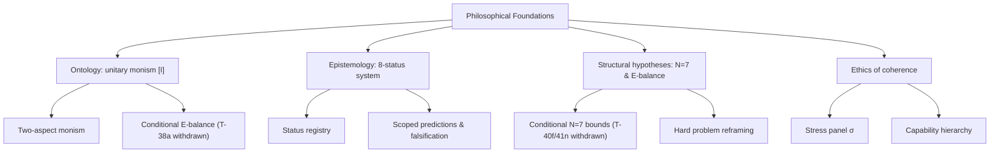

# Philosophical Foundations of Coherence Cybernetics

> *"Philosophy is written in this grand book — the universe — which stands continuously open to our gaze, but it cannot be understood unless one first learns to comprehend the language in which it is written."*
> — Galileo Galilei

:::info Who This Chapter Is For
The philosophical foundations of CC: unitary monism, epistemology of statuses, scope of structural hypotheses, and ethics of the consciousness threshold. The reader will learn how CC separates exact mathematics (`[T]`, `[C]`), conventions (`[D]`), empirical hypotheses (`[H]`), and philosophical interpretation (`[I]`).
:::

In the previous chapter we saw that learning bounds hold under explicitly specified experiments, observation laws, and dynamics ([T-109–T-112](./learning-bounds)). Behind those formal constructions sit philosophical choices — about ontology, epistemology, and normative ethics — that must be stated explicitly so they are never confused with proven theorems.

Every scientific theory rests on a philosophical foundation — explicit or implicit. Newtonian mechanics assumed absolute space and time; quantum mechanics continues to debate its interpretation; evolutionary theory builds on stochastic variation and selection.

Coherence Cybernetics (CC) **makes its philosophical presuppositions explicit**. Knowing where mathematics ends and interpretation begins lets us audit each claim independently. This section examines the philosophical framework behind the formalism.

:::info Chapter Roadmap
In this chapter we will:
1. Examine **four ontological positions** and show why CC adopts unitary monism `[I]` (section 1)
2. Distinguish CC from unbounded panpsychism and clarify the **corrected scope of Chalmers' zombie argument** after the withdrawal of universal `T-38a [✗]` (sections 1.3–1.5)
3. Explore CC's **epistemology** — the 8-status system, honest falsifiability, and the Bayesian analogy (section 2)
4. Examine **structural hypotheses** — the role of $N = 7$ (`T-40f [✗]`, `T-41n [✗]`, `T-113 [H]`), conditional E-coherence balance, and compatibilist autonomy (section 3)
5. Trace interpretive parallels with philosophical traditions — from Spinoza to Buddhism (section 4)
6. Clarify how unitary monism **reframes the hard problem** without claiming to deduce phenomenology from pure algebra (section 5)
7. Summarize **ethical commitments** — why no unvalidated scalar replaces normative judgment or clinical evidence (section 6)
:::

---

## 1. Ontological Status: What Is Real? {#онтология}

### 1.1 Four Ontological Positions

The history of the philosophy of mind is, in essence, the history of four answers to the question "What is reality made of?":

| Position | What is fundamental | Representatives | Problem |
|----------|---------------------|-----------------|---------|
| **Materialism** | Matter only | Democritus, Hobbes, contemporary physicalism | Does not explain subjective experience ([hard problem](/docs/consciousness/foundations/two-aspect-monism)) |
| **Idealism** | Consciousness only | Berkeley, Hegel, analytic idealism | Does not explain the stability of physical laws |
| **Dualism** | Matter + consciousness | Descartes, Popper | Does not explain how they interact |
| **Neutral monism** | Something third, neither matter nor consciousness | Spinoza, Russell, Chalmers | Does not say *what* this third thing is |

To feel the problem, imagine an explanation of pain. The materialist will say: "Pain is the activation of C-fibers in the brain." But *why* does the activation of nerve cells *feel* like pain? Why does it not occur "in the dark," without inner experience? The materialist cannot answer — and this is precisely the gap Chalmers called the *hard problem*.

The idealist will say: "Pain is an experience, and nerve cells are merely its projection." But then why does aspirin help? Why does a certain configuration of atoms reliably eliminate a certain experience?

The dualist will say: "There is matter, and there is consciousness, and they are somehow connected." But that "somehow" is the main problem. If matter and consciousness are different substances, how do they interact? Descartes proposed that through the pineal gland — but this only shifted the question: how does the gland, being material, contact the immaterial?

### 1.2 Unitary Monism: CC's Answer

CC occupies the position of **unitary monism** — a precisely defined version of neutral monism:

:::info Ontological Thesis [I]
Fundamental reality is the **coherence matrix** $\Gamma \in \mathcal{D}(\mathbb{C}^7)$. The physical and the mental are not two substances and not two aspects of some mysterious "neutral" thing, but **two projections** of one mathematical object.
:::

What does this mean concretely?

- **Physics** is what an external observer sees: diagonal elements $\gamma_{kk}$ (populations), the spectrum of $\Gamma$, the dynamics of purity $P(\tau)$. This is the "objective side" — what can be measured by an instrument.

- **Experience** is what it is "like to be" this system: [E-coherence](./definitions#e-когерентность) $\mathrm{Coh}_E$, [reflection measure](/docs/consciousness/foundations/self-observation#мера-рефлексии-r) $R$, [integration measure](/docs/core/structure/dimension-u#мера-интеграции-φ) $\Phi$. This is the "subjective side" — accessible only to the system itself.

- **The unity of both sides** is guaranteed by the fact that both are functions of the same $\Gamma$. There is no need for "psychophysical bridges" or "pre-established harmony": physics and experience are different facets of one crystal.

**Analogy.** Imagine a coin. Heads and tails are not two coins and not two substances glued together. They are two sides of one object that cannot be separated without destroying the coin. $\Gamma$ is CC's "coin." Physics is heads. Experience is tails.

:::tip Why "unitary" rather than simply "neutral"?
Traditional neutral monism (Russell, Mach) says: "There is something neutral, neither matter nor consciousness." But what is this "something"? Russell called it "sense-data," Mach called it "elements." Neither provided a mathematical formula.

CC specifies: the "neutral something" is $\Gamma \in \mathcal{D}(\mathbb{C}^7)$. Not a mysterious substance, but a precisely defined mathematical object — a positive semidefinite Hermitian $7 \times 7$ matrix with unit trace. This makes CC's monism *computable* — hence the word "unitary" (unified + computable).
:::

### 1.3 Distinction from Panpsychism

CC is **not** panpsychism. This distinction is so important and so frequently confused that it deserves detailed treatment.

**Panpsychism** claims that *everything* has experience — even an electron, even a stone, even a thermostat. Every fragment of matter has some "grain of experience" — proto-consciousness. The most prominent contemporary defenders of this position are Galen Strawson, Philip Goff, and (on some interpretations) David Chalmers.

**CC** claims something more subtle and more falsifiable:

> Experience arises **only** in systems with $P > 2/7$, $R \geq 1/3$, $\Phi \geq 1$, and $D_{\text{diff}} \geq 2$.

A stone has no experience — it has no coherence matrix with sufficient purity. An electron has no experience — it has no 7 semantic dimensions. A thermostat has no experience — it does not model itself. CC is a **threshold view**, not unbounded panpsychism: in the field's vocabulary its universal interiority L0, which is not experience, makes it a constitutive panprotopsychism with a threshold for awareness [I] ([where pan-interiority sits](/docs/consciousness/comparative/panpsychism-analysis#место-панинтериоризма)).

Comparing three positions:

| | Panpsychism | Materialism | CC |
|---|---|---|---|
| **Does an electron have experience?** | Yes (proto-consciousness) | No | No ($N < 7$) |
| **Does a bacterium have experience?** | Yes (more than an electron) | No | No: the corpus places it below the L2 thresholds, at L0–L1 |
| **Does a person in a coma have experience?** | Yes (alive → proto-consciousness) | Disputed | Depends: $P > 2/7$? If not — no experience |
| **Does an LLM have experience?** | Yes (information is processed) | No | Verifiable: compute $P$, $R$, $\Phi$, $D$ |
| **Can it be refuted?** | No (unfalsifiable) | No (hard problem) | Yes (5+ predictions) |

### 1.4 The Combination Problem and CC's Answer

Panpsychism has a fatal problem — the **combination problem**: if every atom has micro-experience, how do billions of micro-experiences combine into the *unified* experience of a conscious being? Why is your brain one subject and not billions of tiny subjects?

Panpsychists have proposed various solutions: cosmopsychism (the experience of the Universe is fundamental, and ours is part of it), constitutive panpsychism (micro-experiences "add up"), panprotopsychism (atoms have not experience but "proto-experience"). None of these solutions has gained general acceptance.

CC does not bypass the combination problem; it restates it [I]:

1. Atoms have **no** micro-*experience*, but every system has interiority (L0), which is not experience — in the field's vocabulary, protophenomenal structure ([panprotopsychism](/docs/consciousness/comparative/panpsychism-analysis#место-панинтериоризма)). The problem that reaches CC is therefore the panprotopsychist one: how non-phenomenal structure constitutes experience.
2. Experience (L2) is attributed exactly when purity ($P > 2/7$), reflection ($R \geq 1/3$), integration ($\Phi \geq 1$) and differentiation ($D_{\text{diff}} \geq 2$) pass their thresholds. The thresholds say *when* a system counts as a subject, not *how* its structure becomes experience.
3. **Joint state.** The integration statistic $\Phi$ can exceed its threshold on a product. To distinguish a joint state from the product of its marginals, compute their mutual information.

The combination of experiences remains a question of interpretation. Correlation of a physical state has a mathematical test. Identifying a shared experience requires additional observational evidence.

:::note T-266 and cosmopsychism — a distinction to keep `[H]`/`[I]`
[T-266](/docs/physics/gravity/cosmological-constant#теорема-стадия-вселенной) (`[H]`) explores a cosmological hypothesis mapping Universe-as-holon, a regeneration timescale, a cosmological readout, and terminal-stage extrapolation onto the purity stage parameter $P$. Per the [Status Registry](/docs/reference/status-registry), these are **independent hypotheses `[H]`** — local fixed-metric steepest descent (`T-263`) supplies neither a universal cosmological exponential envelope nor a measured $10^{-60}$ convergence. Moreover, even under that hypothesis, `T-266` is **not** cosmopsychism and does not soften CC's threshold: cosmopsychism treats cosmic experience as *fundamental*, whereas CC retains its four-condition gate ($P > 2/7$, $R \geq 1/3$, $\Phi \geq 1$, $D_{\mathrm{diff}} \geq 2$). A statement about a stage parameter $P$ does **not** assert that the Universe is a conscious subject ([H1.1](/docs/reference/epistemic-vertical#регистр-дыр)).
:::

### 1.5 Chalmers' Zombie Argument and CC's Position

One of the most influential thought experiments in the philosophy of mind is **David Chalmers' zombie argument** (1996).

**The argument.** Imagine a being physically and functionally identical to you in *all* respects — the same neurons, connections, reactions, and reports — yet lacking *any* subjective experience ("dark inside"). Chalmers argues that if such philosophical zombies are conceivable and metaphysically possible, reductive physicalism is false.

**CC's position (three clearly stratified levels):**

**Level 1: Mathematical scope — universal `T-38a [✗]` withdrawn.** Earlier drafts claimed that CC's formalism logically forbids zombies via a universal "No-Zombie theorem" (`T-38a`). That universal claim is **withdrawn `[✗]`**: inside the density-matrix formalism, stationary externally supported counterexamples exist with $P > 2/7$ and low $\mathrm{Coh}_E$ (see [Theorem 8.1](./theorems#теорема-81-условная-необходимость-интериорности-no-zombie)). What replaces `T-38a [✗]` is an **explicitly restricted conditional purity-flux balance** `[C]`: a positive lower bound on $\mathrm{Coh}_E$ follows only inside a restricted model class with bounded external support, positive E-dependent feedback, and positive required flux. Thus pure matrix axioms alone do **not** establish the logical impossibility of zombies.

**Level 2: Ontological framing `[I]`.** As a philosophical interpretation `[I]`, unitary monism rejects the premise that experience is an optional epiphenomenal layer bolted onto physics: physical and experiential descriptions are modelled as projections of one underlying state $\Gamma$. However, identifying the formal $E$-sector of $\Gamma$ with subjective experience remains a separate interpretive/postulational bridge (`[P/I]`), not a deductive mathematical proof.

**Level 3: Epistemic & empirical stance `[H/I]`.** Conceivability does not settle empirical dynamics. Whether specific biological or artificial systems obey an E-dependent regenerative balance is an open, testable empirical hypothesis `[H]` ([Pred 1](./predictions#предсказание-1)) requiring controlled interventions and identifiable readouts.

:::note An Honest Caveat
CC's response to the zombie argument does not claim a deductive refutation of Chalmers from matrix algebra alone. Instead, it separates three questions: (a) what restricted dynamical classes mathematically couple an $E$-sector to viability (`[C]`), (b) whether unitary monism offers a coherent interpretive ontology (`[I]`), and (c) whether empirical measurements confirm E-dependent recovery in real systems (`[H]`).
:::

**Further reading:** [Two-aspect monism](/docs/consciousness/foundations/two-aspect-monism) | [Panpsychism: critical analysis](/docs/consciousness/comparative/panpsychism-analysis)

---

## 2. Epistemology: What Can We Know? {#эпистемология}

### 2.1 The Status System as an Epistemological Compass

One of CC's central methodological safeguards is its **built-in 8-status epistemological system**. Every claim is tagged with its justification level:

| Status | Meaning | Role |
|--------|---------|------|
| **[T]** Theorem | Strictly proven from stated premises | Verified deductive result |
| **[C]** Conditional | Proven under an explicit additional assumption | Conditional mathematical result |
| **[H]** Hypothesis | Formulated but unestablished | Requires proof or empirical testing |
| **[P]** Postulate | Accepted without proof as a foundational assumption | Explicit axiomatic input |
| **[Pr]** Research programme | Named open direction | Neither assumed nor claimed proven |
| **[D]** Definition | Convention by choice | Assigned quantity or threshold |
| **[I]** Interpretation | Philosophical/semantic bridge | Semantic reading |
| **[✗]** Retracted | Proven erroneous or withdrawn | Excluded as a live premise |

This system prevents **confusing the proven with the assumed** — and records retractions (`[✗]`) transparently whenever a proof gap or counterexample is found.

Each empirical reading needs a specified observation and a feasible outcome that would count against it.

**Further reading:** [Status registry](/docs/reference/status-registry)

### 2.2 Falsifiability: What Does CC Risk?

Karl Popper taught that a genuine scientific theory must be *risky* — it must specify observations that would refute a stated model or empirical bridge. Aligned with [Unique Predictions](./predictions), CC advances concrete, scoped falsifiable tests (replacing earlier retracted claims such as universal `T-38a [✗]` No-Zombie, universal `SAD <= 3` `T-136 [✗]`, or universal $N = 7$ learning impossibility `T-113 [H]`):

1. **Restricted E-balance (Pred 1 `[H]`):** Within a declared restricted model class with controlled inputs, rates, gate, and dissipation, testing whether stationary viability obeys the restricted purity-flux balance.
2. **Rank-7 decoherence-anisotropy law (Pred 23 `[T]` algebra / `[C]` mapping):** Under a pre-registered channel mapping, the 21 pairwise decoherence rates of the Fano-jump dissipator must satisfy 14 exact $\mathrm{PG}(2,2)$ linear relations better than non-Fano permutations.
3. **Held-out clinical concordance of $\pi_{\mathrm{bio}}$ (Pred 6 & Pred 21 `[H]`):** A frozen readout calibrated on wakefulness alone (without viability penalty) must achieve Cohen's $\kappa \ge 0.8$ concordance on held-out sessions with $\mathrm{PCI}_{\max} > 0.31$ (P8.4); $\kappa < 0.4$ falsifies the readout hypothesis.
4. **Exact learning obstructions (Pred 9, `T-109`–`T-112` `[T]`):** Under a declared i.i.d. quantum observation law, beating the exact Helstrom optimum $p_e^*(n)$ (or fidelity lower bound $L_F$) falsifies the declared observation/encoding assumptions.
5. **Isotropic feeding window and fold (T-259 `[T]` in model):** In the isotropic Fano-replacement implementation, deviations from $x_{\min}$, two-sided ceiling $x_{\max}$, or the exact $S_5$-quintic fold falsify the implementation or model assumptions.

:::tip Compare with the Competition
- **Panpsychism** struggles with falsifiability when micro-experience is postulated without operational thresholds.
- **FEP** is a general variational modelling framework whose empirical risk depends on specifying a concrete generative model.
- **IIT** makes structural claims, but exact $\Phi$ computation is intractable for large biological networks.
- **CC** evaluates explicit matrix functionals on $7 \times 7$ states in $O(N^3)$ operations — while explicitly separating algebraic computability from the empirical challenge of validating the encoder $\pi$ ([Measurement Methodology §6.4](./measurement#оценка-gamma)).
:::

### 2.3 Connection to Bayesian Epistemology

CC is compatible with the Bayesian approach to knowledge. The update of the self-model $\rho_* = \varphi(\Gamma)$ upon receiving observations through the $\mathrm{Enc}$ functor is essentially **Bayesian updating**, but implemented at the level of the coherence matrix dynamics, not at the level of hypothesis probabilities.

To see this, recall Bayes' formula:

$$
P(\theta | D) = \frac{P(D | \theta) \cdot P(\theta)}{P(D)}
$$

The prior world model $P(\theta)$ is updated by data $D$ to become the posterior $P(\theta | D)$. In CC:

| Bayes | CC |
|-------|-----|
| Prior model $P(\theta)$ | Current self-model $\varphi(\Gamma)$ |
| Data $D$ | Observation through $\mathrm{Enc}$ |
| Likelihood $P(D\|\theta)$ | Fano contraction to the state nearest to the observation |
| Posterior model $P(\theta\|D)$ | Updated $\varphi(\Gamma')$ after one step of $\mathcal{L}_\Omega$ |

The key difference: in Bayesian inference, *probabilities of hypotheses* are updated. In CC, the *entire state of the system* is updated — including not just "knowledge," but also "health," "experience," and "wholeness." This bridge is described in more detail in the section [Learning as Attractor Update](./learning-bounds#обучение-как-аттрактор).

### 2.4 Three Levels of Knowledge in CC

CC distinguishes three qualitatively different levels of knowledge, each corresponding to a certain range of the reflection measure $R$:

1. **Reactive knowledge** ($R < 1/3$): the system responds to stimuli but does not know that it responds. A bacterium swims toward food — but does not know that it is swimming. This is the level of autopoiesis without reflection.

2. **Reflexive knowledge** ($R \geq 1/3$, $\mathrm{SAD} = 1$): the system knows that it knows. A cat does not merely see a mouse — it *knows* that it sees a mouse (in the functional sense: its behavior takes into account its own state).

3. **Meta-reflexive knowledge** ($\mathrm{SAD} \geq 2$): the system knows that it knows that it knows. A person does not merely solve a problem — they are aware of being stuck and changes strategy. This is the level of [metacognition](./sensorimotor#функтор-dec).

These levels are not philosophical abstractions but computable characteristics: $R$ can be computed from $\Gamma$ and $\varphi(\Gamma)$, and $\mathrm{SAD}$ from the sequence of critical purities $P_{\text{crit}}^{(n)}$.

---

## 3. Metaphysics: Structural Hypotheses and Scope {#метафизика}

### 3.1 Why Seven Axes? (Corrected Scope: `T-40f [✗]`, `T-41n [✗]`, `T-113 [H]`)

A natural question about CC is: "Why exactly seven dimensions?"

Earlier drafts claimed that $N = 7$ follows unconditionally from two independent derivations (octonionic algebra and categorical role minimality). Under the current [Status Registry](/docs/reference/status-registry), both unconditional derivations have been **withdrawn**:
- **Unconditional seven-role minimality (`T-40f [✗]`):** Counting seven named semantic roles does not prove a Hilbert-space dimension lower bound without an independent operational distinguishability/faithfulness premise ([Minimality theorem](/docs/proofs/minimality/theorem-minimality-7)).
- **Unconditional octonionic chain (`T-41n [✗]`):** The canonical orientation theorem holds for a **given** Fano plane and collineation-natural orientation class; it does not unconditionally force the Fano plane or physical dimension.
- **Learning architecture (`T-113 [H]`):** Universal $N = 7$ necessity for autonomous learning is unproved (a two-level replacement learner converges in binary estimation; see [Learning Bounds §6](./learning-bounds#оптимальность-n7)).

**What survives strictly:**
1. **Conditional coding and representation bounds (`[T]` under explicit premises):** The smallest nontrivial perfect single-error-correcting binary code is Hamming $(7,4,3)$, and faithful representation of a **supplied** 7-point Fano/octonionic multiplication structure requires $\dim \ge 7$.
2. **Testable seven-role architectural hypothesis (`[H]`):** The seven canonical axes $\{A, S, D, L, E, O, U\}$ form a concrete, falsifiable modelling architecture that can be benchmarked directly against smaller or larger state spaces under matched data and compute budgets (`T-113 [H]`).

### 3.2 Conditional Role of Interiority (`T-38a [✗]` Withdrawn)

Earlier editions presented experience as universally necessary for viability via `T-38a` ("No-Zombie"). That universal implication is **withdrawn `[✗]`** ([Theorem 8.1](./theorems#теорема-81-условная-необходимость-интериорности-no-zombie)):

:::warning Corrected Scope: Restricted Balance vs. Universal Necessity
- **Withdrawn (`T-38a [✗]`):** The universal implication $\mathcal{D}_\Omega \neq 0 \land \mathrm{Viable}(\mathbb{H}) \Rightarrow \mathrm{Coh}_E > 1/7$. Stationary externally supported counterexamples exist inside $\mathcal{D}(\mathbb{C}^7)$.
- **What survives (`[C]` in restricted class / `[H]` empirically / `[I]` philosophically):** Inside an explicitly restricted feedback class (bounded external support, positive E-dependent rate coupling, and positive required purity flux), maintaining $P > 2/7$ satisfies a conditional purity-flux balance requiring positive $E$-sector contribution. Identifying that formal $E$-sector with subjective experience remains a separate `[P/I]` bridge.
:::

### 3.3 Free Will and Determinism

CC takes a **compatibilist** position `[I]`: the formal state $\Gamma$ evolves deterministically under a specified flow $\mathcal{L}_\Omega$, while functional autonomy is modelled through closed-loop dependence on internal state and self-model $\varphi(\Gamma)$.

More formally, the [action functor Dec](./sensorimotor#функтор-dec) (`T-101 [D]` + `[T under attained minima]`) selects an action minimizing a chosen stress objective over an admissible control set. Calling this "autonomy" is a compatibilist philosophical interpretation `[I]` of closed-loop optimal control, not a metaphysical proof of libertarian free will.

**Analogy.** A river is governed by gravity and terrain, yet carves its own channel over time. Similarly, a closed-loop agent's action depends on its integrated internal history $\Gamma$, not merely on an instantaneous external stimulus.

### 3.4 Determinism and Unpredictability

Even when $\Gamma(\tau)$ evolves deterministically under a known law $\mathcal{L}_\Omega$, an external observer faces two practical limits to prediction:

1. **Sensitivity to initial conditions:** Nonlinear regeneration $\mathcal{R}$ can amplify small state perturbations.
2. **Observational fibers and partial observability:** An external observer accesses only reconstructed projections $\widehat{\Gamma}$ with finite-sample uncertainty ([Measurement Methodology §6.4](./measurement#оценка-gamma)), not the exact latent state.

---

## 4. Connection to Philosophical Traditions {#философские-традиции}

### 4.1 Spinoza: Two Attributes of One Substance {#спиноза}

The closest historical philosophical parallel to CC's unitary monism is Baruch Spinoza's *Ethics* (1677), which treats extension (physics) and thought (experience) as two attributes of a single substance (*Deus sive Natura*). All correspondences below are **philosophical interpretations `[I]`**:

| Spinoza (*Ethics*, 1677) | CC parallel | Status |
|--------------------------|-------------|--------|
| One substance (E1P14) | Unified state matrix $\Gamma \in \mathcal{D}(\mathbb{C}^7)$ | **[I]** |
| Attribute of extension (E2P1–2) | External physical/observational readouts ($P$, spectrum) | **[I]** |
| Attribute of thought (E2P1–2) | Experiential-sector observables ($\mathrm{Coh}_E$, $R$, $\Phi$) | **[I]** |
| Modes (E1D5) | Specific configurations of $\Gamma$ | **[I]** |
| Conatus (E3P6) | Self-maintenance / regeneration term $\mathcal{R}[\Gamma, E]$ | **[I]** |
| Linear convergence (analogue of *Necessitas*) | Linear primitivity of $\mathcal{L}_0$ (`T-39a [T]` under connected $H$ and positive dephasing: unique linear stationary state $I/7$) | **[I]** |
| Three kinds of knowledge (E2P40S2, E5P25–28) | Heuristic parallel to capability levels L1 → L2 → L3 | **[I]** |

Note on `T-39a`: linear primitivity guarantees a unique stationary state ($I/7$) for the *linear* baseline $\mathcal{L}_0$ under a connected Hamiltonian graph and fixed positive dephasing; it does **not** prove uniqueness of nonlinear attractors $\rho^*$ under arbitrary feedback.

:::note Spinoza and the Conditional E-Balance
The Spinoza comparison is strictly interpretive `[I]`. A lower bound for E-coherence requires an explicit source, rate constraints, and a stationary balance (`T-38a [✗]` withdrawn). A positive matrix statistic alone does not establish experience.
:::

### 4.2 Whitehead: Process and Reality

Alfred North Whitehead (1861–1947) proposed a process philosophy in which the fundamental entities are not things but **events** (actual occasions). Each event includes a "physical pole" (received data) and a "mental pole" (subjective processing).

This remarkably resonates with CC: a holon is not a "thing" but a **process** — the continuous evolution of $\Gamma(\tau)$. The physical and mental poles are projections onto the corresponding subspaces.

Whitehead also introduced the concept of *prehension* — the grasping of one event by another. In CC this corresponds precisely to the perception functor $\mathrm{Enc}$ ([T-100](./sensorimotor#функтор-enc)): a holon "grasps" the environment, transforming observations into changes in $\Gamma$.

### 4.3 Phenomenology: Husserl and Intentionality

Edmund Husserl (1859–1938) discovered **intentionality** — the property of consciousness to always be *about something*. Consciousness does not exist in a vacuum: it is always directed at an object.

In CC, intentionality is implemented through the [Enc functor](./sensorimotor#функтор-enc) (T-100 [D]): every observation modifies $\Gamma$, and this modification is the mathematical form of "directedness toward an object." Reflection ($\varphi$) is directedness toward oneself.

Merleau-Ponty, Husserl's student, emphasized the *embodiment* of consciousness: we are not disembodied spirits observing the world from the outside — we are embedded in the world through the body. In CC, embodiment is encoded in dimensions A (articulation — perception), D (dynamics — action), and O (grounding — resources). Consciousness in CC is *fundamentally* embodied — because $\Gamma$ includes both "higher" ($E$, $U$) and "basic" ($A$, $O$) dimensions.

### 4.4 Kant: conditions of experience

The comparison with Kant is interpretive [I]. The selected operational window contains $P>2/7$, $R\ge1/3$, $\Phi\ge1$ and a separately defined $D_{\mathrm{diff}}\ge2$. Algebraic relations between these quantities are provable under their definitions; neither the choice of predicate nor its identification with phenomenal experience follows from those relations.

### 4.5 Eastern Traditions

Parallels with Eastern philosophy deserve separate consideration:

- **Buddhist doctrine of anatta** (no permanent self): in CC there is no fixed "self" — there is a dynamic process $\Gamma(\tau)$ with an attractor $\rho_*$ that itself continuously updates. "Self" is not a substance but a pattern — a stable configuration that preserves identity through continuous change. Like a candle flame: it is "the same" each moment, although the gas molecules are completely replaced.

- **Advaita Vedanta** (non-duality): the claim of the unity of Atman and Brahman resonates with CC's thesis of the unity of the physical and mental in $\Gamma$. Shankara said: "Brahman alone is real, the world is its manifestation." CC says: "$\Gamma$ alone is real, physics and experience are its projections."

- **Taoism** (yin-yang): the dynamic equilibrium of dissipation $\mathcal{D}$ and regeneration $\mathcal{R}$ is reminiscent of the Taoist dialectic of opposites. Destruction and restoration, entropy and negentropy — two sides of one dynamics, like yin and yang.

- **Buddhist theory of moments (ksana-vada):** Reality is a flow of momentary events, each conditioned by the previous one. In CC: $\Gamma(\tau + d\tau) = \Gamma(\tau) + \mathcal{L}_\Omega[\Gamma(\tau)] \, d\tau$ — each moment is conditioned by the previous one through the operator $\mathcal{L}_\Omega$.

Important: these parallels are **interpretive** [I], not formal. CC does not claim to prove the truth of Buddhism or Vedanta. But the structural similarity suggests that ancient contemplative traditions may have been describing the same invariants of coherent dynamics that CC formalizes mathematically.

---

## 5. The Hard Problem of Consciousness and CC's Answer {#hard-problem}

### 5.1 Chalmers' Formulation

David Chalmers in 1995 formulated the [hard problem of consciousness](/docs/consciousness/foundations/two-aspect-monism): why do physical processes accompany subjective experience? One can explain *how* the brain processes information (the easy problems), but it is impossible to explain *why* this processing is experienced from the inside.

To appreciate the depth of the problem, let us list the "easy problems" (which neuroscience can in principle solve):
- How does the brain discriminate stimuli? (neural coding)
- How does the brain integrate information? (binding problem)
- How does the brain manage attention? (attention networks)
- How does the brain generate speech? (motor cortex, Broca's area)

All these questions are about *mechanism*. The hard problem is about *experience*: why is information processing in the brain *experienced*? Why do 86 billion neurons transmitting electrical impulses produce *red color*, *pain*, *joy*?

### 5.2 CC's Strategy: Dissolution, Not Solution

CC does not "solve" the hard problem in the usual sense — it **dissolves** it by changing the ontology:

1. In materialism the question "why does matter experience?" makes sense, because matter and experience are different categories.

2. In CC, $\Gamma$ inherently contains both sides. The question "why does $\Gamma$ have an E-dimension?" is analogous to the question "why does spacetime have a temporal coordinate?" — this is part of the structure, not something that needs explaining.

3. **Model scope.** Whether the E-sector has a positive lower bound depends on the preparation and dynamics.

**Analogy.** Imagine someone asks: "Why does space have three dimensions?" A physicist can answer: "In three dimensions, stable orbits and knots are possible — it is the only dimensionality compatible with complex structure." But they cannot answer: "Why does space exist at all?" — that is not a physics question. Analogously: CC can answer when and why consciousness arises, but not "why does experience exist at all?" — that is a question of ontology, not dynamics.

Phenomenal identification requires a readout and independent evidence. The hypotheses of a categorical fixed-point theorem concern functions and their fixed points.

:::note The Dissolution Strategy: Historical Precedents
The strategy of "dissolving" a problem (rather than solving it) has illustrious precedents:
- **The vital force problem (vitalism):** In the 19th century people asked: "What is the vital force?" Biochemistry did not answer this question — it showed that the question was ill-formed: the living is not "matter + vital force" but a certain *organization* of matter.
- **The ether problem:** In the 19th century people asked: "What are the properties of the ether?" Einstein did not answer — he showed that the ether does not exist.
- CC does not answer the question "what is experience on top of physics?" — it shows that experience is not *on top of* physics, but *part of* the same structure $\Gamma$.
:::

**Further reading:** [Two-aspect monism](/docs/consciousness/foundations/two-aspect-monism)

---

## 6. Ethics of Coherence {#этика}

The canonical [UHM Ethics](/docs/consciousness/ethics-meaning/value-consciousness) distinguishes mathematical consequences from normative commitments and empirical bridges. The four-gate predicate is a model classification; it is not an independently validated consciousness test. Neither $C=\Phi R$ nor a hierarchy level determines dignity or a continuous scale of moral worth.

The ethical proposal protects subjects, agency and conditions of flourishing. Purity change is one diagnostic, not a complete definition of good or harm. Individual protections, affected interests and choice criteria are explicit inputs; the formalism can then check feasible trajectories, conditional preservation certificates and tradeoffs. A theorem about joint purity does not establish compassion or a benefit to both participants.

### 6.4 Clinical applications require independent evidence {#этика-медицина}

A scalar model cutoff alone determines neither moral status nor care decisions. [Care under uncertainty](/docs/consciousness/ethics-meaning/value-consciousness)

### 6.5 Suffering and the σ-profile

The stress profile $\sigma_{\mathrm{sys}}(\Gamma)$ is a defined model statistic. Identifying it with suffering, alexithymia or burnout requires separate operational definitions and evidence. A numerical profile cannot override a subject's report by definition. Where reports are unavailable, evidence from behaviour and other validated observations remains necessary; inability to report does not itself establish absence of welfare interests.

**Further reading:** [Ethics](/docs/consciousness/ethics-meaning/value-consciousness) · [Spiritual synthesis](/docs/consciousness/ethics-meaning/spiritual-synthesis) · [Diagnostics](./diagnostics).

---

## 7. Conclusion: Philosophy as Explicit Architecture {#заключение}

In CC, philosophical choices are stated explicitly alongside their mathematical and empirical boundaries:

- **Ontology `[I]`** frames $\Gamma \in \mathcal{D}(\mathbb{C}^7)$ via unitary monism, while keeping phenomenal identification distinct from matrix algebra.
- **Epistemology** enforces the 8-status system (`[T]`, `[C]`, `[H]`, `[P]`, `[Pr]`, `[D]`, `[I]`, `[✗]`) and scoped falsifiability.
- **Structural hypotheses** distinguish proven conditional algebra from withdrawn universal derivations (`T-38a [✗]`, `T-40f [✗]`, `T-41n [✗]`) and open hypotheses (`T-113 [H]`, `T-266 [H]`).
- **Ethics** supplies explicit normative commitments; mathematics checks their stated consequences.

### What We Learned {#итоги}

1. CC adopts **unitary monism `[I]`**: physical and experiential descriptions are modelled as projections of one state $\Gamma$, without pretending that algebra alone proves phenomenology.
2. CC is **not** unbounded panpsychism: experience attribution uses four explicit capability gates, and `T-266 [H]` is a cosmological hypothesis about $P$ rather than cosmopsychism.
3. Universal No-Zombie necessity (`T-38a [✗]`) is **withdrawn**: CC's response to Chalmers separates restricted conditional purity-flux balance (`[C]`), unitary-monist framing (`[I]`), and empirical testing (`[H]`).
4. The combination problem is **restated, not dissolved**: universal interiority (L0) is protophenomenal, and the thresholds state *when* a system is modelled as a subject, not *how* structure becomes experience `[I]`.
5. CC's empirical risk rests on concrete, pre-registered tests (rank-7 decoherence rates, frozen-encoder clinical concordance, exact learning lower bounds, and restricted E-balance).
6. Model-specific relations between self-maintenance and operational capabilities require their full dynamical hypotheses; phenomenal interpretation is a separate bridge.
7. Ethical protection requires explicit commitments and evidence; no unvalidated scalar provides a clinical verdict or dignity ranking.

---

**Connection map of this section:**

---

In the next chapter we leave the philosophical Olympus and descend to earth: [Comparison with alternative theories](./comparison) places CC alongside IIT, FEP, GWT, and other competitors — and shows what CC can do that others cannot, and vice versa.

---

**Further reading:**
- [Two-aspect monism](/docs/consciousness/foundations/two-aspect-monism) — formal development of the ontology
- [Status registry](/docs/reference/status-registry) — complete classification of claims
- [Unique predictions](./predictions) — falsifiable consequences
- [Panpsychism: critical analysis](/docs/consciousness/comparative/panpsychism-analysis) — why CC is not panpsychism
- [Ethics and meaning](/docs/consciousness/ethics-meaning/value-consciousness) — practical ethics of coherence

---

**Related documents:**
- [Comparison with alternative theories](/docs/applied/coherence-cybernetics/comparison)
- [Two-aspect monism](/docs/consciousness/foundations/two-aspect-monism)
- [Unique predictions of CC](/docs/applied/coherence-cybernetics/predictions)
- [Introduction to CC](/docs/applied/coherence-cybernetics/introduction)
