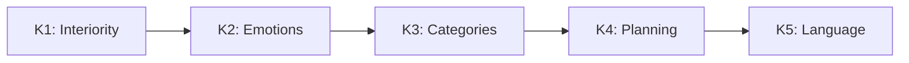

# Unique Predictions of CC

> *"A theory that cannot be refuted by any conceivable event is non-scientific. Irrefutability is not a virtue of a theory (as people often think) but a vice."*
> — Karl Popper, "Conjectures and Refutations" (1963)

:::info Who this chapter is for
23 predictions and model tests of CC — stratified explicitly by status (`[T]`, `[C]`, `[D]`, `[H]`, `[I]`, `[✗]`) — with verification protocols and scope-specific falsification criteria. The reader will learn how CC's testable constructions compare with IIT, FEP, and GWT.
:::

In the [previous chapter](./stability) we established exact geometric margins ($r_{\mathrm{HS}}$, $r_B \ge r_{\mathrm{HS}}/\sqrt{2}$), Grönwall trajectory perturbation bounds, and purity-flux balance. Now we collect the 23 numbered predictions of CC in one place, aligned with the [Status Registry](/docs/reference/status-registry), specifying for each: its **exact scope**, **how to test it**, and **what a failure actually refutes** (a formal implication, a conditional model reduction, or an empirical bridge).

Science differs from philosophy not in the depth of its questions but in the willingness to put its answers to the test of experiment. Popper called this the demarcation criterion: the boundary between science and non-science runs through **falsifiability** — knowing in advance which observations would reject a specified model or empirical bridge.

This chapter organizes the 23 predictions of CC by theme: from fundamental balance laws through architectural hypotheses and numerical thresholds to conditional dynamical scaling and neural-data reconstruction. Each entry states its status explicitly (`[T]`, `[C]`, `[D]`, `[H]`, `[I]`, or `[✗]` where an earlier universal formulation was withdrawn) so that exact mathematical identities are never conflated with untested empirical bridges.

:::note On notation
In this document:
- $\Gamma$ — [coherence matrix](/docs/core/dynamics/coherence-matrix)
- $P$ — [purity](/docs/core/dynamics/viability#определение-чистоты): $P = \mathrm{Tr}(\Gamma^2)$
- $\mathrm{Coh}_E$ — [E-coherence](./definitions#e-когерентность)
- $C$ — [consciousness measure](/docs/consciousness/foundations/self-observation#мера-сознательности-c)
- $\sigma_{\mathrm{sys}}$ — [stress tensor](./definitions#тензор-напряжений)
- $\mathbb{H}$ — [Holon](/docs/core/structure/holon)
:::

---

## I. Fundamental Predictions: Consciousness and Viability

The first group of predictions concerns the deepest idea of CC — the indissoluble connection between interiority and stability. In most theories consciousness is either an epiphenomenon (does not affect dynamics) or a separate postulate (introduced externally). CC asserts something radically different: a system with an E-dependent feedback law can have a different recovery rate, conditional on the target, gate, dissipation, and resources.

### Prediction 1: Conditional E-coherence balance {#предсказание-1}

:::note Prediction `[H]` (universal `T-38a [✗]` withdrawn)
Purity above $2/7$, a nonzero dissipator, and sustained dynamics do **not** force $\mathrm{Coh}_E > 1/7$: the former universal No-Zombie necessity (`T-38a [✗]`) is withdrawn. [Theorem 8.1](./theorems#теорема-81-условная-необходимость-интериорности-no-zombie) supplies a stationary externally supported counterexample alongside an explicitly restricted purity-flux balance. A positive E-floor requires a specified restricted model class, a bound on external support, positive feedback dependence, and a positive required flux. Identifying the E-sector with experience is a further `[P/I]` bridge.
:::

Test the restricted balance after fixing the admissible inputs and rates. Keep the remaining target, gate, dissipation, preparation, and resources fixed during an E-intervention, or explicitly model their changes. An externally supported viable system with low E-coherence does not refute the density-matrix formalism; it refutes only the already-withdrawn universal necessity claim (`T-38a [✗]`).

### Prediction 2: A selected E-dependent rate model {#предсказание-2}

:::info Prediction [D/H]
The model chooses $\kappa=\kappa_b+\kappa_0\mathrm{Coh}_E$, with the other quantities fixed and $\kappa_0\ge0$. Then $\partial\kappa/\partial\mathrm{Coh}_E=\kappa_0$ is an exact derivative [T] of that convention [D]. It does not imply $\dot P\propto\mathrm{Coh}_E$: the regeneration flux is $2\kappa g(P)(\operatorname{Tr}(\rho B(\rho))-P)$ and can be negative. Endogenous variations also change $\kappa_0$, the target, gate, and state.
:::

A correlation with biological recovery is [H], requiring an identifiable observation model and a defined physical recovery outcome. It does not establish a clinical benefit of meditation or therapy. A valid study preregisters the intervention, observation likelihood, nuisance variables, clustered sampling unit, effect size, and held-out test. The bounded rate construction in [septicity](/docs/core/foundations/axiom-septicity#категориальный-вывод-kappa0) is conditional kinetic mathematics, not a categorical uniqueness theorem.

## II. Architectural Predictions: Structure and Dimensionality

The second group of predictions concerns the *architecture* of conscious systems — what is the minimal "design" necessary for the emergence of experience, learning, and social interaction. These predictions make CC unique among theories of consciousness: instead of vague statements about "complexity" and "integration" it names specific numbers.

### Prediction 3: A seven-component stress panel {#предсказание-3}

:::info Prediction [D/H]
The seven stress scores define a panel in a specified frame. The equivalence between crossing that panel, passing the four Cap2 gates and attaining biological health would require separate observation laws and evidence. [Definitions](./definitions#тензор-напряжений)
:::

For window monitoring use the exact four margins and uncertainty-set verdict. For empirical stress classification, preregister the coding rules and test held-out stressors against competing models. The ability to assign a label to every item does not prove independent dimensionality or exhaustive causal coverage.

### Prediction 4: Pre-linguistic cognition is complete {#предсказание-4}

**Intuition.** It is often assumed that consciousness and language are inseparable — that "to think" means "to think in words". CC shows that this is an anthropocentric fallacy. The cognitive hierarchy K1–K5 arranges five levels of cognition, of which language (K5) is only the top — not the foundation. Animals without language function fully at levels K1–K4.

:::info Prediction [I]

$$
\exists \, \mathrm{Cognition}(\mathbb{H}) \text{ with } \mathrm{Language}(\mathbb{H}) = \varnothing
$$

Full cognition (levels K1–K4) is possible without language (K5).

**Status:** [I] — an interpretation following from the definitions of cognitive levels K1–K5.
:::

**See:** [Cognitive hierarchy](/docs/consciousness/comparative/cognitive-hierarchy)

**Uniqueness of the prediction.** GWT links consciousness to global availability of information, often associated with linguistic representations. Higher-Order Theories (HOT) tie consciousness to metacognitive reports, implicitly presupposing language. CC explicitly separates cognition and language as orthogonal axes.

**Cognitive function hierarchy:**

**Verifiability:**
Animals without language demonstrate levels K1–K4:
- Corvids: planning (K4), tool making
- Primates: categorisation (K3), social learning
- All vertebrates: emotional responses (K2)
- All systems with $\rho_E \neq 0$: [interiority](/docs/proofs/consciousness/interiority-hierarchy#уровень-0-интериорность-interiority) (K1/L0)

**Experimental verification:**
1. Compare behavioural correlates of K1–K4 in aphasic patients (loss of language with preserved intellect) and healthy controls.
2. **Prediction:** K1–K4 scores in aphasic patients are preserved at >80% of normal.
3. *Falsification:* if aphasia systematically destroys K3 or K4 — the link "cognition → language" is stronger than CC predicts.

**Interdisciplinary consequences:**
- *Ethology:* provides grounds for full cognitive study of non-linguistic species.
- *AI ethics:* systems without a language module may possess cognitive levels K1–K4, which has ethical implications.

### Prediction 10: Dimension and learning (`T-113`) {#предсказание-10}

:::note Prediction `[H]` (`T-113`)
A seven-axis learning architecture is a testable design (`T-113 [H]`). No general theorem here prohibits autonomous learning at $N < 7$ (indeed, a two-level replacement learner converges for binary estimation; see [Learning Bounds §6](./learning-bounds#оптимальность-n7)). Such a lower bound requires a specified task family, operational independence criterion, representation class, and resource restrictions. Functional-role counts do not prove a Hilbert-space dimension bound.
:::

The rigorous bounds concern a perfect single-error binary code or a faithful representation of a selected internal algebra; see [minimality](/docs/proofs/minimality/theorem-minimality-7). Compare architectures under matched training, observation capacity, resources, and tasks. Failure of one five-dimensional implementation is not a universal impossibility result.

### Prediction 11: Dimension and social learning {#предсказание-11}

:::note Prediction [H]
The proposed role assignment $3_{\rm ToM}+3_{\rm ISL}+1_U=7$ is a model architecture [H]. To establish a lower bound one would need an independence or discrimination result for a specified task.
:::

A lower bound must identify operationally independent observables or an information task requiring a faithful representation. Compare the proposed seven-axis architecture to smaller alternatives on that task.

## III. Thresholds and Robustness

The third group of predictions concerns *numerical thresholds* — specific parameter values at which qualitative transitions occur. Numerical predictions are precisely what distinguishes a scientific theory from philosophical speculation: they are testable, and they are risky.

### Prediction 5: Collective consciousness {#предсказание-5}

Represent the members of a proposed collective by a joint state. The mathematical test asks whether it factors into its marginal states. Identifying the collective as a subject requires an additional observation law.

:::info Prediction. Necessary correlation [T], subject interpretation [H]
**Necessary condition [T].** A collective can differ from a set of separate subjects only if its members' joint state is correlated: a product state is fixed by its marginals, and the mutual information

$$
I(\mathbb{H}_1 : \mathbb{H}_2) = S(\rho_1) + S(\rho_2) - S(\rho_{12}) = D(\rho_{12} \,\|\, \rho_1 \otimes \rho_2)
$$

vanishes exactly on products, so the condition is $I > 0$; for $n$ members the analogue is a positive total correlation $\sum_i S(\rho_i) - S(\rho_{1 \ldots n}) > 0$. The condition is necessary, not sufficient: coupled thermostats meet it too.

**Interaction.** A coupling that commutes with the product anchor leaves a stationary product state. An interaction is therefore insufficient to ensure $I>0$. [CC-7](./theorems#теорема-93-эмерджентность)

**Sufficiency [H].** A correlated group is a subject when its joint state, aggregated to $\mathcal{D}(\mathbb{C}^7)$, passes the four-condition window. This is a hypothesis, not a theorem. [Theorem 9.5](./theorems#теорема-95-каноническая-агрегация) fixes the aggregation by three natural requirements — the only linear, permutation-invariant map $\mathcal{D}(\mathbb{C}^{7^n}) \to \mathcal{D}(\mathbb{C}^7)$ that returns a member's state on an uncoupled group is the mean of the members' marginals — and that map depends on the marginals alone, so it cannot see the correlation that the necessary condition requires. Under it a weakly coupled group of identical members aggregates to within $O(g)$ of one member (T-72 [T]), and at strong coupling the aggregate can fall to $I/7$ ([Theorem 9.6](./theorems#теорема-96-сильная-связь)): the canonical aggregation cannot certify a collective level above the members' at any coupling. An aggregation that sees correlations must give up linearity, permutation invariance or consistency on uncoupled groups, and the corpus fixes none; nor does it have an exclusion rule deciding whether members and group can be subjects at once ([boundary problem](/docs/consciousness/comparative/panpsychism-analysis#проблема-границы)). Research programme [Pr]: a correlation-sensitive aggregation — necessarily non-linear, non-symmetric or inconsistent on uncoupled groups — or an exclusion rule, that turns the hypothesis into a criterion.
:::

**See:** [Theorem 9.1](./theorems#теорема-91-фрактальное-замыкание), [Theorem 9.3](./theorems#теорема-93-эмерджентность)

**Experimental verification:**
1. Measure the correlation between members' states — the mutual information, or the total correlation for $n > 2$, of the reconstructed joint $\Gamma$ — for groups with varying degrees of coordination (jazz quartet vs. random musicians).
2. Apply hyperscanning (simultaneous EEG of several subjects).
3. **Prediction:** the correlation is positive for a coordinated group and absent for an unconnected one. This tests only the necessary condition; a positive result does not show that the group is a subject.

**Verifiability:**
Measurement of the correlation between members for groups with varying degrees of integration:
- Families
- Teams
- Organisations
- Ecosystems

**Criterion:** $I > 0$ (total correlation for $n > 2$) — a necessary condition [T]. Without correlation between members there is no collective subject in any sense the theory can state.

**Interdisciplinary consequences:**
- *Sociology:* formalises a necessary condition for Durkheim's "collective consciousness" — correlation between members' states; whether a correlated collective is a subject remains a hypothesis [H].
- *Ecology:* raises the question of the correlation structure of an ecosystem's joint state; whether a forest is "one organism" in the strict sense the theory does not decide.
- *Organisational science:* gives a necessary, not a sufficient, condition for a team to be "more than the sum of its parts" — correlation of its members' states.

### Prediction 6: Purity gate for viability (`T-5`, `T-96`, `T-129`) {#предсказание-6}

**Intuition.** In the defined capability gate of CC, structural viability requires the state $\Gamma$ to exceed the Hilbert–Schmidt structural-majority threshold $P_{\mathrm{crit}} = 2/7$, rather than merely differing from $I/7$ ($P > 1/7$). Notice that a particular E-axis population bound does **not** follow from this purity gate alone.

:::warning Prediction `[T under the specified purity gate]` / `[D]` cut / `[H]` biological bridge
$$
\mathrm{Viable}(\mathbb{H}) \Rightarrow P(\Gamma) > P_{\mathrm{crit}} = \frac{2}{7}
$$

The model uses the strict Hilbert–Schmidt structural-majority cut $P_{\mathrm{crit}} = 2/7$ (`T-5 [D]`, where the orthogonal decomposition $\| \Gamma - I/7 \|_F^2 = P - 1/7$ is exact `[T]` and any nontrivial stationary state satisfies $P > 1/7$, `T-96 [T]`). **A particular E-axis population bound does not follow from $P > 2/7$ alone.** Identifying the algebraic cut $P > 2/7$ with biological survival or waking consciousness is a separate empirical hypothesis `[H]`.
:::

:::info Selected L2 capability thresholds (exact status per registry)
| Parameter | Value | Status | Reference & Scope |
|-----------|-------|--------|-------------------|
| $P_{\mathrm{crit}}$ | $= 2/7 \approx 0.286$ | **[D]** cut / **[T]** orthogonal decomposition | `T-5`: HS structural-majority convention; biological correspondence is `[H]` |
| $R_{\mathrm{th}}$ | $= 1/3 \approx 0.333$ | **[D]** cut | Selected reflexivity ceiling $P \le 3/7$; note `T-40a [✗]` withdrew categorical triadic exhaustion ($K=3$ is a chosen grouping, not a forced theorem) |
| $\Phi_{\mathrm{th}}$ | $= 1$ (exact) | **[D]** cut / **[T]** one-way bound | `T-129`: selected integration cut; under this definition $\Phi \ge 1 \Rightarrow P \ge 2/7$ is `[T]` (one-way) |
| $D_{\mathrm{diff}}$ | $\ge 2$ | **[D]** cut | Requires a specified experiential register $\rho_E$ (or declared 7D proxy $D^{7D} = 1 + 6\,\mathrm{Coh}_E$) |

All four gates must be checked **separately**; no single scalar replaces the conjunction. See [Mathematical Kernel](/docs/reference/mathematical-kernel#thresholds).
:::

:::note Why $2/7$ in the HS-majority convention?
For a declared 7-dimensional state space $\mathcal{D}(\mathbb{C}^7)$:
1. $P(\Gamma) = 1/7 + \|\Gamma - I/7\|_F^2$, so $P > 1/7$ is equivalent to $\Gamma \neq I/7$ (`[T]`).
2. The chosen cut $P_{\mathrm{crit}} = 2/7 = 2/N$ (`T-5 [D]`) marks the shell $\|\Gamma - I/7\|_F^2 = 1/7 = \|I/7\|_F^2$, where the traceless signal power exceeds the maximally mixed background power.
3. Under the integration definition $\Phi = (P - P_{\mathrm{diag}})/P_{\mathrm{diag}}$, the condition $\Phi \ge 1$ automatically implies $P \ge 2 P_{\mathrm{diag}} \ge 2/7$ (`T-129 [T]`), connecting the two defined cuts algebraically.
:::

**Uniqueness of the prediction.** IIT and GWT specify qualitative thresholds ($\Phi > 0$, ignition) without fixed dimensionless numerical bounds. CC fixes explicit numerical cuts on $\mathcal{D}(\mathbb{C}^7)$ so that an independently reconstructed state $\widehat{\Gamma}$ produces a sharp, testable binary verdict.

**Experimental verification:**
1. In subjects crossing consciousness transitions (anaesthesia, sleep), record EEG/HRV and TMS-EEG; reconstruct $\widehat\Gamma$ via a pre-registered $\pi_{\mathrm{bio}}$ frozen on independent calibration data with no viability penalty ([SUB-1, SUB-2](/docs/applied/research/measurement-protocol#substitution-position)).
2. Compute $\widehat P$ and the full four-gate verdict $\mathrm{Cons}(\widehat\Gamma)$ with uncertainty intervals; compute PCI (Perturbational Complexity Index) independently.
3. **Hypothesis `[H]`:** The consciousness/unconsciousness transition aligns with $\widehat P$ crossing $2/7$, and $\mathrm{Cons}(\widehat\Gamma)$ agrees with $\mathrm{PCI}_{\max} > 0.31$ at Cohen's $\kappa \geq 0.8$ (P8.4).

**Falsification scope:** Failure of empirical concordance rejects the biological bridge or encoder $\pi_{\mathrm{bio}}$ `[H]`, without contradicting the algebraic identity $P = 1/7 + \|\Gamma - I/7\|_F^2$ or `T-129`.

**Interdisciplinary consequences `[H/I]`:**
- *Anaesthesiology:* motivates testing reconstructed purity $\widehat{P}$ alongside empirical depth-of-anaesthesia indices.
- *Clinical neuroscience:* separates exact matrix-margin monitoring from clinical diagnosis, requiring prospective validation.

### Prediction 7: Stability radius (T-104) {#предсказание-7}

For the selected purity boundary $P_c=2/7$, the exact HS distance is $r_{HS}=\sqrt{P-1/7}-\sqrt{P_c-1/7}$ [T]. It grows with purity and is attained by a positive radial projection. Bures obeys $r_B\ge r_{HS}/\sqrt2$; distance to a one-dominant-family candidate is an upper bound until global optimality is proved.

Geometric distance is not a permitted disturbance magnitude. Trajectory-margin transfer requires field, horizon and perturbation bounds; exponential recovery additionally requires dissipativity. Identification with physical consciousness robustness is a hypothesis [H]. See the [stability proofs and conditions](/docs/applied/coherence-cybernetics/stability).

### Prediction 15: Attractor inside the consciousness window, below its upper edge {#предсказание-15}

**Intuition.** Where does consciousness "settle"? Not at maximum purity ($P = 1$), not at the threshold ($P = 2/7$), and — contrary to the earlier form of this prediction — not at the upper edge $3/7$ of the window either. The living attractor sits strictly inside the window, in its lower half: coherent enough to pass every threshold, with a margin below the edge.

:::info Prediction [C at (MaxΦ)] — falsifiable
For a holon whose self-model is the collineation anchor $\varphi_J$ (selected by the principle (MaxΦ) [Pr], [premises](/docs/reference/premises#посылка-максфи)) at $H = 0$ and $\kappa > \kappa_c(\alpha)$, the living attractor is a hyperbolic sink with

$$
P^* \in \bigl(P_c(\alpha),\ P_\infty(\alpha)\bigr) \subset \bigl(2/7,\ 5/14\bigr], \qquad P_\infty(\alpha) \leq 5/14 < 3/7,
$$

$\Phi \in (1, 3/2]$, $R \geq 2/5$, every diagonal entry $1/7$; $P_c = 0.318, 0.308, 0.301$ and $P_\infty = 5/14, 0.334, 0.317$ at $\alpha = 0, 1/2, 1$ ([living attractor in the window](/docs/core/dynamics/evolution#теорема-живой-аттрактор-в-окне), T-124c(4) [T]); it persists for $\|H\| < h_0$.

**Status:** [T] as mathematics for the $\varphi_J$ dynamics; [C at (MaxΦ)] as a prediction about a real holon, whose anchor the axioms leave open. For an embodied holon with backbone rate $\mu > L_{\mathcal{R}}$ the attractor is unique and globally attracting (T-124c(3)), but its purity depends on the backbone target and has no universal value.

*Restated 2026-09-26:* the prediction read "$P(\rho^*_{\mathrm{coupled}}) \to 3/7$ for an embodied holon with backbone injection [C]", with the numerical value $P = 0.4286$. No theorem gives $3/7$: every living stationary state of the $\varphi_J$ family has $P \leq 5/14$ (none has $P \geq 3/7$), and the embodied attractor inherits its purity from the backbone target, so $0.4286$ was a property of one chosen target, not a law.

**Status in other theories:** Absent.
:::

**See:** [Consciousness window](/docs/proofs/consciousness/conscious-window#t-124), [living attractor](/docs/core/dynamics/evolution#теорема-живой-аттрактор-в-окне)

**Verifiability:** For an isolated agent with the $\varphi_J$ anchor and $\kappa > \kappa_c(\alpha)$, measure the attractor $P^*$. **Numerical falsification criterion:** $P^* \geq 3/7$, or $P^*$ outside $(P_c(\alpha), P_\infty(\alpha))$ beyond the measurement error, at $n > 100$ independent measurements ($p < 0.01$) → falsification of the $\varphi_J$ dynamics or of its implementation.

**Interdisciplinary consequences:**
- *Neuroscience:* predicts that a healthy brain at rest sits inside the window with a margin below its upper edge, not at $3/7$.
- *Psychology:* the "optimal state" (flow) is an interior point of the window, not its boundary.

---

## IV. Learning and Cognitive Architecture

The fourth group of predictions concerns *learning bounds* — the minimum resources needed for cognitive activity. These predictions are especially valuable for AI engineering, as they establish theoretically grounded lower bounds.

### Prediction 8: Perceptual information capacity (T-107) {#предсказание-8}

**Intuition.** How much information can a system extract from a single observation? Intuitively the answer depends on the "size" of internal space: the more dimensions, the more one can "absorb" in a single glance. CC gives a precise upper bound: $\log_2 7 \approx 2.81$ bits. This is not a postulate but a consequence of the dimensionality of $\mathbb{C}^7$.

:::info Prediction [T] — measurable in AI systems

$$
C_{\mathrm{Enc}} \leq \log_2 7 \approx 2.81 \text{ bits/observation}
$$

Maximum information extractable per single observation is bounded by the dimensionality of internal space ($N = 7$).
:::

**Uniqueness of the prediction.** FEP speaks of minimising free energy but names no bottleneck in throughput. IIT measures information but does not bound the rate of its extraction. CC is the only theory deriving a *specific numerical bound* on perceptual throughput.

**Experimental verification:**
1. For a CC agent (SYNARC) measure mutual information $I(\text{obs}; \delta\Gamma)$ between the observation and the $\Gamma$ update.
2. **Prediction:** $I \leq 2.81$ bits.
3. *Falsification:* $I > \log_2 7$ systematically — CC is falsified (or the system is not 7-dimensional).

**Verifiability:** For AI systems implementing the CC architecture, measure the mutual information between the observation and the $\Gamma$ update. If $I(\text{obs}; \delta\Gamma) > \log_2 7$ — CC is falsified (or the system uses a non-7-dimensional formalism).

**Connection with bounded rationality:** The bound $\leq 2.81$ bits is a **derived** bound, not postulated. Predicts a specific bottleneck for perceptual systems based on CC.

**See:** [Sensorimotor theory](./sensorimotor#информационная-ёмкость)

**Interdisciplinary consequences:**
- *Cognitive psychology:* echoes Miller's results (7±2) — but in CC this is not an empirical finding but a theoretical consequence.
- *Neuroscience:* predicts an upper bound on information extractable in one processing cycle (one "tick" of neural processing).

### Prediction 9: Combined necessary learning lower bound (`T-109`–`T-112`) {#предсказание-9}

**Intuition.** For a fixed learning task and admissible protocol class, every successful learner must satisfy all valid necessary obstructions simultaneously — informational (Helstrom / fidelity lower bound `T-109`), dynamical (selected scalar accumulator or norm envelope `T-110`), and any separately necessary noise/stability constraint (`T-111`). By conjunction (`T-112`), the required sample count $n_*(\delta)$ is bounded below by their maximum $n_{\mathrm{LB}}$.

:::info Prediction (`T-112`) `[T at one specified task]` — falsifiable
If, for the **same task and admissible protocol class**, every protocol achieving registered error at most $\delta$ requires $n \ge L_1$, $n \ge L_2$, and $n \ge L_3$, then:

$$
n_*(\delta) \ge n_{\mathrm{LB}} := \max(L_1, L_2, L_3).
$$

Specifically (aligned with [Conditional Learning Bounds §§2–5](./learning-bounds#комбинированная-граница)):
- **Information obstruction (`T-109` `[T]`):** For $n$ i.i.d. copies of known equiprobable quantum states $\rho_0, \rho_1$ and unrestricted POVMs, the exact Helstrom error is $p_e^*(n) = \frac{1}{2} - \frac{1}{4}\|\rho_0^{\otimes n} - \rho_1^{\otimes n}\|_1 \le \delta$, which yields the genuine **necessary** fidelity lower bound $L_F = \frac{\log(1/[4\delta(1-\delta)])}{-2\log f}$ ($f = \|\sqrt{\rho_0}\sqrt{\rho_1}\|_1 \in (0,1)$). *(Correction: the quantum Chernoff count $\lceil \log(1/(2\delta))/\xi_{\mathrm{QCB}} \rceil$ is **sufficient** for the optimal test, not a necessary lower bound, and cannot be substituted for $L_1$.)*
- **Dynamical accumulator (`T-110` `[T]`):** For a fixed scalar mode $x_{j+1} = q x_j + b$ ($q = e^{-\alpha \Delta t} \in (0,1)$, $b > 0$) reaching target $d < x_\infty = b/(1-q)$, the exact first step is $n_D = \lceil \log(1 - d(1-q)/b) / \log q \rceil$ (and for general vector impulses $\|b_j\| \le b$, a necessary norm-envelope lower bound).
- **Noise/safety (`T-111` `[T]`):** Safe-neighborhood control $\|\Delta\Gamma\| < r$ is a **sufficient** condition for remaining in feasible set $K$, not a universal necessary bound; for independent classical Gaussian observations $Y_j \sim \mathcal{N}(\pm m, \sigma^2)$, the exact sample count is $n_* = \lceil (\sigma^2/m^2)[\mathsf{\Phi}^{-1}(1-\delta)]^2 \rceil$ (dependent on $\delta$, not bare $1/\mathrm{SNR}^2$).

**Scope:** `T-112` proves the lower-bound inequality $n_* \ge n_{\mathrm{LB}}$, **not** equality $n_* = n_{\mathrm{LB}}$, attainability, or existence of a unique optimal algorithm.
:::

**Experimental verification:**
1. Fix the observation law, hypothesis pair, loss, error tolerance $\delta$, and admissible protocol class before training.
2. Evaluate exact Helstrom error $p_e^*(n)$ (or fidelity lower bound $L_F$) and declared dynamical/noise bounds in matched units on held-out trials.
3. **Prediction:** No admissible learner can systematically beat a verified necessary lower bound ($p_e < p_e^*(n)$ or $n < L_F$). *(Note: beating a sufficient Chernoff count is permitted and does not falsify `T-109`.)*
4. *Falsification:* Achieving systematically lower held-out error than the exact Helstrom optimum $p_e^*(n)$ falsifies the stated encoding, independence, or measurement assumptions.

**See:** [Conditional Learning Bounds](./learning-bounds#комбинированная-граница)

---

## V. Depth of Consciousness and Genesis

The fifth group of predictions concerns the *vertical structure* of consciousness — its depth, the ultimate possibilities of recursive self-reference, and the process of emergence from "nothing" (tabula rasa). Depth requires explicit observation and certification protocols.

### Prediction 12: Testing declared depth diagnostics (T-142) {#предсказание-12}

Iterating a specified Fano channel gives an amplitude-survival law. Identifying that iteration index with measured cognitive depth requires an operational readout and independent data.

**Exact channel prediction [T].** For the bare Fano dephaser $D_{2/3}$ and any initially nonzero off-diagonal entry,

$$
\frac{|(D_{2/3}^{\,n}\Gamma)_{ij}|}{|\gamma_{ij}|}=3^{-n}.
$$

This contracts off-diagonal amplitudes, not total purity by a factor of three. With a declared detector floor $\varepsilon>0$, detectable iterations satisfy $n\le\lfloor\log(1/\varepsilon)/\log3\rfloor$; the bound depends on the detector.

**Chosen-score arithmetic [D/T].** If the instrument instead defines

$$
s_{n-1}:=\frac{P}{2/7}\,3^{-(n-1)},\qquad s_{n-1}>\frac1{n+1},
$$

the thresholds are $p_n=(2/7)3^{n-1}/(n+1)$, namely $1/7,2/7,9/14,54/35$ for indices one through four. Since $P\le1$, this score's maximum passing index is three. The prefactor may exceed one, so $s$ is not a probability or fidelity. Its third test requires $P>9/14$, contradicting the nested L2 bound $P\le3/7$; score index three therefore cannot define L3.

**Protocol [Pr].** Declare the map, frame, initial amplitudes, detector floor, measured ratio and uncertainty before testing the channel law. Independently test a proposed cognitive depth with nonconstant metamodel predictions on held-out targets and inter-level compatibility, following the [capability certificates](/docs/consciousness/hierarchy/interiority-hierarchy#l3-сетевое-сознание). A stable fourth-order certificate is allowed by the revised definitions. Samples of matrices satisfying a score computed by the same formula are implementation checks, not evidence of a biological depth ceiling.

Failure of the measured $3^{-n}$ law rejects the specified channel model or its implementation. Failure of a calibrated score-to-task association rejects that empirical bridge **[H]**, without refuting the arithmetic identity. Neither this score nor seven-dimensionality bounds human or AGI recursive awareness universally. See [Depth Tower](/docs/consciousness/hierarchy/depth-tower#критическая-чистота-sad) and [T-142](/docs/proofs/consciousness/operational-closure#t-142).

### Prediction 13: Conditional genesis tick formula (`T-148`) {#предсказание-13}

**Intuition.** For a unital baseline $\mathcal{L}_0$ (where `T-39a` gives $I/7$ as the unique linear stationary state) and a closed gate $g_V(1/7) = 0$, the isolated initial state $\Gamma_0 = I/7$ stays fixed. Under a **declared constant-input depolarizing recurrence**, purity rises quadratically in the mixing weight $u_n$, yielding an exact first-crossing tick formula **if and only if** the asymptotic mixing weight exceeds the square-root purity threshold ($w > h$).

:::info Prediction (`T-148`) `[C under constant-input depolarizing recurrence with w > h]` — former universal bound withdrawn `[✗]`
Fix an environmental input state $\sigma$ with $P(\sigma) > 2/7$, mixing parameter $\beta \in (0, 1)$, and depolarizing propagator $\mathcal{E}_\eta(\Gamma) = \eta\Gamma + (1-\eta)I/7$ ($\eta \in [0, 1]$). For the recurrence

$$
\Gamma_{n+1} = \beta\,\mathcal{E}_\eta(\Gamma_n) + (1-\beta)\sigma, \qquad \Gamma_0 = I/7,
$$

set $r = \beta\eta$, $w = \frac{1-\beta}{1-\beta\eta}$, and $h = \frac{1}{\sqrt{7P(\sigma) - 1}}$. Then $\Gamma_n = (1-u_n)I/7 + u_n\sigma$ with $u_n = w(1-r^n)$ and $P_n = \frac{1}{7} + u_n^2(P(\sigma) - \frac{1}{7})$. Strict threshold crossing $P_n > 2/7$ occurs in finite steps **iff $w > h$**, and for $0 < r < 1$ its exact first tick is:

$$
n_{\min} = \left\lfloor \frac{\ln(1 - h/w)}{\ln r} \right\rfloor + 1 \qquad (w > h,\ 0 < r < 1).
$$

For $r = 0$, crossing occurs at $n = 1$ iff $w > h$; when $w \le h$, the threshold is **never** reached.

**Correction:** The former universal formula $\lceil \ln\Delta / \ln(1/\beta) \rceil$ with $\Delta = (P_{\mathrm{env}} - 2/7)/(P_{\mathrm{env}} - 1/7)$ is **withdrawn `[✗]`**: since $0 < \Delta < 1$, $\ln\Delta$ is negative (giving a non-positive tick count), and it missed both the quadratic purity law (the square root in $h$) and the no-crossing regime $w \le h$.
:::

**Exact numerical checks (undamped case $\eta = 1 \Rightarrow r = \beta, w = 1$, with $P(\sigma) = 0.35$):**
Here $h = 1/\sqrt{7 \times 0.35 - 1} = 1/\sqrt{1.45} \approx 0.8305$, so $\ln(1 - h) \approx -1.7746$:
- At $\beta = 0.3$: $\ln(0.3) \approx -1.2040 \Rightarrow n_{\min} = \lfloor 1.4740 \rfloor + 1 = 2$ (check: $P_1 \approx 0.244 < 2/7$, $P_2 \approx 0.314 > 2/7$).
- At $\beta = 0.9$: $\ln(0.9) \approx -0.1054 \Rightarrow n_{\min} = \lfloor 16.843 \rfloor + 1 = 17$ (check: $P_{16} < 2/7 < P_{17}$).
- With strong damping ($\eta = 0$, $\beta = 0.9$, even for pure $\sigma$ where $h = 1/\sqrt{6} \approx 0.408$): $w = 0.1 < h$, so $P_n = 53/350 < 2/7$ for all $n \ge 1$ (**no genesis**).

**Verification protocol:**
1. Initialize the declared affine depolarizing recurrence at $\Gamma_0 = I/7$ with registered $\beta, \eta, \sigma$.
2. Measure the first step $n$ achieving $P_n > 2/7$.
3. **Prediction:** Exact agreement with $n_{\min}$ when $w > h$, and no crossing when $w \le h$. Changing the input law, self-model, or dissipator changes the prediction; crossing $P > 2/7$ alone does not establish the remaining capability gates ($R, \Phi, D_{\mathrm{diff}}$).

**See:** [Substrate-independent closure §1 (T-148)](/docs/proofs/consciousness/substrate-closure#t-148)

### Prediction 14: Phase detuning and co-rotating targets {#предсказание-14}

**Intuition.** In a linear fixed-coefficient model with Hamiltonian energy gaps $\omega_{ij} = E_i - E_j$, a static target $\rho^*_{ij} = \mathrm{const}$ is phase-detuned from free unitary rotation $e^{-i\omega_{ij}t}$, which attenuates stationary coherence by a Lorentzian factor. Matching the target phase via co-rotation removes this detuning loss.

:::info Prediction `[T in the fixed-coefficient scalar model]` — corrected scope
For the scalar off-diagonal model $\dot{\gamma}_{ij} = -(d + a + i\omega_{ij})\gamma_{ij} + a\rho^*_{ij}$ with fixed rates $d, a \ge 0$ ($d + a > 0$), the unique stationary coherence is (`[T]`):

$$
\gamma_{ij}^{\mathrm{stat}} = \frac{a\,\rho^*_{ij}}{d + a + i\omega_{ij}}, \qquad |\gamma_{ij}^{\mathrm{stat}}| = \frac{a\,|\rho^*_{ij}|}{\sqrt{(d + a)^2 + \omega_{ij}^2}}.
$$

1. **Detuning suppression `[T]`:** Nonzero Hamiltonian detuning $|\omega_{ij}| > 0$ strictly reduces stationary coherence magnitude relative to $\omega_{ij} = 0$ (or relative to co-rotating targets $\rho^*_{ij}(t) \propto e^{-i\omega_{ij}t}$).
2. **Correction on necessity:** Co-rotating targets are **not universally necessary** for $\Phi \ge 1$. At $H = 0$ (and by persistence for sufficiently small $\|H\| < h_0$, see Pred 15 and [Co-rotating targets](/docs/proofs/consciousness/substrate-closure#co-rotating-targets)), fixed targets already support stationary states with $\Phi \ge 1$. Co-rotation becomes critical specifically in the strong-detuning regime $|\omega_{ij}| \gg d + a$.
:::

**See:** [Fixed targets and rotating coherence](/docs/proofs/consciousness/substrate-closure#co-rotating-targets)

**Experimental verification:**
1. In an implementation obeying the linear fixed-coefficient model at strong detuning ($|\omega_{ij}| \gg d + a$), compare stationary $\Phi$ under static targets $\rho^*_{ij} = \mathrm{const}$ vs. co-rotating targets $\rho^*_{ij}(t) \propto e^{-i\omega_{ij}t}$.
2. **Prediction:** Co-rotating targets restore the Lorentzian suppression factor $\sqrt{1 + \omega_{ij}^2/(d+a)^2}$ in stationary off-diagonal amplitude and strictly increase $\Phi$ in the strong-detuning regime.
3. *Falsification:* Deviation from the Lorentzian ratio in the registered linear model rejects the implementation or the fixed-coefficient assumption.

**Interdisciplinary note `[H/I]`:** Relating phase-matching in this matrix equation to biological gamma-band synchronization or transformer architectures is an exploratory hypothesis `[H]`, not a proven impossibility theorem for non-oscillatory architectures.

---

## VI. Dynamic Predictions: Phase Transitions and Critical Phenomena

The sixth group of predictions concerns the *dynamics* of transitions — how a system enters and exits the conscious state. Their normal forms and scaling laws require explicitly stated dynamical reductions and measurement bridges.

### Prediction 16: Conditional passage and ignition laws {#предсказание-16}

The chosen gate boundary $P=2/7$ is a purity cut. Establishing a bifurcation, a catastrophe normal form or an ignition time requires specifying the flow, reduction and readout. The normal-form calculation below addresses those conditions separately.

**Conditional scalar result [T].** Suppose an actual smooth reduction yields $\dot y=ay+by^2$ with fixed $a,b>0$, initial $0<y_0<y_f$, and an explicitly calibrated relation between $y$ and observables. Its passage time is

$$
T=\frac1a\log\frac{y_f(a+by_0)}{y_0(a+by_f)}.
$$

For fixed $a>0$, $y_0\downarrow0$ gives logarithmic divergence. Only the separately tuned case $a=0$, $b>0$ gives $T=b^{-1}(y_0^{-1}-y_f^{-1})$. An inverse purity-margin law further requires $y_0$ proportional to that margin and the identification of $b$ with a measured rate.

**Protocol [Pr/H].** Specify the flow, centre-manifold reduction, start/finish criteria and measurement bridge; estimate $a,b$ on training trajectories, compare logarithmic and inverse laws on held-out perturbations, and report uncertainty. For a proposed fold/cusp/swallowtail, separately test the required degeneracy and transverse control rank. A gate crossing or a delayed response alone does not establish such a normal form. Controlled neural measurements can test a calibrated dynamical bridge, but static $P$ cannot diagnose awakening, coma or clinical recovery.

Source: [conditional normal forms and passage laws](/docs/consciousness/hierarchy/swallowtail-transitions#лавинная-динамика). Deviations reject the stated reduction/bridge at its status level; there is no universal ignition theorem to falsify.

### Prediction 17: Conditional tricritical mean-field exponents {#предсказание-17}

This is a **conditional prediction [C]** of a specified scalar model plus its phenomenological identification, not a consequence of the seven-dimensional state space. Assume a smooth equilibrium-like reduction with an even potential, a separately tuned zero quartic coefficient, nonzero linear distance-to-criticality, and positive sextic stabilisation:

$$
V(m;t,h)=\frac t2m^2+\frac v6m^6-hm,\qquad v>0.
$$

The sextic germ is $A_5$; it is not the generic $A_4$ swallowtail. $\mathbb Z_2$ symmetry alone permits a quartic term and does not select tricriticality.

**Polynomial theorem [T].** Minimising this potential gives $m^4=-t/v$ for $t<0,h=0$, $h=vm^5$ at $t=0$, susceptibility $\chi=1/t$ on the disordered side, and $V_{\min}=-(-t)^{3/2}/(3\sqrt v)$. Under the standard thermodynamic meanings of these quantities,

$$
\beta=\tfrac14,\quad\delta=5,\quad\gamma=1,\quad\alpha=\tfrac12.
$$

The additional $\nu=1/2$ requires a specified spatial gradient term and a valid Gaussian/mean-field approximation; it is not an exponent of the scalar polynomial alone. The identity $\alpha+2\beta+\gamma=2$ checks consistency of these exponents but proves no mapping to consciousness.

**Protocol [Pr/H].** Before fitting, define the independent order parameter, control variable, actual critical point, field, symmetry test, quartic tuning, finite-size regime and observable-to-$m$ bridge. Fit the reduction on training data and compare held-out scaling against quartic and non-gradient alternatives. A fit of PCI alone does not validate five exponents, spatial dimensionality or equilibrium assumptions. Twenty-one coherence pairs are not a spatial dimension or a controlled thermodynamic limit.

Identifying $t=0$ with $P=2/7$, identifying $m$ with a neural/phenomenal observable, and controlling fluctuations are extra conditions **[C/H]**. Failure of the measured scaling rejects the specified reduction or bridge, not the proved minimisation identity.

Source: [T-161 and its explicit hypotheses](/docs/consciousness/hierarchy/swallowtail-transitions#критические-экспоненты).

### Prediction 18: Eigenvalue ratio $19/49$ in a specified coordinate covariance (`T-13`) {#предсказание-18}

**Intuition.** On the 21 unordered Fano edges, the block-Fano adjacency matrix $\mathbf{F}_{21}$ has eigenvalues $+2$ (multiplicity 7) and $-1$ (multiplicity 14). Evaluating a specifically chosen polynomial covariance produces the uniform-mode eigenvalue $19\alpha/49$; however, symmetry alone leaves two independent amplitudes free.

:::info Prediction (`T-13`) `[T under the supplied coordinate covariance]` / `[H]` physical suppression
For the **supplied** coordinate covariance polynomial $C = \alpha(I - \frac{3}{7}\mathbf{F}_{21} + \frac{3}{49}\mathbf{F}_{21}^2)$ on the 21 Fano edges (`T-13 [T]`):

$$
\lambda_{\mathrm{uniform}}(C) = \frac{19}{49}\,\alpha \approx 0.388\,\alpha, \qquad \lambda_{\perp}(C) = \frac{73}{49}\,\alpha.
$$

**Scope correction:** A general $G_2$-invariant symmetric covariance on $\Lambda^2 \mathbb{R}^7 = \mathbf{7} \oplus \mathbf{14}$ (and a general block-Fano edge covariance) has **two** free amplitudes ($a\mathsf{P}_7 + b\mathsf{P}_{14}$), so Ward symmetry alone does **not** fix the ratio $19/49$. Connecting this algebraic eigenvalue to a physical suppression of the cosmological constant requires an independently measured covariance, an intertwiner, and a calibrated physical energy readout (`[H]`).
:::

**Source:** [Charges of an invariant action](/docs/physics/gauge-symmetry/noether-charges#оператор-f21-определение) + [Cosmological constant](/docs/physics/gravity/cosmological-constant) (`T-13`)

### Prediction 20: Analytical suppression parameter $\varepsilon_{\mathrm{eff}}$ (P6, `T-216`) {#предсказание-20}

**Intuition.** In a declared effective potential model, the suppression parameter $\varepsilon_{\mathrm{eff}}$ is computed algebraically from the chosen potential's structural constants rather than fitted independently; mapping it to Yukawa mass ratios requires a specified physical readout.

:::info Prediction `[C at (SV)]` / `[H]` (`T-216`) — falsifiable
$$
\varepsilon_{\mathrm{eff}} = \frac{4\,|\bar{\gamma}|_{\mathrm{sect}}}{9\,(1 + \Sigma_0/4)} \approx 0.055\text{–}0.057
$$

At the chosen inputs, the self-consistency expression yields $0.0569$ in the sector ansatz and $0.0549$ without it; the loop estimate yields $0.0587$ ([T-216](/docs/proofs/categorical/fundamental-closures#t-216)). Symmetry alone does not fix $\varepsilon_{\mathrm{eff}}$: the potential, its coefficients, density constraints, and physical readout must all be specified.
:::

**Verifiability:** Non-perturbative computation (lattice or variational) of the specified self-consistent vacuum tests whether $\varepsilon_{33}^* \in [0.04, 0.08]$; values outside this band falsify the stated `(SV)` ansatz.

**Source:** [Analytical ε](/docs/physics/particle-physics/yukawa-hierarchy#9-аналитическая-формула-ε) (`T-216`)

---

## VIII. Engineering Predictions: Linear Quantum Channels and Digital Implementations

The eighth group addresses verification in digital and quantum-channel implementations.

### Prediction 19: Choi–diamond validation for linear quantum channels (`T-152`) {#предсказание-19}

**Intuition.** Validating the distance between two **linear quantum channels** $\mathcal{A}, \mathcal{B}: M_d \to M_N$ ($\Delta = \mathcal{A} - \mathcal{B}$) is bounded on both sides by the Choi matrix $J(\Delta)$. By contrast, a classical feature encoder $\pi: \mathbb{R}^D \to \mathcal{D}_N$ has no Choi matrix or diamond norm by that type alone, and no universal canonical comparator exists (`T-42a [✗]`, `T-123 [✗]`).

:::info Prediction (`T-152`) [C under linear quantum channels] — former feature-encoder $O(49D)$ claim withdrawn
For linear maps $\mathcal{A}, \mathcal{B}: M_d \to M_N$ with $\Delta = \mathcal{A} - \mathcal{B}$ and unnormalized Choi matrix $J(\Delta)$, `T-152` `[T]` gives the exact Choi–diamond sandwich:

$$
\frac{1}{d}\|J(\Delta)\|_1 \le \|\Delta\|_\diamond \le \|J(\Delta)\|_1 \le \sqrt{dN}\,\|J(\Delta)\|_F.
$$

A channel is CPTP iff $J \succeq 0$ and $\mathrm{Tr}_{\mathrm{out}} J = I_d$, requiring $d^2$ basis-operator evaluations and $d^2 N^2$ Choi entries in general.

**Withdrawn `[✗]`:** The former claim that an arbitrary feature encoder $\pi: \mathbb{R}^D \to \mathcal{D}_7$ admits a diamond norm $\|\pi - \pi_{\mathrm{can}}\|_\diamond$ computable in $O(49D)$ / $O(DN^2)$ relative to a unique canonical anchor $\pi_{\mathrm{can}}$ is **withdrawn** (`T-152`, `T-42a [✗]`, `T-123 [✗]`). Feature estimators are tested via held-out observation models and certified output-state error bounds, not feature-space diamond norms.
:::

**Verification protocol:**
1. For a linear quantum channel $\mathcal{A}: M_d \to M_N$ against a declared reference channel $\mathcal{B}$, construct $J(\mathcal{A})$ and $J(\Delta)$ on a complete operator basis.
2. Verify CPTP constraints ($J(\mathcal{A}) \succeq 0$, $\mathrm{Tr}_{\mathrm{out}} J(\mathcal{A}) = I_d$) within numerical tolerance and evaluate the Choi–diamond sandwich bounds.
3. For classical feature encoders $\pi: \mathbb{R}^D \to \mathcal{D}_7$, declare the reference observation model and test PSD, trace-one, and held-out state-reconstruction error directly.

**Source:** [Substrate-independent closure §5 (T-152)](/docs/proofs/consciousness/substrate-closure#t-152)

---

## IX. Empirical Predictions: Neural Data

The ninth group addresses empirical testing on biological systems, where observation models, identifiability, and clinical labels must be specified and pre-registered independently.

### Prediction 21: Reconstruction of $\Gamma$ from neural data ($\pi_{\mathrm{bio}}$, P8) {#предсказание-21}

**Intuition.** Testing CC on living brains requires a pre-registered readout $\pi_{\mathrm{bio}}$ mapping physiological recordings (EEG/MEG, fMRI, HRV) to valid density matrices $\widehat{\Gamma} \in \mathcal{D}(\mathbb{C}^7)$ with quantified uncertainty. Notice that universal $G_2$-uniqueness of encoders is withdrawn (`T-42a [✗]`): the choice of biological readout and frame is an explicit part of the empirical hypothesis.

:::info Prediction `[H]` — falsifiable
There exists an independently pre-registered, reproducible, PSD- and trace-preserving readout

$$
\pi_{\mathrm{bio}}: (\mathrm{EEG/MEG}, \mathrm{fMRI}, \mathrm{HRV}) \to \mathcal{D}(\mathbb{C}^7)
$$

(without claiming universal $G_2$-uniqueness, which is withdrawn under `T-42a [✗]`) such that, frozen on independent calibration data with no viability penalty, on held-out sessions:
- waking states pass the declared four-gate window ($P \in (2/7, 3/7]$, $\Phi \ge 1$, $D_{\mathrm{diff}} \ge 2$),
- deep sedation / NREM3 falls below the viability cut ($P \le 2/7$), and
- the reconstructed four-gate verdict agrees with independent clinical markers (e.g., $\mathrm{PCI}_{\max} > 0.31$).
:::

**Experimental verification:**
1. Pre-register the readout $\pi_{\mathrm{bio}}$, preprocessing, and uncertainty model; calibrate on independent training sessions and freeze all parameters.
2. Collect simultaneous TMS-EEG + HRV recordings across wakefulness, sleep, and anaesthesia in held-out subjects.
3. Verify: (a) synthetic ground-truth recovery under the declared observation model, (b) PSD, unit trace, and test–retest reproducibility within tomography confidence intervals ([Γ-tomography §6.4](./measurement#оценка-gamma)), and (c) held-out concordance of the four-gate verdict with $\mathrm{PCI}_{\max} > 0.31$ (P8.4).
*(Correction: sleep–waking critical exponent testing is governed by the conditional hypotheses of Pred 17 / `T-161` and does **not** follow automatically from $\pi_{\mathrm{bio}}$; failure to observe $\beta = 1/4$ does not falsify the polynomial theorem `T-161`.)*

**Falsification criteria:** Systematic non-PSD outputs, failure of test–retest reproducibility beyond tomography CI, or held-out clinical concordance $\kappa < 0.4$ falsifies the specific $\pi_{\mathrm{bio}}$ hypothesis (P8.4).

**Source:** [$\pi_{\mathrm{bio}}$ protocol](/docs/applied/research/measurement-protocol#протокол-pi-bio) `[H]`

**Interdisciplinary consequences `[H]`:**
- *Clinical neuroscience:* provides a falsifiable, state-space test bed alongside PCI and behavioral coma scales.
- *Neuropharmacology:* enables testing whether anaesthetic trajectories cross the four declared capability margins systematically.

### Prediction 22: Spectral gap and neural oscillations `[H]` {#предсказание-22}

**Intuition.** The brain exhibits characteristic oscillatory bands (alpha ~10 Hz, gamma ~40 Hz). Under a primitive linear Liouvillian $\mathcal{L}_0$ (`T-39a [T]` under connected $H$ and positive dephasing), the spectral gap $\lambda_{\mathrm{gap}}(\mathcal{L}_0) > 0$ defines a characteristic relaxation/oscillation scale once physical rate units $\omega_0$ are calibrated from data.

**Prediction `[H]`:** Once physical units are independently calibrated, the characteristic frequency scale of fast coherent dynamics tracks the linear Liouvillian spectral scale:

$$
\nu_{\mathrm{conscious}} \sim \frac{\lambda_{\mathrm{gap}}(\mathcal{L}_0)}{2\pi}
$$

Note that `T-39a` guarantees $\lambda_{\mathrm{gap}} > 0$ (linear primitivity) but does not fix the numerical value of $\omega_0$ in Hz; `T-131` `[D]` chooses a numerical integration step $\delta\tau = \pi/(2\|\mathcal{L}_0\|_{\mathrm{op}})$ without making trajectories bandlimited.

**Experimental verification:**
1. Independently calibrate physical rates of $\mathcal{L}_0$ from perturbational relaxation measurements (not from the target gamma peak itself).
2. Compute $\lambda_{\mathrm{gap}}(\mathcal{L}_0)$ and compare $\lambda_{\mathrm{gap}}/(2\pi)$ against held-out oscillatory frequencies.
3. *Falsification:* Systematic order-of-magnitude disagreement rejects the empirical rate-to-oscillation bridge `[H]`.

**Status:** `[H]` (hypothesis). Requires independent physical calibration of $\omega_0$ and Lindblad rates.

### Prediction 23: The rank-7 decoherence-anisotropy law `[T structure / C mapping]` {#предсказание-23}

**Intuition.** Under the diagonal Fano-jump dissipator family (`T-262`, [Effective Temperature §8](./effective-temperature#линейные-температуры)), the seven Fano lines carry seven nonnegative line **rates** $\gamma_p \ge 0$. Consequently, the 21 pairwise off-diagonal decoherence rates cannot be arbitrary: each is the weighted sum of the four lines incident to exactly one endpoint of the pair, while the pair's shared line cancels. *(Note: this is a law about **rates**, not automatically seven measured temperatures; inferring line temperatures additionally requires line noise amplitudes, response mobility, and energy calibration.)*

**Prediction:** Pairwise off-diagonal decoherence rates obey the exact linear incidence law

$$
r_{ij} = \frac{1}{6}\sum_{p\,:\,|\ell_p \cap \{i,j\}| = 1} \gamma_p, \qquad \gamma_p \ge 0,
$$

so the 21-vector of pairwise rates lies in a 7-dimensional linear subspace: **14 exact linear relations** hold with the specific $\mathrm{PG}(2,2)$ Fano incidence pattern (non-isomorphic 7-line designs span different subspaces). Noiseless identifiable pairwise rates uniquely determine the seven line rates $\gamma_p$ by least squares on the rank-7 incidence matrix.

**Uniqueness of the prediction.** The rank-7 constraint with single-incidence $\mathrm{PG}(2,2)$ structure distinguishes the Fano-jump dissipator from both isotropic single-rate models (rank 1) and unstructured 21-rate models.

**Experimental verification:**
1. Pre-register the channel-to-axis mapping; estimate the 21 pairwise decoherence rates from perturbational rate-tomography protocols on held-out sessions.
2. Project the rate vector onto the rank-7 Fano incidence subspace and compare residual error against a permutation null over non-isomorphic 7-triple designs.
3. **PASS:** Residual consistent with estimation noise and significantly lower than non-Fano permutations. **FAIL:** Statistically significant residual — falsifies the calibrated Fano-jump dissipator model under the registered mapping.

**Status:** `[T]` for the rank-7 incidence algebra; `[C]` for empirical mapping of channel pairs to measurable observables. Source: [T-258/T-262](/docs/core/dynamics/evolution#теорема-динамическая-трихотомия), [Effective Temperature §8](/docs/applied/coherence-cybernetics/effective-temperature#линейные-температуры).

---

## Decision Protocols: pass/fail for the near-term testable subset {#decision-protocols}

A prediction earns scientific weight only with an explicit **decision rule**: what measured value counts as PASS, what counts as FAIL, at what sample size. Below are the protocols for the predictions testable with current instruments (the physics-sector pass/fail table lives in [Falsifiability](/docs/reference/falsifiability#f-gap-1-внутри-триплетный-gap-ниже-межтриплетного)). Estimation of $\widehat\Gamma$, $\widehat P$ and the required $N$ follow the [Γ-tomography theorem §6.4](/docs/applied/coherence-cybernetics/measurement#оценка-gamma).

| Pred | Protocol (observable → decision) | PASS | FAIL | Current status (2026) |
|---|---|---|---|---|
| **5–7** (thresholds) | Anaesthesia induction/emergence; estimate $\widehat P(t)$ via $\pi_{\mathrm{bio}}$ frozen on wakefulness, with no viability penalty ([SUB-1, SUB-2](/docs/applied/research/measurement-protocol#substitution-position)) — not via a PCI calibration; locate loss/recovery of consciousness (LOC/ROC) | LOC/ROC coincides with $\widehat P$ crossing $2/7$ within one anaesthetic time-constant, and $\mathrm{Cons}(\widehat\Gamma)$ agrees with $\mathrm{PCI}_{\max} > 0.31$ at $\kappa \geq 0.8$ | $\widehat P$ crosses $2/7$ with no behavioural transition, LOC/ROC occurs at $\widehat P$ far from $2/7$, or $\kappa < 0.4$ | UNTESTED — no $\pi_{\mathrm{bio}}$ session exists. The earlier "PARTIAL — clinical PCI threshold $0.31$ maps to $P_{\text{crit}}$" rested on a two-point line that put $2/7$ at $0.31$ by construction |
| **1** (Conditional E-balance) | Within a declared restricted model class (fixed admissible inputs, gate, target, and dissipation), test whether stationary $P > 2/7$ satisfies the restricted purity-flux balance (`T-38a [✗]` withdrawn universally) | Measured flux satisfies the restricted balance inequality within CI | Violation of the restricted balance under verified model premises (externally supported low-$\mathrm{Coh}_E$ counterexamples are allowed) | UNTESTED (needs $\pi_{\mathrm{bio}}$ and controlled inputs) |
| **2** ($\kappa \propto \mathrm{Coh}_E$) | Perturb interoceptive integration; measure recovery rate $\widehat\kappa$ against $\widehat{\mathrm{Coh}}_E$ across conditions | $\widehat\kappa$ monotone increasing in $\widehat{\mathrm{Coh}}_E$, slope $> 0$ at $p < 0.01$ | no dependence, or negative slope | UNTESTED |
| **12** (depth diagnostics) | Freeze Fano channel and detector; measure held-out amplitude ratios, then independently test metamodel tasks | Ratios agree with $3^{-n}$ within declared uncertainty; task bridge passes independently | Channel-law discrepancy or failed held-out task association | Arithmetic ceiling is defined; cognitive bridge UNTESTED |
| **21** ($\pi_{\mathrm{bio}}$) | Reconstruct $\widehat\Gamma$ from EEG per [Γ-tomography §6.4](/docs/applied/coherence-cybernetics/measurement#оценка-gamma); check PSD, unit trace, test–retest | $\widehat\Gamma \succeq 0$, reproducible across sessions (within the tomography CI) | non-PSD or irreproducible embedding | UNTESTED (reference implementation pending) |

**Verdict legend.** **PASSING** — measurement inside the pass band; **CONSISTENT** — not excluded, but beyond current sensitivity; **PARTIAL** — indirect/calibration-dependent support; **UNTESTED** — no experiment has probed the band. A single FAIL falsifies the corresponding claim at its status level. The physics-sector pass/fail table (with current 2026 verdicts) lives in [Falsifiability →](/docs/reference/falsifiability#summary-table-of-predictions).

---

## Summary Table of Predictions

| # | Prediction | Formula / Scope | Status | Status in other theories |
|---|-----------|-----------------|--------|------------------------|
| 1 | [Conditional E-balance](#предсказание-1) | Restricted purity-flux balance (universal `T-38a [✗]` withdrawn) | **[H]** | Absent |
| 2 | [E-coherence ↔ regeneration](#предсказание-2) | $\kappa = \kappa_b + \kappa_0\mathrm{Coh}_E$ (convention `[D]`; biological recovery `[H]`) | **[D/H]** | Absent |
| 3 | [7-dimensional stress panel](#предсказание-3) | $\sigma_{\mathrm{sys}} \in \mathbb{R}^7$ (selected panel; exact monitoring uses 4 margins) | **[D/H]** | Absent |
| 4 | [Pre-linguistic cognition](#предсказание-4) | $\mathrm{Cognition} \not\Rightarrow \mathrm{Language}$ | **[I]** | Partial in [FEP](/docs/reference/glossary#связанные-теории) |
| 5 | [Collective consciousness](#предсказание-5) | Correlation criterion $I > 0$ (`CC-7`) | **[T]** necessary / **[H]** sufficiency | [IIT](/docs/reference/glossary#связанные-теории): exclusion — a group is a subject only as a maximum of integrated information |
| 6 | [Purity gate](#предсказание-6) | Strict cut $P > P_{\mathrm{crit}} = 2/7$ (`T-5 [D]`, `T-96`, `T-129`; no E-axis population bound follows) | **[T]** under specified purity gate / **[H]** biological bridge | Absent |
| 7 | [Stability radius](#предсказание-7) | $r_{\mathrm{HS}} = \sqrt{P-1/7}-\sqrt{1/7}$, $r_B \ge r_{\mathrm{HS}}/\sqrt{2}$ (`T-104`) | **[T]** geometry / **[H]** physical robustness | Absent |
| 8 | [Enc capacity](#предсказание-8) | $C_{\mathrm{Enc}} \leq \log_2 7 \approx 2.81$ bits (`T-107`) | **[T]** | Absent |
| 9 | [Learning lower bound](#предсказание-9) | $n_* \ge n_{\mathrm{LB}} := \max(L_1, L_2, L_3)$ (`T-109`–`T-112`, Helstrom/fidelity $L_F$) | **[T]** for one specified task | Absent |
| 10 | [Dimension & learning](#предсказание-10) | Seven-role testable architecture (`T-113`; universal $N=7$ lower bound unproved) | **[H]** | Absent |
| 11 | [Dimension & social learning](#предсказание-11) | Role architecture $3_{\text{ToM}} + 3_{\text{ISL}} + 1_U = 7$ (additive lower bound withdrawn) | **[H]** | Absent |
| 12 | [Declared depth diagnostics](#предсказание-12) | $3^{-n}$ amplitude survival; score ceiling $\le 3$ only under `T-142` convention | **[T/D]** law; **[H]** cognitive bridge | Arithmetic implementation checks |
| 13 | [Conditional genesis time](#предсказание-13) | $n_{\min} = \lfloor\ln(1-h/w)/\ln r\rfloor + 1$ for $w > h$ (`T-148`; former universal formula `[✗]`) | **[C]** constant-input depolarizing recurrence | Absent |
| 14 | [Phase detuning & co-rotation](#предсказание-14) | Lorentzian suppression $a\lvert\rho^*_{ij}\rvert/\sqrt{(d+a)^2+\omega_{ij}^2}$ (co-rotation removes detuning; not universally necessary at small $H$) | **[T]** fixed-coefficient scalar model | Absent |
| 15 | [Attractor inside the window](#предсказание-15) | $P^* \in (P_c, P_\infty)$, $P_\infty \leq 5/14 < 3/7$ (`T-124c`) | **[C at (MaxΦ)]** | Absent |
| 16 | [Conditional passage law](#предсказание-16) | $T=a^{-1}\log[y_f(a+by_0)/(y_0(a+by_f))]$ under $\dot y=ay+by^2$ (universal avalanche `[✗]`) | **[T]** conditional reduction / **[H]** identification | No universal avalanche |
| 17 | [Conditional sextic exponents](#предсказание-17) | $\alpha=1/2,\beta=1/4,\gamma=1,\delta=5$; $\nu=1/2$ needs spatial Gaussian model (`T-161`) | **[C]** tuned scalar model plus phenomenological bridge | Untested |
| 18 | [Coordinate covariance ratio $19/49$](#предсказание-18) | Uniform eigenvalue $19\alpha/49$ for supplied polynomial (`T-13`; Ward symmetry leaves 2 free amplitudes) | **[T]** supplied covariance / **[H]** physical suppression | Absent |
| 19 | [Choi–diamond validation](#предсказание-19) | $\frac{1}{d}\|J(\Delta)\|_1 \le \|\Delta\|_\diamond \le \|J(\Delta)\|_1 \le \sqrt{dN}\|J(\Delta)\|_F$ (`T-152`; feature $O(49D)$ `[✗]`) | **[C]** linear quantum channels $M_d \to M_N$ | Absent |
| 20 | [Analytical $\varepsilon_{\mathrm{eff}}$](#предсказание-20) | $\varepsilon_{\mathrm{eff}} = 4\lvert\bar{\gamma}\rvert_{\mathrm{sect}}/(9(1+\Sigma_0/4))$ (`T-216`) | **[C at (SV)]** / **[H]** | Absent |
| 21 | [$\pi_{\mathrm{bio}}$: neural data → $\Gamma$](#предсказание-21) | Pre-registered PSD readout $\pi_{\mathrm{bio}}: \mathrm{EEG/fMRI/HRV} \to \mathcal{D}(\mathbb{C}^7)$ (universal $G_2$-uniqueness `T-42a [✗]` withdrawn) | **[H]** | Partial in [IIT](/docs/reference/glossary#связанные-теории) |
| 22 | [Spectral gap → neural oscillations](#предсказание-22) | $\nu_{\mathrm{conscious}} \sim \lambda_{\mathrm{gap}}(\mathcal{L}_0)/(2\pi)$ (`T-39a`, `T-131`) | **[H]** | Absent |
| 23 | [Rank-7 decoherence-anisotropy law](#предсказание-23) | $r_{ij} = \tfrac{1}{6}\sum_{p:\,\lvert\ell_p\cap\{i,j\}\rvert=1}\gamma_p$ (14 exact linear rate relations; `T-258`/`T-262`) | **[T]** rate law / **[C]** mapping | Absent |

---

## Theory Comparison: CC vs IIT vs FEP vs GWT {#сравнение-теорий}

The following table compares the scope of testable predictions across frameworks. "+" indicates a declared model prediction (with its exact epistemic status); "~" indicates a qualitative statement without a numerical forecast; "-" indicates absence of the prediction.

| Prediction | CC | IIT | FEP | GWT |
|---|:---:|:---:|:---:|:---:|
| Conditional E-balance | **[H]** restricted flux balance (`T-38a [✗]` withdrawn) | - | - | - |
| E-dependent regeneration model | **[D/H]** ($\kappa = \kappa_b + \kappa_0\mathrm{Coh}_E$) | - | - | - |
| 7-component stress panel | **[D/H]** (7 components; 4 exact margins separate) | - | ~ (free energy) | - |
| Declared capability thresholds | **[D/T]** ($P_{\mathrm{crit}} = 2/7$, $R_{\mathrm{th}} = 1/3$, $\Phi_{\mathrm{th}} = 1$, $D_{\mathrm{diff}} \ge 2$) | ~ ($\Phi > 0$, no number) | - | ~ (ignition, no number) |
| 7-axis learning architecture | **[H]** (`T-113`; universal $N=7$ unproved) | - | - | - |
| Collective consciousness | ~ (`[T]` $I > 0$ necessary / `[H]` sufficient) | **+** (exclusion: only a maximum of integrated information is a subject) | - | - |
| Self-awareness depth | Declared score arithmetic (`T-142`) | No audited comparison | No audited comparison | No audited comparison |
| Conditional genesis time | **[C]** (`T-148`, $w > h$ recurrence) | - | ~ (self-organisation) | - |
| Combined learning lower bound | **[T]** ($n_* \ge n_{\mathrm{LB}}$, `T-109`–`T-112`) | - | ~ (expected free energy) | - |
| Critical exponents | **[C]** tuned sextic mean-field reduction (`T-161`) and tested bridge | No audited comparison | No audited comparison | No audited comparison |
| Stability radius | **[T]** geometric $r_{\mathrm{HS}}, r_B$ (`T-104`) / **[H]** physical | - | ~ (resilience) | - |
| Phase detuning & co-rotation | **[T]** scalar Lorentzian detuning (not universally necessary at small $H$) | - | - | - |
| Neural oscillations from spectral gap | **[H]** | - | - | - |
| Reconstruction of $\Gamma$ from neurodata | **[H]** | ~ ($\Phi$ from connectome) | - | - |
| Yukawa hierarchy | **[C/H]** ($\varepsilon_{\mathrm{eff}} \approx 0.055\text{–}0.059$, `T-216`) | - | - | - |
| Coordinate covariance ratio $19/49$ | **[T]** supplied polynomial (`T-13`) / **[H]** physical $\Lambda$ | - | - | - |

Numerical model estimates require an explicit preparation, readout and withheld observation to count as independently testable predictions.

Where IIT, FEP, and GWT typically remain qualitative frameworks without fixed dimensionless thresholds, CC supplies explicit finite-dimensional equations and stratified empirical hypotheses (`[T]`, `[C]`, `[D]`, `[H]`) so that each assumption can be tested and falsified independently.

---

## Falsification with explicit scope {#фальсификация}

A counterexample to a formal implication, evidence against a physical identification and disagreement under a chosen calibration are different test outcomes. State which assumptions the observation tests.

Each empirical test fixes its observation model, identifiability, uncertainty, and admissible interventions. A simulated matrix, a chosen threshold, or agreement with training labels is not independent confirmation of the theory.

## A testable programme {#заключение}

Exact finite mathematical constructions survive in their stated domains. Their physical identification is tested separately. The registry records current statuses; the measurement protocol states when observations can distinguish the model from alternatives.
