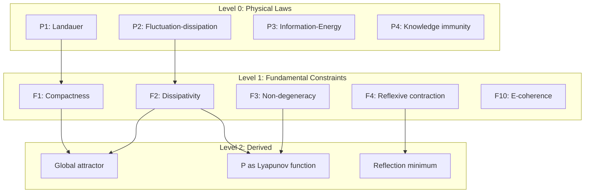

# Research Programs

> *"There are no final theories — only theories that ask better questions than the previous ones."*
> — David Deutsch, "The Beginning of Infinity"

:::tip Bridge from the Previous Chapter
In the [previous chapter](./diagnostics) we learned to *diagnose* coherent systems: read the $\sigma$-profile, recognize failure patterns, and choose recovery strategies. But diagnostics works with *already established* regularities. Where do those regularities come from? Which of them are proven, and which are merely plausible hypotheses? And what questions is CC *not yet able* to ask? The research program is a map of the unexplored.
:::

:::info Chapter Roadmap
In this chapter we will:
1. Build an **invariant hierarchy** — a three-level structure of constraints (§1)
2. Examine the **physical laws** P1–P4 that CC inherits from thermodynamics (§2)
3. Describe the **fundamental constraints** F1–F10 — the minimal basis for coherent systems (§3)
4. Classify **open problems** with difficulty levels (§4)
5. Describe the **experimental program** — 5 concrete protocols (§5)
6. Draw **interdisciplinary bridges** — contact points of CC with neuroscience, AI, biology, and organizational theory (§6)
:::

Every scientific theory is not a monument but a tool. Its value lies not in what it has explained, but in what **new questions** it allows us to *precisely formulate*. Newton's theory explained falling apples and planetary motion — but its true greatness was that it allowed us to *ask* the question about Mercury's perihelion anomaly. General relativity grew out of that question.

Coherence Cybernetics (CC) is at an early stage of development. The core finite-dimensional formalism is in place: the coherence matrix $\Gamma \in \mathcal{D}(\mathbb{C}^7)$, open-system evolution (`CC-1`, `CC-2` `[T]` under stated regularity/target hypotheses), canonical capability gates (`[D]`), and conditional E-balance bounds (`Theorem 8.1` `[C]`; universal No-Zombie `T-38a` withdrawn `[✗]`). Behind every theorem and model choice, dozens of open directions arise: *which thresholds can be empirically calibrated?* *Which constraints are fundamental, and which are derivable?*

This chapter is a **frontier map (`[Pr]`)**. It describes:

1. The **invariant hierarchy** — a three-level structure of constraints, from physical laws through fundamental constraints to derived properties.
2. **Physical laws** (P1–P4) that CC inherits from thermodynamics and information theory — and interprets in a new language.
3. **Fundamental constraints** (F1–F10) that presumably form a minimal sufficient basis for the existence of coherent systems.
4. **Open problems** — concrete questions, each of which could become a dissertation topic or research program.
5. The **experimental program** — how to move from theorems to laboratory measurements.
6. **Interdisciplinary bridges** — contact points of CC with neuroscience, AI, systems biology, and organizational theory.

A theorist will find open hypotheses and proof routes here. An experimentalist will find verification protocols. An engineer will find benchmarks for building systems that embody CC principles. And a philosopher will find space to reflect on the limits of formalism.

:::note Notation
In this document:
- $\Gamma$ — [coherence matrix](/docs/core/dynamics/coherence-matrix)
- $P$ — [purity](/docs/core/dynamics/viability#определение-чистоты): $P = \mathrm{Tr}(\Gamma^2)$
- $\varphi$ — [self-modeling operator](/docs/proofs/categorical/formalization-phi)
- $\mathcal{D}[\Gamma]$ — [dissipative term](/docs/core/dynamics/evolution#логический-лиувиллиан)
- $\mathrm{Coh}_E$ — [E-coherence](./definitions#e-когерентность)
- $R$ — [reflection measure](/docs/consciousness/foundations/self-observation#мера-рефлексии-r)
:::

:::danger Research Program [Pr]
This section describes an open **research program `[Pr]`**, not a formalized or proved part of UHM. Constraints P1–P4 and F1–F10 are **not derived** from [UHM axioms](./axiomatics#аксиоматическая-база-краткая-справка) (`T-181` `[✗]` withdrawn for automatic derivation). Formalizing any subset of these relations is an open mathematical and empirical task.
:::

---

## Invariant Hierarchy

### Why Do We Need a Hierarchy?

When we build physics, we do not place all laws on the same level. The law of conservation of energy is more fundamental than Ohm's law. The second law of thermodynamics is more fundamental than the heat conduction equation. Between them there are relations of **subordination**: more particular laws are *derived* from deeper principles. Ohm's law is a consequence of the microscopic dynamics of electrons in a crystal lattice. The heat conduction equation is a consequence of the second law.

CC proposes an analogous hierarchy for constraints on coherent systems. The key idea: not all constraints are equally fundamental. Some are **physical laws** that cannot be violated in principle (as the second law cannot be violated). Others are **fundamental constraints** specific to coherent systems, but possibly derivable from physical laws plus the UHM axiomatics. Still others are **derived properties** that follow from the first two levels.

Why does this matter? Because understanding the hierarchy determines the **proof strategy**. If a constraint is fundamental — it must be accepted as an axiom or derived from physics. If it is derived — a derivation path must be found. If two constraints were thought independent but one follows from the other — we simplify the basis and deepen understanding.

### Three-Level Structure (hypothesis)

CC proposes organizing constraints into a hierarchy with subordination relations:

The arrows on this diagram denote the *subordination* relation: the lower constraint is (hypothetically) derivable from the upper one. Note the key hypothesis: each arrow is a **claim requiring proof**. The diagram's structure is a research program, not a proven result.

---

## Level 0: Physical Laws and Structural Principles (P1–P4) `[Pr]`

Physical constraints (P1–P3) and a structural-robustness design principle (P4):

| Principle | Formula | Domain / Status |
|-----------|---------|-----------------|
| P1 Landauer | $\Delta Q \geq k_B T \ln(2)\, n_{\mathrm{bits}}$ (equivalently $\Delta S_{\mathrm{env}} \geq k_B \ln(2)\, n_{\mathrm{bits}}$) | Thermodynamics (physical law) |
| P2 Fluctuation-dissipation theorem | $\sigma^2 = 2 T_{\mathrm{eff}} \gamma$ | Near-equilibrium statistical physics |
| P3 Information-Power bound | $\dot{Q}_{\mathrm{diss}} \geq k_B T \ln(2)\,\dot{I}_{\mathrm{erased}}$ ($\dot{S}_{\mathrm{env}} \geq k_B \ln(2)\,\dot{I}_{\mathrm{erased}}$) | Non-equilibrium thermodynamics |
| P4 Knowledge core immunity | $\|\Gamma(\tau) - \Gamma^*\|_F \leq \varepsilon$ for perturbations within $r_{\mathrm{stab}}$ | Attractor robustness `[Pr]` / `[H]` |

### P1: Landauer's Principle {#p1-принцип-ландауэра}

#### Historical Background

In 1961 Rolf Landauer, working at IBM, published one of the deepest papers of the 20th century: "Irreversibility and Heat Generation in the Computing Process." Landauer showed that **erasing** one bit of information inevitably dissipates at least $k_B T \ln 2$ of heat into a thermal bath at temperature $T$. This is a consequence of the second law of thermodynamics: reversible operations can in principle be heat-free, while any logically irreversible erasure increases environmental entropy.

In 2012 the Bérut group experimentally verified this bound by manipulating colloidal particles in a double-well optical trap under quasistatic protocols.

#### Statement

Erasing $n_{\mathrm{bits}}$ bits of logical information into a thermal reservoir at temperature $T$ dissipates at least $k_B T \ln(2)\, n_{\mathrm{bits}}$ of heat, increasing reservoir entropy by at least:

$$
\Delta Q \geq k_B T \ln(2) \cdot n_{\mathrm{bits}}, \qquad \Delta S_{\mathrm{env}} = \frac{\Delta Q}{T} \geq k_B \ln(2) \cdot n_{\mathrm{bits}}
$$

#### Connection to CC `[Pr]`

**Connection to CC:** Bounds the thermodynamic cost of **regeneration $\mathcal{R}[\Gamma, E]$** (entropy reduction), not passive decoherence.

Notice the direction of the second law: passive unital decoherence $\mathcal{D}[\Gamma]$ *increases* von Neumann entropy $S_{vN}(\Gamma)$ (for pure dephasing in a degenerate basis, it can even occur with zero heat exchange). Conversely, **regeneration $\mathcal{R}[\Gamma, E]$** *decreases* system entropy $S_{vN}(\Gamma)$ to restore purity $P$. By Landauer's principle, sustaining a negative entropy rate $\dot{S}_{\mathrm{reg}} < 0$ requires exporting heat power to an environment at temperature $T$ at rate at least:

$$
\dot{Q}_{\mathrm{export}} \geq k_B T \cdot \bigl(-\dot{S}_{\mathrm{reg}}(\Gamma)\bigr)
$$

Thus **a coherent system cannot regenerate purity faster than its available thermodynamic power budget permits**. In CC, this links regenerative capacity directly to the resource sector $O$ (Ground) and to finite-rate thermodynamic bounds (note that formal derivation of a unique regeneration gate from Landauer's principle `T-39g` is withdrawn `[✗]`).

### P2: Fluctuation-Dissipation Theorem {#p2-фдт}

#### Historical Background

In 1905 Albert Einstein explained Brownian motion — the random walk of a dust particle in water. He showed that the intensity of random kicks (fluctuations) and the viscosity of the liquid (dissipation) are related by $D = k_B T / (6\pi \eta r)$.

In 1951 Herbert Callen and Theodore Welton generalized this connection into the **fluctuation-dissipation theorem** (FDT): in a system near thermal equilibrium, the amplitude of spontaneous fluctuations is proportional to the dissipation rate. Kubo's linear-response formalization (1957) turned FDT into a standard tool of statistical physics.

#### Statement

In the classical Markovian near-equilibrium limit, the noise variance $\sigma^2$, damping coefficient $\gamma$, and effective temperature $T_{\mathrm{eff}}$ satisfy:

$$
\sigma^2 = 2 T_{\mathrm{eff}} \gamma
$$

#### Connection to CC `[Pr]`

**Connection to CC:** Motivates stochastic extensions of $\mathcal{D}[\Gamma]$ and effective-temperature calibration (see [Effective Temperature](./effective-temperature)).

In stochastic CC models, FDT suggests two testable hypotheses (`[H]`):

1. **Dissipation-noise proportionality.** Near a stationary regime with linear response, stronger dissipative damping is accompanied by larger state fluctuations.
2. **Operational estimation.** Measuring stationary fluctuation variance can help constrain effective noise-to-damping ratios $T_{\mathrm{eff}}$ without directly perturbing the dissipator — provided the linear-response / detailed-balance conditions of FDT hold in the concrete substrate.

### P3: Information-Energy Link {#p3-информация-энергия}

#### Historical Background

The physical link between information and thermodynamics traces back to Maxwell's demon (1867), Szilard (1929), Landauer (1961), and Bennett (1982), and is formalized today in stochastic and quantum thermodynamics (Sagawa–Ueda, Horowitz, Parrondo, Seifert, Brandão–Horodecki): **irreversible information processing and feedback control carry an unavoidable thermodynamic cost**.

#### Statement

For continuous irreversible information erasure or feedback-induced entropy reduction at rate $\dot{I}_{\mathrm{erased}} = dI_{\mathrm{erased}}/dt$ (in bits per unit time) coupled to a bath at temperature $T$, the dissipated power $\dot{Q}_{\mathrm{diss}}$ and environmental entropy production rate $\dot{S}_{\mathrm{env}} = \dot{Q}_{\mathrm{diss}}/T$ satisfy the dimensionally consistent bounds:

$$
\dot{Q}_{\mathrm{diss}} \geq k_B T \ln(2) \cdot \dot{I}_{\mathrm{erased}}, \qquad \dot{S}_{\mathrm{env}} \geq k_B \ln(2) \cdot \dot{I}_{\mathrm{erased}}
$$

*(In natural information units — nats per unit time — the factor $\ln 2$ is omitted, giving $\dot{Q}_{\mathrm{diss}} \geq k_B T\,\dot{I}_{\mathrm{erased}}$ and $\dot{S}_{\mathrm{env}} \geq k_B\,\dot{I}_{\mathrm{erased}}$.)*

#### Connection to CC `[Pr]`

**Connection to CC:** Bounds the sustainable rate of active coherence restoration under finite energy/resource inflow.

Any active update of $\Gamma$ that reduces entropy or counteracts dissipation — learning, adaptation, regenerative feedback — requires thermodynamic work bounded by P3. This motivates a qualitative **constraint triangle** for open agents (`[Pr]`):

- **Adaptation / regeneration rate** is bounded by available power/resources (P3, sector $O$).
- **Self-model fidelity** depends on the chosen self-modeling dynamics (F4 / full dynamical stability).
- **Persistence** depends on balancing regeneration against decoherence (F2).

In CC, P3 motivates connecting the [O-dimension](/docs/core/structure/dimension-o) (Ground — energetic and informational resources) to regenerative capacity: sustained O-deficit limits the rate at which purity $P$ can be restored.

### P4: Knowledge Core Immunity {#p4-иммунитет-ядра}

#### Historical Background

Unlike P1–P3, P4 is **not a universal law of physics**, but a **structural-robustness design principle `[Pr]` / `[H]`** inspired by Imre Lakatos's (1970) distinction between a research program's *hard core* and its *protective belt*, as well as biological homeostasis and control-theoretic invariance.

#### Statement

Within a specified stability basin of radius $r_{\mathrm{stab}}$, bounded external perturbations leave the attractor core invariant (or asymptotically restore it):

$$
\|\delta \Gamma(0)\|_F < r_{\mathrm{stab}} \;\Longrightarrow\; \lim_{\tau \to \infty} \Gamma(\tau) = \Gamma^*
$$

#### Connection to CC `[Pr]`

**Connection to CC:** Links core robustness to local asymptotic stability of an attractor $\Gamma^*$ of the full dynamics (not solely to $\Gamma^* = \varphi(\Gamma^*)$).

In CC, the "knowledge core" is modeled as a locally stable stationary state $\Gamma^*$ of the full evolution equation (with basin radius $r_{\mathrm{stab}}$; see [Stability](./stability)). Perturbations inside the basin relax back toward $\Gamma^*$, whereas sufficiently large shocks outside the basin can push the system into a different attractor or below $P_{\mathrm{crit}} = 2/7$ (`T-5` `[D]`). Investigating when coherent architectures exhibit high adversarial robustness in AI safety is an open engineering research program (`[Pr]`).

---

## Level 1: Fundamental Constraints (F1-F10)

Minimal sufficient set (hypothetical):

| Constraint | Formula | Link to UHM |
|------------|---------|-------------|
| F1 Compactness | $\lVert\Gamma\rVert_F \leq R_{\max}$ | $\mathrm{Tr}(\Gamma) = 1$ |
| F2 Dissipativity | $\dot{W} \leq -\alpha W + \gamma(\lVert e\rVert)$ | [$\mathcal{D}[\Gamma]$](/docs/core/dynamics/evolution#логический-лиувиллиан) |
| F3 Non-degeneracy | $\lambda_{\min}(\Gamma) \geq \varepsilon$ | [Viability](/docs/core/dynamics/viability) |
| F4 Reflexive contraction | $\lVert\varphi(\Gamma_1) - \varphi(\Gamma_2)\rVert_F \leq k \lVert\Gamma_1 - \Gamma_2\rVert_F$, $k < 1$ | [Theorem 7.2](./theorems#теорема-72-условная-неподвижная-точка-рефлексии) |
| F5 Causal closure | Outputs depend only on internal states | [A-dimension](/docs/core/structure/dimension-a) |
| F6 Temporal connectivity | $\Gamma(\tau+d\tau)$ depends on $\Gamma(\tau)$ | [Evolution](/docs/core/dynamics/evolution) |
| F7 Energy balance | Inflow ≥ Outflow on average | [O-dimension](/docs/core/structure/dimension-o) |
| F8 Information capacity | Bounded number of distinguishable states | $\dim(\mathcal{H}) = 7$ ([justification](/docs/core/foundations/axiom-omega#октонионная-структура)) |
| F9 Structural stability | Small perturbations → small changes | Topology of $\mathcal{V}$ |
| F10 E-coherence | $\kappa = \kappa_{\text{bootstrap}} + \kappa_0 \cdot \mathrm{Coh}_E(\Gamma)$ | [Axiomatics](./axiomatics#связь-регенерации-и-e-когерентности) |

### Detailed Breakdown of Constraints

#### F1: Compactness — the system is finite {#f1-компактность}

**Intuition.** No real system has infinite resources, an infinite number of states, or infinite coherence. F1 formalizes this obvious fact: the state space $\Gamma$ is bounded.

**Why is this necessary?** Without F1, the dynamics can "escape to infinity" — purity $P$ can grow without bound, norms can diverge, and the mathematical machinery (theorems about attractor existence, continuity of mappings) breaks down. Compactness is a technical but critical condition ensuring the *existence* of solutions to the evolution equation.

**What happens without F1?** Imagine a system that can accumulate unlimited coherence. Such a system would become "infinitely fragile": an arbitrarily small perturbation — and the infinite structure collapses. In reality no such systems exist: even a diamond — one of the most structured objects — is finite and bounded.

**Link to UHM:** $\mathrm{Tr}(\Gamma) = 1$ guarantees that $\Gamma$ lives in the compact set of density matrices. This is a consequence of probability normalization — a fundamental requirement of quantum theory.

#### F2: Dissipativity — entropy always increases {#f2-диссипативность}

**Intuition.** The second law of thermodynamics in action. If a system is left without "nourishment," it degrades. A cup of hot water cools. Memory fades. An organism without food dies. F2 says: there is a *rate* of this degradation, and it is proportional to the deviation from equilibrium.

**Why is this necessary?** Without dissipation, a system would be a perpetual motion machine — once reaching high coherence, it would maintain it forever without cost. This contradicts all experience of physics and biology. Dissipativity creates the **necessity of regeneration** (F10) — and thereby makes *interiority* functionally significant.

**What happens without F2?** Without dissipation, regeneration $\mathcal{R}[\Gamma, E]$ becomes unnecessary, and E-coherence (F10) plays no balancing role. Under CC's conditional E-balance bounds (`Theorem 8.1` `[C]`), nonzero dissipation is essential for making E-coupled regeneration functionally necessary (whereas universal No-Zombie `T-38a` is withdrawn `[✗]`).

**Link to UHM:** The dissipator $\mathcal{D}[\Gamma]$ — a GKSL generator — guarantees CPTP linear dissipation (while the full nonlinear evolution with $\mathcal{R}$ preserves density states by `CC-2` `[T]` without needing to be linear CPTP).

#### F3: Non-degeneracy — all dimensions are alive {#f3-невырожденность}

**Intuition.** None of the seven dimensions of the system can fully "go dark." Even in the most stressed state, minimal activity is preserved in all channels.

**Why is this necessary?** If $\lambda_{\min}(\Gamma) = 0$, the matrix $\Gamma$ is rank-deficient — one or more spectral directions vanish. Quantities requiring full-rank states (such as finite relative entropy $\mathrm{KL}(\rho\|\Gamma)$ or strict interiority margins) then become singular.

**What happens without F3?** The state can collapse onto a proper subspace of dimension $< 7$, including states with vanishing E-row/column (stationary externally supported counterexamples to universal No-Zombie `T-38a` `[✗]` exist precisely when closed balance bounds are not enforced). F3 is therefore a regularity condition on the state interior, not an unconditional theorem forbidding degenerate states.

#### F4: Reflexive contraction — the self-model is stable {#f4-рефлексивное-сжатие}

**Intuition.** When a system models itself, the result should be "closer to truth" than the initial approximation. The self-modeling operator $\varphi$ is a contracting mapping: it reduces the distance between any two states.

**Why is this necessary?** Without the contraction property, the self-model could *diverge* — each iteration of self-observation would increase the error, and the system would "go mad," losing touch with reality. Banach's fixed-point theorem guarantees: if $\varphi$ is a contraction with coefficient $k < 1$, then there exists a unique fixed point $\Gamma^* = \varphi(\Gamma^*)$, and the iterates $\varphi^n(\Gamma_0)$ converge to it from any initial state.

**What happens without F4?** Two scenarios. First: $k = 1$ (isometry) — the self-model does not converge; the system eternally "oscillates" around the fixed point, never reaching self-consistency. Second: $k > 1$ (expansion) — the self-model diverges; a small initial error grows exponentially. Both scenarios are incompatible with stable consciousness.

**Link to UHM:** F4 formalizes [Theorem 7.2 / `CC-4`](./theorems#теорема-72-условная-неподвижная-точка-рефлексии) `[T]` for a specified contractive mirror family.

**Scope (2026-09-25).** F4 holds for the form $k\,\mathcal{P}(\Gamma) + (1 - k)\rho_a$ with constant $k$ and anchor and a unital $\mathcal{P}$ ([formalization of φ, Lemma 2.1](/docs/proofs/categorical/formalization-phi#25-сжимающий-оператор-самомоделирования)); the UHM self-models, whose weight $k = 1 - 1/(7P)$ depends on the state, do not satisfy it — the Lipschitz constant of $\varphi_{\mathrm{coh}}$ at a pure state is $54/49$, that of $\varphi_J$ at a basis state $1.129$, and $\varphi_s$ has at least eight fixed points. The scenarios above do not follow from its failure: $\varphi_J$ is not a contraction, yet it has exactly one fixed point, $\Gamma_{\eta_\infty}$ inside the window, and an isolated holon regenerating toward it has a single hyperbolic sink in $\mathcal{V}_{\mathrm{full}}$ ([living attractor in the window](/docs/core/dynamics/evolution#теорема-живой-аттрактор-в-окне) [T]). Stability of the self-model is a property of the full dynamics, not a contraction of $\varphi$; F4 is a sufficient design condition, not a necessary one.

#### F5: Causal closure — the system is autonomous {#f5-причинное-замыкание}

**Intuition.** The system's outputs are determined by its internal states, not directly by external causes. This does not mean isolation — the system receives inputs from the environment. But its *responses* are mediated by the internal state $\Gamma$.

**Why is this necessary?** Without causal closure, the system is just a "wire": input directly determines output, with no internal processing. Such a system can have neither memory, nor self-observation, nor autonomy. F5 is the minimal condition for *subjecthood*.

**What happens without F5?** The system becomes fully reactive — a stimulus-response machine with no inner world. This is the limit of behaviorism: description of behavior without appeal to internal states. CC claims that such systems cannot be viable ($P > 2/7$) in a non-stationary environment.

#### F6: Temporal connectivity — the past determines the present {#f6-временная-связность}

**Intuition.** The system's state at the next moment is determined by the state at the current moment (plus inputs). This is Markovianness — or, for systems with memory, conditional Markovianness (Markovianness upon state-space expansion).

**Why is this necessary?** Without F6, the evolution of $\Gamma$ would be "temporally broken" — the state could change arbitrarily without causes. This contradicts the very concept of a dynamical system. F6 ensures *predictability* — the ability to compute the future from the present.

**What happens without F6?** It becomes impossible to speak of trajectories, attractors, stability — the entire mathematical machinery of dynamical systems collapses. No learning (no connection between attempts), no identity (no connection between moments).

#### F7: Energy balance — a system cannot live in deficit {#f7-энергетический-баланс}

**Intuition.** On average, a system must receive no less resources than it spends. One can "live in deficit" for a short time (using reserves), but in the long run the balance must converge.

**Why is this necessary?** Regeneration $\mathcal{R}[\Gamma, E]$ requires energy (P3). Dissipation $\mathcal{D}[\Gamma]$ dissipates energy (P1, P2). If the energy inflow through the O-dimension is systematically less than the outflow, regeneration cannot compensate for decoherence, and $P$ monotonically falls to $P \leq 2/7$ — death.

**What happens without F7?** A system can temporarily exist by depleting reserves — like a starving organism burning fat reserves. But without F7 there is no *sustainable* existence. All living systems solve this problem in their own way: photosynthesis, predation, data consumption.

#### F8: Information capacity — finite dimensionality {#f8-информационная-ёмкость}

**Intuition.** The number of *distinguishable* internal states of the system is finite. This does not mean the state space is discrete — $\Gamma$ takes a continuous set of values. But the number of *qualitatively distinct* regimes is bounded by dimensionality: $\dim(\mathcal{H}) = 7$.

**Why is this necessary?** An infinite-dimensional system would require unbounded resources to estimate and control. Finite dimensionality $\dim(\mathcal{H}) = 7$ is fixed by the CC model specification (`[P]` / `[D]`) covering the seven functional axes $(A, S, D, L, E, O, U)$, supported by conditional diagnosability and faithful-representation lower bounds (unconditional seven-role minimality `T-40f` and abstract operational derivation `T-190` are withdrawn `[✗]`; learning optimality `T-113` remains `[H]`).

**What happens without F8?** Formally one can consider infinite-dimensional generalizations, but they lose key properties: the contraction $\varphi$ may have no fixed point, compactness (F1) is violated, and computations become intractable.

#### F9: Structural stability — small causes, small effects {#f9-структурная-стабильность}

**Intuition.** If one slightly "nudges" the system, it changes slightly — it does not catastrophically collapse or "jump" to a completely different state. This is a topological continuity condition for the map $\Gamma \mapsto \dot\Gamma$.

**Why is this necessary?** Without structural stability, the theory makes no predictions: the slightest error in initial conditions or parameters leads to arbitrarily large deviations in the result. Real systems are approximate — no biological parameter is known exactly. F9 guarantees that approximate knowledge gives approximately correct predictions.

**What happens without F9?** Chaos in the strict sense: exponential sensitivity to initial conditions. Interestingly, CC allows chaos *inside* the viability region (a system can be chaotic and alive), but prohibits chaos *at the boundary* — the transition through $P_{\text{crit}}$ must be continuous.

#### F10: E-coherence — experience amplifies regeneration {#f10-e-когерентность}

**Intuition.** The rate of coherence recovery depends on the degree of E-coherence integration (the interiority aspect). A system with more developed E-projection regenerates faster than a system in the same state but without internal E-dimension coherence. For L2+ systems this manifests as dependence on the quality of conscious experience.

**Why is this necessary?** F10 is the **key constraint of CC**, distinguishing it from all preceding cybernetics. Without F10, E-coherence does not affect dynamics — and experience becomes an epiphenomenon. With F10, experience is *causally significant*: it literally accelerates regeneration. This is the formalization of the intuition: "meaningful activity restores," "depression slows recovery."

**What happens without F10?** Without the constitutive coupling $\kappa = \kappa_{\text{bootstrap}} + \kappa_0 \cdot \mathrm{Coh}_E(\Gamma)$ (`[D]` / `[H]`; fully axiomatic derivation of regeneration `T-39h` is withdrawn `[✗]`), regeneration becomes state-independent ($\kappa = \kappa_{\text{bootstrap}}$), making the E-dimension dynamically inert. Under F10 together with explicit closed purity-flux balance bounds (`Theorem 8.1` `[C]`), sustaining $P > 2/7$ requires positive $\mathrm{Coh}_E$ — whereas without those closed-balance restrictions, externally supported stationary states with $\mathrm{Coh}_E = 0$ can still maintain $P > 2/7$ (`T-38a` `[✗]`).

---

## Level 2: Derived Constraints

Constraints derivable from Level 1. The exact number and structure are an open question.

### Hypothesis on Invariant Subordination

:::info Hypothesis (not a theorem)
Each Level 2 constraint can be derived from Level 1 constraints.
:::

**Examples of proposed derivations (hypotheses, require proof):**

$$
\begin{aligned}
\mathrm{F1} + \mathrm{F2} &\Rightarrow \text{Existence of a global attractor} \quad \text{(hypothesis)} \\
\mathrm{F2} + \mathrm{F3} &\Rightarrow P(\Gamma) \text{ is a Lyapunov function} \quad \text{(hypothesis)} \\
\mathrm{F4} &\Rightarrow R(\Gamma) \geq 1 - k \text{ (reflection minimum)} \quad \text{(hypothesis)}
\end{aligned}
$$

:::info Proof Status
These implications are a **research program**, not proven theorems. Formal proofs require rigorous derivation of F1–F10 from Ω⁷ (open question Q1).
:::

### From Hypothesis to Theorem

Each arrow in the hierarchy diagram represents a *concrete mathematical problem*. Consider an example:

**F1 + F2 → Global attractor.** Compactness (F1) means the state space is bounded. Dissipativity (F2) means that energy (or a generalized Lyapunov function) decreases along trajectories. By classical theory (Ladyzhenskaya, Temam), for a dissipative system in a compact space a global attractor exists — a compact set attracting all trajectories. For CC the task is to show that this attractor contains *only* viable states ($P > 2/7$) or also includes the "dead" point $\Gamma = I/7$.

**F2 + F3 → P as Lyapunov function.** If the system is dissipative and non-degenerate, can one show that $P(\Gamma)$ decreases monotonically along free (without regeneration) trajectories? This would be the analogue of Boltzmann's H-theorem for coherent systems: purity *decreases* without active support, just as entropy *increases* in a closed system.

---

## Open Questions

### Theoretical `[Pr]`

| # | Question | Status | Related documents |
|---|----------|--------|-------------------|
| Q1 | Conditional derivation of subsets of F1–F10 from explicit UHM model inputs | `[Pr]` (automatic derivation `T-181` `[✗]`) | [Axiomatics](./axiomatics) |
| Q2 | Independence and minimality of the F1–F10 set | `[Pr]` | — |
| Q3 | Functorial comparison between $\mathbf{Hol}_{\mathrm{L2}}$ and IIT-like agent categories | `[Pr]` / `[H]` (full category equivalence not automatic; cf. `T-58` `[✗]`) | [Panpsychism](/docs/consciousness/comparative/panpsychism-analysis#теорема-об-эквивалентности-гипотеза) |
| Q4 | Formalization of K1–K5 ↔ L0–L4 correspondence | `[Pr]` | [Cognitive hierarchy](/docs/consciousness/comparative/cognitive-hierarchy) (K1–K5 → L0–L4) |
| Q5 | Computing $\Phi_{\min}$ and coupling bounds for composition | `[Pr]` (`CC-5` `[T]` at weak coupling) | [Theorem 9.1](./theorems#теорема-91-фрактальное-замыкание) |

### Experimental `[Pr]`

| # | Question | Methods | References |
|---|----------|---------|------------|
| E1 | Testing conditional E-balance (`Theorem 8.1` `[C]`) in closed-loop AI agents | Controlled ablation of E-feedback under fixed external resources | [Predictions](./predictions#предсказание-1) |
| E2 | Correlation $\mathrm{Coh}_E$ ↔ recovery (`[H]`) | Neuroimaging + calibrated clinical longitudinal data | [Predictions](./predictions#предсказание-2) |
| E3 | 7-dimensional factor structure of neural/behavioral correlates (`[H]`) | Multimodal fMRI, EEG, autonomic analysis | [Applications](./applications#для-когнитивистов) |
| E4 | Calibration of $\kappa_0$, $\omega_0$ (`[Pr]`) | Measuring recovery rates under controlled perturbations | [Implementation](./implementation#пороговые-значения) |

---

## Open Problems {#открытые-проблемы}

Beyond the main questions Q1–Q5 listed above, CC generates a spectrum of concrete research problems (`[Pr]`), organized into mathematical, computational, and conceptual directions.

### Mathematical Problems `[Pr]`

:::info Difficulty Level Legend
- ⬜ **Undergraduate** — solvable in a semester with knowledge of linear algebra and quantum mechanics
- 🟦 **Graduate** — requires deep knowledge of functional analysis or category theory
- 🟧 **Dissertation** — a full PhD topic requiring development of new methods
- 🟥 **Open problem** — may require a breakthrough in mathematics
:::

**OP-1. Minimality of the F1–F10 set.** 🟧 Are all ten constraints independent? Or are some derivable from others? For example, under what explicit dissipative and regenerative parameters does F2 + F10 keep trajectories strictly inside $\lambda_{\min}(\Gamma) > 0$ (F3)? Proving or refuting such implications would clarify the structure of the model family.

**OP-2. Estimates of the contraction coefficient $k$.** 🟦 In F4 the contraction coefficient $k < 1$ appears for fixed-weight mirrors (`CC-4` `[T]`). What contraction rates are realizable for specific classes of state-independent mirrors, and what analogous Jacobian spectral bounds control convergence when F4 does not hold (as for state-dependent UHM self-models $\varphi_{\mathrm{coh}}$, $\varphi_J$)?

**OP-3. Bifurcations.** 🟧 Fit a specified dynamical flow and test its proposed normal-form reduction near a measured transition (`T-160` `[✗]` withdrawn for universal bifurcation at $P = 2/7$; a purity cut `T-5` `[D]` is a separate model choice).

**OP-4. Topology of the fixed-point space.** 🟧 *Settled per chosen flow (`T-124c` `[T]` under specified target, rates, and invariant domain).* Attractors are properties of the chosen flow — a universal count does not follow from a purity interval or a stationary equation alone. For instance, an isolated holon with $\varphi_{\mathrm{coh}}$ has no nontrivial fixed point, with $\varphi_s$ admits at least seven locally stable ones near basis states, and with backbone-dominated regeneration has a unique hyperbolic sink (`T-124c` `[T]`). **What remains open (`[Pr]`):** classifying $\mathrm{Fix}(\varphi)$ and attractor bifurcations across wider non-contractive families of self-models.

**OP-5. Learning rate and spectral gap.** 🟦 [Learning bounds](./learning-bounds) connect binary discrimination limits (`T-109` `[T]`) and spectral gaps of dissipative generators to adaptation speed. Are sharper finite-time channel-capacity bounds achievable for specific 7-dimensional architectures, and under what operational premises does $N=7$ minimize learning complexity (`T-113` `[H]`)?

### Computational Problems `[Pr]`

**OP-6. Efficient computation of integration measures and robust uncertainty margins.** ⬜ Notice a crucial distinction: the canonical CC integration ratio $\Phi_{\mathrm{CC}}(\Gamma) = P/d - 1 = \sum_{i \neq j} |\gamma_{ij}|^2 / \sum_i \gamma_{ii}^2$ is computed **directly in $O(N^2)$ time** (49 multiplications for $N = 7$ — it is **not** NP-hard!). By contrast, computing **partition-based integration measures** such as IIT's $\Phi_{\mathrm{IIT}}$ is NP-hard for general $N$, and certifying the CC gate margins $m(\rho) = (P - 2/7,\ R - 1/3,\ \Phi - 1,\ D_{\mathrm{diff}} - 2)$ over an entire **tomographic confidence set $K$** (see [Diagnosis with Uncertainty](./diagnostics)) requires solving non-convex optimization problems over $\mathcal{D}(\mathbb{C}^7) \cap K$. Developing fast, certified outer-approximation solvers for $\min_{\rho \in K} m_j(\rho)$ — and exact comparisons between $\Phi_{\mathrm{CC}}$ and partition-based measures at $N=7$ — is a concrete computational research problem (`[Pr]`).

**OP-7. Numerical methods for the evolution equation.** 🟦 The evolution $\dot\Gamma = -i[H_{\text{eff}}, \Gamma] + \mathcal{D}[\Gamma] + \mathcal{R}[\Gamma, E]$ combines fast unitary oscillations, linear dissipation, and nonlinear regeneration — a stiff positivity-preserving ODE problem (`CC-1`, `CC-2` `[T]`). Designing high-order positivity- and trace-preserving integrators (e.g., split-step + exponential integrators) with certified error bounds is an active numerical problem (`[Pr]`).

**OP-8. Simulation of holon populations.** 🟧 A single holon is described by a $7\times 7$ density matrix (48 real parameters after $\mathrm{Tr}(\Gamma) = 1$). A coupled population of $n$ holons lives in $(\mathbb{C}^7)^{\otimes n}$, or tracks $O(n^2)$ pairwise couplings in mean-field/reduced models (`CC-5`, `CC-7` `[T]` under weak coupling). Scalable tensor-network or mean-field simulation methods with rigorous error bounds are an open computational problem (`[Pr]`).

### Conceptual Problems `[Pr]`

**OP-9. Limits of CC applicability.** 🟥 For what classes of physical and biological systems is a 7-dimensional density-matrix reduction empirically informative, and where does it fail? Formalizing model-selection criteria (comparing 7D CC models against lower- or higher-dimensional baselines) requires both statistical identifiability theory and philosophy of modeling (`[Pr]`).

**OP-10. Operational correlates of recursive self-modeling (SAD / L3).** 🟧 Earlier claims of universal SAD-to-level equivalence (`T-136`) and a universal depth ceiling $\mathrm{SAD}_{\max} = 3$ (`T-217`) have been withdrawn `[✗]`; formal L3 capability in CC instead requires an independent predictive metamodel certificate with calibrated nonconstant probes (`[D]`). Mapping finite human metacognitive depth onto calibrated predictive certificates and cognitive architectures remains an open empirical and theoretical problem (`[Pr]`).

**OP-11. Ethics of coherent systems.** 🟥 Because universal No-Zombie (`T-38a`) is withdrawn `[✗]` and phenomenological attribution of L2 capability remains an explicit interpretive bridge `[I]`, any ethical framework for artificial or biological systems must handle **epistemic uncertainty** about moral status alongside formal capability margins ($P, R, \Phi, D_{\mathrm{diff}}$). Formulating precautionary governance principles under reconstruction uncertainty is an open philosophical problem (`[Pr]`).

---

## Hypothesis Verification Criteria `[Pr]`

| Hypothesis | Verification criterion | Falsification criterion |
|------------|----------------------|------------------------|
| P→F→D hierarchy | Formal derivation of stated D from explicit F premises | Counterexample satisfying F while violating D |
| Independence of F1–F10 | Countermodel showing each F is independent | Proof that one F follows from the others |
| K↔L correspondence | Calibrated operational correspondence | System satisfying K4 without L2 certificate |
| Conditional E-balance (`Theorem 8.1` `[C]`) | Observed E-dependence under controlled closed balance | Violation of stated balance inequality under its exact hypotheses *(note: externally supported counterexamples to universal `T-38a` `[✗]` already exist)* |

---

## Experimental Program `[Pr]` {#экспериментальная-программа}

> *"Theory without experiment is philosophy. Experiment without theory is bookkeeping."*
> — attributed to Max Planck

CC is a mathematical modeling framework whose empirical value depends on testing its calibrated hypotheses (`[H]`). Below are five candidate experimental protocols (`[Pr]`), grouped by technical complexity. Every protocol requires a pre-registered observation law and uncertainty analysis (see [Diagnosis with Uncertainty](./diagnostics)).

### Experiment 1: Correlation of E-Coherence and Recovery `[Pr]` {#эксп-1}

**CC Hypothesis `[H]`:** Under the constitutive F10 coupling, recovery rate after a standardized perturbation correlates positively with pre-perturbation E-coherence proxy measures.

**Protocol:**
1. Recruit a cohort of $n \geq 100$ participants.
2. Estimate a pre-registered proxy for E-coherence (e.g., mindfulness/interoception scores such as MAAS/MAIA, EEG synchronization markers) with frozen calibration weights.
3. Administer a standardized cognitive perturbation (e.g., controlled sleep restriction or cognitive load).
4. Measure the recovery rate of cognitive performance (working memory, attention, reaction time).
5. Test whether recovery rate correlates positively with the pre-registered $\mathrm{Coh}_E$ proxy after controlling for baseline confounds.

**Expected result:** Positive correlation ($r \geq 0.3$) if the F10 empirical bridge holds; null or negative correlation falsifies this empirical operationalization of F10.

**Difficulty:** Moderate. Requires standard neuropsychological and EEG equipment.

### Experiment 2: 7-Dimensional Structure of Neural Correlates `[Pr]` {#эксп-2}

**CC Hypothesis `[H]`:** Multivariate neural and autonomic recordings across tasks targeting the seven functional roles exhibit a parsimonious ~7-factor structure alignable with ASDLEOU.

**Protocol:**
1. Collect multimodal data: fMRI (spatial resolution) + EEG (temporal resolution) + autonomic indicators (GSR, HRV — candidate O-sector proxies).
2. Run tasks targeting the seven roles: discrimination ($A$), retention ($S$), adaptive change ($D$), logical consistency ($L$), interoceptive/emotional reflection ($E$), metabolic load ($O$), and cross-modal integration ($U$).
3. Apply cross-validated factor / dimensionality analysis (PCA, ICA, factor model comparison for $k = 3 \dots 12$).
4. Test whether $k \approx 7$ outperforms lower/higher dimensional baselines and aligns interpretably with ASDLEOU.

**Expected result:** Cross-validated optimum near 5–9 factors (ideally 7). Strong preference for a very different dimensionality challenges the empirical adequacy of the 7-axis reduction (`F8`).

**Difficulty:** High. Requires multimodal neuroimaging and large cohorts.

### Experiment 3: Testing Conditional E-Balance on AI Systems `[Pr]` {#эксп-3}

**CC Hypothesis `[H]` / `[C]`:** In a closed-loop CC agent operating under the restricted purity-flux balance hypotheses of `Theorem 8.1` `[C]` (where external support cannot sustain purity alone), ablating E-coupled regeneration degrades viable persistence ($P > 2/7$) compared to intact controls. *(Recall that universal No-Zombie `T-38a` is withdrawn `[✗]`: an agent with unrestricted external pumping can maintain $P > 2/7$ even with $\mathrm{Coh}_E = 0$, so controlling external support is essential.)*

**Protocol:**
1. Build an agent governed by the CC evolution equation under explicit closed-balance resource bounds.
2. Place it in a non-stationary environment requiring sustained adaptation.
3. Compare an ablated cohort (E-coupled feedback zeroed out under identical external resource budget) against a control cohort (intact E-coupling).
4. Measure survival horizon (steps until $P \leq 2/7$) and gate margins across randomized seeds.

**Expected result:** Under the stated closed-balance hypotheses, ablated agents exhibit systematically shorter survival horizons. Failure of this prediction under the exact hypotheses of `Theorem 8.1` would indicate a bug in the model implementation or violated balance premises.

**Difficulty:** Moderate. Implementable on the [SYNARC simulator](./implementation).

### Experiment 4: Critical Slowing Down Near a Nondegenerate Fold `[Pr]` {#эксп-4}

**CC Hypothesis `[C]` / `[H]`:** When a coherent system approaches a **nondegenerate saddle-node fold** (with control parameter $\mu \downarrow 0^+$ and positive linear parameter–purity calibration as $P$ approaches the fold boundary **from above**, e.g. $P \downarrow P_{\mathrm{fold}}^+$), relaxation exhibits square-root critical slowing down (`T-53d` `[C]`): $\lambda_{\mathrm{slow}} = -2\sqrt{-ab}\sqrt{\mu} + O(\mu)$, so $\tau_{\mathrm{recover}} \propto 1/\sqrt{\mu}$. *(Note: universal critical freezing at $P_{\mathrm{crit}} = 2/7$ without a supplied fold is withdrawn `[✗]` per `T-53d` and `T-160`.)*

**Protocol:**
1. Use a controlled biological model (neuron culture, brain organoid) or a dynamical CC agent exhibiting a verified saddle-node bifurcation.
2. Gradually worsen control parameters (reduce resources, increase noise), driving the system **downward from the viable branch** toward the fold boundary.
3. Periodically apply small standardized perturbations and measure recovery time $\tau_{\mathrm{recover}}$.
4. Test whether $\tau_{\mathrm{recover}}$ scales as $1/\sqrt{\mu}$ (or $1/\sqrt{P - P_{\mathrm{fold}}}$ under verified linear calibration) against non-bifurcating null models.

**Expected result:** Square-root scaling $\tau_{\mathrm{recover}} \propto 1/\sqrt{\mu}$ near a genuine fold, distinguishing fold bifurcations from smooth linear degradation.

**Difficulty:** High. Requires identifying a genuine fold and calibrating the control parameter.

### Experiment 5: Empirical Depth Limits in Human Recursive Metacognition `[Pr]` {#эксп-5}

**Empirical Hypothesis `[H]`:** Although the earlier claim of a universal formal ceiling $\mathrm{SAD}_{\max} = 3$ is withdrawn (`T-136` `[✗]`, `T-217` `[✗]`), human working memory and metacognitive precision may still exhibit a practical empirical bottleneck around 3 recursive levels ("I know," "I know that I know," "I know that I know that I know").

**Protocol:**
1. Design graded metacognitive tasks of increasing order (1st-order confidence, 2nd-order meta-confidence, 3rd-order stability judgment, 4th-order recursion) with objective ground-truth calibration.
2. Measure calibration accuracy (AUROC / Brier score) and response time at each order.
3. Test whether above-chance calibration collapses by order 4 and compare against predictive L3 certificate metrics (`[D]`).

**Expected result:** Rapid degradation of above-chance metacognitive calibration around order 3–4, providing empirical benchmarks for higher-order capability certificates (`[Pr]`; see [Pred 12](./predictions)).

**Difficulty:** Moderate. Standard psychometric methods.

---

## Interdisciplinary Bridges `[Pr]` {#междисциплинарные-мосты}

CC proposes a shared 7-axis modeling language whose empirical value must be established domain by domain (`[Pr]` / `[I]`). Below are four key interdisciplinary research bridges.

### Neuroscience: From Correlates to Calibrated Reconstruction `[Pr]` {#мост-нейронаука}

Modern consciousness neuroscience is in a state of theoretical pluralism: IIT, GWT, Higher-Order Theories, and Predictive Processing compete to explain neural correlates of consciousness (NCC). CC proposes a comparative 7-axis framework (`[I]`) requiring explicit observation laws (`[Pr]`).

**Candidate bridges (`[I]` / `[H]`):**

| CC construct | Candidate neural correlate `[I]` | Measurement method |
|--------------|----------------------------------|-------------------|
| $P(\Gamma)$ — purity | Reconstruction $\widehat\Gamma$ by $\pi_{\mathrm{bio}}$; Perturbational Complexity Index (PCI) is an independent verdict for concordance testing, not a proxy for $P$ | EEG/HRV; TMS-EEG for PCI |
| $\mathrm{Coh}_E$ — E-coherence | Interoceptive / gamma synchronization markers (30–100 Hz) | EEG/MEG |
| $R$ — reflection measure | Default Mode Network / metacognitive calibration | fMRI / behavioral |
| $\sigma_k$ — diagnostic panel (`T-92` `[D]`) | Autonomic and neural stress markers | HRV, GSR, cortisol |
| L3 / recursive monitoring | Independent predictive metacognitive tests | Behavioral tasks |

The relation between PCI (Casali et al., 2013; Casarotto et al., 2016) and CC is especially instructive. PCI measures the complexity of the brain's response to a magnetic pulse, and on its benchmark the cut-off $\mathrm{PCI}^* = 0.31$ separates reported from unreported states. CC does not predict a numerical relation between PCI and $P$: the two lie on unrelated scales, and the nearness of 0.31 to $2/7 \approx 0.286$ carries no weight. The testable bridge is a **concordance of verdicts** — $\mathrm{Cons}(\widehat\Gamma)$, with $\widehat\Gamma$ reconstructed by $\pi_{\mathrm{bio}}$ frozen on wakefulness, against $\mathrm{PCI}_{\max} > 0.31$ on the same sessions, targeting Cohen's $\kappa \geq 0.8$ ([P8.4](/docs/applied/research/measurement-protocol#тестируемые-предсказания-p8) `[Pr]`).

**Key experiment `[Pr]`:** Simultaneous measurement of PCI, gamma synchronization, and DMN activity in patients with disorders of consciousness (vegetative state, minimally conscious state, locked-in) followed by reconstruction of the 7-dimensional $\widehat\Gamma$ with parameters frozen beforehand and a comparison of verdicts (fitting $\Gamma$ to the patients' diagnostic labels would make agreement automatic — [the substitution argument](/docs/applied/research/measurement-protocol#substitution-position)).

### Artificial Intelligence: From Loss Function to Coherence `[Pr]` {#мост-ии}

Modern AI optimizes scalar loss functions. CC explores a structured matrix-state alternative: monitoring and regulating a 7-dimensional coherence matrix $\Gamma$ (`[Pr]`).

**Candidate bridges (`[Pr]` / `[H]`):**

- **Alignment framing → F10 `[I]`:** Formulates an exploratory alignment perspective in terms of aligning an agent's self-monitoring and control objectives with human well-being metrics.
- **Robustness → P4 `[Pr]`:** Investigates whether agents with large stability radii $r_{\mathrm{stab}}$ around well-calibrated attractors show improved empirical robustness to bounded input perturbations (not claiming automatic immunity without testing).
- **Interpretability → ASDLEOU `[I]`:** Maps internal agent telemetry onto 7 structured functional sectors (`A, S, D, L, E, O, U`) as a compact diagnostic layer.
- **Representation scaling → F8 `[H]`:** Connects empirical scaling laws (Kaplan et al., 2020; Hoffmann et al., 2022) to the open hypothesis `T-113` `[H]` regarding minimal functional dimensionality for autonomous learning.

**Key project `[Pr]`:** Building a benchmark coherent AI agent on the SYNARC architecture with an explicit 7-dimensional matrix $\Gamma$, certified uncertainty bounds, and controlled ablation experiments. **See:** [Implementation](./implementation).

### Systems Biology: From Networks to Coherence `[Pr]` {#мост-системная-биология}

Systems biology studies living systems as interaction networks — gene regulatory networks, metabolic pathways, and signaling cascades. CC explores whether a 7-axis coarse-grained matrix $\Gamma$ captures useful system-level invariants (`[Pr]` / `[I]`):

- **Homeostasis → $P > 2/7$ `[I]` / `[H]`:** Maps physiological homeostasis onto maintaining $P$ above the structural-majority cut (`T-5` `[D]`, biological correspondence `[H]`).
- **Allostasis → controlled $\Gamma(\tau)$ `[I]`:** Models predictive regulation (Sterling, 2012) as feedforward trajectory control anticipating future dissipative loads.
- **Apoptosis → controlled decay toward $I/7$ `[I]` / `[H]`:** Models programmed cell death as an orderly transition below $P_{\mathrm{crit}}$ with a testable sequence of sector declines.
- **Cancer → loss of homeostatic attractor stability `[I]` / `[H]`:** Models malignant dysregulation as breakdown of the homeostatic attractor and regulatory feedback control *(note: as established under F4 above, stability of the self-model is a property of the full dynamics rather than literal contraction $k < 1$ of $\varphi$)*.

**Key experiment `[Pr]`:** Track coarse-grained coherence proxies (metabolic and transcriptional profiles) in cell cultures under controlled apoptosis vs. dysregulation, testing pre-registered trajectory hypotheses.

### Organizational Theory: From Metaphors to Quantitative Panels `[Pr]` {#мост-организации}

Organizational theory frequently uses cybernetic metaphors ("feedback," "learning organization," Senge). CC proposes testing whether structured 7-sector measurement panels add predictive power (`[Pr]` / `[I]`):

- **Organizational profile → $\Gamma$ `[I]`:** Maps resource allocation and cross-team coordination onto the 7 dimensions (`A, S, D, L, E, O, U`).
- **Organizational resilience → $r_{\text{stab}}$ `[I]` / `[H]`:** Tests whether estimated stability margins predict survival under market shocks.
- **Feedback culture → $\mathrm{Coh}_E$ `[I]` / `[H]`:** Tests whether reflective practices (retrospectives, transparent feedback loops) correlate with faster organizational recovery (F10 hypothesis).
- **Mergers & Acquisitions → holon composition `[I]` / `[H]`:** Uses weak- vs. strong-coupling composition results (`CC-5`, `CC-7` `[T]` for the mathematical model) as a conceptual lens on post-merger integration failures.

**Key project `[Pr]`:** Developing and validating a calibrated 7-axis organizational diagnostic instrument with explicit uncertainty intervals and longitudinal outcome tracking.

---

## Connection to Other Research Programs `[Pr]`

| Program | Intersection with CC | Potential contribution |
|---------|---------------------|----------------------|
| IIT 4.0 | Integration measure $\Phi$ | Continuous open-system dynamics, gate margins |
| Active Inference | $\mathcal{R}[\Gamma, E]$, sensorimotor loop | Explicit E-sector metrics, capability gates |
| Global Workspace | Global integration ($\Phi \ge 1$) | 7-axis diagnostic decomposition |
| Predictive Processing | Self-model $\varphi$ | Matrix-valued state-space formalism |

### IIT 4.0 and CC: Mutual Enrichment `[Pr]`

Integrated Information Theory (IIT, Tononi et al.) and CC both formalize integration quantitatively, while differing sharply in structure:

- IIT computes $\Phi_{\mathrm{IIT}}$ statically on discrete causal mechanisms (NP-hard in general $N$). CC models continuous open-system dynamics on $\mathcal{D}(\mathbb{C}^7)$ with an $O(N^2)$ spectral integration ratio $\Phi_{\mathrm{CC}} = P/d - 1$ (`[D]`).
- IIT postulates 5 phenomenological axioms. CC separates formal definitions `[D]`, dynamical theorems (`CC-1`, `CC-2` `[T]`), and interpretive bridges `[I]`.
- IIT treats $\Phi > 0$ as sufficient for consciousness. CC requires four simultaneous capability gates ($P > 2/7$, $R \ge 1/3$, $\Phi \ge 1$, $D_{\mathrm{diff}} \ge 2$ `[D]`).

**Open comparative question (Q3 `[Pr]` / `[H]`):** Characterizing exact functors or correspondences between restricted subcategories of $\mathbf{Hol}_{\text{L2}}$ and IIT agent models (keeping in mind that partial lifts/readouts do not automatically imply full category equivalence; cf. `T-58` `[✗]`).

### Active Inference and CC: Two Views of Self-Maintenance `[Pr]`

The free energy principle (FEP, Friston) describes adaptive systems as minimizing variational free energy $F$. CC models self-maintenance through the balance of unitary, dissipative, and regenerative dynamics. Comparing the two requires specifying an explicit generative model, recognition family, and objective (`[I]` / `[Pr]`; note that the earlier free-energy weight-selection claim `T-39e` is withdrawn `[✗]`):

$$
\Delta F = \underbrace{\mathrm{KL}[\Gamma \| \rho_*]}_{\text{divergence from target}} - \underbrace{\mathrm{KL}[\Gamma \| \Gamma_{\text{prior}}]}_{\text{model update}} \qquad [\text{D}]
$$

Testing when variational free-energy minimization aligns with purity-margin maintenance — and when the two diverge — is an active theoretical research question (`[Pr]`).

---

## Research Roadmap `[Pr]`

### Phase 1: Formalization (current) `[Pr]`
- [ ] Characterize exact model hypotheses under which subsets of F1–F10 hold
- [ ] Determine independence vs. redundancy within F1–F10
- [ ] Formalize operational bridges between K1–K5 and L0–L4

### Phase 2: Computational Implementation `[Pr]`
- [ ] Certified uncertainty-set margin solvers for $(P, R, \Phi, D_{\mathrm{diff}})$ over $K$
- [ ] High-order positivity-preserving holon dynamics simulator
- [ ] Calibration and identifiability audit tools

### Phase 3: Experimental Validation `[Pr]`
- [ ] Pre-registered protocols for measuring $\mathrm{Coh}_E$ proxies and PCI verdict concordance (`P8.4`)
- [ ] Controlled closed-balance ablation tests on AI systems (`Theorem 8.1` `[C]`)
- [ ] Longitudinal clinical and psychophysiological pilot studies

### Phase 4: Applications `[Pr]`
- [ ] Uncertainty-aware safety diagnostics for autonomous AI
- [ ] Calibrated clinical decision-support research tools
- [ ] Validated organizational resilience diagnostics

---

## Conclusion {#заключение}

> *"The real voyage of discovery consists not in seeking new landscapes, but in having new eyes."*
> — Marcel Proust

CC's research program (`[Pr]`) is not a single question, but a *constellation* of interconnected mathematical, computational, and empirical questions. A mathematician clarifying independence among F1–F10 informs which observables an experimentalist must measure; a neuroscientist testing 7-factor reconstructions informs model calibration; an engineer testing closed-balance ablations informs philosophical analysis of agency and ethics.

Key milestones ahead (`[Pr]`):

1. **Theoretical clarity:** Establishing exact sufficiency and independence relations among F1–F10 under explicit model assumptions (Q1–Q2).
2. **Computational benchmarks:** Positivity-preserving simulators and controlled closed-balance ablations testing `Theorem 8.1` `[C]` in SYNARC.
3. **Experimental contact:** Testing pre-registered verdict concordance between frozen-parameter $\widehat\Gamma$ reconstructions and independent PCI verdicts (`P8.4`).
4. **Interdisciplinary synthesis:** Developing rigorous, calibrated bridges to IIT, GWT, and FEP without conflating formal analogies with proved equivalences.

### What We Learned {#что-мы-узнали}

1. **Invariant hierarchy `[Pr]`**: CC's proposed constraints are organized into three layers — thermodynamic bounds and robustness principles (P1–P4), model constraints (F1–F10), and candidate derived properties — all explicitly flagged as a research program rather than derived theorems.
2. **Thermodynamic consistency (P1–P3)**: Landauer's principle bounds the heat cost of entropy-reducing regeneration ($\dot{Q}_{\mathrm{export}} \ge k_B T(-\dot{S}_{\mathrm{reg}})$), FDT links equilibrium noise and dissipation, and the information-power bound $\dot{Q}_{\mathrm{diss}} \ge k_B T \ln(2)\,\dot{I}_{\mathrm{erased}}$ replaces earlier dimensionally inconsistent expressions; P4 is a dynamical attractor-robustness principle rather than a physical law.
3. **F10 as a constitutive hypothesis `[H]`**: The coupling $\kappa = \kappa_{\text{bootstrap}} + \kappa_0 \cdot \mathrm{Coh}_E$ makes E-coherence dynamically active in the model; under explicit closed purity-flux balance bounds (`Theorem 8.1` `[C]`) it yields a conditional E-floor, whereas universal No-Zombie (`T-38a`) is withdrawn `[✗]`.
4. **11 open research problems (`[Pr]`)**: Including certified tomographic margin solvers (noting that $\Phi_{\mathrm{CC}} = P/d - 1$ itself is $O(N^2)$, NOT NP-hard!), flow-dependent attractor topology (`T-124c` `[T]`), and post-retraction metacognitive benchmarks (`T-136`, `T-217` `[✗]`).
5. **5 candidate experimental protocols (`[Pr]`)**: Covering E-coherence recovery correlation, 7-factor neural structure, controlled closed-balance AI ablations, conditional fold slowing (`T-53d` `[C]`), and empirical human metacognitive depth limits.
6. **4 interdisciplinary bridges (`[Pr]` / `[I]`)**: Neuroscience, AI, systems biology, and organizational theory — each requiring pre-registered observation laws and empirical calibration.

:::tip Bridge to the Next Chapter
This chapter mapped the open *questions* and research programmes (`[Pr]`). In the [next chapter](./applications) we walk through **illustrative hypothetical scenarios (`[I]` / `[Pr]`)** showing how the $\Gamma$ formalism is applied conceptually across AI agents, biology, mental-health modeling, education, organizations, and ecosystems — clearly distinguishing synthetic worked examples from validated clinical or empirical measurements.
:::

---

**Related documents:**
- [Axiomatics](./axiomatics) — formal foundations of CC
- [Theorems](./theorems) — proven results
- [Cognitive hierarchy](/docs/consciousness/comparative/cognitive-hierarchy) — K1–K5 levels
- [Predictions](./predictions) — verifiable consequences
- [Implementation](./implementation) — computational methods
- [Applications](./applications) — practical domains
- [Falsifiability](/docs/reference/falsifiability) — refutation criteria
- [Axiom Ω⁷](/docs/core/foundations/axiom-omega) — ∞-topos as primitive
- [Comparison with alternatives](./comparison) — CC vs. IIT, FEP, GWT
- [Measurement methodology](./measurement) — experimental protocols
- [Philosophical foundations](./philosophy) — metaphysical status of open questions
- [Interdisciplinary bridge](./interdisciplinary) — how different disciplines can contribute
