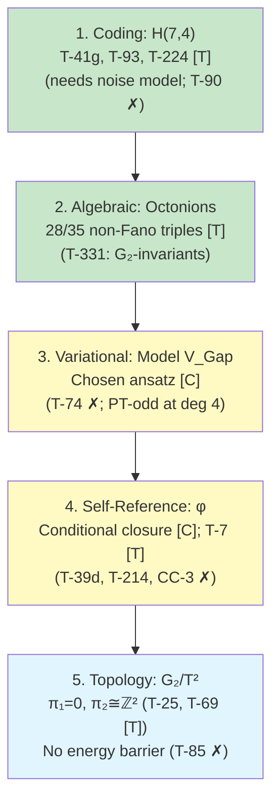

# Topological Protection of Coherence

:::info For whom this chapter is intended
Five mathematical layers often invoked in discussions of coherence robustness — coding structure, non-associative algebra, effective potentials, self-reference, and flag-manifold topology — audited strictly against proved theorems and withdrawn overclaims.
:::

---

### Bridge from the Previous Chapter

In the [previous chapter](./effective-temperature) we introduced the effective temperature $T_{\text{eff}}$ and discussed how Gap coherence degrades when dissipation overwhelms regeneration. This raises a central question: biological systems operate at $T_{\text{phys}} \approx 310\text{ K}$ with continual biochemical and neural noise, yet coherent cognitive dynamics persists over long timescales. Which parts of the UHM formalism genuinely contribute to stability, and which are purely geometric/algebraic properties of the ambient space rather than physical energy barriers?

This chapter examines the five structural layers ("shields") of the formalism and separates proved mathematical theorems `[T]` from conditional dynamical models `[C]`, interpretations `[I]`, and withdrawn claims `[✗]`.

---

### Chapter Roadmap

In this chapter we:

1. **Formulate the central question**: how mathematical structure relates to coherence robustness under noise (section 0).
2. **Audit the five structural layers** — coding (Hamming $H(7,4)$), algebraic (octonionic associator), variational (model potential $V_{\text{Gap}}$), categorical (self-modelling fixed points), and topological ($\pi_2(G_2/T^2) \cong \mathbb{Z}^2$, with $\pi_1(G_2/T^2) = 0$) — distinguishing exact theorems from withdrawn barriers (sections 1–5).
3. **Evaluate layer independence and failure probabilities** — showing why $P_{\text{fail}} = 0$ is impossible and why finite-horizon survival requires an explicit noise and regeneration model (section 6).
4. **Examine clinical interpretations** — sleep, psychosis, coma — as hypotheses `[I]` about weakened dynamical stabilization (section "Pathology").
5. **Draw a careful analogy with quantum error correction** — clarifying what is passive geometry vs. what requires an explicit noise model and decoder (section "QEC").

---

:::note On notation
In this document:
- $\Gamma$ — [coherence matrix](/docs/core/dynamics/coherence-matrix)
- $\hat{\mathcal{G}}$ — [Gap operator](/docs/core/dynamics/gap-operator)
- $\mathrm{Gap}(i,j) = |\sin(\theta_{ij})|$ — gap measure between dimensions
- $G_2 = \mathrm{Aut}(\mathbb{O})$ — [group of octonion automorphisms](/docs/physics/gauge-symmetry/g2-structure)
- $T^2$ — maximal torus of $G_2$
- $V_{\text{Gap}}$ — [Gap potential](/docs/core/dynamics/gap-thermodynamics)
- $\varphi$ — [self-modelling operator](/docs/proofs/categorical/formalization-phi)
- PG(2,2) — [Fano plane](/docs/physics/gauge-symmetry/fano-selection-rules)
:::

## Why Does Consciousness Not Fall Apart? {#центральный-вопрос}

Consider the scale of the problem.

Every second your brain processes millions of signals. Neurons die and are born. The biochemical composition fluctuates continuously. Body temperature — 37°C — is a thermodynamic hell for any coherent quantum system. Semiconductor quantum computers operate near absolute zero, and even there decoherence is a constant battle. Yet consciousness — a phenomenon requiring *coherence* across seven fundamental dimensions — exists continuously at room temperature, for years and decades, without a reboot.

**Why does it not fall apart?**

The naive answer — "because the brain is large and complex" — explains nothing. Large systems are *more* susceptible to decoherence, not less. The naive quantum answer — "decoherence destroys coherence in femtoseconds" — also fails, because consciousness *obviously exists*.

In Coherence Cybernetics, five distinct mathematical structures are commonly organised as "five shields" operating across coding theory, non-associative algebra, effective potentials, categorical self-reference, and Lie-group topology. Crucially, however, **mathematical structure in the state space is not the same thing as a physical energy barrier**: without an explicit regeneration channel, noise model, and readout/decoder, a linear dissipative GKSL flow drives any state toward the maximally mixed state $I/7$ (`T-39a [T]`). Auditing each shield carefully reveals exactly what is strictly proved `[T]`, what holds conditionally in a chosen dynamical model `[C]`, and which earlier universal protection claims have been withdrawn `[✗]`.

---

## Five Shields of the Holon {#пять-щитов}

Before examining the mathematics of each layer, it is useful to see the five structures together with their verified registry status:

| Shield | Mathematical object | Branch of mathematics | Verified scope |
|--------|---------------------|----------------------|----------------|
| **I** | Hamming code $H(7,4)$ / Fano plane $\mathrm{PG}(2,2)$ | Coding theory | Algebraic single-fault separation (`T-41g`, `T-41h`, `T-93`, `T-224 [T]`); universal Gap lower bound withdrawn (`T-90 [✗]`) |
| **II** | Octonionic associator $[e_i, e_j, e_k]$ | Non-associative algebra | 28/35 non-Fano triples non-associative `[T]`; no pure-$\mathrm{Im}\,\Gamma$ cubic $G_2$-invariant (`T-331 [T]`) |
| **III** | Effective potential $V_{\text{Gap}}$ | Variational calculus | Selected phenomenological ansatz `[C]/[D]`; universal spectral derivation withdrawn (`T-74 [✗]`); PT-odd terms start at degree 4 (`T-331 [T]`) |
| **IV** | Fixed points of self-modelling $\varphi$ | Category theory / dynamics | Conditional non-transparency under closure (`T-7`); universal Lawvere/$\varphi$ derivations withdrawn (`T-39d [✗]`, `T-214 [✗]`, `CC-3 [✗]`) |
| **V** | Flag manifold $G_2/T^2$ | Algebraic topology | $\pi_1(G_2/T^2) = 0$, $\pi_2(G_2/T^2) \cong \mathbb{Z}^2$ (`T-25`, `T-69 [T]`); supplies **no physical energy barrier** (`T-69 [T]`, `T-85 [✗]`) |

Notice the crucial distinction from naive "five impenetrable walls" rhetoric: ambient algebraic and topological facts (shields I, II, V) characterise the **geometry of the 7D carrier and its symmetries**, whereas actual dynamical persistence of coherence against thermal or stochastic noise depends on explicit dissipative/regenerative rates and model-specific potentials (shield III) or error-correction decoders (shield I with a declared binary noise channel).

---

## 1. Code-Theoretic Layer (Hamming $H(7,4)$) [T / C] {#код-хэмминга}

### Intuition: a checksum for discrete syndromes

When you download a file from the internet, a checksum lets you detect data corruption. More advanced codes (such as the binary Hamming code) not only *detect* a single bit flip but *localise* and correct it via its syndrome.

The incidence matrix of the Fano plane $\mathrm{PG}(2,2)$ coincides with the parity-check structure of the binary Hamming code $H(7,4)$ with parameters $[n=7, k=4, d=3]$. Under a **declared binary error model and syndrome instrument**, single-axis faults produce seven distinct nonzero 3-bit syndromes and can be uniquely localized.

### Mathematical Formulation

- **Perfect binary code (`T-41g [T]`, `T-41h [T]`):** $H(7,4)$ is the unique perfect single-error-correcting binary code of length $7$ ($2^3 = 7 + 1$); its weight-3 codewords have the seven Fano lines as supports.
- **Syndrome separation (`T-93 [T]`):** The $3 \times 7$ parity-check matrix with all seven distinct nonzero columns separates single bit flips. Applying this to physical error correction requires an explicitly declared binary encoder, noise law, and syndrome decoder `[C]`.
- **Diagnosability rigidity (`T-224 [T]`):** Requiring perfect single-fault localizability (D1–D2) together with a nontrivial state grammar (D3) forces $n = 2^r - 1 \ge 7$; at $n = 7$ the grammar is unique up to relabelling ($H(7,4)$ / Fano plane $\mathrm{PG}(2,2)$, collineation group $\mathrm{PGL}(3,2)$), whereas uniqueness fails at every higher rung $n \ge 15$ ([Σ-calculus](/docs/applied/research/syndrome-calculus#t-224)).

:::warning Withdrawn universal Gap-count lower bound (`T-90 [✗]`)
The earlier claim that sphere-packing forces "at least 3 of the 21 dimension pairs to have nonzero continuous phase Gap" — or yields a universal clinical psychosis criterion — is **withdrawn (`T-90 [✗]`)**. Without a specified binary encoder, noise law, and decoder mapping continuous phases $\theta_{ij}$ into binary words, Hamming sphere-packing imposes **no** lower bound on the number of nonzero phase Gaps. The coding bound $M \sum_{j=0}^{t} \binom{n}{j} \le 2^n$ remains valid strictly as a conditional coding theorem for binary codes of distance $\ge 2t+1$.
:::

### Scope and Limitations

In an explicitly encoded binary or stabilizer-qudit realization, a single error is uniquely localised and corrected, a double error is detected, and a triple error can map one codeword to another. In continuous density-matrix evolution $\Gamma(\tau) \in \mathcal{D}(\mathbb{C}^7)$ without an active decoding channel, however, the Fano incidence structure alone does not prevent smooth drift of coherences toward zero under uncompensated dissipation (`T-39a [T]`).

**See:** [Hamming code in Gap dynamics](/docs/core/dynamics/gap-dynamics#код-хэмминга), [Fano channel](/docs/proofs/gap/fano-channel)

---

## 2. Algebraic Layer (Octonionic Associator) [T] {#ассоциатор}

### Intuition: non-associative structure of $\mathbb{O}$

Octonions $\mathbb{O}$ — the largest of the four normed division algebras ($\mathbb{R}$, $\mathbb{C}$, $\mathbb{H}$, $\mathbb{O}$) — are **non-associative**: $(a \cdot b) \cdot c \neq a \cdot (b \cdot c)$ for generic triples of imaginary units. The associator $[a, b, c] := (a \cdot b) \cdot c - a \cdot (b \cdot c)$ encodes the geometry of the 4-form $\psi = *\varphi_0$ invariant under $G_2 = \mathrm{Aut}(\mathbb{O})$.

### Mathematical Formulation

- **Non-associative triples `[T]`:** Among the $\binom{7}{3} = 35$ unordered triples of imaginary octonion basis units $e_1, \ldots, e_7$, exactly $7$ lie on Fano lines (associative quaternionic subalgebras) and the remaining $35 - 7 = 28$ triples have nonzero associator $[e_i, e_j, e_k] \neq 0$.
- **Exact $G_2$-invariant polynomial structure (`T-331 [T]`):** Decomposing a 7D density matrix as $\Gamma = I/7 + S + iX$ (where $S = \operatorname{Re}(\Gamma - I/7)$ is real symmetric traceless and $X = \operatorname{Im}\Gamma$ is real skew-symmetric), the independent $G_2$-invariant polynomials up to quartic order number exactly **3 quadratic, 5 cubic, and 21 quartic** invariants. Crucially:
  1. **No cubic $G_2$-invariant depends on $X = \operatorname{Im}\Gamma$ alone** (`T-331 [T]`). Every $G_2$-invariant cubic polynomial couples $S$ and $X$ (or depends on $S$ alone).
  2. **No $G_2$-invariant of degree $\le 3$ is PT-odd** (`T-331 [T]`). PT-odd $G_2$-invariants begin only at **degree 4** (where there are three).

:::warning Correction to earlier cubic-associator claims
Earlier drafts asserted that the octonionic associator automatically generates a pure-phase cubic term $V_3(\operatorname{Im}\Gamma)$ forcing a universal barrier around $\theta^* \neq 0$. By **`T-331 [T]`**, no cubic $G_2$-invariant can depend on $\operatorname{Im}\Gamma$ alone, and by **`T-74 [✗]`** no unique universal potential $V_{\text{Gap}}$ is derived from the primitives. Non-associativity fixes the $G_2$-invariant tensor algebra (via the 3-form $\varphi_0$ and 4-form $\psi = *\varphi_0$), which constrains what invariant couplings a model potential *may* contain — it does not by itself create a dynamical barrier.
:::

**See:** [G₂-decomposition of the Gap operator](/docs/core/dynamics/gap-operator#g2-разложение), [Gap thermodynamics](/docs/core/dynamics/gap-thermodynamics#g2-инвариантный-кубик)

---

## 3. Variational Layer (Model Effective Potential $V_{\text{Gap}}$) [C] {#энергетическая}

### Intuition: a ball in a model potential well

If the effective dynamics of a reduced order parameter is governed by a gradient flow of a bounded-below potential $V_{\text{Gap}}$ with a local minimum away from the origin and barrier height $\Delta V > 0$, then small perturbations are restored toward that minimum.

### Mathematical Formulation and Status (`T-74 [✗]`, `T-331 [T]`)

- **Withdrawn universal spectral derivation (`T-74 [✗]`):** The former claim that a unique spectral-action potential $V_{\text{Gap}} = V_2 + V_3 + V_4$ follows universally from UHM primitives is **withdrawn (`T-74 [✗]`)**. Spectral expansions require a supplied spectral geometry and cutoff; an effective potential $V_{\text{Gap}}$ is a **chosen phenomenological model** `[D]/[C]`.
- **Admissible $G_2$-invariant terms (`T-331 [T]`):** Within the class of $G_2$-invariant polynomial potentials on $\Gamma = I/7 + S + iX$, quadratic invariants (3), mixed $S$/$X$ cubic invariants (5), and quartic invariants (21, including the 3 lowest-order PT-odd invariants) can be chosen so that a given model possesses a nontrivial minimum with barrier $\Delta V > 0$.
- **Conditional protection `[C]`:** Once a specific bounded-below effective potential $V_{\text{Gap}}$ and gradient/Langevin dynamics are supplied, a well of depth $\Delta V > 0$ suppresses small fluctuations while $\Delta V$ exceeds the effective noise scale; strong noise can still drive barrier crossing.

**See:** [Gap thermodynamics](/docs/core/dynamics/gap-thermodynamics), [Gap phase diagram](/docs/core/dynamics/gap-phase-diagram)

---

## 4. Categorical / Self-Reference Layer (Fixed Points of $\varphi$) [C] {#категориальная}

### Intuition: non-triviality of constrained self-modelling

In a system equipped with a self-modelling operator $\varphi: \mathcal{D}(\mathbb{C}^7) \to \mathcal{D}(\mathbb{C}^7)$ and dynamical closure constraints, one asks whether a fixed point $\varphi(\Gamma^*) = \Gamma^*$ can remain completely transparent ($\hat{\mathcal{G}}_* = 0$) while maintaining nontrivial viability and closure.

### Mathematical Formulation and Registry Status

- **Conditional non-transparency (`T-7 [T]` in its stated closure model):** Under the stated viability and closure assumptions of the Fano-channel framework, a fully transparent configuration $\hat{\mathcal{G}} = 0$ is incompatible with the L4 closure condition (`L4 ≠ Gap = 0`; see [Fano channel](/docs/proofs/gap/fano-channel#l4-не-gap-0)).
- **Withdrawn universal categorical claims:**
  - `T-39d [✗]`: The claimed universal equivalence between categorical, dynamical, and idempotent definitions of $\varphi$ is **withdrawn** (the image-support reflector exists in the slice over a chosen object; numerical self-models $\varphi: \mathcal{D}(\mathbb{C}^7) \to \mathcal{D}(\mathbb{C}^7)$ are specified separately).
  - `T-214 [✗]`: The universal Lawvere phenomenal-map prohibition is **withdrawn**.
  - `CC-3 [✗]`: Universal necessity of self-modelling is **withdrawn** (existence of the identity map does not establish informational self-observation).

Note also that Lawvere's fixed-point theorem establishes *existence* of a fixed point for a point-surjective map in a cartesian closed category — it does **not** prove dynamical *convergence* of iteration, nor does it prevent a dissipative system from leaving the viable region (for example, $I/7$ is itself a trivial fixed point of the linear anchor-mixing map $\varphi_{\mathrm{lin}}(\Gamma) = R\Gamma + (1-R)I/7$!). Thus shield IV is a **conditional structural consistency constraint** on viable self-modelling states, NOT an unbreakable dynamical barrier with $p_4 = 0$.

**See:** [Self-observation](/docs/consciousness/foundations/self-observation), [Formalisation of the φ operator](/docs/proofs/categorical/formalization-phi)

---

## 5. Topological Layer (Flag Manifold $G_2/T^2$) [T — No Energy Barrier] {#топологическая}

### Intuition: 2-spheres vs. 1D loops in a homogeneous space

Topology classifies continuous maps up to smooth deformation (homotopy). Two distinct questions must never be conflated:
1. Are there non-contractible **1-dimensional loops** ($S^1 \to M$), measured by the fundamental group $\pi_1(M)$?
2. Are there non-contractible **2-dimensional spheres** ($S^2 \to M$), measured by the second homotopy group $\pi_2(M)$?

For the flag manifold $M = G_2/T^2$ (a 12-dimensional compact homogeneous space of the exceptional Lie group $G_2$ modulo its maximal torus $T^2$), the answer to these two questions is **radically different**.

### Exact Homotopy of $G_2/T^2$ {#топология-для-нематематиков}

Consider the fibre bundle $T^2 \hookrightarrow G_2 \to G_2/T^2$. Its homotopy long exact sequence reads:

$$
\cdots \longrightarrow \pi_2(G_2) \longrightarrow \pi_2(G_2/T^2) \longrightarrow \pi_1(T^2) \longrightarrow \pi_1(G_2) \longrightarrow \pi_1(G_2/T^2) \longrightarrow \pi_0(T^2) \longrightarrow \cdots
$$

Because $G_2$ is a compact **simply connected** simple Lie group ($\pi_1(G_2) = 0$, and $\pi_2(G) = 0$ for every compact Lie group $G$) while $T^2 \cong S^1 \times S^1$ is **path-connected** ($\pi_0(T^2) = 0$) with $\pi_1(T^2) \cong \mathbb{Z}^2$, exactness immediately yields (`T-25 [T]`, `T-69 [T]`):

$$
\pi_1(G_2/T^2) = 0, \qquad \pi_2(G_2/T^2) \cong \pi_1(T^2) \cong \mathbb{Z}^2
$$

:::warning Crucial corrections to earlier drafts (`T-25`, `T-69`, `T-85 [✗]`)
1. **$\pi_1(G_2/T^2) = 0$ (NOT $\mathbb{Z}^2$):** The flag manifold $G_2/T^2$ is **simply connected**! Every closed 1D loop $C: S^1 \to G_2/T^2$ is contractible to a point. There are **no** topologically protected 1D loops on $G_2/T^2$.
2. **Orbit stabilizers do not depend on rank alone (`T-25`):** While the orbit-dimension identity $\dim(G_2/H_{A_*}) = 14 - \dim H_{A_*}$ and $\pi_2(G_2/T^2) \cong \mathbb{Z}^2$ hold `[T]` for a specified generic $T^2$-stabilized orbit, the earlier rank-only stabilizer classification is withdrawn `[✗]` because the stabilizer depends on the full $G_7 + G_{14}$ orbit decomposition, not solely on opacity rank.
3. **No physical energy barrier (`T-69 [T]`):** Homotopy classes in $\pi_2(G_2/T^2) \cong \mathbb{Z}^2$ classify continuous maps from a **2-sphere** $S^2 \to G_2/T^2$ (for example, 2D spatial defect textures or 2-parameter families), **not** single 1D time trajectories $\Gamma(\tau)$. Crucially, by **`T-69 [T]`**, *topological classes of maps into $G_2/T^2$ supply **no physical energy barrier**!*
4. **Withdrawn Keldysh-to-Berry derivation (`T-85 [✗]`):** Hermitian traces do not supply an imaginary topological Berry term; a physical Berry curvature or topological action requires an explicitly specified eigenbundle and microscopic field model (`T-85 [✗]`).
:::

### 5.1 Why 1D Loop Integrals Are Not Quantized {#топологический-заряд}

Earlier versions of this page proposed a 1D contour integral $Q_{\text{top}}[C] = \frac{1}{2\pi}\oint_C \sum \epsilon_{ijk}^{\text{Fano}}\,\theta_{ij}\,d\theta_{jk}$ and claimed $Q_{\text{top}}[C] \in \mathbb{Z}$ with $dQ_{\text{top}}/d\tau = 0$. That construction is **mathematically invalid and withdrawn** for two independent reasons:

1. Because $\pi_1(G_2/T^2) = 0$, every closed loop $C$ in $G_2/T^2$ can be smoothly contracted to a point, so no 1D loop homotopy invariant exists on $G_2/T^2$.
2. The 1-form $\alpha = \sum \epsilon_{ijk}^{\text{Fano}}\,\theta_{ij}\,d\theta_{jk}$ is **not closed** ($d\alpha = \sum \epsilon_{ijk}^{\text{Fano}}\,d\theta_{ij} \wedge d\theta_{jk} \neq 0$), so by Stokes' theorem $\oint_C \alpha = \iint_D d\alpha$ varies continuously with the loop $C$ and is neither integer-quantized nor invariant under smooth deformations!

### 5.2 Two Second-Homotopy Integers $(n_1, n_2)$ {#числа-намотки}

The genuine topological invariant of $G_2/T^2$ is the **second** homotopy group (`T-25 [T]`, `T-69 [T]`):

$$
\pi_2(G_2/T^2) \cong H_2(G_2/T^2; \mathbb{Z}) \cong \mathbb{Z}^2
$$

generated by two integer wrapping numbers $(n_1, n_2) \in \mathbb{Z}^2$ corresponding to the two simple coroots of $\mathfrak{g}_2$ (short root $\alpha_1$ and long root $\alpha_2$) for continuous maps $f: S^2 \to G_2/T^2$.

- **What $\pi_2(G_2/T^2) \cong \mathbb{Z}^2$ DOES guarantee `[T]`:** Two continuous maps $f_1, f_2: S^2 \to G_2/T^2$ with distinct $(n_1, n_2)$ cannot be continuously deformed into one another *within the fixed flag manifold $G_2/T^2$*.
- **What it DOES NOT guarantee (`T-69 [T]`):** It does **not** assign a topological charge to a single point $\Gamma(\tau) \in \mathcal{D}(\mathbb{C}^7)$ or to a 1D time curve $\tau \mapsto \Gamma(\tau)$, it does **not** forbid leaving the $G_2/T^2$ orbit inside the contractible convex state space $\mathcal{D}(\mathbb{C}^7)$ (where $\Gamma \mapsto (1-t)\Gamma + t\,I/7$ contracts every state smoothly to $I/7$!), and it supplies **no energy bound** $\Delta E_{\text{top}} \ge (|n_1|+|n_2|)\,\pi\mu^2/\lambda_4$ (that formula is removed; any physical defect energy requires an explicit spatial field theory with gradient kinetic term).

### 5.3 Interpretive Note [I]

Any clinical analogy between homotopy classes $(n_1, n_2) \in \pi_2(G_2/T^2)$ and entrenched psychological patterns is strictly an **informal metaphor `[I]`**: establishing an actual topological obstacle in neural or cognitive dynamics would require identifying a physical 2-sphere order-parameter field taking values strictly in $G_2/T^2$ together with an explicit microscopic energy functional preventing escape into the interior of $\mathcal{D}(\mathbb{C}^7)$.

**See:** [Stabilisers of the Gap operator](/docs/core/dynamics/gap-operator#стабилизаторы), [Berry phase](/docs/physics/cosmology-phys/berry-phase), [Gap thermodynamics](/docs/core/dynamics/gap-thermodynamics)

---

## 6. Separation of Mathematical Layers vs. Dynamical Survival {#независимость}

### 6.1 Five Distinct Structural Layers [D]

The five layers belong to genuinely different mathematical domains, so their formal definitions do not logically reduce to one another — but **none** of them guarantees $P_{\text{fail}} = 0$ for physical coherence:

| # | Layer | Domain | Rigorous status |
|---|-------|--------|-----------------|
| 1 | Code-theoretic ($H(7,4)$) | Finite coding theory ($\mathbb{F}_2$) | `[T]` algebraic single-fault separation (`T-41g`, `T-93`, `T-224`); physical correction needs declared binary error law & decoder (`T-90 [✗]`) |
| 2 | Algebraic (associator) | Non-associative algebra ($\mathbb{O}$) | `[T]` 28/35 non-Fano triples non-associative; constrains $G_2$-invariants (`T-331 [T]`), not a standalone barrier |
| 3 | Variational ($V_{\text{Gap}}$) | Effective potentials | `[C]` conditional on a chosen bounded-below potential (`T-74 [✗]`, `T-331 [T]`) |
| 4 | Self-reference ($\varphi$) | Categorical/dynamical closure | `[C]` conditional on closure hypotheses (`T-7`); universal derivations withdrawn (`T-39d [✗]`, `T-214 [✗]`, `CC-3 [✗]`) |
| 5 | Topological ($G_2/T^2$) | Homotopy theory | `[T]` $\pi_1(G_2/T^2) = 0$, $\pi_2(G_2/T^2) \cong \mathbb{Z}^2$ (`T-25`, `T-69`); **no physical energy barrier** (`T-69 [T]`, `T-85 [✗]`) |

### 6.2 Architecture Diagram

---

## Why $P_{\text{fail}} = 0$ Is Impossible: Honest Failure Analysis {#комбинированная-вероятность}

### Refutation of the Former $P_{\text{fail}} = 0$ Claim

Earlier drafts multiplied five numbers $P_{\text{fail}} = \prod_{i=1}^5 p_i$ and set $p_1 = p_2 = p_4 = 0$ on the grounds that coding, octonionic non-associativity, and Lawvere's theorem are "structurally irremovable", concluding $P_{\text{fail}} = 0$ ("complete destruction of coherence is impossible"). That inference commits a **category error**:

1. **Ambient structures do not halt dissipation.** The space $\mathcal{D}(\mathbb{C}^7)$ is convex and contractible: under purely dissipative unital GKSL evolution with connected Hamiltonian graph, every initial state converges exponentially to $I/7$ (`T-39a [T]`), where all coherences and all phase Gaps vanish — even though $H(7,4)$ still has distance 3, $\mathbb{O}$ is still non-associative, and $\pi_2(G_2/T^2)$ is still $\mathbb{Z}^2$.
2. **Physical survival requires active dynamics and a specified noise model.** Whether a viable trajectory stays inside $\{P > 2/7\}$ over a finite time horizon $[0, T]$ depends on the balance between regeneration $\mathcal{R}[\Gamma, E]$, dissipation $\mathcal{D}(\Gamma)$, and the stochastic perturbation law. By **`T-145 [✗]`**, infinite-horizon exponential survival bounds do not follow from a one-time noise second moment; genuine finite-horizon survival probabilities $1 - P_{\text{fail}}(T)$ require an explicitly specified stochastic process, hitting-time control, and tail hypotheses!
3. **Failure mechanisms are generally correlated, not independent.** Raising environmental noise or suppressing regeneration simultaneously degrades purity $P$, weakens effective restoring forces, and disrupts self-modelling accuracy $R$; therefore a naive independent product $\prod p_i$ is not a theorem.

### Qualitative Comparison of Robustness Mechanisms [I]

| System | Stabilization mechanisms | Nature of failure probability |
|--------|-------------------------|-------------------------------|
| DNA | Redundancy, enzymatic repair, apoptosis, immunity | Finite nonzero rate ($\sim 10^{-9}$ per base per division) |
| Holon (UHM model) | Active regeneration $\mathcal{R}$, model potential $V_{\text{Gap}}$, syndrome decoding (if implemented) | Finite nonzero $P_{\text{fail}}(T) > 0$ determined by explicit noise & regeneration model (`T-145 [✗]` for universal infinite-horizon bounds) |
| Quantum computer (QEC) | Active stabilizer codes, logical qubits | Finite logical error rate below physical threshold |
| Cellular homeostasis | Buffering, negative feedback, turnover | Finite failure rate under extreme stress |

---

## When Stabilization Weakens: Clinical Interpretations {#патология}

Because $P_{\text{fail}}$ is **not** zero, coherence degradation under stress, anaesthesia, neurotoxicity, or injury requires no paradox to explain: whenever dissipation and noise exceed active regeneration $\mathcal{R}$ and model restoring forces, coherence drops and viability can be lost.

### Map of Pathological States [I]

The following table records **interpretive hypotheses `[I]`** mapping clinical regimes onto dynamical variables (purity $P$, self-modelling fidelity $R$, effective restoring potential, and noise level) — without invoking withdrawn topological barriers:

| State | Hypothesised dynamical shift [I] | Clinical interpretation |
|-------|----------------------------------|-------------------------|
| Healthy sleep (REM) | Reduced restoring stiffness, modulated regeneration | Coherence redistributed rather than extinguished; dream dynamics |
| Meditative trance | Controlled lowering of effective restoring stiffness | Exploration of accessible state-space basins while retaining $P > 2/7$ |
| Psychedelic experience | Shallow effective potential + elevated noise/flexibility | Loosening of habitual attractor basins |
| Psychotic episode | High effective noise relative to restoring forces | Unstable Gap trajectories and impaired syndrome/self-model consistency |
| Deep anaesthesia | Strong suppression of regeneration & self-modelling $R$ | Purity and integration approach viability/consciousness thresholds |
| Coma / PVS | Loss of active regeneration and self-modelling | State drifts toward or below $P_{\text{crit}} = 2/7$ |

### Therapeutic Implications [I]

From a dynamical-systems standpoint (rather than topological "unknotting"), clinical interventions are interpreted `[I]` as:

1. **Strengthening restoring dynamics / reducing noise**: pharmacological or environmental stabilisation of the effective attractor landscape.
2. **Restoring regeneration and self-modelling accuracy**: rehabilitative or psychotherapeutic protocols aimed at increasing $R$ and $\mathrm{Coh}_E$.
3. **Controlled attractor transition**: moving a system from a maladaptive metastable basin to a healthier basin via structured perturbation and reconsolidation.

---

## Connection to Quantum Error Correction {#квантовая-коррекция}

The analogy between the Fano/Hamming structure of $\mathbb{C}^7$ and quantum error correction (QEC) is instructive **precisely when its assumptions are stated explicitly**.

### Quantum Error Correction: Brief Overview

In quantum computing, logical information is encoded in a subspace of physical qubits so that specified error operators map the code space into orthogonal error subspaces distinguished by syndrome measurements, enabling active recovery operations.

Key elements of QEC:
- **Code**: isometric encoding into a redundant physical Hilbert space
- **Noise model**: explicit set of correctable Kraus error operators
- **Syndrome & recovery**: syndrome measurement and recovery channel restoring the logical state

### What the Holon Formalism Supplies vs. What Must Be Added

| QEC element | UHM mathematical analogue | Exact requirement |
|-------------|---------------------------|-------------------|
| Binary code skeleton | Hamming $H(7,4)$ / Fano plane $\mathrm{PG}(2,2)$ (`T-41g`, `T-93`, `T-224 [T]`) | Algebraic parity-check structure (`rate = 4/7`) |
| Syndrome | 3-bit Fano parity check | Requires declared binary error channel & syndrome instrument (`T-93`, `T-90 [✗]`) |
| Active recovery | Regenerative operator $\mathcal{R}[\Gamma, E]$ / model restoring force | Must be dynamically supplied; geometry alone does not pump entropy out |
| Protected subspace | Stabilizer / decoherence-free structure | Requires symmetry-matched noise law; $\pi_2(G_2/T^2)$ supplies **no** energy barrier (`T-69 [T]`) |

### Efficiency and Scope

As a classical binary code, $H(7,4)$ has high rate:

$$
\text{Rate}_{\text{Hamming}} = \frac{k}{n} = \frac{4}{7} \approx 0.57
$$

compared with distance-$d$ 2D surface codes ($\text{Rate}_{\text{surface}} \sim 1/d^2$), at the price of minimal distance $d = 3$ (correcting single errors only). However, calling holonomic protection "strictly passive and controller-free" overstates what is proved: passive protection against thermal noise in physical systems requires an explicit Hamiltonian gap / energy barrier and bath coupling, whereas in UHM the ambient geometry (`H(7,4)`, `O`, `G_2/T^2`) must be paired with active thermodynamic regeneration $\mathcal{R}$ and a verified noise model to achieve dynamical stability.

---

## 7. Status Summary {#статусы}

| Result | Status | Reference |
|--------|--------|-----------|
| $H(7,4)$ is the unique perfect single-error-correcting code of length 7; Fano supports | **[T]** | `T-41g`, `T-41h`, `T-93`, `T-224` |
| Universal Hamming lower bound ($\ge 3$ nonzero continuous phase Gaps) & psychosis criterion | **[✗]** (withdrawn) | `T-90 [✗]` |
| Octonionic associator nonzero for 28 of 35 triples | **[T]** | Algebra of $\mathbb{O}$ |
| $G_2$-invariant polynomials: 3 quad, 5 cubic, 21 quartic; no pure-$\mathrm{Im}\,\Gamma$ cubic; PT-odd begins at degree 4 | **[T]** | `T-331` |
| Universal spectral derivation of $V_{\text{Gap}}$ | **[✗]** (withdrawn; chosen model `[C]/[D]`) | `T-74 [✗]` |
| Conditional non-transparency (`L4 ≠ Gap = 0`) under stated closure | **[T]** (in stated model) | `T-7` |
| Universal categorical $\varphi$ equivalence, Lawvere phenomenal prohibition, self-model necessity | **[✗]** (withdrawn) | `T-39d [✗]`, `T-214 [✗]`, `CC-3 [✗]` |
| $\pi_1(G_2/T^2) = 0$ and $\pi_2(G_2/T^2) \cong \mathbb{Z}^2$ | **[T]** | `T-25`, `T-69` |
| Topological classes of maps into $G_2/T^2$ supply **no** physical energy barrier | **[T]** | `T-69` |
| Universal Keldysh-to-Berry topological term & 1D quantized $Q_{\text{top}}[C] \in \mathbb{Z}$ | **[✗]** (withdrawn) | `T-85 [✗]`, $\pi_1(G_2/T^2) = 0$ |
| Claimed $P_{\text{fail}} = 0$ and infinite-horizon survival from one-time noise moment | **[✗]** (withdrawn) | `T-39a`, `T-145 [✗]` |
| Clinical interpretations, pathology map, and QEC analogy | **[I]** | This document |

---

## What We Learned {#что-мы-узнали}

A rigorous summary of the five layers:

- **Coding layer (`T-41g`, `T-93`, `T-224 [T]`):** $H(7,4)$ / $\mathrm{PG}(2,2)$ uniquely realizes perfect single-fault localizability at $n = 7$, but requires a declared binary error model and syndrome instrument; the universal $\ge 3$ continuous Gap lower bound is withdrawn (`T-90 [✗]`).
- **Algebraic & variational layers (`T-331 [T]`, `T-74 [✗]`):** Octonions have 28/35 non-associative triples, and $G_2$-invariant polynomials have 3 quadratic, 5 cubic, and 21 quartic generators — with **no** pure-$\mathrm{Im}\,\Gamma$ cubic and PT-odd invariants beginning at degree 4 (`T-331 [T]`). Effective potentials $V_{\text{Gap}}$ are chosen phenomenological models (`T-74 [✗]`).
- **Categorical layer (`T-7`, `T-39d [✗]`, `T-214 [✗]`, `CC-3 [✗]`):** Non-transparency holds conditionally under explicit closure hypotheses, not as an unbreakable barrier against dissipation.
- **Topological layer (`T-25`, `T-69 [T]`, `T-85 [✗]`):** The flag manifold $G_2/T^2$ is **simply connected** ($\pi_1(G_2/T^2) = 0$, NOT $\mathbb{Z}^2$), so no 1D quantized loop charge $Q_{\text{top}}[C]$ exists. Its second homotopy group is $\pi_2(G_2/T^2) \cong \mathbb{Z}^2$ for 2-spheres $S^2 \to G_2/T^2$, which by `T-69 [T]` supplies **no physical energy barrier**.
- **No $P_{\text{fail}} = 0$:** Ambient algebraic and topological structures do not prevent dissipative decay to $I/7$ (`T-39a [T]`). Realistic finite-horizon survival requires active regeneration $\mathcal{R}$ and an explicit stochastic noise model (`T-145 [✗]`).

---

### Bridge to the Next Chapter

Having separated genuine algebraic/topological invariants from dynamical stabilization mechanisms, we now ask: in which dynamical *regimes* can a driven-dissipative Holon exist? In the [next chapter](./phase-diagram-cc) we examine the **phase diagram** of Coherence Cybernetics, mapping stable regimes, transitions, and diagnostic precursors under explicitly stated dynamical equations.

---

## Related Documents

- [Gap operator](/docs/core/dynamics/gap-operator) — definition of $\hat{\mathcal{G}}$, spectrum, stabilisers
- [Gap dynamics](/docs/core/dynamics/gap-dynamics) — Hamming code, bifurcations
- [Gap thermodynamics](/docs/core/dynamics/gap-thermodynamics) — potential $V_{\text{Gap}}$, Lagrangian
- [Gap phase diagram](/docs/core/dynamics/gap-phase-diagram) — five types of Gap protection
- [Fano channel and Gap theorems](/docs/proofs/gap/fano-channel) — G₂-covariance, L4 $\neq$ Gap = 0
- [G₂-structure](/docs/physics/gauge-symmetry/g2-structure) — $G_2 = \mathrm{Aut}(\mathbb{O})$, Fano plane
- [G₂-Noether charges](/docs/physics/gauge-symmetry/noether-charges) — topological charges and protection
- [CC theorems](./theorems) — No-Zombie, composition, equivalence
- [Self-observation](/docs/consciousness/foundations/self-observation) — fixed points of $\varphi$
- [Formalisation of the φ operator](/docs/proofs/categorical/formalization-phi) — CPTP channels
- [Stability](./stability) — practical consequences of topological protection
- [Philosophical foundations](./philosophy) — metaphysics of coherence stability
