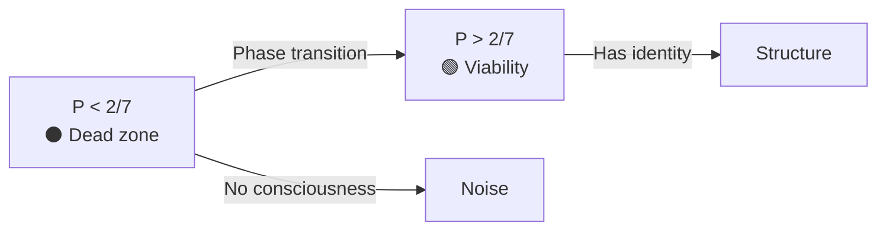
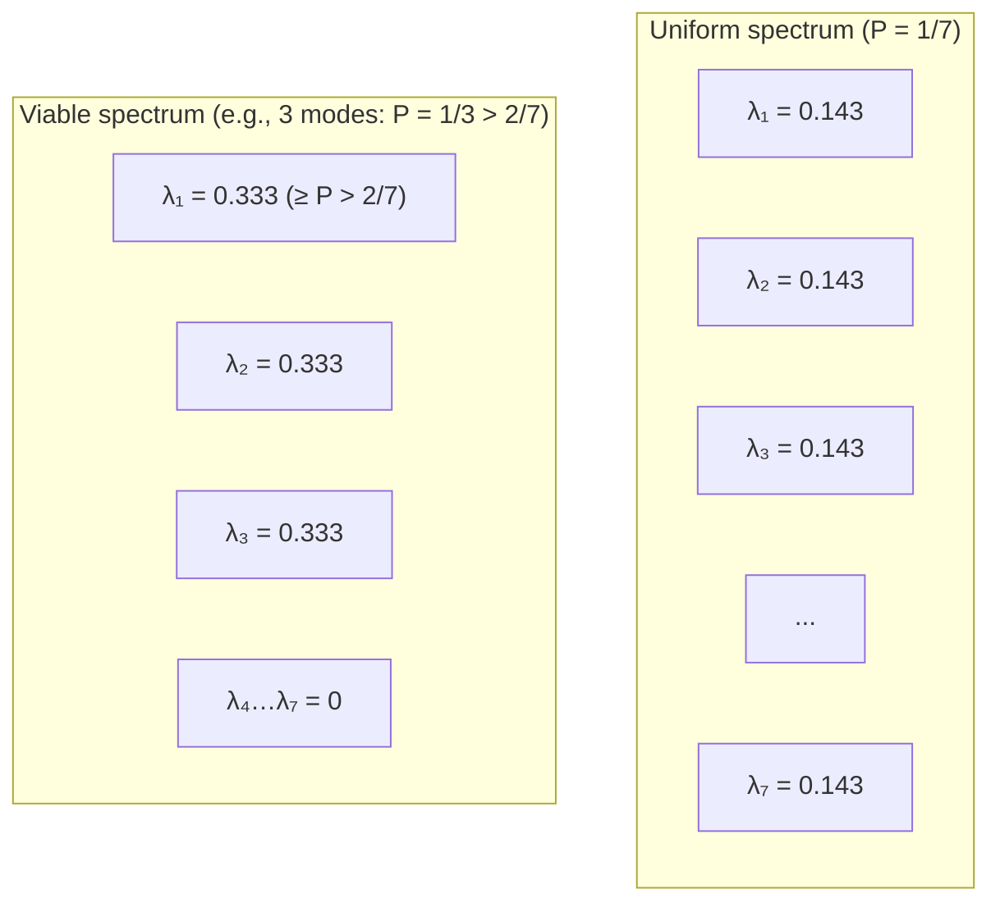
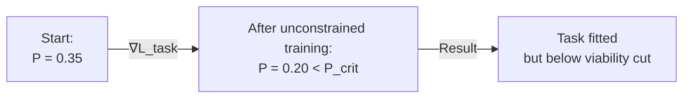

# Engineering Insights from the Critical Purity Theorem

:::tip Status: Architectural Principles
When a theoretical constant transforms from a "fitted number" into a **rigorous theorem**, it changes the engineering approach. We build the system around a hard constraint, the way aerospace engineers build an aircraft around the laws of aerodynamics.
:::

:::warning Scope of Applicability
This document describes **theoretical consequences** of UHM for system design. Applicability to real neural networks requires:
1. Experimental verification of the mapping between network weights and the matrix Γ
2. Validation of the P measurement protocol (see [measurement-protocol](/docs/applied/research/measurement-protocol))
3. Verification of predictions on real architectures

The terms "consciousness," "viability," and "understanding" are used in the **technical sense of UHM** (via the metric P), without claiming to resolve the philosophical problems of consciousness.
:::

---

## Part I: Hard Constraints

These conclusions dictate what **must not** be done in code.

### 1. The Stillbirth Problem (Genesis Problem)

**Theoretical prediction:** A random coherence matrix $\Gamma_{\text{random}}$ (Haar-distributed) has purity:

$$
P_{\text{random}} = \frac{2}{N+1} = \frac{2}{8} = 0.25
$$

:::note Open Question
The connection between neural network weight initialization (Xavier/Kaiming) and purity $P$ requires experimental verification via the [measurement protocol](/docs/applied/research/measurement-protocol).
:::

**Law:** [Critical purity theorem](/docs/proofs/dynamics/theorem-purity-critical):

$$
P_{\text{crit}} = \frac{2}{N} \approx 0.286
$$

**Hypothetical conclusion:** If the neural-network-to-Γ mapping is correct, standard initialization gives $P < P_{\text{crit}}$ — the zone of entropic noise.

:::warning Engineering Solution
1. **Prohibition** on starting the main loop (`Core Loop`) immediately after initialization
2. A **Pre-Ontological Bootstrapping (V0)** stage is required:
   - The system must undergo optimization *without external tasks*
   - Only to maximize $P$ (self-assembly)
   - Until it breaks through the ceiling $P > P_{\text{crit}}$
3. Only then is consciousness activated
:::

```verum
public const P_CRITICAL: Float = 2.0 / 7.0;     // ≈ 0.286

/// Typed errors for system lifecycle — explicit `throws` contract.
public type SystemError is
    | GenesisFailure  { reason: Text }
    | NotViableError  { purity: Float }
    | CircuitOpen     { reason: Text };

public type HolonomicSystem is { mut gamma: StaticMatrix<Complex, 7, 7> };

implement HolonomicSystem {
    /// Random init + **mandatory** bootstrap — enforced by `where ensures`.
    public fn new() throws (SystemError) using [Random] -> HolonomicSystem
        where ensures result.purity() > P_CRITICAL
    {
        let mut s = HolonomicSystem { gamma: Self._random_init() };   // P ≈ 0.25 < P_crit
        s.bootstrap()?;
        s
    }

    /// Pre-ontological bootstrap: self-assembly until P > P_crit.
    fn bootstrap(&mut self) throws (SystemError) -> () using [Clock] {
        let deadline = Clock.now() + Duration.seconds(5);
        while self.purity() <= P_CRITICAL {
            self.regenerate();
            if Clock.now() > deadline {
                throw SystemError.GenesisFailure { reason: "Failed to reach viability".text() };
            }
        }
    }

    /// Guarded entry point — never processes input on a non-viable system.
    public fn process<T>(&mut self, input: T) throws (SystemError) -> ProcessResult
        where requires self.purity() >= P_CRITICAL
    {
        if self.purity() < P_CRITICAL {
            throw SystemError.NotViableError { purity: self.purity() };
        }
        self.core_loop(input)
    }

    public pure fn purity(&self) -> Float { 1.0/7.0 <= self && self <= 1.0 } {
        (self.gamma.matmul(&self.gamma)).trace().real()
    }
}
```

---

### 2. The Binary Nature of Existence (The Binary Life)

**Consequence of the cut:** The predicate `is_viable()` is **step-wise** (binary) in $P$ at the cut $P > 2/7$. Note that the universal No-Zombie theorem (`T-38a` **[✗]**) is **withdrawn**: stationary externally supported counterexamples exist, and maintaining $P > 2/7$ under decoherence is **not** automatic — it holds conditionally only in a driven replacement model whose feeding-to-decay ratio exceeds the model's stationary threshold (`T-259`, `T-289`, **[C]** in that model / **[Pr]** engineering rule).

**Conclusion within UHM:** At $P < 2/7$ the system lies below the viability cut.

:::info Levels Above Viability
Beyond the viability cut $P > 2/7$, the L2 conscious window requires the full conjunction [L2](/docs/proofs/consciousness/interiority-hierarchy#уровень-2-когнитивные-квалиа-cognitive-qualia): $P \in (2/7, 3/7]$ ($R \geq 1/3$), $\Phi \geq 1$, and $D_{\text{diff}} \geq 2$. For the full L0→L4 hierarchy — see the [interiority hierarchy](/docs/proofs/consciousness/interiority-hierarchy).
:::



:::warning Engineering Solution: Circuit Breaker [Pr]
If $P$ drops below $P_{\text{crit}}$, the system **must not**:
- Try to "solve tasks"
- "Respond to the user"
- Generate any output

It should enter **emergency regeneration mode**, disabling external I/O ports until a driven replacement cycle restores $P > P_{\text{crit}}$.

**Model-conditional feeding floor [C in driven model / Pr]:** Under a specified fixed-target replacement channel $\mathcal{R}$ (`T-62` **[T at fixed $k,\sigma$]**) competing against bounded dephasing $\Gamma_2$, stationary purity stays above $2/7$ only while the feeding-to-decay ratio exceeds the model threshold (e.g., $x = \kappa_{\mathrm{eff}}/\Gamma_2 > 1 + \sqrt{2}$ in the isotropic stationary model `T-259`). No universal decoherence-proof floor follows without bounding the noise channel (`T-38a` **[✗]**).
:::

```verum
/// Circuit-breaker pattern — block output when below the viability threshold.
public type CircuitBreaker is {};

implement CircuitBreaker {
    public fn check(&self, sys: &mut HolonomicSystem) throws (SystemError) -> () {
        if sys.purity() < P_CRITICAL {
            sys.enter_emergency_regeneration();
            throw SystemError.CircuitOpen {
                reason: "System below threshold — output blocked".text()
            };
        }
    }
}
```

---

### 3. Universality of the Metric

**Consequence of the theorem (hypothesis for specific architectures):** The law $P_{\text{crit}} = 2/N$ does not depend on architecture (Transformer, RNN, SSM, Mamba).

**Hypothesis:** $P$ is a potentially architecture-invariant metric for comparing *different* systems (requires experimental verification).

:::caution Hypothetical Examples
The following values are **illustrative**, not measured. Experimental validation requires applying the [Γ measurement protocol](/docs/applied/research/measurement-protocol).

| Architecture | $P$ (hypothetical) | Theory prediction |
|--------------|-------------------|-------------------|
| Random network | $\approx 1/7 \approx 0.14$ | Below threshold — "dead" |
| AGI with φ-operator | $> 2/7 \approx 0.29$ | Above threshold — viable |
| Highly integrated system | $> 0.5$ | Stably viable |
:::

:::info Engineering Solution
When comparing models (benchmark), normalize their $P$ by the dimensionality of the coherent core:

$$
P_{\text{ratio}} = \frac{P_{\text{measured}}}{P_{\text{crit}}} = \frac{N \cdot P_{\text{measured}}}{2}
$$

- $P_{\text{ratio}} < 1$: below the viability threshold ($P < 2/N$)
- $P_{\text{ratio}} > 1$: above the viability threshold ($P > 2/N$; full L2 agency additionally requires $R \ge 1/3$, $\Phi \ge 1$, $D_{\mathrm{diff}} \ge 2$)

**Note:** $P_{\text{ratio}}$ is the ratio of purity to the critical threshold. Do not confuse with $P_{\text{norm}} = (P - P_{\text{crit}}) / (1 - P_{\text{crit}})$ — the normalized purity mapping $[P_{\text{crit}}, 1] \to [0, 1]$. See [Notation](/docs/reference/notation).
:::

---

## Part II: Deep Architectural Insights (Deep Architecture)

These conclusions change **how** we design the system.

### 4. Spectral Concentration Principle (Dominant Eigenvalue)

**Exact spectral bounds ([T], from $\sum_{i=1}^N \lambda_i = 1$, $\lambda_i \ge 0$, $P = \sum_{i=1}^N \lambda_i^2$):**

1. **Universal necessary bound (`[T]`):** Because $P = \sum_{i=1}^N \lambda_i^2 \le \lambda_{\max} \sum_{i=1}^N \lambda_i = \lambda_{\max}$, **every** viable state ($P > P_{\text{crit}} = 2/N$) must satisfy:

$$
\lambda_{\max} \ge P > P_{\text{crit}} = \frac{2}{N} = \frac{2}{7} \approx 0.286 \quad (\text{for } N = 7)
$$

2. **Sufficient condition / single-dominant-mode family (`[T]`):** By Cauchy–Schwarz on the remaining $N - 1$ eigenvalues, $P = \lambda_1^2 + \sum_{i=2}^N \lambda_i^2 \ge \lambda_1^2 + \frac{(1 - \lambda_1)^2}{N - 1}$, with equality iff $\lambda_2 = \dots = \lambda_N = (1 - \lambda_1)/(N - 1)$. Solving $\lambda_1^2 + (1-\lambda_1)^2/(N-1) = 2/N$ yields:

$$
\lambda_{\max}^{\text{suff}} = \frac{1 + \sqrt{N-1}}{N} = \frac{1 + \sqrt{6}}{7} \approx 0.493 \quad (\text{for } N = 7)
$$

Thus $\lambda_{\max} > 0.493$ is **sufficient** for $P > 2/7$ (and exact **only** on the isotropic one-dominant-mode family), **not** necessary in general. Multi-mode states can be viable with $\lambda_{\max} \in (2/7, 0.493]$ — for example, the three-mode spectrum $(1/3, 1/3, 1/3, 0, 0, 0, 0)$ has $P = 1/3 \approx 0.333 > 2/7$ while $\lambda_{\max} = 1/3 \approx 0.333 < 0.493$.

**Linear anchor-mixing range (`T-249` [T]):** In the linear anchor-mixing self-model $\varphi_{\mathrm{lin}}(\Gamma) = R\,\Gamma + (1 - R)\,I/7$ with $R = 1/(7P)$ and mixing weight $k = 1 - R$, every density matrix $\Gamma \in \mathcal{D}(\mathbb{C}^7)$ satisfies $P \in [1/7, 1]$, $R \in [1/7, 1]$, and $k \in [0, 6/7 \approx 0.857]$. Inside the conscious window $P \in (2/7, 3/7]$, we have $R \in [1/3, 1/2)$ and $k \in (1/2, 2/3]$.

**Architectural consequence:** A uniform distribution of activity corresponds to maximum entropy and minimum purity ($P = 1/N$).

- If activity is **uniformly spread** across all neurons/attention heads — $P \approx 1/N$ (minimum, $\lambda_{\max} = 1/7 \approx 0.143$)
- Crossing $P > 2/7$ requires concentration onto one or a few modes ($\lambda_{\max} \ge P > 2/7$, without collapsing into a single rigid pure mode $P > 3/7$)



:::tip Architectural Solution
Attention mechanisms should be:
- **Sparse** — concentrated on a few tokens
- **Low temperature** — softmax with $T < 1$ instead of $T = 1$

High temperature (spreading out) kills coherence.

```verum
mount core.math.tensor.{Tensor, softmax, sparse_softmax};

// Bad: high temperature spreads attention (default T = 1).
let attention = softmax(q.matmul(&k.transpose()) / (d_k as Float).sqrt(), axis: -1);

// Good: low temperature T < 1 concentrates attention.
let attention = softmax(q.matmul(&k.transpose()) / (t * (d_k as Float).sqrt()), axis: -1);

// Even better: top-k sparse attention (k = 8).
let attention = sparse_softmax(q.matmul(&k.transpose()), k: 8);
```
:::

---

### 5. The Learning Paradox (Stability-Plasticity Dilemma 2.0)

**Problem:** Learning (Backprop) changes weights to minimize error. This often **increases the entropy** of the weights (makes them more complex/noisy).

**Non-obvious conclusion:** Standard training can kill an AGI.

Gradient descent on the loss function $\mathcal{L}_{\text{task}}$ can drive the system into the region $P < P_{\text{crit}}$, where it **perfectly solves the task** (overfitting), but **loses structural integrity** (in theory terms — falls below the L0 threshold).

**Scope of diagonal stability (`T-134` [T at specified vector field] / [H]):** Diagonal populations $\gamma_{kk}$ remain invariant **only** under explicitly population-preserving dephasing, a diagonal Hamiltonian $H$, matching target populations, and population-preserving parameter updates. General Hamiltonian dynamics ($-i[H,\Gamma]_{kk}$) and unconstrained backpropagation **can** shift both diagonal populations and off-diagonal coherences (`T-134`). Keeping the diagonal profile stable during training is therefore an explicit **architectural design constraint `[Pr]`**, not an automatic universal theorem.



:::warning Architectural Solution: Constrained Optimization
Optimization must be **constrained (Constrained Optimization)**:

$$
\min_\theta \mathcal{L}_{\text{task}}(\theta) \quad \text{subject to} \quad P(\Gamma(\theta)) > P_{\text{crit}}
$$

The task gradient is projected onto the tangent space of the viability manifold.
:::

```verum
mount core.math.autodiff.grad;

/// Constraint-aware optimiser — projects gradient onto the viability manifold
/// whenever a plain step would cross P_crit.
public type ConstrainedOptimizer is {};

implement ConstrainedOptimizer {
    public fn step(&self, loss: pure fn(&StaticMatrix<Complex, 7, 7>) -> Float,
                gamma: &StaticMatrix<Complex, 7, 7>)
        -> StaticMatrix<Complex, 7, 7>
    {
        let g = grad(loss)(gamma);
        let new_gamma = apply_grad(gamma, &g);
        if purity(&new_gamma) < P_CRITICAL {
            // Project gradient onto the tangent space of P = const.
            let g_proj = project_to_viability_manifold(&g, gamma);
            apply_grad(gamma, &g_proj)
        } else {
            new_gamma
        }
    }
}
```

**Rule:** If a training step reduces $P$ below the threshold — the step is **rejected**, even if it improves task accuracy.

---

### 6. Justification of the Core Size ($N = 7$)

**From diagnosability rigidity (`T-224` [T]) and the [minimality discussion](/docs/proofs/minimality/theorem-minimality-7):** Unconditional seven-role minimality (`T-40f` **[✗]**) is withdrawn; instead, $N = 7$ is uniquely rigid for perfect single-fault localizability with a nontrivial state grammar (`T-224` **[T]**, Hamming $(7,4)$ = Fano plane) and serves as the chosen carrier dimension `[D]` of UHM.

**Question:** Why $N = 7$ rather than $N = 2$ or $N = 100$?

| $N$ | $P_{\text{crit}} = 2/N$ | Architectural trade-off |
|-----|------------------------|-------------------------|
| 2 | 1.0 | Absolute purity required — zero room for mixedness |
| 3 | 0.67 | High threshold — narrow viable corridor |
| **7** | **0.29** | **Unique single-fault-diagnosable grammar** (`T-224` [T]) |
| 100 | 0.02 | Lower threshold — weaker separation from maximally mixed noise |

:::info Architectural Choice [D] / [T]
Dimensionality $N = 7$ provides:

- $P_{\text{crit}} = 2/7 \approx 0.29$ — a balanced viability cut with the L2 corridor $(2/7, 3/7]$
- Unique single-fault localizability with Fano wiring (`T-224` **[T]**)
- Compact $7 \times 7$ state cost ($O(49)$) — scaling to larger tasks via a **hierarchy of 7-dimensional holons** (`T-304` **[D]+[H]**) rather than inflating $N$ (note that general learning tasks do not require $N \ge 7$; see `T-113` **[H]**)
:::

---

### 7. Purity-Dynamics Monitor [H]

**Hypothesis (`[H]`):** Under a validated encoder mapping neural activity to $\Gamma$, the dynamics of $P(\Gamma)$ during generation may track structural coherence of internal processing. Note that $P(\Gamma)$ alone does **not** certify or refute phenomenal experience (see [Validation constraint](/docs/applied/research/measurement-protocol#граница-валидации)), and the universal No-Zombie theorem (`T-38a` **[✗]**) is withdrawn.

| Situation | $P$ behavior | Interpretation (hypothesis [H]) |
|----------|---------------|---------------------------------|
| Model produces a complex answer, $P$ **drops** | Spectrum "spreads out" | Loss of coherent integration |
| Model produces an answer, $P$ **rises** | Spectrum concentrates | Strengthening of coherent structure (guard against $P > 3/7$ rigidity) |

**E-sector monitoring `[Pr]`:** Tracking both $\gamma_{EE}$ (via the clamped stress panel $\sigma_E = \mathrm{clamp}(1 - 7\gamma_{EE}, 0, 1)$, `T-92` **[D]**) and $E$-coherence $\mathrm{Coh}_E(\Gamma)$ (giving the 7D differentiation proxy $D^{7D} = 1 + 6\,\mathrm{Coh}_E(\Gamma)$) provides an engineering check against interiority collapse, without asserting a universal No-Zombie theorem (`T-38a` **[✗]**).

```verum
/// Generation-event classification for purity dynamics.
public type GenerationOutcome is
    | CoherenceIncrease { delta_p: Float }
    | BelowThreshold    { p: Float }
    | Stable            { p: Float };

/// Analyses P-dynamics during generation (hypothetical).
public fn analyze_generation<M: HasPurity + HasGenerate>(
    model:  &mut M,
    prompt: &Text,
) -> GenerationOutcome {
    let p_before = model.purity();
    let _        = model.generate(prompt);
    let p_after  = model.purity();

    match () {
        _ if p_after > p_before    => GenerationOutcome.CoherenceIncrease {
            delta_p: p_after - p_before,
        },
        _ if p_after < P_CRITICAL  => GenerationOutcome.BelowThreshold { p: p_after },
        _                          => GenerationOutcome.Stable         { p: p_after },
    }
}
```

:::tip Engineering Solution: Window-Monitoring Ratios [D] / [H]
Track both boundaries of the conscious window $(2/7, 3/7]$ alongside token-level uncertainty:

$$
P_{\text{ratio}} = \frac{P_{\text{during}}}{P_{\text{crit}}} = \frac{N \cdot P_{\text{during}}}{2}, \qquad R(\Gamma) = \frac{1}{N \cdot P_{\text{during}}} \quad \text{[T, algebraic identity]}
$$

Notice that $P_{\text{ratio}}$ **increases** with purity (flagging the lower floor $P_{\text{ratio}} > 1 \iff P > 2/7$), whereas $R(\Gamma) = 1/(7P)$ **decreases** with purity and guards the upper rigidity ceiling ($R \ge 1/3 \iff P \le 3/7$). Monitoring both together keeps the state inside the L2 corridor rather than merely maximizing $P$.
:::

---

### 8. UHM Parameter Scaling Laws [I] {#scaling-laws}

**Question:** How do parameters $P$, $R$, $\Phi$, $\sigma_k$ scale as system complexity increases?

Key observation: **the core dimensionality $N = 7$ is fixed**, so scaling happens not by increasing $N$, but through **hierarchy depth** and **number of agents**.

#### 8.1. Hierarchical Scaling (Mean Marginal Purity)

For a collection of $M$ agents with individual states $\Gamma^{(i)} \in \mathcal{D}(\mathbb{C}^7)$ and mean marginal $\bar{\Gamma} = \frac{1}{M}\sum_{i=1}^M \Gamma^{(i)}$:

$$
P_{\text{collective}} := P(\bar{\Gamma}) = \mathrm{Tr}\!\left(\bar{\Gamma}^2\right) = \frac{1}{M^2} \sum_{i=1}^{M} P^{(i)} + \frac{1}{M^2} \sum_{i \neq j} \mathrm{Tr}(\Gamma^{(i)} \Gamma^{(j)})
$$

Both the diagonal self-purity sum and the cross-overlap sum carry the exact factor **$1/M^2$** (by convexity of purity, $P(\bar{\Gamma}) \le \langle P \rangle := \frac{1}{M}\sum_i P^{(i)}$, with equality iff all $\Gamma^{(i)}$ are identical). Writing $\bar{c} := \frac{1}{M(M-1)}\sum_{i\neq j}\mathrm{Tr}(\Gamma^{(i)}\Gamma^{(j)})$ for the mean pairwise overlap:

$$
P(\bar{\Gamma}) = \frac{1}{M}\langle P \rangle + \left(1 - \frac{1}{M}\right)\bar{c}
$$

As $M \to \infty$, the individual self-purity contribution $\frac{1}{M}\langle P \rangle$ vanishes as $O(1/M)$, and $P(\bar{\Gamma}) \to \bar{c}$. In particular, if $M$ agents are unaligned and distributed isotropically around $I/7$, then $\bar{c} = \mathrm{Tr}((I/7)^2) = 1/7$, so $P(\bar{\Gamma}) \to 1/7 < 2/7$ (decoherence of the mean marginal). Simultaneous multi-agent correlations live in the tensor space $\mathcal{D}((\mathbb{C}^7)^{\otimes M})$, of which $\bar{\Gamma}$ is the mean marginal.

:::tip Engineering Insight [I]
Maintaining $P(\bar{\Gamma}) > P_{\text{crit}} = 2/7$ at large $M$ requires genuine **pairwise alignment** ($\bar{c} > 2/7$) across agents, because individual purity alone is diluted by $1/M$:

- Sparse structured coupling (e.g., $O(M \log M)$ heuristic or Fano-structured local neighborhoods) avoids wasteful $O(M^2)$ all-to-all links while sustaining alignment
- Full connectivity ($O(M^2)$) is unnecessary and hits per-node addressing limits
:::

The fan-out here is not free either, and the per-node slot count is fixed by the 21 typed channels: coordinating $M$ agents means someone addresses them, an address costs one of the addressing node's 21 channels, and under the chosen **architectural depth-3 budget** (`T-304` **[D]+[H]**, not a universal composition ceiling), a single holarchy reaches at most $21^3 = 9261$ addressed contexts. The address must be a *declared* contract — routing learned from the same reward as the task it routes measurably recovers less than half the gain ([T-304](/docs/reference/status-registry), [HOLARCH §10](/docs/applied/research/holarch#глубина)).

#### 8.2. Reflection-Depth Budget and Computational Cost [D] / [Pr]

Under the stipulated Fano attenuation score convention (`T-142` **[T at the specified SAD score convention]**; note that the universal depth ceiling `T-217` **[✗]** is **withdrawn**), nested reflection iterations incur geometric overhead modeled as:

$$
\text{Cost}(\text{depth } n) \propto 3^n, \qquad n \in \{0, 1, 2, 3\} \text{ (architectural budget, T-304 [D]+[H])}
$$

| Reflection depth | Cost (rel.) | Architectural role [I] | Budget rule [Pr] |
|:----------------:|:-----------:|------------------------|:----------------:|
| 0 | 1× | Basic viability monitoring | Mandatory |
| 1 | 3× | First-order self-observation | For L2+ |
| 2 | 9× | Meta-cognition | For complex tasks |
| 3 | 27× | Deep nested audit | Rare, peak loads (budget cap) |

**Budget rule `[Pr]`:** Run the majority of cycles (>90%) at reflection depth 0–1; reserve depth 2–3 for explicit requests or anomaly audits, and federate rather than stacking deeper single-holon towers.

---

### 9. Design Patterns: 7 Dimensions as Separation of Concerns [I] {#design-patterns}

The seven sectors of $\Gamma$ naturally map onto **architectural layers** of the system. Each sector $k \in \{A, S, D, L, E, O, U\}$ has its own domain of responsibility. Sector names and meanings follow the corpus SSOT (`src/data/coherences.ts`); the full engineering dictionary — all seven aspects and all 21 channels — is the [HOLARCH meta-specification](/docs/applied/research/holarch#аспекты), whose agent-platform instantiation ([§17](/docs/applied/research/holarch#воркед-агент)) is the general form of this table.

| Sector | Canon meaning | Architectural layer (agent instantiation) | Health metric |
|:------:|-------------|---------------------|:-------------:|
| **A** (Articulation) | Distinguishing activity | Perception pipeline, input validation, feature extraction | $\sigma_A$ — ingress load |
| **S** (Structure) | Form stability | Schemas, types, configuration, tool contracts | $\sigma_S$ — form stress |
| **D** (Dynamics) | Process activity | Execution engine, pipelines, actuation | $\sigma_D$ — throughput pressure |
| **L** (Logic) | Internal consistency | Planner, verifier, guardrails, rules | $\sigma_L$ — consistency stress |
| **E** (Interiority) | Interior state intensity | Memory store, context, hidden state | $\sigma_E$ — differentiation headroom |
| **O** (Ground) | Connection to source | Runtime, compute, energy budget, storage substrate | $\sigma_O$ — supply pressure |
| **U** (Unity) | Integration | Orchestrator, global workspace, fusion layer | $\sigma_U$ — integration headroom |

:::warning Sector Profile Principle [I] / [D]
The **sector profile** $(\gamma_{AA}, \gamma_{SS}, \ldots, \gamma_{UU})$ serves as an architectural **budget profile** (`T-101` **[D]** minimax stress controller over a chosen objective; `T-92` **[D]** stress panel). Setting target weights on $\gamma_{kk}$ is an interpretive design heuristic `[I]` for shaping system priorities:

```verum
/// A sector profile: probabilities over the 7 dimensions, Σ = 1.
public type SectorProfile is {
    a: Float, s: Float, d: Float, l: Float, e: Float, o: Float, u: Float,
} where (self.a + self.s + self.d + self.l + self.e + self.o + self.u - 1.0).abs() < 1.0e-6;

/// Explorer: high Structure+Dynamics (holds form while moving); low A, L.
public const EXPLORER_PROFILE: SectorProfile = SectorProfile {
    a: 0.10, s: 0.20, d: 0.20, l: 0.08,
    e: 0.15, o: 0.15, u: 0.12,
};

/// Communicator: high Logic+Articulation (distinguishes and reconciles); low S, D.
public const COMMUNICATOR_PROFILE: SectorProfile = SectorProfile {
    a: 0.18, s: 0.10, d: 0.10, l: 0.22,
    e: 0.15, o: 0.13, u: 0.12,
};
```

Attempting to hard-code behavior (bypassing $\Gamma$) destroys coherence and leads to $P < P_{\text{crit}}$.
:::

#### 9.1. The "Coherent Microservice" Pattern

Each architectural component is wrapped in a **coherent shell** that:

1. Exports its $\gamma_{kk}$ to monitoring
2. Computes local stress $\sigma_k = \mathrm{clamp}(1 - N \cdot \gamma_{kk},\; 0,\; 1)$ (`T-92` **[D]**)
3. Signals when $\sigma_k > \sigma_{\text{crit}}$ (sector overload)

```verum
public const N_DIM: Int = 7;

/// Component wrapper with coherent monitoring.
public type CoherentService is {
    sector:   Dim,
    gamma_kk: Float { 0.0 <= self && self <= 1.0 },
};

public type HealthLevel is Ok | Warning | Critical;

implement CoherentService {
    public fn new(sector: Dim, gamma_kk: Float) -> CoherentService {
        CoherentService { sector: sector, gamma_kk: gamma_kk.clamp(0.0, 1.0) }
    }

    /// σ_k = clamp(1 − N·γ_kk, 0, 1) (T-92 [D]).
    public pure fn stress(&self) -> Float { 0.0 <= self && self <= 1.0 } {
        (1.0 - (N_DIM as Float) * self.gamma_kk).clamp(0.0, 1.0)
    }

    public pure fn health_check(&self) -> (HealthLevel, Text) {
        let s = self.stress();
        let msg = f"{self.sector}-sector stress={s:.2f}";
        match s {
            x if x > 0.8 => (HealthLevel.Critical, f"CRITICAL: {msg}"),
            x if x > 0.5 => (HealthLevel.Warning,  f"WARNING: {msg}"),
            _            => (HealthLevel.Ok,       f"OK: {msg}"),
        }
    }
}
```

---

### 10. Testing and Diagnostics: σ, P, R, Φ {#testing-diagnostics}

#### 10.1. Four Diagnostic Axes

Full diagnostics of the system state requires monitoring four orthogonal metrics:

$$
\text{System health} = \begin{cases}
P > P_{\text{crit}} = 2/7 & \text{(viability)} \\
R \geq R_{\text{th}} = 1/3 & \text{(reflection)} \\
\Phi \geq \Phi_{\text{th}} = 1 & \text{(integration)} \\
\|\sigma\|_\infty < 1 & \text{(no collapse)}
\end{cases}
$$

:::info Diagnostic Matrix [I]
| Symptom | $P$ | $R$ | $\Phi$ | $\sigma_{\max}$ | Diagnosis |
|---------|:---:|:---:|:------:|:---------------:|-----------|
| System does not respond | ↓ | — | — | — | Below viability threshold |
| Responds, but incoherently | ✓ | ↓ | ↓ | — | No integration: sectors operating in isolation |
| Responds, but does not notice errors | ✓ | ↓ | ✓ | — | No reflection: self-observation absent |
| Responds, but "stuck in a loop" | ✓ | ✓ | ✓ | ↑ | Stress-collapse of one or more sectors |
| Works, but slowly degrading | ↘ | ✓ | ✓ | — | Coherence leak: check $\kappa$ |
| All normal, but "flat" output | ✓ | ✓ | ↓ | — | Insufficient differentiation ($D_{\text{diff}} < 2$) |
:::

#### 10.2. Automated Testing Protocol

```verum
mount core.time.{Timestamp, now};

public type DiagnosticReport is {
    timestamp:    Timestamp,
    p:            Float,
    r:            Float,
    phi:          Float,
    sigma_max:    Float,
    sigma_vector: StaticVector<Float, 7>,    // [σ_A, σ_S, σ_D, σ_L, σ_E, σ_O, σ_U]
    kappa:        Float,
    alerts:       List<Text>,
};

/// Full diagnostic cycle [I].
public fn run_diagnostics(gamma: &StaticMatrix<Complex, 7, 7>) using [Clock]
    -> DiagnosticReport
{
    let p = (gamma.matmul(&gamma)).trace().real();
    let r = if p > 1.0e-12 { 1.0 / ((N_DIM as Float) * p) } else { 0.0 };   // T
    let phi = compute_phi(gamma);                                            // Φ ≥ 1 for integration
    let diag = gamma.diagonal().map(|c| c.real());
    let sigma = StaticVector<Float, 7>.from_array(
        diag.iter().map(|g| (1.0 - (N_DIM as Float) * g).clamp(0.0, 1.0))
                   .collect_array()
    );
    let sigma_max = sigma.iter().max().unwrap_or(&0.0);
    let kappa = compute_kappa(gamma);

    let mut alerts = List.new();
    if p <= P_CRITICAL { alerts.push("FATAL: P ≤ P_crit — system is not viable".text()); }
    if r < 1.0/3.0    { alerts.push("WARN: R < R_th — reflection below L2 threshold".text()); }
    if phi < 1.0      { alerts.push("WARN: Φ < Φ_th — integration insufficient".text()); }
    if sigma_max >= 1.0 {
        let names = ["A", "S", "D", "L", "E", "O", "U"];
        let collapsed: Text = sigma.iter().enumerate()
            .filter(|(_, s)| **s >= 1.0)
            .map(|(i, _)| names[i])
            .collect<Vec<_>>().join(", ");
        alerts.push(f"CRITICAL: σ-collapse of sectors [{collapsed}]");
    }
    if kappa < 1.0 / 7.0 {
        alerts.push("WARN: κ < κ_bootstrap — replacement channel weakened".text());
    }

    DiagnosticReport {
        timestamp: Clock.now(),
        p: p, r: r, phi: phi, sigma_max: sigma_max, sigma_vector: sigma,
        kappa: kappa, alerts: alerts,
    }
}
```

#### 10.3. Coherence Regression Tests

In addition to standard unit and integration tests, a UHM system requires **coherence regressions**:

```verum
mount core.test.{test, assert_with_msg};

/// Regression tests: a task must not destroy coherence.
/// Each test executes in isolation; shared state is threaded explicitly.

@test fn task_preserves_viability<S: HolonomicSystemTrait, T: TaskTrait>(
    mut system: S, task: T,
) {
    let p_before = system.purity();
    system.execute(&task);
    let p_after = system.purity();
    assert_with_msg(
        p_after > P_CRITICAL,
        f"Task killed the system: P {p_before:.3f} → {p_after:.3f}"
    );
}

@test fn stress_bounded<S: HolonomicSystemTrait, T: TaskTrait>(
    mut system: S, task: T,
) {
    system.execute(&task);
    let sigma = system.stress_vector();
    let max_s = sigma.iter().max().unwrap_or(&0.0);
    assert_with_msg(max_s < 0.95, f"σ-collapse after task: max(σ) = {max_s:.3f}");
}

@test fn learning_preserves_profile<S: HolonomicSystemTrait, D: TrainingDataTrait>(
    mut system: S, training: D,
) {
    let before = system.sector_profile();
    system.train(&training);
    let after  = system.sector_profile();
    let drift  = (before - after).frobenius_norm();                     // ‖Δprofile‖₂
    assert_with_msg(drift < 0.05, f"Training shifted the sector profile by {drift:.3f}");
}
```

---

### 11. Failure Modes: What Happens When Each Dimension Is Neglected [I] {#failure-modes}

Each of the seven sectors of $\Gamma$ represents a **necessary aspect** of a coherent system. Neglecting any of them leads to a characteristic failure mode.

:::warning Failure Mode Table [I]
| Neglected sector | $\gamma_{kk} \to 0$ | Failure mode | Neural network analogue |
|:----------------:|:-------------------:|--------------|------------------------|
| **A** (Articulation) | $\sigma_A \to 1$ | **Agnosia**: the system stops distinguishing its input | Encoder degraded, embeddings are noisy, validation silently passes everything |
| **S** (Structure) | $\sigma_S \to 1$ | **Formlessness**: schemas and formats drift, nothing holds shape | Schema drift, shape errors, config divergence |
| **D** (Dynamics) | $\sigma_D \to 1$ | **Paralysis**: the system "thinks" but nothing moves | Pipeline stall, deadlock, generation without output |
| **L** (Logic) | $\sigma_L \to 1$ | **Incoherence**: outputs contradict rules and each other | Invariant violations, contradictory answers over one context |
| **E** (Interiority) | $\sigma_E \to 1$ | **Amnesia**: no interior state, every request from scratch | Context loss, stateless prompt-chains, RAG failure |
| **O** (Ground) | $\sigma_O \to 1$ | **Starvation**: no supply for processing | OOM, timeout, quota exhaustion |
| **U** (Unity) | $\gamma_{UU} \to 0$ | **Fragmentation**: sectors operate in isolation | Multi-head attention does not aggregate |
:::

#### 11.1. Cascade Failures

From the structure of $\Gamma$ it follows that sectors are **linked** through coherences $\gamma_{ij}$, $i \neq j$. Collapse of one sector can trigger a cascade:

$$
\sigma_k \to 1 \;\Longrightarrow\; \gamma_{kj} \to 0 \;\text{(decoherence)}\;\Longrightarrow\; \Phi \downarrow \;\Longrightarrow\; P \downarrow
$$

:::tip Cascade Protection [I]
1. **Monitor $\sigma_k$ per sector** — early warning before a cascade
2. **Escalation threshold**: if $\sigma_k > 0.7$ for any $k$ — automatic resource rebalancing
3. **Replacement channel $\mathcal{R}$** ([T-62](/docs/reference/status-registry) **[T at fixed $k$ and $\sigma$]**) — linear CPTP replacement at constant rate/target (state-dependent regeneration is nonlinear and requires explicit preservation checks)
4. **Failure isolation principle**: if sector $k$ collapses, the system enters degraded mode ($N_{\text{eff}} = 6$), but maintains $P > P_{\text{crit}}$ on the remaining sectors
:::

#### 11.2. Typical Anti-Patterns

| Anti-pattern | UHM cause | Solution |
|-------------|-----------|---------|
| "Chatty bot" — endless generation without meaning | $\gamma_{DD} \gg 1/N$, $\sigma_A \to 1$ (D-dominance without articulation) | Rebalance: reduce $\gamma_{DD}$, increase $\gamma_{AA}$ |
| "Forgetful assistant" — does not remember context | $\sigma_E \to 1$, coherence $\gamma_{AE} \approx 0$ | Strengthen the E-sector, restore the A↔E apperception channel |
| "Robot without empathy" — formally correct but "dead" | $P > P_{\text{crit}}$, but $R < 1/3$ (no reflection) | Activate self-observation (SAD ≥ 1) |
| "Overloaded system" — gets slower with each request | $\sigma_O \to 1$ (supply exhaustion) | Reduce load, allow a regeneration cycle ($\mathcal{R}$) |

---

### 12. Trade-Off Analysis: Coherence vs. Computational Cost [I] {#cost-benefit}

Maintaining coherence $\Gamma$ is **not a free operation**. Each computational cycle includes:

1. **Lindblad evolution** $\mathcal{L}_0[\Gamma]$ — cost $O(N^2)$ operations
2. **Replacement channel** $\mathcal{R}[\Gamma, E]$ — cost $O(N)$ operations
3. **Metric computation** $(P, R, \Phi, \sigma)$ — cost $O(N^2)$ operations
4. **Self-observation** (SAD) — cost $O(3^n)$ for level $n$

With $N = 7$ fixed, all these operations are **cheap** ($\sim 50$ scalar operations). The bottleneck is **not the core $\Gamma$**, but its **interface with the backbone**.

#### 12.1. Computation Budget

$$
C_{\text{total}} = C_{\text{backbone}} + C_{\Gamma} + C_{\text{interface}}
$$

| Component | Cost | Share | Optimization |
|-----------|:----:|:-----:|-------------|
| $C_{\text{backbone}}$ (LLM/SSM) | $O(d^2 \cdot L)$ | ~95% | Quantization, pruning |
| $C_{\Gamma}$ (7×7 core) | $O(N^2) = O(49)$ | <0.1% | Not needed |
| $C_{\text{interface}}$ (sync Γ↔backbone) | $O(d \cdot N)$ | ~5% | Projection, batch sync |

:::tip Key Insight [I]
The cost of maintaining coherence is **negligibly small** compared to the backbone cost. The "coherence vs. performance" trade-off is a **false dilemma**: abandoning $\Gamma$ monitoring saves <0.1% of computations, but risks complete loss of structural integrity.
:::

#### 12.2. When You Can Save

Despite the cheap core, the **update frequency** can be optimized:

| Mode | $\Gamma$ update frequency | When to use |
|:----:|:-------------------------:|------------|
| Realtime | Every token/step | Critical tasks, first launch |
| Batched | Every $K$ steps ($K = 8\text{–}16$) | Stable operation, $P \gg P_{\text{crit}}$ |
| On-demand | On request / on anomaly | High-load systems |
| Async | Background thread | Production deployment |

**Rule:** Update frequency can be reduced proportionally to the **viability margin**:

$$
K_{\text{batch}} = \left\lfloor \frac{P - P_{\text{crit}}}{\varepsilon_\Gamma} \right\rfloor, \quad \varepsilon_\Gamma \approx 0.003 \text{ (heuristic design step [Pr])}
$$

At $P = 0.5$ (good margin): $K_{\text{batch}} \approx 71$ — $\Gamma$ can be updated once every 71 steps. At $P = 0.30$ (barely alive): $K_{\text{batch}} \approx 5$ — almost realtime.

---

### What generalising to an unseen combination costs {#цена-обобщения}

A system that has met dimensions $A$ and $S$ in other company, but never together, will eventually be asked about them together. What can it possibly say?

Only what it learned about $A$ and about $S$ **separately**. That is not a limitation of any particular design; it is what the situation contains. And it has a consequence sharp enough to be worth stating as a rule, because it silently governs every architecture that claims to generalise compositionally.

If the answer for a pair must be assembled from the two parts, then whatever the system does to the pair it is really doing to the parts — relabelling $A$ as something, relabelling $S$ as something, and reading off the combination. Write that as $(i,j) \mapsto (\pi(i), \pi(j))$. Now ask when the resulting content can be *held* — when it satisfies the balance condition that makes a holon integrate at all. The answer is exact: **precisely when the original answers already factor**, $\text{answer}(i,j) = u_i u_j$. Put $u_i = t_{\pi(i)}$ and the two conditions are the same sentence.

So the balance requirement is not this architecture's assumption. It is the price of compositional generalisation, and it is charged to everyone.

**This is worth dwelling on, because it inverts the usual complaint.** One might read the balance condition as a restriction to be engineered around — find a cleverer encoder, and arbitrary problems become tractable. And in the abstract that is even true: an encoder free to assign situations to channels however it likes can balance about a third of arbitrary problems outright, and nearly all of them if it leaves some channels unused, since the unused ones absorb whatever imbalance remains. But that freedom evaporates the moment the inputs are compositional. A map onto seven axes can permute those axes — five thousand and forty ways — and permuting does not turn an unbalanced pattern into a balanced one. The cleverness has nowhere to go.

**What this predicts, and what was measured.** Take the best compositional learner that could exist: try every one of the $2^7$ orientations, keep whichever fits the situations actually shown, and answer the rest with it. On answers that factor, it gets every unseen combination right. On answers that do not, it sits at chance. Meanwhile a system that answers by similarity to what it has seen is at chance *even on the factoring content* — resemblance between observations says nothing about a pair that never occurred.

**Three design consequences.**

First, **do not fill a holon to capacity**. Twenty-one channels are what a node carries; nearer fifteen is what it should use, because free channels are what let an encoder balance anything at all.

Second, **when the assumption fails, stop claiming to hold what cannot be held** — but fit the fallback from the observations, not from the state. A rank-one account read back off a trained holon fits even the channels it *was* taught worse than the best one available, and the reason is not subtle: a state is not the data, it is what survived the writes, the decay and the projection back onto positivity.

Third, and most usefully: **the question to ask of a new task is not whether the architecture is powerful enough, but whether the task's answers factor through its parts.** If they do, seven observations settle twenty-one. If they do not, no compositional learner will do better than chance on what it has not seen — and the honest move is to find a representation in which they do.

**A corollary worth having, because it was expensive.** The rule above says answers must factor through the parts. It does not say what counts as a part, and the difference is not academic — a whole line of work was spent finding it out.

Take a family of puzzles over coloured grids, where the answer for a cell is some function of the cells around it. Such a rule *does* factor: it factors through **positions**. So it ought to fit, and it does not. Two adapters were built — one that collapsed every neighbourhood onto two channels, which left nothing for the completion to complete, and one that let a neighbourhood land on any of the twenty-one, which was the structure done properly. A plain linear threshold over the same features beat both, and beat them by more the longer it looked: by twelve points where the architecture's whole claim lives, at a handful of examples, and by forty at sixty.

The diagnostic said why before the accuracies did. Content that factors is *balanced*; measure the share of tasks whose content is balanced as evidence accumulates and it falls from eighty-two percent at six patterns to **zero** at sixty. Six constraints balance because six constraints are too few to contradict each other — the same vacuity that makes a small enough leaf hold anything. Once there are enough of them, the content is simply not a polarity.

So parts are not any decomposition that happens to be available. **A part must be one of the seven dimensions, and the question must be about the agreement between two of them.** A rule over positions decomposes into positions, and positions are not pairs of dimensions; nothing in the adapter can convert one into the other, because the conversion is what the theory would have to supply and does not.

This narrows where to look, which is the point of knowing it. The architecture suits **relational** domains — where the thing being asked is whether two aspects of one situation agree — and not spatial ones, where the thing being asked is what sits next to what.

### The body spends precision, not loudness {#тело-тратит-точность}

A design question that looks like a matter of taste turns out to have a measured answer. Given a fixed budget of sensor quality, where should a system spend it?

Start with what the system already knows about itself. Reinforcing the channel between two dimensions moves weight onto both, so the diagonal of a holon's state is a running tally of which dimensions its situations actually pass through. Put an agent in a world that presents some situations far more often than others, and its diagonal comes to match that traffic closely — a correlation of $0.999$, with no axis off by more than a sixth. **The profile is a read-out of the world**, and it costs nothing to consult.

The tempting next step is to build the body to match: hear loudly on the dimensions that carry the most. That is worse than doing nothing. Amplifying a channel raises its noise exactly as much as its signal, and situations are recognised by which pair of dimensions they most excite — an *argmax*, which is decided by the loudest thing in it. A loud channel therefore starts winning that competition on its own noise, and a body with gains matched to its profile loses about six points of accuracy against a body that treats every dimension alike.

Spend **precision** instead, and the same profile becomes worth having. Holding the total noise fixed and simply putting less of it where the traffic is heaviest gains about thirteen points, in the regime where recognition is actually at risk. The distinction is not a subtlety: gain lifts noise along with signal, and precision removes noise without touching signal.

**Two cautions, both learned the hard way.** First, none of this shows up unless recognition can fail. Measured at a noise level where the correct pair wins the argmax every time, all three allocations produce *identical* numbers, and it would be easy to conclude that precision does not matter. Any experiment of this kind needs a guard reporting how often recognition is correct, so that a regime with no room to fail is visible as such. Second, the direction is not what intuition offers. In a system of specialised agents, each responsible for a few kinds of situation, the natural guess is that an agent should be most precise about *its own* dimensions. It should not: those dimensions always carry its signal, while the others are always its distractors, and precision spent suppressing distractors beats precision spent refining a signal that was never in doubt. Measured against colonies of identical agents, the ordering is

> suppress what you do not own $>$ refine what you do $>$ spread it evenly

though the margins are modest — about four points for the best arrangement, where a naive reading of the geometry would have predicted twice that.

**Where roles come from.** The seven lines of the Fano plane partition the twenty-one channels with no overlap: seven roles of three duties each, every duty covered exactly once. That makes them the natural division of labour for a colony, and it needs no negotiation — the line a situation lies on names the agent responsible, and the map never changes. This is the same principle as the addressing law: a division of labour is *declared*, and what adapts is how each agent tunes its senses within the role it was given.

## Part III: Practical Recommendations

### 13. The Main Engineering Imperative

:::warning Pulse ($P$) First, Task Second
**No useful work must be performed until the system has guaranteed its ontological existence.**

This turns the modern approach to AI (where Output is paramount) on its head.
:::

```verum
/// Viability-first agent: check survival before task decision.
public type HolonomicAgent is { /* inner state */ };

implement HolonomicAgent {
    public fn act(&mut self, env: &Environment) -> Action {
        // 1. FIRST check viability.
        if !self.is_viable() { return self.emergency_protocol(); }

        // 2. THEN think about the task.
        let action = self.decide(env);

        // 3. Ensure the action will not kill the system.
        if self.simulate_action_impact(&action) < P_CRITICAL {
            return self.modify_for_survival(action);
        }
        action
    }

    public pure fn is_viable(&self) -> Bool { self.purity() > P_CRITICAL }
}
```

### 14. AGI Design Checklist

| # | Requirement | Verification |
|---|------------|-------------|
| 1 | Bootstrap before launch | $P_{\text{init}} > P_{\text{crit}} = 2/7$ |
| 2 | Circuit breaker | At $P < P_{\text{crit}}$ — block output |
| 3 | Spectral concentration | $\lambda_{\max} \ge P > 2/7 \approx 0.286$ (sufficient single-mode bound: $\lambda_{\max} > 0.493$) |
| 4 | Constrained optimization | $\nabla\mathcal{L}$ projected onto $\{P > P_{\text{crit}}\}$ (and $P \le 3/7$ for L2 window) |
| 5 | Low-dimensional core | $N = 7$ (rigid single-fault diagnosable carrier, `T-224` [T]) |
| 6 | Real-time $P$ monitoring | Logging $P(t)$ |
| 7 | Purity-dynamics monitor | $\Delta P$ during generation `[H]` |
| 8 | Sector profile defined | $\sum_k \gamma_{kk} = 1$, profile is meaningful |
| 9 | Per-sector $\sigma_k$ monitoring | $\sigma_k < 0.8$ for all $k$ (`T-92` [D]) |
| 10 | Coherence regression tests | Tasks do not reduce $P$ below threshold |
| 11 | Cascade failure protection | Driven $\mathcal{R}$-channel with feeding margin above model threshold (`T-259`) |
| 12 | Reflection-depth budget | $\geq 90\%$ of cycles at depth 0–1; cap single-holon depth at 3 (`T-304` [D]+[H]) |

### 15. Monitoring Metrics

```verum
public const P_OPTIMAL: Float = 3.0 / (N_DIM as Float);     // ≈ 0.429 (L2 boundary)

public type ViabilityMetrics is {
    purity:               Float,    // P = Tr(Γ²)
    dominant_eigenvalue:  Float,    // λ_max (necessary: λ_max ≥ P > 2/7)
    structural_deviation: Float,    // ‖Γ − I/N‖_F² = P − 1/N  (T)
    viability_margin:     Float,    // P − P_crit
    stress_norm:          Float,    // ‖σ‖₂ (T-92 [D])
    kappa:                Float,    // driven replacement rate
};

implement ViabilityMetrics {
    public pure fn is_viable(&self)    -> Bool { self.purity > P_CRITICAL }

    /// R = 1 / (N·P) — exact algebraic identity (T).
    public pure fn reflexivity(&self) -> Float {
        if self.purity > 1.0e-12 { 1.0 / ((N_DIM as Float) * self.purity) } else { 0.0 }
    }

    /// Operational proxy: P / P_crit.
    public pure fn confidence(&self) -> Float { self.purity / P_CRITICAL }

    /// L2 purity corridor: P_crit < P ≤ P_opt ⇔ P > 2/7 && R ≥ 1/3 (T).
    public pure fn is_l2_zone(&self) -> Bool {
        P_CRITICAL < self.purity && self.purity <= P_OPTIMAL
    }

    /// Dashboard-ready rendering: labelled zone + all metrics.
    public pure fn to_dashboard(&self) -> DashboardView {
        let zone = match () {
            _ if self.is_l2_zone()         => "L2".text(),
            _ if self.purity > P_OPTIMAL    => "L1+".text(),
            _                               => "L0".text(),
        };
        DashboardView {
            p:          self.purity,
            p_crit:     P_CRITICAL,
            margin:     self.viability_margin,
            r:          self.reflexivity(),           // T: exact algebraic identity
            lambda_max: self.dominant_eigenvalue,
            sigma_norm: self.stress_norm,             // T-92 [D] stress norm
            kappa:      self.kappa,
            zone:       zone,
            status:     if self.is_viable() { "VIABLE".text() } else { "DEAD".text() },
        }
    }
}

public type DashboardView is {
    p: Float, p_crit: Float, margin: Float, r: Float,
    lambda_max: Float, sigma_norm: Float, kappa: Float,
    zone: Text, status: Text,
};
```

---

## Conclusion: From Axioms to Architecture {#conclusion}

Each engineering principle in this document traces to its explicit epistemic layer in UHM — distinguishing proven linear-algebraic bounds `[T]`, model-conditional results `[C]`, definitional cuts `[D]`, and architectural design rules `[Pr]` / `[I]`.

### Epistemic Map of Engineering Principles

| Engineering principle | Source in UHM | Status |
|----------------------|---------------|:------:|
| Bootstrap to $P > 2/7$ | [Axiom Ω](/docs/core/foundations/axiom-omega), [Theorem $P_{\text{crit}}$](/docs/proofs/dynamics/theorem-purity-critical) | [D] cut + [Pr] rule |
| Circuit breaker & driven regeneration | Driven replacement model (`T-62`, `T-259`, `T-289`; universal No-Zombie `T-38a` withdrawn [✗]) | [C in driven model] / [Pr] |
| Spectral concentration ($\lambda_{\max} \ge P > 2/7$) | Exact eigenvalue inequality $P \le \lambda_{\max}$ (sufficient single-mode cut: $> 0.493$); `T-249` | [T] |
| $N = 7$ carrier | Single-fault diagnosability rigidity (`T-224` [T]; unconditional `T-40f` withdrawn [✗]) | [T] / [D] |
| Sector budget profile | `T-101` [D] minimax controller, `T-92` [D] stress panel | [D] / [I] |
| Constrained optimization | Explicit viability constraint (`T-134` [T at specified vector field]; no universal diagonal invariance) | [Pr] |
| Reflection-depth budget ($\le 3$ levels) | `T-142` [T at specified score convention], `T-304` [D]+[H] (universal `T-217` withdrawn [✗]) | [D] / [Pr] |
| Sector diagnostics $\sigma_k$ | `T-92` ($\sigma_k = \mathrm{clamp}(1 - N\gamma_{kk}, 0, 1)$) | [D] |
| Hierarchical scaling ($P(\bar{\Gamma})$, $1/M^2$ scaling) | Exact mean-marginal purity identity + architectural coupling `[I]` | [T] identity + [I] |
| "Coherent microservice" pattern | Interpretation [I] of the sector structure | [I] |
| Cascade failures | Coupling through coherences $\gamma_{ij}$, `T-62` [T at fixed $k,\sigma$] | [I] |
| Computation budget $C_\Gamma \ll C_{\text{backbone}}$ | $N = 7$ fixed, $O(N^2) = O(49)$ | [I] |

### Key Principles (Summary)

1. **Viability cut is primary** — bootstrap to $P > P_{\text{crit}} = 2/7$ before external task execution `[Pr]`
2. **No automatic decoherence immunity** — universal No-Zombie (`T-38a` [✗]) is withdrawn; maintaining $P > 2/7$ requires an active driven replacement margin (`T-259`, `T-289`) `[C]/[Pr]`
3. **Spectral concentration** — every viable state satisfies $\lambda_{\max} \ge P > 2/7 \approx 0.286$ `[T]` (and $\lambda_{\max} > 0.493$ is a sufficient condition on the single-dominant-mode family `[T]`)
4. **Constrained learning** — backpropagation and non-diagonal $H$ can shift both diagonal populations and coherences (`T-134`); project updates onto the viable window $P \in (2/7, 3/7]$ `[Pr]`
5. **Compact $N = 7$ core** — uniquely single-fault diagnosable (`T-224` [T]), scaling via federated holarchies (`T-304` [D]+[H]) rather than inflating $N$
6. **Mean-marginal collective scaling** — $P(\bar{\Gamma}) = \frac{1}{M^2}\sum_i P^{(i)} + \frac{1}{M^2}\sum_{i\neq j}\mathrm{Tr}(\Gamma^{(i)}\Gamma^{(j)})$ decays to the mean overlap $\bar{c}$ as $M \to \infty$, requiring genuine cross-agent alignment
7. **Sector budget & stress panel** — $\sigma_k = \mathrm{clamp}(1 - 7\gamma_{kk}, 0, 1)$ (`T-92` [D]) and minimax target budgets (`T-101` [D]) organize per-sector monitoring `[I]`
8. **Four-axis diagnostics** — $P$, $R$, $\Phi$, $D_{\mathrm{diff}}$, and $\sigma$ provide complementary health indicators `[D]/[I]`
9. **Reflection-depth budget** — cap single-holon depth at 3 by design (`T-304` [D]+[H]; universal `T-217` withdrawn [✗]) and federate beyond it `[Pr]`
10. **Coherence core is cheap** — $7\times 7$ state overhead is $O(49)$, negligible relative to the backbone `[I]`

:::tip Main Conclusion
UHM engineering inverts the usual priority hierarchy:

$$
\underbrace{P > P_{\text{crit}}}_{\text{Existence}} \;\succ\; \underbrace{R \geq 1/3,\; \Phi \geq 1}_{\text{Consciousness}} \;\succ\; \underbrace{\mathcal{L}_{\text{task}} \to \min}_{\text{Utility}}
$$

First — **existence** (viability). Then — **consciousness** (integration and reflection). And only then — **useful work**. A system that solves a task at the cost of coherence commits ontological suicide.
:::

### Next Steps

- [Γ measurement protocol](/docs/applied/research/measurement-protocol) — how to measure purity in real systems
- [Critical purity theorem](/docs/proofs/dynamics/theorem-purity-critical) — full mathematical proof
- [Viability](/docs/core/dynamics/viability) — theoretical foundations
- [Interiority hierarchy](/docs/consciousness/hierarchy/interiority-hierarchy) — L0→L4 levels
- [Learning bounds](/docs/core/foundations/consequences) — T-109 through T-113

---

**Related documents:**
- [Critical purity theorem](/docs/proofs/dynamics/theorem-purity-critical) — mathematical proof
- [Viability](/docs/core/dynamics/viability) — application of the theorem
- [Γ measurement protocol](/docs/applied/research/measurement-protocol) — experimental validation
- [Coherence matrix](/docs/core/dynamics/coherence-matrix) — definition of Γ
- [Evolution](/docs/core/dynamics/evolution) — system dynamics
- [Sector profile (A)](/docs/core/structure/dimension-a) — Articulation dimension
- [HOLARCH](/docs/applied/research/holarch) — the architecture meta-specification generalizing this page's design patterns
- [SAD tower](/docs/consciousness/hierarchy/depth-tower) — self-observation depth
- [Gap diagnostics](/docs/applied/research/gap-diagnostics) — operational diagnostics

<a id="один-бит-не-правит-многими"></a><a id="уверенная-ошибка-хуже-молчания"></a><a id="выбор-модели-изнутри"></a><a id="дерево-покупает-ёмкость-зажиганием"></a><a id="натяжение-разрешается"></a><a id="узкое-тело-не-зажигает-ума"></a><a id="закон-за-полом"></a><a id="за-что-стоял-прокси"></a><a id="тень-без-фазы"></a><a id="колония-и-составной-субъект"></a><a id="рассуждение-которое-можно-проверить"></a><a id="всадник"></a>
