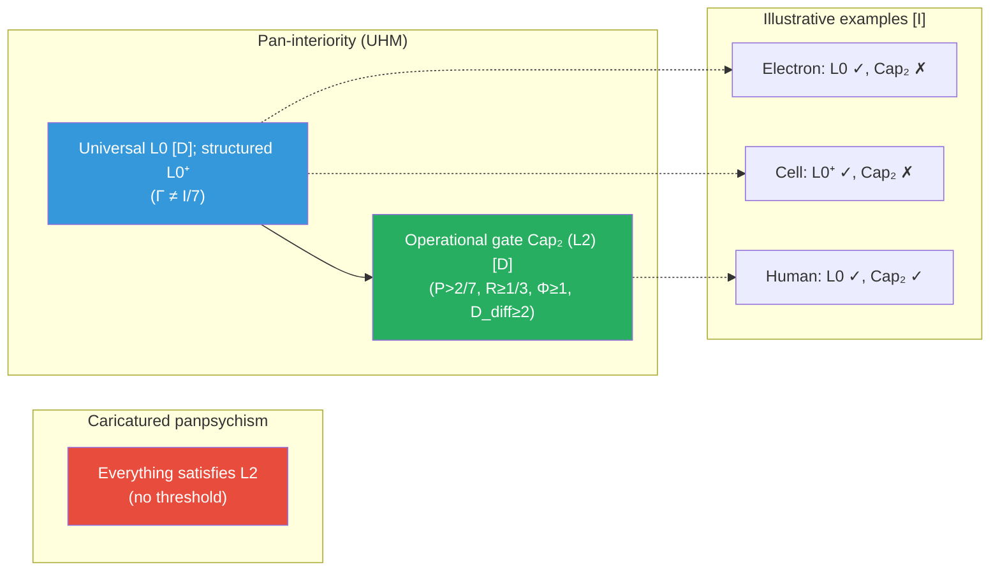
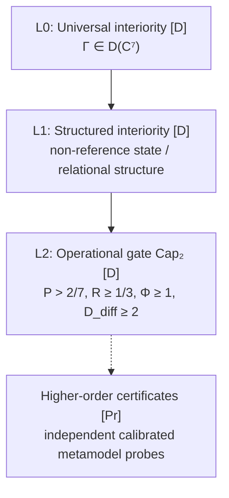

# Panpsychism: Comparative Analysis

:::info Who this chapter is for
You will learn how UHM's position (pan-interiority) differs from classical panpsychism, Russellian monism, cosmopsychism, and Hoffman's Conscious Realism, and what UHM's finite-dimensional formalism does and does not answer regarding the combination and boundary problems.
:::

:::note About notation
In this document:
- $\Gamma$ — [coherence matrix](/docs/core/dynamics/coherence-matrix)
- $\varphi$ — [self-modelling operator](/docs/proofs/categorical/formalization-phi)
- $C$ — [consciousness measure](/docs/consciousness/foundations/self-observation#мера-сознательности-c)
- $\Phi$ — [integration measure](/docs/core/structure/dimension-u#мера-интеграции-φ)
- $R$ — [reflection measure](/docs/consciousness/foundations/self-observation#мера-рефлексии-r)
- $\rho_E$ — reduced density matrix of an extended experiential register $\mathcal{H}_E$ ([Interiority dimension](/docs/core/structure/dimension-e))
- L0, L1, L2 — [interiority hierarchy](/docs/consciousness/hierarchy/interiority-hierarchy) (universal L0 [D], operational gate $\mathrm{Cap}_2$ [D], higher-order certificates [Pr])
- $\mathbf{Hol}$ — [category of Holons](/docs/proofs/categorical/categorical-formalism)
:::

## The Strasbourg problem: where does consciousness come from? {#страсбургская-проблема}

In 1994 in Strasbourg, at the conference *Toward a Science of Consciousness*, David Chalmers posed a question that split the science of consciousness into two camps: **why do physical processes accompany subjective experience?** Why can a "zombie" not exist — a being physically identical to a human but devoid of inner experience?

This question — the hard problem of consciousness — generated three response strategies:

1. **Eliminativism** (Dennett): there is no problem, subjective experience is an illusion
2. **Emergentism** (IIT, GWT): consciousness emerges from complexity
3. **Panpsychism**: consciousness is fundamental — it **always existed**

Panpsychism is the most radical and most ancient of these strategies. Its idea is maximally simple: if consciousness cannot arise from non-conscious matter (since the mechanism is unclear), then consciousness is a **fundamental property**, inherent in all matter from the very beginning. An electron possesses mass, charge, spin — and, possibly, some elementary "inner experience".

The appeal of this position lies in bypassing the hard problem. If consciousness is fundamental, there is no need to explain how it "emerges" from physics. The problem, however, shifts: if an electron possesses experience, how does the electron's experience **combine** with the experience of other electrons into a unified human experience? This is the **combination problem** — the main difficulty of panpsychism.

---

## Definition of panpsychism

**Panpsychism** (from the Greek πᾶν — all, ψυχή — soul) is the metaphysical thesis that mentality, experience, or proto-experience is a fundamental and ubiquitous feature of physical reality: at least some (and on standard versions, all) fundamental physical constituents possess an experiential or proto-experiential aspect.

In ordinary language, panpsychism is often caricatured as the claim that "every physical object — every stone, table, or thermostat — is a conscious subject". Contemporary panpsychists explicitly reject that caricature and distinguish carefully between fundamental constituents, structured aggregates, and full-fledged reflective subjects. Below we examine the main variants and their relation to UHM.

---

## Variants of panpsychism {#варианты-панпсихизма}

### 1. Realistic monism / micropsychism (Strawson) {#элиминативный}

**Galen Strawson** (b. 1952, son of philosopher P.F. Strawson) in *Realistic Monism: Why Physicalism Entails Panpsychism* (*Journal of Consciousness Studies* 13(10–11): 3–31, 2006) argued that a physicalist who takes experience to be real must accept *micropsychism*: "at least some ultimates are intrinsically experience-involving", and — rejecting radical heterogeneity at the fundamental level — that all ultimates are. Strawson rejects radical emergentism as unintelligible: in his view, experientiality cannot arise wholly ex nihilo from purely non-experiential constituents.

**What Strawson actually holds (and does not hold):** Strawson explicitly rejects the claim that every composite physical object possesses full-fledged reflective consciousness (L2): *"Panpsychism certainly does not require one to hold the view that things like stones and tables are subjects of experience — I don't believe this for a moment."* He attributes no reasoning or reflective self-modelling to fundamental particles, and explicitly recognizes William James's combination problem as the central challenge for his view. (Earlier editions of this page mislabelled Strawson's position "eliminative panpsychism", attributed to him the thesis "everything is L2", and claimed a formal `[T]` refutation via $\Gamma = I/7$; both the attribution and the claimed refutation are removed.)

**Relation to UHM:** For the maximally mixed reference state $\Gamma = I/7$, exact arithmetic gives $P = 1/7$, canonical $R = 1$, $\Phi = 0$, and the selected scalar $C = \Phi R = 0$ **[T]**/**[D]**, so $I/7$ fails the operational gate $\mathrm{Cap}_2$ **[D]** (failing both $P > 2/7$ and $\Phi \ge 1$). That arithmetic excludes only the definitional strawman "every state satisfies $\mathrm{Cap}_2$"; it does not prove physical absence of experience without an empirical phenomenal bridge **[I]**/**[H]**, and it is **not** a refutation of panpsychism. Against Strawson's actual thesis — universal intrinsic experientiality at the base without claiming that stones and tables are macro-subjects — UHM's universal L0 **[D]** paired with a sharp operational threshold for L2 **[D]** is a structural neighbour rather than a refutation **[I]**.

### 2. Constitutive panpsychism (as analysed by Chalmers and Goff) {#конститутивный}

**Philip Goff** (b. 1977, Durham University) and **David Chalmers** (b. 1966, NYU) worked out a more refined position — micro-subjects (elementary bearers of proto-experience) **combine** into macro-consciousness — without either of them holding it as his own view: Chalmers analyses constitutive panpsychism without endorsing it, and Goff, who proposed the phenomenal-bonding solution for it (2016), defends cosmopsychism in *Consciousness and Fundamental Reality* (2017); see [the combination problem, stated precisely](#проблема-комбинации-точно). Goff's popular book *Galileo's Error: Foundations for a New Science of Consciousness* (2019) argues for panpsychism in general. (Earlier editions presented both authors as defenders of this position; that attribution is retracted.)

**Claim:** Micro-subjects exist, and their combination constitutes macro-consciousness.

**Combination problem:**

The central difficulty of constitutive panpsychism is that there is no agreed structural law explaining how micro-level experiences combine into a unified macro-experience: experience of a whole is **not reducible** to a simple function $f(C(X_1), C(X_2))$ of isolated component scores. You see a red apple — but your experience of the "red apple" is not a mere aggregate of separate micro-experiences. Between individual proto-experiences and unified macro-experience lies an explanatory **gap** that remains open.

**UHM's approach to composite states:**

UHM models composite holons via the **tensor product** of state spaces:

$$
\mathbb{H}_{1 \otimes 2} := (\Gamma_{12} \in \mathcal{D}(\mathbb{C}^7 \otimes \mathbb{C}^7), \varphi_{12})
$$

with uncorrelated composites represented by product states $\Gamma_1 \otimes \Gamma_2$.

:::warning Status: a criterion of when, not an account of how
Even with correlation in place of $\Phi_{12}$, UHM offers at most a **criterion** — whether a correlated composite, once represented on $\mathcal{D}(\mathbb{C}^7)$, passes the four-condition window — and does not explain the **constitution**: *how exactly* micro-experiences unite into a single experience. This is a reformulation of the problem, not its solution in the philosophical sense; what the machinery does and does not answer is assessed [below](#что-отвечает-аппарат-угм).
:::

#### Does a composite score detect correlations? {#теорема-нередуцируемость}
**Why it fails.** For a product the spectrum does factorise: the eigenvalues of $A \otimes B$ are the products $\lambda_i \mu_j$, the partial traces return $\Gamma_1$ and $\Gamma_2$ exactly, and the mutual information is zero — step (c) is false, and in step (d) there is no correlation to lose. On a product the data of steps (a) and (b) coincide (the spectrum is the product of the spectra and, for non-degenerate spectra, the eigenvectors are the products of the eigenvectors), so $\mu$ loses nothing there. Nor is $\Phi_{12} > 1$ a mark of correlation. Taking $\Phi_{12}$ as the integration measure of the joint $49 \times 49$ matrix (the page defines no other), purity and diagonal purity are both multiplicative on products, and the identity $P = P_{\text{diag}}(1 + \Phi)$ gives

$$
1 + \Phi(\Gamma_1 \otimes \Gamma_2) = (1 + \Phi_1)(1 + \Phi_2).
$$

A worked pair: the state $\Gamma_w = \tfrac12 \lvert u\rangle\langle u\rvert + \tfrac12 \cdot I/7$ with $u = (1, \ldots, 1)/\sqrt7$ passes the purity, reflection and integration thresholds ($P = 5/14$, $R = 2/5$, $\Phi = 3/2$), and two uncoupled copies have $\Phi(\Gamma_w \otimes \Gamma_w) = 21/4$ at $I(1{:}2) = 0$; two holons at $\Phi_1 = \Phi_2 = 1$ give exactly $\Phi_{12} = 3$. (Checked numerically on 200 random pairs of $7 \times 7$ states: the identity holds to a relative error below $10^{-15}$ and $\lvert I(1{:}2)\rvert \leq 2 \cdot 10^{-15}$; regression test `test_phi_of_a_product_factorises` in `website/scripts/check_core_numbers.py`.)

**What replaces it.**

- **Stands [T]:** for a correlated joint state $\rho_{12} \neq \rho_1 \otimes \rho_2$ the marginals do not determine the joint state; the information the partial traces discard is $I(1{:}2) = S(\rho_1) + S(\rho_2) - S(\rho_{12}) = D(\rho_{12} \,\|\, \rho_1 \otimes \rho_2) > 0$ (a standard identity of quantum information theory). Under the specified product dynamics and Hamiltonian coupling, [CC-7](/docs/applied/coherence-cybernetics/theorems#теорема-93-эмерджентность) **[T]** establishes the exact stationarity criterion: a product of stationary single-site states stays stationary if and only if it commutes with the coupling; any identification of non-commuting or correlated composites with collective experience remains an empirical hypothesis **[H]** requiring independent evidence. Correlation holds for classically correlated pairs as well and does not by itself single out integrated experience.
- **Hypothesis [H]:** the phenomenal functor, extended to composite states, is colax-monoidal but not monoidal exactly on correlated joint states. It is not proved: $F$ is defined on $\mathcal{D}(\mathbb{C}^7)$, and applying it to a state on $\mathbb{C}^{7^N}$ first requires the aggregation channel that the theory does not fix (assumption 1 [below](#что-отвечает-аппарат-угм)). Research programme [Pr]: fix that channel, then prove or refute the colax property.

A phenomenal interpretation requires a map on the composite together with a physical and experimental criterion for when two reports describe one subject.

:::info What has been resolved and what remains
- **Retracted [✗]:** "Resolved [T]: emergence as irreversibility of the coherence map $\mu$" and "Resolved [T]: emergence threshold $\Phi_{12} = 1$ (T-129a)". Both rested on the theorem retracted above: a product of two L2 holons already has $\Phi_{12} \geq 3$ at $I(1{:}2) = 0$, and T-129a concerns single states on $\mathcal{D}(\mathbb{C}^7)$, not composites.
- **Stands [T]:** a correlated composite has a joint state that its parts do not fix; the discarded information is $I(1{:}2) > 0$ (a standard identity). Under the specified product dynamics and Hamiltonian coupling, CC-7 **[T]** states that a product of stationary single-site states stays stationary iff it commutes with the coupling; collective experiential identification remains **[H]**.
- **Open [H]:** the colax-monoidal restatement on correlated states, pending the aggregation channel.
- **Open [Pr]:** the constitutive mechanism — *how exactly* a correlated composite is **experienced** as unified experience. This is an analogue of the hard problem: UHM can at most state a *condition*, not the *content* of the unified experience.
:::

### 3. Panprotopsychism (Chalmers)

**Chalmers** (2010, *The Character of Consciousness*) proposed a softened version: everything possesses not "experience" but "proto-mental" properties — something that is not itself consciousness, but under the right combination generates it.

**Analogy:** H₂O. Neither hydrogen nor oxygen is wet by itself. But their combination is wet. The "proto-wetness" of hydrogen + the "proto-wetness" of oxygen → the wetness of water. Analogously: the "proto-experience" of an electron + the "proto-experience" of another electron + the right combination → human experience.

**Correspondence in UHM — level L0:**

By the [canonical definition](/docs/consciousness/hierarchy/interiority-hierarchy#уровень-0-интериорность-interiority) **[D]**, L0 is universal — every system with $\Gamma \in \mathcal{D}(\mathcal{H})$ is assigned an interiority aspect. What panprotopsychism tracks corresponds conceptually to the **structured** (non-reference) subclass of states that do not pass the operational gate $\mathrm{Cap}_2$ **[I]**:

$$
\mathrm{L0}^{+}(\Gamma) := (\Gamma \neq I/7) \quad \text{(structured interiority [D])}
$$

$\mathrm{L0}^{+}$ marks the chosen non-reference subclass $\Gamma \neq I/7$ **[D]**/**[I]**. It includes states both passing and failing $\mathrm{Cap}_2$; non-reference structure does not imply $C = 0$ or absence of experience. Bare L0 and its philosophical reading remain separate from the operational gate.

### 4. Russellian monism (Russell, Strawson) {#расселианский}

**Bertrand Russell** in *The Analysis of Matter* (1927) pointed to a fundamental gap in physics: it describes only the **structural** properties of matter (mass, charge, spin), defined through relations with other objects. But what fills this structure **from within**? Physics is silent. Russell suggested that the intrinsic nature of matter may be mental or proto-mental.

**Conceptual correspondence in UHM [I]:**

| Russellian distinction | UHM counterpart | Comment |
|---------|-----|---------|
| Structural / dispositional properties ($S_{\mathrm{ext}}$) | Hamiltonian $H$, Lindblad operators $\{L_k\}$ | Relational dynamics = structure |
| Intrinsic nature ($I_{\mathrm{int}}$) | [Interiority sector](/docs/core/structure/dimension-e) (native $E$-axis; extended register $\rho_E$ where declared) | Interiority = intrinsic reading [I] |

This table is a philosophical correspondence **[I]**, not a mathematical functor between formal categories. Among existing metaphysical positions, Russellian monism is the closest structural analogue to UHM's [two-aspect monism](/docs/consciousness/foundations/two-aspect-monism).

---

## UHM's position: Pan-interiority {#панинтериоризм}

### Definition

UHM does not accept any form of panpsychism. Instead it proposes **pan-interiority** — a position according to which **every** system possesses interiority (L0 is universal by the [canonical definition](/docs/consciousness/hierarchy/interiority-hierarchy#уровень-0-интериорность-interiority)), every system with $\Gamma \neq I/7$ possesses structured interiority (L0⁺), but **not all** possess consciousness (L2).

:::warning Key distinction
UHM asserts **pan-interiority**, not panpsychism:

$$
\forall \Gamma \neq I/7 : \mathrm{L0}^{+}(\Gamma) = \mathrm{true}
$$

But **not**:

$$
\forall \Gamma : \mathrm{L2}(\Gamma) = \mathrm{true}
$$

:::

### Strict inclusion $\mathrm{L2} \subsetneq \mathrm{L0}$ under the operational gate

$$
\mathrm{L0}(\Gamma) \not\Rightarrow \mathrm{L2}(\Gamma)
$$

**Verification:**

By the canonical operational gate $\mathrm{Cap}_2$ **[D]**, L2 requires $P > 2/7$ **[D]**, $R \geq R_{\text{th}} = 1/3$ **[D]**, $\Phi \geq \Phi_{\text{th}} = 1$ **[D]** (T-129; [T-129a [T]](/docs/proofs/consciousness/operationalization#t-129a-универсальность) proves the one-way algebraic implication $\Phi \ge 1 \Rightarrow P \ge 2/7$), and $D_{\text{diff}} \geq 2$ **[D]** (T-151) ([canonical hierarchy](/docs/consciousness/hierarchy/interiority-hierarchy)).

For a near-reference mode $\Gamma_e \approx I/7$ (e.g., an isolated elementary mode):

$$
\Phi(\Gamma_e) \ll 1 \quad (\text{while } R(\Gamma_e) = 1/(7P) \approx 1 \text{ is a formal artefact at } P \approx 1/7)
$$

Consequently, $\mathrm{L0}(\Gamma_e) = \mathrm{true}$, but $\mathrm{L2}(\Gamma_e) = \mathrm{false}$: the purity and integration cuts fail. The score $R=1/(7P)$ is at least $1/7$ and approaches $1$ near $I/7$. This evaluates the [specified operational gate](/docs/consciousness/hierarchy/interiority-hierarchy#уровень-0-интериорность-interiority) **[D]**, not an electron's first-person experience. $\blacksquare$

### Canonical interiority levels (revised)

In the revised [Interiority Hierarchy](/docs/consciousness/hierarchy/interiority-hierarchy), UHM distinguishes universal L0 **[D]**, non-degenerate phenomenal structure L1 **[D]**, and the four-condition operational gate $\mathrm{Cap}_2 = (P > 2/7) \land (R \ge 1/3) \land (\Phi \ge 1) \land (D_{\mathrm{diff}} \ge 2)$ for L2 **[D]**. Earlier fixed scalar cutoffs for L3 and L4 are **withdrawn [✗]** (see [T-67 [✗]](/docs/consciousness/hierarchy/interiority-hierarchy), [T-86 [✗]](/docs/consciousness/hierarchy/swallowtail-transitions#l3-l4), [T-136 [✗]](/docs/consciousness/hierarchy/depth-tower#спектральная-формула-sad), and [T-217 [✗]](/docs/consciousness/hierarchy/interiority-hierarchy)); higher-order cognitive certificates remain an open research programme **[Pr]** based on independent calibrated metamodel probes rather than fixed scalar inequalities.

---

## Hoffman's Conscious Realism {#хоффман}

### Biography and intellectual trajectory

**Donald D. Hoffman** (b. 1955) is a professor of cognitive science, philosophy, and logic at the University of California, Irvine (UC Irvine). He began his career with classical psychophysics of visual perception: his early works (1980s–2000s) are devoted to computational modelling of the perception of shape, colour, and objects.

The turning point was the recognition of a paradox: if evolution shapes perception, why should perception be **true**? Together with Chetan Prakash and Manish Singh, Hoffman formalised this question in the **"Fitness Beats Truth" theorem** (2009–2015), showing through evolutionary game models that organisms perceiving an "interface" (a compressed adaptive representation) systematically outcompete organisms with "true" perception.

From this result Hoffman arrived at a radical ontological position: space-time is not objective reality but a **user interface** of conscious agents.

:::warning Important classification
Hoffman **himself** rejects the label "panpsychist". His position is **objective idealism** (Conscious Realism): conscious agents are the only fundamental reality, and the physical world is a derivative of their interactions. This is closer to Leibniz (monadology) or Berkeley than to Strawson or Goff.
:::

### The "Fitness Beats Truth" Theorem (FBT) {#fbt}

**Claim** (Hoffman, Singh, Prakash 2015; formal combinatorial proof in Prakash et al. 2021): In finite evolutionary games under a **uniform prior over all payoff functions** on a finite world state space $W$, organisms with payoff-tuned ("interface") perceptual strategies (many-to-one compression aligned with payoffs) asymptotically outcompete strictly veridical ("truth") strategies (injective/homomorphic maps $W \to X$) as the state space grows.

**In plain terms.** Imagine two organisms in a forest. The first sees the world "as it is" — distinguishes 1000 shades of green in the foliage. The second compresses: all edible things are green, all poisonous are red. Under a fixed single-task payoff function drawn without structural correlation to physical geometry, the second makes decisions faster and spends fewer resources on computation. Hoffman extrapolates from this that perception of space-time is an adaptive interface rather than a map of reality — a philosophical leap whose validity depends on assumptions far stronger than the combinatorial theorem itself (see [scope below](#преимущества-хоффмана)).

:::note Connection to CC
CC admits a similar interpretation [I]: the agent $\mathbb{H}$'s perception of its environment $E$ is mediated by [functor $F$](/docs/proofs/categorical/categorical-formalism#3-функтор-f-на-объектах), which need not be accurate — functional adequacy is sufficient. But CC does not postulate the illusoriness of space-time: it is [emergent](/docs/core/foundations/spacetime), not interfacial.
:::

### Full formalism: conscious agent

**Definition (Hoffman, Prakash 2014).** A conscious agent (CA) is a sextuple:

$$
C = (X, G, A, W, D, N)
$$

| Component | Description | Example |
|-----------|-------------|---------|
| $X$ (experience) | All possible experiences of the agent | Colours, sounds, emotions |
| $G$ (actions) | All available actions | Movements, decisions |
| $A: G \times W \to W$ | Action $g$ in world $w$ → new world state | Pressing a button changes the screen |
| $W$ (world) | World states (can be another agent!) | Surrounding environment |
| $D: X \times G \to G$ | Experience → decision (choice of action) | You see danger → you run |
| $N: W \times X \to X$ | World state → experience | Photons → "red" |

Key idea: $W$ need not be the "physical world". For two agents $C_1$ and $C_2$, the world of each is **the other agent**. Physical space-time is the **emergent interface** of a network of interacting agents.

### Composition of conscious agents {#композиция-ca}

**Closure theorem** (Hoffman, Prakash 2014): For any two CAs $C_1$ and $C_2$, their interaction forms a new CA: $C_1 \otimes C_2 = C_{12}$.

This means that **ConsAgents** is a monoidal category. Hoffman interprets this as the principle "conscious agents are all there is".

:::note Parallel with CC
The revised [CC composition theorem](/docs/applied/coherence-cybernetics/theorems#теорема-91-фрактальное-замыкание) gives conditional persistence for specified stable systems and compatible readouts. It does not derive a universally viable/unique aggregate or phenomenal combination. The product-score identity below holds even for uncoupled states and cannot supply that bridge.
:::

### CC's position: pan-interiority vs objective idealism {#панинтериоризм-vs-идеализм}

Hoffman and CC diverge on a key ontological question:

| | Hoffman (Conscious Realism) | CC (Pan-interiority) |
|---|---|---|
| **What is fundamental?** | Only conscious agents | Holons $\mathbb{H}$ (universal L0 [D], operational L2 gate [D], higher-order certificates [Pr]) |
| **Is there a non-conscious reality?** | No — everything reduces to CA | Yes — L0 (interiority) without passing $\mathrm{Cap}_2$ (L2) |
| **Relation of L0 and L2** | L0 = L2 (everything is conscious) | $\mathrm{L0} \supsetneq \mathrm{L2}$ under the operational gate [D] |
| **Physical world** | Interface (idealism) | Emergent (real, structurally modelled) |
| **Consciousness threshold** | No threshold (everything is CA) | $\mathrm{Cap}_2$: $P > 2/7 \wedge R \geq 1/3 \wedge \Phi \geq 1 \wedge D_{\mathrm{diff}} \geq 2$ [D] |
| **Dynamics** | Cycle $N \to D \to A$ (discrete) | $\dot\Gamma = \mathcal{L}_\Omega[\Gamma]$ (continuous) |
| **Falsifiability** | Low (no quantitative predictions) | Prospective testable predictions [Pr]/[H] |

### Structural correspondence with Hoffman's conscious agents [I] {#функтор-хоффман}

An informal component-wise correspondence between Hoffman's conscious agents (CA) and CC components:

| CA component | Informal CC counterpart |
|--------------|----------------------|
| $X$ (experience) | [Experiential space](/docs/proofs/categorical/categorical-formalism#2-категория-exp) |
| $G$ (actions) | Space of CPTP channels $\{\Psi\}$ |
| $N$ (perception) | [Functor $F$](/docs/proofs/categorical/categorical-formalism#3-функтор-f-на-объектах) |
| $D$ (decision) | [Operator $\varphi$](/docs/proofs/categorical/formalization-phi) |
| $A$ (action) | [Regenerative term](/docs/core/dynamics/evolution#3-регенеративный-член) $\mathcal{R}[\Gamma, E]$ |
| $W$ (world) | Environment $E$ in $\mathbb{H}$ |

:::info Status [I] / [Pr]
This table is an **informal interpretational analogy [I]**, not a constructed functor: no morphism mapping, functoriality laws, or monoidal compatibility between explicitly defined categories have been established. Formalizing a functor between $\mathbf{Hol}$ and $\mathbf{ConsAgents}$ remains an unproved open research programme **[Pr]**.
:::

### What Hoffman does better than CC {#преимущества-хоффмана}

1. **Evolutionary epistemology (scoped).** The FBT theorem (Hoffman, Singh & Prakash 2015; formal proof in Prakash et al. 2021) is a valid combinatorial-probability theorem **under its explicit hypotheses** — chiefly a uniform distribution over all payoff functions on finite state spaces and a fixed single-task payoff. Its empirical scope for biological perception is widely contested (ecological payoffs are physically structured and smooth rather than uniformly random, and multi-task generalization across changing goals favours recovering latent world structure), and it does not entail ontological idealism or the illusoriness of space-time. Even with that scope restriction, Hoffman's programme explicitly formalizes the trade-off between selection and perceptual compression, whereas CC has no analogous evolutionary-game result.

2. **Accessibility of exposition.** *The Case Against Reality* (2019) is a bestseller; TED talk with 3M+ views. CC is currently accessible only to specialists.

3. **Radicality of the question.** Hoffman poses the question "what if space-time is not reality?" with maximum sharpness.

4. **Mathematical elegance.** The six-component CA is minimal and convenient for combinatorics.

---

## Precedents and related programmes: combination, boundaries, cosmopsychism, idealism {#прецеденты-и-родственные-программы}

This section sets UHM's pan-interiority against the literature the page has not cited so far: the combination problem as the field now states it, the boundary problem, cosmopsychism and analytic idealism. For each it gives the sources, the leading proposals and their standing, and then — marked as interpretation [I] — what UHM's composite-system results actually answer and which assumptions the answer rests on.

### Where pan-interiority sits in the field's vocabulary {#место-панинтериоризма}

The field now works with definitions due to David Chalmers ("The combination problem for panpsychism", in G. Brüntrup & L. Jaskolla (eds.), *Panpsychism: Contemporary Perspectives*, Oxford University Press, 2016, pp. 179–214). *Panpsychism*: some fundamental physical entities have conscious experiences. *Panprotopsychism*: fundamental physical entities have protophenomenal properties — "special properties that are not themselves phenomenal (there is nothing it is like to have them) but that can collectively constitute phenomenal properties". *Constitutive* views ground macro-experience in the micro-level; *emergent* views let it arise as something new under contingent laws.

By the interiority hierarchy's own definition, [L0](/docs/consciousness/hierarchy/interiority-hierarchy#уровень-0-интериорность-interiority) "is not 'consciousness' or 'experience' in the ordinary sense" but "a mathematical property of the object", and the structure at [L1](/docs/consciousness/hierarchy/interiority-hierarchy#уровень-1-феноменальная-геометрия-phenomenal-geometry) "is not yet perceived"; awareness appears at L2 through reflection and integration. In Chalmers' vocabulary this is a constitutive panprotopsychism with a structural-functional account of awareness [I] — the shape of Sam Coleman's panqualityism (qualities without subjects at the base, awareness constituted functionally), which Chalmers discusses among the combinatorial options. Three consequences follow.

1. The contrast drawn above — "panpsychism = L2 for all" — is not the contrast with the field: no contemporary panpsychist ascribes reflection to electrons (see the [correction in §1](#элиминативный)). The contrast that stands is UHM's sharp threshold.
2. The combination problem that reaches UHM is the panprotopsychist one: how non-phenomenal structure constitutes experience. Chalmers argues that this faces a gap of its own, between the non-phenomenal and the phenomenal, on top of the familiar ones.
3. Earlier editions of another page called the same position "emergentism with an exact threshold" and said that "the combination problem does not arise" ([Philosophical foundations of CC](/docs/applied/coherence-cybernetics/philosophy#онтология)). The two readings face different problems: panprotopsychism faces the gap just named; emergentism avoids the combination problem but, on Chalmers' analysis, must treat its threshold as a contingent psychophysical law and faces the problem of mental causation. The corpus asserted both readings; since 2026-09-25 it takes one throughout — the panprotopsychist reading of this section, on which the thresholds say *when* a system is an L2 subject, not *how* its structure becomes experience [I] — and the emergentist wording is retracted on that page and in the exercises, as is the claim of a solution in [Theories of Consciousness §24](/docs/consciousness/comparative/consciousness-theories#russellian), the section overview and the [proofs of the interiority hierarchy](/docs/proofs/consciousness/interiority-hierarchy) (§5.1).

### The combination problem, stated precisely {#проблема-комбинации-точно}

William James posed the problem (*The Principles of Psychology*, 1890, vol. 1, ch. 6): "Take a sentence of a dozen words, and take twelve men and tell to each one word. Then stand the men in a row or jam them in a bunch, and let each think of his word as intently as he will; nowhere will there be a consciousness of the whole sentence." William Seager named it ("Consciousness, information and panpsychism", *Journal of Consciousness Studies* 2(3): 272–288, 1995). The Stanford Encyclopedia entry "Panpsychism" (Philip Goff, William Seager & Sean Allen-Hermanson, revised 2022) records the consensus: "It is generally agreed, both by its proponents and by its opponents, that the hardest problem facing panpsychism is what has become known as the 'combination problem.'"

Chalmers (2016) splits the problem into three subproblems plus further aspects, and insists that a solution must address all of them:

| Subproblem | Question | Sharpest form |
|---|---|---|
| Subject combination | How do micro-subjects combine into a macro-subject? | *Subject-summing*: given any group of subjects and any further subject, the group can apparently exist without the further one |
| Quality combination | How do micro-qualities yield macro-qualities? | *Palette*: a handful of fundamental qualities against the vast array of experienced ones |
| Structure combination | How does micro-structure yield the structure of experience? | *Structural mismatch*: the structure of experience is unlike the physical structure of the brain |
| Further aspects | Unity, boundary (Rosenberg 1998), awareness, grain | Why one bounded, homogeneous, aware field rather than a jagged array of micro-experiences |

Two authors turned the subject problem into a choice. Sam Coleman ("The real combination problem: panpsychism, micro-subjects, and emergence", *Erkenntnis* 79(1): 19–44, 2014) argues that "subjects cannot combine": each subject's point of view excludes the others', so fusing micro-subjects could only yield a new, emergent macro-subject — which defeats panpsychism's motive; he recommends giving up micro-subjects and keeping qualities without subjects at the base. Philip Goff (*Consciousness and Fundamental Reality*, Oxford University Press, 2017) concludes from the same problem that micropsychism fails and defends cosmopsychism with "grounding by subsumption" (below); Daniel Stoljar's review (*Notre Dame Philosophical Reviews*, 2018.02.09) replies that in the relevant cases "grounding just is grounding by analysis", so subsumption offers no escape. Earlier editions of subsection 2 above presented Goff and Chalmers as defenders of micro-level constitutive panpsychism; neither is (the subsection now says so): Goff's considered view in *Consciousness and Fundamental Reality* is cosmopsychism, and Chalmers analyses constitutive panpsychism without endorsing it.

### Leading proposals and their standing {#предложения-и-их-статус}

| Proposal | Who | What it does | Standing, and whose judgment |
|---|---|---|---|
| Emergent panpsychism: macro-subjects arise under new laws | Gregg Rosenberg (*A Place for Consciousness*, OUP 2004); integrated information theory read as such a law | Avoids combination by making macro-subjects fundamental | Pays with mental causation and contingent laws (Chalmers 2016, who also reads IIT this way); the SEP calls Rosenberg's view "a form of layered emergentism" |
| Phenomenal bonding | Goff, "The phenomenal bonding solution to the combination problem" (in Brüntrup & Jaskolla 2016, pp. 283–302) | A phenomenal relation among micro-subjects, such as co-consciousness, constitutes a new subject | "One of the more promising approaches", yet hard pressed to avoid both a single universal subject and fragmentary subjects (Chalmers 2016) |
| Quantum holism, combinatorial infusion | Seager, "Panpsychism, aggregation and combinatorial infusion", *Mind and Matter* 8(2): 167–184 (2010); Rodolfo Gambini & Jorge Pullin, *Mind and Matter* 22(1): 51–94 (2024) and *J. Consciousness Studies* 32(7): 7–32 (2025) | An entangled whole is a new fundamental entity; the supervenience assumptions behind the combination problem fail at the quantum level, where the joint state space grows exponentially | Worth close examination, but "it does not seem that there is the sort of stable brain-level entanglement that would be needed", and a structural-mismatch worry remains (Chalmers 2016) |
| Panqualityism with functional awareness | Coleman (2012, 2014) | Qualities without subjects at the base; awareness constituted functionally | Open to a quality–awareness gap: qualities without awareness remain conceivable (Chalmers 2016) |
| Formal closure of composition | Hoffman & Prakash, "Objects of consciousness", *Frontiers in Psychology* 5: 577 (2014) | Theorems: the join of two conscious agents is a conscious agent | Proved by construction inside conscious realism (Hoffman & Prakash 2014); closure of a formalism, not by itself a new subject [I] |
| Cosmopsychism | Itay Shani (2015); Yujin Nagasawa & Khai Wager (2016); Goff (2017) | The cosmos is the one fundamental subject; individual subjects derive from it | Trades combination for its reverse, a problem that, in Chalmers' judgment (2016), seems "just as hard as the original combination problem" — [below](#космопсихизм) |

Overall standing, in Chalmers' judgment (2016): "It is fair to say that no proposed solution has yet gained much support." His conclusion names the avenues most worth exploring — phenomenal bonding or quantum holism for subjects, small palettes for qualities, "principles of informational composition" for structure, and a somewhat deflationary account of awareness — and adds that it is not at all clear whether they can work together.

### What UHM's machinery answers, and what it leaves open {#что-отвечает-аппарат-угм}

The finite-dimensional [composite-system framework](/docs/core/dynamics/composite-systems) supplies joint states in $D_{7^k}$ and CPTP marginal/readout maps. A product state has no mutual information; a separable mixture can still be correlated. Marginals generally do not determine the joint state **[T]**. These facts distinguish kinds of correlations, but do not identify a subject.

Weak-coupling persistence is conditional on an actual stable uncoupled equilibrium, appropriate hyperbolicity/contraction assumptions, strict margins for the chosen gate and a compatible readout. “Each part is viable” alone does not prove viability of every mean aggregate or an intrinsic composite boundary. The mean of marginals is one symmetric CPTP readout after identifying subsystem frames; the old blanket uniqueness and viability conclusions are withdrawn. See the revised [CC composition results](/docs/applied/coherence-cybernetics/theorems#теорема-91-фрактальное-замыкание).

- **Subject combination.** The calibrated $\mathrm{Cap}_2$ certificate evaluates a declared seven-dimensional readout and its differentiation variable. Interpreting that operational gate as experience requires the phenomenal bridge **[I]**/**[H]**. T-153's definition **[D]** does not refute the conceivability objection. T-214's **[✗]** universal prohibition of an internal bridge is withdrawn; Lawvere's evaluator hypotheses do not hold for an arbitrary internal map.
- **Quality and structure combination.** A map $D_{7^k}\to D_7$, its frame and the phenomenal assignment must be specified and calibrated. CPTP readout is nonexpansive in chordal Bures distance; it can discard joint information. A seven-mode ansatz does not prove that the visual field or every substrate is faithfully represented. Exact recovery in T-253 applies to the chosen isometric code, not every substrate state.
- **Unity.** If the declared category has a terminal object, its nerve is contractible; the usual positive-degree cohomology of that nerve with constant coefficients vanishes. This is a statement about that classifying space, not all internal/sheaf cohomology, every local coefficient system or all self-models. Actual gluing requires descent and a specified obstruction class. No subject boundary follows from nerve contractibility.

A composite theory therefore needs three additional choices **[D]**/**[H]**: its physical grouping and effective readout; a rule for nested or competing subject candidates; and a phenomenal bridge. A larger tensor score alone does not choose them: it can exceed both component scores even in an uncorrelated product, while the user's marginal is unchanged. The combination problem remains a test of these additional constructions rather than a solved consequence of tensor algebra.

### The boundary problem {#проблема-границы}

The boundary problem asks what fixes the edges of an experiencing subject: why my experience stops at me — not at each of my neurons, and not at me together with my room. Gregg Rosenberg framed it ("The boundary problem for phenomenal individuals", in S. R. Hameroff, A. W. Kaszniak & A. C. Scott (eds.), *Toward a Science of Consciousness II*, MIT Press, 1998) and developed it in *A Place for Consciousness: Probing the Deep Structure of the Natural World* (Oxford University Press, 2004). Andrés Gómez-Emilsson and Chris Percy put it in one line: "Once you've proposed a binding mechanism that creates larger, unified, macro 1PPs, what mechanism puts a stop to that process?" (a 1PP is a first-person perspective).

- **Rosenberg's own answer.** Higher-level "natural individuals" emerge from lower-level ones, and experience is tied to his "carrier" theory of causation — "a form of layered emergentism, according to which human minds co-exist with the micro-level conscious subjects that give rise to them" (SEP "Panpsychism", 2022). Chalmers (2016) classes it as emergent panpsychism in which high-level individuals exert a small amount of downward causation.
- **Fekete, van Leeuwen and Edelman.** Tomer Fekete, Cees van Leeuwen and Shimon Edelman ("System, subsystem, hive: boundary problems in computational theories of consciousness", *Frontiers in Psychology* 7: 1041, 2016) show that any graded measure of consciousness which counts a system as conscious will also count most of its subsystems, "irrelevantly extended" versions of it and groups of individuals — so it either measures something epiphenomenal or implies "a bizarre proliferation of minds" — unless it rests on intrinsic, "systemic" properties that separate systems whose existence is a matter of fact from systems whose existence is a matter of interpretation.
- **Integrated information theory: exclusion.** Experience is "definite"; the conscious complex is the set of units whose integrated information is maximal, and "overlapping substrates that specify less integrated information are excluded" (L. Albantakis et al., "Integrated information theory (IIT) 4.0", *PLoS Computational Biology* 19(10): e1011465, 2023). Giulio Tononi and Christof Koch draw the consequence for groups: two people talking form an integrated system, but its integrated information is below that of each brain, so "there should indeed be two separate experiences, but no superordinate conscious entity" (preprint arXiv:1405.7089; published as "Consciousness: here, there and everywhere?", *Philosophical Transactions of the Royal Society B* 370: 20140167, 2015). Chalmers (2016, in a footnote) objects that such a rule makes consciousness extrinsic: intrinsically identical systems may be conscious or not depending on their surroundings.
- **Electromagnetic topology.** Gómez-Emilsson & Percy ("Don't forget the boundary problem! How EM field topology can address the overlooked cousin to the binding problem for consciousness", *Frontiers in Human Neuroscience* 17: 1233119, 2023) propose that topologically closed pockets of the brain's electromagnetic field give observer-independent hard boundaries, and outline a three-stage empirical test. They document the neglect of the problem: a Scopus search found 5 papers with "boundary problem" against 92 with "binding problem".

UHM on the boundary problem [I]:

1. **Nested candidates [H].** Without an exclusion/boundary rule, several groupings can pass a chosen operational gate. This is an unresolved selection problem, not proof that each grouping experiences.
2. **Readout and sector.** Revised T-253 permits exact CPTP recovery on a declared isometric code; it does not give a faithful compression of every state of an arbitrary larger substrate to $D_7$. Different admissible sectors/frames can give different $\Gamma$ and canonical $\Phi$. A calibrated intrinsic sector and dynamics remain part of the empirical bridge.
3. **Terminal object.** In the all-dimensional CPTP category the terminal object is the one-dimensional unit with the discard map. It is not the seven-dimensional matrix $I/7$. Assigning a chosen seven-dimensional reference to a terminal point in another realisation is additional data **[D]**. Nerve contractibility does not force $C=0$ for a physical universe or define local subject boundaries.
4. **What can be checked.** Once a physical grouping, frame, identifiable state estimator, differentiation variable and temporal protocol are supplied, a $\mathrm{Cap}_2$ certificate can be tested. Phenomenality and subject individuation still need their separately stated bridge and evidence.

### Cosmopsychism {#космопсихизм}

Cosmopsychism reverses the direction of explanation: the cosmos as a whole is the one fundamental conscious subject, and individual minds derive from it. It matters for UHM because UHM also has a "one" at the top of its formalism — the terminal object — and because cosmopsychism is the leading alternative for anyone who finds bottom-up combination hopeless.

- **Sources.** Itay Shani, "Cosmopsychism: a holistic approach to the metaphysics of experience", *Philosophical Papers* 44(3): 389–437 (2015): an all-pervading cosmic consciousness is the single ontological ultimate and the ground from which individual conscious creatures emerge. Yujin Nagasawa & Khai Wager, "Panpsychism and priority cosmopsychism", in Brüntrup & Jaskolla (2016), pp. 113–129: the cosmos is the one basic conscious entity, prior to its parts, on the model of Jonathan Schaffer's priority monism ("Monism: the priority of the whole", *Philosophical Review* 119(1): 31–76, 2010), which argues from quantum entanglement that the cosmos is the one fundamental object. Goff (2017): cosmopsychism with grounding by subsumption.
- **Standing.** The SEP (2022) names these authors among those "attracted to cosmopsychism on the grounds that it is better fitted than micropsychism to deal with the combination problem". The price is the reverse problem. Chalmers (2016) called it the decomposition problem — "how does a single subject give rise to multiple dependent subjects?" — and judged that such problems "seem just as hard as the original combination problem"; later, renaming it the "constitution problem", he rated it "very serious" while finding some cosmic avenues "more promising than analogs in the micropsychist case" (Chalmers, "Idealism and the mind-body problem", in W. Seager (ed.), *The Routledge Handbook of Panpsychism*, Routledge, 2020, pp. 353–373).
- **UHM [I]/[H].** Terminality is a property of a declared mathematical category, not an identification of the cosmos with $I/7$ or a proof that the universe lacks experience. The proposal to realise the Universe as a holon requires its own physical state space, effective map, clock, interactions and boundary conditions. In revised [T-266](/docs/physics/gravity/cosmological-constant#теорема-стадия-вселенной) **[H]**, assigning the cosmic purity $P=3/7$, a universe-as-holon readout, or a terminal-stage extrapolation are independent physical hypotheses **[H]**, not a measured stage or universal cosmic theorem. A purity figure or an assumed trajectory does not prove birth, decay or phenomenal extinction. The universal self-reference ceiling of three is withdrawn (T-136 **[✗]**, T-217 **[✗]**; T-218 **[T at Sing realization]** gives no universal 3-truncation); neither nesting nor Kan fibrancy determines a cosmic cognitive depth. UHM can adopt a philosophical stance on cosmopsychism, but this stance is not settled by the finite matrix formalism. The elementary fact that joint correlations are not fixed by marginals supplies no subject criterion by itself.

### Analytic idealism {#аналитический-идеализм}

Analytic idealism, Bernardo Kastrup's view, holds that there is only cosmic consciousness and that individual minds are split-off parts of it. It matters for UHM because it offers the one mechanism for subject boundaries in this section that has a clinical model, and because UHM has a formal analogue of that mechanism.

- **Source.** Bernardo Kastrup, "The universe in consciousness", *Journal of Consciousness Studies* 25(5–6): 125–155 (2018).
- **What it holds.** "There is only cosmic consciousness. We, as well as all other living organisms, are but dissociated alters of cosmic consciousness, surrounded by its thoughts. The inanimate world we see around us is the extrinsic appearance of these thoughts. The living organisms we share the world with are the extrinsic appearances of other dissociated alters." The model is dissociative identity disorder: an alter is a region of mental contents cut off from the rest by dissociation, and that cut is the subject's boundary. Kastrup claims that the view escapes the hard problem, the combination problem and the decombination problem.
- **Standing.** A minority position. Chalmers (2020, cited above) finds identity cosmopsychism with this kind of fragmentation "a coherent view that is worth taking seriously" but massively revisionary: "It makes us pathological subjects who are entirely unaware of the vast majority of experiences we are having", which "entails a massive failure of introspection". His verdict on idealism as a whole: implausible, yet "not significantly less plausible than its main competitors".
- **UHM [I].** The formal analogue of dissociation is restriction: an individual's self-model acts on its reduced state and cannot reach coherences present only in the joint state ([collective unconscious, property 1](/docs/consciousness/subjects/collective-consciousness#определение-коллективного-бессознательного)). The differences are of kind. UHM posits no cosmic subject; its "extrinsic appearance" is the external side of each $\Gamma$, not the appearance of a cosmic mind's thoughts; and restriction is the normal relation of a part to a whole, not a pathology. Kastrup gives boundaries a mechanism; UHM's partial trace describes privacy but does not say which subsystems are subjects.

### Summary {#сводка-прецедентов}

| Problem | Standing in the literature (whose judgment) | UHM ingredient | What it answers [I] | What stays open |
|---|---|---|---|---|
| Subject combination | Open in the literature | Conditional composite dynamics; T-153 operational definition [D] | Tests a declared grouping/readout | Phenomenal constitution and boundary selection; T-214 [✗] universal no-go withdrawn |
| Quality combination | Open (Chalmers 2016) | Phenomenal functor on $\mathcal{D}(\mathbb{C}^7)$; mean-marginal recovery under consistent aggregation and controlled weak coupling (CC-6 [T]) | Nothing yet | Which state carries the composite's content; aggregation only loses distinguishability |
| Structure combination | Open; the mismatch argument is "a significant challenge" (Chalmers 2016) | Stratified substrate-existence conditions C1–C3 (T-153a [T] for necessary conditions; isometric retraction sufficiency via T-253 [T]/[C]) | Necessary conditions and isometric code embedding | Whether an embedded 7D sector yields the structure of experience |
| Irreducibility of the whole | Standard for correlated states; argued for panpsychism by Seager (2010) and Gambini & Pullin (2024–25) | Standard mutual-information identity; CC-7 [T] (product of stationary single-site states stays stationary iff it commutes with the coupling) | The joint state is not fixed by the parts | Holds for any correlated pair; collective experiential identification remains [H] |
| Boundary | Neglected (5 papers against 92, Gómez-Emilsson & Percy 2023); IIT answers with exclusion | None; nested subjects allowed | A computable test once a sector is chosen | The choice of sector and of aggregation; the proliferation of minds |
| Decomposition (cosmopsychism, idealism) | Open | Terminal nerve result for a declared category; cosmic mapping [H] | A conditional formal construction | Cosmic phenomenality, sector and boundaries; no identification with $I/7$ or universal depth cap |

---

## Comparative table of panpsychism variants

| Variant | Author | Year | Claim | Correspondence in UHM | Main problem |
|---------|--------|------|-------|----------------------|--------------|
| Realistic monism / micropsychism | Strawson | 2006 | Every ultimate is experiential; stones and tables are not subjects ([§1](#элиминативный)) | Universal L0 — a near relative [I] | The combination problem, which Strawson concedes |
| Constitutive micropsychism | Analysed by Chalmers; phenomenal bonding proposed by Goff — neither defends it as his own view ([§2](#конститутивный)) | 2016 | Micro-subjects combine | $\mathbb{H}_1 \otimes \mathbb{H}_2$; stationarity/correlation criterion (CC-7) is not a phenomenal constitution [I] | Combination problem (reformulated, not solved) |
| Panprotopsychism | Chalmers | 2010 | Proto-mental properties | L0 — interiority | No mechanism for L0→L2 transition |
| Russellian | Russell, Chalmers, Goff | 1927/2010 | Intrinsic + structure | Interiority sector ($\rho_E$ where extended) + $(H, \{L_k\})$ [I] | No dynamics |
| Obj. idealism | Hoffman | 2014 | Only CA, physics is interface | Component-wise analogy [I] | No thresholds, low falsifiability |
| Cosmopsychism | Shani; Nagasawa & Wager; Goff | 2015–2017 | The cosmos is the one fundamental subject | Terminal object $T$ — not a subject [I] | The decomposition ("constitution") problem |
| Analytic idealism | Kastrup | 2018 | Only cosmic consciousness; we are its dissociated alters | Partial trace as restriction [I] | Massively revisionary about introspection (Chalmers 2020) |
| **Pan-interiority (UHM)** | — | — | All have L0 [D], not all pass $\mathrm{Cap}_2$ (L2) [D] | $\mathrm{L0} \supsetneq \mathrm{L2}$ | Interiority is a primitive; does not explain *why* it exists |

---

**Related documents:**
- [Anokhin's Cognitome](./cognitome-anokhin) — neural hypernetwork and the "Who" problem
- [Theories of Consciousness](./consciousness-theories) — IIT, FEP, autopoiesis and 30+ theories
- [Cognitive Hierarchy](./cognitive-hierarchy) — K1-K5 levels
- [General Systems Theory](./general-systems-theory) — from Bertalanffy to CC
- [Interiority Hierarchy](/docs/consciousness/hierarchy/interiority-hierarchy) — L0→L4 levels
- [Two-Aspect Monism](/docs/consciousness/foundations/two-aspect-monism) — UHM ontology
- [Theorems](/docs/applied/coherence-cybernetics/theorems) — emergence, composition
- [Categorical Formalism](/docs/proofs/categorical/categorical-formalism) — category $\mathbf{Hol}$, functor $F$
- [Formalisation of φ](/docs/proofs/categorical/formalization-phi) — CPTP channels
- [Glossary](/docs/reference/glossary#связанные-теории) — Conscious Realism
- [The Soul: A Decomposition](/docs/consciousness/comparative/soul-decomposition) — the oldest name for interiority, decomposed under the Γ formalism
- [Two-Aspect Monism: precedents](/docs/consciousness/foundations/two-aspect-monism#прецеденты-и-родственные-программы) — Pauli and Jung, Bohm, Velmans, Chalmers' double-aspect information, Russellian monism as a field
