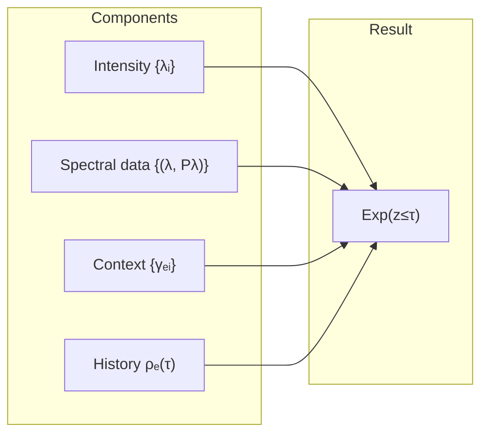

# Theory of Interiority

## "What Is It Like to Be a Bat?"

In 1974 philosopher Thomas Nagel published an essay that became one of the most cited in the philosophy of mind: *"What Is It Like to Be a Bat?"*. His argument is simple and devastating:

A bat perceives the world through echolocation. It has **subjective experience** — "what it is like" to be a bat. But no amount of neurophysiological knowledge about the bat's brain will allow us to **live through** its experience. We can describe the frequency of ultrasound, the neural patterns of echo processing — but between the objective description and the subjective experience there remains an abyss.

Nagel posed the question. Daniel Dennett (1991) tried to sidestep it, arguing that there is no "what it is like" at all. Michael Levin (2019) suggested that subjectivity is more widespread than we think — down to cellular aggregates. But none of these approaches provided a **mathematical language** for describing the content of experience.

**UHM proposes a language for this question [I/H].** Its spectral descriptor uses a specified normalized experiential state $\rho_E$ in an augmented realization; it is not a literal partial trace of the one-dimensional native E-axis. Identifying a physical or phenomenal target requires the declared readout and independent evidence.

:::info Where we come from
The [previous chapter](./two-aspect-monism) proposes a two-aspect interpretation. Here we define a spectral descriptor and separate its mathematical construction from a physical or phenomenal attribution.
:::

### Chapter Roadmap

1. **Reduced matrix $\rho_E$** — the extension and readout needed to define it
2. **Four components of experience** — intensity, quality, context, history
3. **Projective space of qualities** — the geometry in which sensations live
4. **Fubini-Study metric** — distance between qualities (how much red differs from blue)
5. **Unity of experience** — how the $U$ dimension ensures the wholeness of the "self"
6. **Examples** — the colour red and pain in terms of the formalism

## Reduced Matrix of Experience {#редуцированная-матрица-опыта}

### Motivation: how to extract the "experiential" part from the full description

The native $7\times7$ state has seven labelled axes. E is one summand, not a tensor subsystem. A musical-section analogy can motivate a readout, but it does not define a partial trace or recover an experiential register from a population and six coherences.

### Definition

Choose a total state $\rho_{\rm tot}$ on a specified tensor product $\mathcal H_E\otimes\mathcal H_{\rm rest}$ and define
$$
\rho_E=\operatorname{Tr}_{\mathcal H_{\rm rest}}\rho_{\rm tot}.
$$
A declared lift may supply $\rho_{\rm tot}=\mathcal E(\Gamma)$; alternatively it is measured independently. The lift, factor and calibration are part of the augmented record. A compression is a different construction and requires conditioning on a nonzero weight.

For the native one-dimensional axis, $P_E\Gamma P_E=\gamma_{EE}P_E$ normalizes to $P_E$ whenever $\gamma_{EE}>0$. Its spectrum is then $\{1\}$ and its entropy zero; at zero weight the conditional state is undefined. In particular $\gamma_{EE}=0.20$ is a weight, not a nontrivial normalized spectrum.

:::note Section–retraction is not unique experiential reconstruction
The product construction $\Gamma\mapsto\Gamma\otimes\sigma$ has the native marginal $\Gamma$ for every register state $\sigma$. The experiential marginal can therefore be pure or mixed while all native data stay fixed. The former 7D/42D Morita-equivalence and unique PW-reconstruction assertions are withdrawn; see [the corrected realization](/docs/core/structure/dimension-e#rho-e-7d-42d). Choosing a total dimension does not itself choose an experiential factor, lift or conditional state.
:::

:::warning Information completeness
A partial trace generally loses correlations. Adding the native E-star context $\{\gamma_{Ej}:j\ne E\}$ and a history is a declared descriptor; it is not a proof of full reconstruction of the joint state or of phenomenal content. Any sufficiency claim needs the [observation-fibre criterion](/docs/applied/research/reconstruction-identifiability#fiber-theorem), a specified readout and its empirical interpretation.
:::

## Basic Equation

Experiential content is linked to the spectral decomposition of $\rho_E$:

$$
\rho_E |q_i\rangle = \lambda_i |q_i\rangle
$$

This is the standard eigenvalue problem. $\rho_E$ is a Hermitian matrix, so by the spectral theorem it is diagonalisable and all eigenvalues are real:

- $\lambda_i \in [0, 1]$ — **intensity** of the $i$-th component, $\sum_i \lambda_i = 1$
- $|q_i\rangle \in \mathcal{H}_E$ — **quality** of the $i$-th component
- $\mathcal{H}_E$ — Hilbert space of the [Interiority dimension](/docs/core/structure/dimension-e)

**Interpretation [I/H]:** eigenvalues and resolved spectral subspaces are candidate intensity and quality descriptors. Their psychological meaning requires a calibrated readout. At repeated eigenvalues the invariant objects are spectral projectors, as defined below; a chosen eigenbasis does not add observed structure.

:::warning Terminology
This chapter uses “qualia” for the selected L2 interpretation. Its formal classification requires the declared $A_1$, strict $P>2/7$, $R\ge1/3$, $\Phi\ge1$ and the chosen $D_{\rm diff}\ge2$ realization. Missing realization data remain unresolved; a metric or gate is not a phenomenal certificate.

See [Interiority Hierarchy](/docs/proofs/consciousness/interiority-hierarchy) for formal definitions of levels.
:::

## Numerical Examples of Computing $\rho_E$ {#числовые-примеры-rho-e}

These are **chosen register spectra**, not reconstructions from native populations or empirical assignments of sleep, red perception or meditation. For any fixed valid native $\Gamma$, let $\rho_{\rm tot}=\Gamma\otimes\operatorname{diag}(\lambda)$ and designate the second factor as the experiential register. The following old illustrative numbers all give normalized positive six-dimensional register states:

| Illustration | Chosen spectrum $\lambda$ | Mathematical reading |
|---|---|---|
| 1 (historical “sleep” label) | $(.17,.17,.17,.17,.16,.16)$ | Nearly uniform register |
| 2 (historical “red perception” label) | $(.52,.23,.11,.07,.04,.03)$ | One dominant eigenvalue |
| 3 (historical “meditation” label) | $(.38,.30,.15,.09,.05,.03)$ | Two leading eigenvalues |

Tracing the native factor yields the specified register state; tracing the register yields the **same** native $\Gamma$ in all three cases. The six-dimensional register was selected, not derived from the six native E-pairs. This example proves the need for extension data. It supplies neither L0/L2 assignments nor actual purity/reflection/integration values of a missing full native matrix; the old numerical assignments did not establish those claims. Experience-related names remain hypotheses requiring calibrated observations.

### Geometric Intuition: spectrum of $\rho_E$ in different states {#геометрия-спектра}

The spectrum of a specified $\rho_E$ lies on an $(n-1)$-simplex. The psychological labels and level assignments in the following historical illustration are proposed interpretations, not measured examples or consequences of a native partial trace:

| State | Spectrum pattern | $\lambda_1 / \lambda_2$ | Geometric analogy |
|-------|-----------------|------------------------|-------------------|
| Deep sleep (L0) | Flat: $\lambda_i \approx 1/n$ | $\approx 1.0$ | Point at the centre of the simplex — maximum entropy |
| Wakefulness (L2) | Peaked: $\lambda_1 \gg \lambda_2$ | $2$--$5$ | Point near the vertex — one component dominates |
| Meditation (L2) | Two-peaked: $\lambda_1 \approx \lambda_2 \gg \lambda_3$ | $1.1$--$1.5$ | Point on the edge of the simplex — two comparable components |
| Flow (flow) | Moderately peaked | $1.5$--$3$ | Between vertex and edge — focus + context |
| Dissociation | Flat with gap $\gamma_{EU} \to 0$ | $\approx 1$ | Centre of simplex, but coherences are severed |

**Key invariant.** The ratio $\lambda_1/\lambda_2$ is a measure of the **focus** of experience:
- $\lambda_1/\lambda_2 \gg 1$: narrow focus (perception of a single object, acute pain)
- $\lambda_1/\lambda_2 \approx 1$: broad scope (panoramic awareness, "pure consciousness")

For $\lambda_2>0$, this is a spectral ratio invariant under unitary conjugation of the specified register. A native $G_2$ action preserves it only through a proved compatible lift/readout. The psychological labels in the illustration above are hypotheses, not consequences of that invariance.

---

## Experiential Content: Four Components

The following four components define a selected descriptor [D/I]. They require the augmented realization and stored trajectory; a single native $\Gamma$ does not determine arbitrary extension data or its past:

$$
\mathrm{Exp}(z_{\le\tau}) := (\mathrm{Intensity}, \mathrm{Quality}, \mathrm{Context}, \mathrm{History})
$$

**Analogy with the painter's palette.** Imagine a palette with paints. **Intensity** — how much paint of each colour is on the palette (a lot of red, little blue). **Quality** — the colours themselves (red, blue, green). **Context** — the lighting in the studio, which changes the perception of colours. **History** — how the palette looked a minute ago (the painter just added yellow).

### Component 1: Intensity

Spectrum of eigenvalues of $\rho_E$:

$$
\mathrm{Intensity}(\rho_E) := \{\lambda_i\}_{i=1}^{n}, \quad \text{where } \rho_E|q_i\rangle = \lambda_i|q_i\rangle
$$

Intensity determines the amplitude of the interiority state (at L2+: **loudness**, **brightness**, **strength** of experience).

**Numerical example.** Let $\rho_E$ have spectrum $\{0.6, 0.3, 0.1\}$. This means: the dominant component of experience occupies 60% of the "bandwidth," the second — 30%, the third — 10%. Like a bright red rose against a muted green garden with the barely audible hum of a bee.

### Component 2: Quality

The canonical spectral record is
$$
\rho_E=\sum_{\lambda\in\operatorname{Spec}(\rho_E)}\lambda P_\lambda,
\qquad \mathrm{Quality}_{\rm sp}(\rho_E):=\{(\lambda,P_\lambda)\}.
$$
Each $P_\lambda$ projects onto the complete eigenspace for the distinct eigenvalue $\lambda$. For simple eigenvalues it is a rank-one ray $P_\lambda=|q_\lambda\rangle\langle q_\lambda|$. At a degeneracy, rotating a basis within that eigenspace changes individual eigenvectors without changing $\rho_E$; those rays are not identified by the state. Near a degeneracy, resolving separate modes requires a spectral-gap/error bound. The full-state metric below avoids this choice altogether.

A separately calibrated quality-ray map may take values in $\mathbb P(\mathcal H_E)$; it need not select eigenvectors. Rays identify nonzero vectors differing by a nonzero complex scalar, and normalized representatives differ by phase. Interpreting these data as timbre, colour or character is an empirical bridge [I/H], not a consequence of diagonalization. See [spectral readouts and degeneracies](/docs/proofs/categorical/categorical-formalism#3-функтор-f-на-объектах).

### Component 3: Context

Coherences between dimension $E$ and the others:

$$
\mathrm{Context}(\Gamma) := \{\gamma_{EA}, \gamma_{ES}, \gamma_{ED}, \gamma_{EL}, \gamma_{EO}, \gamma_{EU}\}
$$

Context modulates experience through [coherences](/docs/core/dynamics/coherence-matrix#недиагональные-элементы-когерентности):

| Coherence | Description of modulation |
|-----------|--------------------------|
| $\gamma_{EA}$ | Attention — how actively the system processes interiority content |
| $\gamma_{ES}$ | Structural context — bodily sensations, spatial grounding |
| $\gamma_{ED}$ | Dynamic context — temporal unfolding, rhythm of experience |
| $\gamma_{EL}$ | Logical context — conceptual framing (at L2) |
| $\gamma_{EO}$ | Emotional tone — connection to basic dispositions |
| $\gamma_{EU}$ | Unity — how much experience is integrated into a unified "self" |

### Component 4: History

Trajectory of evolution of $\rho_E$ in time window $T_{\mathrm{mem}}$:

$$
\mathrm{History}(\tau, T_{\mathrm{mem}}) := \{\rho_E(\tau') : \tau' \in [\tau - T_{\mathrm{mem}}, \tau]\}
$$

where $T_{\mathrm{mem}} > 0$ is the system's characteristic memory time. History determines adaptation, habituation, expectations. Without history, **anticipation** (prediction of future $\rho_E$ on the basis of the past), **habituation** (decrease of intensity upon repeated stimulation), and **surprise** (divergence between expected and actual $\rho_E$) are impossible.

## Projective Space of Qualities

### Motivation: why qualities live in projective space

The qualities of experience are not merely a set of numbers. They form a **geometric space** with its own metric. This space is the projective space $\mathbb{P}(\mathcal{H}_E)$.

Why projective and not ordinary? Because the **global phase is unobservable**: vectors $|q\rangle$ and $e^{i\theta}|q\rangle$ describe the same quality. Therefore we work not with vectors but with **rays** — equivalence classes:

$$
\mathbb{P}(\mathcal{H}_E) := (\mathcal{H}_E \setminus \{0\}) / \sim
$$

where the equivalence relation is:

$$
|\psi\rangle \sim |\phi\rangle \quad \Leftrightarrow \quad \exists c \in \mathbb{C}^*: |\psi\rangle = c|\phi\rangle
$$

**Analogy.** Think of compass directions. North-east is a direction, not a point. Doubling the compass needle does not change the direction. In the same way, doubling the vector $|q\rangle$ does not change the quality — the direction is the same.

**Topology** (for $\dim(\mathcal{H}_E) = n$):

| Property | Description |
|----------|-------------|
| Compactness | $\mathbb{P}(\mathbb{C}^n)$ is compact |
| Connectedness | $\mathbb{P}(\mathbb{C}^n)$ is connected |
| Isomorphism | $\mathbb{P}(\mathbb{C}^n) \cong S^{2n-1} / U(1)$ |
| Dimension | $\dim_{\mathbb{R}}(\mathbb{P}(\mathbb{C}^n)) = 2n - 2$ |

For finite $n$, this projective space is path-connected and compact. Compactness gives a finite $\varepsilon$-net for every $\varepsilon>0$, not a finite number of states: for $n>1$ there are uncountably many rays. For $n>1$ the FS diameter is $\pi/2$; for $n=1$ the space is one point. A continuous path in the mathematical space does not prove that a physical system can traverse it under its actual controls.

## Fubini-Study Metric {#метрика-фубини-штуди}

### Motivation: how to measure distance between experiences

Intuitively, red is "closer" to orange than to blue. Pain in a finger is "closer" to pain in the hand than to the smell of a rose. But can this be formalised?

Choose a complex inner product and the Fubini–Study geometry on its ray space. The formula below uses **unit-normalized representatives**; for arbitrary nonzero representatives divide the overlap by $\|\psi\|\,\|\phi\|$. The [enriched-Yoneda results](/docs/proofs/categorical/categorical-formalism#enriched-yoneda) then apply to this specified metric space. This is not a consequence that Čencov–Petz forces a unique quantum metric: [Petz classifies a family](/docs/core/foundations/mathematical-foundations#ченцов-петц), and a psychological metric still needs calibration.

**Distance between qualities:**

$$
d_{FS}([|\psi\rangle], [|\phi\rangle]) := \arccos(|\langle\psi|\phi\rangle|) \in [0, \pi/2]
$$

where $[|\psi\rangle]$ is the equivalence class of vector $|\psi\rangle$ in $\mathbb{P}(\mathcal{H}_E)$.

**In plain terms:** Take two vectors $|q_1\rangle$ and $|q_2\rangle$ representing two qualities. Compute their inner product (in absolute value). If it equals 1 — the qualities coincide. If 0 — they are maximally distinct. The Fubini-Study distance is the arccosine of this absolute value.

**Numerical example.** Let $|q_{\text{red}}\rangle = \begin{pmatrix}1\\0\end{pmatrix}$ and $|q_{\text{orange}}\rangle = \begin{pmatrix}\cos 15°\\\sin 15°\end{pmatrix}$. Then:

$$d_{FS} = \arccos(|\cos 15°|) = 15° \approx 0.26 \text{ rad}$$

And for $|q_{\text{blue}}\rangle = \begin{pmatrix}0\\1\end{pmatrix}$:

$$d_{FS}(\text{red}, \text{blue}) = \arccos(0) = \pi/2 \approx 1.57 \text{ rad}$$

The assigned vectors have that distance ordering. Their colour names are illustrative; the ordering becomes a prediction about perception only after independently calibrating the colour-to-ray map.

**Properties:**

| Condition | Value | Interpretation |
|-----------|-------|----------------|
| $d_{FS} = 0$ | $\vert\psi\rangle = e^{i\theta}\vert\phi\rangle$ | Identical qualities |
| $d_{FS} = \pi/2$ | $\langle\psi\vert\phi\rangle = 0$ | Maximally distinct qualities |

**Infinitesimal form** for a differentiable unit-normalized local representative:

$$
ds^2 = \langle d\psi|d\psi\rangle - |\langle\psi|d\psi\rangle|^2
$$

## Full Metric on the Experiential Space

Fix an experiential register of dimension $n$, a native E-projector $P_E$, a common clock/window $[-T,0]$ with $T>0$, and a record
$$
X=(\rho_E,C_E,h),\qquad C_E=P_E\Gamma(I-P_E),\qquad
h\in C([-T,0],\mathcal D(\mathbb C^n)),\quad h(0)=\rho_E.
$$
Here $C_E$ is the native E-star written as a matrix, distinct from the scalar $C=\Phi R$. Define the Bures distance on normalized register states by
$$
F(\rho,\sigma)=\left(\operatorname{Tr}\sqrt{\sqrt\rho\,\sigma\sqrt\rho}\right)^2,
\qquad d_B(\rho,\sigma)=\sqrt{2(1-\sqrt{F(\rho,\sigma)})}.
$$
It is a metric also at repeated eigenvalues and rank-deficient states; the smooth tensor formula needs stricter hypotheses. See the [Bures state-space construction](/docs/proofs/categorical/categorical-formalism#631-bures-топология-на-densitymat).

One valid product metric on these records is
$$
d_{\mathcal E}(X_1,X_2)=\sqrt{d_\lambda^2+\alpha d_B(\rho_1,\rho_2)^2+\beta d_C^2+\gamma d_H^2},
$$
where
$$
d_\lambda=\|\operatorname{sort}\lambda(\rho_1)-\operatorname{sort}\lambda(\rho_2)\|_2,
\quad d_C=\|C_1-C_2\|_{\rm HS},\quad
d_H=\frac1T\int_{-T}^0\|h_1(s)-h_2(s)\|_{\rm HS}\,ds.
$$
Take fixed $\alpha,\beta,\gamma>0$. Component triangle inequalities followed by the Euclidean triangle inequality prove the product triangle inequality. The Bures term separates current states; the context norm separates contexts; zero history integral implies equality everywhere for continuous histories. With merely measurable histories, quotient by equality almost everywhere. The spectral term is optional and redundant for separation, but may express a calibrated weighting of spectral changes. On physical systems or augmented records with further hidden fields this is only a pseudometric unless the descriptor is injective.

The old sum of distances between arbitrarily indexed eigenrays is not a state metric: for $\rho=I_2/2$, the bases $(|0\rangle,|1\rangle)$ and $(|+\rangle,|-\rangle)$ give a sum $\pi/2$ although the state is unchanged. Spectral projectors and $d_B(\rho,\rho)=0$ remove that ambiguity. FS remains valid for separately declared individual rays.

:::warning Calibration and data coverage
Weights, register choice, clock units and context mapping are model inputs fixed before confirmation. Align actual timestamps and preserve missing intervals; interpolation is an additional model, and a missing history cannot be silently replaced by zero distance. The mathematical metric does not determine a psychological dissimilarity scale.
:::

:::info Conditional joint transport [T]
Let $U$ be a native unitary and $V$ a unitary identification of the two experiential registers, applied to both compared records. Require
$$
\Gamma_a'=U\Gamma_aU^\dagger,\quad P_E'=UP_EU^\dagger,\quad
\rho_a'=V\rho_aV^\dagger,\quad h_a'(s)=Vh_a(s)V^\dagger\quad(a=1,2),
$$
with the same time coordinate, weights and declared semantic mapping. Then $C_a'=UC_aU^\dagger$, so all distances above are unchanged by unitary invariance of spectra, fidelity and the HS norm. If the native E-axis is held fixed, require $UP_EU^\dagger=P_E$; a general $G_2$ rotation need not satisfy this. A compatible lift/readout must establish the register relation; it does not follow from native covariance alone. Different clocks or morphologies require their own validated transport, not an automatic equality of phenomenal geometry.
:::

## Levels of Completeness of Description

These are levels of detail of the **selected descriptor**, distinct from the capability levels of the [canonical hierarchy](/docs/consciousness/hierarchy/interiority-hierarchy#типизированный-вход).

| Description | Data | Mathematical scope |
|---|---|---|
| Spectral | Sorted eigenvalues with multiplicity | Does not determine the register state |
| Register | $\{(\lambda,P_\lambda)\}$, equivalently $\rho_E$ | Determines the specified normalized register, including degeneracies |
| Contextual | $(\rho_E,C_E)$ | Adds the declared native E-star |
| With history | $(\rho_E,C_E,h)$ | Adds the recorded trajectory on the common window |

Completeness here is relative to those recorded fields. A claim about the entire augmented state or phenomenal target requires separate identification on its observation fibres.

## The Isospectrality Problem

Distinct register states can have the same spectrum. For example, $\rho_1=\operatorname{diag}(3/4,1/4)$ and $\rho_2=H\rho_1H^\dagger$ with the Hadamard unitary $H$ are different matrices with the same eigenvalues. Their corresponding spectral projectors differ and $d_B(\rho_1,\rho_2)>0$.

Thus the spectrum alone does not identify the state, while the weighted projectors do. At a degeneracy a change of eigenbasis within one eigenspace does **not** produce a different state. Reading isospectral distinctions as “equal intensity, different quality” is a testable interpretation [I/H] after the readout is fixed, not a deduction about two experiences from the eigenvalue equation alone.

## Examples of Cognitive Qualia (L2)

The examples below propose interpretations within a **declared L2 model**: $A_1\land(P>2/7)\land(R\ge1/3)\land(\Phi\ge1)\land(D_{\rm diff}\ge2)$ with the chosen proxy/extension mode. Neither this predicate nor a spectral name proves that a system knows it experiences; higher predictive self-model claims require their own certificates. Fix observations and calibration before testing the proposed readings.

### The colour red

| Component | Mathematical representation | Phenomenal interpretation |
|-----------|-----------------------------|--------------------------|
| Intensity | $\lambda_{\text{red}} \in [0, 1]$ | Brightness |
| Quality | $[\vert q_{\text{red}}\rangle] \in \mathbb{P}(\mathcal{H}_E)$ | Shade of red |
| Context | $\gamma_{EA}$ (attention), $\gamma_{EL}$ | Lighting, background |
| History | $\rho_E(\tau - T_{\mathrm{mem}}) \to \rho_E(\tau)$ | Retinal adaptation |

When you look at a red rose: $\lambda_{\text{red}} \approx 0.7$ (dominant component), $|q_{\text{red}}\rangle$ determines the specific shade, $\gamma_{EA}$ is high (you are paying attention), $\gamma_{EO}$ sets the emotional tone (beauty, joy). After a minute of adaptation $\lambda_{\text{red}}$ decreases slightly — history.

### Pain

| Component | Mathematical representation | Phenomenal interpretation |
|-----------|-----------------------------|--------------------------|
| Intensity | $\lambda_{\text{pain}} \in [0, 1]$ | Strength of pain |
| Quality | $[\vert q_{\text{pain}}\rangle] \in \mathbb{P}(\mathcal{H}_E)$ | Sharp/dull/throbbing |
| Context | $\gamma_{ES}$ (structure), $\gamma_{EO}$ | Localisation, emotions |
| History | $\{\rho_E(\tau')\}_{\tau' \in [\tau - T_{\mathrm{mem}}, \tau]}$ | Sensitisation/desensitisation |

The difference between sharp and dull pain is a difference in $|q_{\text{pain}}\rangle$, not in $\lambda_{\text{pain}}$. Intense dull pain ($\lambda = 0.8$, $|q_{\text{dull}}\rangle$) and mild sharp pain ($\lambda = 0.3$, $|q_{\text{sharp}}\rangle$) differ in both components.

## The E-Slice and the Full Content (T-301) {#e-срез-и-полнота}

The E-slice is a descriptor of the specified $\rho_E$, together with a chosen native context and history. Neither the native label E nor a general Yoneda statement supplies the extension, a unique spectral basis at degeneracy or a proof of phenomenal completeness.

- A full-rank native state has **48 real coordinates**: seven real populations with one trace relation and 21 complex coherences. “28” counts mixed real/complex slots, not independent real parameters. The [21-pair taxonomy](/docs/consciousness/phenomenology/qualia-structure#двадцать-один-и-семь) remains a selected interpretation.
- Every supported oriented cycle gives a diagonal-rephasing invariant. The seven Fano holonomies $H_p=\arg(\gamma_{ij}\gamma_{jk}\gamma_{ki})$ are seven selected readings, not the only invariants: full $K_7$ has cycle rank 15; sparse support requires its own cycle basis. Missing support is not a zero angle.
- The [qualia passport](/docs/consciousness/phenomenology/qualia-structure#паспорт-квалиа) retains state/frame provenance, support, readout, extension and uncertainty. L2 refers to the chosen $A_1$ plus all four Cap$_2$ conditions of the [canonical hierarchy](/docs/consciousness/hierarchy/interiority-hierarchy#типизированный-вход), not an R/Phi pair gate or phase reading alone.

These are complementary typed records. Whether they identify a target quality requires an observation model and a justified empirical bridge; no counting argument supplies the bridge.

## Connection to Neuroscience

How does $\rho_E$ relate to neural correlates of consciousness (NCC)?

In neuroscience, NCC is the minimal neural mechanism sufficient for a specific experience. In UHM:

| Neuroscientific term | Correspondence in UHM |
|---------------------|----------------------|
| NCC (neural correlate of consciousness) | Projection of $\Gamma$ onto the neural basis |
| Contents of consciousness | $\rho_E$ (reduced matrix) |
| Arousal level | $\lambda_{\max}(\rho_E)$ (dominant intensity) |
| Connectivity (functional connectivity) | $\Phi$ (integration measure) |
| Neural differentiation | $D_{\text{diff}}$ |

These correspondences are proposed readouts [I/H], not derived identities with neural mechanisms. A study must specify its encoder, experiential register, observation law and independent behavioral target. If it tests the chosen L2 classification, it must evaluate $A_1$ and all four Cap$_2$ conditions, including strict $P>2/7$ and declared $D_{\rm diff}$, with uncertainty retained.

## Unity of Experience

### The Binding Problem

Neuroscience knows that colour is processed in area V4, shape in area IT, motion in MT. But we see a **unified** object: a red ball flying to the right. How are representations distributed across the cortex unified into a coherent experience?

### UHM's Solution

UHM proposes that declared native E–U coherence and register integration can be predictors of a specified binding response [H]. These are mathematical diagnostics before they are psychological explanations.

For a **fixed measured basis of the normalized experiential register**, write $r_{ab}=(\rho_E)_{ab}$ and define
$$
\Phi_E:=\frac{\sum_{a\ne b}|r_{ab}|^2}{\sum_a r_{aa}^2}.
$$
This preserves the integration formula while identifying its actual state and basis. The denominator is positive for a normalized state. This is distinct from the native global $\Phi$; a one-dimensional compressed E-axis gives $\Phi_E=0$. Choosing an eigenbasis makes the numerator zero, so the basis cannot be selected afterwards to support a binding claim.

The complex number $\gamma_{EU}$ has no ordered comparison with zero. Possible declared real predictors are
$$
b_{EU}=|\gamma_{EU}|,\qquad
\chi_{EU}=\frac{|\gamma_{EU}|^2}{\gamma_{EE}\gamma_{UU}}\in[0,1]
\quad\text{if }\gamma_{EE}\gamma_{UU}>0.
$$
The bound follows from the positive $2\times2$ principal minor. At zero denominator PSD forces the coherence to vanish, but the normalized ratio remains undefined. A signed real part requires a separately fixed phase reference. Neither a positive magnitude nor a threshold on $\Phi_E$ proves a unified self or clinically identifies dissociation.

A testable binding proposal declares the response (for example a cross-modal matching judgement), the fixed encoder/register basis, calibration uncertainty and candidate predictor before outcomes. Compare held-out responses and controlled changes against models using the separate populations, global $\Phi$ and task difficulty. Preserve null results, missing data and source changes; do not fit a “dissociation threshold” to the confirmation labels. Replicated predictive or intervention evidence would support that particular bridge, not an unrestricted clinical or phenomenal identification.

:::note Relation to the chosen hierarchy
$C=\Phi R$ uses native global integration; it contains neither $b_{EU}$ nor $\Phi_E$ as a separate term. L2 requires $A_1$ and all four Cap$_2$ conditions, including strict purity and the declared differentiation mode. The binding proposal adds an empirical target and protocol; it is not a replacement gate.
:::

## Structure of the Experiential Space

**Intensity space:** $(n-1)$-simplex $\Delta^{n-1} = \{\boldsymbol{\lambda} : \lambda_i \geq 0, \sum_i \lambda_i = 1\}$

**Quality-ray space, when this readout is chosen:** $\mathbb P(\mathcal H_E)$. The full register state is represented by its weighted spectral projectors or density matrix.

## For Different Audiences

### For Engineers

**Computational complexity:**

| Operation | Complexity | Note |
|-----------|------------|------|
| Eigenvalues of $\rho_E$ | $O(n^3)$ | Standard diagonalisation |
| Fubini-Study metric | $O(n)$ | Inner product |
| Full metric $d_{\mathcal{E}}$ | $O(n^3+Mn^2)$ | $M$ sampled history matrices with the HS integrand; specified quadrature |

**Practical discretisation of history:** Store $T_{\mathrm{mem}} / \Delta\tau$ states with step $\Delta\tau$. Typical value: 100–1000 time points.

### For Psychologists

The theory of interiority provides a **mathematical language for describing phenomenology**:

- **Spectrum of $\rho_E$** — quantitative characterisation of the "palette" of interiority states (at L2+: experiences)
- **Fubini-Study metric** — measure of "distance" between qualities (how much red differs from blue)
- **Context** — how attention, mood, and embodiment modulate experience
- **History** — mechanism of adaptation, habituation, sensitisation

### For Researchers of Inner Landscapes

Experiential content is a **map of inner space**:

- **Intensity** answers the question "how strongly?"
- **Quality** answers the question "what exactly?" (colour, sound, emotion, bodily sensation)
- **Context** answers the question "under what conditions?" (attentional focus, emotional background)
- **History** answers the question "where did it come from and where is it going?"

Altered states of consciousness are characterised by a change in the **geometry** of this space — distances between qualities may contract (synesthesia) or expand (heightened perception).

### What We Learned

- The selected descriptor records a normalized register, its canonical spectral projectors, native context and history; completeness for a further target is a separate identification claim.
- FS is a metric on declared normalized rays. Bures gives a full-state metric that remains defined at degeneracies; the old indexed-eigenvector sum does not.
- Cross-frame equality requires the joint unitary readout/context/history transport above, including the E-projector and common clock. Native $G_2$ membership alone is insufficient.
- Isospectral states may be different, while different eigenbases of the same degenerate state are not different states.
- Binding via $b_{EU},\chi_{EU}$ or a fixed-basis $\Phi_E$ is an empirical hypothesis with a declared response and controls, not a clinical implication.
- L2 means the chosen $A_1$ plus all four Cap$_2$ conditions, including strict purity and typed differentiation; it is not a phenomenal certificate.

:::tip What's Next
The theory of interiority has specified candidate descriptors and tests for declared experiential readouts. The next question: **how** can a system observe its own content? The answer is given by [Self-Observation](./self-observation) — the operator $\varphi$, the reflection measure $R$, and the consciousness measure $C = \Phi \times R$.

For quantitative definitions of stress, cap, and free energy, see [Coherence Cybernetics definitions](/docs/applied/coherence-cybernetics/definitions).
:::

---

**Related documents:**
- [Self-Observation](./self-observation) — operator $\varphi$ and reflection measure R
- [Hard Problem](./two-aspect-monism) — philosophical analysis
- [Dimension E](/docs/core/structure/dimension-e) — dimension of experience
- [Dimension U](/docs/core/structure/dimension-u) — dimension of unity and measure $\Phi$
- [Interiority Hierarchy](/docs/proofs/consciousness/interiority-hierarchy) — formal definitions L0→L1→L2→L3→L4
- [Coherence Matrix](/docs/core/dynamics/coherence-matrix) — definition of $\Gamma$ and $\rho_E$
- [CC Definitions](/docs/applied/coherence-cybernetics/definitions) — operational formulas for engineers
