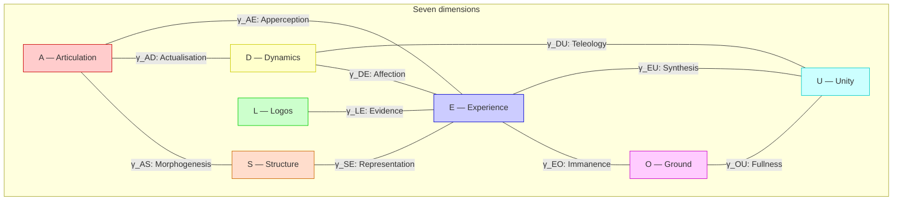
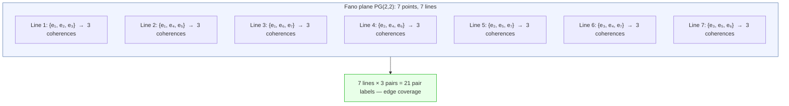

# Qualia Structure: A 21-Pair Taxonomy

:::info Scope and revision, 2026-10-29
This chapter retains the 21-pair taxonomy as a **selected interpretation [I]** and develops its operational tests. It does not infer phenomenal experience or phenomenal completeness from counting matrix entries. The [canonical hierarchy](/docs/consciousness/hierarchy/interiority-hierarchy#типизированный-вход) classifies an augmented record
$$
z=(\Gamma,\mathsf E,\mathsf M,\mathsf Q),\qquad \Gamma\in\mathcal D(\mathbb C^7),
$$
where $\mathsf E$ declares an experiential realization, $\mathsf M$ an implemented self-model/readout, and $\mathsf Q$ independent probes and calibration. Missing data give **unknown**, not a positive or negative phenomenal verdict. Definitions [D], conditional mathematical results [T], interpretations [I] and empirical hypotheses [H] remain distinct.
:::

:::note On notation and realization
$\gamma_{ij}$ denotes a native matrix entry in a declared semantic frame. $\rho_E$ denotes a normalized state on a **separately specified** experiential factor or compression. The native E-axis is one-dimensional: $P_E\Gamma P_E=\gamma_{EE}P_E$ normalizes to $P_E$ when its weight is nonzero, and is undefined as a conditional state at zero weight. Writing $\operatorname{Tr}_{-E}\Gamma$ does not create a tensor factor in $\mathbb C^7$. See [native E-axis and experiential realization](/docs/core/structure/dimension-e#rho-e-7d-42d).
:::

### Chapter roadmap

1. The philosophical proposal and its empirical status.
2. The 21 native pair coordinates and their selected semantic names.
3. Exact population, phase, support and cycle calculations.
4. The distinction between native proxies and a specified experiential extension.
5. A reproducible passport with readout, uncertainty and independent capability tests.
6. Transport across names and morphologies, and counterexamples that a machine must retain.

## Philosophical History: What Are Qualia? {#история}

The word **qualia** (Lat. *qualia*, pl. of *quale* — "of what kind", "of what sort") denotes the **subjective qualities of experiences**: what it is like to see red, to hear C major, to smell coffee. Behind this simple question lies one of the deepest problems in philosophy.

### Lewis (1929): the first definition

The American philosopher **Clarence Irving Lewis** in "Mind and the World Order" (1929) first introduced the term "qualia" into systematic use. He noted: when we see a red rose, there is something that *cannot be conveyed to someone blind from birth* — the subjective quality of "redness". That quality is the quale. Lewis distinguished:

- **Quale** — the ineffable subjective quality (what it is like to see red)
- **Property** — an objective characteristic (wavelength 700 nm)

### Jackson (1982): Mary's room

**Frank Jackson** in the famous thought experiment "Mary's Room" (1982) pushed the problem to its limit:

> Mary is a brilliant neuroscientist who has spent her whole life in a black-and-white room. She knows *everything* about the physics of colour: wavelengths, the workings of retinal cones, neural correlates. One day Mary leaves the room and sees a red rose for the first time. **Does she learn something new?**

Jackson argued: **yes**. Mary learns what it is *like* to see red. Hence physical facts do not exhaust reality — there is something beyond them (qualia).

### Dennett (1988): qualia as illusion

**Daniel Dennett** took the opposite position. In the article "Quining Qualia" (1988) he argued that qualia are a **philosophical illusion**: we think we experience something "ineffable" and "private", but in fact all information about experiences is encoded in functional states of the brain. No "remainder" is left after a complete physical description.

### UHM position: qualia as coherence structure

UHM proposes a two-aspect interpretation: some structures used to describe a system externally also have an interior reading [I]. The 21-pair vocabulary below is one proposed way to organize that reading. Adopting it does not prove that a simulated matrix, a robot, or a measured biological system has a particular experience.

The operational task is to specify the state/extension/readout and identify which observations and interventions discriminate competing interpretations. Mary's room, a philosophical zombie, or an inverted spectrum cannot be settled by the identity $\binom72=21$. The [afterword](#populyarnoe-posleslovie) keeps the philosophical questions separate from the measurements.

## Motivation: Why 21 Types? {#мотивация}

A chosen native state is a Hermitian $7\times7$ matrix in the semantic frame $\{A,S,D,L,E,O,U\}$. The labels have the following intended readings [I]:

| Symbol | Name | Intended role |
|---|---|---|
| $A$ | Articulation | Discrimination |
| $S$ | Structure | Stable forms |
| $D$ | Dynamics | Processes |
| $L$ | Logos | Logical organization |
| $E$ | Experience | The declared interiority readout |
| $O$ | Ground | Support/source |
| $U$ | Unity | Integration |

There are seven real diagonal entries and $\binom72=21$ unordered off-diagonal pairs. Hermiticity determines the reverse entry by conjugation. This counts native coordinates; it does not determine how many sensors, actuators, sensory modalities or kinds of experience a physical system has.

The diagram shows ten selected pair labels; the complete native pair list is below. A physical or statistical encoder requires its own observation law and calibration. The semantic labels do not by themselves identify the matrix from data.

## Interpretation: 21-Pair Qualia Taxonomy (I.1) {#таксономия}

:::info Interpretation I.1 (selected pair taxonomy) [I]
Associate each unordered pair of semantic axes with a proposed experiential role. The table exhausts **pair labels in this frame**, not possible phenomenal content. An observation model, experiential realization and independently tested readout are needed to apply any name to a system. The interpretation can fail even when the matrix arithmetic is correct.
:::

### Complete table of 21 qualia types {#полная-таблица-21-типа-квалиа}

:::warning Status of the names
The combinatorial count is exact [T]. The following names and descriptions are proposed semantic assignments [I/H], not measurements, diagnoses or consequences of positivity. The earlier claim that incidence uniquely fixes every semantic label is not used. Comparisons must retain the declared frame and calibration.
:::

| # | Pair | Coherence | Name | Phenomenological content |
|---|------|-----------|------|--------------------------|
| 1 | $(A,S)$ | $\gamma_{AS}$ | **Morphogenesis** | Crystallisation of distinctions into stable forms — the experience of "taking shape" |
| 2 | $(A,D)$ | $\gamma_{AD}$ | **Actualisation** | Actualisation of discrimination in process — the experience of "perception" |
| 3 | $(A,L)$ | $\gamma_{AL}$ | **Predication** | Discrimination that has become a predicate — the experience of "judgement" |
| 4 | $(A,E)$ | $\gamma_{AE}$ | **Apperception** | Discrimination that has entered interiority — the experience of "awareness" |
| 5 | $(A,O)$ | $\gamma_{AO}$ | **Spontaneity** | Emergence of distinctions without external cause — the experience of "insight" |
| 6 | $(A,U)$ | $\gamma_{AU}$ | **Differentiation** | Discrimination within the whole — the experience of "analysis" |
| 7 | $(S,D)$ | $\gamma_{SD}$ | **Persistence** | Form that persists through process — the experience of "stability" |
| 8 | $(S,L)$ | $\gamma_{SL}$ | **Nomos** | Structure with logical necessity — the experience of "order" |
| 9 | $(S,E)$ | $\gamma_{SE}$ | **Representation** | Structure presented in interiority — the experience of "whole form" |
| 10 | $(S,O)$ | $\gamma_{SO}$ | **Archetype** | Forms from the ground — the experience of "deep pattern" |
| 11 | $(S,U)$ | $\gamma_{SU}$ | **Symmetry** | Structural unity — the experience of "harmony" |
| 12 | $(D,L)$ | $\gamma_{DL}$ | **Regulation** | Logically governed process — the experience of "control" |
| 13 | $(D,E)$ | $\gamma_{DE}$ | **Affection** | Process acting on interiority — the experience of "emotion" |
| 14 | $(D,O)$ | $\gamma_{DO}$ | **Genesis** | Generation from the ground — the experience of "creativity" |
| 15 | $(D,U)$ | $\gamma_{DU}$ | **Teleology** | Integrated directed change — the experience of "volitional effort" |
| 16 | $(L,E)$ | $\gamma_{LE}$ | **Evidence** | Logical coherence in interiority — the experience of "self-evidence" |
| 17 | $(L,O)$ | $\gamma_{LO}$ | **Grounding** | Logic rooted in the ground — the experience of "axiomatic self-evidence" |
| 18 | $(L,U)$ | $\gamma_{LU}$ | **Consistency** | Logical non-contradiction of the whole — the experience of "coherence" |
| 19 | $(E,O)$ | $\gamma_{EO}$ | **Immanence** | The ground present within interiority — the experience of "presence" |
| 20 | $(E,U)$ | $\gamma_{EU}$ | **Synthesis** | Integration of interior content into a whole — the experience of "unity" |
| 21 | $(O,U)$ | $\gamma_{OU}$ | **Fullness** | Identity of source and whole — the experience of "completeness" |

### How to read the table: an extended example

To test “Affection” for $(D,E)$, first specify the target discrimination (for example, a declared response under a controlled intervention), alternatives, observation law and readout. Estimate the state with uncertainty, then test whether the DE statistic improves prediction of that target on independently held-out interventions. Report failures as well as successes. A semantic name or a self-report is not its own validation.

For a numerical carrier example, start with diagonal $1/7$ and set only $\gamma_{DE}=a e^{i\theta}$ and its conjugate nonzero, with $0<a<1/7$. The nontrivial block has eigenvalues $1/7\pm a$, so the state is positive. Varying $a$ and $\theta$ gives reproducible tests of the selected statistics. It does not assign an emotion to the matrix. Previously displayed “human profiles” without a reconstruction/calibration model are not empirical evidence and are not retained as typical ranges.

### Parametric structure of qualia {#параметрическая-структура}

For a nonzero entry, write $\gamma_{ij}=|\gamma_{ij}|e^{i\theta_{ij}}$. Modulus and phase are coordinates; Gap is a derived statistic, not a third independent parameter.

| Statistic | Formula / domain | Status |
|---|---|---|
| Pair magnitude | $\vert \gamma_{ij}\vert \le\sqrt{\gamma_{ii}\gamma_{jj}}$ | Native amplitude [T] |
| Oriented phase | $\arg\gamma_{ij}$, modulo $2\pi$, only on nonzero support | Frame/reference dependent [T] |
| Pairwise Gap | $\vert \operatorname{Im}\gamma_{ij}\vert /\vert \gamma_{ij}\vert $ | Chosen frame statistic [D] |

“Intensity”, “perspective” and “opacity” are proposed readings [I], requiring a declared readout and empirical bridge. Gap is neither a percentage of information hidden from an observer nor a measure of algorithmic incompressibility. At zero amplitude the phase is missing; a stored Gap of zero there is a convention and must retain that status.

#### Upper bound on intensity

Positive semidefiniteness gives $|\gamma_{ij}|^2\le\gamma_{ii}\gamma_{jj}$ from the determinant of the corresponding $2\times2$ principal block. For populations $0.15$ and $0.18$ the pair magnitude cannot exceed $\sqrt{0.027}\approx0.164$.

An estimate outside this bound indicates inconsistency of the estimate, uncertainty model or chosen representation; it does not establish a psychological defect. Satisfying every pair bound alone does not guarantee positivity of the full matrix. Validate the full state and retain uncertainty rather than silently projecting away a discrepancy.

#### Three parameters: analogy

An amplitude/phase analogy with sound can help visualize coordinates, but it is not a sensory identification. In the valid two-axis carrier above, $a=0.05$ and $\theta=0.3$ give Gap $\approx0.296$. That value is **not** “30% of an experience hidden”. Replacing $\theta$ by $-\theta$ keeps the magnitude and Gap, while reversing oriented phase. The [identifiability counterexamples](/docs/applied/research/reconstruction-identifiability#phase-counterexamples) extend this ambiguity to triangle holonomy and spectrum.

## Closure Theorem for the Taxonomy (T.1) {#замкнутость}

:::tip Theorem T.1 (closure of the native pair list) [T]
For a specified seven-dimensional orthonormal frame, there are exactly 21 unordered pairs of distinct axes. A Hermitian matrix has one complex entry per such pair, with the reverse entry fixed by conjugation.

**Proof.** The count is $7\cdot6/2=21$; Hermiticity gives $\gamma_{ji}=\overline{\gamma_{ij}}$. $\square$
:::

The former inference “no additional type of quale is possible” is withdrawn. A count of pair coordinates neither proves that each coordinate is a phenomenal type nor excludes nonlinear, temporal, contextual or extension-dependent readouts. At dimension six the pair count is 15; that arithmetic does not imply a poorer subjective life or identify which experiences a system lacks.

A claimed complete readout must be constant on every fibre of its proposed sufficient statistic. If two allowed augmented records have the same native statistic but different target readouts, the completeness claim fails. The product-extension counterexample in the [passport](#паспорт-квалиа) is one such test.

:::info Frame stability
A simultaneous permutation of axes and semantic labels permutes this pair list. Preserving a particular oriented Fano/octonion structure additionally restricts the allowed frame maps. General $G_2$ rotations mix entries and do not preserve a frame-indexed taxonomy. A chosen dissipator/instrument may fix a frame, but neither that choice nor an abstract classifier derives the phenomenological names. Transport all observations, targets and readouts before comparing them.
:::

## Fano Structure of Qualia {#фано}

A selected Fano plane organizes the pair list into seven triples. Its incidence identities are useful for addressing and diagnostics; they do not prove experiential completeness or an additional physical coupling law.

### What is the Fano projective plane?

The projective plane $\mathrm{PG}(2,2)$ has seven points and seven lines, three points per line, with each pair of points on exactly one line. Once points are assigned to semantic axes, it gives a declared incidence structure. An octonionic realization also needs the multiplication/orientation convention.

### Sectoral structure of coherences

Three appropriately oriented imaginary octonion units on a Fano line, together with the identity, span a quaternion subalgebra. This is an algebraic fact about the chosen multiplication. It does **not** by itself impose an extra equality between three arbitrary complex entries of a density matrix.

Every principal submatrix must satisfy positivity, including triples not on a Fano line. A claim of stronger empirical sector correlations requires a specified coupling/dynamical law and a comparison against non-line triples. In particular, changing one small coherence in the interior of the PSD cone need not force both other entries to change. Incidence alone is not such a dynamics.

### Coverage of 21 pairs by Fano triplets

Each pair occurs on exactly one Fano line, so $7\cdot3=21$ covers the **edges** once. It does not cover every cycle relation: the full support graph $K_7$ has cycle rank $21-7+1=15$, while the seven line triangles span only seven independent cycles. Eight independent phase-cycle coordinates remain. See [T-317](/docs/reference/status-registry) and the [decoder](#теорема-декодер).

Thus a diagnostic assigned to $(D,E)$ has one named line, but its value and dynamics need not be determined by the other two entries on that line. Edge coverage does not establish a closed emotional space or prove that every possible readout factors through the seven lines.

### What a line actually checks {#что-проверяет-прямая}

Under the **additional model** that edge signs are $s_i s_j$ for vertex signs $s_i\in\{-1,1\}$, any triangle obeys
$$
(s_i s_j)(s_j s_k)(s_k s_i)=+1.
$$
This is true for every triangle, not a special law of Fano lines. A negative product refutes that vertex-sign factorization on the observed triangle. It does not imply that the density matrix is invalid or that a negative proposition is impossible.

A valid counterexample uses diagonal $1/7$ and small real coherences on one triangle, with one negative edge. If their common magnitude is $a<1/14$, strict diagonal dominance guarantees positivity, although the product is negative. Distinguish PSD validity, parity under a coding assumption, and empirical interpretation.

Seven successful line checks do not certify global factorization on $K_7$. Check a complete cycle basis on actual support. Likewise, a repetition code and a vertex-sign code are different encodings; their parity conventions do not establish a universal law of integrable cognition. $\Phi$ depends on squared moduli and cannot detect these sign distinctions.

### Twenty-one channels, seven colours {#двадцать-один-и-семь}

The historical phrase “twenty-one channels, seven colours” denotes a selected edge taxonomy and seven selected triangle projections. Neither count is a count of physical modalities or an exhaustive phenomenal dimension.

| Data | Count on full nonzero support | Meaning |
|---|---|---|
| Populations | 7 values, 6 independent | Native diagonal |
| Magnitudes | 21 | Native off-diagonal amplitudes |
| Phase coordinates modulo vertex rephasing | 15 | Complete cycle-space reading |
| Selected Fano triangle phases | 7 of those 15 | A reference projection |

The quotient count assumes full support and a declared vertex-phase convention. In a native empirical frame all phase-sensitive observations must be transported with that convention; they cannot simply be discarded. For sparse support the cycle count changes to $m-n+c$. A $27\oplus14\oplus7$ representation decomposition is a different linear decomposition, not this phase quotient and not a partition into public, private and phenomenal information.

## Diagonal Elements: 7 Population Modes {#населённости}

The diagonal consists of nonnegative populations with $\sum_i\gamma_{ii}=1$. This normalization fixes unit total **model weight**, not joules, attention capacity or a physical resource budget without a calibration model.

Names such as “activity” for D and “interiority” for E are interpretations of the chosen axes. An increased population need not mean a measured change in a person's experience. Clinical or behavioral ranges require identified data and uncertainty; this page supplies no population norms for meditators, athletes or mathematicians.

### Population profiles: examples

Two constructed controls separate the quantities. $I/7$ and $uu^\dagger$, $u_i=1/\sqrt7$, have the same populations and zero diagonal-deficit stress, but purities $1/7$ and one. The family
$$
\Gamma(t)=(1-t)I/7+tuu^\dagger,\qquad 0\le t\le1
$$
has the same diagonal for every $t$, while $P=(1+6t^2)/7$ and $\Phi=6t^2$ vary. Populations alone therefore do not determine the capability gate, experiential differentiation or a phenomenal interpretation.

## Total: 28 = 7 + 21 Parameters of Content {#итого-28}

The historical “28” counts seven real diagonal slots plus 21 **complex** pair slots. The full-rank trace-one state space has real dimension $6+2\cdot21=48$. Positivity constrains the allowed combinations; polar phases are undefined at zero entries, and fixed-rank boundary strata have different dimensions.

This is a dimension of a native mathematical state manifold. It is not a theorem that a moment of human experience has dimension 48. An experiential extension, history, external memory or composed system contributes additional declared data.

## The Mechanism: the Phase-Carried Quality Channel {#механизм-качества}

This section specifies measurable phase diagnostics and their failure modes. Interpreting them as qualities remains a bridge [I/H]. The historical T-300/T-301/T-302 anchors are retained below with their mathematical scope made explicit.

### Spectral and frame dimensions (T-300, scoped) {#теорема-пространство-качества}

For a generic nondegenerate spectrum in dimension seven, the unitary orbit has dimension $7^2-7=42$; six independent eigenvalues supply the remaining dimensions. At degeneracies the orbit dimension is smaller. Consequently the spectrum does not determine a framed state.

Calling the remaining coordinates “quality” is an interpretation, not a dimension theorem. A $G_2$ orbit is not automatically a gauge equivalence of an experiment: transforming only the state can change frame-indexed observables. Nor does orbit dimension show that a dynamical direction has zero energetic or control cost. An empirical equivalence must specify which instruments and readouts are transformed too.

### Phase decoder (T-301, scoped) {#теорема-декодер}

Write $\Gamma=S+iA$ with $S$ real symmetric and $A$ real antisymmetric. For the chosen octonionic three-form the traceless real operator representation splits as $27\oplus14\oplus7$; contracting $A$ with that form gives a seven-component **frame-dependent** linear statistic. It is not a nonlinear phase passport or a decoder of phenomenal content.

On the graph of nonzero coherences, an oriented supported cycle $C$ has
$$
h_C=\arg\prod_{(i,j)\in C}\gamma_{ij}.
$$
Under $\Gamma\mapsto U\Gamma U^\dagger$ with diagonal $U$, the vertex phases telescope, so $h_C$ is invariant. Products require every edge to exist; missing support is not a measured zero angle. Positivity does not remove this requirement.

A spanning forest leaves $m-n+c$ chords. Their oriented fundamental cycles form an integral cycle basis; all cycle phases can be reconstructed modulo $2\pi$ from these and the declared orientation. On full support there are 15, and the seven Fano triangles alone are incomplete. Vanishing phase on **every** basis cycle is equivalent to a positive-real edge connection after vertex rephasing. Being merely real is weaker: a real sign-frustrated triangle has phase $\pi$.

Store support, cycle vertex identities, wrapped phases and amplitude/log-amplitude evidence. A numerical product may underflow even while every stored edge is nonzero; a declared instrumental resolution is a separate layer. Neither invariant phase nor exact graph algebra establishes topological protection against physical noise.

### Observation limits (T-302, corrected) {#теорема-разрыв}

The former universal identification of the explanatory gap with zero covariance is withdrawn. A covariance calculation requires a specific stochastic model and readout. Zero covariance does not in general imply statistical independence or zero information; diagonal Lindblad jumps alone specify neither an observer nor its accessible instrument family.

A precise replacement is observational nonidentifiability: if two allowed augmented states induce the same laws for every permitted intervention but have different target readouts, that target cannot be identified by this design. This is the [observation-fibre criterion](/docs/applied/research/reconstruction-identifiability#fiber-theorem), not a theorem that experience is unobservable from outside. Phase-sensitive instruments may distinguish what a diagonal-only instrument cannot.

### The direction of explanation {#направление}

The two-aspect interpretation proposes how one specified structure may be read externally and internally. It does not follow from a dimension count or force environmental coupling to enter only populations. Hamiltonians, replacement targets and general admissible jumps can change different parts of the state.

Record the actual observation and controlled evolution before inferring information flow or causal direction. A declaration that a channel is “internal” or “private” is not a proof that no external intervention can address it.

### How much quality fits inside consciousness {#сколько-качества-помещается}

At fixed diagonal and magnitudes, $P$ and $\Phi$ are independent of phases, while positive semidefiniteness can constrain jointly admissible phase choices. There is no universal bound of “0.64 radian of experience” from $\Phi\ge1$. Numerical values from a chosen equal-amplitude twist family are not limits for arbitrary states or experiential readouts.

A rank-one state has supported cycle products that are positive real, but this phase fact does not mean “nothing is experienced”. Conversely nonzero cycle phase does not establish Cap$_2$. Tests of a phase-aware predictor must retain the declared task, training/test separation, raw input identity, resources and controls where the assumed phase structure is absent. A synthetic sample-efficiency result would validate that task-specific prediction, not the phenomenal bridge.

### How qualia die: the fading, precisely {#выцветание}

For the specified isotropic Fano dephasing law, each coherence is multiplied by $e^{-\alpha\gamma t}$ with $\alpha=2/3$ and nonnegative constant $\gamma$; populations remain unchanged. Every supported cycle phase stays fixed, while an $r$-edge product magnitude decays as $e^{-r\alpha\gamma t}$. This corrects the older unqualified $5\gamma/21$ rate on this page; a differently normalized channel must state its own rate.

At finite exact time positive multipliers preserve support. At zero amplitude the phase is undefined; below an instrumental floor its estimation may become unresolved. Keep those cases distinct from a zero holonomy. “Fading” names this carrier behavior, not a proved loss of phenomenal experience.

A phase-aligned replacement with an appropriate real multiplier can also preserve these angles. An arbitrary replacement target, Hamiltonian or disturbance need not do so. Claims about a combined flow require its complete generator. Dephasing alone is not a shutdown theorem: every diagonal state is stationary. See [evolution and convergence](/docs/core/dynamics/evolution).

## Access Conditions for Qualia {#условия-доступа}

The [canonical hierarchy](/docs/consciousness/hierarchy/interiority-hierarchy#l2-когнитивные-квалиа) defines
$$
A_2(z)=A_1(z)\land\mathsf{Cap}_2(z),\quad
\mathsf{Cap}_2(z)=(P>2/7)\land(R\ge1/3)\land(\Phi\ge1)\land(D(z)\ge2).
$$
Here $A_1$ and $D$ depend on the declared proxy/extension mode. Reflection and integration alone are a **pair diagnostic**, not this full predicate. Positive classification of this mathematical record does not independently certify phenomenal experience.

### Step-by-step logic of access conditions

1. Validate the state and its frame. $R=1/(7P)$ is a chosen scalar, not the measured accuracy of the implemented self-model.
2. In **7D proxy mode**, $A_1$ is $\mathrm{Coh}_E>0$ and $D=1+6\mathrm{Coh}_E$. This is a declared proxy; $I/7$ passes $A_1$ despite having no E-couplings.
3. In **extension mode**, supply $\rho_E$ through the specified lift/readout and normalization. Use $A_1:\operatorname{rank}\rho_E>1$ and $D=\exp S(\rho_E)$. Rank resolution and reconstruction uncertainty must be declared.
4. Check all four margins with their strict/inclusive boundaries. Missing extension data cannot be replaced by a pair gate or a scalar stress panel.
5. For reconstructed states, report the range of each target over the retained uncertainty set. A robust pass requires every allowed state to satisfy the declared predicate; otherwise the evidence may remain unresolved.

The scalar window follows from the definitions; it neither proves sustained trajectory viability nor physical/phenomenal access. In particular at $P=2/7$ the strict purity gate fails even when $\Phi=1$.

### Access levels

| Level | Required record/evidence | What is not inferred |
|---|---|---|
| L0 | Valid native state | Physical interiority from a matrix alone |
| L1 | Declared proxy or normalized extension test $A_1$ | Equivalence of the two modes |
| L2 | $A_1$ and all four Cap$_2$ conditions | A species diagnosis or phenomenal certificate |
| L3 | L2 plus an independent second-order predictive certificate | Iteration count or self-model convergence as a certificate |
| L4 | Compatible certificates at every declared order in the ideal definition | All orders from a finite test suite |

The predictive test fixes probe/target spaces and errors before outcomes, and requires both error $\le\varepsilon$ and target variation $a>2\varepsilon$. A constant predictor cannot pass both. Empirical finite-family success is not universal generalization. Numerical rows assigning a thermostat, dog or human a level without a calibrated realization are not retained as evidence.

## How to Read a State's Qualia Passport {#паспорт-квалиа}

A passport is an evidence-bearing record, not an automatic answer to “what is it like to be this system”. It names the source, state/frame revision, native or extension mode, observation model, readout, uncertainty and probe protocol.

| Layer | Retained output | Required qualification |
|---|---|---|
| Native state | Populations, complex coherences, PSD/trace checks | Observed, inferred or simulated origin |
| Pair diagnostics | Magnitudes and frame-referenced Gap | Missing/low-resolution phase is explicit |
| Cycle diagnostics | Actual support, oriented cycle basis, phases and carriers | Seven Fano projections are a subset |
| Experiential realization | Total space, lift, readout, normalized $\rho_E$ | A native E-axis is not a tensor subsystem |
| Model classification | $A_1$, four margins and uncertainty verdict | Exact proxy/extension mode; not pair-gate only |
| Metamodel | Independent targets, probes, errors and variation | Finite coverage and compatibility obligations |
| Interpretation | Proposed phenomenal/behavioral target | Independent empirical bridge remains visible |

### Extension and readout obligations {#extension-readout-contract}

Declare a total space, lift $\mathcal E$ or measured joint state, and readout $q_E$. For a tensor factor use the actual partial trace. For a compression specify the effect/subspace and condition on nonzero weight. Compute $\rho_E=q_E(\mathcal E(\Gamma))$ only when those maps and normalization are defined. Report rank resolution and spectral degeneracy; individual eigenrays are not unique at a repeated eigenvalue.

The same native $\Gamma$ admits product extensions $\Gamma\otimes\sigma_1$ and $\Gamma\otimes\sigma_2$. Taking $\sigma_1$ pure and $\sigma_2=I_6/6$ gives $D^{\mathrm{ext}}=1$ and $6$ with identical native diagnostics. A section–retraction cannot identify these extra spectra. Conversely the native proxy gives $D^{7D}=1+6\mathrm{Coh}_E$ by declaration. Keep the two contracts separate in storage, APIs and tests.

An empirical readout specifies $p_z(y\mid u)$ for predeclared interventions, calibrated nuisance parameters, a target quantity and confidence/uncertainty procedure. Test identification on observation fibres: equality of all permitted observation laws must imply equality of the target, if that target is claimed identifiable. Reconstruction precision, predictive success, physical realization and phenomenal interpretation are four separate claims.

The repository supplies independent Lean kernel replay in `verification/lean/ReadoutDescent.lean`; run `python3 scripts/verify_readout_descent.py` from the repository root. Its 16 theorem/axiom audits and five intended false controls cover conditional readout descent, uniqueness, composition, partial-action availability and transport. The premises include a supplied section and preservation of observation fibres; a section alone does not repair aliasing. This is a mathematical replay of those conditional laws, not a native Verum certificate, a proof that Rust implements them, empirical identification or evidence of phenomenal experience.

### Renaming and morphology transport {#morphology-transport}

A seven-axis ontology does not prescribe seven cameras, joints, motors or modalities. Each morphology declares typed ports, units, coordinate frames, timing, calibration, admissible controls and a revision identity. Raw multimodal evidence and histories are retained separately from the fixed-size summary.

For a renaming $T_Y$ of observations and a semantic frame permutation $U$, require an encoder relation such as
$$
G_{m'}(T_Yy)=U G_m(y)U^\dagger
$$
on the declared domain, exactly or within a named bound. Also transport actions, controlled transitions, targets, E-label, lifts and readouts: an encoder relation alone is not behavioral equivalence. For example, the action/readout diagram must commute along the reachable trajectories used to claim transfer. Simultaneous relabelling permutes index diagnostics; general $G_2$ rotation or a new calibration is not automatically a harmless renaming.

For different morphologies there may be no bijection. Supply a simulation/refinement relation, coverage of the source states/actions, preserved feasible-control constraints and accumulated error bounds. A lossy projection licenses only target quantities constant on its fibres. If topology, support, clock or source revision changes without a valid transport, retain the evidence but mark the previous certificate inapplicable. Do not repair it by retroactively fitting a new readout on confirmation outcomes.

### Machine obligations and separating controls {#machine-obligations}

1. Validate states, support and normalization; distinguish absent data, observed zero, invalid input, refusal and exhausted resources. A single normalized E-axis must never pass as a multidimensional experiential register.
2. Retain the product-extension counterexample above, and the family $\Gamma(t)=(1-t)I/7+tuu^\dagger$: all pairwise Gaps vanish, but $t=.45$ passes the scalar purity/reflection/integration cuts and $t=.65$ fails reflection. Neither case is an empirical consciousness assignment.
3. Test equal diagonals/magnitudes/Gaps with different oriented holonomy and spectrum, as in [phase nonidentifiability](/docs/applied/research/reconstruction-identifiability#phase-counterexamples). Test non-Fano and non-triangular cycles, missing edges, product underflow, relabelling and rephasing with transported reference data.
4. Verify source/action/readout transport on actual methods and negative controls: swapped sensor names with unchanged semantics must compare correctly; changed units, stale calibration or missing source coverage must refuse or retain uncertainty. New morphology is not a fresh certificate by fiat.
5. Freeze calibration, probe family and thresholds before confirmation. Include nontrivial held-out response and constant-model controls; no test-directed target selection. Retain failed and unavailable probes, paid work and complete input provenance.
6. For continuous sensors record capture/arrival clocks and uncertainty, sequence, loss, reorder and overload. Freeze the decision's causal observation boundary before action; late data cannot become prior evidence. Qualia diagnostics cannot block actuator deadlines or substitute for independent plant-safety enforcement.

These are executable obligations for the research programme. This page does not claim that all have passed on a robot, or that passing them would settle the philosophical bridge without further empirical interpretation.

## The Ecology of Colour {#экология-краски}

“Colour” below abbreviates a chosen cycle-phase observable. Its evolution is a concrete modeling question once the generator, source, target, support and instrumental resolution are fixed. It is not itself a measured subjective quality.

### Only the dynamics writes

The dephasing-only result preserves supported phase while reducing carriers. Other allowed terms need not: a fixed replacement target with a different complex phase can change a coherence's phase without any Hamiltonian. A unitary alone preserves rank one and hence positive-real supported cycle products of a pure state; combined dephasing/control may create different mixed-state phases. Attribute an observed change to the complete actual evolution, not to the name of one arm.

### The world paints first

Feeding toward an external target can transfer some of its phase structure under a declared mixing/evolution law. A monotone alignment curve, threshold or stationary profile is a result for that law and parameter set, not a theorem that a subject appears when $\Phi$ crosses one. Check all chosen gate conditions and the experiential realization separately. Earlier illustrative feeding percentages are not retained here as universal evidence.

### Inside the organism: one colour per name

For a positive principal compression onto three axes and nonzero normalizer, the surviving triangle product is multiplied by a positive real scale, so its phase is preserved. Other triangles with missing vertices have no supported reading; the selected triangle itself may also be missing an edge. This proves a conditional transport of one observable, not a complete decomposition of experience.

Seven line children do not capture the eight non-line phase directions on full $K_7$ support. Injection, feedback and merging need their own actual maps and source identities. A Bures-closeness criterion requires an amplitude floor/error bound before it guarantees a small phase-readout error; near zero amplitude phase can change sharply.

### The standing picture

A useful research programme tracks which observables are preserved, created, lost or become unresolved at every transfer. It retains parent/child lineage, actual source and readout revision, and tests the predicted effect on held-out behavior. The interpretation as a shared or individual phenomenal subject remains a separate hypothesis, not the last line of a matrix computation.

## The Language of Quality {#язык-качества}

A language of these diagnostics can be tested without presuming phenomenal access. State names, process names and path descriptions require declared targets and observations. Learning a label tests a prediction task; it does not validate the label's phenomenal interpretation.

### Words need the right eye

If two states induce the same allowed observations but different target labels, no learner can identify that label on both from this interface. Phase-sensitive labels require identifying phase evidence; magnitudes alone do not suffice. An unsupported phase is missing evidence, not a fabricated “colourless” word. A learned classifier must be tested on source-separated data and against this ambiguity control.

### Verbs: the end remembers the path

A final state does not generally identify the process that produced it: different controls and histories can share an endpoint. Declare the process family, initial conditions, observation times and noise model. A terminal-frame classifier is justified only on a domain where the target is identifiable from that frame. A common attractor often erases distinctions rather than certifying the path.

### Roads into one home: the three-frame grammar

Three-frame observations may distinguish a particular family of shared-endpoint trajectories. They are not a universal minimum or a sufficient statistic for arbitrary histories. Test the identification map for the declared family, retain capture-time uncertainty, and add samples or return unresolved when trajectories coincide at the permitted readouts. Any carrier lifetime is defined relative to the chosen dynamics and resolution; it is not a universal phenomenal duration.

### What this buys

The programme yields falsifiable acquisition tasks: read a declared observable, predict its response to intervention, and transfer the predictor under a verified observation/action map. It compares full temporal evidence against coarser projections and preserves cases where the projection loses the target. These tests can establish operational discrimination without claiming that every successful word names a felt quality.

## From Names to Judgement {#от-слов-к-суждению}

A judgment retains whether its evidence was directly measured, reconstructed, simulated, inherited under a valid transport, or supplied as a prior. Copies of one report are not independent observations. Composed claims retain all required premises; contradictory or missing sources are not resolved by confidence of phrasing.

Calibration and confirmation are distinct phases. An independent intervention can refute a proposed readout; a self-report is another observation with its own likelihood, not privileged proof of experience. Negative findings may concern the encoder, the extension, the readout or the empirical bridge, and the record should identify which claim was tested.

Purity derivatives can label a selected process family, but a scalar trajectory is not universally sufficient for scene meaning or history. The proof obligation is again constancy of the target on observation fibres. Retaining that boundary makes the research programme more discriminating than a dictionary that always assigns a name.

### What we learned {#итоги}

1. The 21 pairs exhaust a native coordinate list; their proposed phenomenal names remain an interpretation.
2. A normalized one-dimensional E-axis has entropy zero. Nontrivial extension readout requires a specified total space, map and normalization.
3. Pairwise Gap, diagonal stress, full cycle phases and the four capability margins answer different questions.
4. Seven Fano triangles cover all edges once but not all 15 independent cycle directions of full support.
5. The augmented record, uncertainty and independent probes are necessary parts of the operational passport.
6. Renaming and morphology transfer require source/action/readout compatibility; a shared seven-axis model is not a shared physical sensor count.
7. State preservation, task performance, physical safety and phenomenal interpretation are distinct claims with distinct evidence.

:::info Bridge to the next chapter
The name “Affection” for $(D,E)$ motivates hypotheses about emotion-related readouts. [Emotion taxonomy](/docs/consciousness/phenomenology/emotional-taxonomy) requires the same typed observation and calibration discipline; neither a pair label nor $dP/dt$ derives all emotions by itself.
:::

## A Popular Afterword: the Questions That Remain {#populyarnoe-posleslovie}

The operational construction leaves philosophical questions. The answers below separate what the model stipulates, what its mathematics establishes and what remains to be tested.

### "Why are qualia coherences, of all things?"

They are a proposed interpretation of a chosen native representation. Counting links supplies no exhaustive dilemma between “experience is the links” and “there is no experience”. Temporal and extension-dependent readouts are possible and must be specified. A useful claim names the empirical distinctions it predicts and which contrary observation would refute it.

### "Aren't these just correlates of consciousness — where is the experience itself?"

The two-aspect identification is an ontological proposal [I]. An operational model can identify quantities and test causal/readout relations without resolving that proposal. A simulation, a metric value or zero covariance is not an independent proof that the implementation feels anything.

### "What does Mary learn when she first sees red?"

A model may distinguish knowing a description, acquiring a new state and acquiring a new readout. Which changes occur is an empirical question within a declared intervention protocol. The pair taxonomy does not prove that Mary gains only a coherence, no new fact, or that the philosophical problem has been dissolved.

### "Is a zombie possible — an exact copy with nobody home?"

A diagonal matrix is a well-defined mathematical state with no off-diagonal support in the chosen frame. Calling it a “zombie” is model vocabulary, not a theorem about absence of experience. The possibility of a physically identical system with different experience depends on the adopted phenomenal bridge; matrix combinatorics alone does not decide it.

### "Could my red be your blue?"

A cross-person or cross-morphology comparison needs calibrated observations and a justified transport of frames, extensions and readouts. Matching seven line holonomies alone neither identifies the full native phase state nor equates experiential content. Diagonal rephasing invariance is a precise algebraic property; it is not a general solution to privacy or spectrum inversion.

### "Still: why does it feel like *anything* at all?"

UHM's two-aspect thesis supplies an interpretation, while the operational programme supplies tests of declared state/readout relations. Neither is replaced by a scalar threshold. The remaining bridge should be recorded openly, alongside successful discriminations, failures and uncertainty; it is not settled by calling a matrix gate “conscious”.

## Related Documents

- [Canonical hierarchy](/docs/consciousness/hierarchy/interiority-hierarchy) — augmented record, proxy/extension modes and predictive certificates.
- [Native E-axis and experiential realization](/docs/core/structure/dimension-e#rho-e-7d-42d) — compression, lift, readout and counterexamples.
- [Reconstruction and identifiability](/docs/applied/research/reconstruction-identifiability) — observation fibres, uncertainty and phase ambiguities.
- [Sensorimotor theory](/docs/applied/coherence-cybernetics/sensorimotor) — observation/control contracts and physical interpretation.
- [Mathematical kernel](/docs/reference/mathematical-kernel) — status and scope of the formal constructions.
- [Empirical programme](/docs/consciousness/empirical/structure) — proposed tests and falsifiers; empirical status must be checked in its own receipts.
- [Coherence matrix](/docs/core/dynamics/coherence-matrix) and [Gap semantics](/docs/physics/dual-aspect/gap-semantics) — native coordinates and chosen interpretations.
- [Conditional minimality results](/docs/proofs/minimality/theorem-minimality-7) — stated algebraic premises, not phenomenal completeness.
- [Interiority theory](/docs/consciousness/foundations/interiority-theory) and [T-146](/docs/proofs/consciousness/operational-closure#t-146) — proposals requiring the typed distinctions above.
