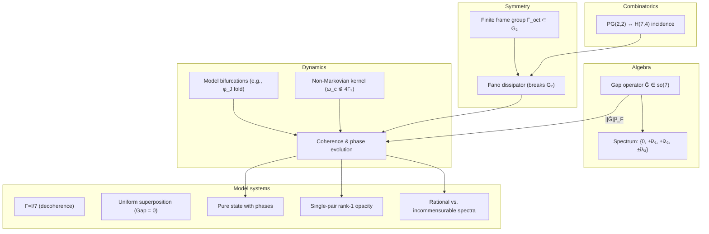

# Gap Dynamics

:::info Who this chapter is for
Dynamics of coherences: Choi–Jamiołkowski isomorphism, bifurcations, Hamming code. Familiarity with the [Gap operator](/docs/core/dynamics/gap-operator) and [Gap thermodynamics](/docs/core/dynamics/gap-thermodynamics) is assumed.
:::

This chapter is dedicated to **how the opaqueness** between the dimensions of a holon evolves. If the [Gap operator](/docs/core/dynamics/gap-operator) describes a "snapshot" of opaqueness, and [Gap thermodynamics](/docs/core/dynamics/gap-thermodynamics) describes the energy landscape, then this chapter answers the question: **how does the system move through this landscape over time?**

The reader will learn:
- How **self-modelling** $\varphi$ affects the Gap profile (via the Choi–Jamiołkowski isomorphism)
- Why a living system **must** preserve coherences (theorem on the necessity of generalized $\varphi$)
- How the **Hamming code H(7,4)** from information theory appears in the structure of Gap correction
- What **bifurcations** (sudden jumps) are possible in the Gap landscape
- How the **system's memory** generates damped Gap oscillations

:::tip Intuitive explanation
Let us return to the analogy with a **stained glass window**. In the [Gap operator](/docs/core/dynamics/gap-operator) we described how to measure the transparency of each panel. Now let us ask: **how does this transparency change over time?**

Imagine the stained glass is "alive" — it can change its transparency in response to light, temperature, and internal processes. Sometimes this change is smooth (a panel gradually becomes cloudy or clears). But sometimes **jumps** occur — a panel that has been cloudy for decades suddenly becomes transparent (an analogue of "insight"), or the reverse (an analogue of "trauma").

Particularly interesting is that a living stained glass has **memory**: past states influence current dynamics. Therefore, after an abrupt change (trauma), transparency **oscillates** — swings back and forth before settling in a new position (an analogue of "grief cycles").
:::

Gap dynamics describes the evolution of **opaqueness** between the dimensions of a holon. This document considers the bifurcation theory of the Gap landscape, non-Markovian memory effects, the connection with the Choi–Jamiołkowski isomorphism, the analogy with quantum error correction via the Hamming code H(7,4), and the $G_2$-covariance of the dissipator. The algebraic structure of the Gap operator is defined in the [Gap operator](/docs/core/dynamics/gap-operator).

---

## 1. Choi–Jamiołkowski isomorphism for φ {#чой-ямиолковский}

### 1.1 Definition (Choi state)

For a CPTP channel $\varphi: \mathcal{D}(\mathcal{H}) \to \mathcal{D}(\mathcal{H})$ the **Choi state** is defined as:

$$
J(\varphi) := (\varphi \otimes \mathrm{id})(|\Omega\rangle\langle\Omega|) \in \mathcal{L}(\mathcal{H} \otimes \mathcal{H})
$$

where the maximally entangled state is:

$$
|\Omega\rangle = \frac{1}{\sqrt{7}} \sum_{i=1}^{7} |i\rangle \otimes |i\rangle
$$

**Properties of the Choi state:**

| Property | Formulation | Consequence |
|----------|-------------|-------------|
| Dimension | $J(\varphi) \in \mathbb{C}^{49 \times 49}$ | Complete description of the channel |
| Hermiticity | $J(\varphi)^\dagger = J(\varphi)$ | Spectral decomposition exists |
| Positivity | $J(\varphi) \geq 0$ | Complete positivity of $\varphi$ |
| CPTP condition | $\mathrm{Tr}_1(J(\varphi)) = I/7$ | Trace preservation |
| Reconstruction | $\varphi(\Gamma) = 7 \cdot \mathrm{Tr}_2\left(J(\varphi) \cdot (I \otimes \Gamma^T)\right)$ | Channel recovery from Choi state |

### 1.2 Block structure and phase properties

:::tip Theorem 1.1 (Choi matrix of a fixed-parameter diagonal-dephasing channel) [T]
For the **linear** CPTP channel $\varphi_{\mathrm{diag}}(X) = k\,\mathrm{diag}(X) + (1-k)\,\mathrm{Tr}(X)\,\mathrm{diag}(w_1,\dots,w_7)$ with fixed $k \in [0, 1]$ and probability weights $w_m \ge 0$, $\sum_m w_m = 1$:

**(a)** Entrywise structure of the Choi state $J(\varphi_{\mathrm{diag}}) = \frac{1}{7}\sum_{a,b}\varphi_{\mathrm{diag}}(|a\rangle\langle b|)\otimes|a\rangle\langle b|$:

$$
\langle m, a \mid J(\varphi_{\mathrm{diag}}) \mid n, b\rangle = \frac{1}{7}\,\delta_{ab}\,\delta_{mn}\bigl(k\,\delta_{ma} + (1 - k)\,w_m\bigr)
$$

**(b)** For $m \neq n$: $[\varphi_{\mathrm{diag}}(\Gamma)]_{mn} = 0$ — the diagonal-dephasing channel destroys all off-diagonal coherences.

*(Note: When $k = k(\Gamma)$ depends on the state $\Gamma$, the map is nonlinear and has no single Choi matrix; the expression above applies only to frozen-parameter linear CPTP channels.)*
:::

### 1.3 Necessity of coherence-preserving φ for integration

:::tip Theorem 1.2 (Necessity of coherence-preserving φ for integrated states) [T]
**(a)** Diagonal states can exceed $P_{\text{crit}} = 2/7$ (for instance $\mathrm{diag}(1,0,\dots,0)$ has $P=1$, or $\mathrm{diag}(0.5, 0.1, 0.1, 0.1, 0.1, 0.05, 0.05)$ has $P = 0.295 > 2/7$), so $P > 2/7$ alone does **not** force nonzero coherences.

**(b)** However, **uniform-diagonal states** ($\gamma_{ii} = 1/7$) have $P = 1/7 + \sum_{i\neq j}|\gamma_{ij}|^2$, and the **integration threshold** $\Phi(\Gamma) = \frac{\sum_{i\neq j}|\gamma_{ij}|^2}{\sum_i \gamma_{ii}^2} \ge 1$ of the conscious window strictly requires $\sum_{i\neq j}|\gamma_{ij}|^2 \ge \sum_i \gamma_{ii}^2 \ge 1/7 > 0$, hence nonzero off-diagonal coherences.

**(c)** Consequently, a self-model intended to support integrated states ($\Phi \ge 1$) cannot be purely diagonal-dephasing and must preserve coherences.
:::

This motivates coherence-preserving self-models such as $\varphi_{\text{coh}}$ via the [Fano structure](/docs/physics/gauge-symmetry/fano-selection-rules) (together with non-unital anchors such as $\varphi_J$ for isolated attractors; see [dead isolation](/docs/core/dynamics/evolution#теорема-мёртвая-изоляция)).

:::note Fano plane PG(2,2)
Projective plane over $\mathbb{F}_2$: 7 points and 7 lines, each line containing 3 points. In UHM: 7 points ↔ 7 dimensions, 7 lines ↔ 7 Fano triplets. More details: [Fano selection rules](/docs/physics/gauge-symmetry/fano-selection-rules).
:::

### 1.4 Phase action of a linear CPTP channel

:::tip Theorem 1.3 (Phase of off-diagonal entries under Kraus representation) [T]
For a linear CPTP channel $\varphi(\Gamma) = \sum_\alpha K_\alpha \Gamma K_\alpha^\dagger$, the off-diagonal entries transform as:

$$
[\varphi(\Gamma)]_{ij} = \sum_\alpha \sum_{m,n} (K_\alpha)_{im}\,\gamma_{mn}\,(K_\alpha)_{jn}^*, \qquad \theta_{ij}^{\text{target}} = \arg\bigl([\varphi(\Gamma)]_{ij}\bigr) \quad (\text{when } [\varphi(\Gamma)]_{ij} \neq 0).
$$

For a diagonal-preserving Fano pinching channel $\mathcal{P}_\alpha$, each off-diagonal entry is multiplied by a positive real contraction factor $c(\alpha) = (1-\alpha)/3 > 0$, leaving $\arg([\mathcal{P}_\alpha(\Gamma)]_{ij}) = \arg(\gamma_{ij})$ unchanged.
:::

### 1.5 Fixed points of φ versus dynamical stationary states

:::tip Theorem 1.4 (Fixed points of φ vs. stationary states of the flow) [T]
**(a) Existence of fixed points of $\varphi$:** Any continuous map $\varphi: \mathcal{D}(\mathbb{C}^7) \to \mathcal{D}(\mathbb{C}^7)$ on the compact convex set $\mathcal{D}(\mathbb{C}^7)$ admits at least one fixed point $\varphi(\rho_*) = \rho_*$ (Brouwer fixed-point theorem).

**(b) Non-coincidence at nontrivial dynamical attractors (T-96 / T-157):** For the full evolution $\dot{\Gamma} = \mathcal{L}_0[\Gamma] + \kappa(\Gamma)g_V(P)(\varphi(\Gamma) - \Gamma)$ with primitive unital linear part $\mathcal{L}_0$ (unique linear stationary state $I/7$), any nontrivial stationary state $\Gamma^* \neq I/7$ with $\kappa g_V > 0$ necessarily satisfies:

$$
\varphi(\Gamma^*) - \Gamma^* = -\frac{1}{\kappa(\Gamma^*)g_V(P(\Gamma^*))}\,\mathcal{L}_0[\Gamma^*] \neq 0.
$$

Thus a nontrivial dynamical attractor $\Gamma^*$ is **not** a fixed point of $\varphi$ (if $\varphi(\Gamma^*) = \Gamma^*$, regeneration vanishes and primitivity forces $\Gamma^* = I/7$); the self-knowledge defect $\|\varphi(\Gamma^*) - \Gamma^*\|_F$ is controlled quantitatively by [T-157](/docs/core/dynamics/evolution#теорема-согласованность-аттракторов).
:::

---

## 2. Combinatorial correspondence with Hamming code H(7,4) {#код-хэмминга}

#### Theorem H(7,4) — combinatorial incidence correspondence [T] {#теорема-h74-формальная}

:::tip Status [T]
The 7 points and 7 lines of the Fano plane $\mathrm{PG}(2,2)$ correspond canonically to the binary Hamming code $H(7,4) = [7,4,3]_2$ **[T]**: the 7 nonzero vectors of $\mathbb{F}_2^3$ form the columns of the $3 \times 7$ parity-check matrix $H$ (whose 3 rows have weight 4 and generate the 7 weight-4 codewords of the dual simplex code), while the complements of the 7 hyperplanes in $\mathbb{F}_2^3 \setminus \{0\}$ are the 7 lines of $\mathrm{PG}(2,2)$ (forming a $7 \times 7$ incidence matrix of row weight 3 and column weight 3).
:::

**Converse direction (selector).** Theorem Σ (T-224) shows how perfect single-fault binary syndrome diagnosis together with non-trivial state grammar and interference bounds selects $n = 7$ — see [operational processes](/docs/core/foundations/operational-processes#address) and [Σ-calculus](/docs/applied/research/syndrome-calculus#t-224).

### 2.1 Structure of the code H(7,4)

The Hamming code H(7,4) is a classical binary linear code $[7,4,3]_2$ with:
- **4 information bits** and **3 parity-check bits** (minimum distance $d_{\min} = 3$, correcting 1 bit flip and detecting 2 bit flips in classical binary codewords).

Parity-check matrix ($3 \times 7$, row weight 4, columns = nonzero vectors of $\mathbb{F}_2^3$):

$$
H = \begin{pmatrix}
1 & 0 & 1 & 0 & 1 & 0 & 1 \\
0 & 1 & 1 & 0 & 0 & 1 & 1 \\
0 & 0 & 0 & 1 & 1 & 1 & 1
\end{pmatrix}
$$

### 2.2 Structural analogy with UHM dimensions [I]

| Hamming code $H(7,4)$ | UHM combinatorial label | Scope |
|-------------|-----|------|
| 7 bit positions | 7 basis axes $\{A,S,D,L,E,O,U\}$ | Incidence geometry $\mathrm{PG}(2,2)$ **[T]** |
| 3 parity checks | 3-bit address syndrome in $\mathbb{F}_2^3$ | Classical single-fault addressing **[T]** |
| Codeword / bit error | Phase/coherence analogy | Interpretive analogy **[I]** only |

### 2.3 Scope: no Hamming lower bound on nonzero Gaps

:::warning Scope clarification
The combinatorial isomorphism $\mathrm{PG}(2,2) \leftrightarrow H(7,4)$ applies to the 7-point incidence structure and classical binary address syndromes. It does **not** prove automatic correction of off-diagonal quantum coherence phases by $\mathcal{R}$, and it does **not** impose a lower bound of 3 nonzero Gaps out of 21 coherences: real density matrices — including both Model 2 below ($\Gamma = |\psi\rangle\langle\psi|$ with uniform real amplitudes, $P=1$) and viable states in $\mathcal{V}_{\mathrm{full}}$ such as $\frac{1}{2}I_7/7 + \frac{1}{2}uu^\dagger$ ($P=5/14, R=0.40, \Phi=1.50$) — have $\mathrm{Gap}(i,j) = 0$ identically for all 21 pairs. Earlier claims of a "Quantum Hamming bound ($\ge 3$ nonzero Gaps)" and automatic coherence error correction have been withdrawn.
:::

---

## 3. Qualitative bifurcations of the Gap landscape {#бифуркации}

### 3.1 Gap landscape

**Definition (Gap landscape):**

$$
\mathcal{G}: \mathcal{D}(\mathbb{C}^7) \to [0,1]^{21}
$$

maps the coherence matrix $\Gamma$ (where $\gamma_{ij} \neq 0$) to the vector of 21 Gap values $\mathrm{Gap}(i,j) = |\mathrm{Im}(\gamma_{ij})|/|\gamma_{ij}|$ for all pairs $(i,j)$ with $i < j$.

### 3.2 Bifurcations in concrete UHM flows

In parameterized nonlinear UHM flows $\dot{\Gamma} = \mathcal{L}_0[\Gamma] + \kappa(\Gamma)g_V(P)(\varphi(\Gamma)-\Gamma)$, bifurcations must be established for each explicit choice of $(H, \mathcal{D}, \varphi, \kappa)$ rather than assumed generically:

- **Proved saddle-node (fold) bifurcation [T]:** For the isolated holon with collineation anchor $\varphi_J$ at $H = 0$, there is a proved saddle-node threshold $\kappa_c(\alpha)$: no stationary state with $P > 2/7$ exists for $\kappa < \kappa_c(\alpha)$, while a hyperbolic sink in $\mathcal{V}_{\mathrm{full}}$ and a saddle appear for $\kappa > \kappa_c(\alpha)$ ([living attractor in the window](/docs/core/dynamics/evolution#теорема-живой-аттрактор-в-окне)).
- **Other local bifurcations [H]:** Pitchfork, Hopf (limit cycle), and cusp bifurcations are standard possibilities in smooth parameterized families of ODEs, but are **not** proved as universal theorems of the UHM Gap landscape (earlier general "Theorem 4.1" and "Theorem 4.2" normal-form assertions and clinical mappings to psychiatric disorders have been withdrawn).

---

## 4. Non-Markovian effects {#немарковские-эффекты}

### 4.1 Equation with memory kernel

**Definition (Non-Markovian coherence equation [D]):**

$$
\frac{d\gamma_{ij}}{d\tau} = -i\Delta\omega_{ij}\,\gamma_{ij} + \int_0^\tau K_{ij}(\tau - s)\, \gamma_{ij}(s)\, ds + \mathcal{R}_{ij}
$$

where:
- $\Delta\omega_{ij} = \omega_i - \omega_j$ — frequency detuning between dimensions $i$ and $j$
- $K_{ij}(\tau - s)$ — **memory kernel**, modelling non-Markovian bath memory
- $\mathcal{R}_{ij}$ — regenerative term

Unlike the Markovian limit ($K_{ij}(t) = -\Gamma_2 \delta(t)$ — instantaneous decoherence), a finite-time memory kernel allows temporary coherence backflow from the environment.

### 4.2 Damped oscillations with an exponential memory kernel

#### Model ansatz 5.0 / T-94 (Single-exponential memory kernel) [D/H] {#теорема-ядро-экспоненциальное}

:::info Scope [D/H]
Choosing an exponential memory kernel $K(t) = -\Gamma_2 \omega_c e^{-\omega_c t}$ ($\omega_c > 0, \Gamma_2 > 0$) is a standard **single-mode / Lorentzian-bath Markovian-embedding ansatz** (`[D/H]`) characterized by memory cutoff rate $\omega_c$ and Markovian decoherence rate $\Gamma_2 = -\int_0^\infty K(t)\,dt$. (Compactness of the state's phase torus $(S^1)^{21}$ does not determine the environment's spectral density or force a single-exponential kernel; the earlier `[T]` derivation claim has been re-scoped.)
:::

:::tip Theorem 5.1 (Damped regimes of the exponential memory kernel) [T]
Consider the scalar memory integro-differential equation $\dot{x}(\tau) = -\Gamma_2 \omega_c \int_0^\tau e^{-\omega_c(\tau-s)} x(s)\,ds$ ($\Delta\omega = 0$, $\mathcal{R} = 0$, $\Gamma_2 > 0$, $\omega_c > 0$). Differentiating once reduces it to the exact second-order ODE:

$$
\ddot{x} + \omega_c \dot{x} + (\Gamma_2 \omega_c)\,x = 0
$$

with characteristic equation $r^2 + \omega_c r + \Gamma_2 \omega_c = 0$ and discriminant $\Delta = \omega_c(\omega_c - 4\Gamma_2)$:

**(a) Underdamped (oscillating) regime — $\omega_c < 4\Gamma_2$ ($\Delta < 0$):** complex conjugate roots $r = -\gamma \pm i\omega_r$, where:

$$
\gamma = \frac{\omega_c}{2}, \qquad \omega_r = \sqrt{\omega_c \Gamma_2 - \frac{\omega_c^2}{4}} > 0
$$

producing damped oscillations of the form $x(\tau) = e^{-\gamma\tau}(C_1 \cos\omega_r\tau + C_2 \sin\omega_r\tau)$.

**(b) Critical damping — $\omega_c = 4\Gamma_2$ ($\Delta = 0$):** double root $r = -2\Gamma_2$.

**(c) Overdamped (monotone) regime — $\omega_c > 4\Gamma_2$ ($\Delta > 0$):** two distinct real negative roots $r_\pm = \frac{-\omega_c \pm \sqrt{\omega_c(\omega_c - 4\Gamma_2)}}{2}$, giving purely exponential relaxation without oscillations. In the **Markovian limit** ($\omega_c \gg 4\Gamma_2$), the slow root approaches $r_+ \approx -\Gamma_2$, recovering standard exponential decoherence $x(\tau) \propto e^{-\Gamma_2\tau}$ while the fast bath mode decays as $e^{-\omega_c\tau}$.
:::

:::info Discrete implementation [T-135]
For a digital agent the exponential memory kernel is discretized via Z-transform with $O(1)$ complexity per step (instead of $O(T^2)$): auxiliary variable $M[n]$ with recursion $M[n+1] = e^{-\omega_c\delta\tau}M[n] + (-\Gamma_2\omega_c)\Gamma[n+1]$. More details: [T-135 [T]](/docs/proofs/consciousness/operationalization#t-135).
:::

### 4.3 Regimes of the exponential memory kernel

| Regime | Exact condition | Coherence dynamics |
|--------|-----------|-------------|
| Underdamped (oscillating) | $\omega_c < 4\Gamma_2$ | Damped oscillations ($\gamma = \omega_c/2$, $\omega_r = \sqrt{\omega_c\Gamma_2 - \omega_c^2/4}$) |
| Critically damped | $\omega_c = 4\Gamma_2$ | Fastest non-oscillatory decay ($r = -2\Gamma_2$) |
| Overdamped | $\omega_c > 4\Gamma_2$ | Monotone bi-exponential relaxation |
| Markovian limit | $\omega_c \gg 4\Gamma_2$ | Single-exponential decoherence $e^{-\Gamma_2\tau}$ |

---

## 5. Gap operator: summary {#gap-оператор}

:::note Canonical definition
The complete definition of the Gap operator $\hat{\mathcal{G}} = \mathrm{Im}(\Gamma) \in \mathfrak{so}(7)$, its algebraic properties, spectral structure and opaqueness rank table are given in the [Gap operator](/docs/core/dynamics/gap-operator). Only a summary of the key results used in the dynamic sections is provided here.
:::

**Key results from the [Gap operator](/docs/core/dynamics/gap-operator):**

- $\hat{\mathcal{G}} \in \mathfrak{so}(7)$ — real antisymmetric matrix, $\mathrm{spec}(\hat{\mathcal{G}}) = \{0, \pm i\lambda_1, \pm i\lambda_2, \pm i\lambda_3\}$.
- **Total Gap:** $\mathcal{G}_{\text{total}} = \|\hat{\mathcal{G}}\|_F^2 = 2\sum_{i<j} |\gamma_{ij}|^2 \cdot \mathrm{Gap}(i,j)^2$ (see [norm convention](/docs/core/dynamics/gap-operator#g-total-definition)).
- **Connection with purity:** $P = P_{\text{sym}} + \mathcal{G}_{\text{total}}$ ([theorem 4.1](/docs/core/dynamics/gap-operator#связь-чистота)).
- **Spectral formula:** $\mathcal{G}_{\text{total}} = 2(\lambda_1^2 + \lambda_2^2 + \lambda_3^2)$ ([theorem 3.1](/docs/core/dynamics/gap-operator#спектр)).
- **Opaqueness rank** = number of nonzero $\lambda_k \in \{0, 1, 2, 3\}$; maximum rank 3 coincides with the number of parity checks of H(7,4) ([section 2](#код-хэмминга)).

---

## 6. $G_2$-covariance of the dissipator {#g2-ковариантность}

This section considers how the symmetry $G_2 = \mathrm{Aut}(\mathbb{O})$ interacts with dissipative dynamics. The detailed theory of $G_2$-structure is presented in [$G_2$-structure and Fano plane](/docs/physics/gauge-symmetry/g2-structure).

:::note DRY
Canonical proofs of $G_2$-covariance are in [Lindblad operators](/docs/core/operators/lindblad-operators#g2-ковариантность).
:::

### 6.1 Atomic dissipator breaks $G_2$

:::tip Theorem 11.1 (Atomic dissipator is NOT $G_2$-covariant) [T]

$$
\exists g \in G_2:\quad \mathcal{D}_{\text{atom}}[g\Gamma g^\dagger] \neq g\,\mathcal{D}_{\text{atom}}[\Gamma]\,g^\dagger
$$

The diagonal projection (atomic observation) **does not commute** with $G_2$-transformations.
:::

### 6.2 Fano dissipator: frame-group covariance {#fano-frame-covariance}

:::tip Theorem 11.2 (Covariance group of the Fano dissipator) [T]
Since $\mathcal{D}_{\text{Fano}} = \tfrac23\mathcal{D}_{\text{atom}}$ (Fano–atomic proportionality), the Fano dissipator is covariant under the finite frame group $\Gamma_{\!\text{oct}}\subset G_2$ — the signed permutations in $G_2$, order $1344 = 8\cdot168$, acting on the lines through $\mathrm{Aut}(PG(2,2))\cong PSL(2,7)$ — **not** under the full continuous $G_2$:

$$
\forall g \in \Gamma_{\!\text{oct}}:\quad \mathcal{D}_{\text{Fano}}[g\Gamma g^\dagger] = g\,\mathcal{D}_{\text{Fano}}[\Gamma]\,g^\dagger.
$$

The canonical fully $G_2$-covariant dissipator is $\mathcal{D}_{G_2}$ (structure constants $\varphi_{abc}$).
:::

**Proof:** For $g\in\Gamma_{\!\text{oct}}$, $g$ permutes Fano lines $\Rightarrow g\Pi_p g^\dagger = \Pi_{\sigma_g(p)} \Rightarrow \sum_p \Pi_p \Gamma \Pi_p$ is invariant under reindexing $\Rightarrow$ covariance holds. A generic $g\in G_2$ rotates the coordinate axes (irreducibility of $\mathbf 7$, Schur), so it does not permute the coordinate lines; full $G_2$-covariance fails for the pinching dissipator. Full treatment: [Fano channel §5](/docs/proofs/gap/fano-channel#g2-ковариантность). $\blacksquare$

### 6.3 Degree of $G_2$-violation

:::tip Theorem 11.3 (Degree of $G_2$-violation is affine in the Fano weight $\alpha$) [T]
**(a)** $\alpha = 0$ (pure Fano): covariance under the finite frame group $\Gamma_{\!\text{oct}}$ only — no $G_2$-covariance at any $\alpha$ ([Theorem 5.1b](/docs/proofs/gap/fano-channel#g2-ковариантность), [frame decision D-0910](/docs/proofs/categorical/uniqueness-theorem#g2-ригидность)).

**(b)** $\alpha = 1$ (pure atomic): $G_2$ is **completely broken**.

**(c)** Intermediate values: $\Delta_{G_2}(\alpha) = \tfrac{2+\alpha}{3} \cdot \Delta_{\max}$, from $\mathcal{D}_\alpha = \tfrac{2+\alpha}{3}\mathcal{D}_{\mathrm{atom}}$.

The measure of violation is **affine** in $\alpha$ and strictly positive on $[0,1]$ — from the proportionality $\mathcal{D}_{\mathrm{Fano}} = \tfrac23\mathcal{D}_{\mathrm{atom}}$.
:::

### 6.4 Parameter space dimension at every α

Because $\mathcal{D}_{\mathrm{Fano}} = \tfrac{2}{3}\mathcal{D}_{\mathrm{atom}}$ breaks continuous $G_2$ down to the finite frame group $\Gamma_{\!\text{oct}}$ at **every** $\alpha \in [0, 1]$ ([Theorem 5.1b](/docs/proofs/gap/fano-channel#g2-ковариантность)), the state parameter space remains the full 48-dimensional space $\mathcal{D}(\mathbb{C}^7)$ for all $\alpha$, and $\alpha$ is a free model weight (earlier `Theorem 11.4` and the variational formula $\alpha^* \approx 1 - 2/(7P)$ have been withdrawn).

---

## 7. Unified theorem on self-observation and Gap {#единая-теорема}

:::note DRY
The canonical formulation is also in the [φ operator](/docs/core/operators/phi-operator#единая-теорема-самонаблюдения).
:::

:::tip Theorem 12.1 (Fano-coherent self-modelling) [T]
The canonical coherence-preserving linear observation channel $\mathcal{P}_\alpha$ and self-model $\varphi_{\mathrm{coh}}$ are parameterized by the compression parameter $k$ and free Fano weight $\alpha \in [0, 1]$:

**(a) Algebraic structure:** The Fano plane $\mathrm{PG}(2,2)$ determines the seven line projectors $\Pi_p$, generating the Fano–Lindblad operators $L_p^{\text{Fano}} = \Pi_p/\sqrt{3}$.

**(b) Phase preservation of $\mathcal{P}_\alpha$:** The Fano–atomic pinching channel $\mathcal{P}_\alpha$ scales every off-diagonal coherence by the positive real factor $c(\alpha) = (1-\alpha)/3 \ge 0$, preserving coherence phases whenever $c(\alpha) > 0$ ($\alpha < 1$).

**(c) Symmetry:** Continuous $G_2$ is broken at every $\alpha \in [0, 1]$ down to the finite frame group $\Gamma_{\!\text{oct}}$, with violation $\Delta_{G_2}(\alpha) = \tfrac{2+\alpha}{3}\Delta_{\max}$ (Theorem 11.3).

*(Note: For a unital phase-preserving self-model $\varphi_{\mathrm{coh}}$, dead isolation ([evolution.md](/docs/core/dynamics/evolution#теорема-мёртвая-изоляция)) drives an isolated system to $\Gamma = I/7$, where off-diagonal coherences vanish; the earlier item (e) formula $\mathrm{Gap}^{(\infty)} = |\sin(\theta_{ij} - \arctan(\Delta\omega_{ij}/(\Gamma_2+\kappa)))|$ was withdrawn because it holds only as a linear fixed-anchor phase shift $\theta^a_{ij} - \arctan(\Delta\omega_{ij}/\Gamma_{\mathrm{eff}})$ toward an externally supplied coherent anchor $\rho_a$, not for phase-preserving $\varphi_{\mathrm{coh}}$.)*
:::

---

## 8. Model systems with exact Gap profiles {#модельные-системы}

Five analytically solvable configurations demonstrate the full spectrum of Gap profiles — from complete transparency to pathological opaqueness.

### 8.1 Model 1: Uniform system ($\Gamma = I/7$)

$$
\gamma_{ij} = \frac{1}{7}\delta_{ij}
$$

| Parameter | Value |
|-----------|-------|
| Coherences | All $\gamma_{ij} = 0$ for $i \neq j$ |
| Gap | Undefined (division by $\lvert\gamma_{ij}\rvert = 0$) |
| Purity | $P = 1/7$ (minimum) |

**Interpretation:** Fully decohered system. No connections between dimensions — no Gap. Corresponds to level L0 (no self-modelling).

### 8.2 Model 2: Pure state (uniform superposition)

$$
|\psi\rangle = \frac{1}{\sqrt{7}}\sum_{i=1}^{7} |i\rangle \quad \Rightarrow \quad \Gamma = |\psi\rangle\langle\psi|, \quad \gamma_{ij} = \frac{1}{7}
$$

| Parameter | Value |
|-----------|-------|
| Coherences | All $\gamma_{ij} = 1/7 \in \mathbb{R}$ |
| Gap | $\text{Gap}(i,j) = \lvert\sin(\arg(1/7))\rvert = \lvert\sin(0)\rvert = \mathbf{0}$ for all pairs |
| Purity | $P = 1$ (maximum) |

**Interpretation:** Ideal transparency. External = internal for all channels. All coherences are real — opaqueness rank 0 ([section 5](#gap-оператор)).

### 8.3 Model 3: Pure state with Fano phases

$$
|\psi\rangle = \frac{1}{\sqrt{7}}\sum_{i=1}^{7} e^{i\phi_i} |i\rangle \quad \Rightarrow \quad \gamma_{ij} = \frac{1}{7}e^{i(\phi_i - \phi_j)}
$$

- $|\gamma_{ij}| = 1/7$ for all pairs
- $\text{Gap}(i,j) = |\sin(\phi_i - \phi_j)|$
- $P = 1$

**Concrete example (phases from octonionic structure):**

Let $\phi_k = (k-1)\pi/7$, i.e. $\phi_1 = 0,\; \phi_2 = \pi/7,\; \phi_3 = 2\pi/7, \ldots, \phi_7 = 6\pi/7$.

| Pair | $\Delta\phi$ | Gap |
|------|:---:|:---:|
| A$\leftrightarrow$S | $\pi/7$ | $\sin(\pi/7) \approx 0.434$ |
| A$\leftrightarrow$D | $2\pi/7$ | $\sin(2\pi/7) \approx 0.782$ |
| A$\leftrightarrow$L | $3\pi/7$ | $\sin(3\pi/7) \approx 0.975$ |
| A$\leftrightarrow$E | $4\pi/7$ | $\sin(4\pi/7) \approx 0.975$ |
| A$\leftrightarrow$O | $5\pi/7$ | $\sin(5\pi/7) \approx 0.782$ |
| A$\leftrightarrow$U | $6\pi/7$ | $\sin(6\pi/7) \approx 0.434$ |
| S$\leftrightarrow$D | $\pi/7$ | $0.434$ |
| S$\leftrightarrow$L | $2\pi/7$ | $0.782$ |
| S$\leftrightarrow$E | $3\pi/7$ | $0.975$ |
| S$\leftrightarrow$O | $4\pi/7$ | $0.975$ |

:::info Observation
Gap grows monotonically with the "distance" between dimensions (in the sense of cyclic order). Neighboring dimensions are more transparent, distant ones more opaque. The A$\leftrightarrow$S connection (articulation–structure) is closer and more transparent than A$\leftrightarrow$L (articulation–logic).
:::

### 8.4 Model 4: Single-pair phase opacity ($\gamma_{SE} = |\gamma_{SE}| \cdot e^{i\pi/2}$)

**Rank-1 Gap configuration** — maximal phase opacity on a single pair $(S, E)$:

$$
\gamma_{SE} = |\gamma_{SE}| \cdot e^{i\pi/2}, \quad \text{remaining coherences} \in \mathbb{R}
$$

| Parameter | Value |
|-----------|-------|
| $\text{Gap}(S,E)$ | $\lvert\sin(\pi/2)\rvert = \mathbf{1}$ (maximum) |
| $\text{Gap}(i,j)$ for $(i,j) \neq (S,E)$ | $0$ |
| Opaqueness rank | 1 |

**Interpretation:** The $(S,E)$ coherence has nonzero modulus ($|\gamma_{SE}| > 0$) with purely imaginary phase, giving a rank-1 Gap operator $\hat{\mathcal{G}}$ (one nonzero singular pair $\pm i|\gamma_{SE}|$). Note that positivity of $\Gamma$ constrains the allowed modulus $|\gamma_{SE}|$ given the remaining real coherences (for example, $S = J_7 - I_7$ with $(S,E)\mapsto i$ remains PSD up to $\eta \approx 0.474$).

### 8.5 Model 5: Rational vs. incommensurable unitary frequency spectra

Let $H_{\text{eff}} = \mathrm{diag}(\omega_1, \dots, \omega_7)$ be diagonal. Under purely unitary evolution $\dot{\gamma}_{ij} = -i(\omega_i - \omega_j)\gamma_{ij}$, the coherence phase rotates as:

$$
\text{Gap}(i,j;\, \tau) = \bigl|\sin\bigl(\theta_{ij}(0) - (\omega_i - \omega_j)\tau\bigr)\bigr|
$$

**Two contrasting spectral regimes:**

- **Integer Fibonacci spectrum $\omega = (0, 1, 2, 3, 5, 8, 13)$:** Because all frequencies are **integers**, every difference $\Delta\omega_{ij} = \omega_i - \omega_j$ is an integer and every frequency ratio $\Delta\omega_{ij}/\Delta\omega_{kl} \in \mathbb{Q}$ is **rational**. Consequently, the unitary trajectory is strictly **$2\pi$-periodic** (not ergodic), and every pair repeatedly returns to its initial phase.
- **Incommensurable spectrum (e.g., $\omega_k = \varphi_{\mathrm{gold}}^k$ or rationally independent $\sqrt{p_k}$):** Only when the frequency differences $\Delta\omega_{ij}$ are **rationally independent** (incommensurable over $\mathbb{Q}$) does the phase vector $(\theta_{ij}(\tau))$ wind quasi-periodically and densely on the invariant torus, avoiding simultaneous exact periodicity.

:::info Scope [I]
Whether any biological system exhibits Fibonacci or golden-ratio frequency spectra is an external empirical question not derived from UHM axioms.
:::

---

## 9. Connections with other sections {#связи}

### 9.1 Cross-references

| Topic | Document | Content |
|-------|----------|---------|
| Gap operator $\hat{\mathcal{G}}$ | [Gap operator](/docs/core/dynamics/gap-operator) | Definition of $\hat{\mathcal{G}}$, $\mathcal{G}_{\text{total}}$, spectrum, $G_2$-decomposition, stabilizers |
| Coherence matrix $\Gamma$ | [Coherence matrix](/docs/core/dynamics/coherence-matrix) | Definition of $\Gamma$, its properties and computation |
| Evolution equations | [Evolution of Γ](/docs/core/dynamics/evolution) | Full equation of motion, Liouvillian |
| Operator $\varphi$ | [φ operator](/docs/core/operators/phi-operator) | Master definition of self-modelling |
| Lindblad operators | [Lindblad operators](/docs/core/operators/lindblad-operators) | Structural jumps and symmetry breaking |
| $G_2$-structure | [$G_2$-structure](/docs/physics/gauge-symmetry/g2-structure) | Full theory of $G_2$-invariants |
| Fano selection rules | [Fano selection rules](/docs/physics/gauge-symmetry/fano-selection-rules) | Incidence triples of $\mathrm{PG}(2,2)$ |
| Gap thermodynamics | [Gap thermodynamics](/docs/core/dynamics/gap-thermodynamics) | Gap entropy and thermodynamic scope |

### 9.2 Logic map

### 9.3 Status summary

| Result | Status | Section |
|--------|--------|---------|
| Choi matrix of fixed linear diagonal-dephasing channel | **[T]** | [1.2](#чой-ямиолковский) |
| Necessity of coherence preservation for $\Phi \ge 1$ / uniform diagonal | **[T]** | [1.3](#чой-ямиолковский) |
| Kraus off-diagonal phase formula | **[T]** | [1.4](#чой-ямиолковский) |
| Fixed points of $\varphi$ vs. nontrivial stationary states (T-96 / T-157) | **[T]** | [1.5](#чой-ямиолковский) |
| Combinatorial incidence correspondence $\mathrm{PG}(2,2) \leftrightarrow H(7,4)$ | **[T]** | [2](#код-хэмминга) |
| Saddle-node fold for $\varphi_J$ (other bifurcations model-dependent) | **[T]/[H]** | [3](#бифуркации) |
| Exponential memory kernel ansatz (T-94) | **[D/H]** | [4.2](#теорема-ядро-экспоненциальное) |
| Non-Markovian regimes ($\omega_c < 4\Gamma_2$ oscillating, $\omega_c > 4\Gamma_2$ overdamped) | **[T]** | [4.2](#немарковские-эффекты) |
| Properties of Gap operator | **[T]** | [Gap operator](/docs/core/dynamics/gap-operator#свойства) |
| Spectral interpretation of Gap | **[T]** | [Gap operator](/docs/core/dynamics/gap-operator#спектр) |
| Atomic dissipator is not $G_2$-covariant | **[T]** | [6.1](#g2-ковариантность) |
| Fano dissipator: frame-group $\Gamma_{\!\text{oct}}$-covariant, not full $G_2$ ($\mathcal{D}_{\text{Fano}}=\tfrac23\mathcal{D}_{\text{atom}}$) | **[T]** | [6.2](#fano-frame-covariance) |
| Degree of $G_2$-violation $\tfrac{2+\alpha}{3}\Delta_{\max}$, affine in $\alpha$ | **[T]** | [6.3](#g2-ковариантность) |
| Fano-coherent observation channel $\mathcal{P}_\alpha$ (Theorem 12.1) | **[T]** | [7](#единая-теорема) |
| Models 1–5 (exact analytical examples) | **[T]** | [8](#модельные-системы) |

---

**Related documents:**
- [Gap operator](/docs/core/dynamics/gap-operator) — definition, spectrum and opaqueness rank
- [Gap thermodynamics](/docs/core/dynamics/gap-thermodynamics) — energy landscape, vacuum, potential V_Gap
- [Lindblad operators](/docs/core/operators/lindblad-operators) — dissipators and $G_2$-covariance
