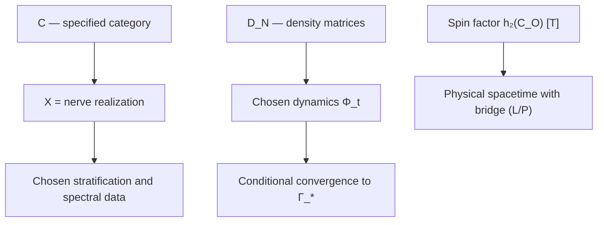

# Spacetime Structure

:::info Types of geometric constructions
This chapter considers different objects: the nerve of a chosen process category, the density-matrix state space, geometry from specified spectral data and physical spacetime. Identifying them requires separate bridges recorded in the [mathematical kernel](/docs/reference/mathematical-kernel).

Selected $\mathcal H=\mathbb C^7$ has complex dimension 7; $D_7$ has real dimension 48, its pure states form $\mathbb{CP}^6$ of real dimension 12, and diagonal states form a 6-simplex. None of these numbers determines the dimension of $|N(\mathcal C)|$ or physical space.

The terminal topos object $1_{\mathcal E}$ and the one-dimensional process system are distinct from $I/7$, a numerical target $M(\Gamma)$ and an equilibrium $\Gamma_*$. Terminality defines neither motion toward equilibrium nor an arrow of time. Clocks, dynamics, stratification and spectral triples are specified separately.

The colour-singlet spin factor and its spinor representation are exact algebraic constructions. Their spacetime reading requires a physical locality premise. [Theorem 48c](#теорема-48c) · [Theorem 48e](#теорема-48e)
:::

:::info Scope
- $X=|N(\mathcal C)|$ is a definition [D] for a specified small category.
- The Bures site consists of opens of $D_N$ with ordinary open covers, separately from $X$.
- Stratification and metric require geometric/spectral data; terminality alone does not provide them.
- Clocks and the nonlinear flow $\Phi_t$ require a specified dynamical law; convergence must be proved for that law.
- Physical spacetime and gravity require the physical bridges listed on their respective pages.
:::

## Base space X = $|N(\mathcal{C})|$ {#базовое-пространство}

:::warning Property 5 (Stratification) [D]
The base space of the theory is defined as the geometric realization of the nerve of the category:

$$
X = |N(\mathcal{C})|
$$

where $\mathcal{C}$ is the [primitive UHM category](./axiom-omega#примитив).
:::

### Autopoiesis of the base space {#автопоэтичность}

Key property: **X is defined endogenously**, not introduced from outside.

| Aspect | Traditional theories | UHM |
|--------|---------------------|---------|
| Base space | Postulated (ℝ⁴, Σ, ...) | Derived from $\mathcal{C}$ |
| Metric | Introduced by hand | Computed from spectral data |
| Topology | Fixed | Follows from the nerve structure |

### Nerve of the category $N(\mathcal{C})$ {#нерв-категории}

**Definition (Nerve):**

The nerve $N(\mathcal{C})$ is a simplicial set:
- 0-simplices: objects of $\mathcal{C}$ (holons $\mathbb{H}$)
- 1-simplices: morphisms $f: A \to B$
- n-simplices: composable chains of morphisms

**Geometric realization:**

$$
|N(\mathcal{C})| = \left( \bigsqcup_n \Delta^n \times N_n \right) \Big/ \sim
$$

where the equivalence relation glues the faces of simplices.

### Stratification of X {#стратификация-x}

A stratification $X=\bigsqcup_\alpha S_\alpha$ is additional data with stated frontier and local-geometric conditions. Cells of the realization correspond to nondegenerate simplices, but their dimensions alone do not give the claimed stratification with sole zero-dimensional stratum $\{T\}$: zero-simplices are all objects of the category.

A category with finitely many objects can have nondegenerate chains of arbitrary length. For example, repeating a nonidentity idempotent endomorphism gives nondegenerate simplices in every dimension. Thus seven does not bound the nerve's dimension. For a **separately chosen** linear order of seven objects its nerve realizes as $\Delta^6$ [T]; this is neither the category of all CPTP processes nor $D_7$.

### Local-global dichotomy {#локально-глобальная-дихотомия}

If the **indexing category** $\mathcal C$ itself has a terminal object, its nerve is contractible [T]. Terminality of its sheaf category does not establish this condition for $\mathcal C$. For contractible $X$, positive cohomology with constant coefficients vanishes; arbitrary sheaf cohomology need not vanish.

Local cohomology requires a separate local model. If a point $x$ has a neighbourhood conical on a link $K$, then

$$
H^k_{\mathrm{loc}}(X,x;A)\cong\widetilde H^{k-1}(K;A).
$$

At an interior point of a six-manifold the link is $S^5$. At a vertex of $\Delta^6$ the link is a contractible $\Delta^5$, so the local cohomology vanishes. Terminality alone selects no link or stratification.

Global contractibility can indeed coexist with nonzero local cohomology, for example at an interior point of a disk. This is a topological compatibility, not a proof of physics or dynamical convergence.

## Connes stratified metric {#метрика-конна}

### Spectral triple for strata {#спектральная-тройка}

On each stratum $S_\alpha$ a spectral triple is defined:

$$
(A_\alpha, H_\alpha, D_\alpha)
$$

where:
- $A_\alpha = C(S_\alpha)$ — algebra of functions on the stratum
- $H_\alpha = L^2(S_\alpha, E_\alpha)$ — Hilbert space of sections
- $D_\alpha$ — Dirac operator on the stratum

### Distance formula d_strat {#формула-расстояния}

:::warning Conditional length construction [C]
Given compatible length metrics on the strata, define a path pseudometric between their points:

$$
d_{strat}(\omega_1, \omega_2) = \inf_{\gamma} \int_\gamma ds_\alpha
$$

where:
- $\gamma$ — a path crossing strata $S_{\alpha_1}, S_{\alpha_2}, \ldots$
- $ds_\alpha$ — Connes metric on stratum $S_\alpha$:

$$
d_\alpha(p, q) = \sup\{|f(p) - f(q)| : \|[D_\alpha, f]\| \leq 1\}
$$

- The infimum is taken over all paths connecting $\omega_1$ and $\omega_2$
:::

### Metric near the terminal object {#метрика-вблизи-t}

For the path pseudometric to be a finite metric, require connectivity of the relevant points, finite lengths and separation of points; terminality gives none of these conditions. On a smooth Riemannian stratum with its canonical spectral triple, Connes' formula recovers geodesic distance [T]; gluing different strata requires additional hypotheses.

If a conical Riemannian model $ds^2=dr^2+r^2ds_K^2$ with apex $x$ is **specified**, then $d(x,(r,k))=r$. This is exact geometry of the chosen cone, not a consequence of terminality. Decrease of $r$ along trajectories requires a separately specified dynamical law; the terminal topos object is not a numerical attractor.

## Space as a structure of differences

:::note Space is not a stage, but a relation
We are accustomed to thinking of space as a "stage" on which physics plays out: first there is an empty room (space), then objects are placed in it (matter). In UHM space is not a stage, but a *structure of differences between states*. The distance between two points is a measure of how hard it is to deform one state into another. If two states transition into each other easily — they are "close"; if this requires a major restructuring — they are "far." Space arises as a by-product of differences, not as their container. This resolves the fundamental problem of quantum gravity: if space is not a given but a consequence, its quantization does not lead to contradictions.
:::

Space is **not an empty container**, but a structure of differences in the category $\mathcal{C}$.

### Distance {#расстояние}

In the updated theory, distance is defined via the [Connes stratified metric](#метрика-конна):

$$
d(A, B) := d_{strat}(A, B)
$$

On a specified spectral triple the distance depends on the algebra and Dirac operator. The Frobenius distance $\|\Gamma_A-\Gamma_B\|_F$ instead compares two assigned state matrices. Turning either construction into a physical ranging procedure requires specified locations and probes. [Operational distance](/docs/geometry/response-metric)

### Topology {#топология}

The topology of the nerve $X$ is determined by the specified small category. The topology of $D_N$ belongs to the density-matrix state space; its Bures and Euclidean topologies coincide. Physical topology does not follow by identifying these different objects.

A terminal object of $\mathcal C$ itself makes its nerve contractible, but gives no local cone structure, monotone stratification or dynamical limit.

## Emergent time

:::note Time is not a river, but a correlation
In everyday experience time seems like a "river" carrying us from past to future. In UHM time is something entirely different. It **emerges** from correlations between subsystems. Imagine a clock and an observer as a single quantum system. "Time = 3 o'clock" means not "the river has reached mark 3," but "the state of the clock correlates with a certain state of the observer." The universe as a whole is *timeless* (satisfies the constraint $[\hat{C}, \Gamma_{\text{total}}] = 0$); time arises *within* it — as the relation of "the clock" (the O measurement) to "the rest" (6 dimensions). This is the solution to the "problem of time" in quantum gravity proposed by Page and Wootters in 1983.
:::

:::warning Theorem (Emergence of time) [T]
Time is **derived** from the structure of the category $\mathcal{C}$ in four equivalent ways:

| Level | Time as... | Formula | Status |
|---------|--------------|---------|--------|
| **Page–Wootters** | Correlation with [O](../structure/dimension-o) | $\Gamma(\tau) = \text{Tr}_O[\cdot]$ | [T] Formalized |
| **Information geometry** | Distance in the Bures metric | $d_B(\Gamma_1, \Gamma_2)$ | [T] Formalized |
| **Categorical** | 1-morphism in ∞-groupoid | $\gamma: \Gamma_1 \to \Gamma_2$ | [T] Formalized |
| **Stratification** | Collapse of strata to T along the depth $n$ | $\dim(X_n) \geq \dim(X_{n+1})$ | [T] Formalized |

[Full proof →](../../proofs/dynamics/emergent-time)
:::

### Page–Wootters mechanism {#механизм-page-wootters}

Time arises as the parameter of **conditional states** with respect to the O measurement:

$$
\Gamma(\tau) := \frac{\text{Tr}_O\left[ (|\tau\rangle\langle \tau|_O \otimes \mathbb{1}_{6D}) \cdot \Gamma_{total} \right]}{p(\tau)}
$$

where:
- $\Gamma_{total}$ satisfies the constraint $[\hat{C}, \Gamma_{total}] = 0$
- $|\tau\rangle_O$ — basis of eigenstates of the internal clock O
- p(τ) — normalization

:::info The continuity of τ is an output, not an assumption (T-286)
Continuous clock parameters require a continuous model or an explicit scaling limit of readings. A finite cyclic clock has a finite set of distinguishable readings. [Depth-clock limit](/docs/proofs/physics/emergent-manifold#теорема-эмерджентное-время)
:::

### Information-geometric time

Distance between configurations in the Bures metric:

$$
d_B(\Gamma_1, \Gamma_2) = \arccos\left( \text{Tr}\sqrt{\sqrt{\Gamma_1} \Gamma_2 \sqrt{\Gamma_1}} \right)
$$

:::note Notation
Here $d_B$ is the Bures angle (not the chordal distance $\sqrt{2(1-\sqrt{F})}$ from [evolution.md](../dynamics/evolution#каноническое-delta-f)).
:::

**Flow of time** — the rate of change of Γ:

$$
\frac{d\tau_{int}}{d\sigma} = \left\| \frac{d\Gamma}{d\sigma} \right\|_B
$$

Time "flows faster" when Γ changes more strongly.

### Relation to evolution

Evolution is described with internal time τ:

$$
\frac{d\Gamma(\tau)}{d\tau} = -i[H_{eff}, \Gamma(\tau)] + \mathcal{D}[\Gamma(\tau)] + \mathcal{R}[\Gamma(\tau), E]
$$

This equation is a **consequence** of the structure of $\Gamma_{total}$, not a postulate.

## Arrow of time {#стрела-времени}

Terminality specifies mapping spaces. Distinct qubit channels can fix the same pure state: examples include the identity and the channel that prepares that state for every input. They give different dynamics.

Let a flow $\Phi_t$ on $D_N$ be **specified**. Convergence $\Phi_t(\Gamma)\to\Gamma_*$ requires a proof for the selected vector field. If every trajectory in an invariant basin converges to a fixed point, its limit defines an idempotent retraction $r$ on that basin [T]; it is distinct from logical support reflection. For nonlinear rates or self-models the flow is not a single linear CPTP semigroup.

The inequality $\dim(X_n)\ge\dim(X_{n+1})$ can be a condition on a separately specified sequence of geometric objects [D]/[H]; existence of $T$ does not imply it. The depth count $n$ and cyclic clock index $\tau\in\mathbb Z_7$ retain different meanings, but neither alone proves physical irreversibility.

### Thermodynamic direction

The arrow of time is defined by the direction of increase of the [von Neumann entropy](../dynamics/coherence-matrix#энтропия-фон-неймана):

$$
\frac{dS_{vN}}{d\tau} \geq 0
$$

:::note Distinction of concepts
The geometric sequence of strata and the dynamical flow must each be specified.

**Global increase of differentiation** ($dD_{\text{diff}}/d\tau > 0$) — this is a [separate cosmological hypothesis](/docs/physics/cosmology-phys/origin#направление-эволюции), having the status of a **non-falsifiable philosophical position**.

These concepts are related (both concern direction), but have different epistemological status.
:::

A reset channel $\rho\mapsto|0\rangle\langle0|$ lowers the entropy of a mixed state. Entropy is nondecreasing for unital CPTP maps in fixed finite dimension.

:::note Clarification
In the presence of [regeneration](../dynamics/evolution#3-регенеративный-член) $\mathcal{R}$ a local decrease in entropy is possible due to the import of free energy:

$$
\Delta S_{vN}^{local} < 0 \Rightarrow \Delta F_{env \to sys} > 0
$$

The total entropy (system + source) always grows.
:::

### Second law of thermodynamics {#второй-закон}

:::warning Theorem (Second law from the unital-channel order) [T]
The second law of thermodynamics is a **consequence** of the **majorization order** induced by the unital-channel refinement of morphisms (see [Mathematical foundations §terminal object](/docs/core/foundations/mathematical-foundations)):

$$
\forall \Gamma:\quad \Gamma \xrightarrow{\ \text{unital CPTP}\ } I/7 \quad\text{iff}\quad I/7 \prec \Gamma \ (\text{always}),\qquad I/7 \not\to \sigma\ \text{for }\sigma\neq I/7.
$$

In the reachability preorder generated by unital channels, $I/7$ is the least state: every state can reach it, and a unital channel fixes it. There is no unital return path to another state. This is a theorem about allowed transitions, not a proof that every unital trajectory converges to $I/7$: the identity channel and unitary dynamics are counterexamples. It is not terminality of the channel category, since multiple channels fix $I/7$.

A constant channel $X\mapsto\mathrm{Tr}(X)\rho'$ reaches any fixed target state $\rho'$. Entropy monotonicity here requires unital channels between registers of the same dimension.
:::

**Geometric interpretation:**

| Aspect | Formulation | Consequence |
|--------|--------------|-----------|
| Sink (unital order) | $\forall \Gamma:\ I/7 \prec \Gamma$; $I/7\not\to\sigma\ (\sigma\neq I/7)$ | Reachability only; convergence needs a dynamical theorem |
| Chosen geometric sequence | $\dim(X_n)\ge\dim(X_{n+1})$ if imposed | An additional condition, not a consequence of terminality |
| Entropy (unital channels) | $dS_{vN}/d\tau \geq 0$ for unital generators only | Entropy does not decrease along unital dynamics; for a general quantum dynamical semigroup the monotone is $D_{KL}(\Gamma\|\rho_\infty)$ (Spohn 1978) |

**Status:** [T] Formalized for the unital morphism class. The second law is **derived** from categorical structure for unital dynamics; the full UHM generator is not unital (see "Thermodynamic direction").

### Relation to the Heaviside function

The gate $g_V(P)$ is specified as part of the numerical law [D]. Landauer thermodynamics requires a separate environment and information-operation model; logical support, terminality and CPTP alone do not fix the gate's form. State preservation of the nonlinear law and finite split step is established under explicit assumptions in [evolution](/docs/core/dynamics/evolution#сохранение-положительности).

## Relativity

### Internal clocks

Different Holons can have different "internal clocks" — different rates of evolution:

$$
\tau_{\mathbb{H}_1} \neq \tau_{\mathbb{H}_2}
$$

where $\tau_{\mathbb{H}}$ is the proper time of the [Holon](../structure/holon) $\mathbb{H}$.

### Relativistic effects [C] {#релятивистские-эффекты}

:::tip Theorem (Relativistic effects from spectral triple) [C at T-53]
Gravitational and kinematic time dilation are consequences of the spectral triple T-53 [C] (its Lorentzian sign holds at reflection positivity, its spatial slice at T-119) and the full spectral action T-65 [T]. Connes' formula defines the metric $g_{\mu\nu}$, and the spectral action reproduces the Einstein–Hilbert action, which includes all relativistic effects.

**Proof.**

**Step 1 (Metric from Connes formula).** From T-53 [C] ([spectral triple](#теорема-спектральная-тройка)):

$$
d(p, q) = \sup\{|f(p) - f(q)| : \|[D, f]\| \leq 1\}
$$

The block-diagonal structure of $D$ with $g_{00} = 1/|D_O|^2 > 0$, $g_{aa} = -1/|D_{3,a}|^2 < 0$ defines the Lorentzian metric $g_{\mu\nu}$.

**Step 2 (Einstein–Hilbert action).** From T-65 [T] ([full spectral action](/docs/physics/gravity/quantum-gravity#теорема-полное-спектральное-действие)):

$$
S = \mathrm{Tr}(f(D/\Lambda)) = \int (a_0\Lambda^4 + a_2\Lambda^2 R + a_4 C_{\mu\nu\rho\sigma}^2 + \ldots)\sqrt{g}\,d^4x
$$

The coefficient $a_2\Lambda^2 R$ gives the kinetic term of gravity, i.e., the Einstein–Hilbert action.

**Step 3 (Time dilation).** Formula for the rate of internal clocks:

$$
\frac{d\tau}{d\sigma} = \omega_0 \cdot \sqrt{\sum_{i \neq O} |\gamma_{Oi}|^2 \cdot \mathrm{Gap}(O,i)^2}
$$

$\mathrm{Gap}(O,i)$ includes gravitational corrections via the metric $g_{\mu\nu}$: in a region of strong gravitational field (small $g_{00}$) the eigenvalues of $D_O$ are modified, which slows $d\tau/d\sigma$. Similarly, kinematic time dilation follows from the Lorentz transformation of spectral data. $\blacksquare$
:::

## Emergence of geometry {#эмерджентность-геометрии}

:::info Section status
- **Metric:** [T] Formalized via $d_{strat}$ (see [above](#метрика-конна))
- **Dimensionality:** the nerve has the dimension of the specified category; $N=7$ does not determine it
- **Gravity.** The manifold $\mathbb R\times S^3$ is a product of the chosen charge and clock constructions. Its physical interpretation is [I]. [T-120](/docs/proofs/physics/emergent-manifold#теорема-произведение-троек)
:::

### Derived metric (not a hypothesis)

In UHM the metric is **derived**, not postulated:

$$
d_{strat}(\omega_1, \omega_2) = \inf_{\gamma} \int_\gamma ds_\alpha
$$

**Key properties:**
- Metric defined on $X = |N(\mathcal{C})|$
- Accounts for stratification (different ds on different strata)
- Cone-like near a specified point only with an explicit conical local model

### Dimensionality of space {#размерность}

The selected objects have different dimensions:

$$
\dim_{\mathbb C}\mathcal H=7,\qquad \dim_{\mathbb R}D_7=48,\qquad
\dim_{\mathbb R}\mathbb{CP}^6=12,\qquad \dim\Delta^6=6.
$$

Only the diagonal state subspace is $\Delta^6$. The nerve of an arbitrary process category need not be that simplex.

### Relation to GR (program) {#связь-с-ото}

A spectral action on a specified smooth spin geometry contains an Einstein–Hilbert term in its heat-kernel expansion. T-119 determines the spectrum of a particular charge algebra and T-120 supplies a product topology. Choosing a physical Lorentzian metric and matter couplings requires additional data. [Metric dynamics](/docs/physics/gravity/einstein-equations)

See [Correspondence with physics: GR](../../proofs/physics/physics-correspondence#5-связь-с-общей-теорией-относительности) for the detailed program.

## Emergence diagram

The diagram separates types; its arrows do not identify a terminal object, state and attractor.

## Non-locality

### Quantum correlations

[Coherences](../dynamics/coherence-matrix#недиагональные-элементы-когерентности) $\gamma_{ij}$ between distant parts of $\Gamma$ mean **non-local connections**:

$$
\gamma_{AB} \neq 0 \Rightarrow A \text{ and } B \text{ are quantum-correlated}
$$

### Entanglement

Entanglement is the non-separability of the state of subsystems:

$$
\Gamma_{AB} \neq \Gamma_A \otimes \Gamma_B
$$

where $\Gamma_A = \mathrm{Tr}_B(\Gamma_{AB})$ is the [partial trace](/docs/consciousness/foundations/interiority-theory#редуцированная-матрица-опыта) over subsystem $B$.

Violation of Bell inequalities is a consequence of non-zero coherences in the structure of $\Gamma$.

## Relation to physics

| Physical concept | Expression via $\mathcal{C}$ | Status |
|--------------------|-------------------------------|--------|
| **Base space** | $X = \lVert N(\mathcal{C})\rVert$ | [T] [Formalized](#базовое-пространство) |
| **Time** | Parameter τ (Page–Wootters) | [T] [Formalized](../../proofs/dynamics/emergent-time) |
| Arrow of time | Specified evolution, readout and monotonicity conditions | [C under these inputs] |
| **Metric** | $d_{strat}$ (Connes on strata) | [T] [Formalized](#метрика-конна) |
| **Dimensionality** | $D_7$: 48; $\mathbb{CP}^6$: 12; diagonal states: 6 | [T] for these objects, not nerve or physical-space dimension |
| Energy | Eigenvalues of $H_{eff}$ | [T] Formalized |
| Gravity | Spectral action on a supplied product geometry | [C under the metric and cutoff assumptions] |
| Topological charges | IC-cohomology of strata | [T] [Formalized](../../proofs/categorical/categorical-formalism#производные-категории) |

## Relation to other approaches

| Approach | Relation to UHM | Status |
|--------|-------------|--------|
| **Quantum mechanics** | Special case of UHM at $R \to 0$ | [Proven](../../proofs/physics/physics-correspondence#3-редукция-к-квантовой-механике) |
| **Standard Model** | Gauge symmetries from $\text{Sym}(\Gamma)$ | [Program](../../proofs/physics/physics-correspondence#6-калибровочные-симметрии-и-стандартная-модель) |
| **Loop quantum gravity** | Spin networks may correspond to coherence structures | Not investigated |
| **String theory** | Possible connection via holographic principle | Not investigated |
| **Hoffman Conscious Agents** | Spacetime as interface consistent with emergence | Conceptually compatible |
| **Emergent gravity (Verlinde)** | Similar approach: gravity as entropic force | Requires investigation |
| **Octonionic lineage** (Günaydın–Gürsey 1973; Manogue–Dray 1999; Boyle 2026) | Same split $1\oplus3\oplus\bar{3}$, read as colour; four-dimensional spacetime from the choice of one imaginary unit | Prior art — see [Precedents](#прецеденты-3-плюс-1) |

## What is formalized vs Research program

| Statement | Status | Comment |
|-------------|--------|-------------|
| **Base space $X = \lVert N(\mathcal{C})\rVert$** | [T] Formalized | [Property 5](./axiom-omega#свойство-5) |
| **Time as Page–Wootters parameter** | [T] Formalized | [Theorem proved](../../proofs/dynamics/emergent-time) |
| **Arrow of time as collapse of strata** | [✗] universal derivation | Terminality specifies no dynamics; a flow and convergence assumptions are required |
| **Metric $d_{strat}$** | [T] Formalized | [Connes stratified metric](#метрика-конна) |
| **Dimensionality 6D** | [✗] as an N=7 consequence for the nerve | Dimension 6 holds for the chosen diagonal simplex |
| **Local-global dichotomy** | [C] with a local conical model | Contractibility gives no spherical link or physical bridge |
| **Lorentzian signature** | signature $(1,3)$ [C] (T-53: time count [T], spatial slice $S^3$ from T-119 [T], sign at reflection positivity) | [UHM spectral triple](#теорема-спектральная-тройка) |
| **Real axis triplets** | No invariant split of the real six-dimensional complement | [Stabilizer representation](#секторная-декомпозиция) |
| **3+1 with rotations that commute with colour** | [T] as mathematics; [C at (L)] as spacetime (Theorem 48e) | [Theorem 48c](#теорема-48c): the colour-singlet part of $\mathfrak h_2(\mathbb O)$ is $\mathfrak h_2(\mathbb C_O)\cong\mathbb R^{1,3}$ |
| **Topology of the product** | [T] for the depth register and specified charge algebra. Its physical reading is [I]. | [T-120](/docs/proofs/physics/emergent-manifold#теорема-произведение-троек) |
| **Einstein–Hilbert term** | [T] on a supplied Riemannian spin geometry with cutoff | [Spectral action](/docs/physics/gravity/quantum-gravity#теорема-полное-спектральное-действие) |

## Sectoral decomposition of dimension 7 = 1 + 3 + 3̄ {#секторная-декомпозиция}

Fix the imaginary unit $e_O$. Its $\mathrm{SU}(3)$ stabilizer acts irreducibly on the real six-dimensional complement. The complexified representation splits as $\mathbb C e_O\oplus\mathbf3\oplus\bar{\mathbf3}$.

- *Numbers* (`website/scripts/check_core_numbers.py`, `test_no_axis_triple_is_su3_invariant`): $\dim\mathrm{Der}(\mathbb{O})=14$, $\dim\mathrm{Stab}(e_O)=8$; invariant axis triples $0$ of $20$; commutant $2$; left multiplication by $e_O=e_7$ pairs $A\leftrightarrow D$, $S\leftrightarrow U$, $L\leftrightarrow E$. Only a one-dimensional $\mathfrak{u}(1)\subset\mathfrak{su}(3)$ maps the span of $\{A,S,D\}$ into itself, so $\mathrm{SU}(3)$ does not act on $\{A,S,D\}$ as on a triplet.

### Theorem 48c (Spacetime that commutes with colour) — mathematics [T], physical 3+1 [C at (L)] {#теорема-48c}

For spacetime rotations to commute with internal colour, they need a carrier on which the two actions are compatible. The spin factor below realizes commuting actions under the stated assumptions. [Precedents](#прецеденты-3-плюс-1)

**Notation.** $e_O=e_7$ in the canonical table ([G₂-structure, §2.2](/docs/physics/gauge-symmetry/g2-structure#октонионное-умножение-и-g2)); $\mathrm{SU}(3)_C=\mathrm{Stab}_{G_2}(e_O)$; $\mathbb C_O=\mathbb R1\oplus\mathbb Re_O\subset\mathbb O$ is the complex subalgebra generated by the clock unit. $\mathfrak h_2(\mathbb K)$, for a subalgebra $\mathbb K\subseteq\mathbb O$, is the real vector space of matrices $X=\begin{pmatrix}a&x\\\bar x&b\end{pmatrix}$ with $a,b\in\mathbb R$, $x\in\mathbb K$, with the quadratic form $\det X=ab-\lvert x\rvert^2$; $G_2$ acts on $\mathfrak h_2(\mathbb O)$ entry by entry.

:::tip Theorem 48c — (a)–(g) [T]; the 3+1 reading [C at (L)]
**(a) Colour fixes exactly the clock's complex numbers.** The elements of $\mathbb O$ fixed by $\mathrm{SU}(3)_C$ are exactly $\mathbb C_O$. A unit $u\in\mathrm{Im}\,\mathbb O$ whose left multiplication commutes with $\mathrm{SU}(3)_C$ is $\pm e_O$. The complex structures on $\mathbb R^6=\mathbb C_O^\perp$ that commute with $\mathrm{SU}(3)_C$ are exactly $\pm L_{e_O}$.

**(b) The colour-singlet part is Minkowski space.** $\mathfrak h_2(\mathbb O)\cong\mathbb R^{1,9}$. Its $\mathrm{SU}(3)_C$-fixed subspace is $\mathfrak h_2(\mathbb C_O)$, of dimension $4$ and signature $(1,3)$. Its $\det$-orthogonal complement $W=\bigl\{\begin{pmatrix}0&w\\\bar w&0\end{pmatrix}: w\perp\mathbb C_O\bigr\}\cong\mathbb C^3$ is negative definite and carries the colour triplet.

**(c) The Lorentz algebra is the centraliser of colour.** The centraliser of $\mathfrak{su}(3)_C$ in $\mathfrak{so}(1,9)$ is $\mathfrak{so}(1,3)\oplus\mathfrak u(1)$, of dimension $6+1=7$. The $\mathfrak{so}(1,3)$ acts on $\mathfrak h_2(\mathbb C_O)$ and trivially on $W$; the $\mathfrak u(1)$ acts on $W$ as $L_{e_O}$ and trivially on $\mathfrak h_2(\mathbb C_O)$.

**(d) The Lorentz group.** $M\in\mathrm{SL}(2,\mathbb C_O)$ acts by $X\mapsto MXM^\dagger$. The action is well defined (the bracketing does not matter), preserves $\det$, induces $\mathrm{SO}^+(1,3)$ on $\mathfrak h_2(\mathbb C_O)$, is the identity on $W$ and commutes with $\mathrm{SU}(3)_C$. Hence $\mathrm{SL}(2,\mathbb C_O)$ and $\mathrm{SU}(3)_C$ act as a direct product.

**(e) One time, three space.** The maximal compact part $\mathrm{SU}(2)\times\mathrm U(1)$ of the centraliser fixes exactly one line, $\mathbb R\,1_2$. It is timelike: $\det 1_2=1>0$. $\mathrm{SU}(2)$ acts as $\mathrm{SO}(3)$ on the three traceless directions $\sigma_z$, $\sigma_x$, $e_O\sigma_y$, which are spacelike. The signature is Lorentzian because $\det$ is: no sign is chosen.

**(f) Spin and colour carriers.** The representation on $\mathbb O^2$ contains $(\mathbf2,\mathbf1)\oplus(\mathbf2,\mathbf3)$ under the specified actions. The singlet part can carry a Weyl spinor. The colour multiplication on the other summand does not define an independent physical quark field. The physical field construction uses separate Lorentz and internal factors. [48e](#теорема-48e)

**(g) No-go inside the holon.** The centraliser of $\mathfrak{su}(3)_C$ is $0$ in $\mathfrak g_2$, $\mathfrak u(1)$ in $\mathfrak{so}(7)$ and $\mathfrak u(1)^3$ in $\mathfrak u(7)$. No $\mathrm{SO}(3)$ acting on the seven axes commutes with colour. For each of the seven associative planes (Fano lines), the stabiliser in $\mathfrak g_2$ is $\mathfrak{so}(4)$ and acts on the plane as $\mathfrak{so}(3)$. It meets $\mathfrak{su}(3)_C$ in $\mathfrak u(2)$ for the three lines through $O$ and in an $\mathfrak{so}(3)$ for the other four. So the rotations of an associative plane are colour rotations.

For the physical identification, 48e distinguishes an algebraic two-level system from the kinematic premise (L) and the spinor premise (W). [48e](#теорема-48e)
:::

**Proof.** (a) $\mathrm{SU}(3)_C$ fixes $1$ and $e_O$. It acts on $\mathbb R^6$ irreducibly and transitively on the unit sphere $S^5$: the orbit of every unit vector is five-dimensional (numbers below). So it fixes no non-zero vector of $\mathbb R^6$. If $L_u$ commutes with every $\varphi\in\mathrm{SU}(3)_C$, then $\varphi(u)\varphi(x)=\varphi(ux)=u\,\varphi(x)$ for all $x$, so $\varphi(u)=u$ and $u\in\mathbb C_O\cap\mathrm{Im}\,\mathbb O=\mathbb Re_O$. The commutant of $\mathfrak{su}(3)$ on $\mathbb R^6$ is $\mathrm{span}\{1,L_{e_O}\}\cong\mathbb C$ (complex type, [sectoral decomposition](#секторная-декомпозиция)), and $(\alpha+\beta L_{e_O})^2=-1$ forces $\alpha=0$, $\beta=\pm1$.
(b) $G_2$ fixes the real diagonal, so a fixed matrix has its off-diagonal entry in $\mathbb O^{\mathrm{SU}(3)}=\mathbb C_O$. Write $a=t+z$, $b=t-z$, $x=x_1+x_2e_O$. Then $\det X=t^2-z^2-x_1^2-x_2^2$. For $z'\in\mathbb C_O$ and $w\perp\mathbb C_O$, $\lvert z'+w\rvert^2=\lvert z'\rvert^2+\lvert w\rvert^2$, so $W$ is $\det$-orthogonal to $\mathfrak h_2(\mathbb C_O)$ and $\det$ is $-\lvert w\rvert^2$ on $W$.
(c) An element of $\mathfrak{so}(1,9)$ that commutes with $\mathfrak{su}(3)$ preserves the isotypic components: the trivial one, $\mathfrak h_2(\mathbb C_O)$, and $W$, which is irreducible of complex type. Its restrictions lie in $\mathfrak{so}(1,3)$ and in the commutant of $\mathfrak{su}(3)$ inside $\mathfrak{so}(6)$, which is $\mathfrak u(1)$. Conversely every such pair commutes. Dimension $7$, confirmed numerically.
(d) Every entry of $MXM^\dagger$ is a sum of products $m\,x\,m'$ with $m,m'\in\mathbb C_O$. The subalgebra generated by $e_O$ and $x$ is associative (Artin), so $(MX)M^\dagger=M(XM^\dagger)$. On $\mathfrak h_2(\mathbb C_O)$ this is the standard spin covering $\mathrm{SL}(2,\mathbb C)\to\mathrm{SO}^+(1,3)$. On $W$, use $mw=w\bar m$ for $m\in\mathbb C_O$, $w\perp\mathbb C_O$ (because $e_Ow=-we_O$) and $\bar w=-w$. The off-diagonal entry becomes $m_{11}w\bar m_{22}+m_{12}\bar w\bar m_{21}=w\,\overline{m_{11}m_{22}-m_{12}m_{21}}=w\,\overline{\det M}=w$. The diagonal entry becomes $w(\bar m_{11}\bar m_{12}-\bar m_{12}\bar m_{11})=0$. So $MX_wM^\dagger=X_w$. Every $\varphi\in\mathrm{SU}(3)_C$ fixes the entries of $M$, so $\varphi(MXM^\dagger)=M\varphi(X)M^\dagger$. An element in both images acts trivially on $\mathfrak h_2(\mathbb C_O)$ and on $W$, so the product is direct.
(e) $\mathrm{SU}(2)$ acts on the traceless Hermitian $2\times2$ matrices by the adjoint representation, which is $\mathrm{SO}(3)$, and it fixes $1_2$. The $\mathrm U(1)$ fixes $\mathfrak h_2(\mathbb C_O)$ and has no fixed vector in $W$.
(f) By Artin, $(mm')x=m(m'x)$ for $m,m'\in\mathbb C_O$, so left multiplication gives a representation. $\mathrm{SU}(3)_C$ commutes with $L_{e_O}$, so it acts $\mathbb C_O$-linearly, as $\mathbf 1$ on $\mathbb C_O$ and as $\mathbf 3$ on $\mathbb C^3$.
(g) Linear algebra over the fourteen derivations of the canonical table. $\blacksquare$

*Numbers* (`website/scripts/check_core_numbers.py`: `test_colour_commuting_spacetime_is_h2_of_the_clock_complex`, `test_no_rotation_of_the_seven_axes_commutes_with_colour`, `test_octonionic_spinor_is_lepton_plus_quark_weyl`, `test_every_non_o_axis_is_half_triplet_and_colour_moves_any_axis_to_any`):
- the fixed space of $\mathfrak{su}(3)_C$ is $2$-dimensional in $\mathbb O$ ($1$, $e_7$) and $4$-dimensional in $\mathfrak h_2(\mathbb O)$, with signature $(1,3)$;
- $\dim\mathfrak{so}(1,9)=45$; the centraliser of $\mathfrak{su}(3)_C$ has dimension $7$; its derived algebra has dimension $6$ and Killing form of signature $(3,3)$; its compact part has dimension $4$ and fixes one line, $1_2$;
- for random $M\in\mathrm{SL}(2,\mathbb C_O)$: both bracketings agree, $L^{\mathsf T}\eta L=\eta$, $L\vert_W=\mathrm{id}$, $[L,g]=0$ for random $g\in\mathrm{SU}(3)_C$, and $\det L_4=1$, $(L_4)_{00}\ge1$;
- the $\mathrm{SU}(3)_C$-orbit of each of the six non-$O$ axes is $5$-dimensional (all of $S^5$), and each axis has weight exactly $\tfrac12$ in $\mathbf 3$;
- centralisers of $\mathfrak{su}(3)_C$: $0$ in $\mathfrak g_2$, $1$ in $\mathfrak{so}(7)$, $3$ in $\mathfrak u(7)$. For the seven associative planes the stabilisers have dimension $6$, act on the plane with rank $3$, and meet $\mathfrak{su}(3)_C$ in dimension $4$ (three lines through $O$) or $3$ (four lines).

**What is new and what is not.** Parts (b), (d) and (f) are the Manogue–Dray reduction ([precedents](#прецеденты-3-плюс-1)) with $\ell=e_O$. Parts (a), (c) and (g) are elementary representation theory. We found no source that states the centraliser (c) in this form, but we claim no new mathematics. UHM's contribution is the premise-free part (a): colour, defined as the stabiliser of UHM's clock unit, leaves exactly one complex line of $\mathbb O$ fixed. So the unit that cuts ten dimensions to four is not chosen. It is the unit whose stabiliser is colour.

**Why the reading is [C] and not [T].** (Q1) is not a theorem of UHM. The holon's state space is $\mathcal D(\mathbb C^7)$, and $\mathfrak h_2(\mathbb O)=\mathbb R^3\oplus\mathrm{Im}\,\mathbb O$ contains the seven axes only as its off-diagonal imaginary part. The three extra directions ($1_2$, $\sigma_z$, $\sigma_x$) are not in the holon. Three routes to derive (Q1) were tried, and none closes. (i) *Inside one holon:* $\mathrm{Herm}(\mathbb C^7)$ contains no unital copy of any spin factor $\mathfrak h_2(\mathbb K)$, not even $\mathfrak h_2(\mathbb R)$. Such a copy needs two anticommuting Hermitian involutions $s_1,s_2$ (the images of $\sigma_z,\sigma_x$). But $s_1s_2=-s_2s_1$ gives $\det(s_1s_2)=(-1)^7\det(s_2s_1)$, so $\det(s_1s_2)=0$, which is impossible for invertible $s_i$ in odd dimension. The "2" of (Q1) therefore needs a second tensor factor; it cannot be found inside the seven axes, for the same parity reason that excludes KO-dimension 6 on $\mathbb C^7$. (ii) *From the Page–Wootters product $\mathbb C[\mathbb Z_7]\otimes\mathbb C^7$:* the clock register is seven-level, not two-level. Its irreducible $\mathbb Z_7$-representations are one-dimensional, so no $\mathrm{SU}(2)$ acts on it. (iii) *From the nerve $X=\lvert N(\mathcal C)\rvert$:* it carries no quadratic form, so no signature. (Q2) is Coleman–Mandula's condition, an input from physics. Hence: [T] as mathematics, [C at (Q)] as spacetime.

**Routes tried for "3 from UHM", and why each fails or feeds 48c.**
- *(a) An associative 3-plane as space.* It fails by (g): its rotation group lies in $\mathrm{SU}(3)_C$. No associative plane is $\mathrm{SU}(3)_C$-invariant, since the only invariant subspaces of $\mathrm{Im}\,\mathbb O$ are $\mathbb Re_O$ and $\mathbb R^6$. $\mathrm{SU}(3)_C$ moves the planes through $O$ among themselves ($\mathbb{CP}^2$ of them) and those orthogonal to $O$ as well, so $O$ distinguishes none. A vacuum that selected one would break colour to $\mathrm U(2)$ or $\mathrm{SO}(3)$.
- *(b) Spin from a quaternionic factor (Dixon's $\mathbb R\otimes\mathbb C\otimes\mathbb H\otimes\mathbb O$, Furey).* UHM has no separate $\mathbb H$ factor. A quaternion subalgebra of $\mathbb O$ that contains $e_O$ is moved by $\mathrm{SU}(3)_C$, so it is not colour-free. What survives is that $M_2(\mathbb C_O)\cong\mathbb C_O\otimes\mathbb H$: Dixon's $\mathbb H$ is the "2" of (Q1). Theorem 48c takes it in that form.
- *(c) Information-theoretic (Müller–Masanes 2013).* The traceless part of $\mathfrak h_2(\mathbb C_O)$ is exactly the Bloch space of a qubit over $\mathbb C_O$, and (e)'s $\mathrm{SO}(3)$ is its $\mathrm{PSU}(2)$. So 48c's "3" is Müller and Masanes's "3", and (Q1) is their premise that the smallest system carries directions, in Jordan-algebra form. Their $G_2$ counter-case (a seven-dimensional ball, Dakić–Brukner; Masanes et al.) does not apply to $\mathfrak h_2(\mathbb C_O)$, whose Bloch ball is three-dimensional.
T-119 computes the spectrum of three commuting rotation charges. Two are colour Cartan generators. The four-dimensional colour-singlet spin factor in 48c uses different algebraic data. In both constructions, an experiment is needed to identify physical coordinates. [Charge spectrum](/docs/proofs/physics/emergent-manifold#теорема-эмерджентное-пространство)
- *Further routes* — the depth register, pairs of holons, $J_3(\mathbb O)$, the Clifford system of T-326 — are closed by [Theorem 48d](#теорема-48d), which also states (Q) as one principle (L) plus the Masanes–Müller principle. [Theorem 48e](#теорема-48e) proves the Masanes–Müller principle inside UHM, so (L) alone remains.

### Theorem 48d (Where the "2" of (Q1) cannot come from, and what (Q) is equivalent to) — [T] as mathematics {#теорема-48d}

Theorem 48c needs a two-by-two structure: its tangent vectors are Hermitian $2\times2$ matrices. The note above lists three routes that fail to find the "2" inside UHM. Theorem 48d closes the other routes: pairs of holons, the depth register, the exceptional Jordan algebra, and the Clifford system of T-326. It then states (Q) as one principle plus one input from quantum information.

:::tip Theorem 48d — (a)–(f) [T]
**(a) No unital spin factor in any holon register.** $\mathrm{Herm}(\mathbb C^d)$ contains a unital copy of a spin factor $\mathrm{JSpin}(n)$ with $n\ge2$ — in particular of any $\mathfrak h_2(\mathbb K)$ — if and only if $d$ is even. So there is none on $\mathbb C^{7^M}$: not for $M$ holons, not for the Page–Wootters product $\mathbb C^7\otimes\mathbb C^7$, not for a holon with its self-model on $\mathbb C^7\otimes\mathbb C^7$, and not for the depth register realised on $M$ O-registers ($7^M$ readings).

**(b) Pairs and the depth register carry no canonical rotation group.** On $\mathbb C^7\otimes\mathbb C^7$ the operators that commute with $G_2$ form a commutative algebra $\mathbb C^4$, because $\mathbf 7\otimes\mathbf 7=\mathbf 1\oplus\mathbf 7\oplus\mathbf{14}\oplus\mathbf{27}$ with no repetition. The operators that commute with the path Laplacian $\Lambda$ of the depth register ([emergent time §11.4](/docs/proofs/dynamics/emergent-time#114-регистр-глубины)) form the commutative algebra of polynomials in $\Lambda$, because $\Lambda$ has simple spectrum. So neither carries an $\mathrm{SO}(3)$ tied to its structure. The colour-singlet subspace of a pair is three-dimensional, spanned by $e_O\otimes e_O$, $\sum_{k\ne O}e_k\otimes e_k$ and $\sum\varphi_{Ojk}\,e_j\otimes e_k$.

**(c) The exceptional algebra is not the algebra of any holons; its colour-singlet part is ordinary.** $J_3(\mathbb O)$ is not a Jordan subalgebra of any $\mathrm{Herm}(\mathbb C^n)$ (Albert 1934). So it is not the observable algebra of any number of holons, of a holon with its self-model, or of their registers. Its $\mathrm{SU}(3)_C$-fixed part is $\mathfrak h_3(\mathbb C_O)\cong\mathrm{Herm}(\mathbb C^3)$: dimension $9$, closed under the Jordan product. Its $G_2$-fixed part is $\mathfrak h_3(\mathbb R)$, dimension $6$. For the idempotent $E_1=\mathrm{diag}(1,0,0)$ the Peirce space $\{X: E_1\circ X=0\}$ is $\mathfrak h_2(\mathbb O)$, and its colour-fixed part is the $\mathfrak h_2(\mathbb C_O)$ of 48c, signature $(1,3)$.

**(d) One centraliser: the rotations of 48c are the weak isospin of T-326.** In the $\mathrm{Spin}(9)$ of the Clifford system on $\mathcal S=\mathbb C\otimes\mathbb O$ ([T-326](/docs/physics/gauge-symmetry/standard-model#sm-из-клиффорда)) the centraliser of $\mathfrak{su}(3)_C$ is a single $\mathfrak u(2)$. The colour-fixed part of the vector $\mathbb R^9$ is the three-plane $\mathrm{span}\{iL_{e_O},J,iJ\}$, and the $\mathfrak{su}(2)$ acts on it irreducibly. The same holds in the $\mathrm{Spin}(9)\subset\mathrm{Spin}(1,9)$ of 48c, with the three-plane $\{e_O\sigma_y,\sigma_z,\sigma_x\}$ (48c(c),(e)). So if 48c's spinor module $\mathbb O^2$ (part (f)) and T-326's $\mathcal S$ are one sixteen-dimensional module of one $\mathrm{Spin}(9)$ with one colour, then the spatial rotations of 48c are $\mathrm{SU}(2)_L$, and the three space directions are the weak triplet $(\mathbf 1,\mathbf 3)_0$.

**(e) The sixteen dimensions carry one index, not two.** A left-handed lepton doublet has $2\times2=4$ complex components: a Weyl index and an isospin index. In $(\mathcal S,L_{e_O})$ the lepton doublet $(\mathbf 1,\mathbf 2)_{-1/2}$ has $2$. So the sixteen real dimensions of $\mathbb O^2\cong\mathcal S$ carry either the Weyl index (48c(f), the reading of Manogue and Dray) or the isospin index (T-326(d)), not both. If they carry isospin, the Weyl index is a separate factor. The colour-singlet part $\mathbb C_O^2\subset\mathbb O^2$ of 48c(f) supplies it: $\mathbb C_O^2\otimes_{\mathbb C}(\mathcal S,L_{e_O})=\mathbf 2_{\text{Weyl}}\otimes[(\mathbf 3,\mathbf 2)_{1/6}\oplus(\mathbf 1,\mathbf 2)_{-1/2}]$ has $16$ complex dimensions, the left-handed doublets of one generation.

**(f) (Q) as one principle.** Let $\mathbb K\subseteq\mathbb O$ be a composition subalgebra that contains $e_O$: $\mathbb C_O$, one of the quaternion subalgebras through $e_O$, or $\mathbb O$. The following are equivalent: (i) $\mathrm{SU}(3)_C$ fixes $\mathfrak h_2(\mathbb K)$ pointwise; (ii) $\mathbb K=\mathbb C_O$; (iii) the Bloch ball of the two-level system $\mathfrak h_2(\mathbb K)$ (the unit ball of its traceless part) is three-dimensional; (iv) $\det$ on $\mathfrak h_2(\mathbb K)$ has signature $(1,3)$. By the theorem of Masanes, Müller, Pérez-García and Augusiak, (iii) holds exactly when two such systems, with continuous reversible dynamics and states determined by local measurements, can be entangled — equivalently, can interact.
:::

**Proof.** (a) Let $s_1,s_2$ be Hermitian with $s_i^2=1$ and $s_1s_2=-s_2s_1$. If $s_1v=v$, then $s_1(s_2v)=-s_2v$. So the invertible $s_2$ maps the $+1$-eigenspace of $s_1$ into its $-1$-eigenspace, and back. The two eigenspaces have equal dimension, and $d$ is even. A unital $\mathrm{JSpin}(n)$ with $n\ge2$ contains such a pair: two orthogonal unit vectors of its traceless part square to $1$ and anticommute. Conversely, for $d=2k$ the operators $1$, $\sigma_z\otimes1_k$, $\sigma_x\otimes1_k$, $\sigma_y\otimes1_k$ span a unital $\mathfrak h_2(\mathbb C)$. And $7^M$ is odd.
(b) The Casimir of $\mathfrak g_2$ takes four distinct values on $\mathbb C^{49}$, on eigenspaces of dimensions $1,7,14,27$ (numbers below). The irreducible representations of $G_2$ of dimension at most $27$ are $\mathbf 1,\mathbf 7,\mathbf{14},\mathbf{27}$, and two copies of one would share a Casimir value. So the decomposition has no multiplicity, and by Schur the commutant is $\mathbb C^4$. $\Lambda$ is tridiagonal with non-zero off-diagonal entries, so each eigenvalue has a one-dimensional eigenspace. Any operator commuting with $\Lambda$ preserves these lines and is a function of $\Lambda$. In the pair, $\mathbf 1\otimes\mathbf 1$, $\mathbf 3\otimes\bar{\mathbf 3}$ and $\bar{\mathbf 3}\otimes\mathbf 3$ each contain one singlet, and the other products none.
(c) Albert proved that $J_3(\mathbb O)$ is exceptional ("On a certain algebra of quantum mechanics", *Ann. Math.* **35**, 65–73 (1934)); it appears as the one exceptional case in the classification of Jordan, von Neumann and Wigner (*Ann. Math.* **35**, 29–64 (1934)). A subalgebra of a special algebra is special, so there is no embedding. $G_2$ acts on $J_3(\mathbb O)$ entry by entry and fixes the diagonal. By 48c(a) an off-diagonal entry is colour-fixed exactly when it lies in $\mathbb C_O$, and $G_2$-fixed exactly when it is real. $\mathbb C_O$ is associative, so $\mathfrak h_3(\mathbb C_O)$ is the Jordan algebra of Hermitian $3\times3$ complex matrices. $E_1\circ X=0$ holds exactly when the first row and column of $X$ vanish, which leaves the lower $2\times2$ block, $\mathfrak h_2(\mathbb O)$.
(d) In the proof of T-326(b), $\mathbb R^9=\mathbb R^6\oplus\mathbb R^3$ under colour, with $\mathbb R^3=\mathrm{span}\{iL_{e_O},J,iJ\}$ trivial. The centraliser is $\mathfrak u(1)\oplus\mathfrak{so}(3)$, and the $\mathfrak{so}(3)$ rotates $\mathbb R^3$. In 48c, $\mathfrak h_2(\mathbb O)$ splits as $\mathfrak h_2(\mathbb C_O)\oplus W$, and the compact part of the centraliser is $\mathfrak{su}(2)\oplus\mathfrak u(1)$, with the $\mathfrak{su}(2)$ rotating the three traceless directions of $\mathfrak h_2(\mathbb C_O)$. Both $\mathfrak{su}(2)$ are the derived algebra of the centraliser of the same $\mathfrak{su}(3)$ inside the same $\mathfrak{spin}(9)$ once the modules are identified, and a centraliser is unique.
(e) Count the complex dimensions. The product of the Weyl and isospin indices needs $2\times2\times(3+1)=16$; $(\mathcal S,L_{e_O})$ has $8$.
(f) (i)⇔(ii): by 48c(a) colour fixes in $\mathbb O$ exactly $\mathbb C_O$. A quaternion subalgebra through $e_O$ contains a unit vector orthogonal to $\mathbb C_O$, which colour moves (its orbit is $S^5$). (ii)⇔(iii)⇔(iv): $\mathfrak h_2(\mathbb K)$ has traceless part of dimension $\dim\mathbb K+1\in\{3,5,9\}$, and $\det$ has signature $(1,\dim\mathbb K+1)$. The last equivalence is the result of L. Masanes, M. P. Müller, D. Pérez-García and R. Augusiak (*J. Math. Phys.* **55**, 122203 (2014), [arXiv:1111.4060](https://arxiv.org/abs/1111.4060)): among state spaces whose components are $d$-dimensional balls, with continuous reversible dynamics and local tomography, "except for the quantum two-qubit state space, none of them contains entangled states. Equivalently, in any of these non-quantum theories interacting dynamics is impossible." $\blacksquare$

*Numbers* (`website/scripts/check_core_numbers.py`: `test_no_unital_spin_factor_on_any_holon_register`, `test_colour_singlet_part_of_the_exceptional_jordan_algebra_is_hermitian_c3`, `test_spatial_triplet_of_48c_is_the_weak_triplet`):
- for $d=7$ and $d=49$ and every split $p+q=d$, a Hermitian operator anticommuting with $\mathrm{diag}(1_p,-1_q)$ has rank $2\min(p,q)<d$;
- the $\mathfrak g_2$ Casimir on $\mathbb C^{49}$ has eigenvalues $0,2,4,\tfrac{14}3$ with multiplicities $1,7,14,27$; there are $3$ colour singlets and $1$ $G_2$ singlet in the pair; the path Laplacian on $7$, $49$ and $343$ readings has simple spectrum;
- in the $27$-dimensional $J_3(\mathbb O)$ the colour-fixed part has dimension $9$ and is closed under the Jordan product, and the $G_2$-fixed part has dimension $6$; the Peirce space of $E_1$ has dimension $10$, and its colour-fixed part has dimension $4$ and $\det$-signature $(1,3)$;
- in the Clifford system of $\mathcal S$ the colour-fixed part of $\mathbb R^9$ is $\mathrm{span}\{iL_{e_O},J,iJ\}$, and the three-dimensional $\mathfrak{su}(2)$ of the centraliser acts on it with no common fixed vector.

**What (Q) now rests on.** Premise **(L)** [H]: the tangent vectors of spacetime at a point form the observable algebra $\mathfrak h_2(\mathbb K)$ of a two-level system whose amplitudes lie in a composition subalgebra $\mathbb K$ of the holon's octonions containing the clock unit $e_O$. Principle **(MM)**: elementary systems of this kind can be entangled (Masanes–Müller–Pérez-García–Augusiak). By (f), (L) and (MM) together give exactly the conclusion of 48c under (Q): spacetime $\mathfrak h_2(\mathbb C_O)\cong\mathbb R^{1,3}$, a rotation group $\mathrm{SO}(3)$ that commutes with colour, and the Lorentzian sign of $\det$. Conversely, that conclusion satisfies (L) and (MM). (L) is weaker than (Q1): $\mathfrak h_2(\mathbb O)$ is the case $\mathbb K=\mathbb O$. Given (L), Coleman–Mandula's condition (Q2) is no longer a separate input from particle physics: it is equivalent to (MM), a principle from the reconstruction of quantum theory. What stays open is (L) itself, the "2". Parts (a)–(c) show that it cannot be found unitally in any Hilbert space built from holons, their registers or their self-models, nor $G_2$-covariantly in a pair or in the depth register, nor through $J_3(\mathbb O)$. Parts (d)–(e) add a constraint: the "2" is not the one of T-326's $\mathcal S$, or else space would be weak isospin. Status: 48c stays [T] as mathematics and [C at (Q)] as spacetime, with (Q) ⟺ (L) ∧ (MM); (L) [H]. *Update (Theorem 48e):* (MM) is a theorem of UHM, so the reading is [C at (L)].

**What this means for 48c(f) and T-326(d).** Both are true as mathematics. As physics they read the same sixteen dimensions differently: 48c(f) as lepton and quark Weyl spinors, T-326(d) as lepton and quark doublets. By (e) at most one reading holds on the same module. The consistent joint picture takes $\mathcal S$ with T-326's isospin and adds the Weyl index through the colour-singlet $\mathbb C_O^2$; the colour-triplet half $(\mathbf 2,\mathbf 3)$ of 48c(f) is then not a quark field. [Theorem 48e](#теорема-48e)(d)–(e) proves this picture and shows that it is forced.

**Routes closed by 48d, and what each left.** *Depth register (§11.4):* its readings are a chain, its dynamics a path Laplacian with simple spectrum, and a unital spin factor needs an even number of readings; nothing two-level is canonical in it. *Pairs of holons and a holon with its self-model:* odd dimension $49$; $G_2$-covariant observables commute; the colour-singlet sector is three-dimensional and holds non-unital copies of $\mathfrak h_2(\mathbb C)$. *Correction (Theorem 48e(c)):* the swap of the two factors selects one, the symmetric colour singlet $\mathrm{span}\{e_O\otimes e_O,\sum_{k\ne O}e_k\otimes e_k\}$; nothing in the pair ties its rotations to space. *$J_3(\mathbb O)$ for three holons or a holon with its self-model:* exceptional, so not an algebra of operators on any Hilbert space. Its colour-singlet part $\mathrm{Herm}(\mathbb C^3)$ is ordinary, and it reproduces 48c's $\mathfrak h_2(\mathbb C_O)$ as a Peirce space; the choice of the idempotent remains an input. *Müller–Masanes:* it does not derive (L), but under (L) it replaces (Q2), by (f). *Clifford system of T-326 as the source of the "2":* closed by (d)–(e).

### Theorem 48e (Two-level systems of UHM are qubits; the Lorentz spinor is a separate factor of the fermion field) — [T] as mathematics {#теорема-48e}

Theorem 48d leaves the 3+1 reading of 48c on two premises: (L), the "2", and (MM), the principle of Masanes and Müller. Theorem 48e removes (MM). Inside UHM it is a theorem, because every system of UHM is a system of complex quantum theory. The theorem also settles the mismatch of 48d(d)–(e) between 48c(f) and T-326(d). The Weyl index of the fermion field is the colour-fixed part $\mathbb C_O^2$ of the spinor of 48c. It is a separate tensor factor, next to the generation $\mathcal S_{\mathbb C}$ of [T-329](/docs/physics/gauge-symmetry/standard-model#поколение-t329).

:::tip Theorem 48e — (a)–(i) [T]
**(a) A two-level system of UHM is a qubit.** Every face of the state space $\mathcal D(\mathbb C^N)$ is $\mathcal D(V)=\{\rho:\operatorname{supp}\rho\subseteq V\}$ for a subspace $V$. It is a Euclidean ball exactly when $\dim V\le2$. For $\dim V=1$ it is a point. For $\dim V=2$ it is the Bloch ball $B^3$, and its order-unit space $\mathrm{Herm}(V)\cong\mathfrak h_2(\mathbb C)$ carries $\det$ with signature $(1,3)$. A holon register has no two-level tensor factor, because $7^M$ is odd (48d(a)). So a two-level system of UHM is a rank-2 face of $\mathcal D(\mathbb C^{7^M})$ or of $\mathcal D(\mathcal S)$.

**(b) (MM) holds in UHM.** Let $\mathbb K\ni e_O$ be a composition subalgebra of $\mathbb O$. The state space of $\mathfrak h_2(\mathbb K)$ is the ball $B^{\dim\mathbb K+1}$. It is affinely isomorphic to a face of some $\mathcal D(\mathbb C^N)$ if and only if $\mathbb K=\mathbb C_O$. For two rank-2 faces $\mathcal D(V_1)$, $\mathcal D(V_2)$ of holon registers, the face $\mathcal D(V_1\otimes V_2)$ of the composite is the two-qubit state space. It is locally tomographic ($16=4\cdot4$), it contains entangled states, and it carries reversible dynamics that entangles product states. So the hypotheses of Masanes, Müller, Pérez-García and Augusiak hold for the two-level systems of UHM, and so does their conclusion, $d=3$.

**(c) Colour-fixed two-level systems.** The colour-fixed subspace is the line $\mathbb Ce_O$ in $\mathbb C^7$, so one holon has no colour-fixed rank-2 face. In $\mathcal S$ it is the plane $\mathrm{span}_{\mathbb C}\{\eta_0,e_O\}$, the lepton line of T-326. In $\mathbb C^7\otimes\mathbb C^7$ it is three-dimensional: the swap of the two factors is $+1$ on $\mathrm{span}\{e_O\otimes e_O,\ \sum_{k\ne O}e_k\otimes e_k\}$ and $-1$ on $\sum\varphi_{Ojk}\,e_j\otimes e_k$. So exactly two colour-fixed two-level systems are canonical: the lepton line of $\mathcal S$ and the swap-symmetric colour singlet of a pair. The lepton line has three Bloch rotations (unitary for the $i$ of $\mathcal H$), and only one of them commutes with the hypercharge of T-326. $G_2$ does not preserve the pair face.

**(d) Rotations that commute with the gauge group do not act on the generation.** The commutant of $\mathfrak g_{\mathrm{SM}}$ (T-329(d)) in $\mathrm{End}_{\mathbb R}(\mathcal S_{\mathbb C})$ has dimension $14$. Its intersection with $\mathfrak{so}(32)$ is abelian, of dimension $6$. So no $\mathrm{SU}(2)$ acting on $\mathcal S_{\mathbb C}$ commutes with $G_{\mathrm{SM}}$. The rotation by $2\pi$ of a spin-½ field is $-1$ on every component. The central element $-1$ of $\mathrm{SU}(2)_L$ is $-1$ on $V_L$ and $+1$ on $V_R$, so it is not that rotation. A rotation group that commutes with $G_{\mathrm{SM}}$ and makes the fermions spinors therefore acts on a separate factor $W$ of a fermion space $W\otimes_{\mathbb C}\mathcal S_{\mathbb C}$, and the smallest such $W$ is $\mathbb C^2$.

**(e) The joint structure.** Let $S=\mathbb C_O^2=(\mathbb O^2)^{\mathrm{SU}(3)_C}$ carry the $\mathrm{SL}(2,\mathbb C_O)$ of 48c(d),(f), with complex unit $e_O$. Then

$$
F:=S\otimes_{\mathbb R}\mathcal S\;\cong\;S\otimes_{\mathbb C}\mathcal S_{\mathbb C},
$$

where the $\mathbb C'$ of T-329 acts as the complex unit of $S$. $F$ has real dimension $64$. On $F$ the algebras $\mathfrak{sl}(2,\mathbb C_O)$ (dimension $6$) and $\mathfrak{spin}(10)$ (dimension $45$) commute, their sum acts faithfully (dimension $51$), and their joint commutant is $\mathbb C$. So $F=(\mathbf 2,\mathbf{16})$ is irreducible of complex type. Under $\mathrm{SL}(2,\mathbb C_O)\times G_{\mathrm{SM}}$ it is sixteen left-handed Weyl fields $Q_L,L_L,u^c,d^c,e^c,\nu^c$, with $2\times16=32$ complex components; the lepton doublet has $2\times2=4$. Colour acts trivially on $S$. On the left half $F_L=S\otimes_{\mathbb C}V_L$ the complex unit of the Weyl factor acts as $+L_{e_O}$, and on $F_R$ as $-L_{e_O}$; the sign is the orientation of $\gamma_{10}$. The rotations $\mathfrak{su}(2)\subset\mathfrak{sl}(2,\mathbb C_O)$ commute with all of $\mathfrak{spin}(10)$ and meet $\mathfrak{su}(2)_L$ in zero.

**(f) UHM's internal structure does not see the size of the spinor factor.** Let $\mathfrak A$ be the real algebra generated by the $\mathbb C'$-linear operators that UHM defines on the generation $\mathcal S_{\mathbb C}$: $\mathfrak{spin}(10)$ (with colour, $\mathfrak{su}(2)_L$, $\mathfrak{su}(2)_R$, $B-L$ and $Y$), $\mathfrak g_2$, and the lifts of $L_{e_O}$, $R_{e_O}$ and of the imaginary unit $i$ of $\mathcal H$. Its commutant in $\mathrm{End}_{\mathbb R}(\mathcal S_{\mathbb C})$ is $\mathbb C'=\mathrm{span}\{1,i'\}$. So for every $n\ge1$ the commutant of $1\otimes\mathfrak A$ on $F_n=\mathbb C^n\otimes_{\mathbb C}\mathcal S_{\mathbb C}$ is $M_n(\mathbb C')$, and the transformations of $F_n$ that preserve UHM's internal structure form $\mathrm{GL}(n,\mathbb C')$. Every statement of T-326, T-327, T-329 and of (e) about the generation holds on $F_n$, with multiplicities multiplied by $n$. Every anomaly trace is $n$ times that of the $\mathbf{16}$, so it vanishes, and $F_n$ is chiral. The ten Clifford generators are $\mathbb C'$-antilinear, so they act on $F_n$ only together with a structure on the first factor. UHM fixes the complex structure of the spinor factor — $i'$, which equals $+L_{e_O}$ on the left-handed fields — and nothing else about it. In particular it does not fix $n$.

**(g) Two components are the only size that carries a relativistic causal structure.** Let $W$ be a complex space of dimension $n\ge2$, and let $\mathrm{GL}(W)$ act on the Hermitian forms $\mathrm{Herm}(W)$ by $X\mapsto MXM^\dagger$. The following are equivalent: (i) $n=2$; (ii) $\mathrm{Herm}(W)$ carries a non-zero quadratic form invariant under $\mathrm{SL}(W)$; (iii) the forms of rank at most one, $\pm\psi\psi^\dagger$ (the pure states of $W$ with their scale), are the zero set of a quadratic form; (iv) the stabiliser $\mathrm{SU}(W)$ of a positive form acts transitively on the directions of the traceless forms; (v) $\mathfrak{sl}(W)$ is isomorphic to a Lorentz algebra $\mathfrak{so}(1,k)$; (vi) the state space $\mathcal D(W)$ is a ball; (vii) $W$ carries a non-zero bilinear form invariant under $\mathrm{SL}(W)$. In that case the form of (ii) is $\det$, unique up to a factor, of signature $(1,3)$; the zero set in (iii) is the light cone $\{\det=0\}$; $k=3$; and the form of (vii) is $\varepsilon$, the pairing of a Weyl mass term. Rotations alone do not decide: $\mathrm{SU}(W)$ preserves $(\operatorname{tr}X)^2$ and $\operatorname{tr}X^2$ for every $n$. The boosts decide.

**(h) Chirality needs a complex unit, not two components.** Let the Lorentz factor be real: $F=\mathbb R^m\otimes_{\mathbb R}\mathcal S$, with the $\mathfrak g_{\mathrm{SM}}$ of T-326 acting on $\mathcal S$ and a complex structure $J$ on $F$ that commutes with it. The commutant of $\mathfrak g_{\mathrm{SM}}$ on $\mathcal S$ is $\mathbb C\oplus\mathbb C$ (the quark block and the lepton line), so $F\cong p\,Q_L\oplus(m-p)\,\bar Q_L\oplus r\,L_L\oplus(m-r)\,\bar L_L$. The $\mathrm{SU}(3)^3$ anomaly of $F$ is $2(2p-m)$. When it vanishes, the $Y^3$ anomaly is $-\tfrac14(2r-m)$. So $F$ is anomaly-free only if it is vectorlike. A chiral, anomaly-free generation built on $\mathcal S$ needs a complex unit that does not come from $\mathcal S$. T-329 takes it from the Lorentz factor, and by (f) the result is chiral and anomaly-free for every $n$.

**(i) Neither the history of the depth register nor the two slots of a self-model rotate the spinor factor.** (1) Take the Feynman–Kitaev constraint on the depth register with steps $U_1,\dots,U_N$. Through $\mathcal V=\sum_t\lvert t\rangle\langle t\rvert\otimes U_t\cdots U_1$ its propagation Hamiltonian is unitarily equivalent to $\tfrac12L_N\otimes1$, where $L_N$ is the Laplacian of the path on the $N+1$ readings. The spectrum of $L_N$ is simple, so the operators on the readings that commute with it form an abelian algebra, and no $\mathrm{SU}(2)$ on the readings commutes with the history. The qubits of Kitaev's unary clock are an encoding, not UHM's register, which is positional in base 7. (2) A holon and its self-model as two slots have the algebra $M_7\oplus M_7$. Its centre is $\mathbb C^2$, so the slot bit is classical, and neither block contains two anticommuting Hermitian involutions. A qubit of slots would need coherences between the slots, which UHM does not define. With them, two slots of the generation, $\mathcal S_{\mathbb C}\oplus\mathcal S_{\mathbb C}=\mathbb C^2\otimes\mathcal S_{\mathbb C}$, would be $F_2$. That would supply a two-dimensional $W$, but it would be an input, and it would still not tie $\mathrm{Herm}(W)$ to spacetime.
:::

**Proof.** (a) Let $\Phi$ be a face and $\rho_0$ a point in its relative interior, with $V=\operatorname{supp}\rho_0$. For $\sigma\in\mathcal D(V)$ there is $\varepsilon>0$ with $\rho_0\ge\varepsilon\sigma$. Then $\rho_0=\varepsilon\sigma+(1-\varepsilon)\tau$ for a state $\tau$, and $\sigma\in\Phi$. Conversely, for $\rho\in\Phi$ we can write $\rho_0=t\rho+(1-t)\rho'$ with $\rho'\in\Phi$ and $t>0$, so $\operatorname{supp}\rho\subseteq V$. Hence $\Phi=\mathcal D(V)$. For $\dim V\ge3$, $\mathcal D(V)$ has a boundary point that is not extreme (a state of rank $2$); a ball has none. For $\dim V=2$, $\rho=\tfrac12(P+r\cdot\sigma_V)\ge0$ exactly when $\lvert r\rvert\le1$, and $\det(t\,1+x\cdot\sigma)=t^2-\lvert x\rvert^2$.
(b) The states of $\mathfrak h_2(\mathbb K)$ are the $X$ with $\operatorname{tr}X=1$ and $\det X\ge0$. They form a ball of dimension $\dim\mathbb K+1\in\{2,3,5,9\}$. By (a) only $3$ occurs, and the composition subalgebra of dimension $2$ that contains $e_O$ is $\mathbb C_O$. By (a), $\mathcal D(V_1\otimes V_2)\cong\mathcal D(\mathbb C^2\otimes\mathbb C^2)$ is a face of $\mathcal D(\mathbb C^7\otimes\mathbb C^7)$. The Bell state of $V_1\otimes V_2$ has a partial transpose with eigenvalue $-\tfrac12$. The unitary $\exp(-i\tfrac\pi4\,\sigma_x\otimes\sigma_x)$ on $V_1\otimes V_2$, extended by the identity, maps a product state to a state with the same negative eigenvalue.
(c) Under colour, $\mathbf 7=\mathbf 1\oplus\mathbf 3\oplus\bar{\mathbf 3}$, and $\mathcal S$ adds one singlet, $\eta_0$. In $\mathbf 7\otimes\mathbf 7$ the singlets are $\mathbf 1\otimes\mathbf 1$ and one in each of $\mathbf 3\otimes\bar{\mathbf 3}$ and $\bar{\mathbf 3}\otimes\mathbf 3$; the swap exchanges the last two. On the lepton line, $i$ and $L_{e_O}$ are commuting complex structures. The Bloch rotations commute with $i$, and the hypercharge of T-326 acts on the line as $-\tfrac12L_{e_O}$. So only the rotation about the $L_{e_O}$-axis commutes with it (computed). $G_2$ does not fix $e_O$.
(d) Under $\mathfrak g_{\mathrm{SM}}$, $\mathcal S_{\mathbb C}$ splits into $Q_L,L_L,u^c,d^c,e^c$ and $\nu^c$. The first five are real-irreducible of complex type and pairwise non-isomorphic; $\nu^c$ is twice the trivial real module. By Schur's lemma the commutant is $\mathbb C^5\oplus M_2(\mathbb R)$, of dimension $14$, and its compact part is $\mathfrak u(1)^5\oplus\mathfrak{so}(2)$. The action of $-1\in\mathrm{SU}(2)_L$ is computed. A group $K$ that commutes with $G_{\mathrm{SM}}$ on a sum of copies of $\mathcal S_{\mathbb C}$ acts on the multiplicity space. A complex $\mathrm{Spin}(3)$-module on which $-1$ acts as $-1$ has even dimension, at least $2$.
(e) For a complex space $S$ and a real space $\mathcal S$, $S\otimes_{\mathbb R}\mathcal S\cong S\otimes_{\mathbb C}(\mathcal S\otimes_{\mathbb R}\mathbb C)$. This is the step of T-329, with $\mathbb C'$ the complex numbers of $S$. $F$ is realised inside $S\otimes_{\mathbb R}\mathcal S_{\mathbb C}$ as the subspace where the two complex units agree. The dimensions, the joint commutant, the hypercharges and the action of the complex unit on $F_L$ and $F_R$ are computed. $\mathfrak{sl}(2,\mathbb C_O)$ acts on the first factor and $\mathfrak{spin}(10)$ on the second, so they commute and meet in zero.
(f) $\mathfrak{spin}(10)$ acts on $\mathcal S_{\mathbb C}$ as the $\mathbf{16}$, which is irreducible of complex type (T-329(a)), so by Schur's lemma its commutant is $\mathrm{span}\{1,\omega\}=\mathrm{span}\{1,i'\}$. Every other generator of $\mathfrak A$ is the $\mathbb C'$-linear extension of an operator on $\mathcal S$ and commutes with $i'$. So the commutant of $\mathfrak A$ is $\mathbb C'$ (computed: dimension $2$). On $F_n\cong\mathcal S_{\mathbb C}^{\oplus n}$ the commutant of $1\otimes\mathfrak A$ is $M_n(\mathfrak A')=M_n(\mathbb C')$, and $\operatorname{Tr}_{F_n}X^k=n\operatorname{Tr}_{\mathbf{16}}X^k$. The nine $\gamma_aK'$ and $\gamma_{10}=i'K'$ contain the conjugation $K'$ once, so they anticommute with $i'$. The value of $i'$ on $V_L$ is T-329(b).
(g) (i) implies the rest by the standard spinor correspondence (Penrose and Rindler, vol. 1): $\det(MXM^\dagger)=\lvert\det M\rvert^2\det X$, $\det=0$ exactly on the rank-one forms, $\mathrm{SU}(2)\to\mathrm{SO}(3)$ is onto, $\mathfrak{sl}(2,\mathbb C)\cong\mathfrak{so}(1,3)$, $\mathcal D(\mathbb C^2)=B^3$, and $\varepsilon$ is $\mathrm{SL}(2)$-invariant. (vii)⇒(i): $W\otimes W=S^2W\oplus\Lambda^2W$ with both summands irreducible, and a trivial summand occurs only when $\Lambda^2W$ is one-dimensional. (ii)⇒(i): $\mathrm{Herm}(W)\otimes\mathbb C=W\otimes\bar W$, and the complexification $\mathfrak{sl}_n\oplus\mathfrak{sl}_n$ of $\mathfrak{sl}(W)$ acts on it factor by factor. An invariant bilinear form on it is a sum of products of invariant forms on the two factors, so it exists only if (vii) holds. (iii)⇒(i): if the quadratic form is semidefinite, its zero set is a linear subspace; the rank-one forms span $\mathrm{Herm}(W)$, so the form would vanish. If it is indefinite, its zero set has dimension $n^2-1$, while the rank-one forms have dimension $2n-1$; $2n-1=n^2-1$ gives $n=2$. (iv)⇒(i): an orbit of $\mathrm{SU}(n)$ on its Lie algebra has dimension at most $n^2-n$, and the sphere of directions has dimension $n^2-2$. (v)⇒(i): the Killing form of $\mathfrak{sl}(n,\mathbb C)$ as a real algebra has signature $(n^2-1,n^2-1)$, and that of $\mathfrak{so}(1,k)$ has signature $(k,k(k-1)/2)$. Equality forces $k=3$ and $n=2$. (vi)⇔(i) is (a).
(h) $Q_L$ and $L_L$ are real-irreducible of complex type and not isomorphic (T-327). On each block the commutant is $\mathbb C$ with unit $L_{e_O}$, so $J$ has eigenvalues $\pm L_{e_O}$ on each of the $m$ copies. The quark doublet contributes $+2$ to the $\mathrm{SU}(3)^3$ anomaly (two triplets) and its conjugate $-2$. The lepton doublet contributes $2(-\tfrac12)^3=-\tfrac14$ to $Y^3$ and its conjugate $+\tfrac14$. The commutant, the charges $\{\tfrac16:6,\,-\tfrac12:2\}$ with $\sum Y^3=-\tfrac29$, and the sign change of the colour anomaly are computed.
(i) (1) $\mathcal V^\dagger H\mathcal V=\tfrac12L_N\otimes1$ is the standard step of the Feynman–Kitaev construction (Feynman, "Quantum mechanical computers", *Found. Phys.* **16**, 507–531 (1986); Kitaev, Shen and Vyalyi, *Classical and Quantum Computation*, AMS 2002). The eigenvalues of $L_N$ are $2-2\cos(\pi k/(N+1))$, $k=0,\dots,N$, all distinct. An operator with simple spectrum commutes only with polynomials in itself. (2) An involution is $\operatorname{diag}(1^p,-1^q)$ in a suitable basis; the solutions of $s_1s_2=-s_2s_1$ are the off-diagonal blocks, of rank at most $2\min(p,q)<7$. $\blacksquare$

*Numbers* (`website/scripts/check_core_numbers.py`: `test_two_level_systems_of_uhm_are_qubits_and_can_be_entangled`, `test_colour_fixed_two_level_faces_of_holon_registers`, `test_no_rotation_of_the_internal_generation_commutes_with_the_gauge_group`, `test_fermion_space_is_weyl_spinor_times_one_generation`):
- for random planes $V\subset\mathbb C^7$ and $V\subset\mathbb C^{49}$, $\tfrac12(P+r\cdot\sigma_V)\ge0$ exactly when $\lvert r\rvert\le1$ (40 samples each); the Bloch balls of $\mathfrak h_2(\mathbb K)$ have dimensions $2,3,5,9$, and only $3$ is the dimension of a ball-shaped face;
- in $\mathbb C^7\otimes\mathbb C^7$ the face of two random planes is locally tomographic (rank $16$); its Bell state has partial-transpose eigenvalue $-\tfrac12$, and $\exp(-i\tfrac\pi4\sigma_x\otimes\sigma_x)$ takes a product state to eigenvalue $-\tfrac12$;
- colour-fixed subspaces: $1$ in $\mathbb C^7$, $2$ in $\mathcal S$ (on $\eta_0,e_O$), $3$ in $\mathbb C^{49}$ with swap eigenvalues $(+1,+1,-1)$; the commutators of the three Bloch rotations of the lepton line with $Y$ have rank $2$;
- the commutant of $\mathfrak g_{\mathrm{SM}}$ on $\mathcal S_{\mathbb C}$ has dimension $14$, its compact part $6$ and abelian;
- on $F$: dimension $64$; the map $\psi\otimes s\mapsto\psi\otimes(s\otimes1)$ into $S\otimes_{\mathbb C}\mathcal S_{\mathbb C}$ has rank $64$ and intertwines $\mathfrak{spin}(9)$; $\dim(\mathfrak{sl}(2,\mathbb C)+\mathfrak{spin}(10))=51$, joint commutant $2$; complex multiplicities of $Y$: $\tfrac16$ twelve, $-\tfrac12$ four, $-\tfrac23$ and $\tfrac13$ six each, $1$ and $0$ two each, total $32$; the Weyl unit is $+L_{e_O}$ on $F_L$ and $-L_{e_O}$ on $F_R$; rotations and $\mathfrak{su}(2)_L$ span $6$ dimensions and commute.

*Numbers for (f)–(i)* (`test_uhm_internal_structure_is_blind_to_the_multiplicity_of_the_fermion_field`, `test_only_a_two_component_spinor_factor_carries_a_relativistic_causal_structure`, `test_a_real_lorentz_factor_gives_an_anomalous_or_vectorlike_generation`, `test_depth_register_history_and_the_two_slots_supply_no_spinor_rotation`):
- the commutant of $\mathfrak A$ ($\mathfrak{spin}(10)$, $\mathfrak g_2$, $L_{e_O}$, $R_{e_O}$, $i$) in $\mathrm{End}_{\mathbb R}(\mathbb R^{32})$ has dimension $2$ and is $\mathrm{span}\{1,i'\}$; all ten $\gamma_a$ anticommute with $i'$; $i'=\pm L_{e_O}$ on $V_L$;
- $\mathrm{SL}(W)$-invariant quadratic forms on $\mathrm{Herm}(W)$: $1$, $0$, $0$ for $n=2,3,4$; the one for $n=2$ is $\det$, signature $(1,3)$. $\mathrm{SU}(W)$-invariant ones: $2$ for each $n$;
- the rank-one cone has dimension $2n-1=3,5,7$ against $n^2-1=3,8,15$; the largest $\mathrm{SU}(n)$-orbit on traceless forms has dimension $n^2-n=2,6,12$ against $n^2-2=2,7,14$; the Killing signature of $\mathfrak{sl}(n,\mathbb C)$ is $(3,3)$, $(8,8)$, $(15,15)$, and only $(3,3)$ is that of an $\mathfrak{so}(1,k)$; $\mathrm{SL}(W)$-invariant bilinear forms on $W$: $1$ for $n=2$, $0$ for $n=3$;
- the commutant of $\mathfrak g_{\mathrm{SM}}$ on $\mathcal S$ has dimension $4$ and is commutative; with $J=L_{e_O}$ the charges are $\{\tfrac16:6,\,-\tfrac12:2\}$ and $\sum Y^3=-\tfrac29$; flipping $J$ on the quark block flips the non-zero colour anomaly;
- Feynman–Kitaev with $N=6$ random steps on $\mathbb C^7$: $\mathcal V^\dagger H\mathcal V=\tfrac12L_6\otimes1$, the spectrum of $L_6$ is simple, its commutant in $M_7(\mathbb C)$ has dimension $7$ and is abelian; for $p+q=7$ every solution of $s_1s_2=-s_2s_1$ has rank $2\min(p,q)\le6$.

The internal two-level algebra specifies $\mathbb K=\mathbb C_O$. Reading its observable space as spacetime tangent vectors is the locality premise (L). A physical Lorentz spinor also requires a factor of complex dimension two with suitable boost action (48e(f)–(i)).

The field in (e) lives in $\mathbb C_O^2\otimes_\mathbb C\mathcal S_{\mathbb C}$. The Lorentz action is on the first factor. Isospin, hypercharge and colour act on the second. A physical quark carries its Lorentz and internal indices in this tensor product.

**Routes tried for (L) in 48e, and what each gave.** *Depth register:* its rank-2 faces are qubits by (a), but its dynamics fixes none of them (48d(b)), and nothing ties their rotations to space. *Page–Wootters clock:* seven levels with one-dimensional $\mathbb Z_7$-irreducibles (48c); its rank-2 faces are qubits, and none is canonical. *The Bloch sphere of $\mathfrak h_2(\mathbb C_O)$:* every two-level system of UHM has the Bloch ball $B^3$ (a). This is what discharges (MM), but it does not say which qubit is spacetime. *Correlated stationary composites (CC-7, for almost every anchor):* UHM's own coupling does not preserve products, so its dynamics is interacting, which is the physical side of (MM). The discharge in (b) needs only the complex quantum theory of the composite. *Colour-fixed faces:* see (c).

**The "2" from a principle without a number.** By (f), (W) cannot be derived from UHM's internal structure, because that structure is the same for every $n$. What fixes $n$ must act on the spinor factor itself. The weakest principle we found that does so names no number:

**(P) [H].** *The tangent vectors of spacetime at a point are the Hermitian forms on the spinor factor $W$ of the fermion field $F=W\otimes_{\mathbb C}\mathcal S_{\mathbb C}$. Spacetime has a direction other than time ($\dim W\ge2$). Its causal structure, a quadratic form given up to a factor, is preserved by every transformation of $W$ that preserves UHM's internal structure.*

By (f) these transformations form $\mathrm{GL}(W)$. The factor is a continuous homomorphism $\mathrm{GL}(W)\to\mathbb R^\times$, and it is trivial on $\mathrm{SL}(W)$, which equals its own commutator group. So the form is $\mathrm{SL}(W)$-invariant, and by (g) $n=2$, the form is $\det$ and its signature is $(1,3)$. The complex unit of $W$ is $i'$, which is $L_{e_O}$ on the left-handed fields, so $\mathrm{Herm}(W)=\mathfrak h_2(\mathbb C_O)$. Hence (P) implies (W) and (L). Conversely, (L) and (W) together with (e) satisfy (P), because $\det(MXM^\dagger)=\lvert\det M\rvert^2\det X$. So **(P) ⟺ (L) ∧ (W)** [T, given the theorems of UHM used in (e)–(g)]. The dimension $2$ of the spinor, the dimension $4$ of spacetime and the signature $(1,3)$ are now consequences. The premise says only that spacetime is built from the spinor factor (Penrose's programme) and that it is relativistic: boosts, not only rotations, preserve its light cone. By (g), (P) can be stated with any of (iii)–(vii) in place of the quadratic form. The light rays are the pure states of the spinor factor (iii). Space is isotropic in every rest frame (iv). The group of the spinor factor is a Lorentz group (v). The spinor factor is a bit, which is the premise of Müller and Masanes (vi). A Lorentz-invariant Weyl mass term exists (vii).

**Status after (f)–(i).** 48c stays [T] as mathematics and **[C at (L)]** as physical spacetime, now with (L) ⟺ (P). The reading is not [T], because (P) is not derived. By (f) no structure internal to UHM can derive it: this obstruction is now a theorem, not a list of failed attempts. What changed is the premise. It no longer contains a number, and the matter sector (T-329) does not depend on it.

**What (P) contains, and how it is counted.** As formulated, (P) names the module $\mathcal S_{\mathbb C}$ of the fermion field, so it already contains (Cl₀) — fermions are vectors of the spinor module $\mathcal S$ of the octonionic Clifford system ([Standard Model, §2.6](/docs/physics/gauge-symmetry/standard-model#поколение-t329)) — and (W₀). It splits as (P) = (Cl₀) ∧ (P\*), where (P\*) is (P) with an arbitrary fermion module $M$ whose internal commutant is $\mathbb C$ in place of $\mathcal S_{\mathbb C}$. The two parts are independent [T]. The field $F_3 = \mathbb C^3\otimes_{\mathbb C}\mathcal S_{\mathbb C}$ satisfies (Cl₀) and not (P\*): by (g) $\mathrm{Herm}(\mathbb C^3)$ carries no $\mathrm{SL}$-invariant quadratic form. The field $F = \mathbb C^2\otimes_{\mathbb C}\mathbb C^7$ — the holon's own vectors, with $\mathfrak g_2$ and the complex unit $i$ of $\mathcal H$ as the internal structure — satisfies (P\*) and not (Cl₀): the commutant of $\{\mathfrak g_2, i\}$ on $\mathbb R^{14}$ is $\mathbb C$ (dimension $2$; without $i$ it is $M_2(\mathbb R)$, dimension $4$), so the structure-preserving transformations of $W$ are $\mathrm{GL}(W)$ and $\det$ is preserved up to a factor, as in the argument above; but $\dim_{\mathbb R}\mathbb C^7 = 14$ is not a multiple of $16$, so $\mathbb C^7$ is not a $\mathrm{Cl}_7$-module. The inputs of the spacetime and matter readings are therefore counted as **(Cl₀) + (P) relative to (Cl₀)**: two independent premises, not one ([Premises of UHM, §7](/docs/reference/premises#слияние-p-кл0); `test_spinor_factor_premise_and_fermion_module_premise_are_independent`).

**Routes tried for (W), and what each gave.** *(a) The clock's complex structure.* It gives the complex structure of $W$ for every $n$: $i'=L_{e_O}$ on the left-handed fields (f). The minimal left ideal of $\mathfrak h_2(\mathbb C_O)\otimes\mathbb C\cong M_2(\mathbb C)$ is $\mathbb C^2$, and that of $\mathrm{Cl}(1,3)\cong M_2(\mathbb H)$ is $\mathbb H^2$, two Weyl spinors $\mathbb C^2$. But the first algebra is 48c's conclusion and the second presupposes $1+3$. The Hermitian forms on $W$ form a formally real Jordan algebra for every $n$, so reality does not decide either. *(b) The history state of the depth register:* closed by (i)(1). *(c) A holon with its self-model as two slots:* closed by (i)(2). It would give $n=2$ only with coherences between the slots, which is an input. *(d) Chirality and the test of Distler and Garibaldi:* they force a complex unit outside $\mathcal S$, which is (W₀), and they hold for every $n$ (h), (f). *(e) The reconstruction of Masanes and Müller:* its premise, that the smallest system carries spatial directions, is (g)(vi) applied to $W$. It is one of the equivalent forms of (P), not a derivation of it. From it they derive $d=3$, as (g) does. *(f) The spinor bundle of T-119's $S^3$:* its rank is $2^{\lfloor3/2\rfloor}=2$, so the "2" is present. But its frame rotations mix T-119's coordinates, two of which are colour charges (T-119(d)), so they do not commute with colour. Reading this bundle as the spin of fermions meets Coleman–Mandula. *(g) Minimality of the spinor factor ([T-347](/docs/reference/premises#t-347)(d)).* By (f) the smallest $W$ compatible with T-329 is $\mathbb C^1$: $F_1=\mathcal S_{\mathbb C}$ is chiral and anomaly-free, but $\mathrm{Herm}(\mathbb C^1)=\mathbb R$ has no spatial direction. Minimality given a spatial direction yields $n=2$ only by restating $\dim W\ge2$; the content of (P) is the boost clause of (g).

### Stabilizer representations {#теорема-секторная-декомпозиция}

The $\mathrm{SU}(3)$ action fixing $e_O$ preserves the complex structure $L_{e_O}$ of its orthogonal complement. The triplet appears over $\mathbb C$. Real coordinate triples such as $\{A,S,D\}$ do not span invariant subspaces. In particular, they define neither external spatial axes nor a compact extra sector.
### Physical spatial dimension {#размерность-пространства-3}

The complex dimension of a colour representation counts internal components. T-119 instead uses the joint spectrum of selected charges. Registering positions in an experiment requires an observable that identifies those coordinates with measurement outcomes.

### Precedents and related programmes {#прецеденты-3-плюс-1}

Two older literatures meet in this section. The *octonionic lineage* found the split $7=1\oplus3\oplus\bar{3}$ in 1973 and read it as colour, and it later found how the choice of one imaginary unit cuts ten-dimensional spacetime down to four. A separate, century-old line of argument asks why space has three dimensions and time one. Below: what each established, where it stands, and how the reading above differs from it.

**The split $7=1\oplus3\oplus\bar{3}$ is prior art (Günaydın and Gürsey, 1973).** The decomposition of the imaginary octonions under the subgroup $\mathrm{SU}(3)\subset G_2$ that fixes one unit entered physics with Günaydın and Gürsey ("Quark structure and octonions", *J. Math. Phys.* **14**, 1651–1667 (1973), DOI [10.1063/1.1666240](https://doi.org/10.1063/1.1666240)), who read the triplet as quark colour; details and standing are in [G₂-structure, §2.6](/docs/physics/gauge-symmetry/g2-structure#прецеденты-g2). The mathematical half of the theorem above — the half that the (SA) box calls standard mathematics — is therefore not a UHM result, and the novelty of this page can lie only in the physical reading.

With $O=e_7$, left multiplication by $e_7$ pairs the real axes into complex coordinates. The complex span of $A-iD$, $S-iU$ and $L-iE$ is one triplet. Its conjugate is the other.
- the sets $\{A,S,D\}$ and $\{L,E,U\}$ are not the $3$ and the $\bar{3}$. No three of the six axes span an $\mathrm{SU}(3)$-invariant subspace, and none can: $\mathrm{SU}(3)$ would act on a real three-dimensional invariant subspace through a homomorphism $\mathrm{SU}(3)\to\mathrm{SO}(3)$, which must be trivial because the simple eight-dimensional group has no non-trivial homomorphism into the three-dimensional $\mathrm{SO}(3)$ — yet $\mathrm{SU}(3)$ fixes no non-zero vector among these six axes;
- the (SA) box's "$\mathrm{Im}(\mathbb{O})\cong\mathbb{R}^1\oplus\mathbb{R}^3\oplus\mathbb{R}^3$ under $\mathrm{SU}(3)\subset G_2$" is not an invariant splitting; the invariant one is $\mathbb{R}\oplus\mathbb{R}^6$, with $\mathbb{R}^6\cong\mathbb{C}^3$ irreducible.

The reading "three axes become space, three become compact" thus rests on a partition of the axes that the $\mathrm{SU}(3)$ decomposition does not supply. This is a defect of the page, not of the precedent.

**Four dimensions from one chosen unit (Kugo and Townsend 1983; Manogue and Dray 1999; Boyle 2026).** A second precedent concerns the step from the octonions to four-dimensional spacetime. Kugo and Townsend related supersymmetry to the four normed division algebras ("Supersymmetry and the division algebras", *Nucl. Phys. B* **221**, 357–380 (1983)), and Baez's review lists the isomorphisms that tie each algebra to a Minkowski spacetime: $\mathfrak{sl}(2,\mathbb{R})\cong\mathfrak{so}(2,1)$, $\mathfrak{sl}(2,\mathbb{C})\cong\mathfrak{so}(3,1)$, $\mathfrak{sl}(2,\mathbb{H})\cong\mathfrak{so}(5,1)$, $\mathfrak{sl}(2,\mathbb{O})\cong\mathfrak{so}(9,1)$ — the spacetime dimension is the dimension of the algebra plus two ("The Octonions", *Bull. Amer. Math. Soc.* **39**, 145–205 (2002), [arXiv:math/0105155](https://arxiv.org/abs/math/0105155)). Baez and Huerta prove that Yang–Mills fields minimally coupled to massless spinors are supersymmetric exactly in these dimensions, 3, 4, 6 and 10 ("Division algebras and supersymmetry I", *Proc. Symp. Pure Math.* **81**, 65–80 (2010), [arXiv:0909.0551](https://arxiv.org/abs/0909.0551)). In this dictionary the four-dimensional spacetime we inhabit belongs to the complex numbers, not to the octonions. Manogue and Dray then showed how to descend from ten to four dimensions without compactification ("Dimensional reduction", *Mod. Phys. Lett. A* **14**, 99–103 (1999), [arXiv:hep-th/9807044](https://arxiv.org/abs/hep-th/9807044)): writing the ten-dimensional massless Dirac equation with octonions and choosing one preferred imaginary unit $\ell$ selects a complex subalgebra $\mathbb{C}\subset\mathbb{O}$, hence $\mathrm{SL}(2,\mathbb{C})\subset\mathrm{SL}(2,\mathbb{O})$, and breaks ten-dimensional Lorentz invariance to four-dimensional; the same choice yields exactly three generations ([Fermion generations, §1.3](/docs/physics/particle-physics/fermion-generations#прецеденты-три-поколения)). Boyle restates the Todorov–Dubois-Violette result in the same language: $2\times2$ Hermitian octonionic matrices form ten-dimensional Minkowski space and complex ones four-dimensional, and "if we fix a copy of $M^{10}$ inside $h_3(\mathbb{O})$, and also fix a copy of $M^4$ inside $M^{10}$, the residual symmetry is $G_{\mathrm{SM}}$" (*J. Math. Phys.* **67**, 071701 (2026), [arXiv:2006.16265](https://arxiv.org/abs/2006.16265)); Krasnov characterises $G_{\mathrm{SM}}$ as the subgroup of $\mathrm{Spin}(9)$ that commutes with a complex structure on $\mathbb{O}^2$ fixed by one unit imaginary octonion (*J. Math. Phys.* **62**, 021703 (2021), [arXiv:1912.11282](https://arxiv.org/abs/1912.11282)). *Standing:* the isomorphisms and the supersymmetry theorem are established mathematics; Manogue and Dray treat free particles in momentum space only and did not construct interactions (their own conclusion); the Jordan-algebra results are published group theory whose physical interpretation is still conjectural (Boyle: "many questions remain"). The spin factor $\mathfrak h_2(\mathbb C_O)$ in [48c](#теорема-48c) also uses the complex subalgebra fixed by the chosen unit. Colour acts internally.

**An obstacle to reading colour as space (Coleman and Mandula, 1967).** The Coleman–Mandula theorem ("All possible symmetries of the S matrix", *Phys. Rev.* **159**, 1251–1256 (1967)) states that for a relativistic scattering matrix with a mass gap, the symmetry group is locally a direct product of the Poincaré group and an internal group: internal rotations such as colour commute with spatial rotations. Furey lists "heed or evade the Coleman–Mandula theorem" as the first checkpoint for any algebraic model of the Standard Model (*Ann. Phys. (Berlin)* **537**, 2400323 (2025), [arXiv:2312.12799](https://arxiv.org/abs/2312.12799)). In 48c the colour and rotation indices live on separate factors.

**Why three and one: the older question (Ehrenfest 1917 to Müller and Masanes 2013).** Whether the dimension of space can be explained is a question older than quantum mechanics. Ehrenfest showed that if Newton's and Coulomb's laws are extended to $n$ space dimensions, neither planetary orbits nor classical atoms are stable for $n>3$ (*Proc. Amsterdam Acad.* **20**, 200 (1917); *Ann. Phys.* **61**, 440–446 (1920), DOI [10.1002/andp.19203660503](https://doi.org/10.1002/andp.19203660503)). Tegmark added time: with more or fewer than one time dimension the equations of nature lose hyperbolicity — the property that lets present data determine the future — so observers cannot predict; with more than three space dimensions there are no traditional atoms, with fewer no gravitational force ("On the dimensionality of spacetime", *Class. Quantum Grav.* **14**, L69–L75 (1997), [arXiv:gr-qc/9702052](https://arxiv.org/abs/gr-qc/9702052)); his argument is explicitly anthropic — the other dimensionalities "might correspond to 'dead worlds', devoid of observers". Information-theoretic reconstructions of quantum theory reach the same number from other premises. Dakić and Brukner show that if the states of the simplest system form a $d$-dimensional ball, their three axioms (on information capacity, locality and reversibility) admit only $d=1$, a classical bit, and $d=3$, the Bloch ball of a qubit ("Quantum theory and beyond: is entanglement special?", in *Deep Beauty*, ed. H. Halvorson, Cambridge University Press 2011, 365–392, [arXiv:0911.0695](https://arxiv.org/abs/0911.0695)). Müller and Masanes prove that if physics happens in $d$ spatial dimensions, events are probabilistic, and the smallest systems carry directional information and evolve continuously and reversibly, then $d=3$ and these systems are quantum bits — the two threes are fixed together ("Three-dimensionality of space and the quantum bit: an information-theoretic approach", *New J. Phys.* **15**, 053040 (2013), [arXiv:1206.0630](https://arxiv.org/abs/1206.0630)). The case closest to UHM's own structure has been examined in this literature and excluded. When the state space of the elementary system is a ball of dimension $d=7$, the minimal group acting transitively on its boundary $S^6$ is $G_2$, and the octonionic structure constants are the only invariant candidate for the coupling to a field; but the dynamics they generate leaves $G_2$, and no interacting solution remains (Dakić and Brukner, "The classical limit of a physical theory and the dimensionality of space", [arXiv:1307.3984](https://arxiv.org/abs/1307.3984), §VI.C). Masanes, Müller, Pérez-García and Augusiak prove that when the local group is $G_2$, every bipartite dynamics is non-interacting ("Entanglement and the three-dimensionality of the Bloch ball", *J. Math. Phys.* **55**, 122203 (2014), [arXiv:1111.4060](https://arxiv.org/abs/1111.4060), §IV.I); Müller's lecture notes derive the three-dimensionality of the Bloch ball from operational principles (*SciPost Phys. Lect. Notes* **28** (2021), [arXiv:2011.01286](https://arxiv.org/abs/2011.01286)). This is a counter-precedent, not a refutation: the state space of a UHM holon is the quantum state space of a seven-level system, $\mathcal{D}(\mathbb{C}^7)$ with pure states $\mathbb{CP}^6$, not a seven-dimensional ball. It does show that "$G_2$ acting on seven directions" has already been tried as a source of spatial dimension and fails to produce interacting physics. Callender reviews the tradition from Kant to the recent physics literature and argues that modern "proofs" of this kind have gone off track — in his title's words, they are answers in search of a question (*Stud. Hist. Phil. Mod. Phys.* **36**, 113–136 (2005), DOI [10.1016/j.shpsb.2004.09.002](https://doi.org/10.1016/j.shpsb.2004.09.002)). *Standing:* the arguments of Ehrenfest and Tegmark are accepted as conditional — the other laws are held fixed — and anthropic; the reconstruction results hold under their postulates; the question is not regarded as settled.

### Kaluza–Klein spectrum {#калуца-клейн-спектр}

A Kaluza–Klein tower requires a compact internal manifold, a metric and an operator with a mode spectrum. The $\bar{\mathbf3}$ in this construction is an internal representation. Its dimension alone does not define a compactification radius or a tower of particle masses.

### Lorentzian signature from spectral triple — Lorentzian signature $(1,3)$ [C] {#лоренцева-сигнатура}

The Riemannian product and the chosen clock define a mathematical dimension count. A Lorentzian realization requires a causal structure or Euclidean data with suitable continuation, including reflection positivity. A lower bound on a Hamiltonian alone does not specify all the required reflection-positive correlation functions.

#### Theorem (UHM spectral triple) — Lorentzian signature $(1,3)$ [C] {#теорема-спектральная-тройка}

On the complex clock singlet and two complex colour triplets, an internal algebra can act block-diagonally. An operator and its grading are additional data.

**Construction and proof.**

**Step 1 (Algebra).** Finite *-algebra acting on $\mathcal{H}_{\text{int}} = \mathbb{C}^7$:

$$
A_{\text{int}} = \mathbb{C} \oplus M_3(\mathbb{C}) \oplus M_3(\mathbb{C})
$$

Here the blocks refer to $\mathbb C e_O,\mathbf3,\bar{\mathbf3}$. A split of the real coordinate axes generally gives a different representation.

#### Internal algebras and Morita equivalence (T-175a) {#алгебра-морита}

The real centre of $\mathbb C\oplus M_3(\mathbb C)\oplus M_3(\mathbb C)$ is $\mathbb C^3$. The real centre of $\mathbb C\oplus\mathbb H\oplus M_3(\mathbb C)$ is $\mathbb C\oplus\mathbb R\oplus\mathbb C$. Morita equivalence preserves the centre, so these algebras cannot be Morita-equivalent as real algebras.

On $H_{\rm int}=\mathbb C^7$ a grading may have positive and negative eigenspaces of dimensions four and three. A real structure of KO-dimension six would exchange these eigenspaces bijectively. Their dimensions rule this out. The four-dimensional heat-kernel curvature term uses a supplied external Dirac geometry. [Spectral action](/docs/physics/gravity/quantum-gravity#теорема-полное-спектральное-действие)

#### Theorem (UHM Krein–Lorentzian spectral triple) [C] {#теорема-крейнова-тройка}

:::tip Theorem (Krein–Lorentzian spectral triple) [C]
Consider a specified Lorentzian spin geometry with a fundamental symmetry $\beta$, a clock Hilbert space and an internal operator. The following expressions describe that choice [C under these inputs].
:::

**Construction.**

**(K1) Auxiliary Hilbert space and Wick rotation.** Start from the *Euclidean* Hilbert space $\mathcal{H} = L^2(M,S)\otimes\mathbb{C}^7$ of the product triple ([Step 1](#теорема-спектральная-тройка)), where $L^2(M,S)$ carries the spinor bundle over the base $M=\mathbb{R}_{\text{PW}}\times\Sigma^3$. The Page–Wootters factor $\mathbb{R}_{\text{PW}}$ is the emergent time; $\Sigma^3\cong S^3$ is the emergent space (T-119, T-120b [C]).

**(K2) Fundamental symmetry $\beta$.** Define the **fundamental symmetry** (Krein metric operator)

$$
\beta = \gamma^0\otimes 1_{\mathbb C^7}, \qquad \beta^\dagger=\beta,\quad \beta^2 = 1,
$$

Given the supplied Lorentzian Hermitian-form construction with one timelike axis, choose its Clifford generator $\gamma^0$. The finite $\mathbb Z_7$ register and its constraint are additional data [T-87 [C]](/docs/core/foundations/axiom-omega#pw-constraint): they do not determine the metric signature or an unbounded temporal line. The spatial metric and any continuous reading limit are separate specified structures. This paragraph constructs the Krein operator for a chosen Lorentzian metric; it does not derive that metric from clock cardinality.

**(K3) Krein space.** The indefinite inner product

$$
\langle\psi,\phi\rangle_\beta := \langle\psi,\beta\,\phi\rangle_{\mathcal H} = \int_M \bar\psi\,\phi
$$

(the Dirac-adjoint pairing $\bar\psi=\psi^\dagger\gamma^0$) is non-degenerate and indefinite; $\mathcal{K}=(\mathcal{H},\langle\cdot,\cdot\rangle_\beta)$ is a **Krein space** with fundamental decomposition $\mathcal{K}=\mathcal{K}_+\oplus\mathcal{K}_-$ into the $\beta=\pm1$ eigenspaces.

**(K4) Krein-self-adjoint Dirac operator.** The total Dirac operator

$$
\mathcal{D} = \mathcal{D}_M\otimes 1 + \gamma_M\otimes D_{\text{int}}, \qquad \mathcal{D}_M = i\gamma^\mu\partial_\mu\ (\text{Lorentzian}),
$$

is **Krein-self-adjoint**, $\mathcal{D}^{\ddagger}=\mathcal{D}$, where $\ddagger$ is the $\beta$-adjoint ($\mathcal{D}^{\ddagger}:=\beta\,\mathcal{D}^\dagger\beta$). Indeed, since $\partial_\mu^\dagger=-\partial_\mu$ and $i^\dagger=-i$ (two sign flips that cancel), $(i\gamma^\mu\partial_\mu)^\dagger = i(\gamma^\mu)^\dagger\partial_\mu$, so

$$
\beta\,\mathcal{D}^\dagger\beta = \gamma^0\big(i(\gamma^\mu)^\dagger\partial_\mu\big)\gamma^0 = i\,\big[\gamma^0(\gamma^\mu)^\dagger\gamma^0\big]\,\partial_\mu = i\gamma^\mu\partial_\mu = \mathcal{D},
$$

using the Lorentzian Clifford identity $\gamma^0(\gamma^\mu)^\dagger\gamma^0=\gamma^\mu$ (verified: $\gamma^0$ Hermitian with $(\gamma^0)^2=+1$, $\gamma^a$ anti-Hermitian with $(\gamma^a)^2=-1$). (On the Euclidean Hilbert space $\mathcal{D}$ is *not* self-adjoint; it is self-adjoint only in the Krein/indefinite sense — the correct notion for Lorentzian geometry.)

**(K5) Signature theorem.** The metric signature equals the $\beta$-signature restricted to the tangent (Clifford) structure:

$$
\operatorname{sig}(g) = \big(\#\{\mu:(\gamma^\mu)^2=+1\},\ \#\{\mu:(\gamma^\mu)^2=-1\}\big) = (\underbrace{1}_{\dim\mathcal H_{\text{time}}},\ \underbrace{3}_{\dim\Sigma^3}) = (1,3).
$$

The clock contributes one parameter and the specified charge spectrum contributes three independent coordinates. Their counts do not fix the relative sign of a spacetime metric.

**(K6) Reflection positivity / unitarity.** The time-reflection $\Theta:\ t\mapsto -t$ lifts to $\Theta=\beta\,\mathcal{U}_{\text{PW}}$. Osterwalder–Schrader positivity $\langle\Theta\psi,\psi\rangle_\beta\geq 0$ on the positive-time subspace is **equivalent** to the spectrum condition that the PW generator $H_S$ be bounded below. Under this (the minimal stability requirement), the quotient of $\mathcal{K}$ by the $\beta$-null states is a genuine (positive-norm) Hilbert space carrying a **unitary** representation of the Lorentz group — i.e. the Krein triple is the intrinsic Lorentzian object, and no separate Euclidean→Lorentzian continuation is needed.

#### Theorem (Metric components from the spectral action — quantitative match) {#теорема-метрика-компоненты}

:::tip Theorem (Emergent metric components vs observation)
The spectral action fixes the emergent metric **components** — not just the signature — from the Dirac spectrum. The result is a **Friedmann–Lemaître–Robertson–Walker** metric on $\mathbb{R}_{\text{PW}}\times S^3$ that is **locally Minkowski [C]** (local Lorentz invariance at T-120b and reflection positivity), with Newton's constant set by $\Lambda=M_{\text{Pl}}$. All checkable geometric predictions match observation; the **single unresolved quantity is the cosmological constant** (the $\sim10^{-123}$ problem, honestly open).
:::

**(M1) Metric components from the Dirac spectrum.** The emergent metric weights each Clifford direction by the corresponding Dirac eigenvalue (Gap-scale), with the Krein sign of §Krein triple:

$$
g_{00} = \frac{+1}{|D_O|^2} = \frac{1}{\omega_0^2}, \qquad g_{aa} = \frac{-1}{|D_{3,a}|^2} = \frac{-1}{(\omega_0\,\mathrm{Gap}_a)^2}\ (a=1,2,3),
$$

where $|D_O|=\omega_0$ (the fundamental PW frequency) and $|D_{3,a}|=\omega_0\,\mathrm{Gap}_a$ are the spatial-sector eigenvalues. The overall factor $\omega_0^{-2}$ fixes the **unit of proper time** ($\omega_0\equiv1$ in natural units); it is not observable, only the ratios are.

**(M2) Local form.** Assume equal spatial scales $\mathrm{Gap}_a=\mathrm{Gap}_s>0$ and the stated coordinate normalization. The proposed tangent metric becomes

$$
g_{\mu\nu} = \frac{1}{\omega_0^2}\,\mathrm{diag}(1,-1,-1,-1) = \frac{1}{\omega_0^2}\,\eta_{\mu\nu},
$$

**exactly Minkowski** at every point. Two distinct statements combine here, and it is worth keeping them separate:

- **Minkowski tangent space** (the equivalence-principle statement) follows already from the **signature $(1,3)$** of the Krein construction — it holds at every point of *any* smooth Lorentzian metric, curved or not.
- Equality of the three spatial scales requires an independent spatial isotropy premise in this model.

Together they give **local Lorentz invariance [C]**. The rotational-isotropy part is precisely what the strongest laboratory tests probe: spatial isotropy is verified to $\sim10^{-18}$ (Hughes–Drever, optical-cavity Michelson–Morley), and any anisotropy would require breaking the $S^3$ symmetry. (Boost invariance is a separate sector, constrained independently and not derived here beyond the signature.)

**(M3) FRW form and spatial curvature.** The slow spatial variation of $\mathrm{Gap}_s$ over $S^3$ gives **constant positive curvature** (maximal symmetry ⟹ constant $R$), so the global metric is the **closed FRW** line element

$$
ds^2 = dt^2 - a(t)^2\,d\Omega_{S^3}^2, \qquad a(t)=\frac{1}{\mathrm{Gap}_s(t)},
$$

with the scale factor $a(t)$ driven by the vacuum Gap evolution. This is exactly the observed cosmological form; the spatial curvature is $\Omega_k\lesssim0$ (closed $S^3$), consistent with Planck 2018 $\Omega_k=0.001\pm0.002$.

**(M4) Newton's constant.** The $a_2$ Seeley–DeWitt coefficient of $\mathrm{Tr}\,f(\mathcal D/\Lambda)$ gives the Einstein–Hilbert term with

$$
\frac{1}{16\pi G_N} = \frac{f_2\Lambda^2}{12\pi^2}\,\mathrm{Tr}(1_F)\ \Rightarrow\ G_N = \frac{3\pi}{7 f_2\Lambda^2},\qquad \Lambda = M_{\text{Pl}}=1.22\times10^{19}\text{ GeV},
$$

with the $O(1)$ coefficient $3\pi/7\approx1.35$. Setting $\Lambda=M_{\text{Pl}}$ reproduces $G_N=6.674\times10^{-11}$ (this fixes the cutoff $\Lambda$ at $M_{\text{Pl}}$ rather than predicting $G_N$ independently).

**(M5) Quantitative comparison.**

| Metric/geometric quantity | Spectral-action prediction | Observation | Status |
|---|---|---|---|
| Signature | $(1,3)$ (Krein, §above) | $(1,3)$ | **[C]** ✓ (T-53) |
| Local Lorentz invariance | exact Minkowski tangent (M2) | isotropy $<10^{-18}$ | **[C at T-120b]** ✓ |
| Metric form | closed FRW $\mathbb{R}\times S^3$ (M3) | FRW | **[C at T-120b]** ✓ |
| Spatial curvature | closed $S^3$, $\Omega_k\lesssim0$ | $\Omega_k=0.001\pm0.002$ | **[T]/[C]** ✓ |
| Newton's constant $G_N$ | $3\pi/(7f_2\Lambda^2)$, $\Lambda=M_{\text{Pl}}$ | $6.674\times10^{-11}$ | **[T at $\Lambda=M_{\text{Pl}}$]** (fixes $\Lambda$) |
| $\sin^2\theta_W$ (unification) | $3/8$ (Connes tr-relation) | $0.231$ at $M_Z$ (after RG) | **[C]** ✓ |
| Cosmological constant $\Lambda_{\text{cc}}$ | $\varepsilon^{12}M_{\text{Pl}}^4\sim10^{-24}M_{\text{Pl}}^4$ (one mechanism) | $\sim10^{-123}M_{\text{Pl}}^4$ | **[C]/[H] — UNRESOLVED** |

:::warning Honest gap: the cosmological constant
A numerical cosmological constant needs a vacuum-energy readout and an independently calibrated physical normalization. The proposed $\varepsilon^{12}$ suppression also requires cancellation of lower-order terms. [Vacuum energy](/docs/physics/gravity/cosmological-constant)
:::

:::info Spectral identity
From the block-off-diagonal structure of $D_{\mathrm{int}}$ ($[D_{\mathrm{int}}]_{ii} = 0$) and the [definition of Gap](/docs/core/dynamics/gap-operator#g-total-definition) the exact identity follows:

$$
\mathrm{Tr}(D_{\mathrm{int}}^2) = \omega_0^2 \cdot \mathcal{G}_{\mathrm{total}}
$$

This connects the [total Gap](/docs/core/dynamics/gap-operator#g-total-definition) with the coefficient $a_2$ of the spectral action and justifies the [derivation of $V_{\mathrm{Gap}}$](/docs/core/dynamics/gap-thermodynamics#вывод-vgap-из-спектрального-действия) from axioms [T].
:::

#### Time, spatial coordinates and signature (T-83) {#теорема-время-из-o}

A chosen Page–Wootters clock provides a parameter for conditional evolution. The abstract product of its scaling limit with a specified charge spectrum has dimension four. Identifying that product with measured events and giving it a Lorentzian metric requires additional physical assumptions. [Construction of the product](/docs/proofs/physics/emergent-manifold#теорема-произведение-троек)

#### Consequence: formula dτ/dσ from spectral triple [T] {#следствие-dtau}

From the spectral triple:

$$
\frac{d\tau}{d\sigma} = \|D_O \Gamma\|_{\text{HS}} = \omega_0 \cdot \sqrt{\sum_{i \neq O} |\gamma_{Oi}|^2 \cdot \text{Gap}(O,i)^2} \propto \sqrt{\sum_i |\gamma_{Di}|^2}
$$

This justifies the formula from [dimension-d.md](../structure/dimension-d) **[T]**.

---

## Open questions

1. **Dark sector:** What is the connection to dark matter/energy?
2. **QFT:** How to unite with quantum field theory?
3. **Calibration of $\omega_0$:** What is the fundamental clock frequency?

---

**Related documents:**
- [Theorem on emergent time](../../proofs/dynamics/emergent-time) — formal derivation of time, including stratification
- [Axiom Ω⁷](./axiom-omega) — final axiomatics with terminal object
- [Consequences](./consequences) — cohomological monism and local-global dichotomy
- [Correspondence with physics](../../proofs/physics/physics-correspondence) — formal connection of UHM with QM, GR, and the Standard Model
- [Origin of the Universe](/docs/physics/cosmology-phys/origin) — cosmogenesis and $\Gamma_{\odot}$
- [Coherence matrix](../dynamics/coherence-matrix) — definition of $\Gamma$ and tensor extension
- [Evolution](../dynamics/evolution) — numerical dynamics and its conditional equilibria
- [Foundation dimension (O)](../structure/dimension-o) — role of internal clock
- [Categorical formalism](../../proofs/categorical/categorical-formalism) — ∞-topos, derived categories, IC-cohomology
- [Holon](../structure/holon) — definition of $\mathbb{H}$
- [Emergent manifold M⁴](../../proofs/physics/emergent-manifold) — derivation of $M^4$ from categorical structure (T-117 — T-121)
- [Theory limits](../../reference/falsifiability#границы-теории) — what UHM does not explain
