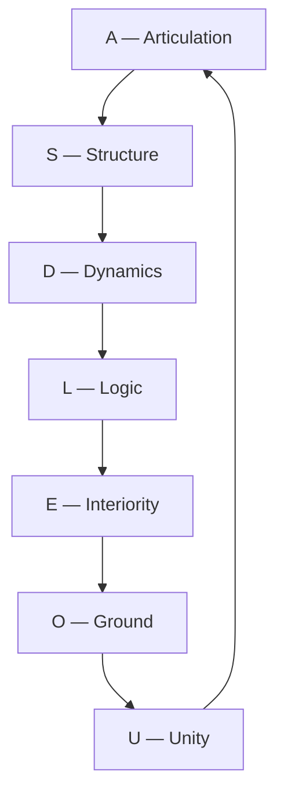
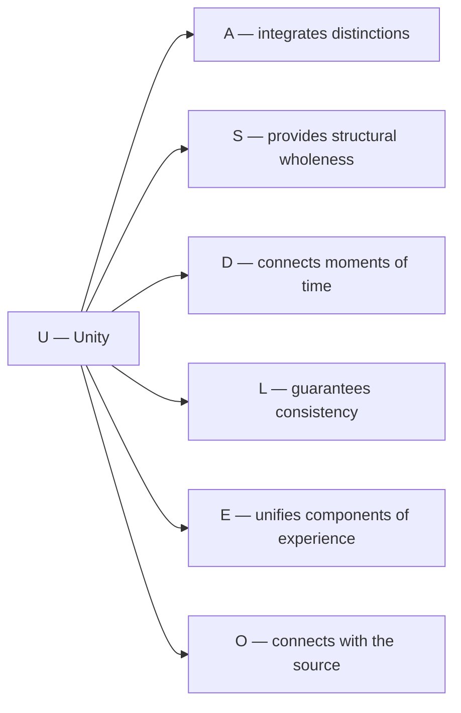

# Dimension VII: Unity (U)

## What this chapter is about

This chapter is devoted to the seventh dimension of the Holon — **Unity**. You will learn:

- Why the idea of unity — from Parmenides to Tononi — occupies a central place in the understanding of reality;
- How dimension $U$ works as a **conductor of the orchestra**, ensuring the coherence of the other six dimensions;
- What the integration measure $\Phi$ is and how it is computed in a **concrete numerical example**;
- Why the threshold $\Phi_{\text{th}} = 1$ is not an arbitrary number but the **unique self-consistent** value;
- How $\Phi_{\text{UHM}}$ differs from Tononi's $\Phi_{\text{IIT}}$ and why the UHM measure is **orders of magnitude** faster;
- What happens when **unity collapses** — from dissociative disorders to depersonalisation.

:::info Who this chapter is for
If you are reading about UHM for the first time — start with the [overview of dimensions](./dimensions). If you are already familiar with the seven dimensions and want to understand what makes a Holon *a unified whole* — you are in the right place.
:::

## Function

**To integrate, to close, to return to the whole.**

## Historical precursor {#историческая-предтеча}

The question "what turns a multiplicity into a unity?" has arisen at every stage in the development of thought.

**Parmenides** (5th century BCE) claimed: being is **one**. There is no void, no non-being, no multiplicity in the genuine sense. Everything that is — is one continuous whole. This radical thesis seems absurd (we do see many things!), but it captured a key intuition: **unity is not a property of things but a condition of their existence**. If a thing is not unified — it is not a thing, but a collection of pieces.

**Gottfried Leibniz** (1714) in the *Monadology* went further: each **monad** is an indivisible unity that "reflects" the entire universe from its own viewpoint. Monads have no "windows" (they do not interact directly), but are coordinated by "pre-established harmony". In UHM the role of "pre-established harmony" is played by the coherences $\gamma_{ij}$: dimensions do not exist in isolation — they are connected, and $U$ ensures that those connections form a whole.

**Giulio Tononi** (2004) in the **Integrated Information Theory (IIT)** gave the first mathematical formalisation of unity: the measure $\Phi_{\text{IIT}}$ assesses how much the system is "more than the sum of its parts". If a system can be cut into two subsystems without loss of information — $\Phi_{\text{IIT}} = 0$, the system is not unified. The more information is lost at any cut — the larger $\Phi_{\text{IIT}}$. The problem: computing $\Phi_{\text{IIT}}$ requires enumerating **all** possible bipartitions — this is $O(2^N)$, an exponentially hard task.

**Daniel Kahneman** (2011) in *Thinking, Fast and Slow* described two "modes" of thinking: **System 1** (fast, automatic) and **System 2** (slow, reflective). From the UHM perspective these are two modes of *integration*: System 1 operates at moderate $\Phi$ (sufficient for a quick response), System 2 requires high $\Phi$ (deep integration of all information sources). The transition between systems is a change in $\Phi$ in real time.

In UHM theory all these ideas converge in a single dimension: **Unity ($U$)** — the Parmenidean One, Leibnizean harmony, Tononovian integrated information, and Kahneman's integration — formalised through the measure $\Phi$ with polynomial computability.

## Description

Unity is the dimension that binds all the other six into one inseparable Holon. It provides the **wholeness and identity** of the system $\mathbb{H}$.

### Intuitive explanation {#интуитивное-объяснение}

Imagine a symphony orchestra. Each musician ($A$, $S$, $D$, $L$, $E$, $O$) plays their own part. The violins distinguish notes ($A$), the cellos create structure ($S$), the percussion sets the rhythm ($D$), the logic of the score connects the parts ($L$), the emotion of the music is experienced ($E$), the energy of breath sustains the playing ($O$). But what turns six parts into **one work**? The **conductor** — dimension $U$.

Without a conductor each musician plays technically correctly, but the result is cacophony. With a conductor — a symphony. The measure $\Phi$ quantifies how "coordinated" the orchestra is: at $\Phi < 1$ the musicians play separately (each hears only themselves), at $\Phi \geq 1$ — a single work sounds (each hears the whole).

:::info Ontological status
Unity is an **aspect** of configuration $\Gamma$, not a separate entity. "The Holon is unified" means: in the coherence matrix $\Gamma$ the projection onto the basis vector $|U\rangle$ is active, and the normalisation condition $\mathrm{Tr}(\Gamma) = 1$ is satisfied.
:::

:::warning Connection with autopoiesis
Removal of dimension $U$ violates **(AP)** — there is no integration, no wholeness. Without $U$ the system fragments and cannot maintain coherence as a unified whole. See [proof](../../proofs/minimality/theorem-minimality-7#случай-n--6-удаление-единства-u).
:::

## Mathematical representation

### Population of U {#населённость-u}

The diagonal element of the coherence matrix:

$$
\gamma_{UU} = \langle U|\Gamma|U\rangle > 0
$$

The condition $\gamma_{UU} > 0$ means that the Unity dimension is active in configuration $\Gamma$. The population $\gamma_{UU}$ is the "strength of the conductor": the more resources allocated to Unity, the more robust the integrity of the system.

**Typical values:**

| System | $\gamma_{UU}$ | Interpretation |
|--------|---------------|----------------|
| Set of disconnected parts | $\sim 0.02$ | Minimal unity |
| Simple organism | $\sim 0.10$ | Basic integrity |
| Healthy human | $\sim 0.16$ | Developed integration |
| Deep meditation | $\sim 0.22$ | Enhanced unity |

:::note
With uniform distribution $\gamma_{UU} = 1/7 \approx 0.143$. Deviation upward — the system emphasises wholeness; downward — tendency towards fragmentation.
:::

### Stress in the U channel

$$
\sigma_U = \mathrm{clamp}(1 - 7\gamma_{UU},\; 0,\; 1) \quad \text{[D] (T-92)}
$$

- $\sigma_U = 0$: unity is provided ($\gamma_{UU} \geq 1/7$)
- $\sigma_U = 1$: critical unity deficit ($\gamma_{UU} \to 0$) — the system is on the verge of fragmentation

### Normalisation condition

Unity is also formalised through the **normalisation condition** of the [coherence matrix](../../reference/specification#матрица-когерентности):

$$
\mathrm{Tr}(\Gamma) = \sum_{i \in \{A,S,D,L,E,O,U\}} \gamma_{ii} = 1
$$

This condition guarantees that the sum of all diagonal elements (probabilities) equals 1 — the system exists as a whole. Normalisation is the simplest manifestation of unity: all parts together make up 100%.

### Integration measure Φ {#мера-интеграции-φ}

<!-- DRY: Master definition of Φ (integration measure). All references should point here: /docs/core/structure/dimension-u#мера-интеграции-φ -->

The **integration measure** $\Phi$ quantifies the degree of coherence (connectedness) between the dimensions of the Holon:

$$
\Phi(\Gamma) = \frac{\sum_{i \neq j} |\gamma_{ij}|^2}{\sum_i \gamma_{ii}^2}
$$

where:
- Numerator — sum of squared moduli of **coherences** (off-diagonal elements)
- Denominator — sum of squares of **diagonal elements**

**Interpretation:**
- $\Phi = 0$: classical ensemble without coherences (orchestra without a conductor — each on their own)
- $\Phi = 1$: phase-transition point — connections are equal in strength to localisation
- $\Phi = 6$: the maximum — a pure state with equal weight on all seven dimensions, $|\psi_i|^2 = 1/7$ (maximal integration). "Entangled" does not apply here: $\mathbb{C}^7$ has no tensor factorisation, since 7 is prime, and entanglement is defined only in the 42-dimensional extension $\mathbb{C}^7 \otimes \mathbb{C}^6$.

**Upper bound (an elementary consequence of the definition, not a registry theorem).** Since $P = \mathrm{Tr}(\Gamma^2) = \sum_i \gamma_{ii}^2 + \sum_{i \neq j}|\gamma_{ij}|^2$, one has $\Phi = P/\sum_i \gamma_{ii}^2 - 1$; by Cauchy–Schwarz $\sum_i \gamma_{ii}^2 \geq (\sum_i \gamma_{ii})^2/7 = 1/7$. Hence $\Phi \leq 7P - 1 \leq 6$, with equality exactly for pure states with uniform diagonal. Inside the conscious window $P \leq 3/7$ this gives $\Phi \leq 2$.

### Numerical example of computing Φ {#числовой-пример}

Consider a concrete matrix $\Gamma$ for illustration. Let $N = 3$ (simplified, for three dimensions):

$$
\Gamma = \begin{pmatrix} 0.4 & 0.2 & 0.1 \\ 0.2 & 0.35 & 0.15 \\ 0.1 & 0.15 & 0.25 \end{pmatrix}
$$

**Step 1.** Diagonal elements: $\gamma_{11} = 0.4$, $\gamma_{22} = 0.35$, $\gamma_{33} = 0.25$.

**Step 2.** Denominator (sum of squares of the diagonal):

$$
\sum_i \gamma_{ii}^2 = 0.4^2 + 0.35^2 + 0.25^2 = 0.16 + 0.1225 + 0.0625 = 0.345
$$

**Step 3.** Off-diagonal elements: $\gamma_{12} = 0.2$, $\gamma_{13} = 0.1$, $\gamma_{23} = 0.15$ (the matrix is Hermitian, so $\gamma_{ji} = \overline{\gamma_{ij}}$; here all are real for simplicity).

**Step 4.** Numerator (sum of squares of off-diagonal elements — each element counted twice, $i \neq j$):

$$
\sum_{i \neq j} |\gamma_{ij}|^2 = 2(0.2^2 + 0.1^2 + 0.15^2) = 2(0.04 + 0.01 + 0.0225) = 0.145
$$

**Step 5.** Result:

$$
\Phi = \frac{0.145}{0.345} \approx 0.42
$$

Conclusion: $\Phi < 1$ — the system is **not integrated**. The connections between dimensions are weaker than the "weight" of the dimensions themselves. This is like an orchestra where each musician hears themselves more than their neighbour.

If instead $\gamma_{12} = 0.30$, $\gamma_{13} = 0.24$, $\gamma_{23} = 0.23$ (strong connections satisfying positive semidefiniteness: $\lambda_{\min} \approx 0.0645 > 0$, $P = 0.746$, $P_{\mathrm{diag}} = 0.345$), one obtains:

$$
\Phi = \frac{2(0.30^2 + 0.24^2 + 0.23^2)}{0.345} = \frac{2(0.09 + 0.0576 + 0.0529)}{0.345} = \frac{0.401}{0.345} \approx 1.16
$$

Now $\Phi > 1$ — the system is **integrated** (and genuinely positive semidefinite). For a concrete $7\times 7$ viable example inside the conscious window, take $\Gamma = \frac{1}{2}I_7/7 + \frac{1}{2}uu^\dagger$ with $u = \frac{1}{\sqrt{7}}(1,\dots,1)^\top$: it has $\lambda_{\min} = 1/14 > 0$, $P = 5/14 \approx 0.357$, $R = 0.40 \ge 1/3$, and $\Phi = 1.50 \ge 1$.

**Corollary — integration forces voice-multiplicity.** The total purity $P = \mathrm{Tr}(\Gamma^2) = \sum_{i \neq j}|\gamma_{ij}|^2 + \sum_i \gamma_{ii}^2$ is *exactly* the numerator plus the denominator of $\Phi$, so the diagonal weight is pinned:

$$
\sum_i \gamma_{ii}^2 = \frac{P}{1+\Phi}.
$$

Since $P \leq 1$ (eigenvalues lie in $[0,1]$, so $\sum \lambda^2 \leq \sum \lambda = 1$), the integration gate forces the diagonal to spread:

$$
\Phi \geq 1 \;\Longrightarrow\; \sum_i \gamma_{ii}^2 \leq \tfrac{1}{2} \;\Longrightarrow\; \frac{1}{\sum_i \gamma_{ii}^2} \geq 2.
$$

**An integrated holon is never localised on a single voice**: $\Phi \geq 1$ necessarily distributes the diagonal weight over at least two effective voices (participation ratio $\geq 2$). This *diagonal* (voice-weight) multiplicity is distinct from — and not implied by — the E-sector differentiation $D_{\mathrm{diff}} = e^{S_{vN}} \geq 2$ (T-151), which is **independent** of $\Phi$: a state can be integrated yet have $D_{\mathrm{diff}} < 2$ (see [conscious-window](/docs/proofs/consciousness/conscious-window), Counterexample 4). Integration compels voice-multiplicity, not phenomenal richness — two distinct "at-least-two" conditions, exact and cheap to check.

Within the **consciousness window** this sharpens. Reflection $R \geq 1/3$ forces $P \leq 3/7$, so a conscious holon (also $\Phi \geq 1$) has participation

$$
\frac{1}{\sum_i \gamma_{ii}^2} = \frac{1+\Phi}{P} \geq \frac{2}{3/7} = \frac{14}{3} \approx 4.67.
$$

**Consciousness engages nearly five of the seven voices**: it is structurally broad, never a single-voice specialist. (The bound is tight at the window edge $\Phi = 1$, $P = 3/7$; real charts, with $\Phi \approx 1.03$ and $P \approx 0.34$, sit near $1/d^2 \approx 6$.)

## Role in integration

### Integration of experience (L2)

At level L2 ([cognitive qualia](../../proofs/consciousness/interiority-hierarchy#уровень-2-когнитивные-квалиа-cognitive-qualia)) the subjective unity of experience ("I") arises when the following conditions are satisfied:

$$
R \geq R_{\text{th}} = \frac{1}{3}, \quad \Phi \geq \Phi_{\text{th}} = 1
$$

where $R$ is the [reflection measure](/docs/consciousness/foundations/self-observation#мера-рефлексии-r). The thresholds $P_{\text{crit}} = 2/7$, $R_{\text{th}} = 1/3$, and $\Phi_{\text{th}} = 1$ are **model definitions [D]** (structural majority, three-way reflection cut, and coherent majority; see [L2 thresholds](../foundations/axiom-septicity#пороги-l2-строгий-вывод)). What is a theorem **[T]** is their algebraic compatibility on uniform-diagonal states: $P > 2/7 \iff \Phi > 1$ whenever $\gamma_{ii} = 1/7$ ([T-129](/docs/proofs/consciousness/operationalization#t-129)).

### Integration threshold Φ_th = 1 [D] {#теорема-порог-интеграции}

:::info Status: [D] Model definition; [T] algebraic compatibility with $P_{\text{crit}} = 2/7$ on uniform diagonals (T-129)
The threshold $\Phi_{\text{th}} = 1$ defines **coherent majority** ($\sum_{i\neq j}|\gamma_{ij}|^2 \ge \sum_i \gamma_{ii}^2$) [D]. On uniform-diagonal states ($\gamma_{ii} = 1/7$), $P = \frac{1}{7}(1+\Phi)$, so $\Phi \ge 1$ coincides algebraically with $P \ge 2/7$ [T] ([T-129](/docs/proofs/consciousness/operationalization#t-129)).
:::

**Statement:**

$$
\Phi_{\text{th}} = 1
$$

**Motivation for the threshold:**

**Step 1: Definition of Φ**

$$
\Phi(\Gamma) = \frac{\sum_{i \neq j} |\gamma_{ij}|^2}{\sum_i \gamma_{ii}^2}
$$

**Step 2: Interpretation of components**

- Numerator: total "energy" of coherences (connections between dimensions)
- Denominator: total "energy" of the diagonal (localisation in individual dimensions)

$\Phi = 1$ means: **coherences carry the same aggregate weight as the diagonal**.

**Step 3: Geometric intuition**

Returning to the orchestra analogy. Each musician has a "volume" ($\gamma_{ii}$) and a "hearability of neighbours" ($|\gamma_{ij}|$). The threshold $\Phi = 1$ is the moment when **the total volume of all connections between musicians becomes no less than the total volume of the musicians themselves**. It is precisely at this moment that the orchestra begins to sound as a unified whole, not as a collection of soloists.

**Step 4: Integration condition**

A system is **integrated** if the connections between dimensions are no weaker than the dimensions themselves:

$$
\sum_{i \neq j} |\gamma_{ij}|^2 \geq \sum_i \gamma_{ii}^2
$$

This is equivalent to:

$$
\Phi \geq 1
$$

**Step 5: Minimality of the threshold**

$\Phi_{\text{th}} = 1$ is the **minimal** value at which the system is integrated by definition:
- At $\Phi < 1$: the diagonal dominates → fragmented state
- At $\Phi \geq 1$: coherences are no weaker than the diagonal → integrated state

**Step 6: Summary**

The boundary $\Phi = 1$ separates:
- $\Phi < 1$: classical mixture (localisation dominates over connections)
- $\Phi \geq 1$: quantum integration (connections are no weaker than localisation)

The value $\Phi_{\text{th}} = 1$ is a model definition **[D]** that aligns algebraically with $P_{\text{crit}} = 2/7$ on uniform-diagonal states ([T-129](/docs/proofs/consciousness/operationalization#t-129)).

### Which contents can cross the threshold {#какое-содержание-берёт-порог}

The threshold definition says *when* a holon is integrated. For the **restricted class of real $\{\pm 1\}$ equal-modulus** flat-diagonal states (T-315), it also yields an exact balance criterion.

Fix the diagonal flat — every dimension carrying the same weight $\gamma_{ii} = 1/7$, so that nothing is decided by localisation — and restrict to **real** equal-modulus coherences whose signs form a symmetric matrix $S$ with $S_{ij} \in \{+1, -1\}$ ($i\neq j$) and $S_{ii} = 0$. A state in this real $\{\pm 1\}$ stratum with coherence strength $c$ is

$$
\Gamma = \tfrac{1}{7} I + c\,S
$$

**Step 1 — what $\Phi$ becomes.** The denominator is $\sum_i \gamma_{ii}^2 = 7 \cdot (1/7)^2 = 1/7$. The numerator counts each of the $21$ pairs twice, each contributing $c^2$, so it is $42c^2$. Hence

$$
\Phi = \frac{42c^2}{1/7} = 294\,c^2
$$

Integration therefore grows with the strength of the coherences and with nothing else — so the question becomes how strong they are *allowed* to be.

**Step 2 — how far the content can be pushed.** A state must stay positive: no dimension may carry negative weight in any basis. The eigenvalues of $\Gamma$ are $1/7 + c\,\mu$ where $\mu$ runs over the eigenvalues of $S$, so the binding constraint comes from the most negative one, $\lambda_{\min}(S)$. Positivity holds exactly while

$$
c \le \frac{1}{7\,|\lambda_{\min}(S)|}
$$

**Step 3 — the identity.** Substituting that ceiling into Step 1:

$$
\Phi_{\max} = 294 \cdot \frac{1}{49\,\lambda_{\min}(S)^2} = \frac{6}{\lambda_{\min}(S)^2}
$$

This is an identity, not an approximation; measured against direct computation it holds to $8.9 \cdot 10^{-16}$, which is machine precision. And it converts the integration gate into a **spectral condition on the shape of the content**:

$$
\Phi \ge 1 \iff |\lambda_{\min}(S)| \le \sqrt{6} \approx 2.449
$$

**Step 4 — which patterns pass.** Suppose each dimension carries a single orientation $s_i = \pm 1$ — call it a *polarity* — and two dimensions agree exactly when their orientations match, so $S_{ij} = s_i s_j$. Then $S = ss^{\top} - I$, whose eigenvalues are $6$ (once, along $s$ itself) and $-1$ (six times). So $\lambda_{\min} = -1$ and $\Phi = 6$: the largest value any sign pattern can reach, and six times over the threshold.

Now flip a single one of the twenty-one agreements. The smallest eigenvalue moves to $-2.5311$, and

$$
\Phi = \frac{6}{2.5311^2} = 0.9365
$$

The gate closes. **One disagreement out of twenty-one costs a factor of six and misses the threshold by three percent.** A second flip gives $0.7151$, a third $0.5185$; nothing recovers.

**Step 5 — why, and exact scope (T-315) [T].** A signed graph is called *balanced* when the product of signs around every cycle is positive; Harary's theorem states that a complete graph is balanced precisely when its signs factor as $S_{ij} = s_i s_j$. Within the **real $\{\pm 1\}$ equal-modulus** flat-diagonal stratum, the integration gate and Harary balance coincide exactly: every balanced sign matrix has $\lambda_{\min} = -1$ ($\Phi_{\max} = 6$), while every frustrated real $\{\pm 1\}$ sign matrix has $|\lambda_{\min}| \ge 2.5311 > \sqrt{6}$ ($\Phi_{\max} \le 0.9365 < 1$, checked across all non-isomorphic sign patterns / 600 samples).

:::warning Strict scope of T-315: real $\{\pm 1\}$ matrices only
This gap-separation theorem applies **strictly to real $\{\pm 1\}$** equal-modulus matrices $S$. Allowing **complex** phases on the same flat-diagonal equal-modulus stratum immediately breaks the dichotomy: replacing a single off-diagonal pair $(0,1) \mapsto i$, $(1,0) \mapsto -i$ (leaving all other $S_{ij} = +1$) creates non-trivial complex holonomies yet yields $\lambda_{\min} \approx -2.1104$ and $\Phi_{\max} = 6/\lambda_{\min}^2 \approx 1.347 > 1$!
:::

The consequence for capacity is sharp. The twenty-one coherences of a holon look like twenty-one independent bits, but only $2^7 = 128$ sign patterns are balanced, and $s$ and $-s$ give the same pattern. **Integrable content is seven polarities, not twenty-one bits, and there are exactly $2^7/2 = 64$ integrable states.** The twenty-one cells are not twenty-one facts; they are the pairwise agreement of seven orientations.

**Step 6 — what this buys.** Because integrable content is so constrained, most of it is redundant: seven orientations determine all twenty-one pairs, so a holon told about some pairs has, in principle, been told about the rest. And the mechanism that collects on this is already present, unbidden — it is positivity itself. A frustrated pattern does not fit near the boundary of positivity, since its $\lambda_{\min}$ is too negative; so a write that pushes the state past that boundary and is then **projected back onto the state manifold** is pulled towards the nearest balanced pattern, and in being pulled it fills in pairs it was never told.

This is measurable. Teach a holon seven of its twenty-one pairs and never mention the other fourteen. A write that projects afterwards holds a non-zero opinion about $100\%$ of the fourteen it never saw, and that opinion is correct $85.7\%$ of the time — $28.6$ percentage points above the best constant answer available in hindsight. The same write *without* the projection reaches $0\%$ of them: it knows only what it was told, exactly as a lookup table does. And the effect is specific rather than general: strip the polarity out of the content, giving each pair an independent random sign, and accuracy falls to $50.0\%$ — a coin. What the projection propagates is a polarity and nothing else.

So generalisation, in this architecture, is not a rule added on top. **It is positivity**, which is to say it is the same requirement that makes a state a state at all.

### Connection with Integrated Information (IIT) {#связь-с-iit}

:::info Status: [D] Definitions; [H] qualitative comparison
$\Phi_{\text{UHM}}$ is defined directly on $\mathcal D(\mathbb C^7)$ in a chosen orthonormal frame [D]. Standard quantum $\Phi_{\text{IIT}}$ requires tensor bipartitions $\mathcal H = \mathcal H_A \otimes \mathcal H_B$, which **do not exist** for a single prime-dimensional register $\mathbb C^7$ ($7$ is prime!). Comparing $\Phi_{\text{UHM}}$ and $\Phi_{\text{IIT}}$ therefore requires either a composite tensor extension ($\mathbb C^{7^k}$) or a classical/diagonal partition proxy, and any threshold match remains a [H] hypothesis.
:::

#### Definition of $\Phi_{\text{IIT}}$ on composite systems

On a **composite** tensor-product Hilbert space $\mathcal H = \bigotimes_{a} \mathcal H_a$ admitting nontrivial bipartitions $\pi = (A|B)$, one may define a Bures-distance bipartition measure:

$$
\Phi_{\text{IIT}}(\Gamma_{\text{comp}}) := \min_{\pi \in \text{Part}(\mathcal H)} D_B\bigl(\Gamma_{\text{comp}},\, \rho_A \otimes \rho_B\bigr)
$$

where $\rho_A = \mathrm{Tr}_B(\Gamma_{\text{comp}})$, $\rho_B = \mathrm{Tr}_A(\Gamma_{\text{comp}})$, and $D_B$ is the Bures distance. Note carefully: on a single native holon $\mathcal H = \mathbb C^7$, $7$ is prime, so $\text{Part}(\mathbb C^7)$ has no nontrivial tensor bipartitions and the formula above is **undefined** without first specifying a composite tensor system or a classical subset-partition surrogate.

#### Definition of the integration threshold {#теорема-эквивалентность-порогов}

:::info Definition (Threshold of coherent integration) [D]
A system is **coherently integrated** if coherences are at least as large in Hilbert–Schmidt weight as the diagonal populations:

$$
\Phi(\Gamma) \geq \Phi_{\text{th}} = 1 \quad \Longleftrightarrow \quad \underbrace{\sum_{i \neq j} |\gamma_{ij}|^2}_{P_{\text{coh}}} \geq \underbrace{\sum_i \gamma_{ii}^2}_{P_{\text{diag}}}
$$

:::

**Structural meaning.** The threshold $\Phi_{\text{th}} = 1$ is a model definition **[D]** aligned with $P_{\text{crit}} = 2/7$ on uniform diagonals ([T-129](/docs/proofs/consciousness/operationalization#t-129)):

1. **Purity normalisation:** $P = \mathrm{Tr}(\Gamma^2) = P_{\text{diag}} + P_{\text{coh}}$, so $\Phi \geq 1 \Leftrightarrow P_{\text{coh}} \geq P/2$ — at least half of [purity](/docs/core/dynamics/viability#определение-чистоты) is carried by off-diagonal coherences in the chosen frame.

2. **Structural regime boundary:** At $\Phi < 1$ diagonal populations dominate; at $\Phi \geq 1$ inter-axis coherences dominate in squared Hilbert–Schmidt norm.

3. **Connection with (AP):** Frame-based coherence coupling between axes supports off-diagonal information transfer across the seven roles (whereas a purely diagonal state has $\Phi = 0$). (The former claim identifying matrix entries $\gamma_{ij}$ with categorical Hom-sets $\mathrm{Hom}(i,j)$ via L-unification is **withdrawn [✗]**; see [categorical formalism](/docs/proofs/categorical/categorical-formalism#l-унификация).)

#### Comparison with Φ_IIT {#сравнение-с-iit}

:::warning Hypothesis (Qualitative UHM–IIT comparison) [H]

$$
\Phi_{\text{UHM}} \geq 1 \quad \longleftrightarrow \quad \Phi_{\text{IIT}} \geq \log(2) \quad \text{(on a composite extension, [H])}
$$

Any numerical threshold correspondence is an **open hypothesis**, since $\Phi_{\text{UHM}}$ is a frame-dependent coherence ratio on $\mathbb{C}^7$ whereas tensor-bipartition $\Phi_{\text{IIT}}$ is defined only on composite (non-prime-dimensional) systems.
:::

| Aspect | $\Phi_{\text{UHM}}$ | $\Phi_{\text{IIT}}$ |
|--------|---------------------|---------------------|
| Definition | Ratio of coherences to diagonal in a chosen frame | Minimum distance to product state across tensor bipartitions |
| Domain | Single $\mathbb C^7$ (or any $N$) | Composite tensor systems only (undefined on prime-dim $\mathbb C^7$) |
| Threshold | $1$ **[D]** (compatible with $P_{\mathrm{crit}}=2/7$ on uniform diagonals, T-129) | $\log(2) \approx 0.693$ (hypothesis) |
| Computational complexity | $O(N^2)$ — **polynomial** | Exponential in number of tensor factors |
| Structural interpretation | Coherent domination | Bipartition inseparability |

#### Why $O(N^2)$ vs $O(2^N)$ matters {#вычислительная-сложность}

For practical applications (AI, neuroscience, clinical diagnostics) computational complexity is not an abstract question, but a question of **feasibility**.

| $N$ (number of elements) | $\Phi_{\text{UHM}}$: $N^2$ operations | $\Phi_{\text{IIT}}$: $2^N$ bipartitions |
|---|---|---|
| 7 | 49 | 64 |
| 20 | 400 | 1 048 576 ($\sim 10^6$) |
| 100 | 10 000 | $\sim 10^{30}$ (impossible) |
| 1000 | 1 000 000 | $\sim 10^{301}$ (absurd) |

For a brain with $\sim 10^{11}$ neurons: $\Phi_{\text{IIT}}$ is uncomputable in principle. $\Phi_{\text{UHM}}$ (with adequate coarse-graining to $N = 7$ dimensions) is computable instantly. This makes UHM a **practically applicable** theory of consciousness, unlike IIT, which remains mathematically elegant but computationally inaccessible.

### Closure of causality

Unity closes the causal cycle of the (M,R)-system:

The closure $U \to A$ ensures **self-consistency**: the result of integration returns to articulation, generating a new cycle. Without this closure the chain $A \to S \to D \to L \to E \to O$ breaks — the system is "open" and cannot sustain itself.

### The gate is one inequality {#ворота-суть-одно-неравенство}

There is a way of writing a state that makes all of this fall out at once. Positivity
of each two-by-two minor already caps every coherence at

$$
|\gamma_{ij}| \;\le\; \sqrt{d_i d_j},
$$

so each pair has a ceiling set by how populated its two axes are — a pair of axes that
barely carries anything cannot be strongly bound, no matter what the rest of the state
does. Divide each coherence by its own ceiling and the state factors:

$$
\Gamma \;=\; D^{1/2}\, K\, D^{1/2},
$$

with $D$ the diagonal and $K$ a correlation matrix — ones down the diagonal, and off it
the *fraction of the ceiling actually used*. The factorisation earns its keep by
separating two things that had been read together. Multiplying on both sides by the
positive definite $D^{1/2}$ cannot change a signature, so $\Gamma$ is admissible exactly
when $K$ is: **positivity lives entirely in $K$ and does not mention the diagonal at
all**. Whatever pattern of binding the geometry permits at one distribution of
population, it permits at every other. The diagonal carries no constraint — it carries
only weight.

Integration is then a single ratio. Writing $p = \sum_i d_i^2$ for the purity of the
diagonal, and $c_{\text{eff}}$ for the ceiling fraction averaged with each pair weighted
by $d_i d_j$,

$$
\Phi \;=\; c_{\text{eff}}^{\,2}\;\frac{1-p}{p}.
$$

That identity is exact. So the threshold $\Phi \ge 1$ is one inequality,
$c_{\text{eff}} \ge \sqrt{p/(1-p)}$, and it can be met in exactly three ways: bind
harder everywhere, spread the population out, or spend the binding where the population
already is. Only the third is free — it costs no additional coherence and no flattening,
and it is the one measured states use.

The same factorisation settles what such a state may contradict **within the real $\{\pm 1\}$ equal-modulus class**. If every pair used the same fraction of its ceiling with a **real $\{\pm 1\}$** sign pattern $\Sigma$, $K$ would be $(1-c)I + c\Sigma$, positivity would read $\lambda_{\min}(\Sigma) \ge -1/c$, and the gate would force $\lambda_{\min} \ge -\sqrt{(1-p)/p}$ — which at a flat diagonal is exactly $-\sqrt 6$, the balance criterion of the previous section (whereas complex equal-modulus phases already allow $\Phi_{\max} \approx 1.347 > 1$). Under uniform saturation with real $\{\pm 1\}$ signs, the frustration compatible with an open gate is zero **at every diagonal**, flat or not. So unevenness (or complex phases) is what lets a general state hold frustration and stay integrated.

### What the gate does not read {#чего-ворота-не-читают}

The splitting has an uncomfortable consequence, and it is worth stating before anything
softens it. In these coordinates a state is forty-eight numbers: six of population,
twenty-one coherence moduli, twenty-one coherence phases. Now read the four gates off
their own definitions —

$$
P=\sum_{i\neq j}|\gamma_{ij}|^2+\sum_i d_i^2,\quad R=\frac{1}{7P},\quad
\Phi=c_{\text{eff}}^2\frac{1-p}{p},\quad
D=1+6\,\frac{d_E^2+2\sum_i|\gamma_{Ei}|^2}{P}
$$

— and every one of them is a function of moduli and populations alone. **Not one gate
reads a phase.** This is not an approximation or a limiting case; phases appear in the
theory in exactly one place, the positivity condition, and there they act as a
constraint on what is admissible rather than as something anybody looks at. The verdict
that decides whether a holon is alive is a function of twenty-seven of its
forty-eight numbers.

Whether that costs anything depends on whether the other twenty-one carry information,
and there the answer has two halves that must not be run together. They are not free to
vary: computed states turn out to be rank-deficient boundary points — a typical spectrum
is $[0,0,0,0.052,0.158,0.289,0.482]$, three exact zeros — and at such a point no phase
moves while everything else stands still. Uniform rephasing was admissible zero times in
two thousand attempts, and the freedom of a single phase measured zero to four decimal
places, for every phase in every state tried.

But locked is not the same as empty. The test that settles it is to erase the phases
*before* the repair rather than after: make every raw coherence real and positive, then
project as usual. The output comes back with a median of zero broken triangles where the
untouched output has twelve of thirty-five, and the two agree on barely one chart in a
hundred. So the phase content is carried in from outside, survives the repair, and lands
in the state — and then no gate looks at it.

What the gate misses is not a leftover. It is exactly consistency: which triangles close
and which fight, how much quality a line carries, whether the state is balanced at all.
A holon can therefore pass every viability test the theory states while being as
self-contradictory as positivity permits, and nothing in the verdict will register the
difference. Whether that is a defect or a correct division of labour — a viability
criterion measuring aliveness and leaving coherence to another instrument — is a real
question, and it cannot be answered by adding conditions to the gates as they stand,
because there is nothing in them to add a condition to. It would take a fifth reading,
one that looks at phase.

The size of the gap can be stated exactly, and it is smaller than twenty-one and larger
than nothing. Six of the phases are pure gauge: rephasing an axis, $\gamma_{ij} \mapsto
e^{i(\theta_i - \theta_j)}\gamma_{ij}$, moves the numbers without moving the state, and
that action has rank six — seven axis phases with the global shift acting trivially. What
is left is **fifteen genuine invariants that nothing in the verdict reads**, which is also
the number of independent triangle holonomies among the thirty-five. The theory is not
empty-handed about them: its seven Fano lines are independent, and each pair of axes lies
on exactly one line, so the lines organise the phases without remainder. But seven of
fifteen is $46.7\%$. Even a fifth gate that read every line perfectly would leave more
than half of what the state knows about its own consistency unread.

One provenance note belongs here rather than in a footnote, because it changes what an
earlier observation means. The rank deficiency and the position at the edge are not
discoveries about states; they are what the repair step does. The matrix before repair
lies outside the cone of admissible states in every single case measured, with a typical
$\lambda_{\min}$ of $-0.28$, and a projection of an infeasible point lands on the
boundary by definition. So "every state sits at the edge of positivity" is a restatement
of the repair, and any argument resting on it is resting on a choice of machinery.

### Three sums {#три-суммы}

For the native definitions in a fixed semantic frame, put $d_i=\gamma_{ii}$ and
$$
s_1=\sum_i d_i^2,\qquad s_2=\sum_{i\neq j}|\gamma_{ij}|^2,\qquad
s_3=d_E^2+2\sum_{j\neq E}|\gamma_{Ej}|^2.
$$
The exclusion $j\neq E$ prevents counting the E population twice. Then exactly
$$
P=s_1+s_2,\qquad R=\frac{1}{7(s_1+s_2)},\qquad \Phi=\frac{s_2}{s_1},\qquad
\mathrm{Coh}_E=\frac{s_3}{s_1+s_2},\qquad D^{7D}=1+\frac{6s_3}{s_1+s_2}.
$$
Thus these native proxies, and $C=\Phi R$, factor through three real statistics. They are constant on each admissible fibre of $(s_1,s_2,s_3)$. This does not license changing forty-five independent coordinates arbitrarily: positivity, support and singular fibres constrain the allowed states. Permuting axes while fixing E preserves these sums; changing phases at fixed populations and magnitudes preserves them whenever the resulting matrix remains positive semidefinite.

These proxies do not read the Fano-line cycle phases. To show that a structural change affects one of their cuts, show which sum it changes. This limited factorization is useful, but is not the full augmented hierarchy: an independently specified $D^{\mathrm{ext}}=\exp S(\rho_E)$, experiential realization, self-model and probe certificates need not factor through these sums. The [canonical hierarchy](/docs/consciousness/hierarchy/interiority-hierarchy#типизированный-вход) retains those inputs explicitly.

### A floor the diagonal cannot cross {#пол-которого-диагональ-не-перейдёт}

The three sums have a consequence that decides what a living system can and
cannot fix about itself. Start from the one inequality that always holds. The
diagonal $d$ is a probability vector, so Cauchy–Schwarz gives

$$
s_1=\sum_i d_i^2 \;\ge\; \frac{\left(\sum_i d_i\right)^2}{7}=\frac{1}{7},
$$

with equality exactly when the diagonal is perfectly flat. A flat diagonal is not
merely one option among many: it is **the least $s_1$ there is**. Since
$P=s_1+s_2$, this means

$$
P \;\ge\; \frac{1}{7}+s_2 \qquad\text{for every state.}
$$

Now recall that the window has a ceiling as well as a floor — $R=1/(7P)$ clears
$1/3$ exactly when $P\le 3/7$. Put the two together and something sharp falls
out: **once the binding alone carries more than $2/7$, the state is above the
ceiling no matter what the diagonal does.** Flatten it completely and purity is
still $1/7+s_2>3/7$. There is nowhere left to go.

Why this matters practically. A system that has to hold itself inside the window
needs some way of shedding purity when it gets too pure, and levelling the
diagonal is the natural first choice, because lowering $s_1$ lowers $P$ and
*raises* $\Phi=s_2/s_1$ at the same time — the one direction in which two
criteria improve together. Damping the binding instead lowers $P$ but takes
$\Phi$ down with it. So the gentle move is to level.

The inequality says the gentle move has a hard limit, and not a limit of degree.
On the set where $s_2>2/7$ levelling is not weak, it is **powerless**: no diagonal
whatsoever puts that state back in the window. And the set is not exotic. Drawn
uniformly it is rare — about one state in twenty thousand — but a process that
concentrates a state, pushing it toward purity, walks straight into it, because
concentration is precisely what puts weight into the binding.

What that costs, measured in a running loop across twenty-four situations: with
no purity regulation at all, **not one** situation ever reaches the window — the
drive over-purifies every time. Levelling the diagonal rescues eleven of the
twenty-four. Levelling *and then* damping the binding for whatever the levelling
could not take rescues twenty. The second move is what covers exactly the set the
first one cannot reach, and nothing else changes: on a loop whose content never
drives $s_2$ past $2/7$ the two are indistinguishable, holding the window for the
same $4998$ consecutive turns.

The landing point is worth naming. Level to flat, so $s_1=1/7$, then damp the
binding to $s_2=2/7$: purity sits exactly on the ceiling at $3/7$, integration at
$\Phi=2$, reflexivity at $R=1/3$. That is not a coincidence of arithmetic but the
maximum the theory already names — the regulator, pushed to its limit, lands on
the best point available.

One more band follows for free. Integration needs $s_2\ge s_1\ge 1/7$, and the
ceiling with $s_1\ge 1/7$ needs $s_2\le 2/7$. So

$$
\text{alive}\;\Longrightarrow\; s_2\in\left[\tfrac{1}{7},\,\tfrac{2}{7}\right],
$$

a band exactly twice as wide as the diagonal's $[1/7,\,3/14]$. Both sums are
confined, and the binding is given twice the room.

### The one channel structure has {#единственный-канал-структуры}

That leaves a question the previous sections have to answer or one of them is
wrong. If the gate reads $s_2/s_1$ and cannot see a pattern, how does $\Phi$
decide balance? It does, provably, and the section before last measured it.

The answer is that a sign pattern does not move $s_2$. It moves the **largest
$s_2$ positivity permits**. Put a state at a flat diagonal with every coherence at
the same fraction $c$ of its ceiling and push it to the edge of admissibility;
then $c = 1/|\lambda_{\min}|$ of the sign matrix, and integration is

$$
\Phi \;=\; 6c^2 \;=\; \frac{6}{\lambda_{\min}^2}.
$$

A balanced **real $\{\pm 1\}$** pattern is $uu^{\mathsf T} - I$ for some assignment of signs to axes, and that matrix has exactly two eigenvalues, $6$ once and $-1$ six times. So *every* balanced real $\{\pm 1\}$ pattern — all sixty-four of them — gives $\lambda_{\min} = -1$ exactly, and $\Phi = 6$. Harary's criterion forces every frustrated **real $\{\pm 1\}$** pattern to $|\lambda_{\min}| > \sqrt 6$, hence $c < 1/\sqrt 6$, hence $\Phi < 1$ (reaching at most $0.9365$ at five broken triangles and $\lambda_{\min} = -2.5311$). As noted above, this gap is strictly a property of the **real $\{\pm 1\}$** equal-modulus stratum: allowing complex phases (such as $(0,1)\mapsto i$) immediately populates the region $\Phi \in (1, 6)$ with frustrated states (e.g. $\Phi_{\max} \approx 1.347$).

**Between $0.9365$ and $6$ there is nothing.** Not a sparse region — an empty one.
Integration under these conditions is not a continuum with a line drawn across it;
it takes one of two widely separated values, and the threshold at $1$ falls in the
gap between them. That is worth saying plainly because it changes the standing of
a number that reads as stipulated: any threshold between $0.937$ and $6$ sorts
every state identically, and $1$ is simply the roundest number in an empty
interval of width five.

And then it is worth immediately taking most of it back, because the gap belongs
to the stratum and not to the world. Computed states meet one of the three
conditions, and their integration is unimodal and tight: over four hundred of
them the quantiles run from $0.863$ to $1.757$ about a median of $1.238$, one
state in five sits inside $[0.9,\,1.1]$ — exactly the interval the idealisation
calls empty — the nearest states on either side of the threshold are $0.9998$ and
$1.0003$, and **not one** reaches $5$, though the idealisation puts every balanced
state at precisely $6$. Where the theory is actually applied, then, the threshold
is not robust at all; it is the most consequential number in the gate, and its
value is a real choice that a fifth of all cases turn on. The robustness is a fact
about a clean stratum, and the clean stratum is not where anything lives.

And the general form of the mechanism is the useful part. Structure influences the
verdict **only** by changing what positivity permits — never by being read. So the
check the previous section handed over has a sharper version: to show that some
structure moves a gate, show that it changes the ceiling. If it does not change
the ceiling, it does not reach the verdict at all.

### What each instrument can see {#что-видит-каждый-прибор}

An observability claim names an observation model, frame, target and admitted state family. The following are algebraic inputs to the named diagnostics, not additive percentages of information.

| Diagnostic | Required state data | Scope |
|---|---|---|
| $P,R,\Phi,\mathrm{Coh}_E,D^{7D},C$ | The three sums above | Native proxies; no arbitrary extension spectrum |
| Population stress | Named populations and declared target | An unclipped fixed-target ratio can recover populations; clipping can lose them |
| Pair magnitudes | Individual complex-entry moduli | No oriented phase recovery |
| Pairwise Gap | Frame-referenced $\vert \sin\theta_{ij}\vert $ | Phase-dependent, with branch ambiguity; not a modulus |
| Seven Fano holonomies | Supported line-cycle phases | Seven independent cycle readings on full support |
| Complete phase passport | Actual support and an oriented fundamental cycle basis | $m-n+c$ cycle phases; missing support is not zero |

A full-rank framed native state has 48 real coordinates. On connected full support an explicitly declared quotient by diagonal rephasing removes six phase coordinates, giving 42 local quotient coordinates. This is not an assertion that the six are physically meaningless: a fixed phase-sensitive instrument may read them. The frame-dependent Gap statistic cannot simply be counted as a gauge-invariant modulus. Counts of coordinates, ranges of scalar diagnostics, mutual information and finite-sample precision are different quantities. The former $7.1\%/81\%$ information claims are withdrawn.

The exact cycle fact remains: $K_7$ has cycle rank $21-7+1=15$. The seven edge-disjoint Fano triangles span seven independent directions, leaving eight outside their span. A spanning-forest cycle passport covers all 15, so those eight are not intrinsically unreadable. On sparse support the count and basis change; triangle readings alone need not suffice.

There is also an exact **Euclidean edge-space** projection identity. Give each oriented edge unit norm; each triangle vector has squared norm 3. Fano triangle vectors are orthogonal because their edges are disjoint. A non-line triangle meets three different Fano triangles in one edge each, so its projection has squared norm $3(1/3)=1$ and its residual has squared norm 2. Hence the residual-to-total norm ratio is $\sqrt{2/3}$. This is one third of a squared norm, not one third of a wrapped holonomy or of information.

The historical comparison of 300 constructed states reported median absolute holonomies $0.9727$ versus $0.9999$ rad, means $1.1807$ versus $1.1832$, shares above $\pi/2$ of $0.325$ versus $0.318$, and higher variability of the eight in $50.3\%$ of states. These are reported descriptive sample figures, not a proof of equal distributions or physical/phenomenal indistinguishability. Reproducing or generalizing them requires the original generator, support policy, readings and statistical protocol. The mathematical coverage result does not depend on that comparison.

## Connection with consciousness

The consciousness measure $C = \Phi \times R$ **[D T-140]** (definition see [self-observation](/docs/consciousness/foundations/self-observation#мера-сознательности-c)). Differentiation $D_{\text{diff}} \geq D_{\min}$ is a separate viability condition.

**Exact bounds on $\Phi$ [T]:** For any $7\times 7$ state $\Gamma$, $P_{\mathrm{diag}} \ge 1/7$ and $P \le 1$, so $0 \le \Phi \le 7P - 1 \le 6$ universally. Inside the **L2 conscious window** ($R = 1/(7P) \ge 1/3 \implies P \le 3/7$), integration is strictly bounded by:

$$
1 \;\le\; \Phi \;\le\; 7P - 1 \;\le\; 2.
$$

In particular, values $\Phi \gg 1$ are **mathematically impossible** in the 7D L2 conscious window (maximum is $\Phi = 2$ at $P = 3/7$, uniform diagonal).

**Role of U in consciousness:** $\Phi$ is the direct contribution of coherent integration to $C$. Without integration ($\Phi < 1$), the state falls outside the L2 predicate even when $R \ge 1/3$.

## Examples {#примеры}

### Illustrative model regimes [I/H]

*(Values below reflect exact mathematical bounds $0 \le \Phi \le 6$ globally and $1 \le \Phi \le 2$ inside the 7D L2 window; empirical identification of any physical or biological system with a $D_7$ state requires a calibrated observation bridge [H].)*

| Regime (illustrative [I/H]) | Valid $\Phi$ range | Mathematical characterization |
|---|---|---|
| Uncorrelated / diagonal mixture | $\Phi \approx 0$ | Off-diagonal coherences negligible; $P \approx P_{\mathrm{diag}}$ |
| Weakly coupled / sub-threshold | $0 < \Phi < 1$ | Diagonal populations dominate ($P_{\mathrm{coh}} < P_{\mathrm{diag}}$) |
| Conscious window (L2) | $1 \le \Phi \le 2$ | $P \in (2/7, 3/7]$, $R \in [1/3, 1/2)$, coherent majority with $P_{\mathrm{coh}} \in [1/7, 2/7]$ |
| High-purity coherent state (outside L2) | $2 < \Phi \le 6$ | $P > 3/7$ ($R < 1/3$); maximal $\Phi = 6$ attained only by uniform-magnitude pure states ($P=1, R=1/7$) |

## Collapse of unity {#распад-единства}

When off-diagonal coherences decay ($\gamma_{ij} \to 0$ for $i \neq j$, or specifically $\gamma_{Ui} \to 0$):

1. Loss of integration: $\Phi \to 0$ as all coherences vanish (and $\gamma_{Ui} \to 0$ removes the $U$-row contribution to $P_{\mathrm{coh}}$ and cuts $\kappa_0 \propto |\gamma_{OE}||\gamma_{OU}|/\gamma_{OO}$).
2. Fragmentation of the native 7D state toward a diagonal mixture.

*(Note: because native scalar gates $P, R, \Phi$ are invariant under arbitrary permutations of axes, mapping specific psychiatric or clinical diagnoses — such as schizophrenia, dissociative identity disorder, or depersonalisation — onto individual matrix entries like $\gamma_{UL}, \gamma_{UE}, \gamma_{UA}$, or writing $\gamma_{UU} \to P_{\mathrm{crit}}$, is mathematically ungrounded and removed [✗].)*

## Connection with other dimensions

**Key connections (model roles [I]):**

- **U ↔ E:** $\gamma_{UE}$ links the unity axis with the interiority axis.
- **U ↔ O:** $\gamma_{OU}$ enters the numerator of the kinetic rate ansatz $\kappa_0 = \omega_0 |\gamma_{OE}||\gamma_{OU}|/(\gamma_{OO} + \varepsilon)$.
- **U ↔ A:** $\gamma_{UA}$ links unity with articulation.
- **U ↔ L:** $\gamma_{UL}$ links unity with logic.

## Coherence with U

| Coherence | Interpretation |
|-----------|----------------|
| $\gamma_{UA}$ | Integration of distinctions |
| $\gamma_{US}$ | Wholeness of structure |
| $\gamma_{UD}$ | Continuity of being in time |
| $\gamma_{UL}$ | Logical consistency of the whole |
| $\gamma_{UE}$ | Synthesis (integration of interior content into the whole) |
| $\gamma_{UO}$ | Connection of wholeness with the source |

## Φ and phase transitions {#фазовые-переходы}

The transition through $\Phi = 1$ is a **phase transition** in the configuration of the Holon, analogous to phase transitions in physics.

| Physical analogue | $\Phi < 1$ (fragmented) | $\Phi \geq 1$ (integrated) |
|-------------------|------------------------|---------------------------|
| Water | Steam (molecules independent) | Liquid (molecules coherent) |
| Magnet | Paramagnet (spins chaotic) | Ferromagnet (spins aligned) |
| Orchestra | Warm-up (each on their own) | Concert (single work) |
| Consciousness | Deep anaesthesia | Wakefulness |

In physics, phase transitions are accompanied by a **qualitative** change in properties: water-as-steam looks completely different from water-as-liquid. In exactly the same way, the transition through $\Phi = 1$ is a qualitative change: the system ceases to be a "collection of parts" and becomes a "whole".

:::note Connection with the consciousness threshold
The phase transition $\Phi = 1$ is one of the two necessary conditions for L2 (consciousness). The second is $R \geq 1/3$ (reflection). Only when both conditions are satisfied does conscious experience arise. Details: [L2 thresholds](../foundations/axiom-septicity#пороги-l2-строгий-вывод).
:::

## Connection with purity

[Purity](../dynamics/viability#определение-чистоты) $P$ is connected to coherences:

$$
P = \mathrm{Tr}(\Gamma^2) = \sum_{i} \gamma_{ii}^2 + \sum_{i \neq j} |\gamma_{ij}|^2
$$

High coherence with $U$ (large $|\gamma_{Ui}|$) correlates with high overall purity $P$, since coherences make a positive contribution to $P$.

**Corollary:** Unity not only "connects" the dimensions, but also **raises the overall orderliness** of the system. A connected orchestra plays "more cleanly" (higher $P$) than a disconnected one.

### Octonionic context {#октонионный-контекст}

:::note Chosen octonionic correspondence [D/I]
The assignment $U=e_6\in\operatorname{Im}\mathbb O$ belongs to the declared oriented orthonormal frame. For a specified positive octonionic three-form, its stabilizer is $G_2$ [T]. This group identity does not uniquely assign functional names to axes or determine a physical encoder. The former universal T-42a rigidity is withdrawn [✗]; [reversible-identification assumptions](/docs/proofs/categorical/uniqueness-theorem#теорема-единственности) give a conditional comparison theorem. Incidence can constrain labels **after** the required marks are supplied; those marks and the remaining label convention are model data. The [structural derivation](/docs/proofs/minimality/theorem-octonionic-derivation) states the additional algebraic inputs, and [the frame discussion](./dimensions#октонионная-интерпретация) distinguishes its symmetries from physical gauge equivalence.
:::

---

**Related documents:**
- [Axiom of Septicity](../foundations/axiom-septicity) — theorem on $\Phi_{\text{th}} = 1$
- [Ground (O)](./dimension-o) — previous dimension
- [Seven dimensions](./dimensions) — overview of all dimensions
- [Self-observation](/docs/consciousness/foundations/self-observation) — connection with consciousness
- [Viability](../dynamics/viability) — conditions of existence
- [Interiority hierarchy](../../proofs/consciousness/interiority-hierarchy) — formal definitions
- [Integrated Information Theory (comparison)](/docs/consciousness/comparative/consciousness-theories) — UHM vs IIT
- [Operationalisation](/docs/proofs/consciousness/operationalization) — derivation of T-129
