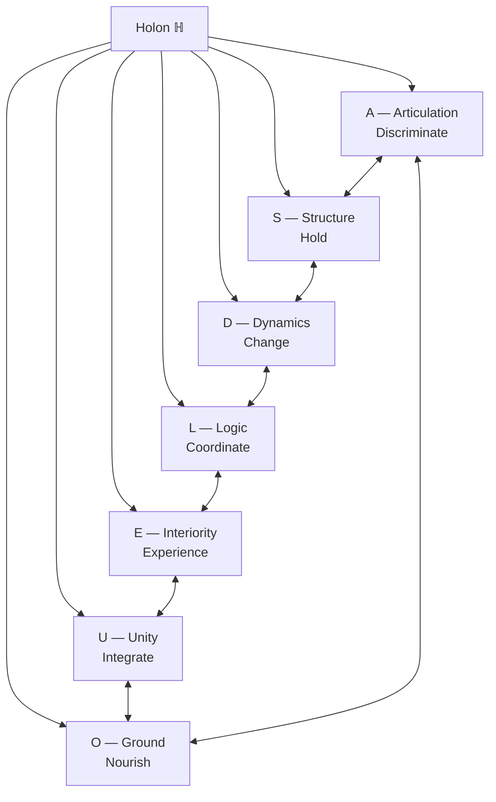
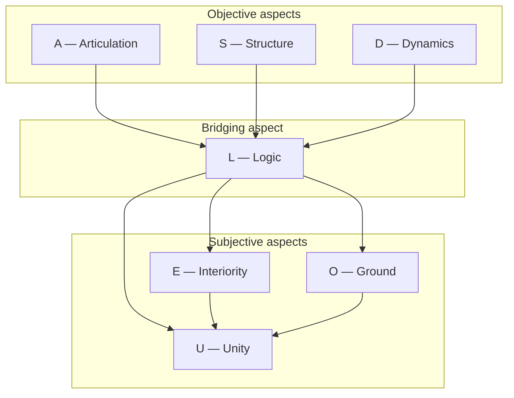

# The Seven Dimensions of the Holon

This chapter is a guide to the seven dimensions of the Holon: A (Articulation), S (Structure), D (Dynamics), L (Logic), E (Interiority), O (Ground), and U (Unity). Each of them is not a "thing" or a "property" in the ordinary sense, but an **inseparable aspect** of the unified configuration $\Gamma$. The seven dimensions are seven ways of "looking at" the same reality, like the seven faces of a prism dispersing white light into a spectrum. By the end of the chapter you will understand why there are exactly seven dimensions, what makes each of them indispensable, and how they are connected to one another.

## Historical precursor

The idea that reality is described by a small number of fundamental "principles" is as old as philosophy itself.

**Pythagoras** (6th century BCE) taught that "everything is number": numerical relations underlie the world. The Pythagoreans discovered that musical intervals correspond to simple fractions and extrapolated this to the cosmos. In UHM this intuition finds precise expression: the state of any system is a matrix of numbers ($\Gamma \in \mathbb{C}^{7 \times 7}$), and all properties of the system — from physical to phenomenological — are determined by these numbers.

**William Rowan Hamilton** (1843) discovered **quaternions** — four-dimensional numbers extending the complex numbers. His friend **John Graves** discovered **octonions** — eight-dimensional numbers — in the same year. Arthur Cayley (1845) independently rediscovered them. Octonions have a remarkable property: they are the last of the four "normed division algebras" (real numbers → complex numbers → quaternions → octonions). The imaginary part of the octonions has exactly **7 dimensions**. In UHM this is no coincidence: the seven dimensions of the Holon are isomorphic to the seven imaginary units of the octonions.

**Gino Fano** (1892) constructed the minimal projective plane — the **Fano plane** PG(2,2). It contains exactly 7 points and 7 lines, with every line passing through 3 points and every point lying on 3 lines. This geometric structure turns out to be central to UHM: it determines which triples of dimensions form "associative triplets" — particularly stable groups that play a role in elementary-particle physics and in the structure of consciousness.

## Overview

The seven labels specify the state coordinates of the historical model. $\mathcal D(\mathbb C^7)$ is taken as its space of quantum states. Establishing which preparation and intervention could identify each coordinate in a physical system is a separate problem. [Historical axioms](/docs/core/foundations/axiom-omega#аксиоматика) · [AP, PH and QG](../foundations/axiom-septicity) · [Operational states](../foundations/operational-processes#process)

It is important to emphasise: the seven dimensions are not seven "parts" of the Holon, in the way that lungs, heart, and brain are parts of a body. They are seven **inseparable aspects** of a single whole, in the way that length, width, and height are three aspects of a single object. One cannot "cut off" the Dynamics dimension from the Holon while leaving the rest — just as one cannot cut the height off a cube while leaving the length and width. If even one dimension goes to zero, the Holon ceases to exist as a coherent configuration.

### Why exactly 7

:::tip Intuitive explanation
Imagine designing a minimal living system — a being that can simultaneously:
1. **Discriminate** (tell one thing from another) → needs tool **A**
2. **Hold form** (have a stable structure) → needs tool **S**
3. **Change** (evolve in time) → needs tool **D**
4. **Be self-consistent** (parts do not contradict one another) → needs tool **L**
5. **Experience** (have an inner side) → needs tool **E**
6. **Feed** (have a source of regeneration) → needs tool **O**
7. **Be whole** (integrate everything into unity) → needs tool **U**

These are functional roles in the model. Counting the items on this list does not furnish a lower bound on the Hilbert-space dimension of an arbitrary self-maintaining system. [Minimality argument and its premises](../../proofs/minimality/theorem-minimality-7)
:::

Seven occurs as the dimension of the imaginary octonions, the number of points on a Fano plane, and the number of positions of a Hamming code with **three** check bits. Four check bits give a perfect single-error-correcting code on **fifteen** positions. To link an error position to a separately specified signed algebra requires a common decoder. The operational theorem derives seven addresses under explicit tests. [Code assumptions, T-224](/docs/applied/research/syndrome-calculus#t-224) · [Address selection](/docs/core/foundations/operational-processes#address)

### Uniqueness of the basis

The model assigns names and operators to a specified frame. Its functional arguments use additional assumptions about self-observation, regeneration and the clock. Their transfer to an arbitrary observation protocol requires evidence that its operations distinguish and preserve that frame. [Historical uniqueness argument](../../proofs/minimality/theorem-minimality-7#часть-vii-теорема-о-единственности-базиса) · [E assumptions](../../proofs/minimality/theorem-minimality-7#единственность-e) · [O assumptions](../../proofs/minimality/theorem-minimality-7#единственность-o)

## Dimensions table

| # | Dimension | Symbol | Function | Operator | Physical analogue | Octonionic basis |
|---|-----------|--------|---------|----------|-------------------|-------------------|
| I | [Articulation](./dimension-a) | $A$ | Discriminate | Projector $P$ | Measurement | $e_1$ |
| II | [Structure](./dimension-s) | $S$ | Hold | Hamiltonian $H$ | Energy | $e_2$ |
| III | [Dynamics](./dimension-d) | $D$ | Change | Unitary $U(\tau)$ | Evolution | $e_3$ |
| IV | [Logic](./dimension-l) | $L$ | Coordinate | Commutator $[\cdot, \cdot]$ | Causality | $e_4$ |
| V | [Interiority](./dimension-e) | $E$ | Experience | Density $\rho$ | Information | $e_5$ |
| VI | [Ground](./dimension-o) | $O$ | Nourish + Measure time | Vacuum $\vert 0\rangle$, Clock | Quantum field + Clock | $e_7$ |
| VII | [Unity](./dimension-u) | $U$ | Integrate | Trace $\mathrm{Tr}$ | Normalisation | $e_6$ |

:::warning Physical analogues are heuristic
The "Physical analogue" column indicates **conceptual correspondences**, not strict identities. For example, dimension $D$ is connected to unitary evolution — but $D$ **is not** time.
:::

:::tip Everyday analogies
To bring the dimensions closer, imagine a person walking through a forest:

| Dimension | Analogy | What happens |
|---|---|---|
| **A** (Articulation) | Eyes | You *discriminate*: "that's a tree, that's a stone, that's the path" |
| **S** (Structure) | Skeleton | Your body *holds its form* with every step |
| **D** (Dynamics) | Legs | You *walk*, *change* your position |
| **L** (Logic) | Planning brain | You *coordinate* your route: "it's slippery here → go around to the right" |
| **E** (Interiority) | Senses | You *experience*: the scent of pine, the cool of the wind, fatigue |
| **O** (Ground) | Ground underfoot | *Support*, from which you draw stability |
| **U** (Unity) | "I" | All of this together is *one* experience: "I am walking through the forest" |

Remove any element — and the walk becomes impossible. Without eyes you cannot discern the path. Without a skeleton — you cannot hold your form. Without legs — you cannot move. Without logic — you walk into a ditch. Without senses — you miss the beauty. Without support — you fall. Without "I" — there is no one walking.
:::

### Combinatorial fixing of semantic roles (T-177) — restated [T] {#комбинаторная-единственность}

:::danger Corrected 2026-09-25 (audit A-90): without axis sectors the incidences fix the roles only from three marks
The earlier fingerprints (below) use the sector of each axis ($\mathbf 3$ or $\bar{\mathbf 3}$) from T-48a, which is retracted: no axis lies in the $\mathbf 3$ or the $\bar{\mathbf 3}$ (0 of 20 axis triples is $SU(3)$-invariant). Repairs tried: (i) the correct complex triplets carry no axis labels; (ii) the octonion signs and the complex structure $J = L_{e_O}$ (which orients the pairs $A \to D$, $S \to U$, $L \to E$) do not reduce the symmetry — the elements of $\Gamma_{\mathrm{oct}}$ that fix $+e_O$ realise the same 24 permutations as the collineations fixing $O$; (iii) marking the Higgs line $\{A,E,U\}$ with $O$ leaves 6 collineations, orbits $\{O\}$, $\{A,E,U\}$, $\{S,D,L\}$. What survives is the exact count below, which replaces the uniqueness claim.
:::

:::tip Theorem T-177 (restated) [T]: three non-collinear marks fix all seven roles
The collineation group of the Fano plane (order 168) acts regularly on the 168 ordered non-collinear triples of axes. Hence the incidence structure fixes all seven roles exactly when three non-collinear axes are marked, and never with fewer: the stabiliser of $O$ has order 24, of $O$ and one more axis 4, of a third axis off their line 1. With $O$ and the Higgs line marked, 6 collineations remain; with $O$ and the $\kappa_0$ pair $\{E,U\}$ chosen in the model [D] marked, 2 remain, with orbits $\{O\}$, $\{A\}$, $\{D\}$, $\{E,U\}$, $\{S,L\}$: $A$ is the third point of the line through $E$ and $U$, and $D$ the third point of the line through $O$ and $A$, while $E \leftrightarrow U$ (with $L \leftrightarrow S$) is one binary choice.

*Proof.* The points of $\mathrm{PG}(2,2)$ are the nonzero vectors of $\mathbb F_2^3$, an ordered non-collinear triple is an ordered basis, and $GL(3,2)$ (order 168) acts simply transitively on ordered bases. Checked exhaustively over all 5040 permutations (`test_fano_roles_are_fixed_by_three_non_collinear_marks`). $\blacksquare$
:::

:::note Earlier statement (T-177, retracted [✗]): Combinatorial uniqueness of semantic roles
After fixing the sector decomposition $7 = 1_O \oplus \mathbf{3} \oplus \bar{\mathbf{3}}$ (T-48a — retracted [✗] 2026-09-25 as an axis-labelled decomposition; the uniqueness below rests on it and is to be re-derived, see T-177 in the status registry), each of the 7 dimensions has a **unique combinatorial profile** — a set of Fano lines and sector connections not isomorphic to the profile of any other dimension.

**Stratification:** The distinguishability of the 7 fingerprints is **[T]** as a combinatorial fact on the Fano plane PG(2,2) once **the combinatorial constraint set** is fixed (sector decomposition T-48a + Higgs line $\{A,E,U\}$). The choice of that constraint set itself is **[C at combinatorial-constraint set]**: T-48a and the Higgs line come from upstream axiomatic structure (A3, electroweak fit), not from T-177 in isolation. Conditional on those inputs, the fingerprint table is exact.
:::

**Proof.** For each $e_k$ we define the **functional fingerprint** $\mathcal{F}(e_k)$ — the triple (sector, set of Fano lines, sector type of each line):

| $e_k$ | Sector | Fano lines | O-connection (path to singlet) |
|--------|--------|------------|--------------------------|
| $e_7$ (O) | **1** | $\{L,E,O\}, \{U,O,S\}, \{O,A,D\}$ | — (singlet itself) |
| $e_1$ (A) | **3** | $\{A,S,L\}, \{E,U,A\}, \{O,A,D\}$ | Direct: line $\{O,A,D\}$ |
| $e_2$ (S) | **3** | $\{A,S,L\}, \{S,D,E\}, \{U,O,S\}$ | Through $\bar{\mathbf{3}}$: line $\{U,O,S\}$ |
| $e_3$ (D) | **3** | $\{S,D,E\}, \{D,L,U\}, \{O,A,D\}$ | Through **3**: line $\{O,A,D\}$ |
| $e_4$ (L) | $\bar{\mathbf{3}}$ | $\{A,S,L\}, \{D,L,U\}, \{L,E,O\}$ | Through $\bar{\mathbf{3}}$: line $\{L,E,O\}$ |
| $e_5$ (E) | $\bar{\mathbf{3}}$ | $\{S,D,E\}, \{L,E,O\}, \{E,U,A\}$ | Through $\bar{\mathbf{3}}$: line $\{L,E,O\}$ |
| $e_6$ (U) | $\bar{\mathbf{3}}$ | $\{D,L,U\}, \{E,U,A\}, \{U,O,S\}$ | Through **3**: line $\{U,O,S\}$ |

**Distinguishability within the 3-sector** $\{e_1, e_2, e_3\}$:
- $e_1$: **unique** element of **3** on the Higgs line $\{E,U,A\}$ → bridge between the spatial and electroweak sectors
- $e_3$: on line $\{O,A,D\}$ — connected to singlet O through a **3**-element ($A$)
- $e_2$: on line $\{U,O,S\}$ — connected to singlet O through a $\bar{\mathbf{3}}$-element ($U$)

**Distinguishability within the $\bar{\mathbf{3}}$-sector** $\{e_4, e_5, e_6\}$:
- $e_4$: **unique** element of $\bar{\mathbf{3}}$ **not** on the Higgs line
- $e_5$: on the Higgs line; O-connection through a $\bar{\mathbf{3}}$-element ($L$) — line $\{L,E,O\}$
- $e_6$: on the Higgs line; O-connection through a **3**-element ($S$) — line $\{U,O,S\}$

All 7 fingerprints are pairwise distinct. $\blacksquare$

:::info Theorem T-183 — restated [T]+[D] (2026-09-25): Functional assignment of the 7 roles
*Restated.* Given $O$ (the clock and ground) and the $\kappa_0$ pair $\{E,U\}$ chosen in the model [D], incidence fixes $A$ (third point of the line through $E$, $U$) and $D$ (third point of the line through $O$, $A$) **[T]** (T-177 restated); what remains is one binary choice, $E \leftrightarrow U$ together with $L \leftrightarrow S$, which is a convention **[D]**. *Retracted [✗]:* the earlier derivation below — steps 1–3, the sector condition of step 4 ($X \in \bar{\mathbf 3}$) and the "sector covariance" of step 6 use axis sectors that do not exist, and step 4 broke the $E \leftrightarrow U$ choice with $L$, whose own identification rested on those sectors. Earlier text:*

All 7 semantic roles $\{A,S,D,L,E,O,U\}$ are **uniquely** determined by the combinatorial structure (T-177, retracted), the functional requirements of the evolution equation $\mathcal{L}_\Omega$, and axioms (AP)+(PH)+(QG)+(V):

**Stratification:** Given the combinatorial-uniqueness chain of upstream inputs — sector decomposition T-48a, the Higgs line $\{A,E,U\}$, $L$-mediation of the regeneration formula, and sector-covariance of unitary evolution — each step (4)–(7) of the proof is **[T]**. The result is thus **[C at combinatorial-uniqueness chain]**: strip any single link (e.g. change the Higgs line, or allow $S$-mediated regeneration), and the uniqueness argument no longer runs. The chain itself is justified upstream in T-48a + axioms; T-183 is not independently axiom-free.

| Role | Determining property | Status |
|------|----------------------|--------|
| **O** (Ground) | Unique $SU(3)$-singlet; PW clock; $\kappa_{\text{bootstrap}}$ | **[T]** |
| **A** (Articulation) | Unique element of **3** on the Higgs line — sector bridge | **[T]** |
| **L** (Logic) | Unique element of $\bar{\mathbf{3}}$ NOT on the Higgs line | **[T]** |
| **E** (Interiority) | Unique element of $\bar{\mathbf{3}} \cap \mathrm{Higgs}$ whose O-connection is $L$-mediated | **[T]** |
| **U** (Unity) | Remaining element of $\bar{\mathbf{3}} \cap \mathrm{Higgs}$ after fixing $E$ | **[T]** |
| **D** (Dynamics) | Unique element of $\{S,D\} \subset \mathbf{3}$ on line $\{O,A,\cdot\}$ | **[T]** |
| **S** (Structure) | Remaining element of **3**-sector after fixing $A$ and $D$ | **[T]** |

**Proof (T-183).**

**Steps 1–3 (O, A, L):** Direct consequence of sector decomposition $7 = 1_O \oplus \mathbf{3} \oplus \bar{\mathbf{3}}$ (T-48a — retracted [✗] 2026-09-25: no axis lies in the $\mathbf 3$ or the $\bar{\mathbf 3}$, so the A- and L-steps lose their ground; O survives as the $SU(3)$-singlet $\mathbb Ce_O$) and the Higgs line $\{A,E,U\}$. O is the unique singlet. A is the unique element of **3** on the Higgs line. L is the unique element of $\bar{\mathbf{3}}$ off the Higgs line. (Already proved in T-177.)

**Step 4 (E).** The regeneration formula $\kappa(\Gamma) = \kappa_{\text{bootstrap}} + \kappa_0 \cdot \mathrm{Coh}_X$ requires a dimension $X$ with properties: (a) $X \in \bar{\mathbf{3}}$ ($\kappa_0$ is defined via $\mathrm{Hom}(O, X)$); (b) $X$ on the Higgs line (electroweak coupling through the $\kappa_0$ chain: $\mathrm{End}(O) \otimes \mathrm{Hom}(O,X) \otimes \mathrm{Hom}(X,Y)$). From $\bar{\mathbf{3}} \cap \mathrm{Higgs} = \{E, U\}$.

Next: $\mathrm{Coh}_X$ is defined via the Umegaki conditional expectation $\mathcal{E}_X: M_7(\mathbb{C}) \to \mathcal{A}_X$ — a **logical** operation (projection onto a C*-subalgebra). Connecting the conditional expectation to the closure subalgebra requires that the O-path to $X$ pass through $L$ (the algebra-closure dimension), ensuring an $L$-mediated regeneration channel:
- $E$: O-path through $L$ (line $\{L,E,O\}$) — $L$-mediated ✓
- $U$: O-path through $S$ (line $\{U,O,S\}$) — $S$-mediated ✗

The unique $L$-mediated candidate is $E$. $\square$

**Step 5 (U).** By exclusion from $\{E, U\}$ after fixing $E$. $\square$

**Step 6 (D).** In the 3-sector $\{A,S,D\}$, after fixing $A$, there remain $\{S,D\}$. Each lies on exactly one O-containing Fano line:
- One on $\{O,A,\cdot\}$ — shares a Fano line with $O$ (source of τ) and $A$ (discrimination)
- The other on $\{U,O,\cdot\}$ — shares a Fano line with $O$ (source of τ) and $U$ (integration)

The evolution operator $e^{-iH_{\mathrm{eff}}\tau}$ is generated from the O-sector (source of τ) through $A$ — a process producing **change through discrimination** (definition of dynamics). The element on line $\{O,A,D\}$ is the unique one whose O-connection passes through an element of the **same** 3-sector ($A$), preserving the sector covariance of unitary evolution. $D$ is that element. $\square$

**Step 7 (S).** By exclusion from $\{S,D\}$ after fixing $D$. $\blacksquare$
:::

:::info Epistemic status of semantic labelling [D]+[T]
The mathematical structure of axioms A1–A5 requires exactly 7 dimensions (Theorem S [T]). The **functional assignment** of all 7 roles was claimed to be uniquely determined through sector membership (T-183); that derivation is retracted [✗] on 2026-09-25 with T-48a. Restated (T-177, T-183): given $O$ and the $\kappa_0$ pair $\{E,U\}$, incidence fixes $A$ and $D$ [T], and one binary convention [D] fixes $E$ versus $U$ (with $L$ versus $S$). The **semantic names** (A=Articulation, S=Structure, etc.) remain a **definition by convention [D]** — they are human-language labels for mathematically distinguished objects. Analogy: the assignment of quarks to specific charge values ($+2/3$ vs $-1/3$) is [T], but the names "up" and "down" are [D].
:::

:::info Functional basis with operator roles
Each dimension is defined by **an operator and its role in the axioms**:

| Dimension | Operator | Axiomatic role | Necessity | Combinatorial status (T-177) |
|-----------|----------|---------------------|---------------|------------------------------|
| $e_1$ (A) | Projector $P^2 = P$ | Discrimination of subobjects | (AP) | **[T]** — third point of the line through $E$, $U$ (T-177 restated) |
| $e_2$ (S) | $H = H^\dagger$ | Spectrum of invariants | (AP) | **[D]** — labelling (T-183 retracted [✗]) |
| $e_3$ (D) | $U(\tau) = e^{-iH\tau}$ | Unitary evolution | (QG) | **[T]** — third point of the line through $O$, $A$ (T-177 restated) |
| $e_4$ (L) | $[\cdot, \cdot]$ | Algebra closure | (AP) | **[D]** — labelling (T-177 retracted [✗]) |
| $e_5$ (E) | $\rho_E = \mathrm{Tr}_{-E}(\Gamma)$ | Phenomenology | (PH) | **[D]** — labelling (T-183 retracted [✗]) |
| $e_6$ (U) | $\mathrm{Tr}(\cdot)$ | Normalisation | (AP) | **[D]** — labelling (T-183 retracted [✗]) |
| $e_7$ (O) | $H_O$, $\vert 0\rangle$ | Clock + source | (QG) | **[T]** — the vector fixed by $SU(3)_C = \mathrm{Stab}(e_O)$ |

The semantic names were presented as a reflection of combinatorially unique functional profiles (T-177); in the restated form (2026-09-25) incidence fixes $O$, $A$, $D$ and the pairs $\{E,U\}$, $\{L,S\}$, and one binary convention [D] does the rest. Analogy: just as "up" and "down" quarks are not random words (they differ by charge $+2/3$ vs $-1/3$), the names themselves are a convention for mathematically distinguishable objects.

The labels and the permitted equivalences must both be specified when interpreting claims of uniqueness. The unlabelled Fano incidence structure admits 168 automorphisms. A physical realization has to specify which relabellings preserve its observed records. [Historical basis argument](../../proofs/minimality/theorem-minimality-7#часть-vii-теорема-о-единственности-базиса)
:::

:::info Emergent time
Time in UHM is not an external parameter but an **emergent property**. Internal time τ arises from correlations between dimension $O$ (Ground) and the remaining dimensions through the Page–Wootters mechanism. Dimension $O$ plays a dual role: source of regeneration **and** internal clock of the system.

[More: Theorem on emergent time →](../../proofs/dynamics/emergent-time)
:::

:::info Reconciliation of the 7D and 42D formalisms
The theory uses **two formalisms**:

- **7D** ($\mathbb{C}^7$): structural theorems (Theorem S, basis uniqueness, thresholds), E-coherence $\mathrm{Coh}_E$ via [HS-projection](/docs/core/foundations/axiom-septicity#hs-projection) **[T]**, measures $R$ and $\Phi$.
- **42D** ($\mathcal{H}_O \otimes \mathcal{H}_{6D} \cong \mathbb{C}^{42}$): Page–Wootters mechanism (emergent time), gauge symmetries of the electroweak sector, tensor entanglement.

**Resolved part [T]:** The tensor gap for $\mathrm{Coh}_E$ is fully resolved — the [C*-algebraic Hilbert–Schmidt projection](/docs/core/foundations/axiom-septicity#hs-projection) defines $\mathrm{Coh}_E$ in 7D **exactly**, without resorting to a partial trace. The subsystem definition is realised through a C*-subalgebra embedding and the [Umegaki conditional expectation](/docs/core/foundations/axiom-septicity#теорема-условное-ожидание). This is standard apparatus of algebraic quantum theory (Haag, 1996; Bratteli–Robinson, 1987).

**Open part [C]:** The full reduced matrix $\rho_E = \mathrm{Tr}_{-E}(\Gamma)$ and the differentiation measure $D_{\text{diff}} = \exp(S_{vN}(\rho_E))$ still require tensor factorisation (42D formalism), since the partial trace $\mathrm{Tr}_{\bar{E}}$ is not defined in $\mathbb{C}^7$ (7 is prime). Statements using $D_{\text{diff}}$ have status **[C]** — conditional on the 42D extension.
:::

## Categorical semantics of the dimensions (T-185) [C] {#категориальная-семантика}

:::warning Theorem T-185 [C under differential cohesion of the UHM site]: Differentially cohesive modalities and the septenary structure
**Status, stratified 2026-09-25.** That a differentially cohesive ∞-topos carries the modalities $\int \dashv \flat \dashv \sharp$ and $\Re \dashv \Im \dashv \&$ is [T] (U. Schreiber, DCCT arXiv:1310.7930v1, Definition 3.4.1 and §3.5). That the UHM ∞-topos is differentially cohesive is an assumption [C]: Schreiber's sufficient condition is an ∞-cohesive site (his Definition 3.4.17), which needs finite products, and $\mathbf{DensityMat}$ has none. The list of exactly seven modalities below and its decomposition $1 \oplus \mathbf{3} \oplus \bar{\mathbf{3}}$ are a reading [I]: DCCT v1 has the reduction $\Re$ and no Rh. An earlier version gave the whole theorem [T]; retracted.

The UHM ∞-topos $\mathbf{Sh}_\infty(\mathcal{D}(\mathbb{C}^7), J_{Bures})$ is assumed to admit a **differentially cohesive** structure (Schreiber 2013) with two tiers of adjoint functors:

**Cohesive tier** (macrostructure): $p_! \dashv p^* \dashv p_* \dashv p^!$

**Infinitesimal tier** (microstructure): $i_! \dashv i^* \dashv i_*$

The historical interpretation groups the following seven expressions into two triples and an identity. The count assumes this list.

| Modality | Definition | Function | Dimension |
|----------|------------|----------|-----------|
| $\mathrm{Id}$ | Identity functor | Preserves everything — source | **O** (Ground) |
| $\Pi = p_! p^*$ | Shape | Extracts distinguishable components | **A** (Articulation) |
| $\flat = p^* p_*$ | Flat | Extracts discrete invariants | **S** (Structure) |
| $\Im = i^* i_!$ | Infinitesimal shape | Captures infinitesimal change | **D** (Dynamics) |
| $\sharp = p_* p^!$ | Sharp | Computes logical closure | **L** (Logic) |
| $\& = i^* i_*$ | Infinitesimal flat | Internalises infinitesimal structure | **E** (Interiority) |
| $\mathrm{Rh} = i_* i^!$ | de Rham | Integrates local to global | **U** (Unity) |
:::

The Bures topology on the finite-dimensional state space does not construct the required site, the adjoints, or the physical operator algebra. A translation from these functors to the seven proposed roles is an interpretation. For example, extracting connected components on the connected space $\mathcal D(\mathbb C^7)$ yields one component and cannot select seven distinguishable axes.

**How the algebra and code can be related.** Division in a finite-dimensional unital real algebra follows from a positive multiplicative norm. A positive size without the multiplication law permits zero divisors. In a binary code one instead tests whether the syndrome columns are nonzero and pairwise distinct. T-244’s historical identification of these requirements is retracted. A concrete probe model relates the dimensions by testing rectangle interference and single-error correction with one shared address. It yields $8\le N+1\le2^k\le8$. Extending that result to the full state space of a physical system would require an independent representation of all preparations and instruments. [Revised T-244](/docs/applied/research/syndrome-calculus#отбор-знака) · [Column test](/docs/applied/research/syndrome-calculus#порог-d-min) · [Shared-address theorem](/docs/core/foundations/operational-processes#address)

---

## Octonionic interpretation {#октонионная-интерпретация}

:::info Structural derivation of N = 7 via octonions
The number 7 dimensions receives a **second, independent justification** through the [structural derivation](../../proofs/minimality/theorem-octonionic-derivation): if the space of internal degrees of freedom is isomorphic to $\mathrm{Im}(\mathbb{O})$ (the imaginary part of the octonions), then $N = \dim(\text{Im}(\mathbb{O})) = 7$.
:::

The seven imaginary units of the octonions $e_1, \ldots, e_7$ correspond to the seven dimensions of the Holon. This correspondence brings:

- **$G_2$-symmetry:** $\mathrm{Aut}(\mathbb{O})$ = $G_2$ ⊂ SO(7) — a 14-parameter group preserving the multiplication structure. $G_2$ is the "gauge group" of the seven-dimensional space: it determines which transformations between dimensions preserve the octonionic multiplication structure.
- **Fano lines.** The unit and the three imaginary basis vectors of each line span an associative quaternion subalgebra. Associativity concerns parenthesization. Quaternion multiplication still depends on the order of its factors.
- **Alternativity:** Any two dimensions generate an associative subalgebra (Artin's theorem [T]); non-associativity appears only when three or more interact. This means: pairwise connections $\gamma_{ij}$ are always "well-defined"; complications arise only at triple and higher-order interactions.

:::tip Intuition: octonions
Octonions can be thought of as "numbers" that generalise the familiar numbers in a new direction:

- **Real numbers** ($\mathbb{R}$): one dimension, fully commutative and associative
- **Complex numbers** ($\mathbb{C}$): 2 dimensions (real + imaginary), commutative and associative
- **Quaternions** ($\mathbb{H}$): 4 dimensions, **not** commutative ($ij \neq ji$), but associative
- **Octonions** ($\mathbb{O}$): 8 dimensions, **not** commutative and **not** associative ($(ab)c \neq a(bc)$)

Hurwitz’s theorem classifies finite-dimensional real unital algebras with positive quadratic composition norm. The allowed dimensions are 1, 2, 4 and 8. Choosing the last gives seven imaginary directions. A physical reason to choose the maximal one remains to be supplied.
:::

:::info Octonionic symmetry and chosen frame [T/D/I]
For a specified positive octonionic three-form, $\operatorname{Aut}(\mathbb O)=G_2$, and the stabilizer of a specified unit vector is $SU(3)$, with $G_2/SU(3)\cong S^6$ [T]. Choosing an $O$ axis and a labelled Fano frame is additional model data. A point on this orbit is a symmetry-breaking order parameter only after an appropriate invariant dynamical potential and vacuum theorem are supplied. A selected clock register does not independently prove a unique physical $O$ direction.

Transporting the form, frame, Hamiltonian and self-model together gives covariance of the resulting description [T]. Holding the frame-dependent dynamics fixed leaves only its common stabilizer; general $G_2$ rotations need not be symmetries. Interpreting all transported descriptions as physical gauge equivalences is an additional bridge [I/H], not the withdrawn universal T-42a encoder theorem. The [conditional RI theorem](/docs/proofs/categorical/uniqueness-theorem#теорема-единственности) states what must be established to compare physical encodings.
:::

The octonionic interpretation not only justifies the number 7 but also explains the **non-associativity** of interactions among three or more dimensions. In an associative algebra the order of operations does not matter: $(a \cdot b) \cdot c = a \cdot (b \cdot c)$. In the octonions — it does. This has deep consequences for Holon dynamics: triple interactions (for example, simultaneous change in A, S, and D) do not reduce to a sequence of pairwise ones. Every triplet of dimensions not lying on a Fano line generates a **non-zero associator** $[e_i, e_j, e_k] = (e_i \cdot e_j) \cdot e_k - e_i \cdot (e_j \cdot e_k) \neq 0$, which manifests as a phase shift — a source of the [Gap](/docs/core/dynamics/gap-operator) between the internal and external descriptions.

## Necessity of each dimension

Within the proposed seven-role interpretation, the following table describes what removing a role would mean. [Model assumptions](../foundations/axiom-septicity)

| Without dimension | Violated | Consequence |
|---------------|------------|-----------|
| $A$ | (AP), (PH), (QG) | No discriminations → no form |
| $S$ | (AP) | No identity → no self-sameness |
| $D$ | (AP), (QG) | No evolution → no process |
| $L$ | (AP) | No closure → no self-consistency |
| $E$ | (PH) | No interiority → no phenomenology |
| $O$ | (QG) | No regeneration, no internal clock → no time |
| $U$ | (AP) | No integration → system is fragmented |

Testing whether another system can implement the same functions with different degrees of freedom requires a common operational specification. [Historical minimality argument](../../proofs/minimality/theorem-minimality-7)

## Matrix representation

:::note DRY: Master definition
For the full matrix representation of $\Gamma$ with formal properties, see [Coherence matrix](../dynamics/coherence-matrix#матричное-представление).
:::

In the basis $\{|A\rangle, |S\rangle, |D\rangle, |L\rangle, |E\rangle, |O\rangle, |U\rangle\}$ the coherence matrix is a Hermitian $7 \times 7$ matrix with elements $\gamma_{ij}$:
- **Diagonal** $\gamma_{ii} \in [0,1]$ — populations of dimensions, $\sum_i \gamma_{ii} = 1$
- **Coherences** $\gamma_{ij}$ ($i \neq j$) — connections between dimensions, $|\gamma_{ij}|^2 \leq \gamma_{ii} \cdot \gamma_{jj}$

:::tip How to read the coherence matrix
The matrix $\Gamma$ can be thought of as a $7 \times 7$ table where:
- **Each diagonal cell** ($\gamma_{AA}$, $\gamma_{SS}$, ..., $\gamma_{UU}$) is a number between 0 and 1, showing "how much energy" is invested in that dimension. The sum of all diagonal elements equals 1 (all "energy" is distributed among the seven dimensions).
- **Each off-diagonal cell** ($\gamma_{AS}$, $\gamma_{AD}$, ...) is a complex number describing the *connection* between two dimensions. The modulus $|\gamma_{ij}|$ is the strength of the connection. The phase $\arg(\gamma_{ij})$ is the "directedness" of the connection (the difference between the inner and outer aspect).
- **The Cauchy–Schwarz inequality** $|\gamma_{ij}|^2 \leq \gamma_{ii} \cdot \gamma_{jj}$ means: the connection between dimensions cannot be stronger than the dimensions themselves "allow". Two weakly populated dimensions cannot have a strong coherence.
:::

## Semantics of coherences

The off-diagonal elements $\gamma_{ij}$ ($i \neq j$) describe **connections between dimensions**. Each such connection has a meaningful interpretation — it is not an abstract number but a description of a specific aspect of the system's life.

| Coherence | Interpretation | Example | What a high value means |
|---------------|---------------|--------|-------------------------------|
| $\gamma_{AE}$ | Articulation ↔ Interiority | Apperception | Discriminations "enter" experience: the system consciously distinguishes |
| $\gamma_{AS}$ | Articulation ↔ Structure | Categorisation | Discriminations form stable categories: the system classifies |
| $\gamma_{AD}$ | Articulation ↔ Dynamics | Perception of motion | Discriminations applied to processes: the system tracks changes |
| $\gamma_{AL}$ | Articulation ↔ Logic | Analysis | Discriminations are logically organised: the system thinks analytically |
| $\gamma_{AO}$ | Articulation ↔ Ground | Basic perception | Discriminations are rooted in the ground: "grounded" perception |
| $\gamma_{AU}$ | Articulation ↔ Unity | Synthesis | Discriminations integrate into a whole: the system sees the "big picture" |
| $\gamma_{SL}$ | Structure ↔ Logic | Nomos | Structure is subject to logical necessity: form is meaningful |
| $\gamma_{SD}$ | Structure ↔ Dynamics | Morphogenesis | Structure emerges from process: form is dynamic |
| $\gamma_{SE}$ | Structure ↔ Interiority | Representation | Structure is present in inner experience |
| $\gamma_{SO}$ | Structure ↔ Ground | Stability | Structure is rooted in the source: a solid foundation |
| $\gamma_{SU}$ | Structure ↔ Unity | Architecture | Structure is integrated into the whole: systemic organisation |
| $\gamma_{DL}$ | Dynamics ↔ Logic | Causality | Processes are logically conditioned: "cause → effect" |
| $\gamma_{DE}$ | Dynamics ↔ Interiority | Volition | Processes are experienced from within: action is felt as "I act" |
| $\gamma_{DO}$ | Dynamics ↔ Ground | Vitality | Processes are nourished by the source: life energy |
| $\gamma_{DU}$ | Dynamics ↔ Unity | Teleology | Processes are directed toward the whole: purposeful action |
| $\gamma_{LE}$ | Logic ↔ Interiority | Understanding | Logical connections are experienced: the "aha moment", insight |
| $\gamma_{LO}$ | Logic ↔ Ground | Intuition | Logic is rooted in deep knowledge: "I know, but cannot explain" |
| $\gamma_{LU}$ | Logic ↔ Unity | Consistency | Logic serves wholeness: the system's non-contradictoriness |
| $\gamma_{EO}$ | Interiority ↔ Ground | Immanence | Experience is rooted in the source: the "feeling of being" |
| $\gamma_{EU}$ | Interiority ↔ Unity | Self-awareness | Experience is whole: "I am" as a unified experience |
| $\gamma_{OU}$ | Ground ↔ Unity | Transcendence | Source and whole coincide: deep unity |

:::note Full set of coherences
The $7 \times 7$ matrix contains $\binom{7}{2} = 21$ independent off-diagonal elements. Each describes the connection between a pair of dimensions. Together with the 7 populations (diagonal) and the condition $\mathrm{Tr}(\Gamma) = 1$ this gives 48 independent real parameters (6 populations + 21 moduli + 21 phases), completely describing the state of the Holon.
:::

:::tip How to interpret coherences
Coherence $\gamma_{ij}$ is a complex number. Its **modulus** $|\gamma_{ij}|$ shows the strength of the connection: 0 = no connection, maximum = full correlation. Its **phase** $\arg(\gamma_{ij})$ shows the "directedness": at zero phase the external and internal aspects of the connection coincide (full transparency); at $\pi/2$ they diverge maximally ([Gap](/docs/core/dynamics/gap-operator) = 1).

Example: high $|\gamma_{LE}|$ (Logic ↔ Interiority) with a small phase means: the system deeply *understands* its experiences — logic and interiority are transparent to each other. High $|\gamma_{LE}|$ with phase $\approx \pi/2$ means: the system *processes* experiences logically, but there is a gap (Gap) between the logical description and the actual experience — "I know I am sad, but I don't understand why."
:::

## Connection with Rosen's (M,R)-systems

The seven dimensions of UHM **generalise** Rosen's (M,R)-system, adding phenomenology and a quantum ground:

| Rosen | UHM | Function |
|-------|-----|---------|
| $M$ (metabolism) | $D$ (Dynamics) | Transformation of substrates |
| $\Phi$ (repair) | $A + L$ (Articulation + Logic) | Restoration of structure |
| $\beta$ (closure) | $U$ (Unity) | Integration, self-closure |
| — | $E$ (Interiority) | Extension: interiority |
| — | $O$ (Ground) | Extension: quantum source |
| — | $S$ (Structure) | Extension: invariants |

**Formally:** $7 = 3_{\text{Rosen}} + 4_{\text{extensions}}$.

Rosen showed that life requires at minimum 3 components (metabolism, repair, closure). UHM adds 4 more: interiority (so the system "experiences"), ground (so it has a source of regeneration and time), structure (so it has invariants), and logic as a separate dimension (not a part of repair). Result: 7 = minimum for a **fully-fledged** living system with an inner side.

:::tip Why three was not enough for Rosen
Rosen was building a theory of *life* — and three components are indeed sufficient for that: a system that metabolises (D), repairs itself (A+L), and closes (U) is formally "alive". But Rosen did not pose the question of *consciousness*. His systems are "zombies": they function but experience nothing. UHM adds E (interiority) — and the system acquires an "inner side". But for full interiority one also needs O (from which to draw the resource for regeneration and time) and S (what exactly is preserved). Thus Rosen's three components grow to seven.
:::

See [Theorem 5.1: Isomorphism with (M,R)-systems](../../proofs/minimality/theorem-minimality-7#часть-v-связь-с-mr-системами-розена).

## Grouping of dimensions

:::warning Grouping is heuristic
The division into "objective" and "subjective" aspects is a **pedagogical simplification**. All seven dimensions are inseparable in $\Gamma$. Two-aspect monism means: the objective and the subjective are two sides of one configuration, not different parts.
:::

**Objective aspects** (A, S, D) — those accessible to an external observer: discriminations can be recorded (A), structure can be measured (S), dynamics can be tracked (D). In physics they correspond to observables: projectors, Hamiltonian, unitary evolution.

**Subjective aspects** (E, O, U) — those connected with the "inner side" of the system: experience (E), rootedness in the source (O), sense of wholeness (U). They are not directly observable "from outside" — they can only be inferred from behaviour or experienced "from within."

**Bridging aspect** — Logic ($L$) is singled out as the "bridge" between objective and subjective. The commutator $[A, B]$ defines **relations** between the operators of all other dimensions. Logic is what makes the system self-consistent: it ensures that the objective and the subjective do not contradict each other.

This grouping $7 = 3 + 1 + 3$ has a deep mathematical basis: it corresponds to the **sector decomposition** $7 = \mathbf{3} \oplus \mathbf{1} \oplus \bar{\mathbf{3}}$ under the action of $SU(3) \subset G_2$ (theorem T-48a — retracted [✗] 2026-09-25 in this axis-labelled form). ~~The triplet $\{A, S, D\}$ forms representation **3**, the singlet $\{O\}$ — representation **1**, and the anti-triplet $\{L, E, U\}$ — representation $\bar{\mathbf{3}}$.~~ Only the singlet survives: the triplet is $\mathrm{span}_{\mathbb C}\{A-iD,\,S-iU,\,L-iE\}$ and the anti-triplet its conjugate, so each mixes the two axis triples. Remarkably, exactly this same type of decomposition determines the structure of quarks in chromodynamics ($SU(3)_{\text{color}}$), although here it acts at a completely different level of description.

:::note Why is L the "bridge" and not O?
At first glance, O (Ground) also seems "bridging": it both nourishes and sets time. But O occupies a special position as an $SU(3)$ **singlet** — it is invariant under sector transformations. L, by contrast, occupies a **boundary** position: it belongs to the anti-triplet ($\bar{\mathbf{3}}$) but functionally connects both triplets through the commutator. Logic "knows" about both the objective and the subjective — that is its uniqueness.
:::

## Cross-cultural reflections

Remarkably, the division into 7 fundamental aspects of reality appears in a wide variety of traditions:

| Tradition | Sevenfold division | Connection with UHM |
|---|---|---|
| Indian (chakras) | 7 energy centres | 7 populations $\gamma_{ii}$ |
| Alchemical | 7 metals (Au, Ag, Cu, Fe, Sn, Pb, Hg) | 7 dimensions |
| Musical | 7 notes (do, re, mi, fa, sol, la, si) | 7 "tones" of the configuration |
| Planetary (antiquity) | 7 planets | 7 "influences" |
| Colour | 7 colours of the rainbow | 7 "qualities" |

These are comparisons of vocabularies. A shared cardinality does not connect the corresponding operations or observations. [Comparison of symbolic systems](https://homohologra.ph/research/symbolic-systems)

## Summary

A chosen seven-level density matrix is determined by seven populations of sum one and 21 complex coherences. A full-rank state has 48 independent real parameters. Calibrated preparations and observables would be needed to identify such a matrix for a physical or biological subject. The Fano plane and octonions provide a labelling and an algebraic structure for the model.

Each dimension is then examined in detail in its own chapter. We recommend reading them in order: A → S → D → L → E → O → U, since each successive dimension builds on the concepts introduced in the preceding ones.

---

**Detailed pages:**
- [Articulation (A)](./dimension-a)
- [Structure (S)](./dimension-s)
- [Dynamics (D)](./dimension-d)
- [Logic (L)](./dimension-l)
- [Interiority (E)](./dimension-e)
- [Ground (O)](./dimension-o)
- [Unity (U)](./dimension-u)

**Related documents:**
- [Holon](./holon) — what the configuration $\Gamma$ is
- [Theorem S](../../proofs/minimality/theorem-minimality-7) — proof of 7D minimality (Track A)
- [Structural derivation via octonions](../../proofs/minimality/theorem-octonionic-derivation) — P1+P2 → $\mathbb{O}$ → N=7 (Track B)
- [Uniqueness theorem](../../proofs/minimality/theorem-minimality-7#часть-vii-теорема-о-единственности-базиса) — proof of basis uniqueness
- [Axiom (AP+PH+QG+V)](../foundations/axiom-septicity) — conditions on the Holon
- [Emergent time](../../proofs/dynamics/emergent-time) — time from the structure of Γ
