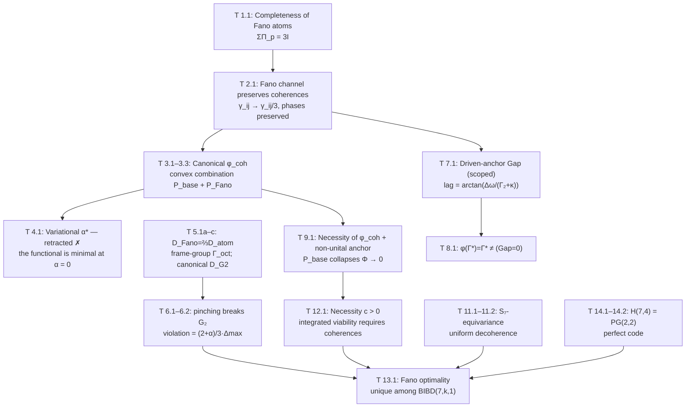

# Proofs: Fano Channel and Key Gap Theorems

:::info Who this chapter is for
The reader will find here proofs of the central theorems of Fano-channel and Gap dynamics: preservation of coherences by the Fano channel, the exact Fano–atomic proportionality $\mathcal{D}_{\text{Fano}}=\tfrac23\mathcal{D}_{\text{atom}}$ (with finite frame-group $\Gamma_{\!\text{oct}}$ covariance and the canonical $G_2$-covariant dissipator $\mathcal{D}_{G_2}$), driven-anchor stationary Gap, distinction between L4 and $\mathrm{Gap}=0$, optimality of the Fano channel among BIBD$(7,k,1)$ channels, and the combinatorial link with the Hamming code $H(7,4)$. Core channel theorems carry status **[T]**; retracted claims (§4) and scope conditions (§7, §9, §12–13) are explicitly marked.
:::

This document collects the proofs and exact scope statements for the central Fano-channel and Gap-dynamics theorems (see the [status registry](/docs/reference/status-registry)).

---

## 1. Fano Predictive Channel {#фано-канал}

### 1.1 Completeness of Fano atoms

:::tip Theorem 1.1 (Completeness of Fano atoms) [T]
For the 7 lines of the [Fano plane](/docs/physics/gauge-symmetry/fano-selection-rules) $PG(2,2)$, projections onto 3-dimensional subspaces are defined:

$$
\Pi_p = \sum_{i \in \mathrm{line}_p} |i\rangle\langle i|, \quad p = 1, \ldots, 7
$$

Each dimension lies on exactly 3 Fano lines, therefore:

$$
\sum_{p=1}^{7} \Pi_p = 3I
$$
:::

**Proof.** Property of the Fano plane: each of the 7 points is incident to exactly 3 lines. For any $i$: $\sum_p \Pi_p |i\rangle\langle i| = \sum_{p: i \in \mathrm{line}_p} |i\rangle\langle i| = 3|i\rangle\langle i|$. Summing over $i$: $\sum_p \Pi_p = 3I$. $\square$

### 1.2 Fano-structured Lindblad operators

:::tip Definition (Fano Lindblad operators) [T]
For each Fano line $p = (i,j,k)$ a Lindblad operator is defined:

$$
L_p^{\text{Fano}} := \frac{1}{\sqrt{3}}\,\Pi_p = \frac{1}{\sqrt{3}}(|i\rangle\langle i| + |j\rangle\langle j| + |k\rangle\langle k|)
$$

**CPTP check:**

$$
\sum_{p=1}^{7} (L_p^{\text{Fano}})^\dagger L_p^{\text{Fano}} = \frac{1}{3}\sum_{p=1}^{7} \Pi_p = \frac{1}{3} \cdot 3I = I \quad \checkmark
$$
:::

### 1.3 Fano predictive channel

$$
\mathcal{P}_{\text{Fano}}(\Gamma) := \sum_{p=1}^{7} L_p^{\text{Fano}}\,\Gamma\,(L_p^{\text{Fano}})^\dagger = \frac{1}{3}\sum_{p=1}^{7} \Pi_p\,\Gamma\,\Pi_p
$$

---

## 2. Theorem: Fano Channel Preserves Coherences [T] {#теорема-фано-канал}

:::tip Theorem 2.1 (Fano channel preserves coherences) [T]
For an arbitrary coherence matrix $\Gamma$:

**(a)** Diagonal elements are preserved exactly:

$$
[\mathcal{P}_{\text{Fano}}(\Gamma)]_{ii} = \gamma_{ii}
$$

**(b)** Off-diagonal elements are preserved with coefficient $1/3$:

$$
[\mathcal{P}_{\text{Fano}}(\Gamma)]_{ij} = \frac{1}{3}\gamma_{ij} \quad \text{for all } i \neq j
$$

**(c)** The phases of coherences are preserved exactly:

$$
\arg([\mathcal{P}_{\text{Fano}}(\Gamma)]_{ij}) = \arg(\gamma_{ij}) = \theta_{ij}
$$
:::

**Proof.**

**(a)** $[\sum_p \Pi_p\,\Gamma\,\Pi_p]_{ii} = \sum_{p: i \in \mathrm{line}_p} \gamma_{ii} = 3\gamma_{ii}$. With factor $1/3$: $\gamma_{ii}$. $\checkmark$

**(b)** In $PG(2,2)$ any two distinct points lie on **exactly one** line. For a pair $(i,j)$, $i \neq j$, exactly one line $p^*$ contains both points:

$$
\left[\sum_p \Pi_p\,\Gamma\,\Pi_p\right]_{ij} = \sum_{p: \{i,j\} \subseteq \mathrm{line}_p} \gamma_{ij} = 1 \cdot \gamma_{ij}
$$

With factor $1/3$: $\gamma_{ij}/3$. $\checkmark$

**(c)** $\arg(\gamma_{ij}/3) = \arg(\gamma_{ij})$, since $1/3 > 0$. $\checkmark$ $\square$

:::info Corollary (Fundamental)
Unlike the canonical $\varphi_{\text{base}}$, which [destroys all coherences](/docs/core/dynamics/gap-dynamics#чой-ямиолковский), the Fano channel **scales** the amplitudes of coherences without phase distortion. This makes it the basis for coherence-preserving self-modeling $\varphi_{\text{coh}}$.
:::

#### Corollary 2.1a — state-independence of the Fano contraction coefficient [T] {#state-independence-alpha}

:::tip Corollary 2.1a
The contraction factor $c_F = 1/3$ — equivalently, the Fano absorption $\alpha = 1 - c_F = 2/3$ — is **state-independent**: for every $\Gamma \in \mathcal D(\mathbb C^7)$ and every off-diagonal pair $(i,j)$, $i \neq j$,
$$[\mathcal{P}_\mathrm{Fano}(\Gamma)]_{ij} = \tfrac{1}{3}\,\gamma_{ij}.$$
**Proof.** The derivation of Theorem 2.1(b) uses **only** the combinatorial fact that exactly one Fano line $p^* \in \mathrm{PG}(2,2)$ contains the pair $\{i,j\}$ (the defining BIBD$(7,3,1)$ property), together with the normalisation prefactor $1/3$ from the three lines incident to each point. Neither step references the entries of $\Gamma$. Hence the contraction coefficient is a function of the geometry of $\mathrm{PG}(2,2)$ alone. $\blacksquare$

**Consequence (state-independent contraction):**
This corollary establishes that the contraction factor $c_F = 1/3$ (and absorption $\alpha = 2/3$) carries over uniformly to **every** state $\Gamma \in \mathcal{D}(\mathbb{C}^7)$ solely from the combinatorial uniqueness of $\mathrm{PG}(2,2)$ (`T-82` Fano uniqueness [T]). *(Note: the former universal self-awareness depth ceiling derived by iterating a fixed Fano channel is withdrawn [✗], since operational level L4 is defined by a compatible prediction tower rather than fixed-channel iteration; see [Holon](/docs/consciousness/hierarchy/interiority-hierarchy).)*
:::

### Numerical example {#числовой-пример-фано}

:::note Example: action of the Fano channel on a specific matrix
Consider a $7 \times 7$ coherence matrix $\Gamma$ with diagonal $\gamma_{ii} = 1/7$ (equilibrium distribution) and several non-zero coherences:

$$
\gamma_{12} = 0.05 + 0.03i, \quad \gamma_{13} = 0.04, \quad \gamma_{45} = -0.02 + 0.01i
$$

(the remaining off-diagonal elements are zero or small).

**Step 1.** Compute the diagonal elements of $\mathcal{P}_{\text{Fano}}(\Gamma)$:

$$
[\mathcal{P}_{\text{Fano}}(\Gamma)]_{ii} = \gamma_{ii} = \frac{1}{7} \approx 0.1429
$$

The diagonal is unchanged — sector probabilities are preserved exactly.

**Step 2.** Compute the off-diagonal elements. By Theorem 2.1(b):

$$
[\mathcal{P}_{\text{Fano}}(\Gamma)]_{12} = \frac{1}{3}(0.05 + 0.03i) = 0.0167 + 0.01i
$$

$$
[\mathcal{P}_{\text{Fano}}(\Gamma)]_{13} = \frac{1}{3} \cdot 0.04 = 0.0133
$$

$$
[\mathcal{P}_{\text{Fano}}(\Gamma)]_{45} = \frac{1}{3}(-0.02 + 0.01i) = -0.0067 + 0.0033i
$$

**Step 3.** Verify phase preservation (Theorem 2.1(c)):

$$
\arg(\gamma_{12}) = \arctan(0.03/0.05) \approx 30.96° \quad \Rightarrow \quad \arg(\gamma_{12}/3) = 30.96° \;\checkmark
$$

$$
\arg(\gamma_{45}) = \arctan(0.01/(-0.02)) + \pi \approx 153.43° \quad \Rightarrow \quad \arg(\gamma_{45}/3) = 153.43° \;\checkmark
$$

**Summary:** coherence magnitudes decreased by exactly a factor of 3, phases were preserved without distortion, the diagonal was untouched. This is precisely what distinguishes the Fano channel from the atomic $\mathcal{P}_{\text{base}}$, which would zero out $\gamma_{12}$, $\gamma_{13}$, $\gamma_{45}$ completely. For a balanced state ($\gamma_{ii} = 1/7$), complete destruction of coherences drops purity to $P = 1/7 < P_{\text{crit}} = 2/7$ [D] and collapses integration $\Phi$ to $0$. The Fano channel provides a "soft" observation that preserves two-thirds less coherence per step than unity while keeping phases intact.
:::

---

## 3. Canonical Form of φ_coh [T] {#phi-coh}

:::tip Theorem 3.1 (Canonical form of $\varphi_{\text{coh}}$) [T]
Canonical coherence-preserving self-modeling:

$$
\varphi_{\text{coh}}(\Gamma) = k \cdot \left[\alpha \cdot \mathcal{P}_{\text{base}}(\Gamma) + (1 - \alpha) \cdot \mathcal{P}_{\text{Fano}}(\Gamma)\right] + (1 - k) \cdot \Gamma_{\text{anchor}}
$$

where:
- $\mathcal{P}_{\text{base}}(\Gamma) = \sum_m P_m\,\Gamma\,P_m = \mathrm{diag}(\Gamma)$ — atomic channel
- $\alpha \in [0, 1]$ — **decoherence depth parameter**
- $k < 1$ — compression parameter
- $\Gamma_{\text{anchor}}$ — anchor state

**CPTP check:** $\mathcal{P}_\alpha = \alpha\,\mathcal{P}_{\text{base}} + (1-\alpha)\,\mathcal{P}_{\text{Fano}}$ is a convex combination of CPTP channels, hence CPTP. $\checkmark$
:::

### Target coherences

:::tip Theorem 3.2 (Target coherences of $\varphi_{\text{coh}}$) [T]
**(a)** Magnitude of target coherence (with diagonal anchor):

$$
|\gamma_{ij}^{\text{target}}| = \frac{k(1-\alpha)}{3} \cdot |\gamma_{ij}|
$$

**(b)** Target phase **is preserved**: $\theta_{ij}^{\text{target}} = \theta_{ij}$.

**(c)** Target Gap **is preserved**: $\mathrm{Gap}^{\text{target}}(i,j) = \mathrm{Gap}(i,j)$.
:::

### Explicit Kraus coefficients

:::tip Theorem 3.3 (Explicit coefficients $c_{mn}$) [T]
Decomposition coefficients of canonical $\varphi_{\text{coh}}$:

$$
c_{mn} = \begin{cases} k & m = n \text{ (the atomic and the Fano channel both keep the diagonal)} \\ (1-\alpha) k / 3 & m \neq n \end{cases}
$$

and the anchor adds $(1-k)\,[\Gamma_{\text{anchor}}]_{mn}$. Every pair $(m,n)$ lies on exactly one Fano line, so a third case "$0$ for $(m,n)$ not on a common Fano line" is empty. *Corrected 2026-09-25:* the theorem printed $c_{mm} = \alpha^* k$ and that empty third case; the diagonal coefficient is $\alpha k + (1-\alpha)k = k$ (as in [$G_2$-structure, Theorem 10.5](/docs/physics/gauge-symmetry/g2-structure)), and $\alpha^*$ is retracted.

Given the Fano weight, the coefficients are determined by:
- [Fano structure](/docs/physics/gauge-symmetry/fano-selection-rules) $PG(2,2)$
- The Fano weight $\alpha$ — a free parameter; its variational value $\alpha^*$ is retracted (§4)
- Compression parameter $k$
:::

---

## 4. Variational Definition of α* — retracted 2026-09-25 [✗] {#alpha-star}

:::tip Theorem 4.1 (Variational definition of $\alpha^*$) — retracted [✗]
The optimal parameter is determined by the [variational principle](/docs/proofs/dynamics/fep-derivation):

$$
\alpha^* = \arg\min_{\alpha \in [0,1]} \mathcal{F}[\mathcal{P}_\alpha; \Gamma]
$$

Approximate formula for a system with purity $P > P_{\text{crit}}$:

$$
\alpha^* \approx 1 - \frac{P_{\text{crit}}}{P} = 1 - \frac{2}{7P}
$$

| Purity $P$ | $\alpha^*$ | Interpretation |
|-------------|-----------|---------------|
| $P = 1$ (pure) | $\approx 0.71$ | Significant Fano participation |
| $P = 0.5$ | $\approx 0.43$ | Balance of atomic and Fano |
| $P \to P_{\text{crit}}$ | $\to 0$ | Almost entirely Fano (minimal coherence destruction) |
:::

**Why retracted.** $\mathcal{F}[\psi;\Gamma] = S_{\text{spec}}(\psi(\Gamma)) + D_{KL}(\psi(\Gamma)\|\Gamma) = -\mathrm{Tr}(\psi(\Gamma)\log\Gamma)$ is linear in $\psi(\Gamma)$ ([FEP derivation](/docs/proofs/dynamics/fep-derivation), retraction box), and $\mathcal{P}_\alpha(\Gamma) = \Delta(\Gamma) + \tfrac{1-\alpha}{3}(\Gamma - \Delta(\Gamma))$, with $\Delta$ the diagonal part, is affine in $\alpha$. Hence, for full-rank $\Gamma$,

$$
\mathcal{F}(\alpha) = \mathcal{F}(0) + \frac{\alpha}{3}\left[D_{KL}(\Gamma\|\Delta\Gamma) + D_{KL}(\Delta\Gamma\|\Gamma)\right],
$$

so the minimum over $[0,1]$ is at $\alpha = 0$ (pure Fano) whenever $\Gamma$ has coherences; the interior value $1 - 2/(7P)$ has no derivation. Checked on 400 random states with $P$ from $0.19$ to $0.91$: minimum at $\alpha = 0$ in all 400. The weight $\alpha$ of $\varphi_{\text{coh}}$ is therefore a free parameter.

---

## 5. Covariance of the Fano Dissipator [T] {#g2-ковариантность}

:::tip Theorem 5.1a (Fano–atomic proportionality) [T]
The Fano dissipator is **exactly proportional** to the atomic dissipator on $\mathrm{Herm}(\mathbb{C}^7)$:

$$
\mathcal{D}_{\text{Fano}} = \tfrac{2}{3}\,\mathcal{D}_{\text{atom}}.
$$
:::

**Proof.** The Fano channel $\mathcal{P}_{\text{Fano}}(\Gamma) = \tfrac13\sum_{p=1}^{7}\Pi_p\,\Gamma\,\Pi_p$ acts entrywise as follows. Each point of $PG(2,2)$ lies on $r=3$ lines, so a diagonal entry is retained three times: $\tfrac13\cdot 3\gamma_{ii} = \gamma_{ii}$ (diagonal preserved). Each pair $\{i,j\}$ lies on exactly $\lambda=1$ line, so an off-diagonal entry is retained once: $\tfrac13\gamma_{ij}$ (coherences contracted by $\tfrac13$). Hence $\mathcal{P}_{\text{Fano}} = \tfrac13\,\mathrm{Id} + \tfrac23\,\Delta$, where $\Delta(\Gamma) := \mathrm{diag}(\Gamma)$ is the pinching onto the diagonal. Since $\sum_p (L_p^{\text{Fano}})^\dagger L_p^{\text{Fano}} = \tfrac13\sum_p \Pi_p = I$, the Lindblad dissipator is the channel minus the identity:

$$
\mathcal{D}_{\text{Fano}} = \mathcal{P}_{\text{Fano}} - \mathrm{Id} = \tfrac23(\Delta - \mathrm{Id}) = \tfrac23\,\mathcal{D}_{\text{atom}}. \qquad\square
$$

:::info Corollary — structural origin of $\alpha = 2/3$
The mixing constant $\alpha = 2/3$ used throughout the corpus is **not a free parameter**: it is the BIBD$(7,3,1)$ uniformization constant, $\alpha = 1 - c = 1 - \tfrac{k-1}{v-1} = 1 - \tfrac13 = \tfrac23$ — the dissipated fraction of coherence per Fano step. Theorem 5.1a derives it from the incidence geometry alone.
:::

:::warning Theorem 5.1b (Covariance group of the pinching dissipators) [T]
Because $\mathcal{D}_{\text{Fano}} = \tfrac23\mathcal{D}_{\text{atom}}$, the two dissipators have **identical** symmetry groups: both are covariant under exactly the monomial unitaries $U(1)^7 \rtimes S_7$ (in particular both are $S_7$-equivariant). The elements of $G_2$ among them form the finite **octonionic frame group** $\Gamma_{\!\text{oct}}$ — the signed permutation matrices in $G_2$, of order $1344 = 2^3\cdot 168$, which acts on the seven Fano lines through its quotient $\mathrm{Aut}(PG(2,2)) \cong PSL(2,7)$ (order 168), the kernel being the $8$ sign changes. **Neither is covariant under the full continuous $G_2$.**

*Corrected 2026-09-25:* the theorem defined $\Gamma_{\!\text{oct}} := \mathrm{Aut}(PG(2,2)) \cong PSL(2,7)$ (order 168), "realised inside $G_2$ as the basis permutations preserving the seven Fano lines". That confused the group with its image: only $21$ of the $168$ collineations are automorphisms of $\mathbb{O}$ as bare basis permutations, the other $147$ need sign changes, and the $1344$ lifts contain no subgroup isomorphic to $PSL(2,7)$ (the extension is non-split).
:::

**Proof.** (Monomial covariance.) A monomial unitary $U|k\rangle = e^{i\theta_k}|\sigma(k)\rangle$ carries diagonal entries to diagonal entries and off-diagonal entries to off-diagonal entries, so $\mathrm{diag}(U\Gamma U^\dagger) = U\,\mathrm{diag}(\Gamma)\,U^\dagger$; hence $\mathcal{D}_{\text{atom}}$, and with it $\mathcal{D}_{\text{Fano}} = \tfrac23\mathcal{D}_{\text{atom}}$, commutes with $\mathrm{Ad}_U$. Conversely, a covariant $U$ maps $\ker\mathcal{D}_{\text{atom}}$, the diagonal matrices, to itself, so it is monomial. A monomial element of $G_2 \subset SO(7)$ is real, i.e. a signed permutation matrix, and those preserving $\varphi$ form $\Gamma_{\!\text{oct}}$. On the lines the same covariance reads: $g \in \Gamma_{\!\text{oct}}$ permutes the coordinate line-projectors, $g\Pi_p g^\dagger = \Pi_{\sigma_g(p)}$, and reindexing the sum $\sum_p \Pi_p\,\cdot\,\Pi_p$ gives $\mathcal{D}_{\text{Fano}}[g\Gamma g^\dagger] = g\,\mathcal{D}_{\text{Fano}}[\Gamma]\,g^\dagger$.

(Failure of full $G_2$-covariance.) $G_2$ is connected, so a continuous map $g\mapsto\sigma_g$ into the discrete 7-element set of coordinate lines is constant; $g\Pi_p g^\dagger = \Pi_p\ \forall g$ would make $\mathrm{span}(\text{line }p)$ a 3-dimensional $G_2$-invariant subspace. But the fundamental representation $\mathbf{7}$ of $G_2$ is **irreducible** (Cartan 1894), so by Schur's lemma it has no nonzero proper invariant subspace — contradiction. A generic $g\in G_2$ carries $\Pi_p$ to a rank-3 projector onto a *rotated* 3-subspace, not to any $\Pi_q$; equivalently $\mathrm{diag}(g\Gamma g^\dagger)\neq g\,\mathrm{diag}(\Gamma)\,g^\dagger$. Hence the pinching dissipators break $G_2$ down to $\Gamma_{\!\text{oct}}$. $\square$

**Machine check (2026-09-25).** Exhaustive enumeration of the $7!\cdot 2^7$ signed permutations: $1344$ preserve the octonion product, all of determinant $+1$, with $168$ distinct permutation parts — exactly the collineations — $8$ sign-only elements and $21$ bare permutations; none of the $5376$ Hurwitz pairs of $\Gamma_{\!\text{oct}}$ (an involution and an element of order 3 with product of order 7) generates a subgroup of order $168$; the transposition $(0\,1)$, which is not a collineation, commutes with $\mathcal{D}_{\text{Fano}}$ exactly.

:::tip Theorem 5.1c (Canonical $G_2$-covariant dissipator) [T]
A genuinely $G_2$-covariant Lindblad dissipator on $\mathbb{C}^7$ exists, built from the associative calibration 3-form $\varphi$ (octonionic structure constants):

$$
(A_a)_{bc} := \tfrac{1}{\sqrt 6}\,\varphi_{abc}\ (a=1,\dots,7), \qquad
\mathcal{D}_{G_2}[\Gamma] = \sum_{a=1}^{7}\Big(A_a\Gamma A_a^\dagger - \tfrac12\{A_a^\dagger A_a,\Gamma\}\Big).
$$

Then (i) $\sum_a A_a^\dagger A_a = I$ (CPTP), from the contraction identity $\sum_{a,b}\varphi_{abc}\varphi_{abd}=6\,\delta_{cd}$; and (ii) $\mathcal{D}_{G_2}[g\Gamma g^\dagger] = g\,\mathcal{D}_{G_2}[\Gamma]\,g^\dagger$ for **all** $g\in G_2$, because $\varphi$ (hence the operator set $\{A_a\}$) is a $G_2$-invariant tensor.
:::

**Proof.** (i) $\big(\sum_a A_a^\dagger A_a\big)_{cd} = \tfrac16\sum_{a,b}\varphi_{abc}\varphi_{abd} = \tfrac16\cdot 6\delta_{cd} = \delta_{cd}$. (ii) $g\in G_2 = \{g\in SO(7): g^\ast\varphi = \varphi\}$ preserves $\varphi$; as $A_a = \varphi(e_a,\cdot,\cdot)$ transforms in the $\mathbf 7$ under $G_2$, the contraction $\sum_a A_a(\cdot)A_a^\dagger$ commutes with $\mathrm{Ad}_g$. By Schur, $\mathcal{D}_{G_2}$ acts as a scalar on each isotypic component of $\mathrm{End}_0(\mathbb C^7) = \mathbf 7\oplus\mathbf{14}\oplus\mathbf{27}$ (three Casimir-determined decay rates). $\square$

:::note Kinematics vs. dynamics — the precise role of $G_2$
Theorems 5.1a–c remove the earlier over-claim ("the Fano dissipator is $G_2$-covariant") and replace it with the correct, stronger picture:

- **Kinematically**, $G_2 = \mathrm{Stab}(\varphi)$ is the gauge group of the *holonomic representation* — the octonionic 3-form is the physical invariant. This is what underlies the $48\to34$ parameter count of the [uniqueness theorem](/docs/proofs/categorical/uniqueness-theorem#g2-ригидность): only the spectrum (6) and the $\varphi$-relative angles (28) are $G_2$-invariant — kinematic invariants; by the [frame decision D-0910](/docs/proofs/categorical/uniqueness-theorem#g2-ригидность) all 48 parameters are physical once the frame is pinned.
- **Dynamically**, the physical UHM dissipator is the pinching (Fano) form, which selects the functional frame $\{A,S,D,L,E,O,U\}$ and therefore breaks $G_2$ to the finite frame group $\Gamma_{\!\text{oct}}$. The unbroken $\mathcal{D}_{G_2}$ (Theorem 5.1c) is the symmetric reference dynamics; UHM's is its frame-fixed realisation. This kinematic-$G_2$ / dynamical-$\Gamma_{\!\text{oct}}$ split **is** the "price of self-observation" tracked by the $\alpha$-parameter.
- The selection of $k=3$ does **not** rely on $G_2$-covariance: it follows from Choi-rank minimality (rank $=7$, T11), BIBD$(7,3,1)$ closure (T13) and the perfect Hamming code $H(7,4)$ (T8–T9).
:::

---

## 6. Pinching Dissipators are NOT fully G₂-Covariant [T] {#атомарный-не-g2}

:::tip Theorem 6.1 (Pinching dissipators break $G_2$) [T]
The atomic dissipator $\mathcal{D}_{\text{atom}}[\Gamma] = \mathrm{diag}(\Gamma) - \Gamma$ — and, by Theorem 5.1a, the Fano dissipator $\mathcal{D}_{\text{Fano}} = \tfrac23\mathcal{D}_{\text{atom}}$ — is **not** covariant under the full continuous $G_2$:

$$
\exists g \in G_2: \quad \mathcal{D}_{\text{atom}}[g\Gamma g^\dagger] \neq g\,\mathcal{D}_{\text{atom}}[\Gamma]\,g^\dagger.
$$

Both are covariant exactly under the finite frame group $\Gamma_{\!\text{oct}}\subset G_2$ (Theorem 5.1b); the fully $G_2$-covariant dissipator is $\mathcal{D}_{G_2}$ (Theorem 5.1c).
:::

**Proof.**

**(a)** $\mathcal{D}_{\text{atom}}[\Gamma] = \mathrm{diag}(\Gamma) - \Gamma$.

**(b)** Covariance requires $\mathrm{diag}(g\Gamma g^\dagger) = g \cdot \mathrm{diag}(\Gamma) \cdot g^\dagger$ for all $\Gamma$, i.e. $g$ commutes with the pinching $\Delta$.

**(c)** This holds iff $g$ permutes the coordinate basis (monomial $g$); a generic $g \in G_2 \subset \mathrm{SO}(7)$ is not monomial (irreducibility of $\mathbf 7$, Theorem 5.1b).

**(d)** Counterexample: a rotation $g$ in the plane $(e_1, e_2)$ with $\gamma_{12} \neq 0$ gives $\mathrm{diag}(g\Gamma g^\dagger) \neq g \cdot \mathrm{diag}(\Gamma) \cdot g^\dagger$, since the left side zeroes the coherence in the rotated basis while the right side does not. The maximal covariance group is therefore the finite $\Gamma_{\!\text{oct}}$. $\square$

### Degree of G₂-violation

:::tip Theorem 6.2 (Degree of violation is determined by $\alpha$) [T]
For the mixed channel $\mathcal{P}_\alpha = \alpha\,\mathcal{P}_{\text{base}} + (1-\alpha)\,\mathcal{P}_{\text{Fano}}$ the $G_2$-non-covariance

$$
\Delta_{G_2}(\alpha) := \sup_{g \in G_2} \|\mathcal{P}_\alpha \circ \mathrm{Ad}_g - \mathrm{Ad}_g \circ \mathcal{P}_\alpha\|_{\text{op}}
$$

is **strictly positive for every** $\alpha\in[0,1]$. Since both pinching dissipators break $G_2$ (Theorem 5.1b), the mixed dissipator satisfies $\mathcal{D}_\alpha = \tfrac{2+\alpha}{3}\,\mathcal{D}_{\text{atom}}$, hence $\Delta_{G_2}(\alpha) = \tfrac{2+\alpha}{3}\,\Delta_{\max}$, with minimum $\tfrac23\Delta_{\max}$ at the pure-Fano point $\alpha=0$. Full $G_2$-covariance is attained only by the structure-constant dissipator $\mathcal{D}_{G_2}$ (Theorem 5.1c), nowhere on the pinching family.
:::

---

## 7. Driven-Anchor Equilibrium Gap [T (scoped)] {#равновесный-gap}

:::tip Theorem 7.1 (Stationary Gap under a fixed coherent anchor) [T (scoped)]
Consider a linear off-diagonal relaxation equation driven by a **fixed, externally supplied constant coherent target** $\gamma_{ij}^{\text{target}} \neq 0$ at constant rate $\kappa > 0$, with diagonal Hamiltonian detuning $\Delta\omega_{ij} = \omega_i - \omega_j$ and dephasing rate $\Gamma_2 > 0$:

$$
\dot\gamma_{ij} = -(i\Delta\omega_{ij} + \Gamma_2 + \kappa)\gamma_{ij} + \kappa\,\gamma_{ij}^{\text{target}}.
$$

Its unique stationary solution satisfies $(\Gamma_2 + \kappa + i\Delta\omega_{ij})\gamma_{ij}^{(\infty)} = \kappa\,\gamma_{ij}^{\text{target}}$ and yields the stationary Gap:

$$
\mathrm{Gap}^{(\infty)}(i,j) = \left|\sin\left(\theta_{ij}^{\text{target}} - \arctan\frac{\Delta\omega_{ij}}{\Gamma_2 + \kappa}\right)\right|.
$$

The stationary phase lags behind the fixed target phase $\theta_{ij}^{\text{target}}$ by $\arctan(\Delta\omega_{ij}/(\Gamma_2 + \kappa))$ due to unitary rotation.
:::

:::warning Scope restriction — withdrawn for isolated unital $\varphi_{\mathrm{coh}}$ [✗]
Theorem 7.1 does **not** apply to an isolated holon driven by the unital phase-preserving self-model $\varphi_{\mathrm{coh}}$ of Theorem 3.1 (with diagonal anchor $\Gamma_{\mathrm{anchor}} = I/7$). For $\varphi_{\mathrm{coh}}$, $\gamma_{ij}^{\mathrm{target}} = \frac{k(1-\alpha)}{3}\gamma_{ij}$ is proportional to $\gamma_{ij}$ itself, making the off-diagonal equation homogeneous with strictly positive damping $\Gamma_2 + \kappa\!\left(1 - \frac{k(1-\alpha)}{3}\right) > 0$; hence $\gamma_{ij}^{(\infty)} = 0$ identically ([dead isolation](/docs/core/dynamics/evolution#теорема-мёртвая-изоляция) [T]). The stationary formula above applies only when $\gamma_{ij}^{\mathrm{target}}$ is supplied by a fixed external coherent anchor, or self-consistently at a nontrivial fixed point of a non-unital channel such as $\varphi_J$ (where $\gamma_{ij}^{\mathrm{target}} = [\varphi_J(\Gamma^*)]_{ij}$ must itself satisfy the nonlinear fixed-point equation).
:::

### Physical intuition {#интуиция-равновесный-gap}

:::note What the driven stationary Gap formula means
**The essence of the formula.** Under a fixed external coherent target $\gamma_{ij}^{\text{target}}$, even in the stationary regime (when coherence amplitudes stop changing), the phase does not align with the target: unitary detuning shifts it by $-\arctan(\Delta\omega_{ij} / (\Gamma_2 + \kappa))$.

**Why does unitary rotation shift the Gap?** The frequency detuning $\Delta\omega_{ij} = \omega_i - \omega_j$ rotates coherence phases as $e^{-i\Delta\omega_{ij}\tau}$, while dephasing ($\Gamma_2$) and relaxation toward the fixed anchor ($\kappa$) damp the amplitude without cancelling the rotation. In the steady state, the phase lags behind $\theta_{ij}^{\text{target}}$ by an angle set by the ratio of rotation rate $\Delta\omega_{ij}$ to total damping $\Gamma_2 + \kappa$.

**Limiting cases (for fixed nonzero $\gamma_{ij}^{\text{target}}$):**
- At $\Delta\omega_{ij} = 0$: $\mathrm{Gap}^{(\infty)} = |\sin(\theta_{ij}^{\text{target}})| = \mathrm{Gap}^{\text{target}}$ — stationary Gap matches the anchor.
- At $|\Delta\omega_{ij}| \gg \Gamma_2 + \kappa$: $\arctan \to \pm\pi/2$, and $|\gamma_{ij}^{(\infty)}| \to 0$ (fast detuning washes out the driven coherence).
- At $\kappa \to \infty$: $\arctan \to 0$, $\mathrm{Gap}^{(\infty)} \to \mathrm{Gap}^{\text{target}}$ — strong anchoring suppresses the phase lag.
:::

---

## 8. L4 ≠ Gap = 0 [T] {#l4-не-gap-0}

:::tip Theorem 8.1 (Self-model fixed points are not equivalent to Gap = 0) [T]
A self-model fixed point $\varphi(\Gamma^*) = \Gamma^*$ (and, operationally, level L4 defined as a compatible prediction tower in [Holon](/docs/consciousness/hierarchy/interiority-hierarchy)) is **not** equivalent to zero imaginary part ($\mathrm{Gap} = 0$):

**(a)** At $\varphi(\Gamma^*) = \Gamma^*$, the model reproduces the state's actual Gap: $\mathrm{Gap}_{\text{perceived}} = \mathrm{Gap}_{\text{actual}}$.

**(b)** $\Gamma^*$ can nevertheless have nonzero imaginary coherences (for example, a complex phase-gauge fixed point of the collineation anchor $\varphi_J$), so $\mathrm{Gap}_{\text{actual}} \neq 0$ is compatible with $\varphi(\Gamma^*) = \Gamma^*$.

**(c)** Conversely, full transparency ($\mathrm{Im}\,\Gamma = 0$, hence $\mathrm{Gap}(i,j) = 0$ for all nonzero coherences) is an independent algebraic condition satisfied by all real density matrices (including pure real superpositions and the real-gauge fixed point of $\varphi_J$); it neither implies nor is implied by $\varphi(\Gamma^*) = \Gamma^*$.
:::

---

## 9. Necessity of Generalized φ [T] {#необходимость-phi-coh}

:::tip Theorem 9.1 (Necessity of $\varphi_{\text{coh}}$) [T]
The canonical $\varphi_{\text{base}}$ (decohering self-observation) is **incompatible** with viability:

**(a)** $\varphi_{\text{base}}$ destroys all coherences: $[\varphi_{\text{base}}(\Gamma)]_{ij} = 0$ for $i \neq j$.

**(b)** With $\gamma_{ij} = 0$: $P \leq \max(\gamma_{ii}) \leq 1$, but with $\gamma_{ii} \approx 1/7$: $P \approx 1/7 < P_{\text{crit}} = 2/7$.

**(c)** To achieve $P > P_{\text{crit}}$ with zero coherences, pathological localization is required.

**(d)** Therefore, a living self-model **must** preserve coherences: a generalized $\varphi_{\text{coh}}$ is necessary.
:::

**Necessary, not sufficient (2026-09-25).** Preserving coherences does not keep an isolated holon alive. With the anchor $I/7$ the channel $\varphi_{\mathrm{coh}}$ is unital, and a unital self-model cannot raise purity: an isolated holon regenerating toward it converges to $I/7$ for every $\kappa$ ([dead isolation](/docs/core/dynamics/evolution#теорема-мёртвая-изоляция) [T]). A non-unital anchor is needed as well. The self-registering $\varphi_s$ ([φ operator](/docs/core/operators/phi-operator#phi-s)) supplies one, and its self-sustaining attractors lie near basis states — the localisation of item (c), now produced by the dynamics ([self-sustaining attractors](/docs/core/dynamics/evolution#теорема-самоподдерживающийся-аттрактор) [T]). The localisation is the price of a phase-covariant anchor, not of life: the collineation anchor $\varphi_J$ keeps an isolated holon at $P \in (2/7, 5/14)$ with every diagonal entry $1/7$ — all purity above $1/7$ is carried by coherences, $\sigma_k = 0$ on every axis — for $\kappa > \kappa_c(\alpha)$ ([living attractor in the window](/docs/core/dynamics/evolution#теорема-живой-аттрактор-в-окне) [T]; the anchor is derived up to the phase gauge in [T-334](/docs/core/operators/phi-operator#t-334)). Item (c) is therefore the alternative that (d) rules out, and $\varphi_J$ realises the one that (d) demands.

---

## 10. Equivalence of BIBD Channels [T] {#bibd-эквивалентность}

:::tip Theorem 10.1 (Equivalence of BIBD channels, T1) [T]
All $(v,k,\lambda)$-BIBD channels with the same $v$ and $k$ (but arbitrary $\lambda$) generate **the same** CPTP channel. The coherence contraction $c = (k-1)/(v-1)$ does not depend on $\lambda$.
:::

**Corollary:** For $v = 7$, $k = 3$: the Fano channel ($\lambda = 1$, $b = 7$) and any $(7,3,\lambda)$-BIBD channel give the same contraction $c = 1/3$. The question "why $\lambda = 1$?" is replaced by the question "why $k = 3$?".

*Which decomposition, not only which channel (2026-09-26).* The channel $c = 1/3$ does not know the lines: all $30$ Fano planes on the seven axes, and many other Kraus sets, give it. Among its Kraus representations by seven operators proportional to projectors — of any ranks and weights — only the line resolutions of the $30$ planes occur, with rank $3$ and weight $1/3$ forced, and exactly one plane is invariant under the frame group $\Gamma_{\!\text{oct}}$: the octonionic one ([T13, strengthened](/docs/core/operators/lindblad-operators#t13-sharp)). Given the channel, "why these seven lines, with $\lambda = 1$?" is thus answered by sharpness, minimality and the frame group. What this gives for the associator coupling $\kappa$: [T-331(g)](/docs/core/dynamics/gap-thermodynamics#t-331g).

Proof: [Lindblad operators](/docs/core/operators/lindblad-operators#теорема-bibd-эквивалентность).

---

## 11. $S_7$-Equivariance and Uniform Contraction [T] {#s7-эквивариантность}

:::tip Theorem 11.1 ($S_7$-equivariance, T5) [T]
The atomic dissipator $\mathcal{D}_\text{atom}$ with operators $L_k = |k\rangle\langle k|$ commutes with any permutation:
$$
\mathcal{D}_\text{atom}[U_\sigma \Gamma U_\sigma^\dagger] = U_\sigma \, \mathcal{D}_\text{atom}[\Gamma] \, U_\sigma^\dagger \quad \forall\, \sigma \in S_7
$$
:::

:::tip Theorem 11.2 (Uniform contraction, T6) [T]
Consequence of T5: $\mathcal{D}_\text{atom}[\Gamma]_{ij} = -\gamma_{ij}$ for **all** $i \neq j$. All coherences decohere at the same rate — **unconditionally** (without any additional homogeneity assumption).
:::

Proof: [Lindblad operators](/docs/core/operators/lindblad-operators#s7-эквивариантность).

---

## 12. Bare Atomic Dephasing vs. Non-Unital Coherent Feedback [✗ / Scoped] {#необходимость-c-положительное}

:::tip Theorem 12.1 (Effect of $c = 0$ under bare/unital observation, T7 — scoped) [T (bare) / ✗ (unconditional)]
Under **bare** atomic dephasing ($c = 0$, $\alpha = 1$, without a non-unital coherent anchor), all off-diagonal coherences decay as $e^{-\Gamma_2\tau}$ and are zeroed by $\mathcal{P}_{\text{base}}(\Gamma) = \mathrm{diag}(\Gamma)$. Consequently, integration $\Phi(\Gamma) = P_{\text{coh}} / P_{\text{diag}}$ decays monotonically to $0 < \Phi_{\text{th}} = 1$ [D], and purity $P > 2/7$ [D] could persist only via unintegrated diagonal localization ($\Phi = 0$).

**Withdrawal of unconditional necessity [✗]:** The earlier unconditional claim that $c > 0$ ($\alpha < 1$) is required for *every* viable feedback law is **withdrawn** (see [Lindblad operators](/docs/core/operators/lindblad-operators#теорема-полнота-покрытия)): a non-unital coherent anchor such as the collineation self-model $\varphi_J$ ([T-334](/docs/core/operators/phi-operator#t-334)) can sustain a living integrated attractor in $\mathcal{V}_{\mathrm{full}}$ even at $\alpha = 1$ ($c = 0$) once $\kappa > \kappa_c(1)$.
:::

Details: [Lindblad operators](/docs/core/operators/lindblad-operators#теорема-полнота-покрытия).

---

## 13. Restricted Optimality of the Fano Channel among BIBD(7,k,1) [T (scoped)] {#оптимальность-фано}

:::tip Theorem 13.1 (Fano optimality within $\mathrm{BIBD}(7,k,1)$, T10) [T (scoped)]
Among nontrivial $S_7$-equivariant $\mathrm{BIBD}(7,k,1)$-channels (**with $\lambda = 1$ assumed**, leaving only $k \in \{2, 3\}$) satisfying complete pair coverage (T2 [T]) and uniform off-diagonal contraction (T6 [T]), the Fano channel ($k = 3$, $c = 1/3$) beats $k = 2$ ($c = 1/6$) on both coherence retention and Kraus count:

| Criterion | $k = 2$ | $k = 3$ | Optimal ($\lambda=1$) |
|----------|:---:|:---:|:---:|
| Contraction $c$ | 1/6 | **1/3** | $k = 3$ |
| Number of operators $b$ | 21 | **7** | $k = 3$ |
| Full $G_2$-covariance | **No** [T] | **No** — breaks to finite $\Gamma_{\!\text{oct}}$ (Thm 5.1b) [T] | — |
| Sharp minimal resolution & $\mathrm{PG}(2,2)$ / $H(7,4)$ | No | **Yes** (Thm 10.1 / T13) [T] | $k = 3$ |

*Scope note:* Dropping the restriction $\lambda = 1$ admits complementary symmetric designs $(7,4,2)$ ($c = 1/2$) and $(7,6,5)$ ($c = 5/6$), both with $b = 7$ sharp Kraus operators ([Lindblad operators, T13](/docs/core/operators/lindblad-operators#t13-sharp)).
:::

Proof: [Lindblad operators](/docs/core/operators/lindblad-operators#теорема-оптимальность-фано).

---

## 14. Connection with Hamming Code H(7,4) [T] {#код-хэмминга}

:::tip Theorem 14.1 (Hamming bound, T8) [T] (standard)
The code H(7,4) is the unique perfect single-error-correcting binary code of length 7: $2^3 = 7 + 1$.
:::

:::tip Theorem 14.2 (H(7,4) = PG(2,2), T9) [T] (standard)
The codewords of weight 3 of H(7,4) form **exactly 7 triples** coinciding with the lines of the Fano plane PG(2,2); they are the complements of the 7 non-zero words of its dual, the simplex code $S(3,7)$, all of weight 4 (corrected 2026-09-28: the theorem placed the weight-3 words in $S(3,7)$). The parity-check matrix of H(7,4) uniquely determines PG(2,2).
:::

**Interpretation:** Autopoiesis as self-correction of errors — the system distinguishes 8 situations ({no perturbation} ∪ {perturbation in dimension $i$}), which requires at least $\lceil\log_2 8\rceil = 3$ independent observations. The perfect code H(7,4) implements optimal correction.

---

## 15. Summary: Unified Picture {#сводка-единая-картина}

The fourteen theorems of this document are not isolated results — they form a unified logical chain in which each link is necessarily and sufficiently justified by the preceding ones.

### Logical chain

### Narrative: from completeness to uniqueness

**Foundation (T 1.1).** Everything begins with a combinatorial fact: the 7 lines of the Fano plane $PG(2,2)$ cover each of the 7 points exactly 3 times. This gives the resolution of identity $\sum \Pi_p = 3I$, from which the CPTP property of the channel immediately follows.

**Coherence-preserving observation (T 2.1).** The Fano channel does not destroy coherences — it scales their magnitudes by $1/3$, preserving phases. This is the critical distinction from the atomic channel, which zeroes out the entire off-diagonal. Combined with a non-unital anchor (such as $\varphi_J$), this makes integrated viability ($\Phi \ge 1$) possible under self-observation.

**Construction of the self-model (T 3.1–4.1).** From the Fano channel and the atomic channel, canonical self-modeling $\varphi_{\text{coh}}$ is constructed — a convex combination of two CPTP channels. The mixing parameter was said to be fixed by the variational principle; that is retracted (§4), so the Fano weight $\alpha$ remains a free parameter of the construction.

**Symmetry selection (T 5.1, 6.1–6.2).** The Fano channel and the atomic channel share the same finite covariance group $\Gamma_{\!\text{oct}}$ (Theorem 5.1b); neither is $G_2$-covariant, and the degree of $G_2$-violation $\tfrac{2+\alpha}{3}\Delta_{\max}$ grows monotonically with $\alpha$ from $\tfrac23\Delta_{\max}$ at $\alpha = 0$. Full continuous $G_2$-covariance is achieved only by the structure-constant dissipator $\mathcal{D}_{G_2}$ (Theorem 5.1c).

**Gap dynamics (T 7.1, 8.1).** Under a fixed externally supplied coherent anchor, unitary detuning introduces a steady-state phase lag $\arctan(\Delta\omega_{ij}/(\Gamma_2+\kappa))$ (while an isolated unital $\varphi_{\mathrm{coh}}$ relaxes to $\gamma_{ij}^{(\infty)}=0$ by dead isolation). Fixed points $\varphi(\Gamma^*)=\Gamma^*$ (and operational L4) are algebraically independent of full realness ($\mathrm{Gap}=0$).

**Necessity of coherences (T 9.1, 12.1).** Atomic observation ($c = 0$) drives integration $\Phi \to 0$ and suppresses coherence-dependent regeneration, leaving only unintegrated diagonal states. Sustaining an integrated viable state ($\Phi \ge 1$) requires composite observation ($c > 0$) paired with a non-unital anchor (e.g., $\varphi_J$).

**Democracy and optimality (T 11.1–11.2, 13.1).** $S_7$-equivariance guarantees that all coherences decohere equally — no sector is privileged. Among all BIBD$(7,k,1)$-channels satisfying this and $c > 0$, the Fano channel ($k = 3$) is the unique optimal one by higher contraction ($c = 1/3$ vs. $1/6$) and minimal operator count ($b = 7$ vs. $21$); its covariance group is the finite frame group $\Gamma_{\!\text{oct}}$, not the full $G_2$ (Theorem 5.1b).

**Closure to coding theory (T 14.1–14.2).** The structure of the Fano channel is isomorphic to the perfect Hamming code $H(7,4)$: distinguishing $2^3 = 8$ binary single-error syndromes on 7 coordinates is realized by the unique perfect binary code of length 7.

### Summary

The Fano channel is selected among $S_7$-equivariant BIBD$(7,k,1)$ channels by:
1. **Dimension $N = 7$** (axiom of septicity)
2. **CPTP** (physicality of the quantum channel)
3. **Frame-group invariance $\Gamma_{\!\text{oct}}$** (pinning the octonionic Fano plane among the 30 planes on 7 axes, Theorem 10.1 / T13; continuous $G_2$-covariance was retracted in Theorem 5.1b)
4. **Optimality among BIBD$(7,k,1)$** (maximum coherence preservation $c = 1/3$ with minimal sharp operator count $b = 7$)

From these follow the Fano plane, uniform contraction $c_F = 1/3$, and the combinatorial bridge to $H(7,4)$. The variational $\alpha^*$ is retracted (§4), so the Fano weight $\alpha$ stays free.

---

## Related documents

- [Gap operator](/docs/core/dynamics/gap-operator) — definition of $\hat{\mathcal{G}}$, spectrum, G₂-decomposition
- [Gap dynamics](/docs/core/dynamics/gap-dynamics) — Choi–Jamiołkowski, bifurcations
- [Fano selection rules](/docs/physics/gauge-symmetry/fano-selection-rules) — Fano plane $PG(2,2)$
- [Formalization of φ](/docs/proofs/categorical/formalization-phi) — variational characterization
- [G₂-structure](/docs/physics/gauge-symmetry/g2-structure) — $G_2 = \mathrm{Aut}(\mathbb{O})$
- [Lindblad operators](/docs/core/operators/lindblad-operators#редукция-моста) — full chain T1–T10
- [Octonionic derivation](/docs/proofs/minimality/theorem-octonionic-derivation#мост) — bridge to UHM
- [Status registry](/docs/reference/status-registry) — classification of all results
