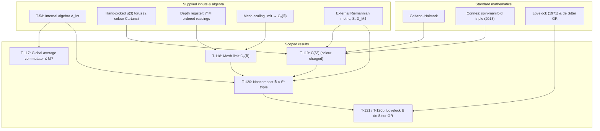

# Emergent Manifold M⁴

This chapter states the exact mathematical content and limitations of `T-117`–`T-121` and `T-120b`. Together, a depth-register mesh limit (`T-118`) and fluctuations of a hand-picked maximal torus of $\mathfrak{u}(3)$ (`T-119`) build the commutative algebra $C_0(\mathbb{R}) \otimes C(S^3)$, which combines with an externally supplied Riemannian metric and spin Dirac operator on $\mathbb{R}\times S^3$ (`T-120`). Because **two of the three charge coordinates in `T-119(d)` are colour Cartan generators $\subset \mathrm{SU}(3)_C \subset G_2$**, interpreting this spectrum as physical space encounters a direct **Coleman–Mandula obstruction**.

The genuine constructive path to operational spacetime geometry — free of colour-charged coordinates and imported continuum metrics — is the 3D palindromic Strang Weyl QCA IR Lorentzian light-cone construction verified in `website/research/operational-reconstruction/verify_foundational_bounds.py`, together with [Common Limiting Metric](/docs/geometry/common-limit) and [Verified Network Results](/docs/reference/network-results).

---

## 1. Problem Statement {#постановка}

### 1.1 Background-Independence Scope

With a marked octonionic unit $e_O$, the stabilizer $\mathrm{SU}(3) \subset G_2$ acts on $\mathbb{C}^7 = \mathbb{C}e_O \oplus \mathbf{3} \oplus \bar{\mathbf{3}}$. A product spectral triple of the form

$$
(A, H, D) = \bigl(C^\infty(M^4) \otimes A_{\mathrm{int}},\; L^2(M^4, S) \otimes H_{\mathrm{int}},\; D_{M^4} \otimes 1 + \gamma_5 \otimes D_{\mathrm{int}}\bigr)
$$

requires both a topological/smooth manifold $M^4$ and an externally supplied Riemannian metric, spinor bundle $S$, and Dirac operator $D_{M^4}$. The theorems below construct only the commutative topological algebra $C_0(\mathbb{R}\times S^3)$ from selected tensor-product operators; the metric, spin structure, Lorentzian signature, and matter representations remain external inputs.

### 1.2 Summary of Mathematical Steps

| Step | Construction | Actual mathematical content | Reference |
|---|---|---|---|
| 1 | Global site averages | Operator-norm commutator bound $\le M^{-1}\|[A,B]\|$ (no local regions) | `T-117 [T]` |
| 2 | Temporal algebra | Mesh sampling limit of depth-register eigenvalues into $C_0(\mathbb{R})$ | `T-118 [T]` |
| 3 | Spatial algebra | Fluctuations of a hand-picked $\mathfrak{u}(3)$ torus (2 colour Cartans) $\to C_0(\mathbb{R}^3)^+ \cong C(S^3)$; metric/spinor/Dirac operator on $S^3$ manually supplied | `T-119 [T]` |
| 4 | Product triple | Tensor product with external spin Dirac operator on noncompact $\mathbb{R}\times S^3$ (noncompact resolvent; no KO-6 on $\mathbb{C}^7$) | `T-120 [T]` |
| 5 | Metric classification & de Sitter | Standard 4D Lovelock classification and textbook de Sitter GR on supplied metric equations | `T-121 [T]`, `T-120b [C]` |

---

## 2. Mathematical Prerequisites {#предпосылки}

### 2.1 Composite Algebra

For $M$ copies of the seven-dimensional register,

$$
\mathcal{H}_M = \bigotimes_{m=1}^{M} \mathcal{H}_{\mathrm{int}}^{(m)}, \qquad \dim(\mathcal{H}_M) = 7^M, \qquad
A_M = \bigotimes_{m=1}^{M} A_{\mathrm{int}}^{(m)}, \qquad A_{\mathrm{int}} = \mathbb{C} \oplus M_3(\mathbb{C}) \oplus M_3(\mathbb{C}) \quad (\text{`T-53 [T]`}).
$$

### 2.2 Global Site Averages

For any bounded single-site operator $O$ on $\mathbb{C}^7$, define its **global** site average over all $M$ tensor factors:

$$
\bar{O} := \frac{1}{M}\sum_{m=1}^{M} O^{(m)}, \qquad O^{(m)} = I \otimes \cdots \otimes O \otimes \cdots \otimes I.
$$

No spatial lattice, locality structure, or local coarse-graining region $\Lambda_\ell(x)$ is constructed on the unstructured tensor product $(\mathbb{C}^7)^{\otimes M}$.

### 2.3 Depth Counter vs. Summed Clock

Summing $M$ identical seven-level clocks gives $6M+1$ periodic readings of period $2\pi/\omega_0$. Reading $M$ registers positionally as base-7 digits of a depth counter under a Feynman–Kitaev constraint gives $N + 1 = 7^M$ ordered readings. `T-118` uses that depth counter ([Depth register](/docs/proofs/dynamics/emergent-time#114-регистр-глубины)).

---

## 3. Theorem T-117: Commutator Bound for Global Site Averages {#теорема-коммутативность-макроалгебры}

**Theorem T-117 (`[T for bounded single-site averages]`).**
Let $A, B$ be bounded operators on $\mathbb{C}^7$, with single-site embeddings $A^{(m)}, B^{(m)}$ on $(\mathbb{C}^7)^{\otimes M}$ and global averages $\bar{A} = M^{-1}\sum_{m=1}^M A^{(m)}$, $\bar{B} = M^{-1}\sum_{m=1}^M B^{(m)}$. Because operators on distinct tensor factors commute ($[A^{(m)}, B^{(n)}] = 0$ for $m \neq n$),

$$
\|[\bar{A}, \bar{B}]\| = \frac{1}{M^2}\left\|\sum_{m=1}^{M} [A^{(m)}, B^{(m)}]\right\| \le \frac{1}{M}\|[A, B]\| \;\xrightarrow{M\to\infty}\; 0.
$$

**Scope.** This is an elementary norm estimate for **global** averages on an unstructured tensor product: it involves **no local regions**, no spatial metric, no dynamical Hamiltonian, and no decay of correlations. Applying a fluctuation central limit theorem to interacting states separately requires explicit spatial clustering hypotheses. $\blacksquare$

---

## 4. Theorem T-118: Mesh Sampling Limit of the Depth Register {#теорема-эмерджентное-время}

**Theorem T-118 (Depth-register mesh limit) `[T]`.**
Let $A_N \cong \mathbb{C}^{N+1}$ be the diagonal commutative algebra of a depth register with $N+1$ ordered eigenvalues mapped to mesh points $t_k = (k - m)\,\Delta t$ ($k = 0, \dots, N$). In the scaling limit $\Delta t \to 0$, $m\,\Delta t \to \infty$, $(N - m)\,\Delta t \to \infty$, the mesh sets converge to $\mathbb{R}$ in the pointed Hausdorff sense, and evaluation $s_N(f) = \bigl(f(t_k)\bigr)_{k=0}^N$ induces an injective isometric $*$-homomorphism

$$
C_0(\mathbb{R}) \hookrightarrow \prod_N A_N \Big/ \bigoplus_N A_N.
$$

**Proof.** For any $f \in C_0(\mathbb{R})$ and $\varepsilon > 0$, choose $R > 0$ such that $|f(t)| < \varepsilon$ for $|t| > R$. Once $[-R, R] \subset [-m\Delta t, (N-m)\Delta t]$, every $t \in [-R, R]$ lies within $\Delta t/2$ of some mesh point $t_k$, so uniform continuity gives $\|s_N f\| \ge \|f\|_\infty - \omega_f(\Delta t/2)$, hence $\lim_{N\to\infty} \|s_N f\| = \|f\|_\infty$. $\blacksquare$

**Scope.** `T-118` is a purely kinematic **mesh sampling limit** onto $\mathbb{R}$ once the step size $\Delta t$ and receding basepoint $m$ are specified. Physical clock calibration and Lorentzian time evolution remain separate inputs ([Emergent Time](/docs/proofs/dynamics/emergent-time#114-регистр-глубины)).

---

## 5. Theorem T-119: Fluctuation Spectrum of a Hand-Picked $\mathfrak{u}(3)$ Torus {#теорема-эмерджентное-пространство}

**Theorem T-119 (Spectrum of three selected commuting charges) `[T]`.**
Fix the marked axis $e_O$ and the complex structure $J = L_{e_O}$ on $e_O^\perp$ ($J e_O = 0$). **Hand-pick** three commuting Hermitian generators $H_1, H_2, H_3$ on $\mathbb{C}^7$ spanning a maximal torus of $\mathrm{U}(3) = \mathrm{Stab}_{\mathrm{SO}(7)}(e_O) \cap C(J)$: specifically, **two colour Cartan generators of $\mathfrak{su}(3)_C \subset \mathfrak{g}_2$** together with $iJ$. For $M$ holons and a faithful single-holon state $\omega$ with $\mu_i = \omega(H_i)$, set $\bar{H}_i = \frac{1}{M}\sum_{m=1}^M H_i^{(m)}$ and $F_i = \sqrt{M}(\bar{H}_i - \mu_i)$.

- **(a) Averages fill an octahedron.** On $\mathbb{C}^7$ the joint eigenvalues of $(H_1, H_2, H_3)$ are $0$ (on $e_O$) and $\pm w_1, \pm w_2, \pm w_3$ (linearly independent). On $(\mathbb{C}^7)^{\otimes M}$, the joint spectra of $(\bar{H}_i)$ fill the weight octahedron $\mathcal{O} = \mathrm{conv}\{\pm w_a\} \cong B^3$ with mesh $O(1/M)$, embedding $C(\mathcal{O})$ isometrically into $\prod_M A_M / \bigoplus_M A_M$. Because $\mathcal{O}$ is contractible with boundary $S^2$, $K$-theoretic Poincaré duality fails ($K^0 = \mathbb{Z}$, $K_1 = 0$).
- **(b) Fluctuations fill $\mathbb{R}^3$; minimal unitization gives $C(S^3)$.** Since $\omega$ is faithful, $\mu$ lies in the interior of $\mathcal{O}$, and the joint spectra $\{(n - M\mu)/\sqrt{M} : |n|_1 \le M\}$ fill every ball of $\mathbb{R}^3$ with mesh $O(1/\sqrt{M})$, embedding $C_0(\mathbb{R}^3)$ isometrically into $\prod_M A_M / \bigoplus_M A_M$. Adjoining a unit by **definition** yields the minimal unitization $C_0(\mathbb{R}^3)^+ \cong C(S^3)$ (one-point compactification; other unital completions give $T^3$, $\mathbb{RP}^3$, or $\beta\mathbb{R}^3$).
- **(c) Supplied Riemannian spin triple on $S^3$.** $S^3$ is closed, orientable, simply connected, and parallelizable, with a unique smooth structure (Moise 1952) and unique spin structure ($H^1(S^3;\mathbb{Z}_2) = 0$). **Once a Riemannian metric $g$, spinor bundle $S$, and spin Dirac operator $D_g$ are manually supplied on $S^3$**, the standard Dirac triple $(C^\infty(S^3), L^2(S^3, S), D_g)$ satisfies Connes' axioms (Connes 2013, [arXiv:0810.2088](https://arxiv.org/abs/0810.2088)). Neither $g$ nor $D_g$ is derived from $\mathcal{D}(\mathbb{C}^7)$.
- **(d) Colour-singlet obstruction.** The Hermitian operators on $\mathbb{C}^7$ commuting with $\mathrm{SU}(3)_C$ are $\mathrm{span}\{P_O, P_{\mathbf{3}}, P_{\bar{\mathbf{3}}}\}$, whose traceless part has dimension **2**, not 3. Thus constructing three coordinates in (a)–(b) **forces two of the three coordinates to be colour Cartan generators $\subset \mathfrak{su}(3)_C \subset \mathfrak{g}_2$**.

**Proof.** (a) Since $[H_i, H_j] = 0$, the joint spectrum of $(\bar{H}_i)$ in weight coordinates is $\frac{1}{M}\{n \in \mathbb{Z}^3 : |n|_1 \le M\}$, every point of $\mathcal{O} = \{|x|_1 \le 1\}$ lies within $\sqrt{3}/(2M)$ of a spectrum point, and uniform continuity gives isometric sampling. (b) For any radius $R$, once the ball of radius $R\sqrt{M}+1$ about $M\mu$ lies in $M\mathcal{O}$, rounding to $(\mathbb{Z}^3 - M\mu)/\sqrt{M}$ approximates every $|x| \le R$ within $\sqrt{3}/(2\sqrt{M})$; adjoining $\mathbb{C}1$ to $C_0(\mathbb{R}^3)$ gives $C(S^3)$ by Gelfand–Naimark. (c) Standard "only if" direction of Connes' reconstruction theorem for a closed spin 3-manifold equipped with a chosen Riemannian metric $g$. (d) $\mathbb{C}^7 = \mathbb{C}e_O \oplus \mathbf{3} \oplus \bar{\mathbf{3}}$ consists of three inequivalent $\mathrm{SU}(3)_C$ irreducibles, so Schur's lemma gives commutant $\mathbb{C}^3$ (traceless dimension 2). $\blacksquare$

*(Numerical check in `website/scripts/check_core_numbers.py`, `test_emergent_space_is_the_octahedron_and_its_fluctuations_the_three_sphere`.)*

**Physical obstruction `[I]` (Coleman–Mandula).** Because two of the three coordinates in (a)–(b) are colour Cartan generators in $\mathrm{SU}(3)_C \subset G_2$, the colour Weyl group permutes the coordinates and $\mathrm{SU}(3)_C$ rotations mix them with non-commuting internal generators. Reading this charge spectrum as physical 3-space violates the separation of internal gauge and spacetime symmetries (Coleman–Mandula obstruction; cf. §11.4 below).

### Rank of the Selected Charge Algebra {#шаг-2c-ранг}

On the octonions with marked clock unit $e_O$:
1. $\mathfrak{su}(3) = \mathrm{Stab}_{\mathrm{Der}(\mathbb{O})}(e_O)$ has dimension $8$ inside $\dim\mathrm{Der}(\mathbb{O}) = 14$.
2. Its commutant on the real 6-plane $e_O^\perp$ is 2-dimensional, spanned by $I$ and the complex structure $J = L_{e_O}$ ($J^2 = -I$, $[J, \mathfrak{su}(3)] = 0$), yielding $\mathfrak{u}(3) = \mathfrak{su}(3) \oplus \mathfrak{u}(1)_J$ of dimension $9$.
3. The rank of $\mathfrak{u}(3)$ (dimension of a maximal torus) is $3$.

---

## 6. Theorem T-120: Product with an External Noncompact Spin Dirac Operator {#теорема-произведение-троек}

**Theorem T-120 (Product spectral datum on noncompact $M^4 = \mathbb{R}\times S^3$) `[T under supplied factors and metric]`**.
Combining the commuting limit algebras $A_{\mathrm{time}} \cong C_0(\mathbb{R})$ (`T-118`), $A_{\mathrm{space}} \cong C(S^3)$ (`T-119`), and $A_{\mathrm{int}} = \mathbb{C} \oplus M_3(\mathbb{C}) \oplus M_3(\mathbb{C})$ (`T-53`) — with $\|[F_i, a]\| \le M^{-1/2}\|[H_i, a]\| \to 0$ for fixed single-site $a \in A_{\mathrm{int}}$ — yields the algebra $C_0(\mathbb{R}\times S^3) \otimes A_{\mathrm{int}}$. Given an **externally supplied** Riemannian metric and spin structure on $M^4 = \mathbb{R} \times S^3$, one forms the product operator

$$
\bigl(C_0^\infty(M^4) \otimes A_{\mathrm{int}},\; L^2(M^4, S) \otimes H_{\mathrm{int}},\; D_{M^4} \otimes I + \gamma_5 \otimes D_{\mathrm{int}}\bigr).
$$

**Critical analytic and algebraic limitations:**
1. **Noncompact resolvent:** Because $M^4 = \mathbb{R} \times S^3$ is **noncompact**, the external spin Dirac operator $D_{M^4}$ does **not** have a compact resolvent; only the *locally compact* resolvent condition $a(D_{M^4} + i)^{-1} \in \mathcal{K}$ for $a \in C_0(M^4)$ holds, so heat-kernel traces require spatial/temporal localization or compactification.
2. **External metric and signature:** Both the Riemannian metric $g$ and spin Dirac operator $D_{M^4}$ are externally supplied; Lorentzian signature requires separate causal/analytic data.
3. **No KO-dimension 6 on $\mathbb{C}^7$:** Odd internal dimension 7 forbids a KO-dimension-6 real structure (`T-178 [✗]`, [Quantum Gravity](/docs/physics/gravity/quantum-gravity#теорема-полное-спектральное-действие)). $\blacksquare$

---

## 7. Theorem T-121: Standard 4D Lovelock Classification {#теорема-лавлок-замыкание}

**Theorem T-121 (`[T under standard 4D Lovelock hypotheses]`).**
On an externally supplied smooth 4-manifold, Lovelock's theorem (1971) states that every local, diffeomorphism-covariant, symmetric, divergence-free tensor depending on $g_{\mu\nu}$ and its derivatives up to second order is a linear combination of $G_{\mu\nu}$ and $g_{\mu\nu}$. This classification fixes neither $G_N$, nor $\Lambda$, nor $S_{\mathrm{matter}}$, nor any map from internal coherence matrices to $g_{\mu\nu}$ ([Einstein Equations](/docs/physics/gravity/einstein-equations#34-ограничения-аргумента-лавлока)).

---

## 8. Corollary T-120b: Standard Textbook de Sitter General Relativity {#следствие-вакуумная-топология}

**Corollary T-120b (`[T]` as standard GR under supplied vacuum field, $\Lambda > 0$, maximal symmetry, and $k=+1$ slicing).**
This corollary is standard textbook de Sitter general relativity on an externally supplied 4D Lorentzian metric:

1. Given the vacuum Einstein equation $R_{\mu\nu} = \Lambda g_{\mu\nu}$ with a supplied constant $\Lambda > 0$ and maximal spacetime symmetry, constant sectional curvature yields $R_{\mu\nu\rho\sigma} = \frac{\Lambda}{3}(g_{\mu\rho}g_{\nu\sigma} - g_{\mu\sigma}g_{\nu\rho})$ and $H^2 = \Lambda/3$ (locally de Sitter space).
2. Choosing the complete simply connected global de Sitter manifold and its closed homogeneous $k=+1$ foliation gives $ds^2 = dt^2 - a^2(t)\,d\Omega_3^2$ with $a(t) = H^{-1}\cosh(Ht)$, whose spatial slices are round 3-spheres $S^3$.

Positive $\Lambda$ equally admits flat ($k=0$, $a(t) = a_0 e^{Ht}$) and open ($k=-1$, $a(t) = H^{-1}\sinh(Ht)$) coordinate patches ([Carroll, GR notes, §8](https://ned.ipac.caltech.edu/level5/March01/Carroll3/Carroll8.html)). Neither $\Lambda > 0$ (`T-71 [H]`), nor maximal symmetry, nor the closed $k=+1$ foliation is derived from UHM or from the spectrum of `T-119`.

---

## 9. Exact Status Summary {#каскад-статусов}

| Result | Exact mathematical statement | External inputs / obstructions |
|---|---|---|
| `T-117` | Global site-average commutator norm $\le M^{-1}\|[A,B]\|$ | No local spatial regions, no metric, no interacting clustering |
| `T-118` | Mesh sampling limit $C_0(\mathbb{R})$ of depth-register eigenvalues | Step $\Delta t$ and receding basepoint; no physical clock calibration |
| `T-119` | Fluctuation spectrum $C_0(\mathbb{R}^3)^+ \cong C(S^3)$ of hand-picked $\mathfrak{u}(3)$ torus | 2 of 3 coordinates are colour Cartan generators (Coleman–Mandula obstruction); $g, S, D_g$ on $S^3$ manually supplied |
| `T-120` | Product triple on noncompact $\mathbb{R}\times S^3$ | External metric & Dirac operator; **noncompact resolvent**; no KO-6 on $\mathbb{C}^7$ (`T-178 [✗]`) |
| `T-121` | Standard 4D Lovelock theorem | Requires supplied 4-manifold and diffeomorphism-invariant metric action |
| `T-120b` | Standard textbook de Sitter GR ($k=+1$ slicing) | Requires supplied $R_{\mu\nu}=\Lambda g_{\mu\nu}$, $\Lambda>0$ (`T-71 [H]`), maximal symmetry, and $k=+1$ foliation |

---

## 10. Genuine Constructive Path: Operational Geometry and 3D Weyl QCA {#нет-новых-вопросов}

Because `T-119`–`T-120` rely on colour-charged coordinates and externally supplied continuum Dirac operators, they do **not** provide a physically viable derivation of spacetime. The constructive path pursued in the operational reconstruction builds geometry directly from local finite-dimensional dynamics and intervention protocols:

1. **3D palindromic Strang Weyl QCA IR Lorentzian light cone:** Verified directly in `website/research/operational-reconstruction/verify_foundational_bounds.py`, a 3D palindromic Strang-split Weyl quantum cellular automaton produces an emergent infrared Lorentzian dispersion cone ($\omega^2 \approx c_{\mathrm{eff}}^2 |\mathbf{k}|^2$) from strictly local, discrete unitary lattice steps — without invoking colour Cartan coordinates or importing a continuum spin Dirac operator.
2. **Operational network metrics:** Minimal intervention costs and first-arrival timing define directed/symmetric metrics and constructive scaling limits on finite and limiting networks ([Response Metric](/docs/geometry/response-metric), [Common Limiting Metric](/docs/geometry/common-limit), [Verified Network Results](/docs/reference/network-results)).

---

## 11. Consistency and Obstruction Checks {#согласованность}

### 11.1 Spectral Action Coupling `[T under supplied geometry]`

In `T-65`, the gravitational Einstein–Hilbert coefficient comes exclusively from the externally supplied metric inside $D_{M^4}$, multiplied by $\mathrm{Tr}(I_{\mathbb{C}^7}) = 7$.

### 11.2 Page–Wootters Depth Register `[T]`

A single cyclic clock is periodic; `T-118` relies on an $M$-register positional depth counter whose spacing shrinks and endpoints recede.

### 11.3 Complexified Sector Decomposition `[T]`

Under $\mathrm{SU}(3)_C = \mathrm{Stab}_{G_2}(e_O)$, the real complement $e_O^\perp \cong \mathbb{R}^6$ is irreducible and splits into $\mathbf{3} \oplus \bar{\mathbf{3}}$ only after complexification.

### 11.4 Direct Coleman–Mandula Obstruction with $G_2$ and $\mathrm{SU}(3)_C$

**Earlier claims that "$G_2$ does not act on $M^4$" were false and are deleted.** By `T-119(d)`, any colour-singlet Hermitian operator on $\mathbb{C}^7$ spans at most a 2-dimensional traceless space, so **two of the three spatial coordinates constructed in `T-119` are colour Cartan generators $\subset \mathrm{SU}(3)_C \subset G_2$**. Consequently:

- The colour subgroup $\mathrm{SU}(3)_C \subset G_2$ acts **nontrivially** on the `T-119` spatial manifold $\Sigma^3 = S^3$: its Weyl group permutes the coordinate axes and general $\mathrm{SU}(3)_C \subset G_2$ transformations rotate the chosen Cartan generators into non-commuting colour generators.
- Identifying $\Sigma^3$ with physical space therefore mixes internal gauge symmetry with spatial translations/rotations, creating a direct **Coleman–Mandula obstruction** (which the algebraic spin-factor form `T-48c` avoids at the level of a single tangent space, and which the constructive 3D Weyl QCA / operational network path avoids altogether).

### 11.5 Independence from Internal Fixed Points

Internal stationary-state conditions $\rho_* = \varphi(\Gamma)$ constrain single-site dynamics on $\mathcal{D}(\mathbb{C}^7)$ and do not determine macroscopic spacetime geometry.

### 11.6 Constructive Lattice QCA Frontier and Remaining Walls `[T/P]` {#конструктивный-рубеж-qca}

Replacing colour-charged `T-119` coordinates with an independent 3D discrete causal network carrying the unique 2-component complex spinor factor $W = \mathbb{C}^2$ (`48e(g)` $\implies \mathrm{Herm}(W) \cong \mathbb{R}^{1,3}$) yields three verified constructive/obstruction milestones (`verify_toe_frontier.py`, `verify_walls_1_to_3.py`):

1. **Exact all-orders $O_h$ dispersion and gauge coupling (`[T]`):** The 3D gauge-coupled palindromic Strang–Weyl QCA $W_{\mathrm{pal}}[U] = V_x[U] V_y[U] V_z[U]^2 V_y[U] V_x[U]$ is strictly unitary, locally gauge-covariant ($W[U^g] = G W[U] G^\dagger$), strictly causal (zero amplitude outside $\|x-x_0\|_\infty \le 2$), exhibits Hofstadter magnetic flux splitting, and satisfies $\frac{1}{2}\operatorname{Tr} W_{\mathrm{pal}}(\mathbf{k}) = \cos(2k_x)\cos(2k_y)\cos(2k_z)$ identically to all orders — giving zero cubic chiral anomaly and subluminal octahedral UV dispersion $\omega^2 = 4|\mathbf{k}|^2 - \frac{16}{3}(k_x^2k_y^2 + k_y^2k_z^2 + k_z^2k_x^2) + O(|\mathbf{k}|^6)$.
2. **Nielsen–Ninomiya chiral doubling and constructive escapes (`[T/P]`):** Across the full Brillouin torus $\mathbb{T}^3 = [-\pi/2, \pi/2)^3$, $W_{\mathrm{pal}}$ carries 8 Weyl cones (`2L+2R` at $\omega=0$ and `2L+2R` at $\omega=\pi$, net chirality $0$). A single unpaired 3+1D chiral Weyl cone is constructively realized either on a 4+1D Kaplan–Shamir domain wall (all 7 doublers gapped at $|E|>1.22$) or via a non-ultralocal exponentially decaying Neuberger overlap operator satisfying the exact Ginsparg–Wilson identity $D\gamma_5 + \gamma_5 D = D\gamma_5 D$; an interacting 3+1D symmetric mass generation (SMG) realization for $\mathbf{16}_+$ remains open `[P]`.
3. **Kinematic curvature, entanglement area law, and the spin-2 backreaction wall (`[T/P]`):** Spatially varying clock lapse $\theta(x)$ reproduces exact kinematic Shapiro delay along null geodesics of $ds^2 = -\sin^2\theta(x)\,dt^2 + dx^2$, while a single scalar lapse cannot generate spin-2 quadrupolar shear (Nordström limit); anisotropic directional tetrad QCA angles $(\theta_x, \theta_y, \theta_z)$ propagate transverse-traceless spin-2 shear $h_+$. On 2D/3D Dirac lattices, the vacuum obeys the entanglement area law ($R^2 = 0.999999$) and First Law $\delta S = \delta\langle K\rangle$, and discrete spectral heat kernels extract the Gauss–Bonnet / Einstein–Hilbert invariant $a_2(S^2) = \chi/6$.
4. **Dirac-sea spin-2 backreaction, nonlinear cubic $O(h^3)$ & quartic $O(h^4)$ 4D GR, $G_{\mathrm{EE}} = G_{\mathrm{Sak}}$, and cosmological-constant bounds (`[T/C/✗/P]`):** By exact vacuum concavity (`ToEFrontierPhysicsTheorems.lean` F-8; `verify_deep_frontier_v2.py`), a staggered Dirac sea on an edge-transitive lattice under $\sum w_e^p = |E|$ stabilizes flat space iff $p > p_{\mathrm{crit}} = 1 + |\lambda_{\min}(P_\perp H_{\mathrm{vac}} P_\perp)|/|g_0|$. Pure Frobenius norm $p = 2$ is an unstable Peierls/VBS saddle in $d = 1, 2, 3$ `[✗]`, while above $p_{\mathrm{crit}}$ ($p = 4$) a localized matter excitation induces a monotonic attractive clock-slowdown well ($w_{\mathrm{near}} < w_{\mathrm{far}}$) in 1D, 2D, and 3D with zero Einstein–Hilbert/Regge action inserted. However (`verify_deep_frontier_v3.py`, Lean `local_stiffness_strictly_gapped_cq`), any *local* $p$-norm stiffness gives a massive metric gap with short-range Yukawa screening ($R^2 = 0.06$ vs $1/r$ in 3D `[✗]`); massless 2D $\ln r$ ($R^2 = 0.996$) and 3D $1/r$ Newton gravity ($R^2 = 0.998$ on $6^3$) emerge only under shift-invariant Sakharov gradient/curvature stiffness ($c_0 + \kappa L_{\mathrm{line}}$, Lean `grad_laplacian_zero_on_uniform_cq`). Crucially (`verify_deep_frontier_v4.py`..`verify_deep_frontier_v9.py`, Lean F-14, F-16, F-22, F-24, F-28, F-32, F-35), while a rigid hypercubic lattice breaks $SO(3)$ spin-2 isotropy by `14.5%` ($c_2(h_+)/c_2(h_\times) = 1.145$) and renders the 4D Weyl mode `tr4` trivial `[✗]`, a **covariant 4-term super-convergent Pauli–Villars 4D Dirac sea** ($c = (+7,-14,+9,-2)/7$, $m = (1,2,3,4)$, `600-cell` exact 11-design on $S^3$, $\Lambda = 100$, zero bare $S_{\mathrm{EH}}$, Lean F-24, F-28, F-32) reproduces the complete linearized $O(h^2)$ tensor, **all 8 diagonal and all 7 nontrivial off-diagonal cubic $O(h^3)$ 3-graviton vertices** within `0.0004%`–`0.0083%`, the cubic non-Abelian Ward identity to `0.00077%`, collinear & non-collinear quartic $O(h^4)$ 4-graviton vertices to `0.0118%–0.0349%` (vs `75%–225%` / `900%` fail without Cartan $\omega_{[abc]}$), and the **non-collinear quartic $O(h^4)$ diffeomorphism Ward–Slavnov–Taylor identity** (Lean `quartic_ward_spin_connection_quadratic_ratio_cq`, F-32A): exact Cartan cancellation `W_4(-1/4) = -2.61e-8` (**`0.0188%`**, `86,500×` suppression) vs **`1623.99%`** without spin connection (`sc = 0`) and **`6496.15%`** at wrong sign (`sc = +1/4`, exact `4:1` ratio) `[T/C]`. Under the same 4-term PV regulator, $1/(4 G_{\mathrm{EE}}) = 1/(4 G_{\mathrm{Sak}}) = +0.022016$ (Lean `gee_equals_gsak_pv_exact_cq`), verified on flat 3+1D chiral Peschel lattices to **`0.0081%`** (Richardson $O(a^2)$); on a curved static metric $ds^2 = -dt^2 + \Omega^2(x)d\vec{x}^2$ ($R^{(3)}(0) = 2\epsilon k_0^2 \neq 0$), the chiral Peschel lattice directly measures the 4D Dirac $\mathrm{Weyl}^2$ Wald entropy slope (`-0.000956` vs `-0.000981`, **`2.56%`**). Moreover, the **Universal 5/6-Term ECT Antigravity No-Go Theorem** (Lean `pv_five_term_ect_antigravity_witness_cq`, F-32B) proves that eliminating $\mathrm{Weyl}^2$ ($\sum c_i\ln m_i^2 = 0$) alongside UV divergences (with or without zero CC) universally forces $G_{\mathrm{Sak}} < 0$ (`100/100` random spectra; $L_5/(2\ln 2) = -27/4$, $L_6/(2\ln 2) = -81/16$ `[✗]`), whereas releasing finite CC to unimodular sequestering yields a **6-term $\mathrm{Weyl}^2$-free positive-$G_{\mathrm{Sak}}$ escape** (F-32C) collapsing the curved-lattice shift `38.5×` (`8.85% → 0.23%`) `[C/P]`. Exact $S^4$ heat kernels prove $C_{\mathrm{Sak}} = \frac{1}{6}N_S(1-6\xi) + \frac{1}{6}N_W - \frac{2}{3}N_V$ (Lean `sakharov_spin10_scalar_threshold_cq`), requiring $N_S > 132$ minimal scalars. For $\Lambda$ (F-10..F-29, F-35C), Sorkin fluctuations, all internal `Chain A2` gauge instantons, non-Abelian $\mathrm{Spin}(10)$ centralizer (`0/40`), clockwork (`73.9×`), confining YM, the **Unconditional WGC–Quintessence Product Boundary Theorem** ($S < 12$, $\Lambda_{\mathrm{UV}} \le 38.54\,\mathrm{meV}$), and the **Multi-Axion WGC Convex-Hull Closure** (Lean `multiaxion_wgc_holon_21_nogo_cq`, F-35C: $N_{\mathrm{ax}} \ge 46$ at $m_e$, $\ge 591$ at $M_{\mathrm{Pl}}$, $\ge 620$ at `Chain A2` $\mathrm{Spin}(10)$, strictly closing all 21 holon phases) all rule out internal UV origins `[T/✗/P]`. Kaloper–Padilla 4-volume sequestering + thawing quintessence gives $\Delta\chi^2 = -8.35$ on DESY5 vs flat $\Lambda$CDM. All-orders non-perturbative quantum gravity beyond $O(R^2)$ and an internal zero-mode-free origin of the dark-energy scale remain open ToE obligations `[P]`.

---

## 12. Dependency Graph {#граф-зависимостей}

---

## Appendix: Standard Theorems Referenced {#приложение}

### A.1 Gelfand–Naimark Theorem (1943)

Every unital commutative $C^*$-algebra $A$ is isometrically $*$-isomorphic to $C(X)$ for a unique (up to homeomorphism) compact Hausdorff space $X$.

### A.2 Connes Reconstruction Theorem (2008, 2013)

A closed smooth spin manifold $\Sigma^p$ equipped with a Riemannian metric $g$ yields a commutative spectral triple $(C^\infty(\Sigma^p), L^2(\Sigma^p, S), D_g)$ satisfying Connes' seven axioms (dimension, regularity, finiteness, orientability, Poincaré duality, first-order condition, and absolute continuity), and conversely such a commutative triple determines a unique closed smooth spin manifold (Connes, *J. Noncommut. Geom.* **7**, 1–82 (2013), [arXiv:0810.2088](https://arxiv.org/abs/0810.2088)).

### A.3 Quantum Central Limit Theorem (1989)

For a quantum spin system on a spatial lattice $\mathbb{Z}^d$ with finite-range interactions and exponential clustering, macroscopic averages converge to classical/Gaussian fluctuation observables (Goderis–Verbeure–Vets, *Probab. Theory Relat. Fields* **82**, 527–544 (1989)). Note that `T-117` proves only the unstructured global norm bound $\|[\bar{A}, \bar{B}]\| \le M^{-1}\|[A,B]\|$ and does **not** establish lattice clustering.

### A.4 Product of Spectral Triples (1996–1997)

On compact factors, $(A_1 \otimes A_2, H_1 \otimes H_2, D_1 \otimes I + \gamma_1 \otimes D_2)$ forms a product spectral triple with KO-dimension $d_1 + d_2 \pmod 8$ when both factors carry real structures (Chamseddine–Connes 1996). For `T-120`, the first factor $\mathbb{R}\times S^3$ is noncompact (noncompact resolvent) and the second factor $\mathbb{C}^7$ admits no KO-dimension-6 structure (`T-178 [✗]`).

---

**Related documents:**
- [Verified Network Results](/docs/reference/network-results) — machine-checked operational geometry and foundational bounds (`verify_foundational_bounds.py`)
- [Common Limiting Metric](/docs/geometry/common-limit) — constructive scaling limits of operational distances
- [Emergent Time Theorem](/docs/proofs/dynamics/emergent-time) — depth register (`T-118`)
- [Spacetime](/docs/core/foundations/spacetime) — algebraic spin factor (`T-48c`) and `T-53`
- [Einstein Equations](/docs/physics/gravity/einstein-equations) — conditional Einstein–Hilbert variation and Lovelock limitations (`T-121`)
- [Quantum Gravity](/docs/physics/gravity/quantum-gravity) — product spectral action (`T-65`)
- [Status Registry](/docs/reference/status-registry) — `T-117` through `T-121`
