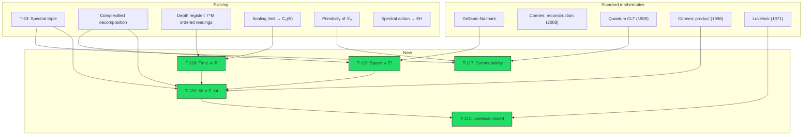

# Emergent Manifold M⁴

A depth register with a specified scaling limit supplies $\mathbb R$. Fluctuations of three selected commuting charges supply $C_0(\mathbb R^3)$, whose minimal unitization has spectrum $S^3$. The product $\mathbb R\times S^3$ is a mathematical construction [T]. Two charges carry colour. Its physical interpretation, metric and dynamics require separate input. [Operational metric limits](/docs/geometry/common-limit)

---

## 1. Problem Statement {#постановка}

### 1.1 Background Independence Gap

With a chosen octonionic unit $e_O$, the stabilizer acts on $\mathbb C^7=\mathbb C e_O\oplus\mathbf3\oplus\bar{\mathbf3}$. A product spectral action also uses a spin manifold, metric and differential operator:

$$
(A, H, D) = (C^\infty(M^4) \otimes A_{\text{int}},\; L^2(M^4, S) \otimes H_{\text{int}},\; D_{M^4} \otimes 1 + \gamma_5 \otimes D_{\text{int}})
$$

The following construction specifies the underlying topological space. Matter representations and couplings are separate inputs.

### 1.2 Solution Strategy

The constructions use the following algebras and limits.

| Step | Content | Source |
|------|---------|--------|
| 1 | Composite algebra | Tensor product [T] |
| 2 | Temporal C*-algebra | $\mathbb{C}[\mathbb{Z}_N] \to C(S^1)$ for the summed O-clock; $C_0(\mathbb{R})$ as the scaling limit of the depth register (T-118 [T]) |
| 3 | Spatial C*-algebra | Joint spectrum of three commuting rotation charges, computed: octahedron (averages), $\mathbb R^3$ (fluctuations), $C(S^3)$ after the minimal unitization (T-119 [T]) |
| 4 | Manifold | Gelfand–Naimark [standard mathematics]; Connes' conditions hold for the Dirac triple of $S^3$ (T-119(c) [T]) |
| 5 | Product | Steps 1–4 (T-120 [T]) |

---

## 2. Mathematical Prerequisites {#предпосылки}

### 2.1 Composite Systems

A composite system of $M$ holons is described by the tensor product:

$$
\mathcal{H}_M = \bigotimes_{m=1}^{M} \mathcal{H}_{\text{int}}^{(m)}, \quad \dim(\mathcal{H}_M) = 7^M
$$

Observable algebra:

$$
A_M = \bigotimes_{m=1}^{M} A_{\text{int}}^{(m)}, \quad A_{\text{int}} = \mathbb{C} \oplus M_3(\mathbb{C}) \oplus M_3(\mathbb{C}) \quad \text{(T-53 [T])}
$$

### 2.2 Macroscopic Observables

For a region $\Lambda_\ell(x)$ containing $|\Lambda_\ell(x)|$ holons near "position" $x$, we define the **macroscopic average**:

$$
\bar{O}(x) := \frac{1}{|\Lambda_\ell(x)|} \sum_{m \in \Lambda_\ell(x)} O^{(m)}
$$

where $O^{(m)} = \mathbb{1} \otimes \cdots \otimes O \otimes \cdots \otimes \mathbb{1}$ is the local observable of the $m$-th holon.

### 2.3 Effective Clocks and the Temporal Algebra

Summing $M$ identical seven-level clocks gives $6M+1$ readings and keeps the period $2\pi/\omega_0$. Using the $M$ registers as digits of a depth counter instead gives $7^M$ ordered readings under a specified Feynman–Kitaev constraint. T-118 uses that counter. [Depth register](/docs/proofs/dynamics/emergent-time#114-регистр-глубины)

---

## 3. Theorem T-117: Commutativity of the Macroscopic Algebra {#теорема-коммутативность-макроалгебры}

**T-117 [T for bounded site averages].** Let $A^{(m)},B^{(m)}$ denote copies of bounded observables acting on site $m$ of a tensor product, and set $\bar A=M^{-1}\sum_m A^{(m)}$, $\bar B=M^{-1}\sum_m B^{(m)}$. Operators on distinct sites commute, so

$$
\|[\bar A,\bar B]\|\le M^{-2}\sum_m\|[A^{(m)},B^{(m)}]\|\le M^{-1}\|[A,B]\|.
$$

Commutativity of these averages does not establish decay of spatial correlations for a family of interacting states. Applying a fluctuation central limit theorem to that family requires its clustering hypotheses.

---

## 4. Theorem T-118: Emergent Temporal Manifold {#теорема-эмерджентное-время}

:::tip Theorem T-118 (Emergent Temporal Manifold) [T]
The temporal part of $A_{\text{macro}}$ — the diagonal algebra $A_N \cong \mathbb{C}^{N+1}$ of the depth register, with readings $t_k = (k - m)\,\Delta t$ in a macroscopic unit — converges to $C_0(\mathbb{R})$, the algebra of continuous functions vanishing at infinity, in the scaling limit $\Delta t \to 0$, $m\,\Delta t \to \infty$, $(N - m)\,\Delta t \to \infty$: the reading sets converge to $\mathbb{R}$ in the pointed Hausdorff sense, and sampling is an injective isometric $*$-homomorphism $C_0(\mathbb{R}) \to \prod_N A_N/\bigoplus_N A_N$.
:::

**Proof.**

**Step 1.** Read the clock registers positionally under the specified Feynman–Kitaev constraint. The resulting $N+1$ readings form an ordered chain and index the conditional dynamical states. [Depth register](/docs/proofs/dynamics/emergent-time#114-регистр-глубины)

**Step 2 (Scaling limit).** Theorem 11.5 of emergent time: the readings form a grid of mesh $\Delta t$ that eventually covers every $[-R, R]$; evaluation at the readings is a $*$-homomorphism $s_N: C_0(\mathbb{R}) \to A_N$, and $\|s_N f\| \geq \|f\|_\infty - \omega_f(\Delta t/2)$ by uniform continuity, so $\limsup_N \|s_N f\| = \|f\|_\infty$. $\blacksquare$

Keeping the origin at the first reading gives the half-line. Taking the basepoint far from both ends in macroscopic units gives the line used by T-120.

**Dependencies:** emergent time, Theorems 11.1 and 11.5 [T]; standard mathematics: Gelfand–Naimark.

---

## 5. Theorem T-119: Emergent Spatial Manifold {#теорема-эмерджентное-пространство}

:::tip T-119. Spectrum of the selected charges [T]
Let $J=L_{e_O}$ on $e_O^\perp$ (and $0$ on $e_O$), and let $H_1,H_2,H_3$ be Hermitian generators on $\mathbb C^7$ of a maximal torus of $\mathrm U(3)=\mathrm{Stab}_{\mathrm{SO}(7)}(e_O)\cap C(J)$: two Cartan generators of $\mathfrak{su}(3)_C$ and $iJ$. Equivalently, of a maximal torus of $\mathrm{SO}(7)$ that fixes the clock axis; $\operatorname{rank}\mathrm{SO}(7)=3$. For $M$ holons put $\bar H_i=\frac1M\sum_m H_i^{(m)}$ and $F_i=\sqrt M\,(\bar H_i-\mu_i)$ with $\mu_i=\omega(H_i)$ for a faithful state $\omega$ of one holon.

**(a) Averages: an octahedron.** The joint eigenvalues of $(H_1,H_2,H_3)$ on $\mathbb C^7$ are $0$ (on $e_O$) and $\pm w_1,\pm w_2,\pm w_3$ with $w_a$ linearly independent. The joint spectra of $(\bar H_i)$ fill the weight octahedron $\mathcal O=\mathrm{conv}\{\pm w_a\}$ with mesh $O(1/M)$. Sampling $f\mapsto f(\bar H)$ embeds $C(\mathcal O)$ isometrically into $\prod_M A_M/\bigoplus_M A_M$. $\mathcal O\cong B^3$ is a manifold with boundary $S^2$, and its $K$-theoretic Poincaré duality fails.

**(b) Fluctuations: $\mathbb R^3$, and $S^3$ after the unit.** The joint spectra of $(F_i)$ fill every ball of $\mathbb R^3$ with mesh $O(1/\sqrt M)$. Sampling embeds $C_0(\mathbb R^3)$ isometrically into $\prod_M A_M/\bigoplus_M A_M$. The *spatial algebra*, defined as the unital C*-algebra generated by this image, is the minimal unitization $C_0(\mathbb R^3)^+\cong C(S^3)$.

**(c) The manifold and Connes' conditions.** $\Sigma^3:=S^3$ is a closed, orientable, simply connected spin 3-manifold, with a unique smooth structure. For every Riemannian metric $g$ on it the Dirac triple $(C^\infty(S^3),L^2(S^3,S),D_g)$ satisfies all seven of Connes' conditions, the first-order condition and Poincaré duality included.

**(d) Colour-singlet coordinates give two dimensions.** The Hermitian operators on $\mathbb C^7$ that commute with $\mathrm{SU}(3)_C$ are $\mathrm{span}\{P_O,P_{\mathbf 3},P_{\bar{\mathbf 3}}\}$; their traceless part is two-dimensional. So the "3" of (a)–(c) needs two colour Cartan generators, and this $\Sigma^3$ is not colour-singlet.
:::

**Proof.** (a) The $H_i$ commute: they lie in one torus. Their joint eigenvalues are computed (numbers below). In weight coordinates they are $0,\pm e_1,\pm e_2,\pm e_3$. On $(\mathbb C^7)^{\otimes M}$ the $\bar H_i$ commute exactly, and their joint eigenvalues are the means of $M$ weights: $\frac1M\{n\in\mathbb Z^3:\lvert n\rvert_1\le M\}$ (the weight $0$ lets the sum stop short of $M$ steps). All these points lie in $\mathcal O=\{\lvert x\rvert_1\le1\}$, and every point of $\mathcal O$ is within $\sqrt3/(2M)$ of one of them. As in [T-118](#теорема-эмерджентное-время), $\lVert f(\bar H)\rVert=\max_{\mathrm{spec}}\lvert f\rvert\ge\lVert f\rVert_\infty-\omega_f(\sqrt3/(2M))$, so sampling is isometric in the quotient. $\mathcal O$ is a compact convex body with interior, hence homeomorphic to $B^3$. Poincaré duality for a closed 3-manifold $X$ would give $K^0(X)\cong K_1(X)$. For the contractible $\mathcal O$, $K^0=\mathbb Z$ and $K_1=0$.
(b) The joint spectrum of $(F_i)$ is $\{(n-M\mu)/\sqrt M:\lvert n\rvert_1\le M\}$. A faithful $\omega$ gives every joint eigenvalue positive weight, so $\mu$ is an interior point of $\mathcal O$. Given $R$, once $M$ is so large that the ball of radius $R\sqrt M+1$ about $M\mu$ lies in $M\mathcal O$, rounding any $x$ with $\lvert x\rvert\le R$ to the lattice $(\mathbb Z^3-M\mu)/\sqrt M$ stays inside the constraint and moves $x$ by at most $\sqrt3/(2\sqrt M)$. So the spectra fill the ball, and $\lVert f(F)\rVert\to\lVert f\rVert_\infty$ for $f\in C_0(\mathbb R^3)$. The image contains no unit, because $C_0(\mathbb R^3)$ has none. So image $+\,\mathbb C1$ is the minimal unitization, whose spectrum is the one-point compactification $\mathbb R^3\cup\{\infty\}=S^3$.
(c) $S^3$ is compact, orientable and parallelisable, hence spin (with one spin structure, since $H^1(S^3;\mathbb Z_2)=0$), and simply connected. Its smooth structure is unique (Moise 1952: every topological 3-manifold has one smooth structure up to diffeomorphism). For a closed spin manifold the Dirac triple satisfies Connes' conditions; this is the "only if" half of the reconstruction theorem (Connes, *J. Noncommut. Geom.* **7**, 1–82 (2013), [arXiv:0810.2088](https://arxiv.org/abs/0810.2088); J. M. Gracia-Bondía, J. C. Várilly, H. Figueroa, *Elements of Noncommutative Geometry*, Birkhäuser 2001, ch. 10–11). The first-order condition holds because $[D,a]=c(da)$ acts by Clifford multiplication, which commutes with multiplication by functions, and $b^\circ=b$ on a commutative algebra. Poincaré duality is the fundamental class $[D]\in K_3(S^3)$. There is no circularity: the manifold is established by (b) through Gelfand–Naimark, not assumed in order to check an axiom.
(d) $\mathbb C^7=\mathbb Ce_O\oplus\mathbf 3\oplus\bar{\mathbf 3}$ with three inequivalent irreducibles, so by Schur the commutant is $\mathbb C^3$. $\blacksquare$

*Numbers* (`website/scripts/check_core_numbers.py`, `test_emergent_space_is_the_octahedron_and_its_fluctuations_the_three_sphere`): the three generators commute; their joint spectrum on $\mathbb C^7$ is the origin plus three antipodal pairs of rank $3$, and in weight coordinates every non-zero point has $\lvert w\rvert_1=\lvert w\rvert_\infty=1$; for $M=10$ and $M=40$ random points of $\mathcal O$ lie within $\sqrt3/(2M)$ of the mean spectrum; for $M=10^6$ and $\mu$ interior, random points of $[-3,3]^3$ lie within $\sqrt3/(2\sqrt M)$ of the fluctuation spectrum; the covariance of $(H_i)$ in $I/7$ is non-degenerate; the colour commutant on $\mathbb C^7$ has dimension $3$.

**The one choice, named.** Other unital completions of $C_0(\mathbb R^3)$ give other compactifications: the coordinate resolvents $(F_i\pm i)^{-1}$ give $(\mathbb R\cup\infty)^3=T^3$, all bounded continuous functions give the Stone–Čech $\beta\mathbb R^3$, and projective completion gives $\mathbb{RP}^3$. The one-point compactification is the smallest compactification of $\mathbb R^3$, and the rotations of the fluctuation covariance extend to it (they do not extend to $T^3$). T-119 takes it by definition, just as T-118 takes $C_0(\mathbb R)$ and not $C_b(\mathbb R)$. This is a definition, not a hypothesis about UHM. Its physical content is that "space" means the observables that become constant at large fluctuations.

**The metric is not fixed.** The covariance of $(F_i)$ in the state $I/7$ is $\tfrac27\cdot1$ in weight coordinates. It gives $\mathbb R^3$ a flat metric, which extends to $S^3$ only conformally (stereographic projection). T-119 fixes the manifold, not the metric. The metric is dynamical and enters through the spectral action (T-65).

**Reading as physical space: [I].** The three charges rotate the three complex planes $\{A,D\},\{S,U\},\{L,E\}$ into which $L_{e_O}$ pairs the six non-$O$ axes; the fixed axis is the clock. So $7=1+2\cdot3$ gives one clock axis and $\operatorname{rank}\mathrm{SO}(7)=3$ commuting charges. But by (d) the coordinates are colour-charged: the Weyl group of $\mathrm{SU}(3)_C$ permutes them, and colour rotations mix them with non-commuting charges. Read as physical space, this $\Sigma^3$ meets the Coleman–Mandula obstacle that [Theorem 48c](/docs/core/foundations/spacetime#теорема-48c) avoids. The two results give the same count $1+3$ but are not yet one picture ([Theorem 48d](/docs/core/foundations/spacetime#теорема-48d)).

### Rank of the charge algebra {#шаг-2c-ранг}

A maximal torus of $\mathrm U(3)$ has three independent generators. In (b), the actual joint fluctuation spectrum fills $\mathbb R^3$. Rank alone gives an upper bound on the number of commuting coordinates.

**The computation, entirely from the octonions**:

1. $\mathfrak{su}(3) = \mathrm{Stab}_{\mathrm{Der}(\mathbb O)}(e_1)$ is $8$-dimensional (§C, verified: $\dim\mathrm{Der}(\mathbb O)=14$, $\dim\mathrm{Stab}=8$).
2. Its commutant on the $6$-dimensional complement $\mathrm{span}(e_2,\dots,e_7)$ is $2$-dimensional; subtracting the identity leaves a **complex structure** $J$ with $J^2 = -I$ (residual $1.3\times10^{-15}$) and $[J,\mathfrak{su}(3)] = 0$ (residual $1.1\times10^{-15}$). So $J$ is *derived*, not posited, and the spatial observable algebra is

$$
\mathfrak{su}(3)\oplus\mathfrak u(1)_J \;=\; \mathfrak u(3), \qquad \dim = 9 \ \text{(verified)} .
$$

3. The rank is the dimension of the centralizer of a generic element. Measured over $20$ random elements: **exactly $3$**, every time. For contrast, none of the candidate "dimensions" equals $3$: $\dim\mathfrak u(3) = 9$, $\dim\mathfrak{su}(3) = 8$, $\dim G_2 = 14$.

$$
\boxed{\,d_s \;=\; \operatorname{rank}\mathfrak u(3) \;=\; 3\,}
$$
---

## 6. Theorem T-120: Product of Spectral Triples {#теорема-произведение-троек}

:::tip T-120. Product of spectral triples
In the limit $M\to\infty$ the macroscopic time, space and internal algebras commute and generate $C_0(\mathbb R)\otimes C(S^3)\otimes A_{\text{int}}=C_0(M^4)\otimes A_{\text{int}}$. For every Riemannian metric on $M^4$ the product triple

$$
(C^\infty(M^4) \otimes A_{\text{int}},\; L^2(M^4, S) \otimes H_{\text{int}},\; D_{M^4} \otimes 1 + \gamma_5 \otimes D_{\text{int}})
$$

is the product for a chosen Riemannian metric and spin structure on $M^4=\mathbb R\times S^3$. On this noncompact manifold, local compactness or a localized trace must be used as appropriate. The finite seven-dimensional factor supplies no real structure of KO-dimension six.
:::

**Proof.**

**Step 1 (Temporal component).** $A_{\text{time}} \cong C_0(\mathbb{R})$ as the scaling limit of the depth register (T-118 [T]).

**Step 2 (Spatial component).** $A_{\text{space}} \cong C(S^3)$ (T-119 [T]).

**Step 3 (Internal component).** $A_{\text{int}} = \mathbb{C} \oplus M_3(\mathbb{C}) \oplus M_3(\mathbb{C})$ (T-53 [T]).

**Step 4.** The depth register can use a separate tensor factor. For a fixed single-site observable $a$, only its own site contributes to the commutator $[F_i,a]$, so $\|[F_i,a]\|\le \|[H_i,a]\|/\sqrt M$. The fluctuation and local readouts therefore commute in the limit.

**Step 5 (Product of algebras).**

$$
C_0(\mathbb R)\otimes C(S^3)\otimes A_{\rm int}\cong C_0(\mathbb R\times S^3)\otimes A_{\rm int},
$$

where $M^4 := \mathbb{R} \times \Sigma^3$.

**Metric and signature.** The product Dirac operator uses the chosen metric on the external factor. A KO-dimension-six real structure would exchange positive and negative chiral subspaces of equal dimension. This cannot hold on $\mathbb C^7$. A Lorentzian realization requires additional causal or analytic data. [Spectral action](/docs/physics/gravity/quantum-gravity#теорема-полное-спектральное-действие)

---

## 7. Theorem T-121: Closure of Lovelock Gaps {#теорема-лавлок-замыкание}

**T-121 [T for a specified four-dimensional metric theory].** On a smooth four-manifold the Lovelock classification gives the Einstein tensor and metric terms for a local natural symmetric divergence-free metric tensor of the indicated differential order. The diffeomorphism covariance comes from the supplied geometric action. The classification fixes neither the coefficients nor the map from an internal matrix to a spacetime metric. [Einstein equations](/docs/physics/gravity/einstein-equations#34-ограничения-аргумента-лавлока)
---

## 8. Corollary T-120b: Vacuum geometry under supplied hypotheses {#следствие-вакуумная-топология}

:::info Corollary T-120b [C at a specified positive vacuum field and closed slicing]
The spectrum $\Sigma^3\cong S^3$ computed in the selected spatial-algebra construction of T-119 is independent of an energy readout. It does not by itself select a round metric. Conversely $\Lambda>0$ does not by itself determine spatial topology or the sign of the curvature of a chosen slice.

Fix the four-dimensional vacuum Einstein equation $R_{\mu\nu}=\Lambda g_{\mu\nu}$, a supplied constant $\Lambda>0$, and maximal spacetime symmetry. In the corresponding curvature convention the constant-curvature ansatz yields

$$
R_{\mu\nu\rho\sigma}=\frac{\Lambda}{3}(g_{\mu\rho}g_{\nu\sigma}-g_{\mu\sigma}g_{\nu\rho}),\qquad H^2=\frac{\Lambda}{3}.
$$

This is locally de Sitter geometry **[T under these inputs]**. Choosing its complete simply connected global realization and the closed homogeneous slicing gives, in units $c=1$,

$$
ds^2=dt^2-a^2(t)d\Omega_3^2,\qquad a(t)=H^{-1}\cosh(Ht).
$$

Its slices are round $S^3$, with sectional curvature $1/a(t)^2>0$; this is the selected $k=+1$ realization.
:::

**Conditional derivation.** Contraction of the constant-curvature tensor in dimension four gives $R_{\mu\nu}=3K g_{\mu\nu}$, hence $K=\Lambda/3$. The closed-slicing Friedmann equation is $\dot a^2+1=H^2a^2$; the displayed $a(t)$ solves it. With spatial completeness, simple connectivity and positive constant spatial curvature specified, the spatial space-form classification gives $S^3$. These assumptions supply the topology; neither the sign of $\Lambda$ nor contractibility of a matrix configuration space supplies them.

Positive $\Lambda$ also admits flat and open de Sitter coordinate patches: $a(t)=a_0e^{Ht}$ with $k=0$, and $a(t)=H^{-1}\sinh(Ht)$ with $k=-1$, respectively. Thus positive **spacetime** curvature and the sign of **spatial** curvature are different statements ([Carroll, GR notes, §8](https://ned.ipac.caltech.edu/level5/March01/Carroll3/Carroll8.html)). Without maximal spacetime symmetry, the vacuum Einstein equation also permits nonzero Weyl curvature and does not force constant sectional curvature.

Identifying a Gap readout with the cosmological constant requires a physical model. A closed round spatial slicing also assumes the topology, a global solution and a choice of foliation.

---

## 9. Results and premises {#каскад-статусов}

T-118 constructs a clock limit. T-119 determines the joint spectrum of selected charges. T-120 forms their product with a chosen external metric. T-121 applies a local four-dimensional classification once metric dynamics is specified.

---

## 10. Open physical questions {#нет-новых-вопросов}

Identifying the charge spectrum with measured locations needs operational comparisons among probes. Test whether independently calibrated signals agree on the same distances and whether this agreement persists across scales. [Common limiting geometry](/docs/geometry/common-limit)

## 11. Consistency Check {#согласованность}

### 11.1 Compatibility with the Spectral Action [T]

The external metric enters the Dirac operator and therefore the curvature coefficient of the spectral action.

### 11.2 Compatibility with Page–Wootters [T]

The single cyclic clock has periodic readings. T-118 uses a depth register whose spacing shrinks and whose two endpoints recede from the observer.

### 11.3 Compatibility with Sector Decomposition [T]

The stabilizer representation splits after complexification into $\mathbb C e_O\oplus\mathbf3\oplus\bar{\mathbf3}$. Its real six-dimensional complement is irreducible. The three charges are specified by a maximal torus.

### 11.4 Compatibility with $G_2$-Rigidity [T]

The symmetry $G_2 = \text{Aut}(\mathbb{O})$ acts on the internal space $F_{\text{int}}$, not on $M^4$. The derivation of $M^4$ is compatible with (and independent of) the $G_2$ structure.

### 11.6 Compatibility with the Self-Referential Fix $\rho_*$

$\rho_* = \varphi(\Gamma)$ is a property of the **internal** dynamics on $F_{\text{int}}$. The derivation of $M^4$ concerns **external** (macroscopic) geometry. They are independent.

---

## 12. Dependency Graph {#граф-зависимостей}

Green nodes are mathematical results under the premises specified in §§3–7.

---

## Appendix: Standard Theorems {#приложение}

### A.1 Gelfand–Naimark Theorem (1943)

Every unital commutative C*-algebra $A$ is isomorphic to $C(X)$ for a unique (up to homeomorphism) compact Hausdorff space $X$ — the Gelfand spectrum of $A$.

### A.2 Connes Reconstruction Theorem (2008, 2013)

Let $(A, H, D)$ be a commutative spectral triple satisfying the axioms:
- (i) Dimension $p$ (in the Weyl sense)
- (ii) Regularity ($A$, $[D,A]$ in the smooth domain)
- (iii) Finiteness ($H_\infty$ is a finitely generated projective $A$-module)
- (iv) Orientability (Hochschild $p$-cycle)
- (v) Poincaré duality

and the absolute continuity condition. Then there exists a unique smooth compact spin manifold $\Sigma^p$ such that $(A, H, D) \cong (C^\infty(\Sigma^p), L^2(\Sigma^p, S), D_{\Sigma^p})$.

*References:* Connes A. (2008) On the spectral characterization of manifolds. J. Noncommut. Geom. 2(3), 253–294; Connes A. (2013) Geometry and the quantum. arXiv:1703.02470.

### A.3 Quantum Central Limit Theorem (1989)

For a quantum spin system on a lattice $\mathbb{Z}^d$ with finite interaction range and clustering property (exponential decay of correlations), in the thermodynamic limit, macroscopic averages $\bar{O}(x) = \frac{1}{|\Lambda|}\sum_{m \in \Lambda} O^{(m)}$ satisfy:

$$
[\bar{O}_1(x), \bar{O}_2(y)] \to 0 \quad (|\Lambda| \to \infty, \; |x-y| > 0)
$$

*References:* Goderis D., Verbeure A., Vets P. (1989) Non-commutative central limits. Probab. Theory Relat. Fields 82, 527–544.

### A.4 Connes–Chamseddine Product Theorem (1996–1997)

The product of spectral triples $(A_1, H_1, D_1)$ and $(A_2, H_2, D_2)$:

$$
(A_1 \otimes A_2,\; H_1 \otimes H_2,\; D_1 \otimes 1 + \gamma_1 \otimes D_2)
$$

satisfies the NCG axioms with KO-dimension $d_1 + d_2 \pmod{8}$, provided both components satisfy the axioms.

*References:* Connes A. (1996) Gravity coupled with matter and the foundation of non-commutative geometry. Comm. Math. Phys. 182, 155–176; Chamseddine A.H., Connes A. (1997) The spectral action principle. Comm. Math. Phys. 186, 731–750.

---

**Related documents:**
- [Emergent Time Theorem](/docs/proofs/dynamics/emergent-time) — temporal component (T-118)
- [Spacetime](/docs/core/foundations/spacetime) — sector decomposition, spectral triple T-53
- [Einstein Equations](/docs/physics/gravity/einstein-equations) — closure of Lovelock gaps (T-121)
- [Quantum Gravity](/docs/physics/gravity/quantum-gravity) — spectral action T-65
- [Emergent Geometry](/docs/physics/gravity/emergent-geometry) — metric derivation program
- [Status Registry](/docs/reference/status-registry) — T-117 through T-121
