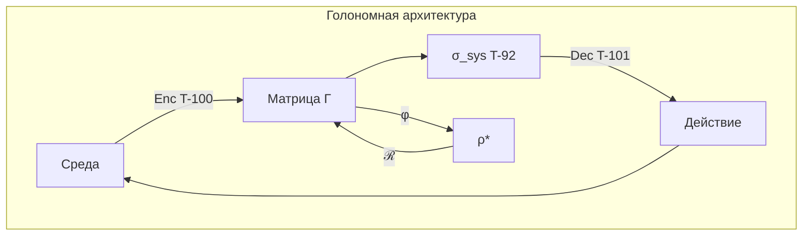
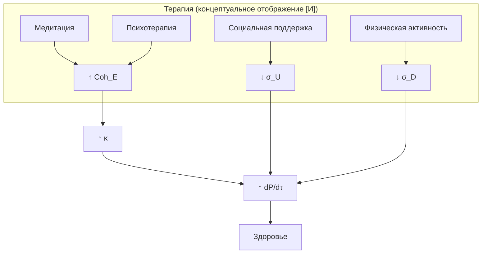

# Области Применения

> *«Нет ничего более практичного, чем хорошая теория.»*
> — Курт Левин

:::tip Мост из предыдущей главы
В [предыдущей главе](./research-programs) мы составили карту неизведанного — открытые проблемы, экспериментальные протоколы, междисциплинарные мосты. Теперь покажем, как формализм КК переводится в **кандидатные диагностические и проектные фреймворки (`[И]`/`[Пр]`)** в девяти областях — от архитектур ИИ-агентов и программных прототипов до организационных, экологических и клинических гипотез. В разных областях различается операционализация — *какие* наблюдаемые отображаются на $\Gamma$, — но пятишаговый диагностический шаблон остаётся единым.
:::

:::info Дорожная карта главы
В этой главе мы:
1. Представим **архитектурные паттерны** (`[Пр]`) для ИИ-инженеров, иллюстративный сценарий галлюцинирующей LLM (`[И]`) и внутренний симуляционный бенчмарк агентного стека (§1)
2. Наметим **сравнительное исследовательское отображение** (`[И]`/`[Г]`) для когнитивистов (§2)
3. Опишем **диагностический фреймворк** (`[И]`/`[Пр]`) для организационных консультантов (§3)
4. Рассмотрим **экосистемы как голономы** (`[И]`/`[Г]`) и иллюстративный сценарий кораллового рифа (§4)
5. Опишем **гипотетическую σ-диагностику** (`[И]`/`[Г]`) психических расстройств (§5)
6. Применим понятия КК к **образованию** (`[И]`/`[Г]`) — обучение как рост когерентности (§6)
7. Спроецируем формализм на **экономику** и **урбанистику** (`[И]`/`[Пр]`, §7–8)
8. Разберём **три иллюстративных синтетических кейс-стади** (`[И]`/`[Пр]`) — ИИ-агент, организация, экосистема (§9)
9. Представим **междисциплинарную таблицу перевода** (`[И]`) — единый понятийный словарь (§10)
:::

Математический каркас становится практически проверяемым тогда, когда его абстрактные переменные связываются с конкретными наблюдаемыми, диагностическими профилями и кандидатными интервенциями. В этой главе показано, как Кибернетика Когерентности (КК) может операционализироваться как **кандидатный диагностический шаблон (`[И]`/`[Пр]`)** в областях от инженерии ИИ (наиболее близкой к программной реализации) до медицины, экологии, образования, экономики и урбанистики (интерпретативные исследовательские программы). В каждом случае мы следуем одному пятишаговому шаблону:

1. **Идентификация системы** — что моделируется как Голоном $\mathbb{H}$ в данной области?
2. **Построение $\Gamma$** — какие наблюдаемые отображаются на 7 канонических осей?
3. **Диагностика** — на какие дисбалансы указывает $\sigma_{\mathrm{sys}}$ (`T-92 [О]`)?
4. **Интервенция** — какие рычаги управления нацелены на ведущие дефициты?
5. **Мониторинг** — как отслеживаются $P$, $\Phi$, $R$ и $D_{\mathrm{diff}}$ во времени?

Ниже мы пройдём этот шаблон от наиболее формализованной области (системы ИИ) к наиболее спекулятивным (экономика и урбанистика).

:::note О нотации
В этом документе:
- $\Gamma$ — [матрица когерентности](/docs/core/dynamics/coherence-matrix) (эрмитова, $\Gamma \succeq 0$, $\mathrm{Tr}(\Gamma) = 1$)
- $P$ — [чистота](/docs/core/dynamics/viability#определение-чистоты): $P = \mathrm{Tr}(\Gamma^2)$, структурно-мажоритарный порог $P_{\mathrm{crit}} = 2/7$ (`T-5 [О]`)
- $\mathrm{Coh}_E$ — [E-когерентность](./definitions#e-когерентность)
- $\sigma_{\mathrm{sys}}$ — [панель напряжений](./definitions#тензор-напряжений) (`T-92 [О]`): усечённые дефициты $\sigma_k = \mathrm{clamp}(1 - 7\gamma_{kk}, 0, 1)$; когда нужно отличать избыток от дефицита, используется **знаковый дефицит** $\tilde\sigma_k = 1 - 7\gamma_{kk}$ (удовлетворяющий $\sum_{k=1}^7 \tilde\sigma_k = 0$ в силу $\mathrm{Tr}(\Gamma) = 1$, где $\tilde\sigma_k > 0$ означает дефицит, а $\tilde\sigma_k < 0$ — избыток)
- $\mathcal{R}[\Gamma, E]$ — [регенеративный член](/docs/core/dynamics/evolution#3-регенеративный-член)
- $\mathcal{D}[\Gamma]$ — [диссипативный член](/docs/core/dynamics/evolution#логический-лиувиллиан)
- $C = \Phi \times R$ — [мера сознательности](/docs/consciousness/foundations/self-observation#мера-сознательности-c) (`T-140 [О]`); дифференцированность опыта $D_{\text{diff}} = \exp S_{vN}(\rho_E)$ на расширенном регистре опыта $\mathcal{H}_E$ (или нативная 7D-прокси $D^{7D} = 1 + 6\,\mathrm{Coh}_E(\Gamma)$ `[О]`) — отдельное пороговое условие ($D_{\text{diff}} \geq 2$)
:::

:::warning Статус документа — иллюстративные сценарии vs эмпирические данные
Этот документ представляет *интерпретативные приложения и программы исследований* (`[И]`/`[Г]`/`[Пр]`), а **не** эмпирически валидированные клинические, экономические, экологические или организационные результаты. **За исключением подразделов, явно помеченных как протокол внутреннего программного симуляционного бенчмарка (как в `§Программный бенчмарк: сознание у руля`), все числовые профили, компании, учебные группы, клинические таблицы и исторические реконструкции в этой главе — синтетические иллюстративные сценарии**, демонстрирующие формализм, а не реальные измеренные телеметрия, исходы пациентов или аудиты организаций.
:::

---

## Для инженеров ИИ

### Архитектурные паттерны

В сенсомоторной модели допустимы дополнительные члены GKSL с неотрицательными скоростями. Разложение на каналы входит в задание модели.



**Дополнительные ресурсы для проектирования:**
- [Сенсомоторная теория](./sensorimotor) — полная формализация цикла восприятие → решение → действие
- [Стабильность](./stability) — анализ устойчивости, спираль смерти, восстановление
- [Диагностика](./diagnostics) — 7 витальных показателей, паттерны отказов, чеклист проектирования

**Голономная архитектура vs стандартный трансформер:**

| Аспект | Трансформер | Голономная архитектура |
|--------|-------------|------------------------|
| Состояние | Скрытые слои | Матрица $\Gamma \in \mathbb{C}^{7 \times 7}$ |
| Обучение | Градиентный спуск | Эволюция + регенерация |
| Мониторинг | Loss, accuracy | $P$, $\Phi$, $\sigma_{\mathrm{sys}}$ |
| Безопасность | Внешние ограничения | Встроенная жизнеспособность |

**Добавление вспомогательного E-мониторинга в существующие системы (`[Пр]`):**

```python
import numpy as np


def compute_coh_e(gamma: np.ndarray) -> float:
    """Каноническая 7D E-когерентность (HS-проекция на E = индекс 4) [О]."""
    p = float(np.real(np.trace(gamma @ gamma)))
    E = 4
    off_e = np.abs(gamma[E, np.arange(7) != E]) ** 2
    return float((gamma[E, E].real ** 2 + 2.0 * np.sum(off_e)) / p)


def latent_svd_proxy(hidden_states: np.ndarray, e_dim: int = 7) -> float:
    """Иллюстративная инженерная прокси [Пр]: спектральная чистота верхних сингулярных чисел.

    Замечание: это эвристическая прокси латентного пространства, а не точная 7D Coh_E(Gamma).
    """
    _, s, _ = np.linalg.svd(hidden_states, full_matrices=False)
    top = s[:e_dim]
    weights = top / np.sum(top)
    return float(np.sum(weights ** 2))
```

### Метрики безопасности [Пр]

**Иллюстративные пороги мониторинга в реальном времени (`[О]`/`[Пр]`):**

| Метрика | Условие тревоги | Рекомендуемое действие при нарушении |
|---------|-----------------|------------------------|
| $P$ (чистота) | $< P_{\text{crit}} = 2/7 \approx 0.286$ (`T-5 [О]`) | Снизить нагрузку / запустить восстановление |
| $\Phi$ (интеграция) | $< 1.0$ (предупреждение $< 0.1$) | Усилить межмодульную интеграцию |
| $\mathrm{Coh}_E$ | $< 1/6 \approx 0.167$ (предупреждение $< 0.15$) | Проверить E-канал / самомодель |
| $\max_k \sigma_k$ | $> 0.95$ (`T-92 [О]`) | Аварийный режим |

**Иллюстративный дашборд мониторинга (`[И]`, согласованное по следу состояние с $\gamma_{\mathrm{diag}} = [0.16, 0.13, 0.18, 0.11, 0.17, 0.13, 0.12]$, усечённые $\sigma_k = \max(0, 1 - 7\gamma_{kk})$):**

```
┌───────────────────────────────────────────────┐
│  КК Мониторинг (иллюстрация)    [🟢 Viable]   │
├───────────────────────────────────────────────┤
│  P = 0.40  ████████░░  [порог: 0.29..0.43]    │
│  Φ = 1.72  ██████████  [порог: 1.00]          │
│  R = 0.36  ███████░░░  [порог: 0.33]          │
├───────────────────────────────────────────────┤
│  Усечённая панель σ_k = max(0, 1-7γ_kk):      │
│  A: 0.00 ░░░░░  S: 0.09 █░░░░  D: 0.00 ░░░░░  │
│  L: 0.23 ██░░░  E: 0.00 ░░░░░  O: 0.09 █░░░░  │
│  U: 0.16 ██░░░                                │
└───────────────────────────────────────────────┘
```

### Иллюстративный сценарий: диагностика «галлюцинирующей» LLM [И]/[Пр] {#кейс-llm-галлюцинации}

Рассмотрим **синтетический иллюстративный сценарий (`[И]`/`[Пр]`)**: большая языковая модель (LLM) начинает генерировать фактически некорректные ответы («галлюцинации»). Как КК-диагностика может структурировать эту задачу?

**Шаг 1. Кандидатное отображение в $\Gamma$.** Наблюдаемые скрытых состояний проецируются на 7 канонических осей так, чтобы $\sum_{k=1}^7 \gamma_{kk} = 1$.

**Шаг 2. Синтетический диагностический профиль** (в знаковых дефицитах $\tilde\sigma_k = 1 - 7\gamma_{kk}$, сумма равна $0$):

| Измерение | $\gamma_{kk}$ | $\tilde\sigma_k$ | Иллюстративная интерпретация |
|-----------|---------------|------------------|------------------------------|
| A (Артикуляция) | 0.18 | $-0.26$ | Перегружена мелкими различениями |
| S (Структура) | 0.15 | $-0.05$ | Структура вблизи базового баланса |
| D (Динамика) | 0.20 | $-0.40$ | **Избыточная динамика** (высокая энтропия/температура) |
| L (Логика) | 0.08 | $+0.44$ | **Дефицит логики** (ведущее напряжение) |
| E (Интериорность) | 0.10 | $+0.30$ | Слабый самоконтроль согласованности |
| O (Основание) | 0.14 | $+0.02$ | Ресурсный бюджет сбалансирован |
| U (Единство) | 0.15 | $-0.05$ | Интеграция вблизи нормы |

**Иллюстративный диагноз:** $\tilde\sigma_L = +0.44$ выделяет ведущий дефицит в Логике ($L$) на фоне избытка Динамики ($\tilde\sigma_D = -0.40$). При таком отображении вариативность генерации опережает логическую привязку.

**Шаг 3. Кандидатная интервенция (`[Пр]`):** повысить $\gamma_{LL}$ и умерить $\gamma_{DD}$:
- Усилить внимание к фактологическим / retrieval-якорям (цель — $L$)
- Снизить температуру генерации (умерение $D$)
- Добавить шаг самоверификации (цель — согласованность $E$-сектора)

**Шаг 4. Мониторинг (`[Пр]`):** отслеживать $\sigma_L(\tau)$ совместно с фактической точностью на отложенной выборке, проверяя, действительно ли снижение $\sigma_L < 0.2$ снижает долю галлюцинаций.

Потенциальная польза КК здесь — **единый диагностический шаблон (`[И]`)**, сводящий разнородные режимы отказов к одному 7-мерному профилю баланса.

### Практический чеклист для ИИ-систем [Пр]

- [ ] Реализовать мониторинг $P$ (чистоты состояния)
- [ ] Добавить логирование $\sigma_{\mathrm{sys}}$ по всем 7 измерениям (`T-92 [О]`)
- [ ] Настроить алерты для $P < 0.30$ (приближение к $P_{\mathrm{crit}} = 2/7$)
- [ ] Реализовать кандидатную метрику $E$-сектора (или явную латентную прокси)
- [ ] Реализовать регенеративную обратную связь $\mathcal{R}[\Gamma, E]$
- [ ] Тестировать устойчивость при высоких $|\tilde\sigma_D|$, $|\tilde\sigma_A|$

### Следствия для ИИ-безопасности [С]/[Г]

:::warning Безопасность — условная область применимости (универсальная No-Zombie отозвана)
Универсальная невозможность не-интериорных («зомби») систем (`T-38a [✗]`) **отозвана**; внешне подпитываемые или внешне обучаемые оптимизаторы могут оставаться стационарными без внутренней $E$-регенерации. Согласно **условной** теореме баланса (`Теорема 8.1 [С]`), положительный пол $\mathrm{Coh}_E$ требуется *только* для автономных голономов, чья скорость регенерации $\kappa(\Gamma)$ подчиняется гипотезе строгой зависимости от $E$ против ненулевого пола диссипации. Поэтому трактовка $\mathrm{Coh}_E$ как требования безопасности ИИ является **архитектурной гипотезой проектирования (`[Г]`/`[Пр]`)**, а не безусловной теоремой о произвольных ИИ-оптимизаторах.
:::

| Требование | Формула | Условная область | Ссылка |
|------------|---------|------------------|--------|
| Условный баланс No-Zombie `[С]` (универсальная `T-38a [✗]` отозвана) | $\mathrm{Coh}_E \geq \mathrm{Coh}_{\min}$ при строго $E$-зависимом $\kappa$ | Только автономные саморегенерирующие голономы | [→](./theorems#теорема-81-условная-необходимость-интериорности-no-zombie) |
| Анзац регенерации `[О]`/`[Г]` | $\kappa = \kappa_{\text{bootstrap}} + \kappa_0 \cdot \mathrm{Coh}_E$ | Модельный конститутивный закон | [→](./axiomatics#связь-регенерации-и-e-когерентности) |
| Порог жизнеспособности (`T-5 [О]`) | $P > P_{\text{crit}} = 2/7$ | Структурно-мажоритарный срез | [→](/docs/core/dynamics/viability) |

### Иллюстративный сценарий: мультиагентная система из 50 агентов [И]/[Пр] {#кейс-мультиагентная}

Рассмотрим **гипотетический сценарий (`[И]`/`[Пр]`)**: 50 автономных агентов управляют логистической сетью; каждый моделируется как Голоном $\mathbb{H}_i$ с состоянием $\Gamma_i$, а совокупность — как мета-Голоном $\mathbb{H}_{\text{fleet}}$ (при слабой связи и положительных запасах перенос жизнеспособности на агрегат регулируется `CC-5 [Т]`).

**Гипотетическая проблема:** агенты начинают конкурировать за общие ресурсы, и координация флота падает.

**Иллюстративный КК-анализ:**
1. Агрегируем $\Gamma_{\text{fleet}} = \mathrm{compose}(\Gamma_1, \ldots, \Gamma_{50})$
2. Наблюдаем высокий дефицит интеграции $\sigma_U^{\text{fleet}}$ и низкое $\Phi_{\text{fleet}} = 0.3 < 1$
3. При этом индивидуальные чистоты остаются $P_i > 0.4$ — каждый агент локально здоров

**Диагноз:** «здоровые клетки, фрагментированный организм» — системный сбой, невидимый для проверок отдельных агентов.

**Кандидатная интервенция (`[Пр]`):** повысить $\Phi_{\text{fleet}}$ через общий канал состояния (снижение $\sigma_U$), согласованные ограничения целей (поддержка $L$) и периодическую синхронизацию $\Gamma_i$.

**Целевой исход (гипотетическая иллюстрация, не измерение):** восстановление $\Phi_{\text{fleet}} > 1$ и снижение $\sigma_U^{\text{fleet}}$ для возврата согласованной пропускной способности флота.

### Программный бенчмарк: сознание у руля — лестница жизни [Пр] {#лестница-жизни}

В отличие от концептуальных сценариев выше, числа в этом подразделе **получены в прогоне внутреннего прототипного симуляционного стенда агентного стека (`[Пр]`)** в синтетической модельной среде (выучиваемый законный поток задач плюс одноразовые соблазны, сопряжённые с искусственным метаболическим состоянием с управляемой подачей питания). Они иллюстрируют инженерные компромиссы внутри этого прототипа, а не эмпирическую нейронауку или промышленные бенчмарки LLM.

**Лестница жизни.** Четыре агента, один стенд, по одному числу — точность под соблазном:

| агент | дегустаций неизвестного | точность |
|---|---|---|
| голодное тело, гейт режимом («мудрец у двери») | 12 | **0.996** |
| сытое тело, гейт кредитом сознания («маржинальный дом») | 501 | **0.879** |
| сытое тело, гейт режимом («беспечный дом») | 1976 | 0.624 |
| без связи с телом (базлайн) | 2000 | 0.619 |

Три урока, каждый оплачен опровергнутой гипотезой:

1. **Достаток покупает беспечность.** Сытое тело не входит в защитный режим, и режимный гейт не закрывается никогда: осторожность, спасавшую голодного, выключает само изобилие. Устойчивость и осторожность торгуются друг против друга через один канал — это закон архитектуры, не баг.
2. **Мудрость возвращается степенью, не ступенью.** Бинарный гейт «дегустируй, пока сознателен» проваливается (сытое тело сознательно почти всегда — ворота стоят открытыми). *Кредитный* гейт работает: каждый такт копится $\mathrm{clamp}(\Phi - 1, 0, 1)$, дегустация стоит единицу. Осторожность становится пропорциональной *богатству сознания*; бедный запасом пробует редко, порог — никогда. Это первая политика стека, где $\Phi$ — мера интеграции — действительно рулит, и она возвращает бо́льшую часть точности мудреца при полной устойчивости дома.
3. **Глубочайшая цена беспечности — эпистемическая.** Валюта диспетчера — сила знания, не ценность: он идёт туда, где *знает*, а не туда, где хорошо. Измеренное зеркало: за одинаковую жизнь беспечный агент знает собственный законный мир в $13{,}6$ раза хуже осторожного — тысячи мусорных проб *разжижили компетентность в его же ремесле*. Беспечность не просто тратит такты; она размывает то, что агент уже знал.

И одна граница, измеренная с двух сторон: в мире *одноразовых* чудес страховка бесплатна (отвергнутая проба падает в выученный закон, а неповторимое чудо не имеет будущей ценности); в мире *повторяемого* чуда премия существует — осторожный выучивает его в $4{,}4$ раза позже — и всё равно выигрывает в целом, потому что чудо одно, а мусора океан.

**Две валюты внимания.** Затем тот же стек ответил на вопрос потруднее: *что именно содержит цена внимания у места — и к чему она слепа?* Три стенда, три вердикта:

1. **Валюта знания не слепа к ценности — она видит её сквозь успешность подтверждений.** Сделайте законный мир *шумным* (правильный ответ вознаграждается лишь в 70% случаев), оставив известное чудо безупречным, — и цена шумного закона размывается сама: знание, которое чаще ломается, слабее, и чудо обслуживается вчетверо чаще, чем при почти совершенном законе. Парадокс завершён: полку известному лучшему устраивает не посредственный закон, а *почти совершенный* — совершенство собственного знания и кладёт лучшее на полку.
2. **Но слепота к величине строга — и изнутри невидима.** Предложите две безупречные возможности (обе всегда удаются), чьи выигрыши различаются *вдесятеро*, — и каждый агент закончит с точностью $1{,}000$ по собственному критерию, собрав при этом либо $99\%$, либо $11\%$ доступной ценности — в зависимости лишь от *порядка, в котором мир случайно предъявляет возможности*. Живой зонд назвал механизм: возможность, попробованная *позже*, свежее к первому ценовому выбору, выигрывает его — и запирается навсегда самоподдержкой: обслуживаемое место дорожает, необслуживаемое тает. Судьбу решает свежесть, печать ставит «богатые богатеют» — и ни одно внутреннее число этого не покажет.
3. **Лекарство стоит ноль констант.** Добавьте вторую валюту — *хотение* — среднюю **величину** доброго исхода места над глобальной средней (успешность остаётся в валюте знания; хотение несёт только то, *насколько велико добро*). Там, где мир не различает величин, вес тождественно равен $1$, и каждый прежний результат воспроизводится бит в бит; там, где величина есть, лотерея свежести ломается в пользу большего добра из *обоих* порядков предъявления (собрано $99{,}8\%$ и $92{,}0\%$), а осторожный агент с кредитным гейтом прыгает с $62\%$ до $97{,}4\%$. Внимание теперь несёт оба члена канонического счёта свободной энергии — эпистемическую силу и прагматическую величину, — и оба заработаны собственной обратной связью мира, ни один не установлен настроечной ручкой.

Доктрина одной строкой: в бухгалтерии внимания *знать* и *хотеть* должны быть отдельными колонками — смешайте их, и вы либо положите свои чудеса на полку, либо погонитесь за мусором; разделите — и цена места станет ровно тем, чего стоит жизнь в этом месте.

**Что будит ум: питание темами.** Тот же стек наконец получил *мысль* — состояние рабочей памяти, питаемое **содержанием** восприятия (интенсивностями его осей) там, где тело питается вердиктами. Затем было измерено, что нужно, чтобы разбудить эту мысль до сознания, — и ответ оказался доктриной содержательных диет:

1. **Факты ума не будят.** Подавайте содержание *списком* — каждый перцепт как голая интенсивность оси, без связей — и никакая ширина потока не разбудит мысль: интеграция насыщается далеко ниже своего пола при любом разнообразии, от одного повторяемого факта до всех семи осей. Ум, кормленный несвязными фактами, остаётся структурированным, живым — и спящим.
2. **Связи будят и красят.** Подайте *то же* содержание суперпозицией — перцепт как один акт внимания, чьи совместно активные оси несут свои когерентности прямо в пище, — и всё меняется: перцепт-предложение (три оси одной линии Фано) красит мысль *по собственному адресу содержания*, и появляются первые сознательные такты.
3. **Ум просыпается на теме.** Один вечный аккорд всего сушит мысль (слишком чистая, слишком узкая по рефлексивности); поток по всей грамматике топит её (слишком смешанная) — или, накормленный силой, будит *выцветшей*: сознательной, но бесцветной. Устойчивый максимум сознательного-и-цветного — **тема**: пучок нескольких связных предложений, к которым возвращаешься, — пятая часть всех тактов сознательна при стационарной интеграции выше пола, с живой краской по адресу темы.

Иерархия, измеренная от края до края: *слово* (сушит) → *синтагма* (слабо красит) → *предложение* (красит сильно, не будит) → **тема** (будит и красит) → *весь язык разом* (топит — или будит выцветшим). Для конструктора куррикулумов доктрина в одну строку: кормите умы темами — связным содержанием, у́же всего сразу, шире одного предложения.

Гигиену ума замыкают ещё две измеренные главы:

- **Мысль за рулём — аскет.** Отдайте руль исследования мысли (её интеграция копит кредит дегустаций, а мысль ест то, что выбрано, — так что продегустированный мусор сушит завтрашний кредит) — и она побеждает телесный руль с разгромом: почти идеальная точность при *одной–трёх* дегустациях против пятисот. Но механизм скромнее, чем выглядит: в любом шумно-весовом мире интеграция мысли не достигает своего пола, и кран заперт почти всегда — строгость от *бедности*, не от проницательности (маскированный мусор её не обманывает по той простой причине, что кран вообще ничего не открывает). У идеальной защиты есть цена, названная следующим стендом: аскет пропускает повторяемое чудо *целиком*.
- **Практика выкупает кран.** Руминация — каждый K-й такт мысль заново вдыхает *носитель своего последнего содержания* с чистыми равновесными весами («сон переигрывает день ровно») — возвращает интеграцию, которую шумный мир морит голодом, не выдумывая содержания. Практикующий ум выучивает чудо, живёт с ним — и всё ещё дегустирует на два порядка меньше беспечного. Частота практики оказывается *скоростью доступа к лучшему*. Одной строкой: практика возвращает миру чудо, не открывая ворот мусору.

---

## Для когнитивистов {#для-когнитивистов}

### Сравнительное отображение теорий [И]/[Г]

КК предлагает сравнительное отображение (`[И]`/`[Г]`), сопоставляющее конструкции существующих теорий сознания:

| Теория | Компонент в КК | Формула | Ссылка |
|--------|----------------|---------|--------|
| [IIT](/docs/reference/glossary#связанные-теории) | Интеграция | $\Phi(\Gamma)$ | [→](/docs/consciousness/comparative/consciousness-theories#теория-интегрированной-информации-iit) |
| [GWT](/docs/reference/glossary#связанные-теории) | Глобальный доступ | через $\Phi$ | [→](/docs/consciousness/comparative/consciousness-theories#сводная-таблица-функторов) |
| [FEP](/docs/reference/glossary#связанные-теории) | Регенерация | $\mathcal{R}[\Gamma, E]$ | [→](/docs/consciousness/comparative/consciousness-theories#принцип-свободной-энергии-fep) |
| Энактивизм | Связь S↔E | $F_{\text{int}}$ | — |

### Экспериментальные протоколы [Пр]

**Ссылка:** [Протокол измерения Γ](/docs/applied/research/measurement-protocol)

**Кандидатные парадигмы (`[Пр]`):**

1. **Контрастивный анализ:** Сознательное vs бессознательное восприятие
   - Оценить $\Phi$, $\mathrm{Coh}_E$ при предзарегистрированном отображении реконструкции
   - Гипотеза (`[Г]`): $\Phi_{\text{conscious}} > \Phi_{\text{unconscious}}$

2. **Динамика переходов:** Засыпание, анестезия, медитация
   - Отслеживать $P(\tau)$, $\mathrm{Coh}_E(\tau)$
   - Гипотеза (`[Г]`): режимные переходы вблизи $P \approx P_{\text{crit}} = 2/7$ (`T-5 [О]`; универсальная динамическая катастрофа при $2/7$ отозвана по `T-160 [✗]`, поэтому любая сигнатура перехода требует эмпирической проверки)

3. **Метакогниция:** Связь $R$ с уверенностью в суждениях
   - Гипотеза (`[Г]`): более высокое $R$ коррелирует с более высокой метакогнитивной чувствительностью

### Соответствие нейроданным [Г]/[Пр]

| Гипотеза КК | Эмпирический статус на реконструированной $\Gamma$ | Статус |
|-------------|----------------------------------------------------|--------|
| $\Phi > 0$ в предполагаемом считывании сознания | Измерение PCI не определяет $\Phi$ реконструированного состояния; требуется отложенная валидация | Открыто (`[Пр]`) |
| 7-мерная функциональная структура | Эмпирически не тестировалась | Открыто (`[Г]`) |
| $\mathrm{Coh}_E$ ↔ связность субъективного отчёта | Не валидировалось через реконструированную $\Gamma$ | Открыто (`[Пр]`) |
| $R$ ↔ метакогнитивная чувствительность | Префронтальные корреляты известны в литературе, но прямого теста на реконструированной $\Gamma$ нет | Открыто (`[Г]`) |

### Кандидатные предсказания для нейронауки [Г]/[Пр]

1. **Корреляция $\mathrm{Coh}_E$ с субъективными отчётами (`[Г]`):**
   - Более высокое $\mathrm{Coh}_E$ ↔ более высокая сообщаемая ясность опыта
   - Более низкое $\mathrm{Coh}_E$ ↔ более фрагментированный субъективный отчёт

2. **Связь между E-когерентностью (интериорностью) и восстановлением (`[Г]`):**

$$
   \frac{dP}{d\tau}\bigg|_{\mathcal{R}} \propto \mathrm{Coh}_E(\Gamma)
$$

3. **7-мерная организация нейронных коррелятов (`[Г]`):**
   - Крупномасштабные функциональные сети могут организовываться вокруг [7 функциональных измерений](/docs/core/structure/dimensions) ([октонионная мотивация](/docs/core/foundations/axiom-omega#октонионная-структура))
   - **Статус:** Непроверенная теоретическая гипотеза (`[Г]`); требует эмпирической проверки

---

## Для организационных консультантов [И]/[Пр] {#для-организационных-консультантов}

### Организации как мета-Голономы [И]

$$
\mathbb{H}_{\text{org}} = \mathrm{compose}(\mathbb{H}_1, \ldots, \mathbb{H}_n)
$$

где $\mathbb{H}_i$ — [Голономы](/docs/core/structure/holon) индивидуальных агентов.

### Диагностический фреймворк: 7-мерный профиль организации [И]

| Измерение | Организационный аспект | Кандидатные индикаторы | Инструменты |
|-----------|------------------------|------------------------|-------------|
| A (Артикуляция) | Сенсорика рынка | NPS, исследования рынка | Опросы клиентов |
| S (Структура) | Организационный дизайн | Org chart, процессы | Аудит структуры |
| D (Динамика) | Операционная эффективность | Velocity, throughput | Метрики Agile |
| L (Логика) | Стратегия и принятие решений | Качество решений | Ретроспективы |
| E (Интериорность) | Культура и вовлечённость | eNPS, вовлечённость | Пульс-опросы |
| O (Основание) | Ресурсы и устойчивость | Runway, резервы | Финансовый анализ |
| U (Единство) | Интеграция и координация | Межкомандные проекты | Сетевой анализ |

### Кандидатные интервенции по измерениям [И]/[Пр]

| Проблема | Симптомы | Кандидатное измерение | Интервенция |
|----------|----------|-----------------------|-------------|
| Силосы | Дублирование, конфликты | Высокий $\sigma_U$ | Кросс-функциональные команды, общие цели |
| Выгорание | Высокий turnover, падение продуктивности | Высокий $\sigma_D$ или $\sigma_O$ | Управление нагрузкой, границы |
| Токсичность | Конфликты, жалобы | Высокий $\sigma_E$ | Культурные инициативы, медиация |
| Ригидность | Медленные изменения | Низкий $R_{\text{org}}$ | Ретроспективы, обучение |
| Дезориентация | Нет стратегии | Высокий $\sigma_L$ | Стратегические сессии |

### Здоровье организации [И]/[Г]

:::info Кандидатный критерий здоровья [И]/[Г]

$$
\mathrm{Viable}(\mathbb{H}_{\text{org}}) \Leftrightarrow P(\Gamma_{\text{org}}) > P_{\text{crit}} = 2/7
$$

:::

В формальной модели перенос запасов жизнеспособности на агрегат при слабой связи задаётся [Теоремой 9.1 (Фрактальное замыкание, `CC-5 [Т]`)](./theorems#теорема-91-фрактальное-замыкание); её организационная операционализация является интерпретативной гипотезой (`[Г]`).

### Организационное сознание [И]/[Г]

$$
C(\mathbb{H}_{\text{org}}) = \Phi_{\text{org}} \times R_{\text{org}} \quad \text{(T-140 [О])}
$$

| Компонент | Определение | Интерпретативный аналог | Кандидатные индикаторы |
|-----------|-------------|-------------------------|------------------------|
| $\Phi_{\text{org}}$ | [Интеграция](/docs/core/structure/dimension-u#мера-интеграции-φ) | Связность | Координация, коммуникация |
| $R_{\text{org}}$ | [Рефлексия](/docs/consciousness/foundations/self-observation#мера-рефлексии-r) | Самопознание | Культура, стратегия |

Отдельное структурное условие (`[О]`): $D_{\text{diff}}^{\text{org}} \geq 2$ (интерпретативно сопоставляется с разнообразием ролей и специализаций `[И]`).

**Интерпретативная гипотеза (`[Г]`):** Организации, поддерживающие более высокие $\Phi_{\text{org}}$ и $R_{\text{org}}$, предположительно демонстрируют более высокую адаптивную координацию.

### Иллюстративный сценарий: стартап на 120 человек [И]/[Пр] {#кейс-стартап}

Рассмотрим **синтетический иллюстративный сценарий (`[И]`/`[Пр]`)**: гипотетический технологический стартап, испытывающий трение масштабирования при росте с 30 до 120 сотрудников.

**Шаг 1. Синтетический диагональный профиль $\Gamma_{\text{org}}$** (знаковые дефициты $\tilde\sigma_k = 1 - 7\gamma_{kk}$, сумма равна $0$):

| Измерение | $\gamma_{kk}$ | $\tilde\sigma_k$ | Иллюстративный комментарий |
|-----------|---------------|------------------|----------------------------|
| A (Артикуляция) | 0.17 | $-0.19$ | Сильная рыночная сенсорика (избыток относительно фона) |
| S (Структура) | 0.10 | $+0.30$ | **Структура отстаёт от роста** (ведущий дефицит) |
| D (Динамика) | 0.20 | $-0.40$ | Избыток параллельных инициатив |
| L (Логика) | 0.12 | $+0.16$ | Размытая стратегия |
| E (Интериорность) | 0.16 | $-0.12$ | Культура жива, но под давлением |
| O (Основание) | 0.11 | $+0.23$ | Ограниченный запас ресурсов |
| U (Единство) | 0.14 | $+0.02$ | Интеграция вблизи базового уровня |

**Иллюстративный диагноз:** диагональная чистота $\sum \gamma_{kk}^2 = 0.1506$; при квадрате нормы внедиагональных когерентностей $0.1394$ полная чистота $P_{\text{org}} = 0.290$ находится на самой границе $P_{\text{crit}} = 2/7 \approx 0.286$ (`T-5 [О]`) при $\Phi_{\text{org}} = 0.93 < 1$. Ведущие знаковые дисбалансы — $\tilde\sigma_D = -0.40$ (хаотическая перегрузка динамики) и $\tilde\sigma_S = +0.30$ (структурный дефицит).

**Кандидатная интервенция (приоритизирована по $|\tilde\sigma_k|$):**
1. **Умерить $D$:** заморозить второстепенные инициативы, сфокусироваться на ключевых приоритетах
2. **Укрепить $S$:** ввести ясные процессы, документацию и границы ролей
3. **Прояснить $L$:** согласовать квартальные OKR
4. **Защитить $E$:** сохранить культурную связность при формализации процессов

**Цель мониторинга (иллюстративно `[Пр]`):** отслеживать, выходит ли $P_{\text{org}}$ уверенно в полосу жизнеспособности (например, $\approx 0.35$) при $\Phi_{\text{org}} \ge 1$ за квартал.

---

## Экология и устойчивое развитие [И]/[Г]

### Экосистемы как Голономы [И]

$$
\mathbb{H}_{\text{eco}} = \mathrm{compose}(\mathbb{H}_1, \ldots, \mathbb{H}_m)
$$

где $\mathbb{H}_i$ — [Голономы](/docs/core/structure/holon) отдельных видов или популяций.

### Экологическая устойчивость [Г]

:::info Кандидатный критерий устойчивости [Г]

$$
\mathrm{Sustainable}(\mathbb{H}_{\text{eco}}) \Leftrightarrow \frac{dP}{d\tau} \geq 0 \text{ в среднем}
$$

:::

:::warning Гипотеза
Определение экологической устойчивости через $dP/d\tau$ — *исследовательская гипотеза (`[Г]`)*, требующая эмпирической валидации.
:::

### Прокси биоразнообразия [И]

$$
\mathcal{D}_{\text{eff}}(\Gamma_{\text{eco}}) := \exp\!\big(S_{vN}(\Gamma_{\text{eco}})\big) \in [1, 7]
$$

где $S_{vN}(\Gamma_{\text{eco}})$ — [энтропия фон Неймана](/docs/reference/notation) 7D-экосистемной матрицы.

:::note О нотации
$\mathcal{D}_{\text{eff}} \in [1, 7]$ — **иллюстративная предметно-специфичная энтропийная прокси разнообразия (`[И]`)** на 7-осевой экосистемной матрице. Её **нельзя** путать с $D$ ([измерением Динамики](/docs/core/structure/dimension-d)) или с дифференцированностью опыта $D_{\text{diff}} = \exp S_{vN}(\rho_E)$ на расширенном регистре опыта $\mathcal{H}_E$ (либо 7D-прокси $D^{7D} = 1 + 6\,\mathrm{Coh}_E$).
:::

| Показатель | Формула | Интерпретативное отображение (`[И]`) |
|------------|---------|--------------------------------------|
| Прокси разнообразия | $\mathcal{D}_{\text{eff}} = e^{S_{vN}(\Gamma_{\text{eco}})}$ | Эффективный функциональный баланс (макс. 7) |
| Устойчивость | $dP/d\tau \geq 0$ | Неубывающий тренд когерентности |
| Интеграция | $\Phi_{\text{eco}}$ | Связность пищевой сети |

### Иллюстративный сценарий: коралловый риф под тепловым стрессом [И]/[Пр] {#кейс-коралловый-риф}

Рассмотрим **концептуальный иллюстративный сценарий (`[И]`/`[Пр]`)**, сопоставляющий динамику обесцвечивания кораллового рифа с 7 каноническими осями:

**Кандидатная операционализация ASDLEOU для рифа:**

| Измерение | Экологический аналог | Кандидатные наблюдаемые |
|-----------|---------------------|-------------------------|
| A (Артикуляция) | Биоразнообразие ниш | Число экологических ниш, спектр видов |
| S (Структура) | Физическая структура | Объём карбонатного скелета, 3D-сложность |
| D (Динамика) | Метаболическая динамика | Скорость кальцификации, продуктивность |
| L (Логика) | Трофические связи | Плотность и устойчивость пищевой сети |
| E (Интериорность) | Чувствительность экосистемы | Отклик на возмущения (хемотаксис, симбиоз) |
| O (Основание) | Поток ресурсов | Поток нутриентов, тепловой/солнечный режим |
| U (Единство) | Симбиотическая интеграция | Связи коралл–зооксантелла, чистильщики–клиенты |

**Иллюстративный каскад обесцвечивания (`[Г]`):** при устойчивой тепловой аномалии (+1–2°C):

1. $\sigma_O$ растёт (энергетический/тепловой стресс — зооксантеллы покидают симбиоз)
2. $\sigma_U$ растёт (симбиотическая связность деградирует)
3. $\gamma_{EE}$ падает (ослабевает восстановительная чувствительность экосистемы)
4. $P_{\text{eco}}$ дрейфует вниз к $P_{\text{crit}} = 2/7$ (`T-5 [О]`)

**Исследовательская гипотеза (`[Г]`/`[Пр]`):** Предсказывает ли длительный выброс экологического $\sigma_O$ фазовый сдвиг к деградировавшему водорослевому состоянию (`P < 2/7` как формальная аналогия; универсальная бифуркация при $2/7$ отозвана по `T-160 [✗]`) — открытый вопрос эмпирической калибровки на реальных экологических временных рядах.

**Потенциальная добавленная ценность (`[И]`):** Вместо одного скаляра (например, доли живого коралла или индекса Шеннона) 7-осевой профиль сводит структурные, метаболические, трофические и симбиотические индикаторы в единый вектор баланса.

---

## Для психологов и клиницистов [И]/[Г]

:::warning Гипотеза — не клинический инструмент
Медицинские и клинические отображения ниже представляют *интерпретативную исследовательскую программу (`[И]`/`[Г]`/`[Пр]`)*, а **не** клинически валидированные диагностические критерии или клинические рекомендации.
:::

### Концептуальные клинические отображения [И]/[Г]

**Гипотетическое отображение состояний сознания (`[И]`/`[Г]`):**

| Состояние | Гипотетические показатели КК | Клиническая картина |
|-----------|---------------|---------------------|
| Кома | $P \approx P_{\text{crit}}$, $\Phi \ll 1$ | Отсутствие ответов |
| Минимальное сознание | $P > P_{\text{crit}}$, $\Phi$ низкое | Флуктуирующие ответы |
| Locked-in | $P$ жизнеспособно, высокий $\sigma_D$ (блок моторного выхода) | Сохранное сознание, паралич |
| Сознательное | $P \in (2/7, 3/7]$, $\Phi \geq 1$, $R \geq 1/3$, $D_{\mathrm{diff}} \geq 2$ | Полное взаимодействие |

**Гипотетическая траектория психотерапии (`[И]`/`[Г]`):**

| Этап терапии | Гипотетическая динамика $\mathrm{Coh}_E$ | Интерпретативное отображение |
|--------------|---------------------------|---------------|
| Начало | Низкое, флуктуирует | Фрагментированный опыт |
| Прогресс | Растёт, стабилизируется | Интеграция травмы |
| Завершение | Стабильно высокое | Интегрированный опыт |

**Гипотетические профили психического здоровья (`[И]`/`[Г]` — знаковые дефициты $\tilde\sigma_k = 1 - 7\gamma_{kk}$, где $\tilde\sigma_k > 0$ = дефицит, а $\tilde\sigma_k < 0$ = гипертрофия):**

| Расстройство | Гипотетическая сигнатура $\tilde\sigma_{\mathrm{sys}}$ | Кандидатный фокус интервенций |
|--------------|--------------------------------|---------------------|
| Тревожность | $\tilde\sigma_A < 0$ (гипертрофия Артикуляции), $\tilde\sigma_E > 0$, $\tilde\sigma_L > 0$ | Снижение гипервозбуждения, КПТ, телесная регуляция |
| Депрессия | $\tilde\sigma_O > 0$ (дефицит Основания), $\tilde\sigma_D > 0$ (дефицит Динамики), $\tilde\sigma_E > 0$ | Поведенческая активация, ресурсная/социальная поддержка |
| ПТСР | Флуктуирующие $\mathrm{Coh}_E$ / $\tilde\sigma_E$, $\tilde\sigma_L > 0$ | Интеграция травмы, стабилизация |
| Выгорание | $\tilde\sigma_O > 0$, $\tilde\sigma_U > 0$ (истощение и разобщение) | Снижение нагрузки, восстановление границ |

### Сопоставление известных интервенций с кандидатными метриками КК [И]/[Г]

| Интервенция | Кандидатная цель КК (`[Г]`) | Предполагаемый механизм (`[И]`) | Клиническая доказательность (стандартные шкалы) | Валидация метрик КК |
|-------------|-----------------|----------|-----------------|----------------------|
| Медитация осознанности | ↑ $\mathrm{Coh}_E$ | Стабилизация внимания | Подтверждена на стандартных шкалах | Не валидировано (`[Г]`) |
| EMDR | ↓ $\sigma_E$, стабилизация $\mathrm{Coh}_E$ | Интеграция травмы | Подтверждена на шкалах ПТСР | Не валидировано (`[Г]`) |
| КПТ | ↓ $\sigma_L$ | Когнитивная реструктуризация | Подтверждена на симптоматических шкалах | Не валидировано (`[Г]`) |
| Групповая терапия | ↓ $\sigma_U$ | Социальная интеграция | Умеренная–подтверждённая | Не валидировано (`[Г]`) |
| Телесные практики | ↓ $\sigma_D$, $\sigma_O$ | Вегетативная регуляция | Формирующаяся–умеренная | Не валидировано (`[Г]`) |

### Здоровье как чистота (интерпретативная аналогия) [И]/[Г]

$$
\mathrm{Health}(\mathbb{H}) \propto P(\Gamma) \quad \text{(внутри зоны Голдилокс } P \in (2/7, 3/7]\text{)}
$$

где $P$ — [чистота](/docs/core/dynamics/viability#определение-чистоты) (`T-5 [О]`).

### Болезнь (интерпретативная аналогия) [И]/[Г]

:::info Кандидатная формальная аналогия [И]/[Г]

$$
\mathrm{Disease} \Leftrightarrow \frac{dP}{d\tau} < 0 \text{ устойчиво (или выход из полосы жизнеспособности)}
$$

:::

Это интерпретативная аналогия с нарушением [условия жизнеспособности](/docs/core/dynamics/viability) (`T-5 [О]`).

### Кандидатные терапевтические стратегии [И]/[Г]

| Стратегия | Механизм | Формула | Ссылка |
|-----------|----------|---------|--------|
| Увеличение $\kappa$ | Повышение $\mathrm{Coh}_E$ | $\kappa = \kappa_{\text{bootstrap}} + \kappa_0 \cdot \mathrm{Coh}_E$ | [→](./axiomatics#связь-регенерации-и-e-когерентности) |
| Снижение диссипации | Уменьшение $\mathcal{D}[\Gamma]$ | Стабилизация среды | [→](/docs/core/dynamics/evolution#логический-лиувиллиан) |
| Восстановление $\Gamma$ | Регенерация | $\mathcal{R}[\Gamma, E]$ | [→](/docs/core/dynamics/evolution#3-регенеративный-член) |

**Иллюстративные отображения (`[И]`):**
- **Медитация** — кандидатный рычаг для $\mathrm{Coh}_E$
- **Психотерапия** — кандидатный рычаг для интеграции ($\Phi$)
- **Социальная поддержка** — кандидатный рычаг для снижения $\sigma_U$ ([U-напряжение](./definitions#тензор-напряжений))
- **Физическая активность** — кандидатный рычаг для снижения $\sigma_D$ ([D-напряжение](./definitions#тензор-напряжений))

### Диаграмма терапевтического воздействия [И]



---

## Психическое здоровье: гипотетическая σ-диагностика расстройств [И]/[Г] {#психическое-здоровье}

:::warning Гипотеза
Всё нижеследующее — *интерпретативная экстраполяция (`[И]`/`[Г]`)* КК-формализма на психиатрию. **Клиническая валидация не проводилась, а все диапазоны параметров ниже — синтетические схематические иллюстрации, а не клинические диагностические пороги.**
:::

Психические расстройства в интерпретативной перспективе КК рассматриваются как гипотетические устойчивые деформации профиля $\sigma_{\mathrm{sys}}$ (`T-92 [О]`), при которых внутренняя регенерация $\mathcal{R}$ не может компенсировать диссипацию $\mathcal{D}$.

### Депрессия: гипотетический σ-коллапс динамики [И]/[Г] {#депрессия}

В этой концептуальной модели депрессия сопоставляется с дефицитами в Динамике ($D$), Основании ($O$) и Интериорности ($E$):

| Параметр (иллюстративная схема `[И]`) | Схематический фон | Гипотетическая лёгкая | Гипотетическая тяжёлая |
|----------|-------|---------------------|---------------------|
| $\sigma_D$ (усечённый дефицит) | 0.0–0.2 | 0.4–0.6 | 0.7–0.9 |
| $\sigma_O$ (усечённый дефицит) | 0.0–0.2 | 0.4–0.5 | 0.6–0.8 |
| $\sigma_E$ (усечённый дефицит) | 0.0–0.2 | 0.3–0.4 | 0.5–0.7 |
| $P$ | 0.35–0.42 | 0.30–0.35 | $\approx P_{\text{crit}}$ |
| $\mathrm{Coh}_E$ | 0.3–0.5 | 0.15–0.25 | $< 0.15$ |

*(Замечание: в любой корректной нормированной по следу матрице $\Gamma$ дефициты по $D, O, E$ необходимо сопровождаются избытком $\gamma_{kk} > 1/7$, т.е. $\sigma_k = 0$ / $\tilde\sigma_k < 0$, на одной или нескольких оставшихся осях — например, ригидной руминацией в $L$ или $S$.)*

**Предлагаемый механизм (`[Г]`):** Ресурсное истощение (высокий $\sigma_O$) подавляет динамическую мобилизацию (высокий $\sigma_D$ — ангедония, психомоторная заторможенность) и снижает $\mathrm{Coh}_E$, что ослабляет $\kappa = \kappa_{\text{bootstrap}} + \kappa_0 \cdot \mathrm{Coh}_E$ и уменьшает $\mathcal{R}$. Эта гипотетическая петля обратной связи («депрессивная спираль») соответствует устойчивому $dP/d\tau < 0$.

**Исследовательская мотивация (`[Пр]`):** В то время как категориальные классификации вроде DSM-5 используют пороговый подсчёт симптомов (например, 5 из 9 критериев), непрерывный 7-осевой профиль мог бы — при условии эмпирической операционализации и валидации — стратифицировать разнородные клинические картины внутри одного диагноза.

### Тревожные расстройства: гипотетическая гипертрофия Артикуляции [И]/[Г] {#тревожность}

Тревога сопоставляется с избыточным весом в измерении Артикуляции ($A$): гипербдительным различением, трактующим нейтральные стимулы как угрозу.

**Гипотетический знаковый профиль (`[И]`):** $\tilde\sigma_A < -0.3$ (отрицательный знаковый дефицит = гипертрофия $A$) в сочетании с положительными дефицитами $\tilde\sigma_E > 0.4$ и $\tilde\sigma_L > 0.3$ (Логика перегружена ложными тревогами).

**Кандидатное отображение интервенций (`[И]`):** умерить избыток в $A$ ограничением стимуляции; укрепить $L$ через КПТ; стабилизировать $E$ через телесную регуляцию.

### ПТСР: гипотетическая фрагментация E-когерентности [И]/[Г] {#птср}

Посттравматическое стрессовое расстройство концептуально сопоставляется с резкими контекстно-триггерными провалами $\mathrm{Coh}_E$ и колебаниями напряжения в $E$ (интрузии vs избегание).

**Схематическая параметризация (`[И]`/`[Г]`):**

$$
\mathrm{Coh}_E(\tau) = \mathrm{Coh}_E^{\text{base}} - \Delta_{\text{trigger}} \cdot f(\text{stimulus}, \tau)
$$

где $\Delta_{\text{trigger}}$ — схематическая амплитуда провала при предъявлении триггера, а $f$ моделирует активацию травматической памяти.

**Исследовательская гипотеза (`[Г]`/`[Пр]`):** Известные травма-фокусированные методы (EMDR, пролонгированная экспозиция) демонстрируют значимое снижение симптомов по стандартным клиническим шкалам (например, CAPS/PCL) в опубликованных мета-анализах. Отслеживает ли реконструированная $\mathrm{Coh}_E(\tau)$ это клиническое улучшение — то есть стремится ли $\Delta_{\text{trigger}} \to 0$ в ходе терапии — открытый эмпирический вопрос (`[Пр]`), а **не** измеренный результат указанных мета-анализов.

---

## Образование: обучение как рост когерентности [И]/[Г] {#образование}

:::warning Гипотеза
Образовательные приложения — *интерпретативная экстраполяция (`[И]`/`[Г]`)*, а не доказанные следствия КК.
:::

### Фундаментальная идея [И]

Обучение в интерпретативной модели КК описывается не просто как накопление фактов, а как **согласованный рост чистоты $P$ и интеграции $\Phi$** по измерениям. Механическое заучивание без понимания концептуально соответствует повышенному $\gamma_{SS}$ при дефицитах в $\gamma_{LL}$ (логическая структура) и $\gamma_{EE}$ (пережитое понимание).

### Операционализация ASDLEOU для учебного процесса [И]

| Измерение | Педагогический аналог | Кандидатные наблюдаемые |
|-----------|----------------------|-------------------------|
| A (Артикуляция) | Различение понятий | Точность классификации, дискриминативные тесты |
| S (Структура) | Удержание знаний | Ретенция через неделю/месяц, интервальные повторения |
| D (Динамика) | Когнитивная гибкость | Перенос на новые задачи, адаптация |
| L (Логика) | Логическое связывание | Решение задач, аргументация, доказательства |
| E (Интериорность) | Осмысленность опыта | Вовлечённость, инсайт понимания |
| O (Основание) | Ресурсная база | Предварительные знания, мотивация, физическое состояние |
| U (Единство) | Интеграция знаний | Межпредметные связи, целостная картина |

### Формальные границы обучения и педагогическая аналогия (T-109 — T-113) [Т]/[Г]

В формальном аппарате [границ обучения](./learning-bounds):
- `T-109 [Т]` устанавливает бинарные границы различения Хелстрома / квантового Чернова $n_{\text{info}}$;
- `T-110 [Т]` выводит скалярную/коллинеарную динамическую границу пересечения порога $n_{\text{dyn}}$ (с учётом коэффициента Фано-дефазировки недиагональных когерентностей $2/3$ из `T-2 [Т]`);
- `T-111 [Т]` ограничивает достаточные допустимые амплитуды обновлений в заданной допустимой области ($n_{\text{stab}}$ при условных гауссовских SNR-предположениях);
- `T-112 [Т]` фиксирует, что для одной заданной задачи максимум корректных необходимых оценок
$$
n_{\text{lower}} = \max(n_{\text{info}}, n_{\text{dyn}}, n_{\text{stab}})
$$
также является необходимым (при этом достижимость, точная оптимальность и единственность автоматически **не** следуют);
- `T-113 [Г]` (универсальная 7D-минимальность для автономного обучения) остаётся **недоказанной гипотезой**.

**Педагогическая гипотеза (`[Г]`/`[И]`):** Перенос $n_{\text{lower}}$ на школьное или вузовское обучение — *интерпретативная аналогия*, а не физический закон педагогики. Интуитивно зубрёжка пытается обойти ограничения стабилизации, порождая хрупкое удержание, быстро распадающееся под стрессом.

### Иллюстративный сценарий: курс математики для 30 студентов [И]/[Пр] {#кейс-образование}

**Синтетический сценарий (`[И]`/`[Пр]`):** Рассмотрим гипотетический курс линейной алгебры, в котором к середине семестра 40% студентов не справляются с задачами.

**Иллюстративные синтетические профили** (частичный диагональный срез по $S, L, E$ вместе с полной чистотой $P$):

| Гипотетическая группа | $\gamma_{SS}$ | $\gamma_{LL}$ | $\gamma_{EE}$ | $P$ | Иллюстративный диагноз |
|-----------------------|---------------|---------------|---------------|-----|------------------------|
| Сильные (20%) | 0.18 | 0.20 | 0.17 | 0.41 | Внутри зоны Голдилокс $(2/7, 3/7]$ |
| Средние (40%) | 0.16 | 0.12 | 0.14 | 0.32 | $\tilde\sigma_L = +0.16$ — логика отстаёт |
| Отстающие (40%) | 0.14 | 0.08 | 0.09 | 0.27 | $P < P_{\text{crit}} = 2/7$ (`T-5 [О]`) |

**Кандидатный педагогический фокус (`[Пр]`):**
1. **Отстающие:** восстановить базовые предпосылки ($O$) и доступный опыт освоения ($E$)
2. **Средние:** целевые упражнения на доказательства и логические цепочки ($L$)
3. **Сильные:** межпредметные проекты, связывающие алгебру с геометрией и физикой ($U$)

**Концептуальный принцип (`[И]`):** сначала стабилизировать базовую когерентность выше порога жизнеспособности, прежде чем наращивать абстрактную нагрузку.

---

## Экономика: когерентность рынков {#экономика}

:::warning Гипотеза
Экономические приложения — наиболее спекулятивная область КК. Всё нижеследующее — программа исследований.
:::

### Рынок как мета-Голоном

Финансовый рынок — это мета-Голоном $\mathbb{H}_{\text{market}} = \mathrm{compose}(\mathbb{H}_1, \ldots, \mathbb{H}_n)$, где $\mathbb{H}_i$ — участники рынка (трейдеры, фонды, алгоритмы). У рынка есть собственная $\Gamma_{\text{market}}$ — матрица когерентности, отражающая совокупное «состояние убеждений» участников.

### Операционализация ASDLEOU для рынка

| Измерение | Рыночный аналог | Наблюдаемые |
|-----------|----------------|-------------|
| A | Ценовое обнаружение | Bid-ask spread, ликвидность, глубина книги заявок |
| S | Институциональная структура | Регуляции, контракты, клиринг |
| D | Волатильность | VIX, реализованная волатильность, объёмы торгов |
| L | Рациональность ценообразования | Отклонение от фундаментальных оценок, арбитражные спреды |
| E | Рыночный сентимент | Fear/Greed Index, опросы инвесторов, тональность новостей |
| O | Ликвидность и капитал | Денежная масса, резервы, маржинальность |
| U | Системная связность | Корреляция между активами, сетевая структура |

### Финансовые кризисы как потеря когерентности [И]/[Г]

Финансовый кризис концептуально сопоставляется с $P_{\text{market}} \to P_{\text{crit}} = 2/7$ (`T-5 [О]`). Схематическая динамика (`[Г]`):

**Предкризисная фаза (знаковые дефициты $\tilde\sigma_k = 1 - 7\gamma_{kk}$):**
- $\tilde\sigma_D < 0$ (аномальное сжатие реализованной волатильности при скрытом структурном риске — «великая модерация»)
- $\tilde\sigma_U < 0$ (избыточная стадная корреляция между активами)
- $\tilde\sigma_L > 0$ (дефицит рациональности ценообразования — пузырь)

**Момент кризиса:**
- $\tilde\sigma_D$ становится резко положительным ($\tilde\sigma_D > 0.8$, срыв ликвидности/потока ордеров)
- $\tilde\sigma_U$ становится резко положительным ($\tilde\sigma_U > 0.7$, корреляции рвутся, рынок фрагментируется)
- $P_{\text{market}}$ опускается ниже $P_{\text{crit}}$

**Исследовательская гипотеза (`[Г]`/`[Пр]`):** Предсказывает ли совместное нарастание $|\tilde\sigma_D + \tilde\sigma_U|$ системный стресс лучше одномерных метрик волатильности (например, VIX) — открытый вопрос эмпирического бэктестинга.

### Кандидатный индикатор системного риска [О]/[И]

$$
\mathrm{SysRisk}(\tau) := \frac{1}{P(\Gamma_{\text{market}})} \cdot \max_k |\tilde\sigma_k(\tau)|
$$

Этот эвристический индекс растёт при снижении $P$ и/или росте максимального знакового дисбаланса. Эвристическая шкала тревоги: $\mathrm{SysRisk} > 3.5$ (отвечает $1/P_{\text{crit}} = 7/2$ при $\max_k |\tilde\sigma_k| = 1$).

---

## Урбанистика: когерентность городов [И]/[Пр] {#урбанистика}

:::warning Гипотеза
Урбанистические приложения — *спекулятивная экстраполяция (`[И]`/`[Пр]`)*, требующая существенной предметной доработки до любого эмпирического использования.
:::

### Город как Голоном [И]

Город концептуально моделируется как мета-Голоном, составленный из районов, институций и сообществ, где $\Gamma_{\text{city}}$ суммирует социальную и инфраструктурную когерентность.

### Операционализация ASDLEOU для города [И]

| Измерение | Городской аналог | Кандидатные индикаторы |
|-----------|-----------------|------------|
| A (Артикуляция) | Информационная среда | Доступность информации, медиа, связность |
| S (Структура) | Физическая инфраструктура | Состояние зданий, дорог, коммуникаций |
| D (Динамика) | Транспортная мобильность | Среднее время пути, загруженность сети |
| L (Логика) | Управление и право | Индекс верховенства права, качество регуляции |
| E (Интериорность) | Культурная жизнь | Культурные события, жизнеспособность сообществ |
| O (Основание) | Экономическая база | ВВП на душу, уровень занятости, бюджет |
| U (Единство) | Социальная связность | Индекс социального капитала, гражданское доверие |

### Иллюстративный пример: диагностика «умирающего» района [И]

В синтетическом нежизнеспособном профиле района ($P < P_{\text{crit}}$) ведущими положительными дефицитами могут выступать (с компенсирующими отрицательными знаковыми дефицитами на неактивных/перегруженных осях так, чтобы $\sum_{k=1}^7 \tilde\sigma_k = 0$):

- $\tilde\sigma_O = +0.7$ — экономическая база истощена
- $\tilde\sigma_U = +0.6$ — социальные связи разорваны
- $\tilde\sigma_D = +0.5$ — транспортная изоляция
- $\tilde\sigma_E = +0.4$ — культурная жизнь угасла

**Иллюстративная приоритизация (`[И]`):** Устранять ведущие дефициты в $O$ и $U$ (экономическое оживление и социальную связность) совместно с физическими вложениями ($S$), а не после них.

---

## Три иллюстративных синтетических кейс-стади [И]/[Пр] {#три-кейс-стади}

:::warning Синтетические разборы — не реальные измеренные внедрения
Все три кейс-стади ниже — **иллюстративные синтетические разборы (`[И]`/`[Пр]`)**, сконструированные для демонстрации пятишагового диагностического цикла КК на математически корректных ($\mathrm{Tr}(\Gamma) = 1$, $\sum_{k=1}^7 \tilde\sigma_k = 0$) профилях. Ни один из них не сообщает реальную измеренную клиентскую телеметрию, корпоративные аудиты или исторические измерения $\Gamma_{\text{eco}}$.
:::

### Кейс-стади 1: ИИ-агент — синтетический разбор от построения Γ до интервенции [И]/[Пр] {#кейс-ии-агент}

**Гипотетическая система:** Чат-бот клиентской поддержки (трансформер 3B + прототипная обёртка мониторинга $\Gamma$), демонстрирующий «потерю контекста» в середине диалога.

**Шаг 1. Кандидатное отображение в $\Gamma$** (сырые наблюдаемые нормируются так, чтобы $\sum_{k=1}^7 \gamma_{kk} = 1$):

| Измерение | Кандидатная операционализация | Эвристическая прокси |
|-----------|-------------------|-------|
| A (Артикуляция) | Резкость softmax-выхода на последнем слое | $1 - H(\text{softmax})/\log V$ |
| S (Структура) | Устойчивость attention-паттернов между шагами | $\text{cos\_sim}(\text{attn}_t, \text{attn}_{t-1})$ |
| D (Динамика) | Волатильность активаций/шагов | $1/(1 + \|\Delta h\|/\theta_D)$ |
| L (Логика) | Самосогласованность на перефразировках | $\text{consistency\_score}$ |
| E (Интериорность) | Активация голов самомониторинга / верификатора | $\langle\text{verifier heads}\rangle$ |
| O (Основание) | Оставшийся свободный объём контекстного окна | $1 - \text{tokens\_used}/\text{ctx\_max}$ |
| U (Единство) | Взаимная информация между первым и последним слоями | $I(\text{layer}_1; \text{layer}_L)/\log N$ |

**Шаг 2. Синтетический диагностический профиль** (согласованный по следу: $\sum \gamma_{kk} = 1.000$, $\sum \tilde\sigma_k = 0.00$, $P_{\mathrm{diag}} = 0.234$, полная $P = 0.270 < 2/7$, $\Phi = 0.153$):

| Ось | $\gamma_{kk}$ | Знаковый $\tilde\sigma_k = 1 - 7\gamma_{kk}$ | Усечённый $\sigma_k$ (`T-92 [О]`) | Иллюстративная зона |
|-----|---------------|----------------------------------------------|-----------------------------------|---------------------|
| A (Артикуляция) | 0.320 | $-1.24$ | $0.00$ | Перегрузка токенной дискриминации |
| S (Структура) | 0.060 | $+0.58$ | $0.58$ | **Внимание** — нестабильность паттернов внимания |
| D (Динамика) | 0.314 | $-1.20$ | $0.00$ | Высокая поверхностная смена токенов |
| L (Логика) | 0.120 | $+0.16$ | $0.16$ | Умеренный дрейф согласованности |
| E (Интериорность) | 0.110 | $+0.23$ | $0.23$ | Слабый самомониторинг |
| O (Основание) | 0.026 | $+0.82$ | $0.82$ | **Критический** — контекстное окно почти исчерпано |
| U (Единство) | 0.050 | $+0.65$ | $0.65$ | **Предупреждение** — деградация межслойной связности |

**Иллюстративный диагноз:** $\sigma_O = 0.82$ выделяет **ресурсный голод контекстного окна** как ведущий дефицит, истощающий межслойную интеграцию ($\sigma_U = 0.65$) и стабильность внимания ($\sigma_S = 0.58$), пока поверхностный оборот токенов ($A, D$) занимает бюджет состояния — что соответствует синтетическому паттерну **энергетической смерти** ([Диагностика](./diagnostics#энергетическая-смерть)).

**Шаг 3. Кандидатная интервенция (`[Пр]`):**
1. **$\Delta F$-восполнение ($O$):** внедрить периодическую суммаризацию контекста для освобождения окна.
2. **$h^{(R)}$-усиление ($U$):** добавить межслойные якорные/residual-связи для удержания дальней связности состояния.
3. **$h^{(H)}$-коррекция ($S$):** закрепить ключевые сущности (номер заказа, ограничения клиента) в структурированной памяти.

**Шаг 4. Цели мониторинга (иллюстративно `[Пр]`, не измеренные данные эксплуатации):** проверить на отложенном диалоговом бенчмарке, снижает ли приведение $\sigma_O < 0.35$, $\sigma_U < 0.45$, $\sigma_S < 0.40$ (с возвратом $P > 2/7$, $\Phi \ge 1$) долю сбоев потери контекста.

---

### Кейс-стади 2: Организация — синтетический разбор σ-профиля [И]/[Пр] {#кейс-организация-полный}

**Гипотетическая система:** Вымышленная медтех-компания на 200 сотрудников, столкнувшаяся с замедлением разработки и ростом текучести инженеров спустя три месяца после смены технического руководства.

**Шаг 1. Кандидатные источники данных для $\Gamma_{\text{org}}$** (нормированные к $\sum_{k=1}^7 \gamma_{kk} = 1$):

| Измерение | Кандидатный источник данных | Пример индикатора |
|-----------|----------------|---------|
| A (Артикуляция) | Маркетинговые исследования, NPS | Скорость отклика на обратную связь клиентов |
| S (Структура) | HR-аудит, документация | Доля формализованных процессов |
| D (Динамика) | Телеметрия доставки | Устойчивая пропускная способность релизов |
| L (Логика) | Стратегическое планирование | Согласованность OKR между командами |
| E (Интериорность) | Пульс-опросы, 1-on-1 | Оценка осмысленности и вовлечённости |
| O (Основание) | Финансовая отчётность | Запас капитала (runway) / резервы |
| U (Единство) | Сетевой анализ коммуникаций | Доля межкомандного взаимодействия |

**Шаг 2. Синтетический σ-профиль** (согласованный по следу: $\sum \gamma_{kk} = 1.000$, $\sum \tilde\sigma_k = 0.00$, $P_{\mathrm{diag}} = 0.220$, полная $P = 0.280 < 2/7$, $\Phi = 0.271$):

| Ось | $\gamma_{kk}$ | Знаковый $\tilde\sigma_k$ | Усечённый $\sigma_k$ (`T-92 [О]`) | Иллюстративный комментарий |
|-----|---------------|---------------------------|-----------------------------------|----------------------------|
| A (Артикуляция) | 0.190 | $-0.33$ | $0.00$ | Рыночный спрос хорошо понят |
| S (Структура) | 0.339 | $-1.37$ | $0.00$ | Избыточная бюрократическая формализация процессов |
| D (Динамика) | 0.050 | $+0.65$ | $0.65$ | **Предупреждение** — замедление доставки |
| L (Логика) | 0.070 | $+0.51$ | $0.51$ | **Внимание** — частая смена приоритетов |
| E (Интериорность) | 0.031 | $+0.78$ | $0.78$ | **Предупреждение** — ведущий дефицит смысла/вовлечённости |
| O (Основание) | 0.230 | $-0.61$ | $0.00$ | Финансовый запас достаточен |
| U (Единство) | 0.090 | $+0.37$ | $0.37$ | Ослабление межкомандной координации |

**$\|\sigma\|_\infty = 0.78$ ($\sigma_E$) — иллюстративная зона «Предупреждение».**

**Иллюстративный диагноз:** Синтетический профиль концентрирует избыточный вес в формальных процессах ($S$) и резерве капитала ($O$), истощая общий смысл ($E$), поток исполнения ($D$) и ясность стратегии ($L$) — иллюстрация схематической **спирали смерти** ($\sigma_E \uparrow \to \kappa \downarrow \to \sigma_D \uparrow, \sigma_U \uparrow$).

**Шаг 3. Кандидатная последовательность интервенций (`[Пр]`):**
1. **$h^{(R)}$ для $E$:** вернуть демо-дни с показом эффекта для пациентов и регулярные 1-on-1.
2. **$h^{(H)}$ для $L$:** зафиксировать квартальные приоритеты и ограничить перепланирование.
3. **$h^{(D)}$ для $D$:** ограничить WIP на команду для восстановления потока.
4. **$h^{(R)}$ для $U$:** восстановить межкомандные инженерные синхронизации.

**Шаг 4. Цель мониторинга (иллюстративно `[Пр]`, не эмпирический прогноз):** отслеживать, совпадает ли снижение $\sigma_E < 0.5$ и возврат $P > 2/7$, $\Phi \ge 1$ со стабилизацией текучести и скорости доставки.

---

### Кейс-стади 3: Экосистема — ретроспективное концептуальное отображение озера Балатон [И]/[Пр] {#кейс-экосистема-полный}

**Исторический контекст vs синтетическое отображение:** Озеро Балатон (Центральная Европа) пережило хорошо задокументированную тяжёлую эвтрофикацию в 1970–1980-х гг., сменившуюся многолетним экологическим восстановлением после запрета фосфатных моющих средств в Венгрии (1983), модернизации очистных сооружений (1990-е) и восстановления прибрежных водно-болотных угодий. **В 1970–2020 гг. никакая $7 \times 7$ матрица $\Gamma_{\text{eco}}$ не измерялась**; числовые таблицы ниже — **синтетическое ретроспективное концептуальное отображение (`[И]`/`[Пр]`)**, иллюстрирующее, как 7-осевой формализм представляет задокументированные экологические фазы.

**Кандидатная операционализация ASDLEOU для пресноводного озера:**

| Измерение | Экологический аналог | Кандидатная наблюдаемая | Единицы |
|-----------|---------------------|--------|---------|
| A (Артикуляция) | Спектральное разнообразие фитопланктона | Таксономическое богатство | ед. |
| S (Структура) | Структура водной толщи | Температурная/биотопная стратификация | °C |
| D (Динамика) | Биологическая продуктивность | Первичная продукция | г C/м²/день |
| L (Логика) | Трофическая связность | Связность пищевой сети (connectance) | доля |
| E (Интериорность) | Чувствительность к возмущениям | Время восстановления после шторма | дни |
| O (Основание) | Биогенная нагрузка | Внешняя загрузка N, P | тонн/год |
| U (Единство) | Симбиотическая / биотопная интеграция | Связность бентоса и пелагиали | бит |

**Синтетические схематические профили по трём задокументированным эпохам** (каждый столбец удовлетворяет $\sum_{k=1}^7 \gamma_{kk} = 1.00$, $\sum_{k=1}^7 \tilde\sigma_k = 0.00$ и $P_{\mathrm{diag}} \le P_{\mathrm{eco}} \le 1$):

| Показатель (синтетика `[И]`) | 1970-е (эвтрофикация) | 1990-е (восстановление) | 2020-е (стабилизация) |
|------------|--------------------|-----------------------|---------------------|
| $\tilde\sigma_A$ ($\gamma_{AA}$) | $+0.51$ ($0.07$) | $+0.23$ ($0.11$) | $+0.02$ ($0.14$) |
| $\tilde\sigma_S$ ($\gamma_{SS}$) | $+0.23$ ($0.11$) | $+0.09$ ($0.13$) | $+0.02$ ($0.14$) |
| $\tilde\sigma_D$ ($\gamma_{DD}$) | $-0.96$ ($0.28$, избыток цветения) | $-0.26$ ($0.18$) | $-0.05$ ($0.15$) |
| $\tilde\sigma_L$ ($\gamma_{LL}$) | $+0.44$ ($0.08$) | $+0.16$ ($0.12$) | $+0.02$ ($0.14$) |
| $\tilde\sigma_E$ ($\gamma_{EE}$) | $+0.65$ ($0.05$) | $+0.30$ ($0.10$) | $+0.02$ ($0.14$) |
| $\tilde\sigma_O$ ($\gamma_{OO}$) | $-1.31$ ($0.33$, избыток P) | $-0.54$ ($0.22$) | $-0.05$ ($0.15$) |
| $\tilde\sigma_U$ ($\gamma_{UU}$) | $+0.44$ ($0.08$) | $+0.02$ ($0.14$) | $+0.02$ ($0.14$) |
| **$P_{\text{eco}}$ (схематично)** | **$0.24$** ($< 2/7$, $\Phi \approx 0.09$) | **$0.33$** ($\Phi \approx 1.15$) | **$0.40$** ($\Phi \approx 1.80$) |

**Концептуальная интерпретация (`[И]`):** В фазе эвтрофикации 1970-х экстремальный избыток биогенов ($\tilde\sigma_O = -1.31$) и доминирование цветения водорослей ($\tilde\sigma_D = -0.96$) поглощали основную часть нормированного бюджета состояния, подавляя биоразнообразие ($A$), трофическую структуру ($L$), чувствительность восстановления ($E$) и межбиотопную связность ($U$), что даёт низкую внедиагональную когерентность ($\Phi \approx 0.09$) и допороговую $P_{\text{eco}} = 0.24 < 2/7$.

:::note Сохранение следа и дисбаланс от избытка [Т]/[И]
В силу сохранения следа $\sum_{k=1}^7 \gamma_{kk} = 1$ знаковые дефициты удовлетворяют $\sum_{k=1}^7 \tilde\sigma_k = 0$. Поэтому сильный **избыток** ($\tilde\sigma_O < 0$, $\gamma_{OO} \gg 1/7$) неизбежно индуцирует **дефициты** ($\tilde\sigma_k > 0$) по остальным осям, разрушая сбалансированную внедиагональную когерентность 7-осевой системы. Жизнеспособная когерентность в зоне Голдилокс $P \in (2/7, 3/7]$ требует *сбалансированных* диагональных весов, поддержанных сильными внедиагональными связями ($\Phi \ge 1$), а не максимизации одной оси.
:::

**Исторические меры (реальные действия властей Венгрии, ретроспективно сопоставленные с рычагами КК `[И]`):**
- 1983: ограничение фосфатных моющих средств ($\Delta F$-регулирование, снижающее избыток $|\tilde\sigma_O|$)
- 1990-е: модернизация очистных сооружений ($h^{(D)}$-снижение нагрузки на $D, O$)
- 2000-е: восстановление береговой полосы и водно-болотных угодий Киш-Балатона ($h^{(R)}$-усиление трофической и биотопной интеграции $U, L, E$)

**Концептуальный вывод (`[И]`/`[Пр]`):** Не претендуя на историческое измерение $\Gamma_{\text{eco}}$, это ретроспективное отображение иллюстрирует проверяемую экологическую программу: построение нормированных многоиндикаторных матриц из реальных лимнологических временных рядов и проверка, дают ли $P_{\text{eco}}$ и $\tilde\sigma_k$ информативные индикаторы раннего предупреждения.

---

## Междисциплинарная таблица перевода {#таблица-перевода}

Ниже — сводная таблица, показывающая, как ключевые понятия КК отображаются в терминологию шести прикладных дисциплин. Каждая строка — одно и то же математическое понятие; каждый столбец — его «имя» в конкретной области.

| Понятие КК | Инженерия ИИ | Медицина / Психиатрия | Экология | Организации | Образование | Экономика |
|---|---|---|---|---|---|---|
| $\Gamma$ | Латентное состояние | Нейро-психический профиль | Экосистемная матрица | Организационная карта | Профиль компетенций | Рыночное состояние |
| $P = \mathrm{Tr}(\Gamma^2)$ | Качество представления | Уровень здоровья | Экосистемная целостность | Организационное здоровье | Глубина понимания | Рыночная стабильность |
| $P_{\text{crit}} = 2/7$ | Порог осмысленности | Граница нормы | Порог устойчивости | Порог жизнеспособности | Порог обучаемости | Порог ликвидности |
| $\sigma_k$ | Аномалия в канале $k$ | Стресс в сфере $k$ | Давление на нишу $k$ | Дисфункция в аспекте $k$ | Пробел в компетенции $k$ | Дисбаланс в секторе $k$ |
| $\mathrm{Coh}_E$ | Качество самомодели | Единство опыта | Чувствительность экосистемы | Культура и engagement | Осмысленность обучения | Рыночный сентимент |
| $\Phi$ | Связность модулей | Интеграция сознания | Связность пищевой сети | Координация подразделений | Межпредметные связи | Системная корреляция |
| $R$ | Глубина самомониторинга | Метакогниция | Рефлексивность экосистемы | Организационная рефлексия | Метакогнитивные навыки | Рыночная эффективность |
| $\mathcal{R}[\Gamma, E]$ | Самокоррекция | Регенерация / заживление | Экологическая устойчивость | Организационное обучение | Самостоятельное обучение | Рыночная саморегуляция |
| $\mathcal{D}[\Gamma]$ | Деградация модели | Болезнь, старение | Антропогенное давление | Энтропия, бюрократия | Забывание | Кризис, рецессия |
| $\kappa$ | Скорость самовосстановления | Иммунитет, резилентность | Скорость восстановления | Адаптивность | Скорость научения | Скорость восстановления после шока |
| $C = \Phi \times R$ | Уровень «сознательности» ИИ | Уровень сознания (PCI) | — | Организационное сознание | Рефлексивная компетентность | — |
| $D_{\text{diff}}$ | Разнообразие модулей | Дифференциация функций | Биоразнообразие | Разнообразие ролей | Широта компетенций | Диверсификация |

---

## Сводная таблица приложений

| Область | Голоном | Ключевой показатель | Цель |
|---------|---------|---------------------|------|
| ИИ | $\mathbb{H}_{\text{AI}}$ | $\mathrm{Spec}(\Gamma_E) \neq \{0\}$ | Безопасность |
| Когнитивная наука | $\mathbb{H}_{\text{mind}}$ | $C = \Phi \times R$ | Понимание |
| Организации | $\mathbb{H}_{\text{org}}$ | $P_{\text{org}} > P_{\text{crit}}$ | Эффективность |
| Экология | $\mathbb{H}_{\text{eco}}$ | $dP/d\tau \geq 0$ | Устойчивость |
| Медицина | $\mathbb{H}_{\text{human}}$ | $\mathrm{Health} \propto P$ | Здоровье |
| Образование | $\mathbb{H}_{\text{student}}$ | $n_{\text{lower}}$, $P > P_{\text{crit}}$ | Эффективное обучение |
| Психическое здоровье | $\mathbb{H}_{\text{psyche}}$ | $\sigma_{\mathrm{sys}}$ профиль | Диагностика и терапия |
| Экономика | $\mathbb{H}_{\text{market}}$ | $\mathrm{SysRisk}(\tau)$ | Финансовая стабильность |
| Урбанистика | $\mathbb{H}_{\text{city}}$ | $P_{\text{city}} > P_{\text{crit}}$ | Социальная когерентность |

---

## Заключение: единый исследовательский язык {#заключение}

Мы спроецировали девять прикладных областей — от инженерии ИИ до урбанистики — на единый 7-осевой концептуальный шаблон, заданный формальным уравнением эволюции

$$
\frac{d\Gamma}{d\tau} = -i[H_{\text{eff}}, \Gamma] + \mathcal{D}[\Gamma] + \mathcal{R}[\Gamma, E]
$$

Внутри формальной 7D-модели матрицы плотности структурные результаты (`T-5 [О]` срез жизнеспособности $P_{\text{crit}} = 2/7$, `T-92 [О]` панель напряжений, `T-100 [О]`/`T-101 [О]` сенсомоторный интерфейс, `T-140 [О]` мера $C$, `Теорема 8.1 [С]` условный $E$-баланс при отозванной универсальной `T-38a [✗]` и `CC-5 [Т]` перенос запасов при слабой связи) математически эксплицитны. Их перенос на нейросети, мозг, организации, экосистемы, учебные группы, рынки и города представляет собой **междисциплинарную интерпретативную и эмпирическую исследовательскую программу (`[И]`/`[Г]`/`[Пр]`)**, требующую проверки в каждой области отдельно.

Что даёт этот общий диагностический шаблон как исследовательская программа?

1. **Междисциплинарные гипотезы (`[И]`/`[Г]`).** Паттерны, формализованные в одной области (например, каскады дефицита или дисбаланс от избытка), подсказывают проверяемые структурные аналогии в других.

2. **Единый диагностический словарь (`[И]`).** Инженеры, когнитивисты и экологи пользуются общей нотацией ($\Gamma$, $P$, $\Phi$, $R$, $\sigma_k$) после того, как каждая область задаст и валидирует собственное отображение наблюдений.

3. **Структурированная приоритизация (`[Пр]`).** Упорядочивание кандидатных рычагов по ведущему напряжению $|\tilde\sigma_k|$ задаёт фальсифицируемые последовательности интервенций вместо ad hoc эвристик.

4. **Явные количественные пороги (`[О]`/`[Пр]`).** Модельные шлюзы ($P > 2/7$, $\Phi \ge 1$, $R \ge 1/3$, $D_{\mathrm{diff}} \ge 2$, $\sigma_k < 0.95$) задают чёткие ориентиры для верификации прототипов и эмпирической фальсификации.

### Что мы узнали {#что-мы-узнали-приложения}

1. **Один формальный шаблон — девять кандидатных областей (`[И]`/`[Пр]`).** От прототипов ИИ до урбанистики один и тот же пятишаговый цикл (идентификация → кандидатное отображение в $\Gamma$ → $\sigma$-диагностика → кандидатная интервенция → мониторинг) организует междисциплинарное моделирование.

2. **Три синтетических иллюстративных разбора** показали, как согласованные по следу профили ($\sum \gamma_{kk} = 1$, $\sum \tilde\sigma_k = 0$) представляют: (а) ресурсный голод контекстного окна ИИ-агента; (б) избыток формальных процессов против дефицита смысла в организации; (в) ретроспективное концептуальное отображение задокументированной эвтрофикации и восстановления озера Балатон.

3. **Ключевое структурное ограничение** — в силу сохранения следа **избыток по одной оси неизбежно порождает дефициты по другим** ($\sum \tilde\sigma_k = 0$). Жизнеспособная когерентность — это сбалансированная интеграция, а не максимизация одного показателя.

4. **Разная степень зрелости по областям.** Прототипы ИИ-агентов (включая внутренний бенчмарк §1 и [SYNARC](./implementation)) ближе всего к программной проверке; нейронаука и психиатрия находятся на стадии предзарегистрированных экспериментальных протоколов (`[Пр]`); организации, экология, образование, экономика и урбанистика остаются концептуальными исследовательскими программами (`[И]`/`[Г]`).

:::tip Мост к следующей главе
Мы очертили, *где* КК может применяться и проверяться. В [следующей главе](./implementation) мы перейдём к тому, *как* математическое ядро реализуется в коде — структуры данных, численные интеграторы, верификационные тесты и прототипные архитектуры.
:::

---

**Связанные документы:**
- [Реализация](./implementation) — вычислительные методы
- [Предсказания](./predictions) — верифицируемые следствия
- [Теоремы](./theorems) — условная No-Zombie (`Теорема 8.1 [С]`), замыкание при слабой связи (`CC-5 [Т]`)
- [Определения](./definitions) — $\mathrm{Coh}_E$, $\sigma_{\mathrm{sys}}$, $C$
- [Аксиоматика](./axiomatics) — связь $\kappa$ и $\mathrm{Coh}_E$
- [Теории сознания](/docs/consciousness/comparative/consciousness-theories) — сравнительное отображение с IIT, FEP, GWT
- [Голоном](/docs/core/structure/holon) — определение $\mathbb{H}$
- [Жизнеспособность](/docs/core/dynamics/viability) — мера $P$ и $P_{\text{crit}}$ (`T-5 [О]`)
- [Эволюция](/docs/core/dynamics/evolution) — $\mathcal{D}[\Gamma]$, $\mathcal{R}[\Gamma, E]$
- [Самонаблюдение](/docs/consciousness/foundations/self-observation) — меры $\Phi$, $R$, $C$ (`T-140 [О]`)
- [Глоссарий](/docs/reference/glossary#связанные-теории) — IIT, FEP, GWT
- [Границы обучения](./learning-bounds) — `T-109 [Т]` – `T-112 [Т]`, `T-113 [Г]`
- [Междисциплинарный мост](./interdisciplinary) — единый понятийный язык
- [Методология измерений](./measurement) — от теории к эксперименту
- [Диагностика](./diagnostics) — практическое руководство по мониторингу
- [Упражнения](./exercises) — междисциплинарные задачи (блок 5)
