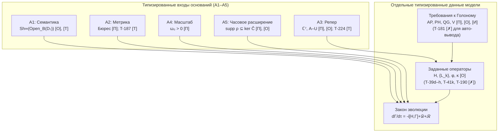
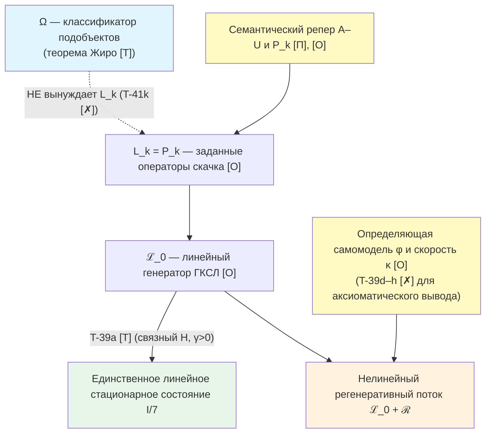
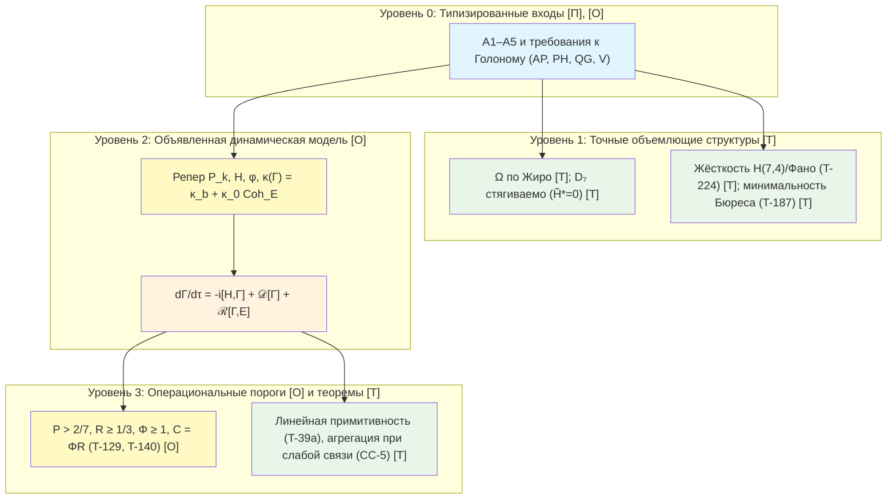

# Аксиоматика Кибернетики Когерентности

:::info Мост из предыдущей главы
В [предыдущей главе](./introduction) мы узнали, *что* такое Кибернетика Когерентности: единый формализм, описывающий динамику, структуру и интериорность через матрицу когерентности $\Gamma$. Мы увидели уравнение эволюции, семь измерений, пороги жизнеспособности и иерархию интериорности. Но откуда всё это берётся? Почему формулы именно такие? Теперь нам предстоит заглянуть в **фундамент** — аксиоматическую базу, из которой выводятся все конструкции КК.
:::

:::tip Дорожная карта главы
В этой главе мы:
1. **Поймём, зачем нужна аксиоматика** — урок Евклида, Колмогорова и Гильберта (раздел «Зачем нужна аксиоматика?»)
2. **Разберём три уровня строгости** вывода: дедуктивный, категориальный, конструктивный (раздел «[Что значит „строго выводится“?](#что-значит-строго-выводится)»)
3. **Познакомимся с типизированной архитектурой оснований** — пучковой $\infty$-топосной оболочкой и явной модельной записью (раздел «[Типизированный примитив и явная модельная запись](#единственный-примитив)»)
4. **Пройдём по пяти аксиомам** Ω⁷ (`A1`–`A5`) и отдельным требованиям к Голоному (`AP`, `PH`, `QG`, `V`) (раздел «[Аксиоматическая база](#аксиоматическая-база-краткая-справка)»)
5. **Проведём аудит цепочки построения** — чётко отделив доказанные теоремы `[Т]` от явных операторных/скоростных определений `[О]` и отозванных выводов `[✗]` (раздел «[Цепочка построения](#цепочка-вывода)»)
6. **Разберём соглашение о базовой скорости bootstrap** и динамическую роль $\kappa_{\text{bootstrap}} > 0$ `[О]` (раздел «[Соглашение о bootstrap-скорости](#bootstrap-парадокс)»)
7. **Проведём аудит E-акцентуации** — показав, почему прежнее диагональное доказательство неверно для когерентных состояний и что действительно выполняется (раздел «[E-акцентуация](#e-акцентуация)»)
:::

:::note О нотации
В этом документе:
- $\Gamma$ — [матрица когерентности](/docs/core/dynamics/coherence-matrix)
- $\mathcal{H} = \mathbb{C}^7$ — гильбертово пространство
- $\mathcal{D}[\Gamma]$ — [диссипативный член](/docs/core/dynamics/evolution#логический-лиувиллиан)
- $\mathcal{R}[\Gamma, E]$ — [регенеративный член](/docs/core/dynamics/evolution#3-регенеративный-член)
- $\varphi$ — [оператор самомоделирования](/docs/proofs/categorical/formalization-phi)
:::

## Зачем нужна аксиоматика?

### Урок Евклида

Две с половиной тысячи лет назад Евклид совершил один из величайших интеллектуальных подвигов в истории: он взял геометрию, которую египтяне и вавилоняне знали как набор практических рецептов, и показал, что вся она вырастает из **пяти** утверждений, принимаемых без доказательства. Пять постулатов — и из них, как дерево из семени, выросла вся планиметрия.

Это была не просто систематизация знания. Это был первый случай, когда человечество обнаружило **силу аксиоматического метода**: если фундамент выбран правильно, то все следствия строго необходимы. Не «мы так думаем» и не «это кажется правдоподобным», а **это не может быть иначе**, пока верны аксиомы.

### Колмогоров и вероятность

В 1933 году Колмогоров проделал для теории вероятностей то же, что Евклид — для геометрии. До Колмогорова вероятность была собранием интуиций: частотный подход, геометрическая вероятность, байесовская степень уверенности. Колмогоров предложил три аксиомы (сигма-алгебра событий, нормировка, аддитивность) — и из них вывел всю теорию вероятностей. Все парадоксы испарились. Все школы объединились в рамках единого языка.

Урок Колмогорова: **аксиоматика не ограничивает, а освобождает**. Она позволяет отделить содержательные вопросы от терминологических споров.

### Гильбертова программа и её наследие

Гильбертова программа (1920-е) попыталась аксиоматизировать всю математику. Гёдель в 1931 году показал, что это невозможно в полном объёме: любая достаточно богатая непротиворечивая система содержит неразрешимые утверждения. Но программа Гильберта не была напрасной — она породила современное понимание того, **что значит** строить теорию строго.

Это понимание таково: теория считается строгой, если:
1. **Примитивы** (неопределяемые понятия) названы явно
2. **Аксиомы** (утверждения, принимаемые без доказательства) перечислены исчерпывающе
3. **Всё остальное** выводится из аксиом по правилам логики
4. **Нет скрытых допущений** — каждое предположение отмечено и маркировано

### Зачем аксиоматика Кибернетике Когерентности?

Кибернетика, в отличие от физики и математики, до сих пор остаётся во многом **до-аксиоматической** дисциплиной. Кибернетика Винера, кибернетика Эшби, кибернетика второго порядка Фон Фёрстера — всё это ценные концептуальные рамки, но ни одна из них не имеет формальной аксиоматики, из которой бы выводились все утверждения.

**Кибернетика Когерентности (КК)** ставит цель формализовать кибернетику с явной стратификацией статусов. Каждое утверждение КК несёт один из канонических маркеров реестра — **[Т]** (теорема), **[С]** (условный результат), **[Г]** (гипотеза), **[П]** (постулат), **[Пр]** (исследовательская программа), **[О]** (определение), **[И]** (интерпретация) или **[✗]** (отозвано) — чётко отделяя то, что постулировано или определено, от того, что строго доказано. Полная система статусов ведётся в [Реестре статусов](/docs/reference/status-registry).

---

## Что значит «строго выводится»? {#что-значит-строго-выводится}

Прежде чем углубиться в аксиомы, уточним, что именно строго выводится, а что явно задаётся как типизированный вход в текущей ревизии УГМ ([Аксиома Ω⁷](/docs/core/foundations/axiom-omega)).

### Три уровня «вывода»

1. **Дедуктивный вывод** (самый строгий): утверждение B логически следует из явно сформулированных посылок A. Пример: после выбора критерия структурного большинства $\|\Gamma - I/7\|_F^2 > 1/7$ `[О]` неравенство $P(\Gamma) > 2/7$ следует дедуктивно `[Т]`.

2. **Категориальная конструкция**: конструкция B определена с точностью до эквивалентности заданной категориальной структурой A. Пример: по **теореме Жиро** `[Т]` топос Гротендика пучков на малом сайте (таком как сайт открытых покрытий Бюреса $\operatorname{Open}_B(D_7)$) обладает классификатором подобъектов $\Omega$. *(Принципиально важно, как показано ниже при аудите, что $\Omega$ **не** вынуждает конкретные операторы Линдблада $L_k$ без дополнительных операторных/инструментальных входов: `T-41k [✗]`, `T-190 [✗]`.)*

3. **Конструктивная спецификация**: явная динамическая или операторная модель (например, генератор Линдблада $\mathcal{L}_0$, оператор самомоделирования $\varphi$ или определяющая функция скорости $\kappa(\Gamma)$) задаётся явно `[О]` и анализируется конструктивно.

### Чего вывод НЕ означает

Вывод **не означает** сворачивания независимых модельных выборов в единый лозунг. Выбор порога (такого как $P_{\text{crit}} = 2/7$, $R_{\text{th}} = 1/3$ или $\Phi_{\text{th}} = 1$) является **определенческим соглашением `[О]`**, а не самостоятельным выводом из чистой топологии; кроме того, математическая непротиворечивость сама по себе не доказывает эмпирическую истинность.

---

## Метатеоретический статус

**Кибернетика Когерентности (КК)** есть единственная полная кибернетика, строго выводимая из Унитарного Голономного Монизма (УГМ). Она не является ещё одной кибернетикой в ряду существующих — она есть **метатеория**, из которой все частные кибернетики выводятся как проекции.

Что это значит на практике? Представьте себе белый свет. Пропустите его через призму — и вы получите красный, оранжевый, жёлтый... каждый из этих цветов реален и полезен, но ни один из них не является полным светом. Кибернетика Винера — это «красный луч» КК (обратная связь, информация). Автопоэзис Матураны и Варелы — «зелёный луч» (самоорганизация, граница). Теория интегрированной информации Тонони — «фиолетовый луч» (интеграция, $\Phi$). КК — это белый свет, из которого все они получаются ограничением на подмножество измерений.

:::info Ключевое утверждение
Любая корректная теория систем, описываемых $\Gamma$, есть проекция КК на подмножество измерений или динамических режимов.
:::

Это утверждение — не декларация, а **теорема** (точнее, семейство теорем), доказываемая для каждой конкретной теории путём явного построения проекции. Подробнее: [Сравнительный анализ теорий сознания](/docs/consciousness/comparative/consciousness-theories).

---

## Типизированный примитив и явная модельная запись {#единственный-примитив}

### От нетипизированного «единственного примитива» к типизированной модельной записи

В ранних редакциях УГМ формулировался как автоматический вывод пространства, времени, динамики, диссипации, регенерации и сознания из одной нетипизированной категории $\mathcal{C}$. Как зафиксировано в [Аксиоме Ω⁷](/docs/core/foundations/axiom-omega) и [Реестре статусов](/docs/reference/status-registry), такое нетипизированное схлопывание заменено **явной типизированной модельной записью**:

$$
\mathfrak{T} = (\mathcal{E}_7,\, D_7,\, d_B,\, \text{репер},\, \mathcal{L}_0,\, \varphi,\, a,\, \text{часовое расширение},\, \text{закон наблюдения})
$$

где $\mathcal{E}_7 = \operatorname{Sh}_\infty(\operatorname{Open}_B(D_7), J_{\mathrm{open}}) \simeq \operatorname{Sh}_\infty(B^{48})$ — пучковая $\infty$-топосная оболочка над сайтом открытых покрытий Бюреса пространства $D_7 = \mathcal{D}(\mathbb{C}^7)$ (локально стягиваемая топологическая оболочка, сама по себе «слепая» к $\mathbb{C}$, выпуклости и метрике), тогда как квантовая реализация **(QG)** ($\mathbb{C}^7$, матрицы плотности $\mathcal{D}(\mathbb{C}^7)$, правило Борна, CPTP-каналы), семантический репер, генератор $\mathcal{L}_0$, самомодель $\varphi$, часовое расширение и закон наблюдения являются **явно объявленными типизированными полями** `[П]/[О]`.

### Проверенный статус каждой конструкции

| Конструкция | Фактический математический источник | Статус |
|-------------|-------------------------------------|--------|
| Базовое пространство $D_7 = \mathcal{D}(\mathbb{C}^7)$ | Выпуклое компактное пространство состояний; стягиваемо через $\rho \mapsto (1-t)\rho + t\,I/7$ | `[Т]` |
| Приведённые / положительные когомологии | $\tilde{H}^*(D_7; \mathbb{Z}) = 0$, т. е. $H^k(D_7; \mathbb{Z}) = 0$ для всех $k \geq 1$, тогда как $H^0(D_7; \mathbb{Z}) \cong \mathbb{Z}$ (но никогда $H^*(X) = 0$!) | `[Т]` |
| Классификатор $\Omega$ пучкового 1-топоса | **Теорема Жиро** для топосов Гротендика ($\Omega(U) = \operatorname{Open}(U)$ на сайте открытых покрытий) | `[Т]` |
| Проективный инструмент $L_k = P_k$ | Заданные операторные/инструментальные данные `[О]` (вынуждение из классификатора отозвано: `T-41k [✗]`, `T-190 [✗]`) | `[О]` / `T-41k [✗]` |
| Линейный генератор ГКСЛ $\mathcal{L}_0$ | Строится из заданных $H$ и $\{L_k\}$; линейная примитивность даёт единственное стационарное $I/7$ (`T-39a`) | `[Т]` (при заданных связном $H$ и скорости) |
| Самомодель $\varphi$ и регенерация $\mathcal{R}$ | Явно заданная определяющая модель `[О]` (полностью аксиоматические выводы отозваны: `T-39d–h [✗]`) | `[О]` / `T-39d–h [✗]` |
| Часовое время $\tau$ | Условное часовое расширение Пейдж–Вуттерс (`A5`) | `[П]/[О]` |

### Онтологический статус и математические факты

- **Стягиваемость и когомологии (`[Т]`):** поскольку $D_7$ выпукло и непусто, оно стягиваемо, следовательно, его **приведённые** когомологии с постоянными коэффициентами обращаются в нуль ($\tilde{H}^*(D_7; \mathbb{Z}) = 0$, что эквивалентно $H^k(D_7; \mathbb{Z}) = 0$ при каждом $k \geq 1$, тогда как $H^0(D_7; \mathbb{Z}) \cong \mathbb{Z}$). Запись неприведённых когомологий непустого пространства в виде «$H^*(X) = 0$» является математической ошибкой, поскольку $H^0(X; \mathbb{Z}) \cong \mathbb{Z}$ для любого непустого линейно связного пространства. Кроме того, этот топологический факт не зависит от терминального объекта $\mathcal{E}_7$ и не влечёт зануления когомологий с произвольными пучками коэффициентов или онтологического монизма без явного интерпретативного постулата `[И]`.
- **Монистический тезис `[И]`:** прочтение типизированной записи $\mathfrak{T}$ как единой онтологии физических и опытных феноменов является явным **монистическим постулатом/интерпретацией `[П]/[И]`**, а не теоремой, выведенной из терминального объекта (`T-181 [✗]`).

---

## Аксиоматическая база (краткая справка) {#аксиоматическая-база-краткая-справка}

:::tip DRY: Полная аксиоматика
Полная типизированная спецификация `A1`–`A5` приведена в [Аксиоме Ω⁷](/docs/core/foundations/axiom-omega). Требования к Голоному (`AP`, `PH`, `QG`, `V`) — в [Требованиях к Голоному](/docs/core/foundations/axiom-septicity). Каноническое уравнение эволюции — в [Эволюции](/docs/core/dynamics/evolution).
:::

КК строится на пяти явных фундаментальных входах **`A1`–`A5`** вместе с явной квантовой реализацией **(QG)** и требованиями к Голоному **`AP`, `PH`, `QG`, `V`**:

| № | Вход | Содержание | Статус |
|---|---------|---------|--------|
| A1 | Семантика ($\infty$-топос) | $\mathcal{E}_7 = \operatorname{Sh}_\infty(\operatorname{Open}_B(D_7), J_{\mathrm{open}})$ (топологическая оболочка) | Конструкция `[О]`, существование `[Т]`, онтология `[П]/[И]` |
| A2 | Метрика (Бюрес) | Хордовая дистанция Бюреса $d_B$ на состояниях; тензор SLD/Бюреса на стратах полного ранга (`T-187`) | Выбор `[П]`, CPTP-монотонность `[Т]` |
| A3 | Репер ($N = 7$) | $\mathcal{H} = \mathbb{C}^7$ с семантическим репером `A, S, D, L, E, O, U` и структурой Фано/октонионов | `[П]/[О]`; условная жёсткость диагностируемости `T-224 [Т]` |
| A4 | Масштаб ($\omega_0 > 0$) | Калиброванный масштаб обратной частоты $\omega_0 > 0$ (гамильтоновы и диссипативные скорости задаются отдельно) | `[П]` |
| A5 | Часовое расширение | Расширенная тензорная реализация, считывание часов и ограничение $\operatorname{supp}\rho \subseteq \ker\hat{C}$ | `[П]/[О]` |

Разберём каждый вход точно.

### Аксиома 1 (`A1`): Семантика — пучковая $\infty$-топосная оболочка

**Формально:** $\mathcal{E}_7 = \operatorname{Sh}_\infty(\operatorname{Open}_B(D_7), J_{\mathrm{open}}) \simeq \operatorname{Sh}_\infty(B^{48})$ над сайтом открытых покрытий Бюреса пространства $D_7$.

**Что из неё следует `[Т]`:** по **теореме Жиро** для топосов Гротендика лежащий в основе пучковый 1-топос обладает классификатором подобъектов $\Omega$ (где $\Omega(U) = \operatorname{Open}(U)$). Что **не** следует автоматически: $\Omega$ классифицирует открытые подобъекты, а НЕ задаёт гильбертово пространство, матрицу плотности или вынужденный набор операторов Линдблада (`T-41k [✗]`, `T-181 [✗]`, `T-190 [✗]`).

### Аксиома 2 (`A2`): Метрика — геометрия Бюреса (`T-187`)

**Формально:** хордовая дистанция Бюреса $d_B$ на $D_7$ и монотонный риманов тензор Бюреса/SLD на состояниях полного ранга.

**Точный статус (`T-187`):** классически (Ченцов, 1982) метрика Фишера–Рао — единственная монотонная метрика. В квантовом случае (Петц, 1996) существует семейство монотонных метрик. По **`T-187`** (`[Т]` в нормированном семействе Петца на состояниях полного ранга) тензор Бюреса/SLD является поточечно **минимальным** монотонным тензором (согласованным с принципом очищения Ульмана и границей Крамера–Рао для SLD); сам выбор монотонности и селектора минимального тензора относится к явным входам `[П]`. Принципиально важно, что равномерное би-липшицево сравнение между метриками Петца требует **компактной положительной нижней границы спектра собственных значений** — оно **не** выполняется глобально на границе вырожденных рангов $\partial D_7$ и само по себе не устанавливает универсальной робастности предсказаний (`T-187`).

### Аксиома 3 (`A3`): Репер — семь измерений ($N = 7$)

**Формально:** $\mathcal{H} = \mathbb{C}^7$, снабжённое каноническим семантическим ортонормированным репером **A (Артикуляция), S (Структура), D (Динамика), L (Логика), E (Интериорность), O (Основание), U (Единство)** и заданной структурой Фано/октонионов.

**Точный статус:** фиксация $\mathcal{H} = \mathbb{C}^7$ является постулатом/определением репера `[П]/[О]`. Безусловная семиролевая минимальность (`T-40f [✗]`) и автоматический операциональный вывод семи ролей (`T-190 [✗]`) отозваны; строго сохраняется **жёсткость диагностируемости (`T-224 [Т]`)**: требование совершенной локализуемости одиночной неисправности вместе с нетривиальной грамматикой состояний вынуждает $n = 2^r - 1 \ge 7$ и при $n = 7$ однозначно отбирает грамматику кода Хэмминга $H(7,4)$ / плоскости Фано $\mathrm{PG}(2,2)$.

### Аксиома 4 (`A4`): Масштаб — калиброванная частота $\omega_0 > 0$

**Формально:** калиброванный масштаб обратного времени $\omega_0 > 0$, связывающий безразмерный параметр внутренней эволюции $\tau$ с физическим временем $t$, при отдельно заданных гамильтоновых и диссипативных скоростях `[П]` (не выводимых из терминальности или положительности гамильтониана).

### Аксиома 5 (`A5`): Пейдж–Вуттерс — часовое расширение

**Формально:** выбранная расширенная тензорная реализация, процедура считывания часов и условие носителя $\operatorname{supp}\rho \subseteq \ker\hat{C}$ (`[П]/[О]`), порождающие условную динамику Пейдж–Вуттерс относительно часового регистра.

### Визуальная карта

### Требования к Голоному: `AP`, `PH`, `QG`, `V` (явные входы, а не автоматические следствия)

Согласно **`T-181 [✗]`**, требования к Голоному `AP`, `PH`, `QG`, `V` **не** следуют автоматически из `A1`–`A4` (терминальные объекты топоса не отбирают квантовые состояния, биологическую жизнеспособность или феноменальное содержание). Напротив, [Голоном](/docs/core/structure/holon) $\mathbb{H}$ определяется путём явного задания этих четырёх типизированных требований ([Требования к Голоному](/docs/core/foundations/axiom-septicity)):

- **(AP) Автопоэзис `[П]/[И]`:** объявленная самомодель $\varphi: D_7 \to D_7$ и динамика поддержания организации.
- **(PH) Феноменология `[П]/[И]`:** объявленная опытная реализация и интерпретативный мост к наблюдению.
- **(QG) Квантовое основание `[П]/[О]`:** положительные состояния единичного следа $\Gamma \in \mathcal{D}(\mathbb{C}^7)$, правило Борна и объявленная модель квантовых процессов.
- **(V) Жизнеспособность `[О]/[Г]`:** структурное большинство $P(\Gamma) > P_{\text{crit}} = 2/7$ (`[Т]` после выбора $\|\Gamma - I/7\|_F^2 > 1/7$ `[О]`) совместно с условиями выживания траектории.

**См.:** [Полная типизированная спецификация](/docs/core/foundations/axiom-septicity)

---

## Уравнение эволюции: сердце КК

### Краткая форма

$$
\frac{d\Gamma(\tau)}{d\tau} = -i[H_{\text{eff}}, \Gamma] + \mathcal{D}[\Gamma] + \mathcal{R}[\Gamma, E]
$$

### Три силы, формирующие жизнь

Уравнение эволюции — это не просто формула. Это описание **трёх фундаментальных сил**, действующих на любую когерентную систему:

**1. Унитарный член: $-i[H_{\text{eff}}, \Gamma]$**

Это «инерция» системы — свободная эволюция, сохраняющая когерентность. Если бы действовал только этот член, система вращалась бы вечно, не теряя и не приобретая организации. Как планета на идеальной орбите: ни ускоряется, ни замедляется.

**2. Диссипативный член: $\mathcal{D}[\Gamma]$**

Это «трение» — потеря когерентности из-за взаимодействия системы с собственной структурой различений. Без противодействия диссипация превращает любое состояние в максимально смешанное $I/N$ (тепловая смерть). Как дом без ремонта: постепенно ветшает и разрушается.

**3. Регенеративный член: $\mathcal{R}[\Gamma, E]$**

Это «ремонт» — восстановление когерентности. Именно этот член отличает живое от неживого. Камень подчиняется только первым двум членам. Клетка, организм, общество — добавляют третий.

Полный вывод и описание каждого члена: [Эволюция](/docs/core/dynamics/evolution).

### Эволюция в метафорах

Представьте фонтан. Вода (когерентность) бьёт вверх (регенерация), гравитация тянет её вниз (диссипация), а форма струи задаётся геометрией сопла (унитарная эволюция). Живая система — это фонтан, который **сам** строит своё сопло и **сам** качает воду. Если напор падает ниже критического — фонтан иссякает (система выходит из области жизнеспособности $\mathcal{V}$).

---

## Специфика КК: проективный инструмент, соглашение о скорости и E-акцентуация

### Проективный инструмент и аудит прежней L-унификации (`T-41k [✗]`, `T-190 [✗]`) {#l-унификация-вывод-l_k-из-ω}

:::warning Отозванный вывод операторов Линдблада из классификатора (`T-41k [✗]`, `T-190 [✗]`)
В ранних редакциях утверждалось, что операторы Линдблада $L_k = P_k = |k\rangle\langle k|$ вынуждаются автоматически как «атомы классификатора подобъектов $\Omega$» через $L_k = \sqrt{\chi_{S_k}}$. Этот вывод **отозван (`T-41k [✗]`, `T-190 [✗]`)**:
- На сайте открытых покрытий $\operatorname{Open}_B(D_7)$ классификатор $\Omega(U) = \operatorname{Open}(U)$ образует гейтингову алгебру открытых подмножеств; открытые множества $\{\rho : \rho_{ii} > 0\}$ пересекаются на каждом состоянии полного ранга (они не являются непересекающимися атомами), а связное пространство $D_7$ имеет лишь два открыто-замкнутых подмножества ([Аксиома Ω⁷ §Внутренняя логика](/docs/core/foundations/axiom-omega#атомы-классификатора)).
- Выбор семи ортонормированных проекторов репера $P_k = |k\rangle\langle k|$ ($\sum_k P_k = I$) и канала дефазировки $\rho \mapsto \sum_k P_k \rho P_k$ представляет собой **явно заданные операторные/инструментальные данные `[О]`** (при этом `[Т]` состоит в том, что после объявления репера эти проекторы определяют унитальный CPTP-канал пинчинга).
:::

После объявления семантического ортонормированного репера `A, S, D, L, E, O, U` (`A3`) и проективных операторов скачка $L_k = P_k$ (`[О]`) диссипатор Линдблада $\mathcal{D}[\Gamma] = \sum_k \gamma_k (L_k \Gamma L_k^\dagger - \frac{1}{2}\{L_k^\dagger L_k, \Gamma\})$ реализует дефазировку в объявленном базисе (`[Т]`).

---

### Иерархия зависимостей {#иерархия-зависимостей}

Проверенная архитектура разделяет **теорему Жиро** для $\Omega$ `[Т]`, **явно объявленные операторные/определяющие входы `[О]`** и **условную линейную примитивность (`T-39a`)**:

**См.:** [Аксиома Ω⁷ — Типизированная реализация](/docs/core/foundations/axiom-omega#примитив)

### Цепочка построения (после аудита) {#цепочка-вывода}

Вместо единой чисто теоремной цепочки от $\Omega$ до жизнеспособного $\Gamma^*$ проверенная структура содержит явные типизированные входы на каждом стыке:

1. **Пучковый топос и классификатор `[Т]`:** по **теореме Жиро** $\operatorname{Sh}(\operatorname{Open}_B(D_7), J_{\mathrm{open}})$ является топосом Гротендика с классификатором подобъектов $\Omega$ ($\Omega(U) = \operatorname{Open}(U)$).
2. **Проективный инструмент `[О]`:** проекторы репера $L_k = P_k$ являются задаваемыми операторными данными (`T-41k [✗]`, `T-190 [✗]`).
3. **Линейная примитивность (`T-39a [Т]`):** при связном графе гамильтониана и положительной скорости дефазировки линейный генератор $\mathcal{L}_0$ примитивен с единственным стационарным состоянием $I/7$ (это **не** доказывает единственности нелинейной жизнеспособной неподвижной точки $\Gamma^* \neq I/7$).
4. **Регенерация и самомодель `[О]`:** нелинейная самомодель $\varphi$ и скорость регенерации $\kappa(\Gamma)$ являются выбранными определяющими функциями (`T-39d [✗]`, `T-39e [✗]`, `T-39f [✗]`, `T-39g [✗]`, `T-39h [✗]`).

:::info Каноническое определение
Полный проверенный интерфейс зависимостей: [Аксиома Ω⁷](/docs/core/foundations/axiom-omega).
:::

---

## Соглашение о bootstrap-скорости и динамика {#bootstrap-парадокс}

### Проблема: Барон Мюнхгаузен

Если бы скорость регенерации зависела *исключительно* от $\mathrm{Coh}_E(\Gamma)$ по закону $\kappa(\Gamma) = \kappa_0\,\mathrm{Coh}_E(\Gamma)$, то состояние, стартующее вблизи $\mathrm{Coh}_E = 0$, имело бы исчезающую регенерацию и не смогло бы «самозапуститься». Добавление положительной базовой скорости $\kappa_{\text{bootstrap}} > 0$ устраняет это вырождение в динамических моделях.

### Связь регенерации и E-когерентности {#связь-регенерации-и-e-когерентности}

Сохраняемое определяющее соглашение о скорости **`[О]`** ([Требования к Голоному §Модель скорости](/docs/core/foundations/axiom-septicity#структурный-анзац-kappa0)) имеет вид:

$$
\kappa(\Gamma) = \kappa_{\text{bootstrap}} + \kappa_0 \cdot \mathrm{Coh}_E(\Gamma), \qquad \kappa_{\text{bootstrap}} = \frac{\omega_0}{7}, \qquad \kappa_0 = \omega_0\,\frac{|\Gamma_{OE}|\,|\Gamma_{OU}|}{\Gamma_{OO}} \quad (\Gamma_{OO} > 0)
$$

где:
- $\kappa_{\text{bootstrap}} = \omega_0 / 7 > 0$ — **выбранное базовое соглашение о скорости `[О]`** (прежний категориальный вывод $\kappa_{\text{bootstrap}} = \|\mathrm{unit}(\mathcal{D}_\Omega \dashv \mathcal{R})\|$ и $\kappa_0 = \|\mathrm{Nat}(\mathcal{D}_\Omega, \mathcal{R})\|$ **отозван `[✗]`** согласно `T-39f [✗]`, `T-39g [✗]`, `T-39h [✗]` и [Требованиям к Голоному](/docs/core/foundations/axiom-septicity#структурный-анзац-kappa0): категориальное сопряжение не определяет норму на множестве естественных преобразований).
- $\mathrm{Coh}_E(\Gamma) \in [0, 1]$ — доля строки и столбца $E$ в норме Гильберта–Шмидта ([определения](./definitions#e-когерентность)). Отметим, что по **`T-38a [✗]`** прежняя универсальная нижняя граница $\mathrm{Coh}_E(\Gamma) > 1/7$ на всех жизнеспособных состояниях (универсальная необходимость No-Zombie) **отозвана**: существуют стационарные внешне поддерживаемые контрпримеры, а нижняя граница на интериорность выполняется лишь при явно ограниченных гипотезах баланса потока чистоты.

### Динамическая роль $\kappa_{\text{bootstrap}} > 0$

В модельных расчётах ([модельные системы](/docs/applied/coherence-cybernetics/model-systems)) задание $\kappa_{\text{bootstrap}} > 0$ как определяющего входа `[О]` обеспечивает положительный базовый дрейф даже при малом $\mathrm{Coh}_E$, позволяя реализовать трёхстадийную численную траекторию (зарождение $\to$ усиление с положительной обратной связью $\to$ баланс с диссипацией), когда целевое состояние и суммарная регенерация превосходят порог диссипации.

---

## E-акцентуация: аудит прежнего диагонального утверждения {#e-акцентуация}

### Почему прежняя «Теорема 2.2» ($w_E > 1/7$ из L2) неверна

В ранних редакциях этой главы формулировалась «Теорема 2.2 (E-акцентуация из определения L2)», утверждавшая, что $w_E := \Gamma_{EE} > 1/7$ является доказанной теоремой `[Т]`, выводимой из определения L2-сознания ($P \in (2/7, 3/7]$, $R = 1/(7P) \ge 1/3$, $\Phi \ge 1$, $D_{\text{diff}} \ge D_{\min}$ со скалярным произведением $C = \Phi \times R \ge 1/3$ из **`T-140 [О]`**). Это диагональное доказательство **математически ошибочно и отозвано** по двум точным причинам:

:::warning Опровержение прежней диагональной «Теоремы 2.2» (`T-334 [Т]`)
1. **Диагональные состояния не могут быть L2-сознательными, а недиагональные L2-состояния НЕ обязаны иметь $w_E > 1/7$!**
   - Прежнее доказательство вычисляло чистоту как $P = \sum_{i=1}^7 w_i^2$, что верно **только для диагональных состояний** ($\gamma_{ij} = 0$ для всех $i \neq j$). Однако любое диагональное состояние имеет $\Phi(\Gamma) = 0 < 1$, нарушая критерий интеграции L2!
   - Напротив, для **когерентных** (недиагональных) состояний **равномерные диагональные населённости $w_i = 1/7$ для ВСЕХ семи осей — включая $w_E = 1/7$ — полностью совместимы с $P \in (2/7, 3/7]$, $R \ge 1/3$ и $\Phi \ge 1$!** Конкретно, рассмотрим коллинеационно-ковариантное семейство $\Gamma(t) = (1 - t)\,I/7 + t\,uu^\dagger$ ($u = \frac{1}{\sqrt{7}}(1,\ldots,1)^T$, **`T-334 [Т]`**):
     $$
     w_i = \Gamma_{ii}(t) = \frac{1}{7} \;\; \forall i, \qquad P(t) = \frac{1 + 6t^2}{7}, \qquad \Phi(t) = 6t^2.
     $$
     Для любого $t \in \left(\frac{1}{\sqrt{6}}, \frac{1}{\sqrt{3}}\right]$ получаем $P(t) \in (2/7, 3/7]$, $R(t) = 1/(7P(t)) \in [1/3, 1/2)$ и $\Phi(t) \in (1, 2]$ — и всё это при **$w_E = 1/7$ тождественно**!
2. **Неравномерность не выделяет ось $E$.** Даже при ограничении на диагональные состояния импликация $\sum_i w_i^2 > 2/7 \implies \max_i w_i > 1/7$ даёт лишь *некоторый* индекс $i$, но никак не конкретно $i = E$ без дополнительного семантического постулата.
:::

### Что выполняется на самом деле

- **Точный алгебраический факт `[Т]`:** на *чисто диагональной* матрице плотности условие $P > 2/7$ влечёт $\max_i w_i > 1/7$ (при $\Phi = 0$). На общих когерентных матрицах плотности из $\mathcal{D}(\mathbb{C}^7)$ равномерная диагональ $w_i = 1/7$ совместима с любой чистотой $P \in [1/7, 1]$ и со всем окном Голдилокс $P \in (2/7, 3/7], \Phi \ge 1$ (`T-334 [Т]`).
- **Роль E-акцентуации `[О]/[И]`:** требование избыточной населённости $w_E > 1/7$ (или конкретной нижней границы на $\mathrm{Coh}_E$) является поэтому **модельно-специфическим или интерпретативным выбором `[О]/[И]`**, а НЕ теоремой, выводимой из $P > 2/7$ или определения L2.

---

## От Розена к КК: эволюция (M,R)-систем {#от-розена-к-кк}

### Розен: замыкание к эффективным причинам

В 1958 году Роберт Розен предложил формализм (M,R)-систем для описания живой организации как замыкания относительно эффективных причин:
- **M (метаболизм):** преобразование входов в выходы
- **R (репарация):** восстановление метаболической машинерии
- **$\beta$ (замыкание):** производство репарационной машинерии

Теоретико-множественный формализм Розена не включал квантовые матрицы плотности, меры интеграции или регистры опыта.

### КК как интерпретативное расширение (M,R)-систем [И]

В интерпретативном отображении `[И]` КК расширяет (M,R)-схему 7-мерным квантовым носителем $\Gamma \in \mathcal{D}(\mathbb{C}^7)$ и каноническими семантическими осями:

| Розен | КК (канонические оси) | Интерпретативная роль [И] |
|-------|-----------------------|---------------------------|
| M (метаболизм) | D (Динамика) | Преобразование / процесс |
| R (репарация) | A (Артикуляция) + L (Логика) | Различение и законосообразное восстановление |
| $\beta$ (замыкание) | U (Единство) | Глобальная интеграция |
| — | E (Интериорность), O (Основание), S (Структура) | Дополнительные канонические оси |

### Канонические роли E, O, S

Три остальные канонические оси — **E (Интериорность)**, **O (Основание)** и **S (Структура)**:
- **E (Интериорность)** задаёт ось опыта / интериорности;
- **O (Основание)** задаёт ось основания / заземления (и опорную ось в часовых/основательных связях);
- **S (Структура)** задаёт структурно-организационную ось.

---

## Структура теории

### Архитектура КК

Типизированная архитектура разделяет фундаментальные входы, явные операторные/определяющие соглашения и доказанные теоремы:

### Замкнутость композиции (результат при слабой связи `CC-5`) {#замкнутость-композиции-следствие-из-ap}

На произведении состояний $1+\Phi(\Gamma_1\otimes\Gamma_2)=(1+\Phi_1)(1+\Phi_2)$. Высокое $\Phi$ пары поэтому совместимо с нулевой взаимной информацией. Корреляцию проверяют по $I(1{:}2)$ относительно текущих маргинальных состояний. Для проверки жизнеспособности коллектива задают канал агрегации и его порог. По **`CC-5`** (`[Т]` при слабой связи, заданном среднем маргинальном состоянии и положительных запасах) контроль по следовой норме переносит соответствующие запасы жизнеспособности на агрегат. [Теоремы о композиции](./theorems#теорема-95-каноническая-агрегация)

---

## Обзор проверенных аксиоматических статусов

Подведём точный итог тому, что является **теоремой `[Т]`**, что представляет собой **определенческое соглашение `[О]`** или **постулат `[П]`**, а какие прежние выводы **отозваны `[✗]`**:

| Позиция | Фактический источник | Проверенный статус | Ссылка |
|---------|----------------------|--------------------|--------|
| Классификатор $\Omega$ топоса $\operatorname{Sh}(\operatorname{Open}_B(D_7))$ | **Теорема Жиро** | **[Т]** | [Типизированный примитив](#единственный-примитив) |
| Приведённые когомологии $\tilde{H}^*(D_7; \mathbb{Z}) = 0$ ($H^0 \cong \mathbb{Z}$, $H^{k\ge 1} = 0$) | Стягиваемость выпуклого $D_7$ | **[Т]** | [Типизированный примитив](#единственный-примитив) |
| Проективные операторы скачка $L_k = P_k$ | Объявленный репер и инструмент | **[О]** (вывод из классификатора отозван: `T-41k [✗]`, `T-190 [✗]`) | [Проективный инструмент](#l-унификация-вывод-l_k-из-ω) |
| $P_{\text{crit}} = 2/7$ | Структурное большинство $\|\Gamma - I/7\|_F^2 > 1/7$ `[О]` | **[О]+[Т]** (алгебраическое `[Т]` *после* выбора большинства `[О]`) | [Критическая чистота](/docs/proofs/dynamics/theorem-purity-critical) |
| $R_{\text{th}} = 1/3$ | Выбранный порог доступа на $R = 1/(7P)$ | **[О]** | [Мера рефлексии](/docs/consciousness/foundations/self-observation#мера-рефлексии-r) |
| $\Phi_{\text{th}} = 1$ | Выбранный порог когерентного большинства | **[О]** (`T-129 [О]`) | [Мера интеграции](/docs/core/structure/dimension-u#мера-интеграции-φ) |
| $C = \Phi \times R \ge 1/3$ | Выбранное скалярное произведение (необходимо, но не достаточно для $R\ge 1/3 \land \Phi\ge 1$) | **[О]** (`T-140 [О]`) | [Самонаблюдение](/docs/consciousness/foundations/self-observation#мера-сознательности-c) |
| $w_E > 1/7$ из L2 (прежняя Теорема 2.2) | Контрпример: когерентные L2-состояния с равномерной диагональю (`T-334`) | **[✗]** как `[Т]` (опциональный модельный вход `[О]/[И]`) | [Аудит E-акцентуации](#e-акцентуация) |
| $\kappa_{\text{bootstrap}} = \omega_0 / 7$, $\kappa = \kappa_b + \kappa_0\mathrm{Coh}_E$ | Определяющее соглашение о скорости | **[О]** (вывод из нормы сопряжения отозван: `T-39f–h [✗]`) | [Соглашение о bootstrap-скорости](#bootstrap-парадокс) |
| Универсальная нижняя граница $E$ / необходимость No-Zombie | Существуют стационарные внешне поддерживаемые контрпримеры | **[✗]** (`T-38a [✗]`) | [Теоремы КК](./theorems) |
| $N = 7$ | Постулат репера `A3` `[П]`; условная жёсткость диагностируемости `T-224 [Т]` | **[П]** / **`T-224 [Т]`** (безусловные `T-40f [✗]`, `T-181 [✗]`, `T-190 [✗]` отозваны) | [Аксиома Ω⁷](/docs/core/foundations/axiom-omega) |
| Минимальный монотонный тензор Бюреса/SLD | Нормированное семейство Петца на состояниях полного ранга (`T-187`) | **[Т]** (поточечно минимален на полном ранге; для равномерного сравнения нужна компактная нижняя граница спектра) | [Аксиома 2](#аксиоматическая-база-краткая-справка) |
| Замкнутость композиции (`CC-5`) | Слабая связь + заданное среднее маргинальное состояние + положительные запасы | **[Т]** (при указанных гипотезах слабой связи) | [Композиция](#замкнутость-композиции-следствие-из-ap) |

---

## Что мы узнали

Подведём итоги аудита аксиоматических оснований КК:

1. **Явная дисциплина статусов** разделяет фундаментальные постулаты (`A1`–`A5`, `AP`, `PH`, `QG`, `V`), определенческие соглашения (`[О]`), доказанные теоремы (`[Т]`) и отозванные выводы (`[✗]`).

2. **Типизированная модельная запись вместо нетипизированного «чёрного ящика»:** по **теореме Жиро** `[Т]` пучковый топос на $\operatorname{Open}_B(D_7)$ имеет классификатор подобъектов $\Omega$, а выпуклое пространство $D_7$ стягиваемо с приведёнными когомологиями $\tilde{H}^*(D_7; \mathbb{Z}) = 0$ ($H^0 \cong \mathbb{Z}$, $H^{k\ge 1} = 0$). Однако `AP, PH, QG, V` (`T-181 [✗]`), проективные операторы скачка $L_k$ (`T-41k [✗]`, `T-190 [✗]`) и законы регенерации (`T-39d–h [✗]`) являются явно задаваемыми типизированными входами `[П]/[О]`, а не автоматическими следствиями $\Omega$.

3. **Определенческие пороги `[О]` и теоремы `[Т]`:** $R_{\text{th}} = 1/3$, $\Phi_{\text{th}} = 1$ (`T-129`), $C = \Phi R$ (`T-140`) и $\kappa_{\text{bootstrap}} = \omega_0/7$ представляют собой **определенческие/конститутивные соглашения `[О]`**; $P_{\text{crit}} = 2/7$ является алгебраическим `[Т]` *после* выбора структурного большинства `[О]`; в то время как `T-224`, `T-187`, `T-39a`, `T-334` и `CC-5` являются подлинными теоремами `[Т]` с явно сформулированными гипотезами.

4. **Опровержение диагональной E-акцентуации:** когерентные состояния с равномерной диагональю $w_i = 1/7$ (такие как опорное семейство `T-334 [Т]`) удовлетворяют всем условиям L2 $P \in (2/7, 3/7]$, $R \ge 1/3$, $\Phi \ge 1$, опровергая прежнюю диагональную «Теорему 2.2», тогда как универсальная нижняя граница на $E$ (`T-38a [✗]`) отозвана.

5. **Канонические семь осей:** повсюду в КК семь осей — это **A (Артикуляция), S (Структура), D (Динамика), L (Логика), E (Интериорность), O (Основание), U (Единство)**.

:::info Мост к следующей главе
Аксиоматика дала нам фундамент — примитив, аксиомы и цепочку построения. Но чтобы *работать* с теорией, нужны точные определения: что именно мы измеряем, какие меры используем, как интерпретируем числа. В [следующей главе](./definitions) мы систематически определим все ключевые понятия КК — от Голонома и мер когерентности до тензора напряжений и иерархии аттракторов. Эти определения станут «кирпичами», из которых в [главе о теоремах](./theorems) будет построено всё здание.
:::

---

**Связанные документы:**
- [Определения](./definitions) — базовые определения КК
- [Теоремы](./theorems) — фундаментальные теоремы КК
- [Аксиома Ω⁷](/docs/core/foundations/axiom-omega) — типизированная архитектура оснований $\mathcal{E}_7$
- [Требования к Голоному (AP+PH+QG+V)](/docs/core/foundations/axiom-septicity) — типизированные требования к Голоному
- [Эволюция](/docs/core/dynamics/evolution) — уравнение $d\Gamma(\tau)/d\tau$
- [Жизнеспособность](/docs/core/dynamics/viability) — мера $P$ и $P_{\text{crit}}$
- [Формализация оператора φ](/docs/proofs/categorical/formalization-phi) — CPTP-каналы
- [Сравнительный анализ теорий сознания](/docs/consciousness/comparative/consciousness-theories) — КК в контексте IIT, GWT, AST
- [Модельные системы](/docs/applied/coherence-cybernetics/model-systems) — численная проверка bootstrap-динамики
- [Философские основания](./philosophy) — онтологический статус аксиом
- [Сравнение с альтернативами](./comparison) — как аксиомы КК соотносятся с IIT, FEP
- [Упражнения](./exercises) — задачи на аксиоматику
