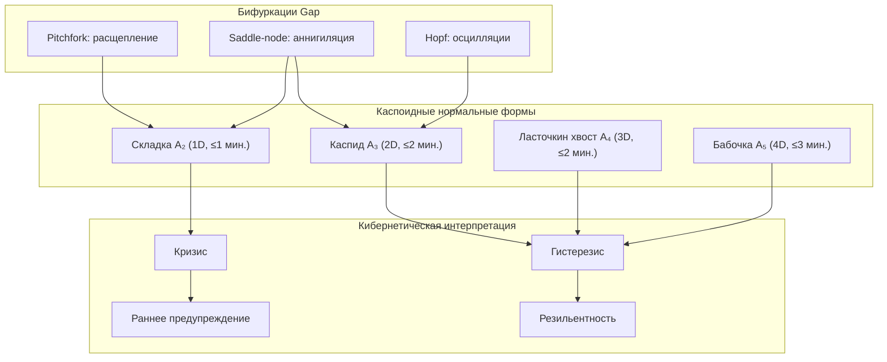

# Бифуркации Gap-ландшафта

:::info Мост из предыдущей главы
В [предыдущей главе](./gap-algebra) мы построили **алгебру** Gap-оператора: его спектр $\{0, \pm i\lambda_1, \pm i\lambda_2, \pm i\lambda_3\}$, классификацию по рангу непрозрачности и связь с кодом Хэмминга H(7,4). Мы увидели *статическую* картину — какие конфигурации непрозрачности возможны. Теперь нам предстоит изучить **динамику**: что происходит, когда параметры системы плавно меняются, а её состояние — скачком?
:::

### Дорожная карта главы

В этой главе мы:

1. **Познакомимся с тремя типами бифуркаций** Gap-ландшафта — вилочной, седло-узловой и Хопфа — и поймём, какие жизненные события за ними стоят (раздел 1)
2. **Изучим катастрофы Уитни** — универсальный язык для описания скачкообразных перестроек, от складки до ласточкиного хвоста (раздел 2)
3. **Введём понятия кризиса, гистерезиса и резильентности** — и увидим, как бифуркационная теория формализует «точки невозврата» и «запас прочности» (раздел 3)
4. **Применим бифуркационный подход к клинике** — от депрессии как седло-узловой бифуркации до посттравматического роста как прямого скачка через swallowtail (раздел 4)

---

:::note О нотации
В этом документе:
- $\Gamma$ — [матрица когерентности](/docs/core/dynamics/coherence-matrix)
- $P$ — [чистота](/docs/core/dynamics/viability#определение-чистоты): $P = \mathrm{Tr}(\Gamma^2)$
- $P_{\text{crit}} = 2/7$ — [теорема о критической чистоте](/docs/proofs/dynamics/theorem-purity-critical)
- $\mathrm{Gap}(i,j) = |\sin(\arg(\gamma_{ij}))|$ — [мера зазора](/docs/physics/dual-aspect/gap-semantics)
- $\hat{\mathcal{G}} \in \mathfrak{so}(7)$ — [Gap-оператор](/docs/core/dynamics/gap-dynamics#gap-оператор)
- $T_{\text{eff}}$ — [эффективная температура](/docs/core/dynamics/gap-thermodynamics#эффективная-температура)
- $\kappa$, $\Gamma_2$ — скорости регенерации и декогеренции
- L0–L4 — [уровни интериорности](/docs/proofs/consciousness/interiority-hierarchy)
:::

:::warning Статус документа
Этот документ развивает кибернетическую интерпретацию результатов, доказанных в [Gap-динамике](/docs/core/dynamics/gap-dynamics#бифуркации) и [Фазовой диаграмме Gap](/docs/core/dynamics/gap-phase-diagram). Статусы указаны для каждого результата индивидуально.
:::

---

## Точки невозврата: зачем изучать бифуркации {#точки-невозврата}

Вода при 0°C не просто «становится чуть холоднее». Она **замерзает** — скачком переходит в качественно иное состояние. Мост под нарастающей нагрузкой не просто «прогибается больше». В какой-то момент он **рушится**. Человек, лишённый сна трое суток, не просто «немного устал». Он **проваливается** в сон — внезапно, неконтролируемо, посреди предложения.

Все эти явления объединяет одно: **непропорциональность причины и следствия**. Малое изменение параметра — температуры, нагрузки, времени бодрствования — вызывает катастрофическое изменение состояния. Математика, описывающая такие переходы, называется **теорией бифуркаций**.

Слово «бифуркация» (от лат. *bifurcus* — раздвоенный) означает буквально «развилку»: при непрерывном изменении параметра система приходит к точке, где её дальнейшее поведение качественно меняется. Дорога раздваивается. Привычный путь исчезает.

Для Кибернетики Когерентности бифуркации — не абстракция. Они описывают самые драматические события в жизни любой когерентной системы:

- **Момент прозрения** — когда разрозненные знания внезапно складываются в целостную картину
- **Психический кризис** — когда привычная организация психики перестаёт работать
- **Цикличность настроений** — когда система переходит от стабильности к колебаниям
- **Потерю жизнеспособности** — когда когерентность падает ниже порога $P_{\text{crit}} = 2/7$ и система «гаснет»

В Gap-ландшафте бифуркации приобретают особую конкретность: 21 Gap-переменная образует ландшафт потенциальной энергии с долинами (устойчивые состояния), перевалами (неустойчивые состояния) и обрывами (точки потери устойчивости). Бифуркации — это моменты, когда рельеф этого ландшафта перестраивается.

---

## Бифуркации в природе {#бифуркации-в-природе}

Прежде чем перейти к математике, стоит осознать: бифуркации — не экзотика. Они повсюду.

**Физика.** Фазовые переходы — канонический пример. Вода замерзает. Железо намагничивается. Сверхпроводник теряет сопротивление. Каждый из этих переходов — бифуркация: при плавном изменении температуры симметрия системы внезапно нарушается, и возникает новый порядок.

**Биология.** Клетка-предшественник «выбирает» специализацию — становится нейроном или глиальной клеткой. Этот выбор необратим и описывается вилочной бифуркацией (модель Вэддингтона). Сердечная аритмия — бифуркация Хопфа: нормальный ритм переходит в хаотические колебания. Эпилептический припадок — седло-узловая бифуркация: мозг внезапно «проваливается» в патологическое состояние.

**Экология.** Озеро может десятилетиями поглощать загрязнения, сохраняя прозрачность. Но в один день — после очередной, казалось бы ничтожной порции фосфатов — оно зацветает. Устойчивое состояние прозрачной воды **перестаёт существовать**. Это классическая седло-узловая бифуркация, и восстановить прозрачность гораздо труднее, чем утратить — нужно снизить содержание фосфатов намного ниже того уровня, при котором произошёл коллапс (гистерезис).

**Экономика.** Банковская паника — типичный пример самоисполняющегося пророчества с бифуркационной природой. Пока доверие выше порога — система стабильна. Малейшее снижение ниже порога — лавинообразное бегство вкладчиков. Два устойчивых состояния (доверие/паника) сосуществуют в области бистабильности каспида.

**Психология.** Инсайт — пожалуй, самый яркий пример бифуркации в повседневной жизни. Вы мучительно размышляете над задачей, не видите решения, а затем — внезапно, одним скачком — видите **всё**. Gap между измерениями мгновенно падает с высокого значения до низкого. Прозрачность возникает скачком, не плавно.

Во всех этих примерах общее одно: **малое изменение параметра вызывает качественное изменение состояния**. Теория бифуркаций — математический язык для точного описания таких переходов.

---

## 1. Бифуркации в Gap-динамике {#бифуркации-в-gap-динамике}

Gap-ландшафт — отображение пространства состояний в 21-мерный куб непрозрачностей:

$$
\mathcal{G}: \mathcal{D}(\mathbb{C}^7) \to [0,1]^{21}, \quad \mathcal{G}(\Gamma) := \{\mathrm{Gap}(i,j)\}_{1 \leq i < j \leq 7}
$$

При изменении управляющего параметра $\mu$ (внешнее давление, внутренняя регенерация, температура) Gap-ландшафт претерпевает качественные перестройки — **бифуркации**. Три основных типа подробно описаны в [Теореме 4.1](/docs/core/dynamics/gap-dynamics#бифуркации) **[Т]**.

Каждая из трёх бифуркаций рассказывает свою историю. Вместе они образуют полную грамматику качественных изменений — всё, что может случиться с Gap-ландшафтом при плавном изменении параметров, сводится к одному из этих трёх сценариев (или их комбинации).

### 1.1 Вилочная бифуркация (Pitchfork): момент выбора {#pitchfork}

Представьте шарик, лежащий на вершине холма с идеально симметричными склонами. Пока вершина плоская — шарик покоится. Но стоит холму чуть заострить вершину — и шарик **обязан** скатиться: влево или вправо. Симметрия требует, чтобы оба склона были одинаковы, но шарик может выбрать только один.

Это и есть вилочная бифуркация — момент, когда **симметрия ситуации нарушается выбором**. Название «вилка» (pitchfork) отражает форму бифуркационной диаграммы: одна ветвь расщепляется на три (две устойчивые и одна неустойчивая между ними).

Классический образ — осёл Буриданов, стоящий на точно равном расстоянии от двух одинаковых охапок сена. Математика говорит: симметричное положение неустойчиво. Осёл *обязан* выбрать. Любая флуктуация — дуновение ветра, случайное движение головы — определит выбор. Но выбор **необратим**: оказавшись у одной охапки, осёл уже не вернётся к симметричной позиции.

В нейробиологии вилочная бифуркация описывает латерализацию мозга. Левое и правое полушария изначально симметричны, но в процессе развития одно из них «выбирает» доминирование в речевых функциях. Какое именно — определяется малыми флуктуациями на ранних стадиях.

:::tip Теорема (Pitchfork-бифуркация для Gap) [Т]
При наличии дискретной симметрии Gap-ландшафта и пересечении критического значения управляющего параметра $\mu_c$ единственное стационарное состояние расщепляется на два:

$$
\mathrm{Gap}^{(\infty)}(i,j;\, \mu) = \begin{cases}
\mathrm{Gap}_0 & \text{при } \mu < \mu_c \\
\mathrm{Gap}_0 \pm \sqrt{\mu - \mu_c} & \text{при } \mu > \mu_c
\end{cases}
$$

**Доказательство:** См. [Gap-динамика, Теорема 4.1(a)](/docs/core/dynamics/gap-dynamics#бифуркации).
:::

**Нормальная форма.** Вблизи бифуркации всё многообразие Gap-динамики сжимается до одного уравнения — **нормальной формы**:

$$
\frac{d\,\mathrm{Gap}}{d\tau} = (\mu - \mu_c)\,\mathrm{Gap} - \mathrm{Gap}^3
$$

Это уравнение — квинтэссенция вилочной бифуркации. Правая часть содержит два слагаемых: линейное $(\mu - \mu_c)\,\mathrm{Gap}$, которое определяет устойчивость нулевого состояния, и кубическое $-\mathrm{Gap}^3$, которое ограничивает рост.

При $\mu < \mu_c$ единственная стационарная точка $\mathrm{Gap} = 0$ устойчива. Линейный член отрицателен — возмущения затухают. Система «удерживает» симметричное состояние.

При $\mu > \mu_c$ всё меняется. Линейный член становится положительным — нулевое состояние отталкивает. Рождаются две новые стационарные точки: $\mathrm{Gap}^{(\pm)} = \pm\sqrt{\mu - \mu_c}$. Каждая из них устойчива. Система **обязана** выбрать одну из двух.

**Фазовый портрет.** До бифуркации ($\mu < \mu_c$): единственный аттрактор в начале координат. Все траектории стекаются к нему. После бифуркации ($\mu > \mu_c$): два аттрактора, разделённые неустойчивой точкой в начале координат. Пространство разделено на два бассейна притяжения. Какой именно бассейн «поймает» систему — определяется начальными условиями и флуктуациями.

**Gap-специфические параметры:**
- $\mu$ отождествляется с $T_{\text{eff}} / T_c$ — безразмерной температурой
- $\mu_c$ — критическая температура фазового перехода I $\leftrightarrow$ II ([три фазы](/docs/core/dynamics/gap-phase-diagram#три-фазы))
- При $T_{\text{eff}} > T_c$: параметр порядка $\mu^2$ **меняет знак** ($\mu^2 < 0 \to \mu^2 > 0$), и Gap-профиль спонтанно приобретает ненулевую анизотропию

:::info Кибернетическая интерпретация [И]
Pitchfork-бифуркация соответствует **спонтанному нарушению симметрии** Gap-профиля. В психологическом контексте это *экзистенциальный выбор*: система, которая до бифуркации находилась в симметричном состоянии (все каналы одинаково прозрачны/непрозрачны), вынуждена «выбрать» одну из двух несимметричных ветвей. Выбор **необратим** — возврат требует сильного внешнего воздействия.
:::

**Что КК добавляет.** В стандартной теории бифуркаций pitchfork — геометрический факт. КК придаёт ему *содержание*: два рождающихся аттрактора — не абстрактные точки в фазовом пространстве, а конкретные **конфигурации когерентности** между семью измерениями. Выбор ветви — это выбор того, *какие* связи между измерениями станут прозрачными, а какие — непрозрачными. Это определяет характер субъекта: какие аспекты опыта будут интегрированы, а какие — отщеплены.

### 1.2 Седло-узловая бифуркация (Saddle-node): последняя капля {#saddle-node}

У верблюда есть спина. На спину кладут соломинки — по одной. Верблюд стоит. Ещё одну. Стоит. И ещё. В какой-то момент — одна последняя соломинка — и спина **ломается**.

Седло-узловая бифуркация — математическая формализация «последней капли». Устойчивое состояние (узел) и неустойчивое состояние (седло) существуют бок о бок. При изменении параметра они сближаются, сливаются и **аннигилируют** — оба перестают существовать. Система остаётся без опоры и стремительно уносится в другую область фазового пространства.

В отличие от вилочной бифуркации, здесь нет выбора. Есть **катастрофа**: то, на чём система стояла, исчезает из-под ног.

:::tip Теорема (Saddle-node-бифуркация для Gap) [Т]
При $\mu = \mu_{sn}$ два стационарных Gap-профиля (устойчивый узел и неустойчивое седло) сливаются и аннигилируют:

$$
\frac{d\,\mathrm{Gap}}{d\tau} = \mu - \mathrm{Gap}^2
$$

При $\mu > 0$: две стационарные точки $\mathrm{Gap} = \pm\sqrt{\mu}$. При $\mu < 0$: стационарных точек **нет** — система покидает локальный бассейн притяжения.

**Доказательство:** См. [Gap-динамика, Теорема 4.1(b)](/docs/core/dynamics/gap-dynamics#бифуркации).
:::

**Нормальная форма** седло-узловой бифуркации — простейшее из всех бифуркационных уравнений:

$$
\frac{d\,\mathrm{Gap}}{d\tau} = \mu - \mathrm{Gap}^2
$$

Геометрия прозрачна: парабола $\mathrm{Gap}^2$ пересекает горизонтальную линию $\mu$. При $\mu > 0$ — два пересечения (два стационарных состояния). При $\mu = 0$ — касание (слияние). При $\mu < 0$ — ни одного пересечения. Стационарные состояния **испарились**.

**Фазовый портрет.** При $\mu > 0$: положительный корень $\mathrm{Gap} = +\sqrt{\mu}$ устойчив (узел), отрицательный $\mathrm{Gap} = -\sqrt{\mu}$ неустойчив (седло). Все траектории в окрестности стекаются к узлу. При $\mu = 0$: узел и седло сливаются в полуустойчивую точку. При $\mu < 0$: аттрактора нет. Система уносится прочь — «проваливается».

**Gap-специфические параметры (согласовано с `T-259`):**
- На схематической фазовой диаграмме $\mu$ записывают как $r - r_c$ (отклонение от линии складки); **количественно** в гейтированном изотропном потоке с фиксированной целью (`T-259 [Т]`, раздел 1.2a ниже) управляющим параметром складки служит $u - u^*$ ($u^* \approx 21{,}5$ при $c = 2$), а **не** устаревшая формула $r_c = P_{\text{crit}}/(7P) \approx 0{,}116$.
- Ниже складки ($u < u^*$, схематически $r < r_c$): жизнеспособная стационарная ветвь и её неустойчивый двойник сливаются и аннигилируют, переводя траектории на ветвь мёртвой зоны (Фаза III).

**Скачкообразность перехода.** Gap **внезапно** переключается на качественно иной уровень. Нет промежуточных состояний — система мгновенно «проваливается» из одного бассейна притяжения в другой. Это фундаментальное отличие от плавной деградации: система выглядит стабильной вплоть до самого момента катастрофы.

**Гистерезис в восстановлении.** Для возврата к прежнему режиму требуется $\mu > \mu_{sn} + \Delta\mu_{\text{hyst}}$, где $\Delta\mu_{\text{hyst}} > 0$ — ширина гистерезиса. Система, пережившая кризис, не может вернуться к прежнему состоянию простым «откатом» параметров. Чтобы понять почему, вспомните озеро: загрязнять его можно было годами, но для восстановления прозрачности нужно снизить уровень загрязнения **намного** ниже того, при котором произошёл переход. Старое равновесие уже уничтожено.

:::info Кибернетическая интерпретация [И]
Saddle-node бифуркация — формализация **острого кризиса**. Клинически: прежний устойчивый Gap-профиль перестаёт существовать. Система вынуждена реорганизоваться. Примеры:
- Острая декомпенсация при истощении ресурсов ($r < r_c$)
- Внезапная потеря устойчивости организации при критическом оттоке
- «Точка невозврата» в экологических системах
:::

**Что КК добавляет.** Стандартная теория говорит: «устойчивое состояние исчезло». КК говорит *больше*: исчезло конкретное **соотношение прозрачностей** между семью измерениями. Система не просто «дестабилизировалась» — она потеряла определённый *паттерн когерентности*. Какой именно паттерн возникнет после кризиса — зависит от того, в какой бассейн притяжения система «упадёт». Это может быть как более высокий уровень организации (посттравматический рост), так и более низкий (хроническая декомпенсация).

#### 1.2a Точная складка: как закрывается окно сознания {#точная-складка-окна}

Параметр $r_c$ выше был оставлен как схематический символ линии складки. Теорема **`T-259`** (**[Т]** для заявленного изотропного потока с фиксированной целью; **[С]** при физическом сопоставлении скоростей для биологических субстратов — см. [Фазовую диаграмму §1.3](./phase-diagram-cc#теорема-окно-питания)) определяет редуцированную границу Фазы III *точно*, выявляя две разные кромки: простой линейный порог и глубокую нелинейную складку. Работаем в естественном безразмерном отношении $x = \kappa_{\text{eff}}/\Gamma_2$: **насколько сильно систему регенерируют относительно скорости декогеренции.** Когда питание слабеет и $x$ падает, стационарная чистота $P_\infty$ сползает вниз.

**Простая кромка — серебряное сечение.** Отложим на миг гейт жизнеспособности. Голая (линейная) релаксация держит неподвижную точку, остающуюся жизнеспособной, $P_\infty > P_{\text{crit}}$, лишь выше порога $x_{\min}$. У стены рефлексии $P^* = 3/7$ этот порог в точности

$$
x_{\min} = 1 + \sqrt{2} \approx 2{,}414,
$$

**серебряное сечение** — та же константа, что задаёт стороны правильного восьмиугольника. Питайте разум меньше чем $1+\sqrt2$ единиц когерентности на единицу декогеренции — и у этой стены безгейтовое состояние просто слишком смешано, чтобы быть сознательным. (Для более строгих самомоделей $P^* > 3/7$ это окно становится *двусторонним*: слишком *много* когерентности против жёсткого идеала замораживает систему так же верно, как слишком мало — морит голодом; тепло защищает разум от собственного перфекционизма.) Этот порог — *пересечение порога* одной устойчивой неподвижной точкой, ещё не седло-узел.

**Глубокая кромка — складка.** Подлинный седло-узел §1.2 — где сознательная неподвижная точка и её неустойчивый двойник действительно *касаются и аннигилируют* — появляется лишь когда включён гейт жизнеспособности $g_V$, делающий динамику самосогласованной и нелинейной. Его положение — корень квинтики

$$
(2\Lambda - 1)\,(c^2\Lambda^4 - 1) = 4c\,\Lambda^2(1 - \Lambda), \qquad c = 7P^* - 1,
$$

а **группа Галуа этой квинтики — $S_5$**, полная симметрическая группа на пяти буквах, которая *неразрешима*. По теореме Абеля–Руффини константа складки поэтому **доказуемо не выражается в радикалах**: в отличие от серебряного floor'а, для неё нет формулы в $\sqrt{\ },\sqrt[3]{\ },\dots$ — это алгебраическое число пятой степени, и поиск замкнутой формы обрывается, доказуемо, на самой квинтике. У стены Голдилокс ($c = 2$) складка сидит на $u^\ast \approx 21{,}5$. **Это** — а не серебряное сечение — истинная граница мёртвой зоны.

:::note Одно окно — два вида чисел, и почему наивная формула проваливается
Окно несёт *радикальный* floor ($1+\sqrt2$) и *нерадикальную* складку (алгебраическое число 5-й степени): одна кромка выразима в квадратных корнях, другая доказуемо нет. Что единая диссипативная система держит константы обоих видов — отпечаток нелинейности гейта, сидящей поверх линейной релаксации. Это же объясняет, почему старая скоропись $r_c = P_{\text{crit}}/(7P)$ так плохо промахивается: вычисленная *на складке*, она даёт $\approx 0{,}116$ против истинных $\approx 21{,}5$ — расхождение на **два порядка величины**. Для количественного используйте складку из T-259; $r_c$ держите лишь как маркер топологии.
:::

### 1.3 Бифуркация Хопфа (Hopf): рождение ритма {#hopf}

Маятник часов неподвижно висит — устойчивое равновесие. Но подключите к нему механизм с пружиной, и маятник начинает *качаться* — возникает устойчивый предельный цикл. Это бифуркация Хопфа: стационарное состояние теряет устойчивость и порождает **колебания**.

Бифуркация Хопфа — возможно, самая фундаментальная из трёх, потому что она объясняет **происхождение ритмов**. Почему бьётся сердце? Почему чередуются сон и бодрствование? Почему настроение колеблется? Почему экономика проходит циклы подъёма и спада? Во всех этих случаях стационарное состояние становится неустойчивым, и система переходит к **самоподдерживающимся колебаниям**.

Ключевое отличие от простых затухающих колебаний: предельный цикл Хопфа — **аттрактор**. Система не просто колеблется — она *притягивается* к определённой амплитуде и частоте. Возмутите её — и она вернётся к тому же циклу. Это устойчивый ритм, а не случайная вибрация.

:::tip Теорема (Hopf-бифуркация для Gap) [Т]
При $\mu = \mu_H$ пара комплексно-сопряжённых собственных значений линеаризованной динамики пересекает мнимую ось. Стационарный Gap-профиль теряет устойчивость и порождает **предельный цикл**:

$$
\mathrm{Gap}(i,j;\, \tau) = \mathrm{Gap}_0 + A(\mu)\sin(\omega_H\tau + \phi)
$$

где:
- $A(\mu) \propto \sqrt{\mu - \mu_H}$ — амплитуда предельного цикла (суперкритический случай)
- $\omega_H$ — частота Хопфа, определяемая мнимой частью собственных значений

**Доказательство:** См. [Gap-динамика, Теорема 4.1(c)](/docs/core/dynamics/gap-dynamics#бифуркации).
:::

**Нормальная форма** бифуркации Хопфа записывается в комплексных координатах $z = \mathrm{Gap}_1 + i\,\mathrm{Gap}_2$:

$$
\frac{dz}{d\tau} = (\mu + i\omega_H)z - |z|^2 z
$$

Линейная часть $(\mu + i\omega_H)z$ описывает вращение с частотой $\omega_H$ и рост/затухание с темпом $\mu$. При $\mu < 0$ — затухание: колебания гаснут, система возвращается к стационарному состоянию. При $\mu > 0$ — рост: амплитуда нарастает, пока нелинейный член $-|z|^2 z$ не остановит рост на значении $A = \sqrt{\mu}$.

**Gap-специфические параметры:**
- $\omega_H$ определяется расстройкой частот $\Delta\omega_{ij}$ и скоростью декогеренции $\Gamma_2$
- Амплитуда $A(\mu)$ ограничена нелинейными членами: $A_{\max} \leq 1 - \mathrm{Gap}_0$ (Gap не может превысить 1)

**Динамика собственных значений.** Линеаризация Gap-уравнения вокруг стационарной точки даёт матрицу Якоби $J \in \mathbb{R}^{21 \times 21}$. При бифуркации Хопфа:

$$
\mathrm{spec}(J)\big|_{\mu = \mu_H} \ni \{\pm i\omega_H\}, \quad \frac{d\,\mathrm{Re}(\lambda)}{d\mu}\bigg|_{\mu_H} > 0
$$

— пара собственных значений пересекает мнимую ось с ненулевой скоростью. Это условие трансверсальности гарантирует, что бифуркация — не вырожденный случай, а структурно устойчивое явление.

**Суперкритический vs субкритический Хопф.** Описанный выше — суперкритический случай: предельный цикл рождается с нулевой амплитудой и плавно растёт. Существует и субкритический вариант, где предельный цикл возникает *скачком* — с конечной амплитудой. Субкритический Хопф опаснее: система может внезапно перейти от покоя к колебаниям большой амплитуды без промежуточных стадий.

:::info Кибернетическая интерпретация [И]
Hopf-бифуркация формализует **циклические осцилляции** Gap. Клинически это соответствует:
- Биполярному расстройству (чередование маниакальных и депрессивных эпизодов)
- Колебаниям вовлечённости в организациях
- Сезонным циклам экосистем

Ключевое отличие от немарковских осцилляций ([раздел 4 Gap-динамики](/docs/core/dynamics/gap-dynamics#немарковские-эффекты)): Hopf-осцилляции — **незатухающие** предельные циклы, тогда как немарковские — затухающие.
:::

**Что КК добавляет [И].** В феноменологической психиатрии биполярную цикличность часто описывают дескриптивно, без маломерной бифуркационной модели. В интерпретационной схеме КК `[И]` бифуркация Хопфа в редуцированной Gap-динамике даёт модельный механизм: стационарный Gap-профиль теряет устойчивость, и пары канонических измерений периодически обмениваются когерентностью — например, усиленная связность **Динамики–Интериорности ($D \leftrightarrow E$)** в активированной/маниакальной фазе чередуется с повышенной ригидностью или рассогласованием **Структуры–Основания ($S \leftrightarrow O$)** в депрессивной фазе. Частота $\omega_H$ и амплитуда $A$ являются эмпирически измеримыми наблюдаемыми после калибровки отображения считывания.

Циркадные ритмы — ещё один интерпретативный пример `[И]`: сон и бодрствование образуют предельный цикл, в котором когерентность пар измерений (например, Артикуляции–Структуры $A \leftrightarrow S$ и Логики–Единства $L \leftrightarrow U$) периодически осциллирует с частотой $\omega_H \approx 2\pi/(24\,\text{ч})$.

### 1.4 Сводная таблица бифуркаций

| Бифуркация | Нормальная форма | Критерий | Редуцированный Gap-параметр | Клинический аналог [И] |
|------------|-----------------|----------|-----------------------------|------------------------|
| Pitchfork | $\dot{G} = \mu G - G^3$ | $\mu = \mu_c$ | $T_{\text{eff}} / T_c$ (заданная симметричная редукция) | Экзистенциальный выбор |
| Saddle-node | $\dot{G} = \mu - G^2$ | $\mu = \mu_{sn}$ | $u - u^*$ (складка `T-259`; схематически $r - r_c$) | Острый кризис |
| Hopf | $\dot{z} = (\mu + i\omega)z - \lvert z\rvert^2 z$ | $\mathrm{Re}(\lambda) = 0$ | $\Delta\omega_{ij}, \Gamma_2$ | Биполярные колебания |

### 1.5 Взаимодействие бифуркаций {#взаимодействие-бифуркаций}

В реальных системах бифуркации редко встречаются поодиночке. Чаще наблюдаются **каскады** и **взаимодействия**:

- **Седло-узел + Хопф.** Система переживает кризис (седло-узловая бифуркация), и вместо нового устойчивого состояния попадает в предельный цикл (бифуркация Хопфа). Клинически: острый психотический эпизод, после которого пациент входит в циклическую динамику.

- **Вилка + седло-узел.** Система выбирает одну из двух ветвей (вилка), а затем выбранная ветвь исчезает (седло-узел). Клинически: специализация, которая оказывается тупиковой.

- **Каскад вилок.** Каждая ветвь вилочной бифуркации сама раздваивается, затем каждая из четырёх — ещё раз, и т.д. Это знаменитый **путь Фейгенбаума к хаосу**. В Gap-пространстве такой каскад может описывать постепенный переход от упорядоченного поведения к хаотическому.

---

## 2. Катастрофы Уитни и теория особенностей {#катастрофы-уитни}

### 2.0 Что такое катастрофы {#что-такое-катастрофы}

В 1960-х годах французский математик Рене Том совершил нечто замечательное: он доказал, что при малом числе управляющих параметров все возможные скачкообразные перестройки гладких систем исчерпываются **конечным списком** стандартных форм. Владимир Арнольд систематизировал этот список, а Эрик Кристофер Зееман применил его к биологии, психологии и социальным наукам.

Идея проста и глубока. Любая гладкая система с потенциалом $V(x; a_1, \ldots, a_k)$, зависящим от состояния $x$ и параметров $a_i$, имеет стационарные состояния в точках $\partial V/\partial x = 0$. При изменении параметров эти стационарные точки двигаются, сливаются, рождаются и исчезают. Теорема Тома утверждает: **при $k \leq 4$ управляющих параметрах все структурно-устойчивые перестройки стационарных точек сводятся к семи элементарным катастрофам.**

Первые три катастрофы — складка, каспид и ласточкин хвост — управляются одной переменной состояния и 1, 2, 3 параметрами соответственно. Именно они определяют архитектуру Gap-ландшафта.

Классификация катастроф Уитни (Арнольд, Том) предоставляет **универсальный язык** для описания скачкообразных перестроек Gap-ландшафта. Теория катастроф классифицирует все структурно-устойчивые перестройки поверхностей критических точек гладких функций.

Универсальность катастроф — ключевое свойство: какова бы ни была конкретная физика системы, *форма* перестройки определяется лишь числом управляющих параметров и числом переменных состояния. Это означает, что Gap-ландшафт КК подчиняется тем же законам перестройки, что и горный рельеф, поверхность океана или потенциальная энергия химической реакции.

### 2.1 Складка (Fold, $A_2$) — коразмерность 1: простейшая катастрофа {#fold}

Складка — это простейшая из катастроф и, возможно, самая распространённая. Представьте складку на ткани: гладкая поверхность, перегнувшись, создаёт точку, где два слоя сливаются. Точно так же в фазовом пространстве: два стационарных состояния сближаются, сливаются и исчезают.

Складка — это математическая формализация **tipping point**, «точки опрокидывания». Малькольм Гладуэлл написал об этом бестселлер, но математика была открыта за сто лет до него.

:::tip Теорема (Катастрофа складки для Gap) [Т]
При одном управляющем параметре $a$ эффективный потенциал:

$$
V(G) = G^3 + a\,G
$$

Стационарное условие $V'(G) = 3G^2 + a = 0$ даёт:
- При $a > 0$: нет вещественных стационарных точек
- При $a < 0$: две стационарные точки $G = \pm\sqrt{-a/3}$ (устойчивая + неустойчивая)
- При $a = 0$: **точка складки** — стационарные точки сливаются

**Доказательство:** См. [Фазовая диаграмма, Теорема 5.1(a)](/docs/core/dynamics/gap-phase-diagram#катастрофы-уитни).
:::

**Физический смысл.** Одна устойчивая конфигурация Gap-профиля **исчезает** при изменении единственного параметра. Система скачком переходит в другой бассейн притяжения. Переход мгновенен: нет «полу-скачка», нет промежуточного состояния. Система находилась в минимуме потенциала, минимум исчез — система стремительно «скатывается» к ближайшему оставшемуся минимуму.

**Примеры:**
- «Внезапное озарение»: $\mathrm{Gap} \approx 1 \to \mathrm{Gap} \approx 0$ **скачком** — прозрачность между измерениями мгновенно восстанавливается
- «Внезапное расщепление»: $\mathrm{Gap} \approx 0 \to \mathrm{Gap} \approx 1$ **скачком** — ранее прозрачная пара измерений становится непрозрачной

### 2.2 Каспид (Cusp, $A_3$) — коразмерность 2: бистабильность и гистерезис {#cusp}

Каспид — следующая по сложности катастрофа и, вероятно, самая практически важная. Два управляющих параметра создают ситуацию, в которой **два устойчивых состояния сосуществуют**. Система может находиться в любом из двух — и переходит между ними **скачком**, причём скачок «туда» и «обратно» происходит при **разных** значениях параметров.

Зееман использовал каспид для описания агрессии у собак: одновременное изменение страха и ярости создаёт область бистабильности, где собака может быть либо покорной, либо агрессивной — и переход между этими состояниями скачкообразен. Та же математика описывает переключение между состояниями сна и бодрствования, решения о покупке/продаже на финансовых рынках, и — в КК — переходы между уровнями интериорности.

:::tip Теорема (Катастрофа каспида для Gap) [Т]
При двух управляющих параметрах $(a, b)$ эффективный потенциал:

$$
V(G) = G^4 + a\,G^2 + b\,G
$$

Стационарное условие $V'(G) = 4G^3 + 2aG + b = 0$ порождает поверхность катастрофы в пространстве $(G, a, b)$.

Бифуркационное множество (каспоидная кривая):

$$
8a^3 + 27b^2 = 0
$$

Внутри каспоидной кривой — **область бистабильности**: два устойчивых минимума $G_{\text{low}}$ и $G_{\text{high}}$ сосуществуют. Переход между ними происходит скачком при пересечении границы.

**Доказательство:** См. [Фазовая диаграмма, Теорема 5.1(b)](/docs/core/dynamics/gap-phase-diagram#катастрофы-уитни).
:::

**Геометрия каспоидной кривой.** Уравнение $8a^3 + 27b^2 = 0$ определяет кривую в плоскости $(a, b)$, имеющую форму острия (каспа) в точке $(a, b) = (0, 0)$. Внутри этой кривой (при $a < 0$) — два минимума потенциала. Вне кривой — один. На самой кривой минимум и перегиб сливаются — происходит складка.

Каспоидная кривая делит плоскость параметров на три области:
1. **Вне каспа** ($a > 0$ или $|b|$ велико): единственный минимум, непрерывная зависимость от параметров
2. **Внутри каспа** ($a < 0$, $|b|$ мало): два минимума, бистабильность
3. **На границе каспа**: складка — один минимум исчезает, происходит скачок

**Бистабильность с гистерезисом.** В области каспида редуцированный скалярный параметр порядка $G$ может находиться в одном из двух сосуществующих устойчивых минимумов $G_{\text{low}}$ и $G_{\text{high}}$, а переключение между ними демонстрирует **гистерезис** (скачки происходят на противоположных ветвях каспоидной кривой $8a^3 + 27b^2 = 0$). Отметим согласно **`T-28b [✗]`**, что одно лишь скалярное значение фазового Gap **не** определяет L-уровни инъективно (явные состояния с тождественными парными фазовыми Gap могут иметь противоположные вердикты способностей); соотнесение $G_{\text{low}}$ / $G_{\text{high}}$ с более высокими или низкими рефлексивными режимами является строго иллюстративным соответствием `[И]` в рамках конкретного редуцированного семейства, где $R, \Phi, D_{\text{diff}}$ монотонно коварьируют с $G$.

:::info Кибернетическая интерпретация [И]
Каспид формализует «эффект защёлки»: система, совершившая скачок в бассейн с низким Gap, не возвращается немедленно при малом откате параметров — для обратного скачка требуется достичь противоположной границы складки.

В редуцированном двупараметрическом семействе управляющие параметры $(a, b)$ интерпретируются `[И]` как:
- $a$ — бифуркационный/температуроподобный параметр (фактор расщепления)
- $b$ — нарушающее симметрию внешнее воздействие или терапевтическое поле (нормальный фактор)
:::

### 2.3 Ласточкин хвост ($A_4$) и бабочка ($A_5$): точный подсчёт минимумов и снятое отображение на L-уровни {#swallowtail}

Ласточкин хвост ($A_4$, коразмерность 3) и бабочка ($A_5$, коразмерность 4) — следующие две каспоидные особенности в теории катастроф Тома–Арнольда (`T-29 [С]` для локальных нормальных форм при заданной скалярной градиентной редукции). Здесь необходимо чётко зафиксировать **критическое исправление анализа** и две **ретракции по реестру (`T-28 [✗]`, `T-28b [✗]`)**:

:::warning Точный подсчёт минимумов (`A_4` против `A_5`) и ретрактированное соответствие с L-уровнями (`T-28 [✗]`, `T-28b [✗]`)
1. **Ласточкин хвост пятой степени ($A_4$) имеет не более ДВУХ локальных минимумов, а НЕ трёх!**
   Рассмотрим деформацию ласточкиного хвоста:
   $$
   V_{A_4}(G) = G^5 + a\,G^3 + b\,G^2 + c\,G
   $$
   Её производная $V'_{A_4}(G) = 5G^4 + 3aG^2 + 2bG + c = 0$ — многочлен **четвёртой** степени (квартика), имеющий не более **4** вещественных корней. По теореме Ролля локальные минимумы и максимумы строго чередуются; поскольку $V'_{A_4}(G) \to +\infty$ при $|G| \to \infty$, четыре простых вещественных корня $r_1 < r_2 < r_3 < r_4$ неизбежно чередуются как **max, min, max, min** — что даёт **не более 2 локальных минимумов** (причём $V_{A_4}(G) \to -\infty$ при $G \to -\infty$, так что $A_4$ даже не ограничен снизу глобально без стабилизирующего члена высшей степени).
2. **Три сосуществующих устойчивых минимума (тристабильность) требуют минимум СЕКСТИЧЕСКОГО (шестой степени) потенциала — катастрофы «бабочка» $A_5$ (`T-161`):**
   Для получения **3** локальных минимумов, разделённых 2 локальными максимумами (`min–max–min–max–min`), уравнение $V'(G) = 0$ должно иметь не менее **5** вещественных корней, что требует $\deg V \ge 6$:
   $$
   V_{A_5}(G) = G^6 + a\,G^4 + b\,G^3 + c\,G^2 + d\,G \qquad \text{(коразмерность 4, бабочка } A_5\text{)}.
   $$
   (В частности, `T-161` явно указывает, что секстический росток — это $A_5$, а не $A_4$.)
3. **Ретрактированы универсальное соответствие «ласточкин хвост / L-уровни» (`T-28 [✗]`) и фазовая Gap-инъекция (`T-28b [✗]`):**
   - **`T-28 [✗]`:** Прежнее утверждение об универсальном соответствии между листами ласточкиного хвоста и иерархией интериорности L0–L4 **ретрактировано**. Применение любой нормальной формы ($A_2, A_3, A_4, A_5$) к конкретному переходу требует указать точную редуцированную 1D-динамику, доказать нужную кратность вырождения и проверить трансверсальность управляющих параметров.
   - **`T-28b [✗]`:** Прежнее утверждение, будто статистика фазового Gap инъективно классифицирует L-уровни, **ретрактировано**: явные состояния с одинаковыми фазовыми Gap дают противоположные вердикты способностей. Вердикт факторизуется через скалярную статистику тогда и только тогда, когда он постоянен на её слоях.
:::

**Что остаётся строго справедливым `[Т]`/`[С]`:**
- Локальные нормальные формы Тома–Арнольда $A_2$ (складка), $A_3$ (каспид), $A_4$ (ласточкин хвост) и $A_5$ (бабочка) остаются точными теоремами теории особенностей в применении к заданному редуцированному семейству (`T-29 [С]`).
- **Тристабильность** (три сосуществующих устойчивых аттрактора, допускающих прямые переходы в обход промежуточной ямы) — корректный динамический механизм `[С]` в **секстическом ($A_5$) или более высокого порядка** ограниченном снизу редуцированном потенциале (коразмерности 4) после проверки редукции, вырождения и трансверсальности — а не в потенциале $A_4$ с квартичной производной.

### 2.4 Иерархия элементарных каспоидов {#иерархия-катастроф}

Последовательность каспоидов $A_2 \to A_3 \to A_4 \to A_5$ образует математически точную иерархию локальных нормальных форм:

- **$A_2$ (складка, $\deg V = 3$, коразм. 1):** $V'(G)$ квадратична ($\le 2$ вещ. корней) $\implies$ не более **1** локального минимума (точка опрокидывания).
- **$A_3$ (каспид, $\deg V = 4$, коразм. 2):** $V'(G)$ кубична ($\le 3$ вещ. корней) $\implies$ не более **2** локальных минимумов (бистабильность и гистерезис, глобально ограничен снизу).
- **$A_4$ (ласточкин хвост, $\deg V = 5$, коразм. 3):** $V'(G)$ квартична ($\le 4$ вещ. корней) $\implies$ не более **2** локальных минимумов и 2 локальных максимумов (не ограничен снизу глобально; самопересекающееся множество Максвелла).
- **$A_5$ (бабочка, $\deg V = 6$, коразм. 4):** $V'(G)$ квинтична ($\le 5$ вещ. корней) $\implies$ до **3** сосуществующих локальных минимумов (тристабильность, глобально ограничен снизу).

### 2.5 Сводная таблица каспоидных нормальных форм

| Катастрофа | Коразм. | Потенциал $V(G)$ | Степень $V'(G)$ | Макс. лок. минимумов | Глобально ограничен снизу? |
|------------|---------|------------------|-----------------|----------------------|----------------------------|
| Складка ($A_2$) | 1 | $G^3 + aG$ | 2 | 1 | Нет |
| Каспид ($A_3$) | 2 | $G^4 + aG^2 + bG$ | 3 | 2 (бистабильность) | Да |
| Ласточкин хвост ($A_4$) | 3 | $G^5 + aG^3 + bG^2 + cG$ | 4 | **2** (не 3!) | Нет |
| Бабочка ($A_5$) | 4 | $G^6 + aG^4 + bG^3 + cG^2 + dG$ | 5 | **3** (тристабильность) | Да |

:::note Примечание о поколениях фермионов и L4
Поскольку $A_4$ имеет не более **2** локальных минимумов (а не 3), подсчёт минимумов ласточкиного хвоста **не** служит проверкой согласованности для $N_{\text{gen}} = 3$ (который опирается отдельно на конечно-полевое число $|\mathrm{QR}(7)| = 3$, с физическим отождествлением поколений `[И]`). Аналогично, определения L-уровней опираются на операциональные критерии способностей ($P, R, \Phi, D_{\text{diff}}$), а не на листы ласточкиного хвоста (`T-28 [✗]`, `T-28b [✗]`).
:::

---

## 3. Кибернетическая интерпретация {#кибернетическая-интерпретация}

### 3.1 Кризисная динамика {#кризис}

:::info Определение (Кризис как бифуркация) [И]
**Кризис** — пересечение системой бифуркационного множества в пространстве управляющих параметров. Прежний устойчивый Gap-профиль перестаёт существовать, и система вынуждена реорганизоваться.
:::

Кризис — слово, которое в обыденном языке несёт негативную коннотацию. Но этимологически (от греч. *krisis* — решение, поворотный пункт) и математически кризис — это точка **качественного изменения**, которое может быть как деструктивным, так и конструктивным. Седло-узловая бифуркация, уничтожающая стационарное состояние, может привести систему как в Фазу III (мёртвая зона), так и в более глубокий минимум (L3).

Три типа бифуркаций порождают три типа кризисов:

| Тип кризиса | Бифуркация | Динамика | Прогноз |
|------------|------------|----------|---------|
| Острый кризис | Saddle-node | Мгновенная потеря стабильности | Быстрая реорганизация или коллапс |
| Кризис выбора | Pitchfork | Расщепление на две ветви | Необратимый выбор направления |
| Циклический кризис | Hopf | Переход к осцилляциям | Периодические обострения |

**Формальный критерий наступления кризиса:**

$$
\det\left(\frac{\partial^2 V_{\text{eff}}}{\partial G_i \partial G_j}\right) = 0
$$

— Гессиан потенциала вырождается. Один из минимумов теряет устойчивость.

**Анатомия кризиса.** Кризис проходит через три фазы:

1. **Приближение.** Параметры медленно дрейфуют к бифуркационному множеству. Система ещё стабильна, но её резильентность (расстояние до бифуркации) уменьшается. Этот период может длиться годы — и именно в нём работают ранние предупреждающие сигналы (раздел 3.4).

2. **Переход.** Параметры пересекают бифуркационное множество. Старый минимум исчезает (saddle-node) или становится неустойчивым (pitchfork, Hopf). Переход стремителен — его длительность определяется скоростью «скатывания» по потенциальному рельефу, а не скоростью изменения параметров.

3. **Реорганизация.** Система оказывается в новом бассейне притяжения и релаксирует к новому аттрактору. Этот период может быть болезненным (адаптация к новому состоянию) или эйфорическим (если новое состояние — более глубокий минимум с большей когерентностью).

### 3.2 Гистерезис в восстановлении {#гистерезис}

:::tip Предложение (Асимметрия деградации и восстановления в бистабильном семействе) [С]
В заданном бистабильном редуцированном семействе (например, в деформации каспида $A_3$ или в нелинейном гейтированном потоке `T-259`), как только управляющий параметр пересекает нижний порог складки $\mu_{\text{collapse}}$ и система покидает жизнеспособную ветвь, возврат на эту ветвь требует превышения верхнего порога складки:

$$
\mu_{\text{recovery}} = \mu_{\text{collapse}} + \Delta\mu_{\text{hyst}}, \qquad \Delta\mu_{\text{hyst}} > 0
$$

*Уточнение области применимости (`T-160 [✗]`):* По **`T-160 [✗]`** алгебраический порог чистоты $P_{\text{crit}} = 2/7$ **не** порождает универсально катастрофу или петлю гистерезиса; гистерезис выполняется условно `[С]` внутри объявленного бистабильного редуцированного семейства с проверенными границами складок (такого как `T-259` или деформация каспида `T-29`).
:::

Гистерезис — не дефект системы, а фундаментальное следствие нелинейности. Он объясняет множество клинических и организационных наблюдений, которые иначе кажутся парадоксальными.

**Практические следствия гистерезиса:**

| Контекст | Коллапс | Восстановление | $\Delta\mu_{\text{hyst}}$ |
|----------|---------|----------------|---------------------------|
| Индивид | Декомпенсация при $\sigma_{\max} > 1$ | Стабилизация требует $\sigma_{\max} < 1 - \delta$ | $\delta > 0$ |
| Организация | Потеря когерентности | Реорганизация сильнее исходной | Пропорционально глубине кризиса |
| Экосистема | Коллапс популяции | Восстановление требует лучших условий | Может быть очень большим |

**Асимметрия «ломать — строить».** Гистерезис математически объясняет интуитивно очевидное наблюдение: разрушить легче, чем восстановить. Чтобы уронить стакан, достаточно лёгкого толчка. Чтобы склеить — нужно усилие, многократно превышающее силу удара. В терминах Gap-ландшафта: «скатиться» с минимума $G_{\text{low}}$ в $G_{\text{high}}$ легко (любое возмущение, превышающее барьер). Вернуться — трудно, потому что барьер возврата *выше* барьера падения.

:::warning Следствие для терапии [И]
Восстановление после кризиса **не является** простым «откатом» к прежнему состоянию. Терапевтическое вмешательство должно обеспечить параметры, **превышающие** докризисные. Это объясняет клиническое наблюдение: пациент, вернувшийся к прежнему образу жизни после кризиса, часто рецидивирует — прежние условия находятся в зоне гистерезиса.
:::

### 3.3 Резильентность как расстояние до бифуркации {#резильентность}

:::info Определение (Резильентность) [И]
**Резильентность** системы — евклидово расстояние в пространстве управляющих параметров от текущего состояния до ближайшей бифуркационной точки:

$$
\mathcal{R}_{\text{res}}(\mu) := \inf_{\mu_b \in \mathcal{B}} \|\mu - \mu_b\|
$$

где $\mathcal{B}$ — бифуркационное множество (объединение всех бифуркационных кривых и поверхностей).
:::

Резильентность — одно из самых практически ценных понятий бифуркационной теории. Оно отвечает на вопрос: **насколько система далека от катастрофы?** Не «насколько она здорова» (это $P$, чистота), а «какой запас прочности остался до качественного изменения».

Два человека с одинаковым уровнем чистоты $P$ могут иметь радикально различную резильентность: один находится глубоко внутри бассейна притяжения, другой — на его границе. Оба «здоровы», но один из них — на грани.

**Вычисление резильентности.** Для заданной редуцированной фазовой диаграммы с безразмерной температурой $t$ и параметром питания/регенерации $r$ (где $r_c$ обозначает действительную линию складки — например, квинтическую складку $u^*$ из `T-259`, а НЕ устаревшую скоропись $P_{\text{crit}}/(7P)$):

$$
\mathcal{R}_{\text{res}} = \min\left(\frac{|t - 1|}{\sqrt{1 + (dr_c/dt)^2}}, \; |r - r_c|\right)
$$

— минимум расстояний до линии перехода $t = 1$ и границы складки $r = r_c$.

**Резильентность и операциональные режимы [И]:** Поскольку `T-28 [✗]` и `T-28b [✗]` ретрактировали универсальные отображения «ласточкин хвост / фазовый Gap $\to$ L-уровни», резильентность $\mathcal{R}_{\text{res}}$ должна оцениваться непосредственно относительно границ складок заданной динамической модели (например, запаса $u - u^*$ в `T-259`), а не выводиться из одних лишь меток L-уровней или скалярного Gap. Как правило `[И]`, более глубокие потенциальные ямы соответствуют большему параметрическому запасу до коллапса на складке.

### 3.4 Предвестники бифуркации: раннее предупреждение {#раннее-предупреждение}

Бифуркация наступает внезапно — но предвестники её приближения возникают *задолго до* самого перехода. Это — одно из глубочайших следствий теории: **катастрофу можно предсказать**.

Идея восходит к теории критических явлений в физике: вблизи фазового перехода флуктуации нарастают, а время релаксации возрастает (так называемое **критическое замедление**, critical slowing down). Те же закономерности обнаружены в экологии (предвестники коллапса экосистем), медицине (предвестники эпилептического приступа), финансах (предвестники биржевого краха) и психологии (предвестники психотического эпизода).

КК предоставляет точный формализм для этих предвестников в терминах Gap-динамики.

:::tip Предложение (Индикаторы раннего предупреждения в линеаризованной модели Ланжевена) [С]
Вблизи локальной бифуркации коразмерности 1 заданной одномерной редуцированной координаты $x$ при аддитивном белом шуме $\dot{\delta x} = -|\lambda_{\min}(\mu)|\,\delta x + \sqrt{2D}\,\xi(\tau)$ (постоянная интенсивность шума $D > 0$) линейная теория Орнштейна–Уленбека даёт:

**(a)** Критическое замедление ($\tau_{\text{relax}} = 1/|\lambda_{\min}(\mu)| \to \infty$):
- **Складка / седло-узел** ($|\lambda_{\min}| = 2\sqrt{\mu - \mu_{sn}}$): $\tau_{\text{relax}} \propto |\mu - \mu_{sn}|^{-1/2}$
- **Вилка (pitchfork)** ($|\lambda_{\min}| \propto |\mu - \mu_c|$): $\tau_{\text{relax}} \propto |\mu - \mu_c|^{-1}$

**(b)** Рост стационарной дисперсии флуктуаций ($\mathrm{Var}(\delta x) = D / |\lambda_{\min}(\mu)| \to \infty$):
- **Складка / седло-узел**: $\mathrm{Var}(\delta x) \propto |\mu - \mu_{sn}|^{-1/2}$
- **Вилка (pitchfork)**: $\mathrm{Var}(\delta x) \propto |\mu - \mu_c|^{-1}$

**(c)** Замедление спада автокорреляции:
$$
C(\Delta\tau) = \langle\delta x(\tau)\,\delta x(\tau + \Delta\tau)\rangle = \frac{D}{|\lambda_{\min}|}\,e^{-\Delta\tau / \tau_{\text{relax}}}
$$
так что коэффициент автокорреляции с лагом $\Delta\tau$, $\rho(\Delta\tau) = e^{-\Delta\tau/\tau_{\text{relax}}} \to 1$ при $\tau_{\text{relax}} \to \infty$.

**Доказательство и уточнение по `T-105`.** Следует непосредственно из стационарной дисперсии процесса Орнштейна–Уленбека $\mathrm{Var}(\delta x) = D / |\lambda_{\min}|$ и автокорреляции $\rho(\Delta\tau) = e^{-|\lambda_{\min}|\Delta\tau}$ (Strogatz 2015, §8) для заданного собственного значения редуцированного якобиана $|\lambda_{\min}(\mu)|$ и интенсивности шума $D$. *(Уточнение: более ранние редакции ошибочно цитировали `T-105` как флуктуационно-диссипационную теорему для дисперсии Gap; в реестре **`T-105`** — это условная **граница Ландауэра** для теплового стирания при измеренных температуре термостата и потоке энтропии, то есть совершенно иной результат! Равным образом, универсальные критические показатели УГМ ретрактированы согласно `T-161`.)* $\blacksquare$
:::

**Физическая интуиция.** Критическое замедление — самый надёжный предвестник. Его можно понять через аналогию: представьте шарик в мелкой чашке. Если толкнуть шарик, он быстро вернётся на дно. Теперь представьте, что чашка постепенно сплющивается — дно становится всё более плоским. Шарик по-прежнему возвращается на место, но *всё медленнее*. В момент, когда чашка станет совершенно плоской, время возврата станет бесконечным — шарик «забывает», где его равновесие.

То же самое происходит с Gap-ландшафтом: при приближении к бифуркации минимум потенциала становится мельче, и система всё медленнее возвращается в равновесие после возмущений. Это можно *измерить* — отсюда практическая ценность теории.

**Практический протокол раннего предупреждения:**

1. Отслеживать $\tau_{\text{relax}}$ — время возврата Gap после малых возмущений
2. Если $\tau_{\text{relax}}$ растёт на $> 50\%$ за наблюдаемый период — система приближается к бифуркации
3. Рост $\mathrm{Var}(\mathrm{Gap})$ подтверждает диагноз
4. Интервенция: увеличить $\kappa$ (регенерацию) или снизить $\Gamma_2$ (диссипацию)

**Мерцание (flickering).** Ещё один предвестник — мерцание: система начинает ненадолго «перескакивать» между двумя состояниями, прежде чем совершить окончательный переход. В области каспида, вблизи границы бистабильности, шум может перебрасывать систему через понижающийся барьер — и наблюдатель видит хаотические переключения между $G_{\text{low}}$ и $G_{\text{high}}$. Это напоминает мерцание лампочки перед перегоранием — или колебания настроения перед психотическим эпизодом.

---

## 4. Клинические приложения {#клинические-приложения}

Бифуркационный подход к психиатрии — не метафора, а исследовательская программа, и КК придаёт ей строгое математическое содержание. Вот как три типа бифуркаций проявляются в клинической практике.

### 4.1 Депрессия как седло-узловая бифуркация {#депрессия}

Стандартная модель: при снижении нейротрансмиттерной активности (серотонин, дофамин) ниже критического уровня устойчивое «нормальное» состояние исчезает, и система «проваливается» в депрессивный аттрактор.

В интерпретационной модели КК `[И]` безразмерное отношение регенерации к декогеренции $\mu = \kappa_{\text{eff}} / \Gamma_2$ падает ниже порога складки $\mu_{sn}$ (такого как гейтированная складка $u^*$ из `T-259`, `[С]` при физическом сопоставлении скоростей). Стационарный аттрактор с более высокой когерентностью аннигилирует, и траектории переходят в аттрактор с более низкой когерентностью и сниженной рефлексией.

**Гистерезис в лечении.** Антидепрессанты повышают $\kappa$ (усиливают регенерацию когерентности). Но для выхода из депрессии необходимо $\kappa > \kappa_{\text{recovery}} > \kappa_{\text{collapse}}$ — одного возврата к «норме» недостаточно. Это объясняет, почему рекомендуется продолжать приём антидепрессантов *после* исчезновения симптомов: параметры должны выйти из зоны гистерезиса, прежде чем прежнее равновесие снова станет устойчивым.

### 4.2 Биполярное расстройство как бифуркация Хопфа {#биполярное}

Биполярное расстройство типа I характеризуется чередованием маниакальных и депрессивных эпизодов. В КК это — бифуркация Хопфа: стационарный Gap-профиль теряет устойчивость и сменяется предельным циклом.

**Частота $\omega_H$.** Для типичного биполярного расстройства период цикла составляет месяцы — это определяет $\omega_H$. Для быстроциклического (rapid cycling) — недели. Стабилизаторы настроения (литий, вальпроат) действуют, увеличивая диссипацию $\Gamma_2$ — перемещая систему обратно в область $\mu < \mu_H$, где стационарное состояние устойчиво.

**Амплитуда.** Тяжесть эпизодов определяется $A(\mu) = \sqrt{\mu - \mu_H}$: чем дальше параметры от точки бифуркации (в сторону неустойчивости), тем больше размах колебаний.

### 4.3 Посттравматический рост как прямой скачок {#посттравматический-рост}

Одно из самых поразительных клинических наблюдений: после тяжёлой травмы некоторые люди не просто восстанавливаются — они достигают *более высокого* уровня функционирования, чем до травмы. Это — посттравматический рост (Tedeschi, Calhoun).

В тристабильном редуцированном потенциале (требующем как минимум секстического потенциала «бабочки» $A_5$ с 3 сосуществующими локальными минимумами, а не не более чем бистабильного ласточкиного хвоста $A_4$) острое потрясение, дестабилизирующее промежуточный метастабильный бассейн, может выбросить траекторию либо в бассейн более низкой когерентности (регресс), либо — при благоприятной конфигурации регенерации и управляющих параметров `[И]` — в более глубокий бассейн более высокой когерентности (посттравматический рост). Это интерпретационная динамическая модель `[И]`, а не универсальная теорема о соответствии ласточкиного хвоста и L-уровней (`T-28 [✗]`, `T-28b [✗]`).

### 4.4 Эпилепсия: субкритический Хопф и критическое замедление {#эпилепсия}

Эпилептический приступ — пример субкритической бифуркации Хопфа: мозг внезапно, скачком, переходит от нормальной активности к высокоамплитудным синхронным колебаниям. В отличие от суперкритического случая (плавное нарастание амплитуды), здесь переход — мгновенный.

Предвестники приступа — классические индикаторы раннего предупреждения:
- Критическое замедление (увеличение $\tau_{\text{relax}}$) на ЭЭГ: мозг всё медленнее возвращается к фоновой активности после стимуляции
- Рост дисперсии ЭЭГ-сигнала ($\mathrm{Var}(\mathrm{Gap}) \to \infty$)
- Увеличение автокорреляции

Эти индикаторы уже используются в экспериментальных системах прогнозирования приступов — и КК обеспечивает им теоретический фундамент.

---

## 5. Бифуркационная диаграмма для КК-приложений {#бифуркационная-диаграмма}

---

## 6. Связь с другими разделами

### 6.1 Математические основания

| Результат | Статус | Источник |
|-----------|--------|----------|
| Локальные нормальные формы бифуркаций (вилка, седло-узел, Хопф) | **[Т]** (для заданной невырожденной редукции) | [Gap-динамика](/docs/core/dynamics/gap-dynamics#бифуркации) |
| Точная гейтированная складка и квинтическая граница $S_5$ (`T-259`) | **[Т]** (изотропный поток с фиксированной целью) / **[С]** (биокалибровка) | Раздел 1.2a, [Фазовая диаграмма](./phase-diagram-cc#теорема-окно-питания) |
| Элементарные каспоидные нормальные формы $A_2, A_3, A_4, A_5$ (`T-29`) | **[Т]** (локальная теория особенностей; $A_4$ имеет $\le 2$ мин., $A_5$ — до $3$) | Раздел 2.5, [Фазовая диаграмма](/docs/core/dynamics/gap-phase-diagram#катастрофы-уитни) |
| Универсальное соответствие swallowtail / L-уровни и фазовая Gap-инъекция | **[✗]** (ретрактировано) | `T-28 [✗]`, `T-28b [✗]` |
| Универсальная катастрофа порога чистоты и универсальные критические показатели УГМ | **[✗]** (ретрактировано; только настроенная модель) | `T-160 [✗]`, `T-161` |
| Линейные индикаторы раннего предупреждения Ланжевена (отличные от Ландауэра `T-105`) | **[С]** (редуцированная модель с аддитивным шумом) / **[Г]** (клиника) | Раздел 3.4 |
| Интерпретации кризиса, гистерезиса и резильентности | **[И]** | Данный документ |

### 6.2 Перекрёстные ссылки

- [Фазовая диаграмма Gap](/docs/core/dynamics/gap-phase-diagram) — три фазы, критические явления, swallowtail
- [Динамика Gap](/docs/core/dynamics/gap-dynamics) — бифуркации, немарковские эффекты, единая теорема
- [Термодинамика Gap](/docs/core/dynamics/gap-thermodynamics) — $T_{\text{eff}}$, свободная энергия, ФДТ
- [Иерархия интериорности](/docs/proofs/consciousness/interiority-hierarchy) — уровни L0–L4
- [Жизнеспособность](/docs/core/dynamics/viability) — $P_{\text{crit}} = 2/7$
- [Gap-диагностика](/docs/applied/research/gap-diagnostics) — прикладная методология
- [Приложения](./applications) — клинические и организационные приложения

---

---

### Что мы узнали {#что-мы-узнали}

1. **Три типа бифуркаций** исчерпывают грамматику качественных изменений Gap-ландшафта: вилочная (выбор), седло-узловая (катастрофа) и Хопфа (рождение ритма). Каждая описывается нормальной формой — простейшим уравнением, сохраняющим сущность перехода.

2. **Точный подсчёт минимумов каспоидов и ретракции.** $A_2$ (складка) имеет $\le 1$ минимума, $A_3$ (каспид) и $A_4$ (ласточкин хвост с квартичной производной) имеют не более **2** локальных минимумов, тогда как **3** сосуществующих минимума (тристабильность) требуют как минимум секстической «бабочки» $A_5$ (`T-29`, `T-161`). Универсальное отображение swallowtail/L-уровни (`T-28 [✗]`), фазовая Gap-инъекция (`T-28b [✗]`) и универсальная катастрофа порога чистоты (`T-160 [✗]`) ретрактированы.

3. **Точная гейтированная складка (`T-259`) и гистерезис.** В гейтированном изотропном потоке с фиксированной целью (`T-259`) линейная кромка лежит в серебряном сечении $1+\sqrt{2}$, тогда как подлинная седло-узловая складка — невыразимое в радикалах алгебраическое число 5-й степени ($u^* \approx 21{,}5$ при $c = 2$), заменяющее устаревшую скоропись $r_c = P_{\text{crit}}/(7P)$. Внутри бистабильных редуцированных семейств восстановление обладает гистерезисом.

4. **Резильентность** — параметрическое расстояние до ближайшей границы складки/бифуркации — количественно задаёт запас прочности внутри конкретной редуцированной динамической модели.

5. **Ранние предвестники** бифуркации (критическое замедление $\tau_{\text{relax}} = 1/|\lambda_{\min}|$, рост дисперсии $\mathrm{Var} = D/|\lambda_{\min}|$, рост автокорреляции) следуют из линейной устойчивости процесса Орнштейна–Уленбека вблизи складки ($|\mu-\mu_{sn}|^{-1/2}$) или вилки ($|\mu-\mu_c|^{-1}$) `[С]` (в отличие от условной тепловой границы Ландауэра `T-105`).

6. **Клинические интерпретации `[И]`**: депрессия моделируется как седло-узловой коллапс, биполярная цикличность — как предельный цикл Хопфа на канонических осях (`D, E, S, O, A, L, U`), а посттравматический рост — как переход между аттракторами в тристабильном редуцированном ландшафте типа $A_5$.

:::tip Мост к следующей главе
Бифуркации описывают скачкообразные переходы — но реальные системы обладают **памятью**: прошлое влияет на настоящее, и влияние это не мгновенно. В [следующей главе](./non-markovian) мы введём **ядро памяти** $K(\tau)$ и покажем, как немарковская динамика порождает осцилляции Gap — «волны горя» и «вспышки ясности», — а также терапевтические окна, в которые интервенция наиболее эффективна.
:::

---

**Связанные документы:**
- [Определения](./definitions) — меры $P$, $\Phi$, $R$, $\mathrm{Coh}_E$
- [Теоремы](./theorems) — фундаментальные результаты КК
- [Немарковская динамика](./non-markovian) — ядро памяти, осцилляции, «циклы горя»
- [Предсказания](./predictions) — верифицируемые следствия КК
- [Реализация](./implementation) — вычислительные методы
- [Философские основания](./philosophy) — бифуркация и эмерджентность
- [Упражнения](./exercises) — задачи на динамику и фазовые переходы
