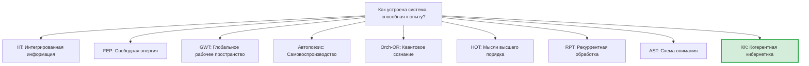

# Сравнение с Альтернативными Теориями

> *«Настоящая проверка теории — не то, может ли она объяснить известные факты, а то, предсказывает ли она новые.»*
> — Имре Лакатос

:::info Для кого эта глава
Систематическое сравнение КК с восемью конкурирующими теориями сознания: IIT, FEP, GWT, автопоэзис, Orch-OR, HOT, RPT и AST.
:::

В предыдущей главе мы исследовали философский фундамент КК — двухаспектный монизм, формальные условия способностей и этику порогов. Всё это звучит амбициозно, но научный каркас не живёт в вакууме. Его ценность определяется не только внутренней стройностью, но и тем, *что он позволяет формализовать и проверить, чего не могут альтернативы*. Пришло время поставить КК рядом с конкурентами — честно, отмечая как преимущества, так и ограничения каждого.

Если вы учёный, работающий в одной из этих традиций, этот раздел покажет, как перевести ваши идеи на язык КК — и наоборот. Если вы новичок, он поможет понять интеллектуальный ландшафт, в котором существует КК.

:::info Дорожная карта главы
В этой главе мы:
1. Обрисуем **теоретический ландшафт** — мастер-таблица 9 теорий (раздел 1)
2. Покажем **мосты КК — каждая теория** с компактными сравнениями (раздел 2). Развёрнутый анализ всех 42 теорий: [Теории сознания](/docs/consciousness/comparative/consciousness-theories)
3. Сведём всё в **таблицу предсказаний** (раздел 3) и честно оценим **ограничения КК** (раздел 4)
:::

---

## 1. Обзор теоретического ландшафта {#обзор}

### 1.1 Девять теорий за одним столом

Представим, что за круглым столом сидят девять теорий. Каждая из них пытается ответить на вопрос: «Как устроена система, способная к опыту?»

Эти теории можно разделить на четыре семейства:

- **Информационные:** IIT, GWT, RPT — фокусируются на обработке и интеграции информации
- **Биологические:** FEP, автопоэзис — фокусируются на выживании и самоорганизации
- **Когнитивные:** HOT, AST — фокусируются на репрезентациях и внимании
- **Физические:** Orch-OR — привязывает сознание к квантовой гравитации
- **КК** — стремится связать все четыре перспективы в рамках единой 7-мерной модели

### 1.2 Мастер-таблица сравнения

| Характеристика | IIT (Тонони) | FEP (Фристон) | GWT (Баарс) | Автопоэзис (Матурана) | Orch-OR (Пенроуз) | HOT (Розенталь) | RPT (Ламме) | AST (Грациано) | **КК** |
|---|---|---|---|---|---|---|---|---|---|
| **Центральный объект** | Структура $\Phi$ | Модель $q(\theta)$ | Раб. простр. | Живая клетка | Микротрубочки | Мысль 2-го порядка | Рекуррентные петли | Модель внимания | **$\Gamma \in \mathcal{D}(\mathbb{C}^7)$** |
| **Мера сознания** | $\Phi_{\text{IIT}}$ | Нет явной | Доступ к GW | Нет кол. | Объект. редукция | Нет кол. | Нет кол. | Нет кол. | **Четыре зазора ($P, R, \Phi, D_{\text{diff}}$); скаляр $C = \Phi R$ `[О]` (`T-140`)** |
| **Динамика** | Нет | Вар. вывод | Нет | Качест. | Кв. гравитация | Нет | Нет | Нет | **$\mathcal{L}_\Omega + \mathcal{R}$ (открытая + нелинейная)** |
| **Порог** | $\Phi > 0$ | Нет | Доступ | Автопоэзис | OR-событие | HOT о HOT | Рек. петля | Модель | **$P{>}2/7 \land R{\geq}1/3 \land \Phi{\geq}1 \land D_{\text{diff}}{\geq}2$ `[О]`** |
| **Фальсифицируемость** | Слабая | Слабая | Умеренная | Слабая | Слабая | Умеренная | Умеренная | Умеренная | **Условная (при калиброванном мосте)** |
| **Вычислимость** | NP-hard | Аппрокс. | Нет | Нет | Неясно | Нет | Нет | Нет | **$O(N^3)$, $N{=}7$** |

---

## 2. Детальное сравнение с каждой теорией {#детальное-сравнение}

:::info Подробный анализ
Полный анализ 42 теорий сознания (включая 8 ниже) с историей, формализмом и критикой: [Теории сознания → 42 теории](/docs/consciousness/comparative/consciousness-theories). Здесь — **только мосты** между каждой теорией и КК.
:::

### 2.1 IIT (Тонони) {#iit}

**Мост `[И]`:** $\Phi_{\text{КК}} = P/d - 1$ (`[О]`) — базисно-зависимое спектральное отношение, играющее роль интеграции, качественно аналогичную $\Phi_{\text{IIT}}$ в режимах высокой когерентности, хотя математически эти величины различны (это не тождество). PCI в лаборатории — не прокси для $P$: $P$ считывается с реконструкции $\widehat\Gamma$ ([Методология измерений](./measurement#измерение-чистоты)), а PCI даёт независимый вердикт, сравниваемый с $\mathrm{Cons}(\widehat\Gamma)$ каппой Коэна $\kappa$ ([P8.4](/docs/applied/research/measurement-protocol#substitution-position)).

| Аспект | IIT | КК |
|---|---|---|
| **Мера** | $\Phi_{\text{IIT}}$ (NP-hard) | $\Phi_{\text{КК}}$ ($O(N^2)$) `[О]` |
| **Порог** | $\Phi > 0$ | $P > 2/7 \land R \geq 1/3 \land \Phi \geq 1 \land D_{\text{diff}} \geq 2$ `[О]` |
| **Динамика** | Нет | Открытая + нелинейная ($\mathcal{L}_\Omega + \mathcal{R}$) |
| **Преимущество IIT** | Экспериментальная база (PCI) | — |

---

### 2.2 FEP (Фристон) {#fep}

FEP (Фристон, 2010) моделирует адаптивные системы как минимизирующие вариационную свободную энергию $F$. КК разделяет идею активного самоподдержания и использует явный интерфейс наблюдения (`Enc`-оценщик, `T-100` `[О]`). Каноническое $\Delta F$ голонома ([определение](/docs/core/dynamics/evolution#каноническое-delta-f) `[О]`) формально аналогично разности свободной энергии (при этом прежнее утверждение о выборе веса через свободную энергию `T-39e` снято `[✗]`).

**Интерпретация `[И]`.** Для сравнения с принципом свободной энергии нужны порождающая модель, вариационное семейство и целевой функционал. Формальная аналогия функционалов не задаёт эти объекты.

| Аспект | FEP | КК |
|---|---|---|
| **Сознание** | Не объясняется | Явные врата способностей ($P, R, \Phi, D_{\text{diff}}$) и $\mathrm{Coh}_E$ `[О]` |
| **Область** | Любая устойчивая система с марковским одеялом | $\Gamma \in \mathcal{D}(\mathbb{C}^7)$, структурный срез $P > 2/7$ `[О]` (`T-5`) |
| **Обучение** | Нет общих границ размерности | `T-109` `[Т]` (границы бинарного различения); `T-113` `[Г]` (гипотеза оптимальности $N=7$) |
| **Преимущество FEP** | Масштабируемость, сотни экспериментов, predictive coding | — |

:::info Подробное сравнение
Развёрнутый анализ FEP (формализм, active inference, марковское одеяло): [Теории сознания — FEP](/docs/consciousness/comparative/consciousness-theories#fep).
:::

---

### 2.3 GWT (Баарс, Деан) {#gwt}

GWT (Баарс, 1988; GNWT — Деан, Шанжё, 2001) связывает сознание с глобальной трансляцией информации («театр сознания»). В КК это интерпретативно (`[И]`) перекликается с высокой $\Phi$ (внедиагональные когерентности, связывающие все 7 измерений). КК формализует сопоставление через $\Gamma$, $\mathcal{L}_\Omega$ и непрерывные метрики вместо бинарного «на сцене / за кулисами». GWT превосходит КК в нейронной специфичности (GNWT: «зажигание», P300) и клиническом применении.

:::info Подробное сравнение
[Теории сознания — GWT](/docs/consciousness/comparative/consciousness-theories#gwt).
:::

---

### 2.4 Автопоэзис (Матурана, Варела) {#autopoeisis}

В КК автопоэзис (1972) моделируется через самоподдержание неподвижной точки $\varphi(\Gamma^*) = \Gamma^*$ выбранной самомодели (`CC-4` `[Т]` для заданного семейства зеркал) вместе со срезом жизнеспособности $P > 2/7$ (`T-5` `[О]`), тогда как уровень способностей L2 дополнительно требует $R \ge 1/3$, $\Phi \ge 1$ и $D_{\mathrm{diff}} \ge 2$ (`[О]`). При этом универсальная необходимость самомодели (`CC-3`) снята `[✗]`. КК концептуально опирается на операциональную замкнутость, структурное сопряжение (моделируемое через заданный интерфейс наблюдения `T-100` `[О]`) и различение организации и структуры (`[И]`). Автопоэзис превосходит КК в биологической конкретности и социальной теории (Луманн, энактивизм Варелы).

:::info Подробное сравнение
[Теории сознания — Автопоэзис](/docs/consciousness/comparative/consciousness-theories#автопоэзис).
:::

---

### 2.5 Orch-OR (Пенроуз, Хамерофф) {#orch-or}

Orch-OR (1996) привязывает сознание к квантовой гравитации в микротрубочках. КК использует квантово-подобный формализм матриц плотности ($\Gamma \in \mathcal{D}(\mathbb{C}^7)$) без привязки к микротрубочкам: субстратно-нейтральное моделирование, вычислимость $O(N^3)$ и проверка через калиброванные макро-наблюдаемые (`[Пр]`). Orch-OR предлагает конкретный биофизический локус (микротрубочки) и связь с гравитационным коллапсом, тогда как КК выносит физический субстрат в слой эмпирической калибровки.

:::info Подробное сравнение
[Теории сознания — Orch-OR](/docs/consciousness/comparative/consciousness-theories#orch-or).
:::

---

### 2.6 HOT (Розенталь) {#hot}

HOT (1986) — концептуальный предшественник рефлексии $R$ и рекурсивной глубины самонаблюдения (SAD). Порядки мысли в HOT интерпретативно (`[И]`) соответствуют шагам рекурсивного самомоделирования (`T-150` `[О]`). КК задаёт количественную рефлексию $R \in [0,1]$ с порогом L2 $R \geq 1/3$ (`[О]`), отмечая, что прежние утверждения об универсальной эквивалентности SAD и уровней (`T-136`) и универсальном потолке глубины $\mathrm{SAD}_{\max} = 3$ (`T-217`) сняты `[✗]`; вместо этого уровень L3 требует независимого предиктивного сертификата метамодели (`[О]`, см. [Pred 12](./predictions#предсказание-12)). HOT превосходит КК в 40-летней философской проработке и связи с метакогницией.

:::info Подробное сравнение
[Теории сознания — HOT](/docs/consciousness/comparative/consciousness-theories#hot).
:::

---

### 2.7 RPT (Ламме) {#rpt}

RPT (Ламме, 2003) отождествляет сознание с рекуррентной обработкой. В КК рекуррентность интерпретативно (`[И]`) соответствует внедиагональным когерентностям $\gamma_{ij}$, входящим в $P$ и $\Phi$, с явным срезом структурного большинства $P > 2/7$ (`T-5` `[О]`). RPT превосходит КК в временных предсказаниях (прямой проход ~100 мс, рекурсия ~200+ мс) и нейронной конкретности (V1→V4→IT→PFC→V1).

:::info Подробное сравнение
[Теории сознания — RPT](/docs/consciousness/comparative/consciousness-theories#rpt).
:::

---

### 2.8 AST (Грациано) {#ast}

AST (2013) предполагает, что сознание — модель собственного внимания. Это интерпретативно (`[И]`) перекликается с самомоделью $\varphi(\Gamma)$ в КК, где $R$ измеряет рефлексию (`[О]`) по всем 7 измерениям, а не только по вниманию. При этом универсальная необходимость самомодели (`CC-3`) и универсальный No-Zombie (`T-38a`) сняты `[✗]`; в КК нижние границы на E-когерентность действуют условно при явно заданных гипотезах замкнутого баланса потока чистоты (`[С]`, [Теоремы](./theorems#теорема-81-условная-необходимость-интериорности-no-zombie)). AST превосходит КК в объяснении иллюзий сознания и theory of mind.

:::info Подробное сравнение
[Теории сознания — AST](/docs/consciousness/comparative/consciousness-theories#ast).
:::

---

## 3. Сводная таблица предсказаний {#сводная-таблица}

Что именно утверждает или проверяет каждая теория и каков эпистемический статус в КК? Эта таблица отделяет доказанные математические теоремы от определений, условных результатов, гипотез и снятых утверждений.

| Предсказание / структурное утверждение | IIT | FEP | GWT | Автопоэзис | Orch-OR | HOT | RPT | AST | **КК** |
|---|:---:|:---:|:---:|:---:|:---:|:---:|:---:|:---:|:---:|
| Условный E-баланс / No-Zombie | ? | Нет | Нет | Нет | Да | Нет | Нет | Нет | **Условно `[С]`** (`T-38a` `[✗]`) |
| Количественные пороги способностей | ~Да | Нет | Нет | Нет | Нет | Нет | Нет | Нет | **Определено `[О]`** (непустота `[Т]`, `T-124`) |
| Семисекторная диагностическая панель | Нет | Нет | Нет | Нет | Нет | Нет | Нет | Нет | **Определено `[О]`** (`T-92`) |
| Связь E-когерентности и регенерации | Нет | Нет | Нет | Нет | Нет | Нет | Нет | Нет | **Гипотеза `[Г]`** (`T-39h` `[✗]`) |
| Универсальный потолок SAD = 3 | Нет | Нет | Нет | Нет | Нет | Нет | Нет | Нет | **Снято `[✗]`** (`T-136`, `T-217`) |
| Доязыковое познание | Да | Да | Нет | Да | ? | Нет | Да | Нет | **Да `[И]`** |
| Нейроосцилляции из щели | Нет | Нет | Нет | Нет | ? | Нет | Нет | Нет | **Да `[Г]`** |
| Оптимальность N=7 для обучения | Нет | Нет | Нет | Нет | Нет | Нет | Нет | Нет | **Гипотеза `[Г]`** (`T-113`) |
| Рабочее окно $P \in (2/7, 3/7]$ | Нет | Нет | Нет | Нет | Нет | Нет | Нет | Нет | **Определено `[О]`** (непустота `[Т]`, `T-124`) |
| Время рекуррентной обработки ~200 мс | Нет | Нет | ~Да | Нет | Нет | Нет | **Да** | Нет | Нет |
| Теория сознания других (Theory of Mind) | Нет | Частично | Нет | Нет | Нет | Частично | Нет | **Да** | Нет |
| Нейронная реализация (конкретные пути) | Нет | **Да** | **Да** | Нет | **Да** | Нет | **Да** | Частично | Нет |

:::tip Как читать эту таблицу
- **`[Т]`** = строго доказанная теорема в КК
- **`[С]`** = доказано условно при явно указанных допущениях
- **`[О]`** = формальное определение / соглашение в КК
- **`[Г]`** = проверяемая или математическая гипотеза
- **`[И]`** = философская / семантическая интерпретация
- **`[✗]`** = снятое универсальное утверждение (сохранено явно ради прозрачности)
- **Да** (без маркера) = альтернативная теория предсказывает или моделирует это свойство
- **~Да** = предсказывает с оговорками
- **Нет** = теория не адресует этот вопрос
:::

---

## 4. Честная оценка ограничений КК {#ограничения}

Ни одна теория не совершенна. Вот что КК пока **не может**:

1. **Эмпирическая проверка.** Главная слабость — отсутствие экспериментальных подтверждений. КК формулирует проверяемые гипотезы, но ни одна из них пока не подтверждена в лаборатории. IIT, FEP, GWT и RPT значительно опережают КК по объёму экспериментальных данных.

2. **Калибровка и неопределённость остаются условными.** У полос мониторинга структура **`[О]`**, а калиброванные пороги **`[С]`** зависят от объявленной системы ([T-106](./diagnostics#вывод-порогов)). Фиксированное канальное вложение и контракт наблюдений допускают состоятельное восстановление моментов; для ограниченных i.i.d. наблюдений в [разделе 6.4](./measurement#оценка-gamma) выведены явные конечно-выборочные границы. Центрирование по той же выборке меняет цель и зависимость; эффективный размер выборки по энергии не переносит эти границы автоматически. Нормированное парное отношение в общем случае смещено. Семантика вложения, временная зависимость, статистическое покрытие и перенос между субстратами требуют отдельных проверок. [Справочный модуль](pathname:///code/gamma_tomography.py) явно разделяет эти контракты.

3. **Масштабирование.** Композиция голономов теоретически описана, но практическая работа с большими системами (общество из миллионов агентов) вычислительно сложна.

4. **Феноменологическая адекватность.** Вопрос, *адекватно* ли 7 измерений описывают реальный субъективный опыт, остаётся открытым эмпирическим и философским вопросом `[Г]` / `[Пр]`. Возможно, реальная феноменология богаче — и 7 измерений лишь грубое приближение.

5. **Нейронный субстрат.** КК не предлагает конкретных нейронных механизмов — это и сила (нейтральность к субстрату), и слабость (для проверки в нейронауке требуется явный мост наблюдений).

6. **Социальное познание.** КК не развита в направлении социального познания, теории сознания других (theory of mind), эмпатии — областей, где AST и FEP имеют интересные результаты.

Эти ограничения — не скрытые дефекты, а **открытые проблемы**, определяющие программу исследований (см. [Программы исследований](./research-programs)).

:::note Честность как принцип
Этот раздел написан с намеренной честностью. КК — молодой каркас, и было бы неверно преувеличивать статус теорем или скрывать эмпирические пробелы. Каждая из конкурирующих теорий сталкивается с серьёзными компромиссами: IIT — с вычислительной сложностью, FEP — с эмпирической конкретизацией порождающих моделей, GWT и автопоэзис — с математической формализацией, Orch-OR — с биологической декогеренцией. Полной, экспериментально подтверждённой теории сознания пока не существует; КК обменивает нейронную конкретность и накопленную лабораторную базу на конечномерную вычислимость ($N=7$) и явное разделение формальных теорем `[Т]`, определений `[О]`, гипотез `[Г]` и интерпретаций `[И]`.
:::

---

## 5. Заключение: КК как сравнительный каркас {#заключение}

Современная наука о сознании и самоорганизации напоминает вавилонскую башню: множество языков, мало взаимопонимания. IIT говорит на языке информации, FEP — на языке байесовского вывода, GWT — на языке когнитивной архитектуры, автопоэзис — на языке биологической организации, HOT — на языке репрезентаций.

КК предлагает **общий словарь моделирования `[И]`**, в котором идеи других подходов сопоставляются конкретным компонентам 7-осевой записи:

| Теория | Компонента КК `[И]` |
|--------|---------------------|
| IIT | $\Phi$-компонента |
| FEP | $\Delta F$ (вариационная формулировка, требует порождающей модели) |
| GWT | Глобальная интеграция ($\Phi \geq 1$) |
| Автопоэзис | $\varphi(\Gamma^*) = \Gamma^*$ (самоподдержание неподвижной точки) |
| HOT | $R$ и предиктивные сертификаты высших порядков |
| RPT | Формирование внедиагональных $\gamma_{ij}$ (когерентностей) |
| AST | $\varphi(\Gamma)$ (самомодель) |

Станет ли КК успешным объединяющим языком, зависит от построения явных формальных мостов (таких как порождающие модели для FEP и калиброванные законы наблюдений для нейронных данных) и экспериментальной проверки её гипотез (`[Пр]`).

### Что мы узнали {#итоги}

1. Мы сравнили КК с **8 альтернативными теориями** — от IIT до AST.
2. КК **концептуально опирается** на ключевые идеи каждой: интеграцию (IIT), активное самоподдержание (FEP), глобальную доступность (GWT), самопроизводство (автопоэзис), рефлексию (HOT), рекуррентность (RPT) и самомоделирование (AST).
3. КК **предлагает** явную конечномерную формализацию ($N=7$, вычислимость $O(N^3)$) и строгое разделение теорем `[Т]`, условных результатов `[С]`, определений `[О]`, гипотез `[Г]` и снятых утверждений `[✗]`.
4. Каждая альтернативная теория **превосходит** КК в своих устоявшихся сильных сторонах: экспериментальной базе, нейронной конкретности или философской проработке.
5. КК можно сравнивать с другими описаниями через заданные проекции `[И]`. Формальное сведение FEP к КК требует явного построения порождающей модели и её динамики (§2.2).

---

В следующей главе мы перейдём от теории к практике: [Методология измерений](./measurement) покажет, *как* перевести формулы КК в конкретные эксперименты, тесты и аудиты.

---

**Дальнейшее чтение:**
- [Уникальные предсказания](./predictions) — полный перечень фальсифицируемых предсказаний
- [Философские основания](./philosophy) — онтологический статус КК
- [Сравнение теорий сознания](/docs/consciousness/comparative/consciousness-theories) — подробный анализ
- [Панпсихизм: критический анализ](/docs/consciousness/comparative/panpsychism-analysis) — почему КК ≠ панпсихизм
- [Вариационная формулировка](./variational) — мост КК — FEP

---

**Связанные документы:**
- [Философские основания](/docs/applied/coherence-cybernetics/philosophy)
- [Уникальные предсказания КК](/docs/applied/coherence-cybernetics/predictions)
- [Методология измерений](/docs/applied/coherence-cybernetics/measurement)
- [Введение в КК](/docs/applied/coherence-cybernetics/introduction)
