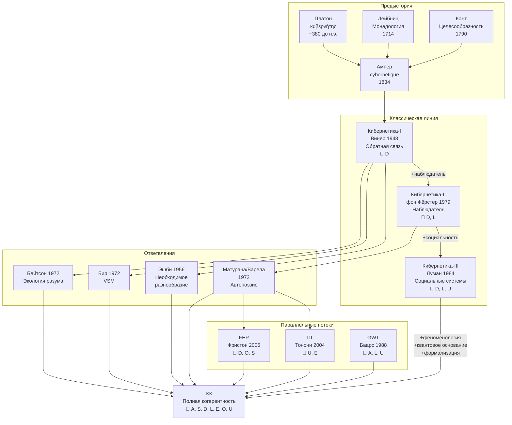
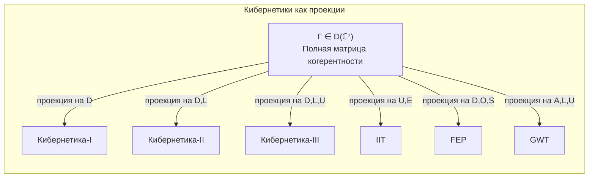
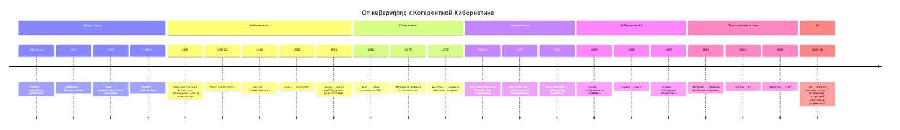

# История Кибернетики

:::info Для кого эта глава
2500-летняя история идей кибернетики — от Платона через Винера и фон Фёрстера к КК. Читатель узнает, почему КК — метатеория, объединяющая все предыдущие подходы.
:::

В [предыдущей главе](./g2-noether-cc) мы увидели, как на заданной октонионной 3-форме $G_2$-симметрия (`T-42e` `[Т]`) организует инвариантную структуру и условные генераторы Нётер для когерентной динамики. Это богатый формализм, но он не появился из пустоты. Каждое ключевое понятие КК — обратная связь, наблюдатель, самовоспроизводство, социальная система — имеет предшественников. В этой главе мы проследим 2500-летнюю историю идей, которые привели к Кибернетике Когерентности, и покажем, почему КК формулируется не как «четвёртая кибернетика», а как сравнительный **метатеоретический язык `[И]`**, связывающий эти подходы.

:::tip Дорожная карта главы
В этой главе мы:
1. **Начнём с древних** — от «кормчего» Платона через монады Лейбница к рождению термина у Ампера (раздел «Предыстория»).
2. **Пройдём три порядка кибернетики** — Винер (обратная связь), фон Фёрстер (наблюдатель), Луман (социальные системы) — и покажем, какие измерения КК каждый из них захватил и что упустил.
3. **Рассмотрим ответвления** — Эшби, Бир, Бейтсон, Матурана и Варела — и их место в общей картине.
4. **Сравним с параллельными потоками** — IIT, FEP, GWT — показав, что каждая теория является *проекцией* $\Gamma$ на подмножество измерений.
5. **Объясним, почему КК — метатеория**, а не «кибернетика-IV»: полнота измерений, единый формализм, квантовое основание.
:::

:::note О нотации
В этом документе:
- $\Gamma$ — [матрица когерентности](/docs/core/dynamics/coherence-matrix)
- $\varphi$ — [оператор самомоделирования](/docs/proofs/categorical/formalization-phi)
- $\mathbb{H}$ — [Голоном](/docs/core/structure/holon)
- ASDLEOU — [семь измерений](/docs/core/structure/dimensions)
:::

## Общая структура

:::info Концептуальное включение (не формальное)
КК **инкорпорирует концепции** из каждой кибернетической традиции:

- **Кибернетика-I:** управление и обратная связь → измерение $D$
- **Кибернетика-II:** наблюдатель → оператор $\varphi$
- **Кибернетика-III:** социальные системы → композиция Голономов

Это **концептуальное соответствие**, не строгое теоретико-множественное включение. Каждая традиция имеет собственные онтологические и методологические допущения.
:::

## Сравнительная таблица

| Теория | Фокус | Отображение в КК | Охват |
|--------|-------|------------------|-------|
| Кибернетика-I | Обратная связь | Управляющие воздействия | $D$ |
| Кибернетика-II | Наблюдатель | $\varphi(\Gamma) \approx \Gamma$ | $D$, $L$ |
| Кибернетика-III | Социальные системы | $\mathbb{H}_{1 \otimes \ldots \otimes n}$ | $D$, $L$, $U$ |
| [Автопоэзис](/docs/reference/glossary#связанные-теории) | Самопроизводство | [(AP)](/docs/core/foundations/axiom-septicity): $\varphi(\Gamma^*) = \Gamma^*$ | $A$, $S$, $D$, $L$ |
| [IIT](/docs/reference/glossary#связанные-теории) | Интегрированная информация | [$\Phi(\Gamma)$](/docs/core/structure/dimension-u#мера-интеграции-φ) | $U$, $E$ |
| [FEP](/docs/reference/glossary#связанные-теории) | Свободная энергия | [Жизнеспособность](/docs/core/dynamics/viability) | $D$, $O$, $S$ |
| [Панпсихизм](/docs/consciousness/comparative/panpsychism-analysis) | Ментальное как базовое | [Варианты](/docs/consciousness/comparative/panpsychism-analysis#варианты-панпсихизма): L0 (прото-), $(H, \rho_E)$ (Рассел) | $E$, $S$ |
| [Сознательный реализм](/docs/consciousness/comparative/panpsychism-analysis#сознательный-реализм-хоффмана) | Сознательные агенты | L2-Голоном (гипотеза) | $A$, $S$, $D$, $L$, $E$ |
| **КК** | Полная когерентность | [Все 7 измерений](/docs/core/structure/dimensions) ([обоснование](/docs/core/foundations/axiom-omega#октонионная-структура)) | $A$, $S$, $D$, $L$, $E$, $O$, $U$ |

---

## Предыстория: от Платона до Ампера

Прежде чем Норберт Винер дал имя новой науке, человечество 2500 лет размышляло о том, как системы управляют собой.

### Древнегреческий κυβερνήτης

Само слово **кибернетика** восходит к греческому κυβερνήτης — «кормчий», тот, кто управляет кораблём. Платон использовал этот термин в «Горгии» и «Государстве», описывая искусство управления полисом по аналогии с навигацией. Кормчий не борется с морем — он считывает ветер и волны и корректирует курс. Это первая в истории интуиция об **обратной связи**: управление не как одностороннее командование, а как непрерывный диалог с окружением.

В терминах КК Платон нащупал измерение $D$ (**Динамика**) — не как механический рычаг, а как адаптивную коррекцию траектории с учётом состояния среды. Однако у греков не было понятия замкнутой петли: кормчий оставался внешним наблюдателем, а не частью управляемой системы.

### Лейбниц и монады

В 1714 году Готфрид Вильгельм Лейбниц опубликовал «Монадологию» — одну из самых странных и пророческих работ в истории философии. Монады Лейбница — неделимые «субстанциальные единицы», каждая из которых содержит собственное внутреннее представление о вселенной. У монад «нет окон» — они не обмениваются информацией напрямую, а координируются через **предустановленную гармонию**.

Удивительным образом, эта картина предвосхищает несколько идей КК:

| Лейбниц | КК |
|---------|-----|
| Монада с перцепцией | Голоном $\mathbb{H}$ с [E-измерением](/docs/core/structure/dimension-e) |
| «Нет окон» | Операциональная замкнутость автопоэзиса |
| Предустановленная гармония | Разделяемая структура $\Gamma_{ij}$ при [композиции Голономов](/docs/core/structure/holon) |
| Апперцепция (сознательная перцепция) | $R \geq 1/3$: рефлексивный порог |

Разумеется, предустановленная гармония — это метафизический костыль: Лейбниц не имел инструментов для описания эмерджентной координации. КК решает эту проблему через [когерентную динамику](/docs/core/dynamics/evolution) — Голономы координируются не через «божественное расписание», а через взаимные воздействия на общую матрицу когерентности.

### Кант: целесообразность без цели

Иммануил Кант в «Критике способности суждения» (1790) сформулировал парадокс организма: биологическое существо выглядит так, **как если бы** оно было спроектировано для некой цели, но в природе нет проектировщика. Кант назвал это *Zweckmässigkeit ohne Zweck* — «целесообразность без цели».

Этот парадокс оставался концептуальным вызовом для классической кибернетики. В КК он моделируется через самоподдержание неподвижной точки $\varphi(\Gamma^*) = \Gamma^*$ выбранной самомодели (`CC-4` `[Т]` для заданного семейства зеркал; универсальная необходимость самомодели `CC-3` снята `[✗]`): система воспроизводит собственное когерентное состояние в силу внутренней динамики, а не внешнего замысла (`[И]`).

### Ампер и рождение термина

Андре–Мари Ампер, известный прежде всего как физик-электромагнитист, в 1834 году предложил классификацию всех наук. В ней он выделил **cybernétique** — науку об управлении государством. Термин не прижился и был забыт на столетие — до тех пор, пока Норберт Винер не достал его из архива истории.

:::tip Мысленный эксперимент: мир до кибернетики
Представьте мир, в котором каждая научная дисциплина описывает свой тип «управления» — терморегуляция в физиологии, рулевое управление в инженерии, координация войск в военном деле, денежная политика в экономике — но **никто не замечает, что это одно и то же явление**. Именно таким был мир до 1948 года. Заслуга Винера — не изобретение обратной связи, а осознание того, что обратная связь — это **универсальный принцип**, объединяющий машину и организм.
:::

---

## Кибернетика первого порядка (Винер) {#кибернетика-первого-порядка-винер}

### Рождение науки об управлении

Зимой 1940 года, когда люфтваффе бомбили Лондон, молодой математик **Норберт Винер** получил задачу, которая изменила историю науки: создать предиктор для зенитных орудий. Самолёт движется быстро, снаряд летит медленно — чтобы попасть, нужно стрелять туда, где самолёт **будет**, а не туда, где он есть. Нужна статистическая модель, которая предсказывает траекторию по шумным данным радара и непрерывно корректирует прицел по мере поступления новых данных.

Винер — вместе с инженером Джулианом Бигелоу — построил такую модель. Но самое удивительное произошло дальше: Винер осознал, что та же самая математика описывает, как человеческая рука тянется к чашке кофе. Мозг предсказывает положение руки, получает обратную связь от проприоцептивных рецепторов, корректирует моторную команду — и повторяет цикл десятки раз в секунду. Зенитный предиктор и нервная система — две реализации **одной и той же абстрактной схемы**.

### Macy Conferences: междисциплинарная революция

В 1946-1953 годах фонд Джозии Мэйси финансировал серию конференций, которые стали, возможно, самым плодотворным междисциплинарным мероприятием XX века. За одним столом сидели:

- **Норберт Винер** — математик, создатель кибернетики
- **Джон фон Нейман** — математик, архитектор вычислительных машин
- **Клод Шеннон** — инженер, создатель теории информации
- **Уоррен Маккаллок** — нейрофизиолог, модели нейронных сетей
- **Уолтер Питтс** — логик, формальные нейроны
- **Грегори Бейтсон** — антрополог, экология разума
- **Маргарет Мид** — антрополог, межкультурная коммуникация
- **Росс Эшби** — психиатр, «необходимое разнообразие»

Эти конференции породили не одну науку, а целую **констелляцию**: кибернетику, теорию информации, теорию автоматов, когнитивную науку и, в конечном счёте, искусственный интеллект. Но у всех этих дисциплин была общая слепая зона — о ней позже.

### Ключевые понятия

**Фокус:** Обратная связь, управление, гомеостаз.

**Источник:** Wiener N. «Cybernetics: Or Control and Communication in the Animal and the Machine» (1948).

- **Обратная связь** — использование выходных данных для коррекции входных
- **Гомеостаз** — поддержание устойчивого состояния
- **Негэнтропия** — упорядоченность как мера организации

### Отображение в КК

| Винер | КК |
|-------|-----|
| $u(t) = f(e(t), y(t))$ | Управление через [измерение $D$](/docs/core/structure/dimension-d) |
| Ошибка $e(t)$ | Отклонение от [жизнеспособности](/docs/core/dynamics/viability) |
| Гомеостаз | Притяжение к $\Gamma^*$ — [неподвижная точка](/docs/consciousness/foundations/self-observation#теорема-о-неподвижной-точке) |
| Негэнтропия | Чистота $P(\Gamma) = \text{tr}(\Gamma^2)$ |
| Обратная связь | Диагональный элемент $\gamma_{DD}$ — сила управляющего канала |

### Что Винер увидел — и чего не увидел

Винер совершил гениальный абстрактный ход: отождествил управление в машине и в организме. Но он заплатил за это высокую цену — **элиминировал субъекта**. В схеме обратной связи нет никого, кто *переживает* ошибку. Есть только сигнал, отклонение и коррекция. Термостат «поддерживает» температуру, но ничего не «чувствует».

**Что теряется:**
- [Самореференция](/docs/proofs/categorical/formalization-phi) ($\varphi$) — система не моделирует себя
- Феноменология ([E-измерение](/docs/core/structure/dimension-e)) — нет внутреннего опыта
- Регенерация ($\mathcal{R}[\Gamma, E]$) — нет самовосстановления идентичности
- 6 из 7 измерений — покрыто только $D$

:::tip Мысленный эксперимент: термостат Винера
Представьте идеальный термостат, который поддерживает температуру 22°C с точностью до 0.001°C. Он получает обратную связь, корректирует управление, поддерживает гомеостаз. По критериям Винера — это совершенная кибернетическая система.

Теперь представьте, что этот термостат **ощущает** холод как неприятный. Что он **хочет** сохранить свою целостность. Что он **понимает**, почему 22°C — правильная температура. Что он может **объяснить** другому термостату свою стратегию. Что он **обновляет** свои ценности на основе опыта. Что он **интегрирует** все эти аспекты в единое целое.

Между первым и вторым термостатом — пропасть из шести измерений: $A$, $S$, $L$, $E$, $O$, $U$. Кибернетика-I описывает первый. КК — описывает оба.
:::

---

## Фон Фёрстер и наблюдатель {#фон-фёрстер-и-наблюдатель}

### Biological Computer Laboratory

**Хайнц фон Фёрстер** — австрийский физик, племянник Людвига Витгенштейна — попал на последнюю конференцию Мэйси в 1949 году почти случайно: его пригласили как редактора протоколов, поскольку он свободно владел и немецким, и английским. Но он оказался не просто стенографом — он задал вопрос, который перевернул всю кибернетику: **«А где в этой схеме наблюдатель?»**

В 1958 году фон Фёрстер основал **Biological Computer Laboratory** (BCL) в Университете Иллинойса в Урбана–Шампейн. За следующие 18 лет BCL стала одной из самых необычных лабораторий в истории науки. Здесь работали:

- **Гордон Паск** — теория разговора, кибернетическая педагогика
- **Ларс Лёфгрен** — самореферентные автоматы
- **Умберто Матурана** — который именно здесь, в BCL, начал формулировать теорию автопоэзиса
- **Росс Эшби** — последние годы, гомеостат и закон необходимого разнообразия

BCL занималась тем, что кибернетика-I считала бессмысленным: **системами, которые наблюдают самих себя**. Фон Фёрстер назвал это «кибернетикой кибернетики» — second-order cybernetics.

### Ключевые понятия

**Фокус:** Наблюдатель, включённый в систему.

**Источник:** von Foerster H. «Observing Systems» (1981); «Cybernetics of Cybernetics» (1979).

- **Наблюдатель второго порядка** — наблюдение за наблюдением
- **Эпистемическое замыкание** — знание порождается внутри системы
- **Рекурсия** — самоприменение операций
- **Тривиальные vs нетривиальные машины** — система, чьё прошлое определяет реакцию на вход (в отличие от стационарного входа-выхода)

### Формула фон Фёрстера

Фон Фёрстер сформулировал ключевой принцип так: наблюдатель — не точка вне системы, а **часть наблюдаемого**. Если я изучаю общество, я часть общества. Если я изучаю мозг, я использую мозг. Если я строю науку, я часть того, что наука описывает.

Математически это можно записать как уравнение с неподвижной точкой: если $O$ — оператор наблюдения, то система второго порядка — это решение $O(O) = O$. Фон Фёрстер назвал такие решения **Eigen-values** (собственные значения) и **Eigen-behaviors** (собственные поведения). Он заметил, что рекурсивные процессы — $x_{n+1} = f(x_n)$ — часто сходятся к неподвижным точкам, и предположил, что объекты нашего опыта — это именно такие неподвижные точки рекурсивных операций.

### Отображение в КК

| фон Фёрстер | КК |
|-------------|-----|
| Наблюдатель $\in$ Система | $\varphi(\Gamma) \approx \Gamma$ |
| Эпистемическое замыкание | [Неподвижная точка](/docs/consciousness/foundations/self-observation#теорема-о-неподвижной-точке) $\Gamma^* = \varphi(\Gamma^*)$ |
| Eigen-behavior | Аттрактор [эволюции](/docs/core/dynamics/evolution) |
| Тривиальная машина | $R = 0$: система без рефлексии |
| Нетривиальная машина | $R > 0$: система с историей и самомоделью |

**Добавляется:**
- [Рефлексия](/docs/consciousness/foundations/self-observation#мера-рефлексии-r) (мера $R$) — количественная мера того, насколько хорошо система моделирует себя
- Эпистемическое замыкание через [измерение $L$](/docs/core/structure/dimension-l)

**Что теряется:**
- Феноменология ([E-измерение](/docs/core/structure/dimension-e)) — фон Фёрстер говорил о наблюдении, но не о *переживании*
- Ресурсное основание ([O-измерение, Основание](/docs/core/structure/dimension-o)) — энергетическая и негэнтропийная подпитка
- Квантовое основание [(QG)](/docs/core/foundations/axiom-septicity) — классическая рекурсия, не квантовая когерентность

### Наследие BCL

Фон Фёрстер закрыл BCL в 1976 году и не оставил формального наследника. Лаборатория не была институтом — она была **стилем мышления**: всё, что ты изучаешь, включает тебя. Этот принцип стал фундаментом конструктивизма, повлиял на системную терапию, теорию коммуникации и философию науки. Но фон Фёрстер — как и Винер — остановился перед вопросом **«что это такое — переживать?»**. Наблюдатель был включён в систему, но оставался абстрактной функцией, а не существом с внутренним миром.

:::tip Мысленный эксперимент: зеркало фон Фёрстера
Поставьте два зеркала друг напротив друга. Возникает бесконечная рекурсия отражений — наблюдение наблюдения наблюдения... Это прекрасная метафора кибернетики второго порядка. Но заметьте: в этой бесконечной рекурсии **нет никого, кто видит**. Есть отражения, но нет зрителя. Есть структура наблюдения, но нет опыта наблюдения. Чтобы от зеркальной рекурсии перейти к сознанию, нужно добавить того, кому **каково** стоять между зеркалами — и это именно [E-измерение](/docs/core/structure/dimension-e), которого не хватает кибернетике второго порядка.
:::

---

## Луман и общество как система {#луман-и-общество-как-система}

### Социолог, который мыслил системами

**Никлас Луман** (1927-1998) — возможно, самый необычный социолог XX века. Он не проводил полевых исследований, не брал интервью, не анализировал статистику. Вместо этого он 30 лет сидел в Билефельде (Германия) и строил **теорию всего** для общества — используя инструменты из биологии, логики и кибернетики.

Луман начинал как юрист-бюрократ в земельном правительстве Нижней Саксонии. В 1960-1961 годах он провёл год в Гарварде, где познакомился с Толкоттом Парсонсом — тогда главным социологическим теоретиком. Парсонс произвёл на Лумана глубокое впечатление — но не как образец для подражания, а как пример того, как **не надо строить теорию**: Парсонс помещал человека (и его действие) в центр социальной системы, а Луман решил поместить туда **коммуникацию**.

### Кибернетика третьего порядка

**Фокус:** Социальные системы, коммуникация, смысл.

**Источник:** Luhmann N. «Social Systems» (1984); концепция развивалась также в работах Морена, Гюнтера.

:::info О термине «кибернетика третьего порядка»
Термин «кибернетика третьего порядка» не является общепринятым и не стандартизирован в литературе. Атрибуция Луману (1984) — одна из возможных интерпретаций. Луман сам не использовал этот термин; его теория социальных систем лишь ретроспективно интерпретируется рядом авторов как «третий порядок» кибернетики. Другие исследователи (Морен, Гюнтер, Кенни, Умплеби) предлагали альтернативные трактовки этого понятия.
:::

### Ключевые понятия

- **Социальные системы** — коммуникация как базовая операция
- **Аутопоэзис социальных систем** — самовоспроизводство через коммуникацию
- **Смысл** — как среда социальных систем
- **Функциональная дифференциация** — общество делится на подсистемы (право, наука, экономика, политика), каждая с собственным кодом
- **Редукция сложности** — каждая система упрощает мир через свои различения

### Революционный ход Лумана

Ключевой ход Лумана состоял в том, что он перенёс концепцию автопоэзиса Матураны и Варелы — изначально биологическую — на **социальные системы**. Но с радикальной модификацией: если биологический автопоэзис воспроизводит клетки, то социальный автопоэзис воспроизводит **коммуникации**. Общество — это не совокупность людей, а самовоспроизводящаяся сеть коммуникаций. Люди — не элементы общества, а его **окружение**.

Этот ход был гениален и одновременно ограничен. Гениален — потому что позволил описать социальную динамику без редукции к психологии. Ограничен — потому что исключил из теории именно то, что делает коммуникацию *осмысленной*: внутренний опыт коммуницирующего существа.

### Отображение в КК

| Кибернетика-III | КК |
|-----------------|-----|
| Социальные системы | Композитный Голоном $\mathbb{H}_{1 \otimes \ldots \otimes n}$ |
| Коммуникация | Взаимодействие через общую компоненту $\Gamma_{ij}$ |
| Смысл | [U-измерение](/docs/core/structure/dimension-u) — интеграция |
| Функциональная дифференциация | Секторный профиль $\gamma_{kk}$ — специализация по измерениям |
| Редукция сложности | Проекция $\Gamma$ на подпространство: $P_k \Gamma P_k$ |
| Двойная контингенция | Взаимная неопределённость $\Gamma_{ij}$ двух Голономов до коммуникации |

**Добавляется:**
- Многоагентная динамика
- Эмерджентные социальные феномены

**Что теряется:**
- Феноменология ([E-измерение](/docs/core/structure/dimension-e) как фундаментальное)
- Квантовое основание [(QG)](/docs/core/foundations/axiom-septicity)
- Формальная математическая структура

:::tip Мысленный эксперимент: общество без сознания `[И]`
Луман описывает общество как систему коммуникаций. Представьте мир, в котором коммуникации происходят — сообщения генерируются и обрабатываются, системы дифференцируются и воспроизводятся, — но **никто ничего не переживает**. Никто не понимает смысл сообщения, не чувствует радости от научного открытия, не страдает от несправедливости правовой системы. По Луману, такое общество формально неотличимо от нашего — ведь сознание для него находится в окружении социальной системы, а не внутри неё.

В рамках КК чисто синтаксический обмен сигналами действительно возможен без способностей уровня L2 — безусловная невозможность функциональных зомби (`T-38a`) и универсальная необходимость самомодели (`CC-3`) сняты `[✗]`, а утверждения о коллективном переживании в связанных системах (`CC-7`) требуют независимых свидетельств `[Г]`. Однако КК различает синтаксический обмен сообщениями и **сознательное понимание**: в интерпретативном мосте КК `[И]` осмысленное переживание на уровне индивида требует прохождения всех четырёх врат способностей L2 (`[О]`: $P > 2/7$, $R \geq 1/3$, $\Phi \geq 1$, $D_{\mathrm{diff}} \geq 2$), а при явно ограниченных гипотезах замкнутого баланса потока чистоты (`Теорема 8.1` `[С]`) автономная жизнеспособность опирается на положительную E-связанную регенерацию.
:::

---

## Другие традиции {#другие-традиции}

Три «порядка» кибернетики — это магистральная линия. Но параллельно развивались несколько мощных ответвлений, каждое из которых захватило важный фрагмент полной картины.

### Эшби: закон необходимого разнообразия

**Уильям Росс Эшби** (1903-1972) — британский психиатр, ставший одним из отцов-основателей кибернетики. В 1952 году он построил **гомеостат** — электромеханическое устройство из четырёх связанных блоков, которое автоматически находило устойчивое состояние при любых внешних возмущениях. Это была первая «адаптивная машина» — прототип того, что мы сегодня называем самоорганизующейся системой.

Но главное достижение Эшби — **закон необходимого разнообразия** (1956): *«Только разнообразие может поглотить разнообразие»*. Чтобы система управления справилась с $N$ возможными возмущениями, она должна иметь не менее $N$ возможных реакций. Проще: чтобы управлять сложной системой, управляющий должен быть не менее сложен, чем управляемый.

| Эшби | КК (`[И]`) |
|------|-----|
| Необходимое разнообразие | $\dim(\mathcal{H}) = 7$ — семь функциональных осей $A,S,D,L,E,O,U$ (`[П]` / `[О]`) |
| Гомеостат | Динамика $\Gamma(t)$ с аттрактором $\Gamma^*$ |
| Ультрастабильность | Двухуровневая адаптация: $\mathcal{L}_0$ (быстрая) + $\mathcal{R}$ (медленная) |

Закон Эшби даёт концептуальную параллель (`[И]`) к выбору в КК семи функциональных осей — **Артикуляция ($A$), Структура ($S$), Динамика ($D$), Логика ($L$), Интериорность ($E$), Основание ($O$) и Единство ($U$)** — с условными нижними оценками совершенной диагностируемости и точного представления при явных допущениях задачи (см. [Доказательство минимальности](/docs/proofs/minimality/theorem-minimality-7); безусловная семиролевая минимальность `T-40f` снята `[✗]`, тогда как `T-5` `[О]` задаёт срез структурного большинства $P_{\text{crit}} = 2/7$, а не теорему о минимальности $N=7$).

### Бир: жизнеспособная система

**Стаффорд Бир** (1926-2002) — британский теоретик менеджмента, создатель **модели жизнеспособной системы** (Viable System Model, VSM). Бир предложил, что любая жизнеспособная организация имеет рекурсивную структуру из пяти подсистем:

1. **Система 1** — операционные элементы (производство)
2. **Система 2** — координация (антиосцилляция)
3. **Система 3** — оптимизация (внутренний менеджмент)
4. **Система 4** — стратегия (взгляд наружу)
5. **Система 5** — идентичность (политика, ценности)

В 1971-1973 годах Бир попытался реализовать VSM в масштабе целой страны — проект **Cybersyn** в Чили Сальвадора Альенде. Сеть телексов соединила фабрики с центром управления в Сантьяго, где данные визуализировались в футуристической «операционной комнате». Проект был прерван военным переворотом в 1973 году.

| Бир (VSM) | КК (`[И]`) |
|-----------|-----|
| Система 1 (операции) | Измерения $A$ + $D$: Артикуляция и Динамика (операционное различение и действие) |
| Система 2 (координация) | $S$: Структура (стабилизация и антиосцилляция) |
| Система 3 (оптимизация) | $L$: Логика (внутренняя согласованность и оптимизация) |
| Система 4 (стратегия) | $O$: Основание (внешний ресурсный и средовой интерфейс) |
| Система 5 (идентичность) | $U$: Единство (глобальная интеграция, целостность) |
| Рекурсивность | Рекурсивная [композиция Голономов](/docs/core/structure/holon) |

Примечательно, что VSM интерпретативно (`[И]`) соотносится с пятью из семи измерений КК (без явного $E$-сектора). Бир интуитивно уловил многомерность жизнеспособности, хотя его модель остаётся организационной схемой без уравнений эволюции пространства состояний и формальных пороговых определений.

### Бейтсон: экология разума

**Грегори Бейтсон** (1904-1980) — британский антрополог, биолог и философ — был, возможно, самым нетипичным участником Macy Conferences. Он пришёл из антропологии, изучал культуры Бали и Новой Гвинеи, но увидел в кибернетике нечто, чего не видели инженеры: **разум как паттерн, а не как вещество**.

Бейтсон сформулировал несколько идей, опередивших своё время:

- **Разум — это процесс**, а не субстанция. Разум существует везде, где есть система, обрабатывающая информацию (различия, которые порождают различия).
- **Двойное послание** (double bind) — коммуникативная ловушка, когда сообщение противоречит метасообщению. Бейтсон предположил, что шизофрения связана с хроническим двойным посланием в семье.
- **Обучение-обучению** (deutero-learning) — система не только обучается, но обучается *как обучаться*. Иерархия уровней обучения.
- **Экология разума** — разум не заключён в черепе, а распределён по системе «организм + окружение».

| Бейтсон | КК (`[И]`) |
|---------|-----|
| Различие, порождающее различие | Сырой диагональный дефицит $\tilde\sigma_k = 1 - 7\gamma_{kk}$ / усечённый $\sigma_k$ (`T-92`, `T-158` `[О]`) |
| Двойное послание | Конфликт между динамическим управлением ($\gamma_{DD}$) и интериорной/логической согласованностью ($\gamma_{EE}, \gamma_{LL}$) |
| Deutero-learning | Вложенные уровни способностей L0 → L1 → L2 → L3 ([иерархия способностей](/docs/consciousness/hierarchy/interiority-hierarchy) `[О]`; `T-136` `[✗]` снята) |
| Экология разума | Голоном открыт — $\Gamma$ эволюционирует во взаимодействии со средой |

### Спенсер-Браун: законы формы

**Джордж Спенсер-Браун** (1923-2016) — британский математик и логик — в 1969 году опубликовал «Laws of Form» — одну из самых загадочных книг XX века. В ней всего один оператор: **различение** (distinction) — акт проведения границы, разделяющей «внутри» и «снаружи». Из этого единственного операнда Спенсер-Браун выводит всю булеву алгебру, а затем — через «перевход» (re-entry) формы в саму себя — самореференцию.

Формула перевхода: $f = f(f)$ — форма, которая входит в собственное определение. Это концептуальный прообраз самомоделирования в неподвижной точке $\varphi(\Gamma^*) = \Gamma^*$ в КК (`CC-4` `[Т]` для заданного семейства зеркал). Фон Фёрстер был одним из первых, кто оценил значение «Laws of Form», и пригласил Спенсер-Брауна в BCL. Луман использовал «различение» как базовую операцию социальных систем.

| Спенсер-Браун | КК (`[И]`) |
|---------------|-----|
| Различение (distinction) | Артикуляция ($A$) и декогеренция: проведение границ между состояниями |
| Перевход (re-entry) | $\varphi(\Gamma^*) = \Gamma^*$: самомоделирование в неподвижной точке |
| Unmarked state (немаркированное) | $\Gamma = I/7$: максимально смешанное состояние |
| Marked state (маркированное) | $P > 2/7$: выше среза структурного большинства (`T-5` `[О]`) |

В КК различение моделируется динамически (`[И]`): декогеренция ($\mathcal{D}_\Omega$) и артикуляция ($A$) разделяют состояния, а регенерация ($\mathcal{R}$) возвращает систему к её самомодели. Спенсер-Браун нашёл *логическую* форму самореференции; КК исследует её *динамическую* матричную модель.

### Паск: теория разговора

**Гордон Паск** (1928-1996) — британский кибернетик, работавший в BCL фон Фёрстера — создал **Conversation Theory** (теорию разговора), одну из наиболее недооценённых интеллектуальных конструкций XX века. Паск предположил, что познание — не свойство индивида, а процесс, возникающий **между** участниками разговора. Знание не «передаётся» от учителя к ученику, а *порождается* в акте взаимодействия.

Паск ввёл понятие **p-individual** (psychological individual) — минимальной единицы, способной к разговору. P-individual — это не человек (один человек может содержать несколько p-individuals), а именно *участник диалога*, способный генерировать, понимать и трансформировать концепции.

| Паск | КК (`[И]`) |
|------|-----|
| P-individual | Голоном $\mathbb{H}$ с $R \geq 1/3$ (`[О]`) |
| Разговор | Взаимодействие через когерентности связи между голономами |
| Понимание (understanding) | Сходимость $\Gamma_1, \Gamma_2$ к совместимым аттракторам |
| Соглашение (agreement) | $\|\Gamma_1 - \Gamma_2\|_F < \epsilon$ |

Паск подчёркивал, что познание — **диалогический** процесс. КК моделирует связанные голономы через [композицию голономов](/docs/core/structure/holon): два голонома, взаимодействуя при слабой или сильной связи, способны порождать эмерджентную композитную динамику (`CC-7` `[Т]` для характеризации стационарного произведения; коллективное переживание остаётся `[Г]`).

### Матурана и Варела: автопоэзис

**Умберто Матурана** и **Франсиско Варела** — чилийские биологи, которые в 1972 году ввели понятие **автопоэзиса** (от греч. αὐτός — «сам» + ποίησις — «творение»). Автопоэтическая система — это сеть процессов, которые непрерывно производят компоненты, необходимые для продолжения этой самой сети.

Матурана начал с вопроса: *«Что определяет живую систему как живую?»* Ответ: не химический состав, не структура, а **организация** — замкнутая сеть производства. Клетка — автопоэтическая, потому что её метаболизм производит мембрану, которая ограничивает метаболизм, который производит мембрану, — и так далее.

Варела (1946-2001) пошёл дальше: он связал автопоэзис с феноменологией Гуссерля и Мерло-Понти, создав **нейрофеноменологию** — программу, в которой нейронаука и отчёты от первого лица дополняют друг друга. Это был первый серьёзный шаг к тому, что КК формализует как [E-измерение](/docs/core/structure/dimension-e), — но Варела не дожил до его завершения.

Подробнее связь автопоэзиса с КК — в разделе [Теории сознания](/docs/consciousness/comparative/consciousness-theories).

### Ванчурин: Самообучающаяся Вселенная {#ванчурин}

**Виталий Ванчурин** — физик, который в работе *«Мир как нейронная сеть»* (2020) и последовавшей программе **Самообучающейся Вселенной** сделал смелый шаг: смоделировал Вселенную как обучающуюся систему при **ограниченных ресурсах**, где эффективные физические уравнения возникают как условия оптимальности обучения.

Вот почему эта программа относится к истории кибернетики. Эшби и Бир интуитивно уловили многомерность жизнеспособности без уравнений в пространстве состояний; Ванчурин записывает явные динамические уравнения снизу вверх (от динамики обучения к физике), тогда как КК строит открытые квантовые уравнения на $\mathcal{D}(\mathbb{C}^7)$ сверху вниз. Сопоставление трёх интенсивных переменных Ванчурина с тремя динамическими членами КК даёт содержательный интерпретативный словарь (`[И]`):

| Ванчурин (SLU) | КК (`[И]` / `[С]`) |
|-----------------|-----|
| Калибровочное поле $A_\mu$ (моделирует смещение) | Член **работы** $h^{(H)}$ — унитарное гамильтоново вращение (`T-258`) |
| Температура $T$ (моделирует быструю энтропию) | Член **тепла** $h^{(D)}$ — унитальная диссипация (`T-258`) |
| Химпотенциал $\mu$ (моделирует счёт $N$) | Член **негэнтропийного притока** $h^{(R)}$ — регенерация (`T-258`) |
| $U(1)$-симметрия из $\Delta N \in \mathbb{Z}$ | Диагональная ковариантность голого диссипатора $U(1)^7$ (`T-260` `[Т]`; вещественная трактовка — `[И]`) |
| Ковариантная динамика обучения | Генератор эволюции $\mathcal{L}_\Omega$ |

Отметим точную область применимости: при явно заданном термодинамическом процессе (`T-258` `[Т]` для заданного процесса) унитарный вклад в энтропию равен нулю, а унитальный диссипатор не уменьшает энтропию, тогда как тепловые и химические отождествления являются входными допущениями модели, а снятая `T-102` `[✗]` не доказывает исчерпывающего запрета других каналов ГКСЛ; аналогично, `T-260` `[Т]` устанавливает диагональную $U(1)^7$-ковариантность голого диссипатора, тогда как трактовка учёта вещества остаётся интерпретативной `[И]`. Даже с этими точными оговорками совпадение двух независимых исследовательских программ на триаде «работа / тепло / приток» весьма показательно.

---

## Параллельные потоки: теории сознания {#параллельные-потоки}

С 1990-х годов параллельно кибернетической традиции развились три теории, каждая из которых выделяет отчётливые функциональные аспекты семимерной записи КК.

### IIT: интегрированная информация (Тонони)

**Джулио Тонони** — итальянский нейрофизиолог, работающий в Университете Висконсина–Мэдисон — с 2004 года развивает **теорию интегрированной информации** (Integrated Information Theory, IIT). Центральная идея: сознание тождественно $\Phi$ — количеству информации, которое система генерирует «как целое», сверх того, что генерируют её части.

IIT — это, вероятно, наиболее формализованная из конкурирующих теорий сознания. Она даёт конкретное число ($\Phi$), определяет «квалиа-пространство» (структуру переживания), формулирует пять аксиом (Existence, Composition, Information, Integration, Exclusion). Но у неё есть фундаментальная проблема: $\Phi$ вычислительно непрактичен (NP-трудный для общих графов) и онтологически неопределён — почему именно *интеграция* должна порождать *переживание*?

| IIT (Тонони) | КК (`[И]` / `[О]`) |
|-------------|-----|
| $\Phi$ (интеграция) | [$\Phi(\Gamma)$](/docs/core/structure/dimension-u#мера-интеграции-φ) — [U-измерение](/docs/core/structure/dimension-u) `[О]` |
| Квалиа-пространство | [E-измерение](/docs/core/structure/dimension-e) — явный сектор в $\mathbb{C}^7$ |
| 5 аксиом IIT | Концептуальное сопоставление с условиями модели КК `[И]` |
| $\Phi > 0$ как критерий сознания | $P > P_{\text{crit}} \wedge R \geq 1/3 \wedge \Phi \geq 1 \wedge D_{\text{diff}} \geq 2$ — **четырёхвратный** критерий `[О]` (`T-5`) |

Ключевое различие: IIT делает интеграцию *единственным* критерием сознания. В определении способностей КК `[О]` интеграция ($\Phi \geq 1$) — лишь одни из четырёх врат наряду с чистотой ($P > P_{\text{crit}} = 2/7$), рефлексией ($R \geq 1/3$) и дифференциацией опыта ($D_{\text{diff}} \geq 2$).

### FEP: принцип свободной энергии (Фристон)

**Карл Фристон** — британский нейровизуалист, создатель SPM (Statistical Parametric Mapping) и один из самых цитируемых нейроучёных в мире — с 2006 года развивает **принцип свободной энергии** (Free Energy Principle, FEP). Центральная идея: любая самоорганизующаяся система, которая существует достаточно долго, *выглядит так, как будто* она минимизирует вариационную свободную энергию — расхождение между своей внутренней моделью и сенсорными данными.

FEP — это одновременно очень глубокая и очень скользкая идея. Глубокая — потому что она объединяет восприятие, действие, обучение и внимание в единую оптимизационную схему. Скользкая — потому что, будучи принципом минимизации сюрприза, она либо тривиально верна (всё, что существует, минимизирует сюрприз — иначе оно бы распалось), либо фальсифицируема, но тогда непонятно, каков контрпример.

| FEP (Фристон) | КК (`[И]`) |
|---------------|-----|
| Свободная энергия $F$ | Каноническое $\Delta F$ / зазор жизнеспособности `[И]` (требует явной порождающей модели) |
| Марковское одеяло | Граница [Голонома](/docs/core/structure/holon) / интерфейс наблюдений |
| Активный вывод | [D-измерение (Динамика)](/docs/core/structure/dimension-d): эволюция состояния и активное управление |
| Минимизация сюрприза | Удержание в [жизнеспособной области](/docs/core/dynamics/viability): $P > P_{\text{crit}}$ (`T-5` `[О]`) |
| Генеративная модель | [S-измерение (Структура)](/docs/core/structure/dimension-s) и [L-измерение (Логика)](/docs/core/structure/dimension-l): удерживаемая внутренняя модель |
| Сенсорная точность (precision) | $\gamma_{AA}$ ([A-измерение, Артикуляция](/docs/core/structure/dimension-a)): различение сигнала и шума |

FEP интерпретативно фокусируется на $D$ (Динамика), $O$ (Основание), $S$ (Структура) и отчасти $L$ (Логика) — без выделенной метрики E-сектора и явного четырёхвратного критерия доступа. Фристон сам признаёт, что FEP — это «процесс-теория», а не «теория содержания»: она описывает *как* оптимизируется вывод, но не *что* переживается.

### GWT: глобальное рабочее пространство (Баарс)

**Бернард Баарс** — американский когнитивный учёный — в 1988 году предложил **теорию глобального рабочего пространства** (Global Workspace Theory, GWT). Метафора: сознание — это «прожектор» на сцене театра. Множество бессознательных процессов-«актёров» конкурируют за доступ к «сцене» — глобальному рабочему пространству. Тот процесс, который попадает на сцену, становится сознательным и транслируется всем «зрителям» — остальным модулям мозга.

Станислас Деан и Жан–Пьер Шанжё развили эту идею в **нейронную теорию глобального рабочего пространства** (GNWT), связав «сцену» с длинно-дистанционными кортикальными связями (особенно префронтально-теменными).

| GWT (Баарс, Деан) | КК (`[И]`) |
|-------------------|-----|
| Глобальное рабочее пространство | Когерентная компонента $\Gamma$: внедиагональные $\gamma_{ij} \neq 0$ |
| «Прожектор» внимания | [A-измерение (Артикуляция)](/docs/core/structure/dimension-a): избирательное различение |
| Бессознательные модули | $P < P_{\text{crit}}$: режимы низкой когерентности ниже среза большинства (`T-5` `[О]`) |
| Broadcast (трансляция) | $\Phi \geq 1$: интеграция между измерениями ([U-измерение](/docs/core/structure/dimension-u)) |
| Ignition (зажигание) | Пересечение $P = P_{\text{crit}} = 2/7$ (`T-5` `[О]`; универсальная бифуркация `T-160` снята `[✗]`) |

GWT — это по сути теория **механизма доступа** к сознанию, а не феноменального характера как такового. В терминах КК (`[И]`): GWT фокусируется на избирательной артикуляции ($A$), логической координации ($L$) и глобальной трансляции ($U$), не моделируя явной динамики E-сектора.

### Сводная таблица параллельных потоков

| Аспект | IIT | FEP | GWT | КК |
|--------|-----|-----|-----|-----|
| Формализм | Высокий | Высокий | Низкий | Явный 7D-матричный и категорный каркас |
| Интериорность | Постулируется | Игнорируется | Игнорируется | Явное [E-измерение](/docs/core/structure/dimension-e) |
| Динамика | Статична | Оптимизация $F$ | Конкуренция модулей | [Уравнение эволюции](/docs/core/dynamics/evolution) |
| Многоагентность | Нет | Частично (активный вывод) | Нет | [Композиция $\mathbb{H}$](/docs/core/structure/holon) |
| Фальсифицируемость | Трудна ($\Phi$ NP-труден) | Дискуссионна | Средняя | [Структурированные гипотезы](/docs/applied/coherence-cybernetics/predictions) `[Г]` |
| Фокус ASDLEOU `[И]` | U, E | D, O, S | A, L, U | Все 7 |

---

## Диаграмма эволюции кибернетики {#диаграмма-эволюции-кибернетики}

---

## Почему КК — не четвёртая кибернетика, а метатеория {#почему-кк-метатеория}

Соблазнительно назвать КК «кибернетикой четвёртого порядка» — просто следующей ступенью в лестнице I → II → III → IV. Но это было бы неточно, и вот почему.

### Паттерн кибернетического прогресса

Каждый переход между порядками кибернетики следовал одному паттерну: **включение наблюдателя предыдущего уровня в описываемую систему**.

- **I → II:** Винер описывал управление *извне*. Фон Фёрстер включил учёного *в* систему.
- **II → III:** Фон Фёрстер описывал наблюдателя *индивидуально*. Луман включил наблюдателя *в сеть* наблюдателей.

Если бы КК была «кибернетикой-IV», она бы включила сеть наблюдателей в ещё более широкую систему — например, в экосистему или в космос. Но КК делает нечто **принципиально иное**: она не добавляет ещё один уровень, а перестраивает базис моделирования.

### Три причины, по которым КК выступает сравнительной метатеорией `[И]`

**1. Семиосевой охват.** Кибернетики I-III и параллельные теории фокусируются на *подмножествах* функциональных измерений: $D$ (Винер), $D+L$ (фон Фёрстер), $D+L+U$ (Луман), $U+E$ (IIT), $D+O+S$ (FEP), $A+L+U$ (GWT). КК моделирует все семь осей $\{A,S,D,L,E,O,U\}$ одновременно (`[П]` / `[О]`, с условными нижними оценками диагностируемости и представления; безусловная минимальность `T-40f` снята `[✗]`).

**2. Единый формализм.** Каждая теория использует свой математический аппарат: дифференциальные уравнения (Винер), рекурсивные функции (фон Фёрстер), различения (Луман), графы (IIT), байесовские модели (FEP). КК предлагает единое матричное пространство состояний $\Gamma \in \mathcal{D}(\mathbb{C}^7)$ и [категорный формализм](/docs/proofs/categorical/categorical-formalism) для их сопоставления (`[И]`).

**3. Открытое квантовое пространство состояний.** Классические кибернетики I-III оперируют классическими макропеременными. КК стартует с матрицы плотности $\Gamma \in \mathcal{D}(\mathbb{C}^7)$ с явными внедиагональными когерентностями и каналами декогеренции, восстанавливая классическую диагональную динамику при затухании внедиагональных когерентностей.

### Аналогия

Отношение КК к кибернетикам I-III — это не «четвёртая книга в серии», а скорее **перевод на общий язык**. Подобно тому, как теория категорий — не «новая алгебра» или «новая топология», а язык, на котором *алгебра и топология могут разговаривать друг с другом*, — КК предлагается как язык сопоставления кибернетики, теории сознания и открытой квантовой динамики (`[И]`).

---

## Единый словарь: как КК переводит между дисциплинами {#единый-словарь}

Одна из ключевых функций КК — давать интерпретативный **словарь перевода `[И]`** между дисциплинами, десятилетиями изучавшими перекрывающиеся феномены в разной терминологии.

### Таблица соответствий (`[И]`)

| Понятие КК | Кибернетика | Нейронаука | Философия сознания | Физика | Теория систем |
|-----------|-------------|------------|-------------------|--------|--------------|
| $\Gamma$ | Состояние системы | Нейронная активность | Состояние сознания | Матрица плотности $\rho$ | Фазовая точка |
| $P(\Gamma)$ | Упорядоченность | Нейронная когерентность | Структурная когерентность | Чистота $\text{tr}(\rho^2)$ | Прокси негэнтропии |
| $\varphi$ | Наблюдатель (фон Фёрстер) | Модель себя (default mode) | Самосознание | — | Рефлексивность |
| $R$ | Точность рефлексии | Метакогниция | Самомоделирование | — | Обратная связь высшего порядка |
| $\Phi$ | — | Интеграция (Тонони) | $\Phi$ в IIT | Отношение когерентностей | Связность |
| $\sigma_k$ | Отклонение от нормы | Нейронный стресс | Страдание/дискомфорт | Секторный дефицит | Ошибка управления |
| $\mathcal{L}_0$ | Обратная связь | Нейродинамика | Поток динамики | Уравнение Линдблада | Системная динамика |
| $\mathcal{R}$ | Самовосстановление | Нейропластичность | Активное восстановление | Неунитальная обратная связь | Регенерация |
| $P_{\text{crit}} = 2/7$ (`T-5` `[О]`) | — | Кандидатный порог `[Г]` | Срез большинства `[О]` | Структурный срез `[О]` | Срез жизнеспособности `[О]` |
| Голоном $\mathbb{H}$ | Жизнеспособная система (Бир) | Нейронная ассамблея | Субъект опыта | Подсистема | Автопоэтическая единица |
| $\mathbb{H}_{1 \otimes \ldots \otimes n}$ | Социальная система (Луман) | Нейронная сеть | Интерсубъективность | Тензорное произведение | Метасистема |

### Примеры перевода (`[И]`)

**Проблема Чалмерса** (трудная проблема сознания) на языке КК `[И]`: КК не претендует на выведение квалиа из одной лишь классической динамики; двухаспектный монизм помещает [E-измерение](/docs/core/structure/dimension-e) рядом с остальными шестью измерениями как со-фундаментальный сектор $\Gamma$, отделяя формальные условия способностей (`[О]` / `[Т]`) от феноменологической интерпретации (`[И]`).

**Закон Эшби** на языке КК `[И]`: необходимое разнообразие ↔ выбор 7-мерного функционального базиса $\{A,S,D,L,E,O,U\}$, достаточного для отслеживания семи различных операциональных ролей.

**Марковское одеяло Фристона** на языке КК `[И]`: граница наблюдения и управления, разделяющая внутреннее состояние $\Gamma$ и его среду.

---

## Ключевые различия КК

| Аспект | Кибернетика I-II-III | КК |
|--------|---------------------|-----|
| Онтология | Информация/коммуникация | Матрица когерентности $\Gamma$ |
| Субъективность | Игнорируется | Явное [E-измерение](/docs/core/structure/dimension-e) |
| Динамика | Описательная / классическая | [Уравнение эволюции](/docs/core/dynamics/evolution) |
| Основание | Классическое | Формализм матриц плотности на $\mathcal{D}(\mathbb{C}^7)$ |
| Формализм | Неформальный / частичный | Явный конечномерный и категорный |
| Жизнеспособность | Интуитивная | [Структурный срез](/docs/core/dynamics/viability) $P > P_{\text{crit}} = 2/7$ (`T-5` `[О]`) |
| Число измерений | 1-3 | 7 (`[П]` / `[О]`, с условными оценками; `T-40f` `[✗]`) |
| Рефлексия | Качественная (фон Фёрстер) | [Количественная](/docs/consciousness/foundations/self-observation#мера-рефлексии-r): $R \geq 1/3$ `[О]` |
| Предсказания | Концептуальные | [Структурированные фальсифицируемые гипотезы](/docs/applied/coherence-cybernetics/predictions) `[Г]` |
| Пороги | Нет | $P_{\text{crit}} = 2/7$, $R_{\text{th}} = 1/3$, $\Phi_{\text{th}} = 1$, $D_{\text{diff}} \geq 2$ `[О]` |

---

## Хронология: 80 лет от обратной связи к когерентности

---

## Нерешённые вопросы

Даже при явном формализме КК наследует от кибернетической традиции ряд открытых вопросов:

1. **Эмпирическая верификация.** Кибернетики I-III были по преимуществу концептуальными: они меняли *способ мышления*, не давая узких лабораторных тестов. КК формулирует [структурированные проверяемые гипотезы](/docs/applied/coherence-cybernetics/predictions) `[Г]`, которым ещё предстоит эмпирическая проверка.

2. **Реконструкция и трактабельность.** Реконструкция $\Gamma$ для реальных систем (мозг, социальная группа, экосистема) требует явного закона наблюдений и проверки идентифицируемости (см. [Диагностика с неопределённостью](./diagnostics)), что остаётся активной исследовательской программой (`[Пр]`).

3. **Граница между метафорой и отображением.** Когда мы говорим «гомеостаз Винера → аттрактор $\Gamma^*$», это *формальное вложение* или *интерпретативная аналогия* (`[И]`)? Чёткое различение строгих математических теорем `[Т]`, интерпретативных мостов `[И]` и эмпирических гипотез `[Г]` принципиально для всей КК.

---

### Что мы узнали {#что-мы-узнали}

1. **Кибернетика — это 2500-летняя история** одной идеи: как системы управляют собой. От κυβερνήτης Платона через монады Лейбница и целесообразность Канта к cybernétique Ампера.
2. **Три порядка кибернетики** — три ступени включения: Винер включил *обратную связь* ($D$), фон Фёрстер — *наблюдателя* ($D + L$), Луман — *социальные системы* ($D + L + U$). Каждый порядок фокусировался на подмножестве семи осей КК.
3. **Ответвления захватили важные фрагменты `[И]`**: Эшби — необходимое разнообразие (концептуальная параллель к семи функциональным осям $A,S,D,L,E,O,U$), Бир — жизнеспособная система (рекурсивная структура), Бейтсон — различие как единица разума ($\sigma_k$, `T-92`/`T-158` `[О]`), Матурана/Варела — автопоэзис (неподвижная точка `CC-4`), Спенсер-Браун — различение/перевход, Паск — диалогическое познание, Ванчурин — триада «работа / тепло / приток» (`T-258`, `T-260`).
4. **Параллельные потоки** (IIT, FEP, GWT) — каждый выделяет своё подмножество измерений (`[И]`): IIT — $U, E$; FEP — $D, O, S$; GWT — $A, L, U$.
5. **КК как сравнительная метатеория `[И]`**: вместо простого добавления четвёртого порядка она предлагает единое 7-мерное пространство матриц плотности $\Gamma \in \mathcal{D}(\mathbb{C}^7)$ для сопоставления предшествующих традиций.
6. **Единый словарь `[И]`**: КК даёт явную таблицу перевода между дисциплинами, сохраняя чёткую границу между доказанными теоремами `[Т]`, соглашениями `[О]` (такими как `T-5`, $P_{\mathrm{crit}} = 2/7$), гипотезами `[Г]` и снятыми утверждениями `[✗]`.

:::tip Мост к следующей главе
Мы проследили, как идеи обратной связи, наблюдателя и социальных систем развивались на протяжении 80 лет — и как КК соотносит их в едином 7-мерном формализме. Далее: как система **взаимодействует со средой**? В [следующей главе](./sensorimotor) мы рассмотрим сенсомоторный интерфейс — законы наблюдений, оптимальное управление и поток чистоты — построенный на тех же гамильтоновой, диссипативной и регенеративной компонентах (при том что положительные суммы дополнительных генераторов ГКСЛ остаются допустимыми, поскольку `T-102` `[✗]` снята).
:::

---

**Связанные документы:**
- [Теории сознания](/docs/consciousness/comparative/consciousness-theories) — IIT, FEP, автопоэзис в контексте КК
- [Панпсихизм](/docs/consciousness/comparative/panpsychism-analysis) — категорный анализ вариантов панпсихизма
- [Аксиоматика](./axiomatics) — формальные основания КК
- [Теоремы](./theorems) — ключевые результаты
- [Голоном](/docs/core/structure/holon) — определение $\mathbb{H}$
- [Семь измерений](/docs/core/structure/dimensions) — базис $\mathcal{H}$
- [Предсказания](/docs/applied/coherence-cybernetics/predictions) — фальсифицируемые следствия КК
- [Философские основания](./philosophy) — от Спинозы к унитарному монизму
- [Сравнение с альтернативами](./comparison) — КК vs. IIT, FEP, GWT, автопоэзис, Orch-OR
