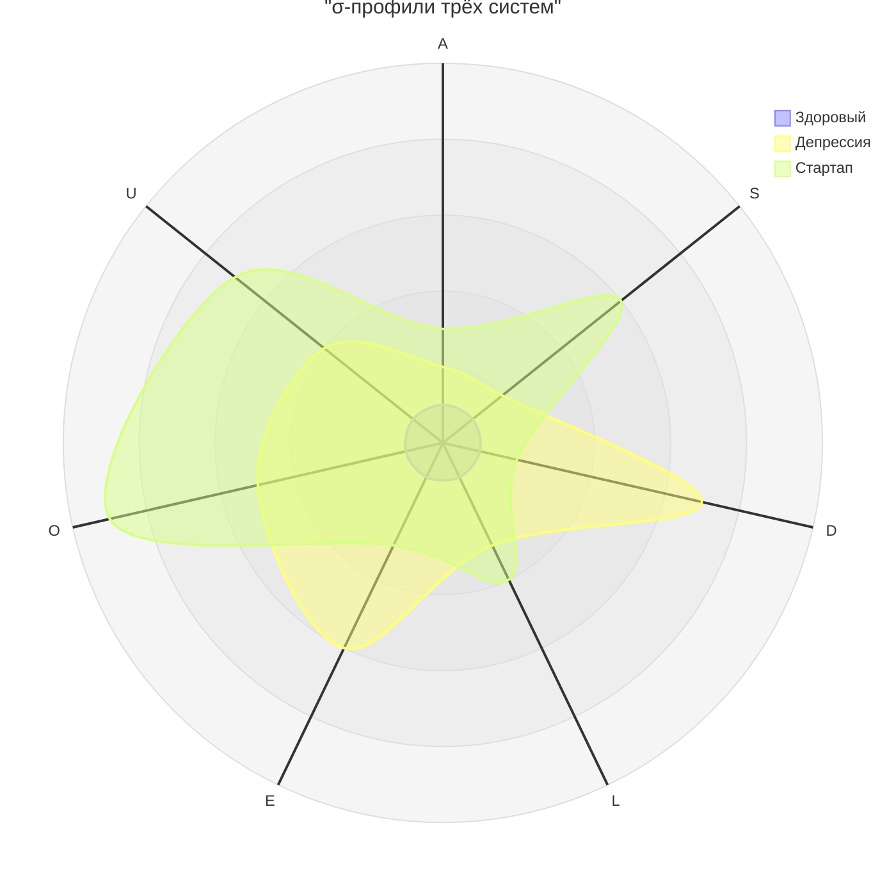

# Упражнения и Задачи

> *«Ничему нельзя научить. Можно лишь помочь обнаружить это внутри себя.»*
> — Галилео Галилей


:::info Для кого эта глава
Задачи для самопроверки по всем главам учебника — от элементарных до исследовательских. Читатель сможет проверить понимание формализма КК на конкретных примерах.
:::

Мы прошли весь путь: от аксиом — через динамику, стабильность и обучение — к философии, сравнению с конкурентами, методологии измерений и междисциплинарному мосту. Теперь пришло время **проверить понимание**.

Теория без практики — мёртвая буква. Этот раздел содержит задачи для самопроверки, организованные по уровням сложности и по главам учебника. Каждая задача снабжена подсказками и ссылками на соответствующие разделы. Решение приведено в свёрнутых блоках — попробуйте сначала решить самостоятельно.

:::note Уровни сложности
- ★ — элементарные (требуют только подстановки в формулу). Школьник справится.
- ★★ — средние (требуют понимания связей между понятиями)
- ★★★ — продвинутые (требуют самостоятельного вывода)
- ★★★★ — исследовательские (открытые вопросы)
:::

:::info Как пользоваться этим разделом
1. Начните с задач вашего уровня (см. рекомендации в конце)
2. Не подглядывайте в решение, пока не попробуете сами
3. Если застряли — прочитайте подсказку, затем соответствующий раздел
4. Задачи ★★★★ не имеют «правильных ответов» — это исследовательские вопросы
:::

---

## 0. Разминка: матрицы 2x2 (для школьников) {#блок-0}

Прежде чем погружаться в $7 \times 7$, давайте разомнёмся на малых матрицах.

### Задача 0.1 ★ Что такое матрица плотности?

Матрица плотности $\rho$ — это матрица, которая: (a) эрмитова ($\rho = \rho^\dagger$), (b) положительно полуопределённая ($\langle v|\rho|v \rangle \geq 0$ для всех $v$), (c) с единичным следом ($\mathrm{Tr}(\rho) = 1$).

Для $2 \times 2$:

$$
\rho = \begin{pmatrix} a & c \\ c^* & 1-a \end{pmatrix}, \quad a \in [0,1], \quad |c|^2 \leq a(1-a)
$$

**(а)** Проверьте, что $\rho_1 = \begin{pmatrix} 0.7 & 0.1 \\ 0.1 & 0.3 \end{pmatrix}$ — матрица плотности.

**(б)** Является ли $\rho_2 = \begin{pmatrix} 0.5 & 0.6 \\ 0.6 & 0.5 \end{pmatrix}$ матрицей плотности?

**(в)** Вычислите чистоту $P = \mathrm{Tr}(\rho_1^2)$.

<details>
<summary>Решение</summary>

**(а)** Проверяем: $\mathrm{Tr} = 0.7 + 0.3 = 1$ (ок). Эрмитовость: $c = c^* = 0.1$ (ок). Положительность: $|c|^2 = 0.01 \leq a(1-a) = 0.7 \times 0.3 = 0.21$ (ок). **Да**, это матрица плотности.

**(б)** $|c|^2 = 0.36$, $a(1-a) = 0.25$. $0.36 > 0.25$ — нарушена положительная полуопределённость. **Нет**, это не матрица плотности. (Собственные значения: $1.1$ и $-0.1$ — отрицательное!)

**(в)** $\rho_1^2 = \begin{pmatrix} 0.7 & 0.1 \\ 0.1 & 0.3 \end{pmatrix}^2 = \begin{pmatrix} 0.50 & 0.10 \\ 0.10 & 0.10 \end{pmatrix}$. $P = \mathrm{Tr}(\rho_1^2) = 0.50 + 0.10 = 0.60$.

Альтернативно: $P = a^2 + (1-a)^2 + 2|c|^2 = 0.49 + 0.09 + 0.02 = 0.60$.

</details>

---

### Задача 0.2 ★ Минимальная и максимальная чистота (2x2)

**(а)** Какова минимальная чистота для $2 \times 2$ матрицы плотности? При каком $\rho$?

**(б)** Какова максимальная? При каком $\rho$?

**(в)** Если бы КК работала для $N=2$ с порогом $P_{\text{crit}} = 2/N$, каков был бы порог?

<details>
<summary>Решение</summary>

**(а)** Минимум при $\rho = I/2 = \begin{pmatrix} 0.5 & 0 \\ 0 & 0.5 \end{pmatrix}$. $P = 0.25 + 0.25 = 0.50 = 1/N = 1/2$.

**(б)** Максимум при чистом состоянии (ранг 1), например $\rho = \begin{pmatrix} 1 & 0 \\ 0 & 0 \end{pmatrix}$. $P = 1$.

**(в)** $P_{\text{crit}} = 2/2 = 1$ — только чистое состояние жизнеспособно! Для $N = 2$ нет «зоны Голдилокс» — система либо идеальна, либо мертва. Это одна из причин, почему $N = 2$ недостаточно для сознания.

</details>

---

### Задача 0.3 ★ Напряжение для 2x2

Определим «напряжение» по аналогии с КК: $\sigma_k = 1 - N \cdot \gamma_{kk}$ для $N=2$.

**(а)** Вычислите $\sigma_1, \sigma_2$ для $\rho_1$ из задачи 0.1.

**(б)** Интерпретируйте: какое «измерение» в дефиците?

<details>
<summary>Решение</summary>

**(а)** $\sigma_1 = 1 - 2 \times 0.7 = -0.4$ (избыток), $\sigma_2 = 1 - 2 \times 0.3 = 0.4$ (дефицит).

**(б)** Измерение 2 в дефиците ($\sigma_2 > 0$): оно получает меньше, чем «справедливую долю» $1/2$. Измерение 1 — в избытке ($\sigma_1 < 0$).

</details>

---

## 1. Матрица когерентности и чистота {#блок-1}

### Задача 1.1 ★ Вычисление чистоты

Дана матрица когерентности в диагональном приближении:

$$
\Gamma = \mathrm{diag}(0.20, 0.18, 0.15, 0.14, 0.13, 0.12, 0.08)
$$

**(а)** Вычислите чистоту $P = \mathrm{Tr}(\Gamma^2)$.

**(б)** Жизнеспособна ли система? Сравните с $P_{\text{crit}} = 2/7$.

**(в)** Вычислите все 7 компонент тензора напряжений $\sigma_k = 1 - 7\gamma_{kk}$.

**(г)** Какое измерение находится в критическом состоянии?

:::tip Подсказка
Для диагональной матрицы $P = \sum_k \gamma_{kk}^2$. **См.:** [Чистота](/docs/core/dynamics/viability#определение-чистоты), [Тензор напряжений](./definitions#тензор-напряжений).
:::

<details>
<summary>Решение</summary>

**(а)** $P = 0.20^2 + 0.18^2 + 0.15^2 + 0.14^2 + 0.13^2 + 0.12^2 + 0.08^2 = 0.04 + 0.0324 + 0.0225 + 0.0196 + 0.0169 + 0.0144 + 0.0064 = 0.1522$

**(б)** $P = 0.1522 < 2/7 \approx 0.286$. Система **нежизнеспособна**.

**(в)** $\sigma_A = 1 - 7 \times 0.20 = -0.40$, $\sigma_S = 1 - 7 \times 0.18 = -0.26$, $\sigma_D = 1 - 7 \times 0.15 = -0.05$, $\sigma_L = 1 - 7 \times 0.14 = 0.02$, $\sigma_E = 1 - 7 \times 0.13 = 0.09$, $\sigma_O = 1 - 7 \times 0.12 = 0.16$, $\sigma_U = 1 - 7 \times 0.08 = 0.44$.

**(г)** $\sigma_U = 0.44$ — максимальное напряжение. Измерение Единства (U) — самое слабое. Но ни одно не превышает 1, поэтому по $\sigma$ система ещё «внутри», хотя по $P$ уже нежизнеспособна. Это связано с тем, что $P < 2/7$ может возникать при умеренных, но *равномерно распределённых* напряжениях.

</details>

---

### Задача 1.2 ★★ Максимальная и минимальная чистота

**(а)** Какова минимальная чистота матрицы $\Gamma \in \mathcal{D}(\mathbb{C}^7)$? При каком $\Gamma$ она достигается?

**(б)** Какова максимальная чистота? При каком $\Gamma$?

**(в)** Покажите, что $P_{\text{crit}} = 2/7$ (`T-5` `[О]`) — это точный **срез структурного большинства** в геометрии Гильберта–Шмидта: используя ортогональное разложение $\Gamma = I/7 + \Delta$ ($\mathrm{Tr}(\Delta) = 0$), докажите, что $P(\Gamma) = \|I/7\|_F^2 + \|\Delta\|_F^2 = 1/7 + \|\Gamma - I/7\|_F^2$, так что $P(\Gamma) > 2/7 \iff \|\Gamma - I/7\|_F^2 > \|I/7\|_F^2 = 1/7$. *(Примечание: состояния с $P \le 2/7$ остаются статистически отличимыми от $I/7$ по критерию Хелстрома `T-109` `[Т]`.)*

:::tip Подсказка
Минимальная чистота достигается при $\Gamma = I/7$ (максимально смешанное состояние). Максимальная — при чистом состоянии (ранг 1). **См.:** [Теорема о критической чистоте](/docs/proofs/dynamics/theorem-purity-critical).
:::

---

### Задача 1.3 ★ Когерентность и фазы

Дана внедиагональная когерентность $\gamma_{AE} = 0.05 \cdot e^{i\pi/3}$.

**(а)** Чему равен модуль $|\gamma_{AE}|$?

**(б)** Чему равна фаза $\theta_{AE}$?

**(в)** Что физически означает ненулевая когерентность между Артикуляцией (A) и Интериорностью (E)?

:::tip Подсказка
**См.:** [Матрица когерентности](/docs/core/dynamics/coherence-matrix), [Определения](./definitions).
:::

<details>
<summary>Решение</summary>

**(а)** $|\gamma_{AE}| = 0.05$.

**(б)** $\theta_{AE} = \pi/3 = 60°$.

**(в)** Ненулевая когерентность A–E означает, что восприятие (A) и самосознание (E) *согласованы*: изменения в восприятии влияют на самосознание и наоборот. Это соответствует интроцептивному восприятию — способности чувствовать своё тело «изнутри». Человек с высоким $|\gamma_{AE}|$ хорошо осознаёт свои телесные ощущения.

</details>

---

### Задача 1.4 ★ Равномерная система

Матрица $\Gamma = I/7$ — максимально смешанное состояние.

**(а)** Вычислите $P$, $\sigma_k$ для всех $k$, $\|\sigma\|_\infty$.

**(б)** Почему система с $\Gamma = I/7$ «мертва», хотя ни одно $\sigma_k$ не превышает 0?

**(в)** Нарисуйте $\sigma$-профиль (7 столбиков) для $\Gamma = I/7$ и для системы из задачи 1.1. Чем они отличаются?

<details>
<summary>Решение</summary>

**(а)** На состоянии $I/7$ чистота $P=7(1/7)^2=1/7$. Диагональный показатель $1-7\gamma_{kk}$ равен нулю для каждой координаты.

**(б)** Диагональный показатель проверяет отклонение населённости от равномерной. Он не обнаруживает низкую чистоту $I/7$ и не заменяет ни полную панель, ни четыре запаса Cap2. Каждая заданная оценка вычисляется отдельно.

**(в)** Для $I/7$: сырой диагональный дефицит $1 - 7\gamma_{kk}$ тождественно равен нулю по всем 7 координатам, тогда как в отдельной семикомпонентной сырой панели из [Определений](./definitions#sigma-sys-formal) (`T-92`, `T-158` `[О]`) имеем $\tilde\sigma_A = \tilde\sigma_S = \tilde\sigma_D = 0$, но $\tilde\sigma_L = 1$, $\tilde\sigma_U = 2$, а при 7D-прокси $D^{7D} = 1 + 6\mathrm{Coh}_E = 13/7$ получаем $\tilde\sigma_E = 36/35 \approx 1.03$. Для задачи 1.1: неравномерный диагональный профиль, указывающий на конкретный секторный дефицит. Контраст показывает, почему плоский диагональный дефицит сам по себе никогда не заменяет вычисления чистоты $P$ и четырёх точных зазоров Cap2.

</details>

---

### Задача 1.5 ★★ Порог через когерентности

Система диагональна с $\gamma_{kk} = 1/7$ для всех $k$, но имеет внедиагональные когерентности $|\gamma_{ij}| = c$ для всех $i \neq j$.

**(а)** Выразите $P$ через $c$.

**(б)** При каком $c$ достигается $P = 2/7$?

**(в)** Интерпретируйте: что означает «набрать чистоту только за счёт когерентностей»?

:::tip Подсказка
$P = \sum_k \gamma_{kk}^2 + \sum_{i \neq j} |\gamma_{ij}|^2 = 7 \times (1/7)^2 + 42 \times c^2 = 1/7 + 42c^2$.
:::

<details>
<summary>Решение</summary>

**(а)** $P = 1/7 + 42c^2$.

**(б)** $2/7 = 1/7 + 42c^2 \Rightarrow c^2 = 1/(7 \times 42) = 1/294 \Rightarrow c = 1/\sqrt{294} \approx 0.0583$. Проверим положительную полуопределённость: выбор вещественных положительных $\gamma_{ij} = c$ для всех $i \neq j$ даёт $\Gamma = (1/7 - c)I + c\,\mathbf{1}\mathbf{1}^T$ с собственными значениями $1/7 + 6c \approx 0.4928$ (кратность 1) и $1/7 - c \approx 0.0845 > 0$ (кратность 6), так что $\Gamma$ — строго положительно определённая матрица плотности!

**(в)** Система с равномерной диагональю, но с когерентностями $c \approx 0.058$ — «жизнеспособна за счёт связей». Каждое измерение по отдельности ничем не выделяется ($\gamma_{kk} = 1/7$), но *координация* между ними ($|\gamma_{ij}| > 0$) создаёт организованность. Это аналог организации, где каждый отдел средний, но командная работа — превосходная.

</details>

---

## 2. Динамика и эволюция {#блок-2}

### Задача 2.1 ★★ Линдбладова диссипация

Рассмотрим одномерную (игрушечную) модель: $\Gamma = \begin{pmatrix} p & c \\ c^* & 1-p \end{pmatrix}$ с диссипатором $\mathcal{D}[\Gamma] = -\gamma(p - 1/2, c, c^*, 1/2 - p)$.

**(а)** К какому состоянию стремится $\Gamma$ при $\tau \to \infty$?

**(б)** Вычислите чистоту $P(\tau)$ и покажите, что она монотонно убывает.

**(в)** Свяжите это с тезисом КК: «без регенерации система умирает».

<details>
<summary>Решение</summary>

**(а)** $\dot{p} = -\gamma(p - 1/2)$, $\dot{c} = -\gamma c$. Решения: $p(\tau) = 1/2 + (p_0 - 1/2)e^{-\gamma\tau}$, $c(\tau) = c_0 e^{-\gamma\tau}$. При $\tau \to \infty$: $\Gamma \to I/2$ — максимально смешанное состояние.

**(б)** $P = p^2 + (1-p)^2 + 2|c|^2 = 2(p - 1/2)^2 + 1/2 + 2|c|^2$. Подставляя: $P(\tau) = 2(p_0 - 1/2)^2 e^{-2\gamma\tau} + 1/2 + 2|c_0|^2 e^{-2\gamma\tau}$. $dP/d\tau = -4\gamma[(p_0 - 1/2)^2 + |c_0|^2]e^{-2\gamma\tau} < 0$. Чистота **монотонно убывает**.

**(в)** Без регенерации ($\mathcal{R} = 0$) чистота всегда падает. Для $N=2$: $P \to 1/2$. Для $N=7$: $P \to 1/7$. Система деградирует до максимального хаоса. Регенерация $\mathcal{R}$ — единственное, что может противостоять этой деградации.

</details>

---

### Задача 2.2 ★★★ Регенерация как спасение

К системе из задачи 2.1 добавлен регенеративный член:

$$
\mathcal{R}[\Gamma] = \kappa \cdot (\rho_* - \Gamma)
$$

где $\rho_* = \begin{pmatrix} 0.7 & 0.2 \\ 0.2 & 0.3 \end{pmatrix}$ — целевое состояние, $\kappa > 0$.

**(а)** Найдите стационарное состояние $\Gamma_{\infty}$ полной динамики $\dot{\Gamma} = \mathcal{D}[\Gamma] + \mathcal{R}[\Gamma]$.

**(б)** При каком $\kappa$ чистота стационарного состояния $P(\Gamma_\infty) > 2/7$?

**(в)** Интерпретируйте результат: что происходит при «слабой» ($\kappa \ll \gamma$) и «сильной» ($\kappa \gg \gamma$) регенерации?

<details>
<summary>Решение</summary>

**(а)** $\dot{\Gamma} = 0$: $-\gamma(\Gamma - I/2) + \kappa(\rho_* - \Gamma) = 0$. $(\gamma + \kappa)\Gamma = \gamma \cdot I/2 + \kappa \cdot \rho_*$. $\Gamma_\infty = \frac{\gamma \cdot I/2 + \kappa \cdot \rho_*}{\gamma + \kappa}$.

$p_\infty = \frac{\gamma/2 + 0.7\kappa}{\gamma + \kappa}$, $c_\infty = \frac{0.2\kappa}{\gamma + \kappa}$.

**(б)** $P(\Gamma_\infty) = 2(p_\infty - 1/2)^2 + 1/2 + 2|c_\infty|^2$. Прежде всего заметим, что **любая** $2 \times 2$ матрица плотности удовлетворяет $P \geq 1/2 > 2/7 \approx 0.286$, поэтому $P(\Gamma_\infty) > 2/7$ выполняется при любых $\kappa, \gamma \geq 0$! (При этом $N=2$-аналог $2/N$ дал бы $P_{\text{crit}} = 2/2 = 1$, требуя чистого состояния.) Используя ортогональное разложение $\Gamma_\infty - I/2 = \frac{r}{1+r}(\rho_* - I/2)$ с $r = \kappa/\gamma$ и $P(\rho_*) = 0.7^2 + 0.3^2 + 2(0.2)^2 = 0.66$, получаем точную квадратичную формулу $P(\Gamma_\infty) = 0.5 + 0.16\left(\frac{r}{1+r}\right)^2$.

Проверка значений: при $r = 1$: $p_\infty = 0.6$, $c_\infty = 0.1$, $P = 0.5 + 0.16(0.25) = 0.5400$. При $r = 0.1$: $p_\infty = 0.57/1.1 \approx 0.5182$, $c_\infty = 0.02/1.1 \approx 0.0182$, $P = 0.5 + 0.16/121 \approx 0.5013$.

**(в)** При $\kappa \ll \gamma$ (слабая регенерация): $\Gamma_\infty \approx I/2$ — диссипация побеждает, система стремится к максимально смешанному состоянию. При $\kappa \gg \gamma$ (сильная регенерация): $\Gamma_\infty \approx \rho_*$ — регенерация побеждает, система приближается к целевому состоянию.

</details>

---

### Задача 2.3 ★★ Время жизни

Система начинает с $P(0) = 0.35 > P_{\text{crit}}$. Регенерация отключена ($\kappa = 0$). Чистота экспоненциально затухает к $1/7$: $P(\tau) = 1/7 + (P(0) - 1/7) \cdot e^{-\gamma \tau}$.

**(а)** Найдите время $\tau_*$, при котором $P(\tau_*) = P_{\text{crit}} = 2/7$.

**(б)** Для $\gamma = 0.1$ вычислите $\tau_*$ численно.

**(в)** Как связан этот результат с понятием «время жизни» системы? **См.:** [Стабильность](./stability#время-жизни).

<details>
<summary>Решение</summary>

**(а)** $2/7 = 1/7 + (0.35 - 1/7)e^{-\gamma\tau_*}$. Поскольку $0.35 - 1/7 = 7/20 - 1/7 = 29/140 \approx 0.2071$, получаем $e^{-\gamma\tau_*} = (1/7)/(29/140) = 20/29 \approx 0.6897$, откуда $\tau_* = \ln(29/20)/\gamma \approx 0.3716/\gamma$.

**(б)** $\tau_* \approx 0.3716/0.1 \approx 3.72$ единиц времени.

**(в)** $\tau_*$ — время, за которое система опускается ниже $P_{\text{crit}} = 2/7$ (`T-5` `[О]`) при отсутствии регенерации. Большая начальная чистота и меньшая диссипация увеличивают этот горизонт, а достаточная регенерация ($\kappa > 0$) способна удерживать $P > 2/7$ сколь угодно долго.

</details>

---

### Задача 2.4 ★★ Баланс диссипации и регенерации (квадратичная чистота!)

Рассмотрим 7-мерный линейный баланс $\dot{\Gamma} = -\gamma(\Gamma - I/7) + \kappa(\rho_* - \Gamma)$ при постоянных скоростях $\gamma, \kappa > 0$ и целевом состоянии плотности $\rho_* \in \mathcal{D}(\mathbb{C}^7)$.

**(а)** Найдите стационарное состояние $\Gamma_\infty = (1 - \lambda)\frac{I}{7} + \lambda\rho_*$, где $\lambda = \frac{\kappa}{\kappa + \gamma}$, и **докажите**, что его чистота зависит от $\lambda$ **квадратично** (строго выпукло), а НЕ линейно:

$$
P(\Gamma_\infty) = \frac{1}{7} + \left(\frac{\kappa}{\kappa + \gamma}\right)^2 \left(P(\rho_*) - \frac{1}{7}\right)
$$

**(б)** Если $P(\rho_*) = 0.5$, при каком точном отношении $r = \kappa/\gamma$ достигается срез структурного большинства $P(\Gamma_\infty) = 2/7$? *(Сравните с тем, что ошибочно дало бы наивное линейное усреднение чистот!)*

**(в)** Интерпретируйте: какие реальные системы соответствуют $\kappa/\gamma \ll 1$, а какие — $\kappa/\gamma \gg 1$?

<details>
<summary>Решение</summary>

**(а)** Приравнивая $\dot{\Gamma} = 0$, получаем $(\gamma + \kappa)\Gamma_\infty = \gamma(I/7) + \kappa\rho_*$, то есть $\Gamma_\infty = (1 - \lambda)\frac{I}{7} + \lambda\rho_*$ с $\lambda = \frac{\kappa}{\kappa + \gamma}$. Записывая $\Gamma_\infty - \frac{I}{7} = \lambda\!\left(\rho_* - \frac{I}{7}\right)$ и пользуясь точной ортогональностью $\mathrm{Tr}\!\left(\frac{I}{7}(\rho_* - \frac{I}{7})\right) = \frac{1}{7}(1 - 1) = 0$:

$$
P(\Gamma_\infty) = \left\|\frac{I}{7}\right\|_F^2 + \left\|\Gamma_\infty - \frac{I}{7}\right\|_F^2 = \frac{1}{7} + \lambda^2 \left\|\rho_* - \frac{I}{7}\right\|_F^2 = \frac{1}{7} + \left(\frac{\kappa}{\kappa + \gamma}\right)^2 \left(P(\rho_*) - \frac{1}{7}\right).
$$

Поскольку $P(\rho) = \mathrm{Tr}(\rho^2)$ строго выпукла (квадратична), для любых $\lambda \in (0,1)$ и $\rho_1 \neq \rho_2$ выполняется $P((1-\lambda)\rho_1 + \lambda\rho_2) < (1-\lambda)P(\rho_1) + \lambda P(\rho_2)$.

**(б)** Подставим $P(\rho_*) = 1/2$ и $P(\Gamma_\infty) = 2/7$:

$$
\frac{2}{7} - \frac{1}{7} = \lambda^2 \left(\frac{1}{2} - \frac{1}{7}\right) \;\Longrightarrow\; \frac{1}{7} = \lambda^2 \cdot \frac{5}{14} \;\Longrightarrow\; \lambda^2 = \frac{2}{5} \;\Longrightarrow\; \lambda = \sqrt{\frac{2}{5}} \approx 0.6325.
$$

Разрешая $\lambda = \frac{r}{1 + r}$ относительно $r = \kappa/\gamma$:

$$
r = \frac{\lambda}{1 - \lambda} = \frac{\sqrt{2}}{\sqrt{5} - \sqrt{2}} = \frac{\sqrt{10} + 2}{3} \approx 1.721.
$$

*(Для сравнения: ошибочное линейное усреднение чистот $\lambda(1/2) + (1-\lambda)(1/7) = 2/7$ дало бы $\lambda = 2/5$, $r = 2/3 \approx 0.667$, но при таком $r$ истинная чистота равна лишь $1/7 + (2/5)^2(5/14) = 0.200 < 2/7$! Выпуклость делает удержание чистоты заметно труднее, чем подсказывает линейная интуиция.)*

**(в)** $\kappa/\gamma \ll 1$: доминирует диссипация — быстрая деградация к $I/7$ (аналог старения без репарации). $\kappa/\gamma \gg 1$: доминирует регенерация — состояние плотно удерживается возле $\rho_*$ (аналог организмов с выраженной регенерацией тканей, таких как *Hydra* или *Turritopsis dohrnii*).

</details>

---

## 3. Тензор напряжений и диагностика {#блок-3}

### Задача 3.1 ★ Интерпретация профиля напряжений

Две организации имеют следующие профили напряжений:

**Организация X:** $\sigma = [0.2, 0.3, 0.1, 0.2, 0.8, 0.3, 0.4]$

**Организация Y:** $\sigma = [0.5, 0.5, 0.5, 0.5, 0.5, 0.5, 0.5]$

**(а)** Какая организация в более опасном положении? Почему?

**(б)** Какой тип вмешательства нужен каждой?

**(в)** Какой паттерн отказа угрожает организации X? **См.:** [Диагностика](./diagnostics#паттерны-отказов)

<details>
<summary>Решение</summary>

**(а)** Организация X: $\|\sigma\|_\infty = 0.8$ (E: Интериорность). Организация Y: $\|\sigma\|_\infty = 0.5$ (все равны). По $\|\sigma\|_\infty$ — X опаснее (0.8 > 0.5). Но Y имеет *суммарное* напряжение $\sum \sigma_k = 3.5$ > X: $\sum = 2.3$. X — острая проблема в одном месте (пик E). Y — хронически ослабленная система «по всем фронтам».

**(б)** X: **точечное вмешательство** — усилить рефлексию и обратную связь ($\sigma_E = 0.8$ — почти критическое). Y: **системное вмешательство** — общая реорганизация, потому что ни одно измерение не в норме.

**(в)** X рискует попасть в **спираль смерти**: $\sigma_E = 0.8 \to \mathrm{Coh}_E \downarrow \to \kappa \downarrow \to P \downarrow \to$ все $\sigma_k$ растут. Один дефицит запускает каскад.

</details>

---

### Задача 3.2 ★★ Спираль смерти

Покажите, что каскад $\sigma_E \uparrow \to \sigma_O \uparrow \to \sigma_U \uparrow$ (спираль смерти) следует из формул КК:

1. $\sigma_E \uparrow$ → $\mathrm{Coh}_E \downarrow$
2. $\mathrm{Coh}_E \downarrow$ → $\kappa \downarrow$ (через формулу $\kappa = \kappa_{\text{bootstrap}} + \kappa_0 \cdot \mathrm{Coh}_E$)
3. $\kappa \downarrow$ → $P \downarrow$
4. $P \downarrow$ → $\sigma_O \uparrow$, $\sigma_U \uparrow$

**См.:** [Стабильность](./stability#спираль-смерти), [Связь регенерации и E-когерентности](./axiomatics#связь-регенерации-и-e-когерентности)

---

### Задача 3.3 ★★ Согласованность следа: почему не всякий σ-профиль задаёт диагональные дефициты

Предположим, вам передан строго положительный вектор оценок $\sigma = [0.3, 0.1, 0.4, 0.2, 0.6, 0.3, 0.5]$, и кто-то пытается обратить формулу диагонального дефицита $\tilde\sigma_k = 1 - 7\gamma_{kk}$.

**(а)** Вычислите кандидатные числа $g_k = (1 - \sigma_k)/7$ и проверьте их сумму $\sum_{k=1}^7 g_k$.

**(б)** Объясните математически, почему $\sigma$ **не может** быть вектором сырых диагональных дефицитов $1 - 7\gamma_{kk}$ ни для какой допустимой матрицы плотности $\Gamma \in \mathcal{D}(\mathbb{C}^7)$. *(Частое заблуждение, которого следует избегать: могут ли внедиагональные элементы исправить неверный след?)*

**(в)** Если $1 - \sigma_k$ вместо этого выражают ненормированные относительные веса секторов, перенормируйте $\gamma_{kk} = g_k / \sum_j g_j$ и вычислите $P_{\text{diag}} = \sum_k \gamma_{kk}^2$.

<details>
<summary>Решение</summary>

**(а)** $g_k = (1 - \sigma_k)/7 = (0.100, 0.129, 0.086, 0.114, 0.057, 0.100, 0.071)$. Их сумма равна $\sum_{k=1}^7 g_k = 4.6/7 \approx 0.657 \neq 1$.

**(б)** Для **любой** матрицы плотности $\Gamma$ справедливо $\mathrm{Tr}(\Gamma) = \sum_{k=1}^7 \gamma_{kk} = 1$, поэтому сырые знаковые диагональные дефициты $\tilde\sigma_k = 1 - 7\gamma_{kk}$ **обязаны** удовлетворять точному тождеству нулевой суммы $\sum_{k=1}^7 \tilde\sigma_k = 7 - 7\sum_k \gamma_{kk} = 0$. Внедиагональные элементы $\gamma_{ij}$ ($i \neq j$) **никогда** не входят в след! Следовательно, полностью положительный вектор $\sigma$ не может быть вектором сырых диагональных дефицитов $1 - 7\gamma_{kk}$; он может представлять лишь неотрицательные усечённые оценки панели или баллы опросника, требующие явного калиброванного закона наблюдений (`T-92`, `T-158` `[О]`).

**(в)** Перенормировка $g_k$ на $\sum_j g_j = 4.6/7$ даёт допустимые диагональные населённости $\gamma = (0.1522, 0.1957, 0.1304, 0.1739, 0.0870, 0.1522, 0.1087)$ с $\sum_k \gamma_{kk} = 1$. Их диагональная чистота равна $P_{\text{diag}} = \sum_k \gamma_{kk}^2 \approx 0.1512 < 2/7 \approx 0.286$ (нежизнеспособна без существенных внедиагональных когерентностей).

</details>

---

### Задача 3.4 ★ Визуализация: σ-диаграмма

Нарисуйте σ-профиль (лепестковую диаграмму / radar chart) для следующих систем:

**(а)** Здоровый человек: $\sigma = [0.1, 0.1, 0.1, 0.1, 0.1, 0.1, 0.1]$

**(б)** Пациент с депрессией: $\sigma = [0.2, 0.2, 0.7, 0.3, 0.6, 0.5, 0.4]$

**(в)** Стартап на грани банкротства: $\sigma = [0.3, 0.6, 0.2, 0.4, 0.3, 0.9, 0.7]$



**(г)** Какой профиль наиболее «острый» (один пик)? Какой наиболее «круглый» (равномерный)?

<details>
<summary>Решение</summary>

**(г)** Стартап — наиболее «острый» (пик O = 0.9: дефицит финансов). Здоровый — наиболее «круглый» (все по 0.1). Депрессия — промежуточная, с двумя выраженными пиками (D = 0.7 и E = 0.6).

</details>

---

## 4. Сознание и самонаблюдение {#блок-4}

### Задача 4.1 ★★ Пороговый тройной замок

Система имеет следующие параметры: $P = 0.45$, $\Phi = 1.5$.

**(а)** Вычислите каноническую рефлексию $R = 1/(7P)$.

**(б)** Удовлетворены ли все три условия сознательности ($P > 2/7$, $R \geq 1/3$, $\Phi \geq 1$)?

**(в)** Какое условие нарушено и что это означает интерпретативно?

**(г)** Приведите пример реальной системы с таким профилем.

<details>
<summary>Решение</summary>

**(а)** $R = 1/(7 \times 0.45) \approx 0.317$.

**(б)** $P = 0.45 > 2/7 \approx 0.286$ (ок), $R = 0.317 < 1/3 \approx 0.333$ (**не ок**), $\Phi = 1.5 \geq 1$ (ок). **Нет**, не все условия выполнены.

**(в)** $R < 1/3$ — недостаток рефлексии. Заметьте, *почему*: $P = 0.45$ превышает потолок Златовласки $3/7 \approx 0.429$, а по каноническому тождеству $R = 1/(7P)$ условие $R \geq 1/3$ эквивалентно $P \leq 3/7$. Система жизнеспособна и интегрирована, но **пере-упорядочена**: слишком мало термального запаса для адаптивного самомоделирования — режим жёсткой кристаллизации, отказ с противоположной хаосу стороны.

**(г)** Гипер-ригидная система: перетренированный автомат, исполняющий одну застывшую рутину, или организм в глубоком оцепенении с сохранённой структурой — организован (высокое $P$), интегрирован ($\Phi > 1$), но неспособен к гибкому самомоделированию. (Сравните с задачей 4.3, где отказы приходят с противоположной, хаотической стороны.)

</details>

---

### Задача 4.2 ★★★ Критический аудит: прежняя формула затухания SAD и её ретракция

В более ранней версии УГМ числовой показатель «глубины самосознания» (SAD) задавался лестницей затухания:

$$
P_{\text{crit}}^{(n)} = P_{\text{crit}} \cdot \frac{3^{n-1}}{n+1}, \qquad P_{\text{crit}} = \frac{2}{7}.
$$

**(а)** Вычислите $P_{\text{crit}}^{(1)}, P_{\text{crit}}^{(2)}, P_{\text{crit}}^{(3)}, P_{\text{crit}}^{(4)}$ и проверьте, что $P_{\text{crit}}^{(4)} > 1$.

**(б)** Объясните, почему $P(\Gamma) = \mathrm{Tr}(\Gamma^2) \leq 1$ для любой матрицы плотности $\Gamma$, так что эта *конкретная* последовательность затухания автоматически обрывается на $n = 3$.

**(в)** **Критический аудит:** Почему универсальная эквивалентность SAD и уровней (`T-136` `[✗]`) и универсальный потолок глубины $\mathrm{SAD}_{\max} = 3$ (`T-217` `[✗]`) были сняты, и что заменяет их для уровня L3 в актуальной КК?

**См.:** [Башня глубины](/docs/consciousness/hierarchy/depth-tower#критическая-чистота-sad), [Определения](./definitions#иерархия-интериорности)

<details>
<summary>Решение</summary>

**(а)** При $P_{\text{crit}} = 2/7 \approx 0.286$:
- $P_{\text{crit}}^{(1)} = (2/7) \cdot 1/2 = 1/7 \approx 0.143$
- $P_{\text{crit}}^{(2)} = (2/7) \cdot 3/3 = 2/7 \approx 0.286$
- $P_{\text{crit}}^{(3)} = (2/7) \cdot 9/4 = 9/14 \approx 0.643$
- $P_{\text{crit}}^{(4)} = (2/7) \cdot 27/5 = 54/35 \approx 1.543 > 1$.

**(б)** Любая матрица плотности имеет собственные значения $\lambda_i \in [0,1]$ с суммой 1, откуда $P(\Gamma) = \sum_i \lambda_i^2 \leq \sum_i \lambda_i = 1$. Поэтому ни одно состояние не может удовлетворять $P > 54/35$.

**(в)** Арифметическое неравенство $54/35 > 1$ является исключительно свойством *выбранной* формулы затухания (`T-150` `[О]` отмечает, что $\varphi^n \circ \varphi^m = \varphi^{n+m}$ — свойство итерации отображения, а не вывод когнитивной глубины). Поскольку смена выбранного числового закона затухания меняет порог отсечения, универсальная эквивалентность SAD и уровней (`T-136`) и универсальный потолок $\mathrm{SAD}_{\max} = 3$ (`T-217`) были **сняты `[✗]`**. В актуальной КК уровень L3 определяется через $\mathrm{Cap}_2$ плюс **независимый предиктивный сертификат метамодели с калиброванными непостоянными зондами `[О]`**.

</details>

---

### Задача 4.3 ★★ Мера сознательности C

Три системы (каноническая рефлексия $R = 1/(7P)$ определяется чистотой; дифференциация $D_{\text{diff}}$ дана):

| Система | $P$ | $\Phi$ | $D_{\text{diff}}$ |
|---------|-----|--------|-------------------|
| Бактерия | 0.20 | 0.3 | 1.2 |
| Кошка | 0.32 | 1.1 | 1.8 |
| Человек | 0.35 | 1.3 | 2.6 |

**(а)** Для каждой: вычислите $R = 1/(7P)$ и проверьте четыре порога ($P > 2/7$, $R \geq 1/3$, $\Phi \geq 1$, $D_{\text{diff}} \geq 2$).

**(б)** Вычислите $C = \Phi \times R$ для каждой.

**(в)** Какие системы «сознательны» (все четыре порога выполнены)?

**(г)** Проверьте, что данные согласованы с определениями: покажите, что у любого состояния $7 \times 7$ выполняется $\Phi \leq 7P - 1$.

<details>
<summary>Решение</summary>

**(а)** Бактерия: $R = 1/(7 \times 0.20) \approx 0.71$. $P = 0.20 < 2/7$ (нет), $R = 0.71 \geq 1/3$ (да — большой термальный запас, но нет жизнеспособности, чтобы им воспользоваться), $\Phi = 0.3 < 1$ (нет), $D_{\text{diff}} = 1.2 < 2$ (нет). 1 из 4.
Кошка: $R = 1/(7 \times 0.32) \approx 0.45$. $P = 0.32 > 2/7$ (да), $R = 0.45 \geq 1/3$ (да), $\Phi = 1.1 \geq 1$ (да), $D_{\text{diff}} = 1.8 < 2$ (**нет!**). 3 из 4.
Человек: $R = 1/(7 \times 0.35) \approx 0.41$. $P$ (да), $R$ (да), $\Phi = 1.3$ (да), $D_{\text{diff}} = 2.6 \geq 2$ (да). 4 из 4.

**(б)** Бактерия: $C = 0.3 \times 0.714 \approx 0.21$. Кошка: $C = 1.1 \times 0.446 \approx 0.49$. Человек: $C = 1.3 \times 0.408 \approx 0.53$.

**(в)** Только **человек** удовлетворяет все четыре порога. Кошка «почти» — ей на волосок не хватает дифференциации ($D_{\text{diff}} = 1.8$ вместо нужных $2$): её репертуар опыта чуть беднее, чем нужно для устойчивого сравнения квалиа. Это согласуется с тем, что кошки демонстрируют *ограниченную* метакогницию. Заметьте также, что $C$ сама по себе вопроса не решает: у кошки $C \approx 0.49$ близко к человеческим $0.53$, но четырёхусловный предикат их разделяет — пороги образуют конъюнкцию, а не балл.

**(г)** $\Phi = P/\sum_i \gamma_{ii}^2 - 1$, а $\sum_i \gamma_{ii}^2 \geq (\sum_i \gamma_{ii})^2/7 = 1/7$ по неравенству Коши–Буняковского, поэтому $\Phi \leq 7P - 1$; внутри окна сознания $P \leq 3/7$ это даёт $\Phi \leq 2$. Данные проходят: бактерия $0.3 \leq 0.40$, кошка $1.1 \leq 1.24$, человек $1.3 \leq 1.45$. Граница достигается: у $\Gamma = \lambda \lvert u\rangle\langle u\rvert + (1 - \lambda)\, I/7$ с $u = (1, \ldots, 1)/\sqrt7$ диагональ плоская, $P = (1 + 6\lambda^2)/7$ и $\Phi = 6\lambda^2 = 7P - 1$; при $\lambda = 1/2$ получаем $P = 5/14 \approx 0.357$, $\Phi = 3/2$, $R = 2/5$, $C = 3/5$.

</details>

---

### Задача 4.4 ★★ Зона Голдилокс

Зона Голдилокс: $P \in (2/7, 3/7]$ ([T-124](./phase-diagram-cc)).

**(а)** Вычислите границы: $2/7 \approx ?$, $3/7 \approx ?$.

**(б)** Какова «ширина» зоны: $\Delta P = 3/7 - 2/7$?

**(в)** Если $P = 0.45 > 3/7 \approx 0.429$ — система «слишком организована». Что это означает? Приведите пример.

<details>
<summary>Решение</summary>

**(а)** $2/7 \approx 0.286$, $3/7 \approx 0.429$.

**(б)** $\Delta P = 1/7 \approx 0.143$ — довольно узкое окно!

**(в)** $P > 3/7$ — ригидность. Система слишком упорядочена: не может адаптироваться к изменениям. Пример: авторитарная организация с жёсткой иерархией. Или: обсессивно-компульсивное расстройство (чрезмерная упорядоченность мышления). Или: переобученная нейросеть (overfitting — модель «запомнила» обучающие данные и не обобщает).

</details>

---

## 5. Философия и сравнение теорий {#блок-5}

### Задача 5.1 ★★ Аргумент зомби и область применимости Теоремы 8.1

Философский зомби — существо, функционально идентичное человеку во всём, кроме субъективного опыта.

**(а)** Почему утверждение о **безусловной** невозможности зомби (`T-38a` `[✗]`) было снято, и при каких явно заданных замкнутых гипотезах баланса потока чистоты [Теорема 8.1](./theorems#теорема-81-условная-необходимость-интериорности-no-zombie) (`[С]`) всё же гарантирует положительную нижнюю границу на $\mathrm{Coh}_E(\Gamma)$?

**(б)** Сравните этот условный динамический результат с позицией IIT в отношении зомби.

**(в)** Почему отделение математических оценок (`[С]`) от феноменологического приписывания (`[И]`) делает теорию научно сильнее, чем безусловная претензия на теорему?

**См.:** [Философские основания](./philosophy#hard-problem), [Теоремы](./theorems#теорема-81-условная-необходимость-интериорности-no-zombie)

---

### Задача 5.2 ★★ ИИ и сознание

**(а)** Может ли современная языковая модель (GPT-4, Claude) быть сознательной по критериям КК?

**(б)** Какие из четырёх условий ($P > 2/7$, $R \geq 1/3$, $\Phi \geq 1$, $D_{\text{diff}} \geq 2$) она может удовлетворять? Какие — принципиально нет?

**(в)** Что нужно изменить в архитектуре, чтобы приблизить ИИ к порогу сознательности? **См.:** [Области применения](./applications).

---

### Задача 5.3 ★★ IIT vs КК

**(а)** Назовите три ключевых различия между IIT и КК.

**(б)** В каком смысле КК «включает» IIT как частный случай?

**(в)** Что IIT делает лучше КК?

**См.:** [Сравнение с альтернативными теориями](./comparison#iit)

---

### Задача 5.4 ★★★ Панпсихизм vs КК

**(а)** Сформулируйте ключевое отличие КК от панпсихизма в одном предложении.

**(б)** Что такое «проблема комбинирования», и избегает ли её КК?

**(в)** При каких условиях КК *стала бы* панпсихизмом? (Что нужно изменить в аксиомах?)

**См.:** [Философские основания](./philosophy#онтология)

<details>
<summary>Решение</summary>

**(а)** КК — пороговый взгляд, а не безграничный панпсихизм: у каждой системы есть интериорность (L0), которая опытом не является, а опыт (L2) приписывается только за четырьмя порогами ($P > 2/7$, $R \geq 1/3$, $\Phi \geq 1$, $D_{\text{diff}} \geq 2$) — камень *не* обладает опытом. В словаре поля это конститутивный панпротопсихизм с порогом осознания [И] ([анализ панпсихизма](/docs/consciousness/comparative/panpsychism-analysis#место-панинтериоризма)).

**(б)** Проблема комбинирования: если каждый атом имеет микроопыт, как микроопыты складываются в макроопыт? КК её не избегает, а переформулирует: микроопытов нет, но есть универсальная протофеноменальная интериорность (L0), поэтому вопрос становится таким: как структура L0 конституирует опыт L2? Пороги отвечают, *когда* система — субъект, а не *как* [И].

**(в)** Если бы порог был $P > 0$ (а не $P > 2/7$) и $R > 0$, $\Phi > 0$ — любая система с ненулевыми параметрами была бы «чуть-чуть сознательной». Это и есть панпсихизм. КК избегает этого, устанавливая *конечные* пороги.

</details>

---

## 6. Междисциплинарные задачи {#блок-6}

### Задача 6.1 ★★ Физик читает организационный аудит

Используя [таблицу перевода](./interdisciplinary#таблица-перевода), переформулируйте следующий организационный диагноз на языке физики:

> «Компания страдает от плохой межотдельной координации (сотрудники не знают, что делают соседние отделы), при этом каждый отдел в отдельности работает эффективно.»

**(а)** Какие элементы $\Gamma$ затронуты (диагональные или внедиагональные)?

**(б)** Как это влияет на $P$ и $\Phi$?

**(в)** Какой физический аналог вы бы предложили?

<details>
<summary>Решение</summary>

**(а)** Внедиагональные: $|\gamma_{ij}| \to 0$ при нормальных $\gamma_{kk}$. Каждый «отдел» (измерение) имеет достаточный ресурс, но *связи* между ними отсутствуют.

**(б)** $P$ снижается (меньше когерентностей → меньше $\sum|\gamma_{ij}|^2$). $\Phi$ снижается сильно (спектральный зазор падает при разрыве связей).

**(в)** Физический аналог: набор невзаимодействующих спинов. Каждый спин имеет ненулевую поляризацию (аналог $\gamma_{kk}$), но корреляции между спинами отсутствуют ($\gamma_{ij} = 0$). Это *сепарабельное* состояние — аналог «силосов» в организации.

</details>

---

### Задача 6.2 ★★★ Биолог моделирует иммунитет

Иммунная система клетки: антиген вошёл → распознан (A) → структурирован ответ (S) → запущена динамика (D) → верифицирована логика ответа (L) → опыт интегрирован (E) → ресурсы мобилизованы (O) → ответ координирован (U).

**(а)** Опишите этот процесс как траекторию в пространстве $\sigma_k$: какие компоненты напряжений растут и падают?

**(б)** Что происходит при аутоиммунном заболевании (ошибка в L)?

**(в)** Как конститутивная гипотеза КК F10 (`[Г]`: $\kappa = \kappa_{\mathrm{bootstrap}} + \kappa_0\,\mathrm{Coh}_E$) моделирует связь между хроническим стрессом ($\sigma_E \uparrow$) и ослаблением восстановления ($\kappa \downarrow$)?

---

### Задача 6.3 ★★ Психолог интерпретирует σ-профиль

Пациент пришёл с жалобами на «ощущение, что жизнь рассыпается». Психометрия даёт: σ-профиль = [0.3, 0.6, 0.4, 0.3, 0.5, 0.4, 0.8].

**(а)** Какие два измерения наиболее нагружены?

**(б)** Что они означают на психологическом языке?

**(в)** Какую терапевтическую стратегию предлагает КК?

**(г)** Проверьте: «рассыпается» — подходящее слово? К какому измерению оно относится?

<details>
<summary>Решение</summary>

**(а)** $\sigma_U = 0.8$ (Единство) и $\sigma_S = 0.6$ (Структура).

**(б)** $\sigma_U = 0.8$: социальная изоляция, потеря чувства принадлежности, «я один(а) в мире». $\sigma_S = 0.6$: когнитивная дезорганизация — мысли не складываются в связную картину, трудно планировать.

**(в)** КК-стратегия: приоритет — $\sigma_U$ (самое высокое). Восстановить социальные связи (групповая терапия, поддерживающее сообщество). Затем — $\sigma_S$ (когнитивная структуризация: КПТ, планирование, рутины).

**(г)** «Рассыпается» — метафора потери U (единства) и S (структуры). Пациент интуитивно описывает свой σ-профиль! Слово точно соответствует двум наиболее нагруженным измерениям.

</details>

---

### Задача 6.4 ★★ Инженер проектирует ИИ-агента

Вы проектируете ИИ-агента с 7 модулями. Текущие характеристики:

| Модуль | Функция | Текущий $\gamma_{kk}$ |
|--------|---------|----------------------|
| Perception (A) | Обработка входа | 0.18 |
| Memory (S) | Хранение состояний | 0.16 |
| Action (D) | Генерация действий | 0.15 |
| Reasoning (L) | Логический вывод | 0.14 |
| Self-Monitor (E) | Мониторинг состояния | 0.08 |
| Resource Mgr (O) | Управление ресурсами | 0.15 |
| Integration (U) | Кросс-модульная шина | 0.14 |

**(а)** Вычислите σ-профиль и найдите слабейший модуль.

**(б)** Вычислите $P$ (диагональное приближение).

**(в)** Что нужно усилить для достижения $P > 2/7$?

<details>
<summary>Решение</summary>

**(а)** $\sigma = [1-7(0.18), \ldots] = [-0.26, -0.12, -0.05, 0.02, 0.44, -0.05, 0.02]$. Слабейший: E (Self-Monitor), $\sigma_E = 0.44$.

**(б)** $P = 0.0324 + 0.0256 + 0.0225 + 0.0196 + 0.0064 + 0.0225 + 0.0196 = 0.1486 < 2/7$.

**(в)** Увеличить $\gamma_{EE}$ (усилить Self-Monitor) и добавить внедиагональные когерентности ($|\gamma_{ij}|$) — кросс-модульное внимание. Даже без изменения диагонали добавление однородных вещественных положительных когерентностей $c = 0.06$ между всеми парами даёт $\Delta P = 42 \times 0.0036 = 0.1512$, итого $P = 0.2998 > 2/7$, при сохранении положительной полуопределённости (минимальное собственное значение $\lambda_{\min} \approx 0.0288 > 0$).

</details>

---

### Задача 6.5 ★★★★ Открытый вопрос: композиция сознаний

Два голонома $\mathbb{H}_1$ и $\mathbb{H}_2$ с $\Gamma_1, \Gamma_2 \in \mathcal{D}(\mathbb{C}^7)$ объединяются. Композитная матрица $\Gamma_{12} \in \mathcal{D}(\mathbb{C}^{49})$.

**(а)** Может ли $C(\Gamma_{12}) > C(\Gamma_1) + C(\Gamma_2)$? (Сверхаддитивность сознания)

**(б)** Если да — при каких условиях? Что это означает для социальных систем?

**(в)** Это — одна из [открытых проблем](./research-programs) КК. Предложите стратегию атаки.

---

## 7. Измерения и калибровка {#блок-7}

### Задача 7.1 ★ PCI и P: почему калибровочная прямая ничего не доказывает

Рассмотрим предлагаемое преобразование $P=0.461\,\mathrm{PCI}+0.143$ для измерений в разных шкалах. Определите его опорные точки и проверьте, является ли совпадение порогов независимым свидетельством. [Метод измерения](./measurement#калибровка)

**(а)** Покажите, что прямая через $(\mathrm{PCI}, P) = (0, 1/7)$ и $(c, 2/7)$ даёт $P = 2/7$ при $\mathrm{PCI} = c$ для всякого якоря $c > 0$, и восстановите $0.461$ и $0.143$ при $c = 0.31$.

**(б)** Casarotto et al. (2016) приводят $\mathrm{PCI}_{\max}$ в бодрствовании 0.53 [0.39–0.70] (102 субъекта, все с отчётом). Куда снятая прямая ставит верхний конец этого диапазона относительно окна $P \in (2/7, 3/7]$? Что это говорит о прямой?

**(в)** Мост, который может провалиться, — согласие вердиктов (P8.4). На 50 отложенных сессиях: оба вердикта «в сознании» (по $\mathrm{Cons}(\widehat\Gamma)$ и по $\mathrm{PCI}_{\max} > 0.31$) — 24, оба «без сознания» — 20, только $\mathrm{Cons}$ — 2, только PCI — 4. Вычислите каппу Коэна $\kappa$ и назовите исход проверки ($\kappa \geq 0.8$ подтверждает, $\kappa < 0.4$ фальсифицирует).

<details>
<summary>Решение</summary>

**(а)** Прямая есть $P = \tfrac17\,(1 + \mathrm{PCI}/c)$; при $\mathrm{PCI} = c$ она даёт $2/7$, каким бы ни было $c$. При $c = 0.31$: наклон $1/(7 \cdot 0.31) = 0.461$, свободный член $1/7 = 0.143$. «Совпадение» с 0.31 вложено выбором якоря; с 0.25 или 0.40 оно вышло бы точно так же.

**(б)** $P = \tfrac17\,(1 + 0.70/0.31) = 0.465 > 3/7 = 0.429$; прямая покидает окно при $\mathrm{PCI} = 2 \cdot 0.31 = 0.62$. Она вывела бы самые сложные бодрствующие мозги за окно ($P > 3/7$, значит $R < 1/3$ и $\neg\mathrm{Cons}$), хотя каждый из них даёт отчёт. Перевод без вывода противоречит тем самым данным, для чтения которых его подогнали; PCI — нормированная сложность Лемпеля–Зива бинаризованного ответа, $P$ — функция $\Gamma$, и никакое число не переводит одно в другое.

**(в)** $p_o = 44/50 = 0.88$. Маргиналы: $\mathrm{Cons}$ говорит «в сознании» в $26/50 = 0.52$, PCI — в $28/50 = 0.56$; $p_e = 0.52 \cdot 0.56 + 0.48 \cdot 0.44 = 0.502$. $\kappa = (0.88 - 0.502)/(1 - 0.502) = 0.76$ — между 0.4 и 0.8: исход не решён, ни подтверждения, ни фальсификации, хотя сырое совпадение 88 %.

</details>

---

### Задача 7.2 ★★ Организационный аудит: числовой пример

Компания из 100 человек прошла семимерный аудит. Результаты (нормализованные 0–1):

| Параметр | Значение |
|----------|----------|
| Ясность коммуникации (A) | 0.7 |
| Стабильность процессов (S) | 0.8 |
| Скорость адаптации (D) | 0.4 |
| Непротиворечивость политик (L) | 0.6 |
| Культура рефлексии (E) | 0.3 |
| Ресурсная обеспеченность (O) | 0.7 |
| Кросс-функциональность (U) | 0.5 |

**(а)** Переведите в σ-профиль, используя $\sigma_k = 1 - x_k$ (где $x_k$ — нормализованное значение).

**(б)** Найдите $\|\sigma\|_\infty$ и определите приоритет вмешательства.

**(в)** Компания планирует инвестировать \$1M в один проект. КК рекомендует направить на... что?

<details>
<summary>Решение</summary>

**(а)** $\sigma = [0.3, 0.2, 0.6, 0.4, 0.7, 0.3, 0.5]$.

**(б)** $\|\sigma\|_\infty = 0.7$ (E: культура рефлексии — самое слабое). Приоритет: усиление рефлексии.

**(в)** КК рекомендует: \$1M на программу развития культуры рефлексии (ретроспективы, coaching, psychological safety, 360-review). Это снизит $\sigma_E$, что через цепочку $\mathrm{Coh}_E \uparrow \to \kappa \uparrow \to P \uparrow$ улучшит *все* показатели. Инвестиция в E — инвестиция с мультипликативным эффектом.

</details>

---

### Задача 7.3 ★★ От ЭЭГ к σ-профилю

Используя протокол из [Методологии измерений](./measurement#измерение-чистоты), назначение каналов группам:

| Группа | Каналы | Средняя мощность (мкВ²) |
|--------|--------|------------------------|
| A | O1, O2, Oz | 45 |
| S | T3, T4, T5, T6 | 38 |
| D | C3, C4, Cz | 42 |
| L | F3, F4 | 35 |
| E | Fz, Pz | 22 |
| O | Fp1, Fp2 | 40 |
| U | P3, P4 | 30 |

**(а)** Нормализуйте мощности: $\gamma_{kk}^{\text{raw}} = \text{мощность}_k / \sum \text{мощностей}$.

**(б)** Вычислите σ-профиль.

**(в)** Интерпретируйте: какое измерение «просело»?

<details>
<summary>Решение</summary>

**(а)** Сумма = 45+38+42+35+22+40+30 = 252. $\gamma_A = 45/252 = 0.179$, $\gamma_S = 0.151$, $\gamma_D = 0.167$, $\gamma_L = 0.139$, $\gamma_E = 0.087$, $\gamma_O = 0.159$, $\gamma_U = 0.119$.

**(б)** $\sigma_A = 1 - 7(0.179) = -0.25$, $\sigma_S = 1 - 7(0.151) = -0.06$, $\sigma_D = 1 - 7(0.167) = -0.17$, $\sigma_L = 1 - 7(0.139) = 0.03$, $\sigma_E = 1 - 7(0.087) = 0.39$, $\sigma_O = 1 - 7(0.159) = -0.11$, $\sigma_U = 1 - 7(0.119) = 0.17$.

**(в)** $\sigma_E = 0.39$ — самое высокое. Срединные структуры (Fz, Pz) демонстрируют пониженную мощность. Это может указывать на дефицит интроцептивной обработки — что согласуется, например, с алекситимией или деперсонализацией.


**Считывание.** Мощности диапазонов задают диагональные населённости. Для оценок E или U, использующих когерентности, нужны дополнительные данные. Показатель, вычисленный только по диагонали, обозначьте как приближённую оценку и сравните с полной панелью отдельно.
</details>

---

## 8. Обучение и границы {#блок-8}

### Задача 8.1 ★★ Информационная граница

Квантовая граница Чернова (T-109): $n \geq \frac{\ln(1/(2\delta))}{\xi_{\text{QCB}}}$, где $n$ — число наблюдений, $\delta$ — вероятность ошибки, $\xi_{\text{QCB}}$ — квантовое расхождение Чернова.

**(а)** Для $\delta = 0.05$, $\xi_{\text{QCB}} = 0.1$: сколько наблюдений нужно?

**(б)** Для $\delta = 0.01$: сколько?

**(в)** Интерпретируйте: почему требуемое число наблюдений растёт при уменьшении допустимой ошибки?

**См.:** [Границы обучения](./learning-bounds)

<details>
<summary>Решение</summary>

**(а)** $n \geq \ln(1/0.1) / 0.1 = \ln(10)/0.1 = 2.303/0.1 = 23.03$. Нужно **24** наблюдения.

**(б)** $n \geq \ln(1/0.02)/0.1 = \ln(50)/0.1 = 3.912/0.1 = 39.12$. Нужно **40** наблюдений.

**(в)** Чем точнее нужен результат (меньше $\delta$), тем больше данных нужно — это фундаментальный информационный лимит. Даже идеальная система не может «угадать» правильный ответ из одного наблюдения — потому что наблюдение зашумлено, и нужно *статистически* отделить сигнал от шума.

</details>

---

### Задача 8.2 ★★★ Гипотеза размерности N=7 для обучения

`T-113` (`[Г]`) формулирует открытую гипотезу о том, что $N = 7$ — минимальная размерность для автономного обучения через регенерацию, тогда как безусловная семиролевая минимальность (`T-40f` `[✗]`) и безусловный октонионный вывод (`T-41n` `[✗]`) сняты.

**(а)** Какие операциональные допущения о независимости задач и алгебры необходимы, чтобы превратить `T-113` (`[Г]`) в строгую нижнюю границу?

**(б)** Какие функциональные роли среди $(A, S, D, L, E, O, U)$ играют самостоятельные роли в автономном обучении, и чем условные границы диагностируемости отличаются от безусловной минимальности?

**(в)** Каково точное соотношение между теоремой Гурвица (октонионы) и *заданной* плоскостью Фано (`T-41n` `[✗]`)?

**См.:** [Границы обучения](./learning-bounds#теорема-t-113), [Минимальность](/docs/proofs/minimality/theorem-minimality-7)

---

## 9. Проектные задания {#блок-9}

### Проект 9.1 ★★ Постройте σ-профиль своей организации

**Задание:** Используя протокол семимерного аудита из [Методологии измерений](./measurement#измерение-напряжений), проведите экспресс-аудит вашей организации (или учебной группы, или семьи).

**Шаги:**
1. Для каждого из 7 измерений задайте 3 вопроса сотрудникам (или членам группы)
2. Нормализуйте ответы к шкале [0, 1]
3. Вычислите σ-профиль
4. Визуализируйте (radar chart)
5. Определите приоритет вмешательства

**Результат:** Отчёт на 1 страницу с σ-диаграммой и рекомендациями.

---

### Проект 9.2 ★★★ Симуляция голонома на Python

**Задание:** Реализуйте на Python (NumPy) симуляцию голонома, сохраняющую положительность и единичный след.

```python
import numpy as np

rng = np.random.default_rng(42)

DT = 0.01
GAMMA_DISS = 0.10   # скорость линейной диссипации
KAPPA = 0.20        # скорость регенерации
I7 = np.eye(7, dtype=complex) / 7.0

# Гарантированно положительно полуопределённое начальное состояние вблизи I/7 (след = 1)
A = rng.normal(size=(7, 7)) + 1j * rng.normal(size=(7, 7))
rho_rand = A @ A.conj().T
rho_rand /= np.trace(rho_rand)
gamma = 0.8 * I7 + 0.2 * rho_rand

# Когерентное целевое состояние с точной чистотой P(rho_star) = 0.50 > 2/7
u = np.ones((7, 1), dtype=complex) / np.sqrt(7.0)
alpha = np.sqrt(5.0 / 12.0)
rho_star = (1.0 - alpha) * I7 + alpha * (u @ u.conj().T)

for step in range(5001):
    # Линейная диссипация: Gamma -> I/7
    d = -GAMMA_DISS * (gamma - I7)
    # Линейная регенерация: Gamma -> rho_star
    r = KAPPA * (rho_star - gamma)
    gamma = gamma + DT * (d + r)

    if step % 1000 == 0:
        p = float(np.real(np.trace(gamma @ gamma)))
        min_eig = float(np.linalg.eigvalsh(gamma).min())
        print(f"Шаг {step:4d}: P = {p:.4f}, min_eig = {min_eig:.5f}")
```

**Вопросы:**
**(а)** Отследите $P(\tau)$ и проверьте, что на протяжении всей эволюции выполняются $\mathrm{Tr}(\Gamma) = 1$ и $\lambda_{\min}(\Gamma) > 0$. Убедитесь численно, что $P_\infty$ сходится к $1/7 + \left(\frac{\kappa}{\kappa+\gamma}\right)^2 (0.5 - 1/7) = 19/63 \approx 0.3016$.

**(б)** Варьируйте $r = \kappa/\gamma$. Убедитесь численно, что $P_\infty = 2/7$ достигается при $r = (\sqrt{10} + 2)/3 \approx 1.721$ (в точном согласии с задачей 2.4!). *(Бонус: объясните, почему диагональная цель $\rho_* = \mathrm{diag}(0.20, 0.18, 0.16, 0.14, 0.12, 0.10, 0.10)$ с $P = 0.152 < 2/7$ НИКОГДА не сможет достичь $P_\infty = 2/7$ ни при каком $\kappa/\gamma$!)*

**(в)** Замените постоянную `KAPPA` на зависящий от состояния конститутивный закон $\kappa(\Gamma) = \kappa_{\mathrm{bootstrap}} + \kappa_0\,\mathrm{Coh}_E(\Gamma)$ и вносите возмущения в когерентности E-сектора каждые 1000 шагов. Как это влияет на траекторию?

---

### Проект 9.3 ★★★★ Анализ PCI-данных

**Задание:** Найдите опубликованные данные PCI (например, Casali et al., 2013, или Casarotto et al., 2016).

**(а)** Не переводите PCI в $P$ — этот перевод снят (задача 7.1). Возьмите набор данных с сырой ТМС-ЭЭГ (например, R1.b из [спецификации для репликации](/docs/applied/research/measurement-protocol#replication-ready-tms-eeg)) и реконструируйте $\widehat\Gamma$ протоколом $\pi_{\mathrm{bio}}$, замороженным на сессиях бодрствования, без штрафа жизнеспособности ([SUB-1, SUB-2](/docs/applied/research/measurement-protocol#substitution-position)).

**(б)** Для каждого состояния (бодрствование, REM, глубокий сон, анестезия, вегетативное) вычислите вердикт $\mathrm{Cons}(\widehat\Gamma)$ и, независимо, вердикт PCI $\mathrm{PCI}_{\max} > 0.31$.

**(в)** Вычислите каппу Коэна $\kappa$ между двумя вердиктами (P8.4): $\kappa \geq 0.8$ подтверждает, $\kappa < 0.4$ фальсифицирует. Где они расходятся, через какой выход предиката ($\widehat P \leq 2/7$ или $\widehat P > 3/7$) уходит $\mathrm{Cons}$ и на чьей стороне клинический диагноз?

**(г)** Опубликуйте результаты (препринт на arXiv или bioRxiv).

---

### Проект 9.4 ★★ Дневник σ-мониторинга

**Задание:** В течение 7 дней ведите дневник, каждый вечер оценивая 7 компонент $\sigma$ по шкале 0–10:

| День | $\sigma_A$ | $\sigma_S$ | $\sigma_D$ | $\sigma_L$ | $\sigma_E$ | $\sigma_O$ | $\sigma_U$ |
|------|------------|------------|------------|------------|------------|------------|------------|
| Пн | | | | | | | |
| ... | | | | | | | |
| Вс | | | | | | | |

**Вопросы:**
**(а)** Какое измерение стабильно высокое (хронический стресс)?
**(б)** Какое колеблется больше всего?
**(в)** Есть ли корреляции ($\sigma_D$ и $\sigma_E$ растут вместе?)?
**(г)** Что вы можете изменить, чтобы снизить $\|\sigma\|_\infty$?

---

### Проект 9.5 ★★★ Сравните две теории

**Задание:** Выберите одну из теорий из [Сравнения с альтернативами](./comparison) (IIT, FEP, GWT, HOT, RPT или AST).

**(а)** Прочитайте оригинальную статью (ссылки даны в главе 27).

**(б)** Составьте таблицу «Что общего / Что различается / Мост» на 1 страницу.

**(в)** Сформулируйте *один* эксперимент, который различил бы эту теорию и КК (т.е. при одном исходе — верна теория, при другом — КК).

---

## 10. Концептуальные вопросы для размышления {#блок-10}

### Вопрос 10.1 Почему 7 измерений?

Прочитайте [Аксиому Ω⁷](/docs/core/foundations/axiom-omega#октонионная-структура) и [анализ минимальности](/docs/proofs/minimality/theorem-minimality-7) (отметив, что безусловная семиролевая минимальность `T-40f` и безусловный выбор октонионов `T-41n` сняты `[✗]`, будучи заменены условными нижними оценками диагностируемости и точного представления). Затем ответьте:

**(а)** Какие явные посылки лежат в основе условных нижних границ для $N = 7$?

**(б)** Если построить модель с $N = 6$, какая функциональная ось из $\{A, S, D, L, E, O, U\}$ выпадает и что меняется в записи модели?

**(в)** Если расширить модель до $N = 8$, как изменится структура симметрии плоскости Фано?

---

### Вопрос 10.2 Этика когерентности

Вспомните из [Определений](./definitions) и `T-140` (`[О]`), что $C = \Phi \cdot R = \frac{1}{7d} - \frac{1}{7P} \in [0, 6/7]$ глобально (и $C \le 2/3 \approx 0.667$ внутри окна Голдилокс $P \in (2/7, 3/7]$), тогда как одно условие $C \ge 1/3$ необходимо, но недостаточно для четырёх врат L2 ($P > 2/7$, $R \ge 1/3$, $\Phi \ge 1$, $D_{\mathrm{diff}} \ge 2$).

**(а)** Система имеет $C = 0.45$, проходя три из четырёх врат L2, но не достигая $D_{\mathrm{diff}} \ge 2$ (как пример с кошкой в задаче 4.3). Как следует формулировать её моральное рассмотрение?

**(б)** Человек в глубокой анестезии имеет $C \approx 0$ в данный момент, но сохраняет биологическую способность вернуться в L2. Почему этические системы различают текущее состояние и диспозициональную способность?

**(в)** Предположим, ИИ-система удовлетворяет всем четырём вратам L2 внутри записи своей модели со значением $C = 0.60$ (строго ниже потолка $2/3$ окна Голдилокс и глобального потолка $6/7$ — заметим, что значения вроде $C = 1.5$ математически невозможны!). При каких условиях на закон наблюдений и феноменологический мост (`[И]`) её перезагрузка порождала бы реальные этические обязательства?

**См.:** [Философские основания, этика](./philosophy#этика)

---

### Вопрос 10.3 Пределы теории

**(а)** Назовите три вещи, которые КК *не может* объяснить.

**(б)** Для каждой: это принципиальное ограничение или временный пробел?

**(в)** Если бы вы были рецензентом статьи о КК, какой *один* контраргумент вы бы выдвинули?

---

### Вопрос 10.4 Свободная воля

**(а)** КК занимает компатибилистскую позицию (см. [Философские основания](./philosophy#метафизика)). Объясните: как система может быть одновременно *детерминированной* и *свободной*?

**(б)** Libertarian о свободе скажет: «Настоящая свобода — это способность поступить иначе». Как КК ответит?

**(в)** Hard determinist скажет: «Свободы нет, есть только иллюзия». Как КК ответит?

---

### Вопрос 10.5 Будущее КК

**(а)** Какой *один* эксперимент вы бы провели первым для проверки КК?

**(б)** Какой результат подтвердил бы КК? Какой — опроверг бы?

**(в)** Если КК подтвердится — какие практические последствия это будет иметь для медицины? Для ИИ?

---

## 11. Рекомендации для самостоятельного изучения {#рекомендации}

### Уровень «Школьник» (★)

1. Прочитайте [Введение](./introduction) и [Определения](./definitions)
2. Решите задачи 0.1–0.3, 1.1, 1.4, 3.4
3. Заведите [дневник σ-мониторинга](#блок-9) (Проект 9.4)

### Уровень «Начинающий» (★—★★)

1. Прочитайте [Введение](./introduction), [Определения](./definitions) и [Стабильность](./stability)
2. Решите задачи 1.1–1.5, 3.1, 4.1, 4.3–4.4
3. Попробуйте [минимальный код](./implementation#быстрый-старт) из раздела Реализация

### Уровень «Продвинутый» (★★—★★★)

1. Прочитайте [Теоремы](./theorems) и [Лагранжиан](./lagrangian)
2. Решите задачи 2.1–2.4, 4.2, 5.3–5.4, 6.1–6.4, 7.1–7.3, 8.1–8.2
3. Реализуйте [симуляцию голонома](#блок-9) (Проект 9.2)

### Уровень «Исследователь» (★★★—★★★★)

1. Изучите [Алгебру щели](./gap-algebra), [$G_2$ и Нётер](./g2-noether-cc), [Топологическую защиту](./topological-protection)
2. Решите задачи 6.5, 8.2 и все вопросы из раздела 10
3. Выберите один из проектов 9.3 или 9.5
4. Выберите [открытую проблему](./research-programs) и начните над ней работать

---

:::tip Финальное напутствие
Этот учебник — не истина в последней инстанции. КК — молодая теория, и многое может измениться. Лучшее, что вы можете сделать — не просто *изучить* КК, а **проверить** её. Найдите предсказание, которое можно проверить. Соберите данные. Посчитайте. Если КК окажется неправа — это тоже победа: вы продвинете науку.

Удачи.
:::

---

**Дальнейшее чтение:**
- [Реализация](./implementation) — код для экспериментов
- [Модельные системы](./model-systems) — конкретные примеры
- [Программы исследований](./research-programs) — открытые вопросы


---

**Связанные документы:**
- [Введение в КК](/docs/applied/coherence-cybernetics/introduction)
- [Определения](/docs/applied/coherence-cybernetics/definitions)
- [Теоремы](/docs/applied/coherence-cybernetics/theorems)
- [Уникальные предсказания КК](/docs/applied/coherence-cybernetics/predictions)
