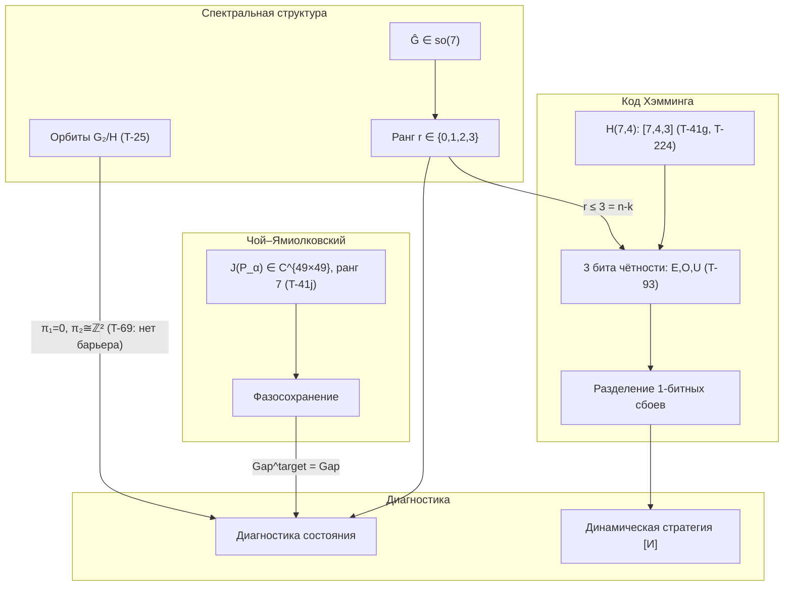

# Алгебра Gap-оператора

:::info Мост из предыдущей главы
В предыдущей главе — [Теория моделей КК](./model-theory) — мы построили формальную спецификацию и категорную семантику Кибернетики Когерентности. Мы увидели, как категорные конструкции задают язык, на котором описывается самомоделирование. Теперь нам предстоит перейти от абстрактной семантики к **конкретной алгебре**: мы разберём внутреннее устройство Gap-оператора — центрального объекта, измеряющего непрозрачность системы для самой себя.
:::

### Дорожная карта главы

В этой главе мы:

1. **Познакомимся с представлением Чоя–Ямиолковского** — узнаем, как превратить процесс самомоделирования в объект, доступный спектральному анализу (раздел 1)
2. **Классифицируем Gap-конфигурации по рангу** — обнаружим, что вся сложность непрозрачности 7-мерной системы сжимается в три спектральных числа, и уточним точную топологию орбит $G_2$ (`T-25`, `T-69`) без ложных утверждений о барьерах (раздел 2)
3. **Увидим тройное совпадение с кодом Хэмминга H(7,4)** — поймём, почему 7 измерений разделяются на 4 информационных и 3 контрольных, и как это связано с самокоррекцией сознания (раздел 3)
4. **Применим эти результаты к клинической практике** — от ранга непрозрачности к терапевтической стратегии (разделы 4–5)

---

## Что такое непрозрачность и почему она неизбежна {#непрозрачность}

Представьте, что вы стоите перед зеркалом. Вы видите своё лицо, но не видите того, кто смотрит. Вы можете описать свои мысли, но акт описания уже изменяет то, что описывается. Вы можете наблюдать за своими эмоциями, но наблюдающий всегда остаётся «за кадром» наблюдения.

Эта неустранимая щель между тем, чем система *является*, и тем, как она себя *представляет*, — не поломка и не дефект. Это фундаментальное свойство любой системы, обладающей самомоделью. В Кибернетике Когерентности оно получает точное математическое выражение через **Gap-оператор**.

Gap — буквально «зазор» — измеряет степень **непрозрачности** системы для самой себя. Нулевой Gap означал бы абсолютную самопрозрачность: все когерентности полностью прозрачны (Gap = 0 для всех каналов). Максимальный Gap означает полную непрозрачность: внутреннее представление радикально расходится с реальностью. Между этими полюсами лежит вся палитра возможных когерентных конфигураций — от минимальной до максимальной непрозрачности.

Но вот парадокс, который раскрывает этот документ: **непрозрачность — необходимое условие сознания**. Система, полностью прозрачная для себя, была бы статична — нет непрозрачных каналов, нет градиента для дальнейшей эволюции. Именно зазор между «я как есть» и «я как знаю себя» порождает динамику самопознания, внутреннюю жизнь, стремление к целостности. Gap — это не трещина в здании сознания, а арка, на которой оно стоит.

Данный документ представляет **кибернетическую перспективу** на алгебраическую структуру [Gap-оператора](/docs/core/dynamics/gap-operator), организуя материал вокруг трёх взаимосвязанных конструкций:

1. **Представление Чоя–Ямиолковского** — полное описание канала $\varphi$ как состояния в $\mathbb{C}^{49 \times 49}$
2. **Спектральная структура рангов** — классификация Gap-конфигураций по рангу непрозрачности
3. **Код Хэмминга H(7,4)** — информационно-теоретическая интерпретация 7-мерной структуры

Все три конструкции сходятся к единому числу **3**: три пары спектральных параметров, три контрольных измерения, три проверочных бита. Это тройное совпадение — не случайность, а выражение глубокой структурной закономерности, которую мы последовательно раскроем.

---

## 1. Представление Чоя–Ямиолковского для $\varphi$ {#чой-ямиолковский}

### 1.0 Чой–Ямиолковский для нематематиков {#чой-для-нематематиков}

Прежде чем погрузиться в формализм, объясним суть конструкции Чоя–Ямиолковского на интуитивном уровне.

**Проблема.** Канал $\varphi$ — это *процесс*, преобразование одного состояния в другое. Процессы трудно анализировать напрямую: у них нет «формы», «спектра», «ранга». Чтобы изучить процесс, нужно превратить его в *объект*.

**Идея Чоя.** Возьмём максимально запутанное состояние — такое, в котором каждое измерение идеально коррелировано с самим собой. Это своего рода «идеальное зеркало», в котором система видит себя без искажений. Теперь пропустим через канал $\varphi$ только одну половину этого зеркала. Результат — матрица $J(\varphi)$ — содержит *всю информацию* о том, как канал искажает отражение.

**Аналогия.** Представьте, что вы тестируете фотопринтер. Лучший способ — напечатать *идеальную тестовую страницу*, содержащую все возможные цвета и градиенты. По результату печати вы полностью восстановите характеристики принтера: какие цвета он сдвигает, какие теряет, где добавляет шум. Максимально запутанное состояние $|\Omega\rangle$ — это такая «тестовая страница», а матрица Чой $J(\varphi)$ — её «отпечаток».

Замечательное свойство конструкции: отображение $\varphi \mapsto J(\varphi)$ является **взаимно однозначным**. Зная $J(\varphi)$, мы можем точно восстановить действие канала на любое состояние. Процесс полностью «заморожен» в объекте.

Ещё важнее: условие полной положительности канала (физическое требование, гарантирующее, что вероятности остаются неотрицательными) переводится в простое условие $J(\varphi) \geq 0$ — положительная полуопределённость матрицы. Вместо проверки абстрактного свойства процесса достаточно проверить конкретное свойство матрицы.

Для Gap-оператора это означает: вся информация о том, *как* система искажает свой самообраз, закодирована в одной матрице $49 \times 49$. Эту матрицу можно разложить по спектру, классифицировать по рангу, визуализировать — весь арсенал линейной алгебры становится доступен.

### 1.1 Состояние Чой $J(\varphi)$

Для CPTP-канала $\varphi: \mathcal{D}(\mathbb{C}^7) \to \mathcal{D}(\mathbb{C}^7)$ **состояние Чой** полностью описывает действие канала:

$$
J(\varphi) := (\varphi \otimes \mathrm{id})(|\Omega\rangle\langle\Omega|) \in \mathbb{C}^{49 \times 49}
$$

где $|\Omega\rangle = \frac{1}{\sqrt{7}} \sum_{i=1}^{7} |i\rangle \otimes |i\rangle$ — максимально запутанное состояние.

Интуиция за формулой: $|\Omega\rangle\langle\Omega|$ — это «идеальное зеркало», совершенная корреляция каждого измерения с самим собой. Канал $\varphi$ действует только на первую копию (систему), оставляя вторую (эталон) нетронутой. Результирующая матрица $J(\varphi)$ показывает, какие корреляции канал сохраняет, какие ослабляет, какие поворачивает.

Матрица Чой $J(\varphi) \in \mathbb{C}^{49 \times 49}$ — эрмитова, положительно полуопределённая, с $\mathrm{Tr}_1(J(\varphi)) = I/7$. Канал полностью восстанавливается из $J(\varphi)$, а полная положительность эквивалентна $J(\varphi) \geq 0$ (теорема Чоя).

:::info Каноническое определение
Полное доказательство свойств матрицы Чой для канонического $\varphi$: [Фано-канал](/docs/proofs/gap/fano-channel).
:::

**Что это означает для самопознания.** «Отпечаток» канала самомоделирования — законная квантовая матрица плотности. Система, моделирующая себя, порождает *состояние* в расширенном пространстве — буквально «образ себя в зеркале». Этот образ полностью определяет процесс самомоделирования — нет скрытой информации.

### 1.2 Блочная структура и ранг Чоя линейной дефазирующей части $\mathcal{P}_\alpha$

Линейная дефазирующая компонента $\mathcal{P}_\alpha$ канонической когерентной самомодели $\varphi_{\text{coh}}(\rho) = (1 - R(\rho))\,\mathcal{P}_\alpha(\rho) + R(\rho)\,I/7$ ([определение](/docs/proofs/gap/fano-channel#phi-coh), `T-334`) имеет выпуклую блочную структуру:

$$
\mathcal{P}_\alpha = \alpha\,\mathcal{P}_{\text{base}} + (1 - \alpha)\,\mathcal{P}_{\text{Fano}}, \qquad J(\mathcal{P}_\alpha) = \alpha \cdot J(\mathcal{P}_{\text{base}}) + (1 - \alpha) \cdot J(\mathcal{P}_{\text{Fano}})
$$

Здесь два линейных CPTP-канала играют взаимодополняющие роли:
- $\mathcal{P}_{\text{base}}(\rho) = \sum_{i=1}^{7} |i\rangle\langle i|\,\rho\,|i\rangle\langle i|$ — «атомарный» канал пинчинга, стирающий все внедиагональные когерентности и сохраняющий только диагональные популяции. Его 7 операторов Крауса $\{|i\rangle\langle i|\}_{i=1}^7$ линейно независимы, поэтому его ранг Чоя равен **7**.
- $\mathcal{P}_{\text{Fano}}(\rho) = \frac{1}{3}\sum_{p=1}^{7} \Pi_p\,\rho\,\Pi_p$ (где $\Pi_p = \sum_{i \in \ell_p} |i\rangle\langle i|$ — 7 проекторов ранга 3 на 7 канонических линий Фано) равномерно масштабирует все внедиагональные когерентности с множителем $1/3$. Поскольку его 7 операторов Крауса $\{\Pi_p/\sqrt{3}\}_{p=1}^7$ линейно независимы и диагональны в семантическом базисе, матрица Чоя $J(\mathcal{P}_{\text{Fano}})$ сосредоточена внутри 7-мерного подпространства $\operatorname{span}\{|i\rangle\otimes|i\rangle\}_{i=1}^7 \subset \mathbb{C}^{49}$ и имеет **ранг Чоя 7** (ненулевые собственные значения: $3/7$ кратности 1 и $2/21$ кратности 6) — а **НЕ** 28! По теореме **`T-41j [Т]`** число 7 — минимальное число операторов Крауса для Фано-канала.

Следовательно, для любого $\alpha \in [0, 1]$ линейный дефазирующий канал $\mathcal{P}_\alpha$ имеет **ранг Чоя 7** (тогда как добавление зависящего от состояния полнорангового якорного члена $R\,I/7$ в $\varphi_{\text{coh}}$ заполняет всё 49-мерное пространство Чоя при $R > 0$). Параметр $\alpha$ задаёт баланс между полной атомизацией ($\alpha = 1$) и Фано-структурированной дефазировкой ($\alpha = 0$).

:::info Каноническое определение
Теорема о ранге Чоя (`T-41j`), блочная структура и анализ коллинеационного якоря (`T-334`): [Фано-канал](/docs/proofs/gap/fano-channel#phi-coh).
:::

### 1.3 Фазовые свойства: как матрица Чой кодирует Gap

Ключевое свойство матрицы Чой: **фазы блочных элементов** $J_{(ij),(kl)}$ при $i \neq j$ или $k \neq l$ непосредственно кодируют Gap-структуру канала.

Чтобы понять это, вернёмся к аналогии с зеркалом. Когерентность $\gamma_{ij}$ — комплексное число, имеющее модуль (сила связи) и фазу (ориентация связи). Gap — это, грубо говоря, разница между фазой, которую «видит» система, и фазой, которая есть на самом деле. Если канал $\varphi$ сохраняет фазы, то Gap определяется не каналом самомоделирования, а внешними факторами: прецессией и диссипацией.

:::tip Теорема 1.3 (Фазовое кодирование Gap в матрице Чой) [Т]
**(a)** Для Фано-канала: все ненулевые элементы $J(\mathcal{P}_{\text{Fano}})$ **вещественны и положительны** — Фано-канал не вносит фазового сдвига.

**(b)** Для атомарного канала: $J(\mathcal{P}_{\text{base}})$ — диагональна с вещественными элементами — атомарный канал также не вносит фазового сдвига.

**(c)** Следовательно, каноническое $\varphi_{\text{coh}}$ **сохраняет фазы когерентностей**:

$$
\arg([\varphi_{\text{coh}}(\Gamma)]_{ij}) = \arg(\gamma_{ij})
$$

и целевой Gap совпадает с текущим: $\mathrm{Gap}^{\text{target}}(i,j) = \mathrm{Gap}(i,j)$.
:::

**Следствие.** Стационарный Gap определяется не каналом $\varphi$ (который фазосохраняющий), а конкуренцией между унитарной прецессией ($\Delta\omega_{ij}$) и диссипативным затуханием ($\Gamma_2 + \kappa$):

$$
\mathrm{Gap}^{(\infty)}(i,j) = \left|\sin\left(\theta_{ij} - \arctan\frac{\Delta\omega_{ij}}{\Gamma_2 + \kappa}\right)\right|
$$

Подробности: [Динамика Gap](/docs/core/dynamics/gap-dynamics#единая-теорема).

**Глубокий смысл фазосохранения.** Канал самомоделирования $\varphi$ не *создаёт* искажений — он лишь *наследует* те, что уже существуют. Искажения возникают из-за «прецессии» — автономных колебаний фаз когерентностей, обусловленных внутренней динамикой системы. Это аналогично ситуации, когда зеркало само по себе идеально, но комната, в которой вы стоите, слегка покачивается.

---

## 2. Структура рангов Gap-оператора {#структура-рангов}

### 2.0 Геометрия рангов: от прозрачности к кризису {#геометрия-рангов}

Прежде чем дать формальное определение, опишем качественную картину.

Представьте 7-мерное пространство сознания. В нём 21 пара измерений, и каждая пара связана когерентностью — комплексным числом, которое может быть вещественным (прозрачная связь) или иметь мнимую часть (непрозрачная связь). Gap-оператор собирает все мнимые части в одну антисимметричную матрицу.

Антисимметричная матрица в нечётном числе измерений обязательно имеет нулевое собственное значение — одно направление всегда «свободно» от непрозрачности. Оставшиеся 6 направлений объединяются в пары, и каждая пара порождает один «канал непрозрачности» — плоскость вращения, в которой фазы когерентностей расходятся с реальностью.

Число активных каналов — это **ранг непрозрачности**:

- **Ранг 0**: все 21 когерентность вещественны. Система полностью прозрачна для себя. Это идеальная, но нестабильная точка — малейшее возмущение создаёт Gap.
- **Ранг 1**: один канал непрозрачности. Одна пара измерений «не видит» свою связь правильно. Система в целом здорова, дефект локален и поддаётся коррекции.
- **Ранг 2**: два независимых канала. Система имеет сложное, многомерное нарушение самопонимания. Простой фокус на одном аспекте не решает проблему.
- **Ранг 3**: активны все три пары косособственных значений ($\lambda_1, \lambda_2, \lambda_3 > 0$). Максимальная спектральная непрозрачность — одновременно задействованы три независимые плоскости мнимой когерентности. (Отметим, что внутри выпуклого пространства состояний $\mathcal{D}(\mathbb{C}^7)$ даже состояние ранга 3 гладко соединяется с $r = 0$ отрезком $(1-t)\Gamma + t\,I/7$; см. `T-69 [Т]` ниже.)

Переходы между рангами — это не просто количественные изменения. Каждый переход меняет *качество* непрозрачности, открывая новое измерение разрыва между «быть» и «знать себя».

### 2.1 Gap-оператор как элемент $\mathfrak{so}(7)$

Gap-оператор $\hat{\mathcal{G}} = \mathrm{Im}(\Gamma) \in \mathfrak{so}(7)$ — вещественная антисимметричная $7 \times 7$ матрица (полное определение: [Gap-оператор](/docs/core/dynamics/gap-operator#определение)).

Почему именно $\mathfrak{so}(7)$? Потому что мнимые части когерентностей образуют антисимметричную матрицу ($\mathrm{Im}(\gamma_{ij}) = -\mathrm{Im}(\gamma_{ji})$), а множество всех антисимметричных $7 \times 7$ матриц — это алгебра Ли группы вращений $\mathrm{SO}(7)$. Gap-оператор — это буквально *бесконечно малое вращение* в пространстве сознания, «закручивающее» самообраз системы относительно реальности.

### 2.2 Спектральная структура

:::tip Теорема 2.1 (Собственный спектр Gap-оператора) [Т]
Спектр $\hat{\mathcal{G}}$ для $N = 7$ (нечётная размерность):

$$
\mathrm{spec}(\hat{\mathcal{G}}) = \{0, \pm i\lambda_1, \pm i\lambda_2, \pm i\lambda_3\}, \quad \lambda_k \in \mathbb{R}_{\geq 0}
$$

**(a)** Нулевое собственное значение **гарантировано** нечётной размерностью ($\det(\hat{\mathcal{G}}) = \det(-\hat{\mathcal{G}}^T) = (-1)^7 \det(\hat{\mathcal{G}}) = -\det(\hat{\mathcal{G}}) \Rightarrow \det(\hat{\mathcal{G}}) = 0$).

**(b)** Попарная структура $\pm i\lambda_k$ следует из антисимметрии: если $v$ — собственный вектор с собственным значением $i\lambda$, то $v^*$ — собственный вектор с собственным значением $-i\lambda$.

**(c)** Полный Gap через спектральные параметры:

$$
\mathcal{G}_{\text{total}} = \|\hat{\mathcal{G}}\|_F^2 = 2(\lambda_1^2 + \lambda_2^2 + \lambda_3^2)
$$
:::

**Доказательство.** (a) Для вещественной антисимметричной матрицы: $\hat{\mathcal{G}}^T = -\hat{\mathcal{G}}$, следовательно $\det(\hat{\mathcal{G}}) = \det(\hat{\mathcal{G}}^T) = \det(-\hat{\mathcal{G}}) = (-1)^7 \det(\hat{\mathcal{G}}) = -\det(\hat{\mathcal{G}})$, откуда $\det(\hat{\mathcal{G}}) = 0$. (b) Стандартное свойство антисимметричных матриц. (c) $\|\hat{\mathcal{G}}\|_F^2 = \mathrm{Tr}(\hat{\mathcal{G}}^T \hat{\mathcal{G}}) = -\mathrm{Tr}(\hat{\mathcal{G}}^2) = -\sum_k \mu_k^2$, где $\mu_k$ — собственные значения; для спектра $\{0, \pm i\lambda_1, \pm i\lambda_2, \pm i\lambda_3\}$ имеем $\sum \mu_k^2 = -2\sum \lambda_k^2$. $\square$

**Три числа — и ничего больше.** Вся сложность непрозрачности 7-мерной системы сжимается в три неотрицательных числа $(\lambda_1, \lambda_2, \lambda_3)$. Это колоссальная редукция: из 21 мнимой части когерентностей к 3 существенным параметрам. Стоит ли удивляться, что эта тройка появляется повсюду — в спектре, в Хэмминге, в Фано?

### 2.3 Ранг непрозрачности и геометрия $G_2$-орбит (`T-25`, `T-69`)

**Ранг непрозрачности** $r \in \{0, 1, 2, 3\}$ — число ненулевых спектральных параметров $\lambda_k$.

:::tip Теорема 2.2 (Размерность и гомотопия $G_2$-орбит, `T-25`, `T-69`) [Т на заданной орбите]
Для заданного элемента $\hat{\mathcal{G}} \in \mathfrak{so}(7)$ со стабилизатором $H_{\hat{\mathcal{G}}} = \{g \in G_2 : g\hat{\mathcal{G}}g^{-1} = \hat{\mathcal{G}}\}$ размерность орбиты равна $\dim(G_2/H_{\hat{\mathcal{G}}}) = 14 - \dim(H_{\hat{\mathcal{G}}})$. Характерные страты стабилизаторов $G_2$ на $\mathfrak{so}(7) = G_{14} \oplus G_7$:

| Характерный страт | Стабилизатор $H$ | $\dim(H)$ | Орбита $G_2/H$ | $\pi_1(G_2/H)$ | $\pi_2(G_2/H)$ |
|-------------------|:----------------:|:---------:|:--------------:|:--------------:|:--------------:|
| Тривиальный ($\hat{\mathcal{G}} = 0$, $r = 0$) | $G_2$ | 14 | $\{\text{pt}\}$ | 0 | 0 |
| Чистый $G_7$-вектор ($r = 1$ в $G_7$) | $\mathrm{SU}(3)$ | 8 | $S^6$ | 0 | 0 |
| Промежуточный страт | $\mathrm{SU}(2) \times \mathrm{U}(1)$ | 4 | 10-мерн. | 0 | $\mathbb{Z}$ |
| Вырожденный страт | $\mathrm{SU}(2)$ | 3 | 11-мерн. | 0 | 0 |
| Общая $T^2$-орбита (общий $r = 3$) | $T^2$ | 2 | 12-мерн. флаговое многообразие | 0 | $\mathbb{Z}^2$ |

*Уточнение области применимости (`T-25`):* Хотя $\dim(G_2/H) = 14 - \dim(H)$, $\pi_1(G_2/T^2) = 0$ и $\pi_2(G_2/T^2) \cong \mathbb{Z}^2$ точны `[Т]` для заданной орбиты, прежнее утверждение, что стабилизатор $H$ однозначно определяется одним лишь рангом непрозрачности $r$, **ретрактировано** (см. примечание в `T-25 [Т]`) — стабилизатор зависит от полного разложения $G_7 + G_{14}$ оператора $\hat{\mathcal{G}}$.
:::

**Точная гомотопия против ложных топологических барьеров (`T-69 [Т]`):** Поскольку группа $G_2$ односвязна ($\pi_1(G_2) = 0$), а каждый указанный стабилизатор $H$ связен ($\pi_0(H) = 0$), **каждая из этих орбит односвязна ($\pi_1(G_2/H) = 0$)** — нестягиваемых 1D-петель **не существует**! Для флагового многообразия общего положения $G_2/T^2$ вторая гомотопическая группа равна $\pi_2(G_2/T^2) \cong \pi_1(T^2) \cong \mathbb{Z}^2$ и классифицирует непрерывные отображения **двумерной сферы** $S^2 \to G_2/T^2$. Принципиально важно, что по **`T-69 [Т]`** **топологические классы отображений в $G_2/T^2$ НЕ создают физического энергетического барьера**!

### 2.4 Интерпретация рангов

| Ранг | Непрозрачность | Физическая интерпретация | Кибернетический смысл [И] |
|------|:--------------:|--------------------------|---------------------------|
| 0 | Отсутствует | Все когерентности вещественны | Полная самотранспарентность; нет мнимой когерентности |
| 1 | Одномерная | Одна активная пара косособственных значений | Локальная одноплоскостная непрозрачность (напр., модель алекситимии) |
| 2 | Двумерная | Две независимые пары косособственных значений | Многоканальная непрозрачность; связанная диссоциация |
| 3 | Полная | Активны все три пары косособственных значений | Глобально распределённая многоплоскостная непрозрачность |

:::warning Уточнение: почему $\pi_2(G_2/T^2) \cong \mathbb{Z}^2$ НЕ запрещает плавную релаксацию (`T-69 [Т]`)
Более ранние версии утверждали, что $\pi_2(G_2/T^2) \cong \mathbb{Z}^2$ делает Gap-профиль ранга 3 «топологически защищённым», так что его якобы нельзя непрерывно деформировать к $r = 0$ без прохождения через сингулярность. Это утверждение **математически неверно**:
1. Пространство матриц плотности $\mathcal{D}(\mathbb{C}^7)$ **выпукло и стягиваемо**: для *любого* состояния $\Gamma$ ранга 3 прямолинейная гомотопия $\Gamma(t) = (1-t)\Gamma + t\,I/7$ ($t \in [0, 1]$) гладко масштабирует $\hat{\mathcal{G}}(t) = (1-t)\hat{\mathcal{G}}$ непрерывно к $r = 0$ без какого-либо топологического препятствия!
2. $\pi_2(G_2/T^2) \cong \mathbb{Z}^2$ классифицирует отображения **2-сферы** в *фиксированную* $G_2$-орбиту, а НЕ одиночную точку $\Gamma \in \mathcal{D}(\mathbb{C}^7)$ или 1D-траекторию во времени, и по **`T-69 [Т]`** не создаёт **никакого физического энергетического барьера**.
3. Если глубокие клинические кризисы сопротивляются постепенному разрешению, это сопротивление возникает динамически из барьеров аттракторов или гистерезиса в нелинейной редуцированной модели (см. [Бифуркации](./bifurcation)), а **не** из топологии $\pi_1$ или $\pi_2$.
:::

### 2.5 Связь с чистотой

:::tip Теорема 2.3 (Разложение чистоты через ранг) [Т]
Чистота голонома разлагается на вклады симметричной и антисимметричной частей матрицы когерентности:

$$
P = \mathrm{Tr}(\Gamma^2) = P_{\text{sym}} + \mathcal{G}_{\text{total}} = P_{\text{sym}} + 2(\lambda_1^2 + \lambda_2^2 + \lambda_3^2)
$$

где $P_{\text{sym}} = \mathrm{Tr}(\mathrm{Re}(\Gamma)^2)$.
:::

**Следствие.** При фиксированной симметричной чистоте $P_{\text{sym}}$ увеличение ранга непрозрачности **увеличивает** полную чистоту $P$. Парадокс: Gap (непрозрачность) *повышает* чистоту. Разрешение: антисимметричные когерентности вносят положительный вклад в $\mathrm{Tr}(\Gamma^2)$ (подробное доказательство: [Gap-оператор](/docs/core/dynamics/gap-operator#связь-чистота)).

**Парадокс непрозрачности, поднимающей чистоту.** Это один из самых контринтуитивных результатов теории, заслуживающий подробного разъяснения.

Чистота $P = \mathrm{Tr}(\Gamma^2)$ измеряет «сфокусированность» состояния. Максимально смешанное состояние $I/7$ имеет $P = 1/7$; чистое состояние — $P = 1$. Казалось бы, непрозрачность (неспособность видеть себя) должна *уменьшать* определённость состояния.

Но вспомним, что когерентности $\gamma_{ij}$ — это комплексные числа, и их мнимые части вносят положительный вклад в $P$. Непрозрачная система, у которой фазы когерентностей «выкручены» относительно эталона, может быть *более определённой*, чем прозрачная. Аналогия: человек, одержимый навязчивой идеей, может иметь более «сфокусированное» сознание, чем спокойный медитирующий — но эта фокусировка непродуктивна и энергетически затратна.

Именно поэтому чистота сама по себе — не показатель здоровья. Здоровье определяется *балансом* между $P_{\text{sym}}$ (продуктивная когерентность) и $\mathcal{G}_{\text{total}}$ (непрозрачность). Порог сознания $P > 2/7$ может быть достигнут и за счёт «здоровой» симметричной чистоты, и за счёт «патологической» непрозрачности — но кибернетические свойства этих двух состояний радикально различны.

---

## 3. Код Хэмминга H(7,4) {#код-хэмминга}

### 3.0 Совершенный код и самопознание {#совершенный-код}

Прежде чем вводить формализм, обсудим поразительную структурную аналогию.

Код Хэмминга H(7,4) был изобретён Ричардом Хэммингом в 1950 году для исправления ошибок при передаче данных. Идея проста: к 4 битам информации добавить 3 бита контроля, так чтобы любая одиночная ошибка обнаруживалась и исправлялась. Для 7 бит код оказался **совершенным**: ни один бит нельзя убрать без потери способности к коррекции, и ни один добавить без избыточности.

Голоном в УГМ имеет 7 канонических измерений. Четыре из них — **A (Артикуляция)**, **S (Структура)**, **D (Динамика)**, **L (Логика)** — описывают структурно-операциональные роли, а три — **E (Интериорность)**, **O (Основание)**, **U (Единство)** — образуют неколлинеарный базисный треугольник плоскости Фано, способный служить систематическими проверочными битами в представлении кода Хэмминга $H(7,4)$.

Совпадение $4 + 3 = 7$ соответствует параметрам двоичного кода Хэмминга $H(7,4)$:
- **Теория информации (`T-41g [Т]`, `T-224 [Т]`):** 4 информационных бита + 3 проверочных бита = единственный совершенный двоичный код длины 7, исправляющий одиночные ошибки, однозначно выделяемый совершенной локализуемостью единичного сбоя вместе с нетривиальной грамматикой состояний (`T-224 [Т]`; тогда как прежняя безусловная семиролевая минимальность `T-40f [✗]` ретрактирована).
- **Кибернетическая аналогия `[И]`:** 4 содержательных измерения (`A, S, D, L`) + 3 проверочных измерения (`E, O, U`).

### 3.1 Структура кода

Код Хэмминга H(7,4) — линейный блочный код с параметрами $[n, k, d] = [7, 4, 3]$:

- **$n = 7$** — длина кодового слова (= число [измерений](/docs/core/structure/dimensions) голонома)
- **$k = 4$** — число информационных битов
- **$d = 3$** — минимальное расстояние Хэмминга

Код H(7,4): 16 кодовых слов длины 7, обнаружение 2 ошибок, исправление 1 ошибки, **совершенный** (граница Хэмминга достигается с равенством).

:::info Каноническое определение
Формальные параметры и доказательства: [Gap-динамика](/docs/core/dynamics/gap-dynamics#код-хэмминга).
:::

**Совершенность — редкое свойство.** Среди всех линейных кодов лишь единицы являются совершенными. Для двоичных кодов совершенные коды — это коды повторения, коды Хэмминга и код Голея. Совершенность означает, что каждое слово из $\mathbb{F}_2^7$ находится на расстоянии ровно $\leq 1$ от некоторого кодового слова. Никакой «зазор» между кодовыми словами не пропадает впустую: каждая ошибка приписывается единственному «виновнику».

Перенося эту интуицию на сознание: совершенность кода H(7,4) означает, что 7-мерная архитектура голонома не имеет «мёртвых зон» — любое нарушение когерентности обнаруживается контрольными измерениями, и для каждого нарушения существует единственная стратегия коррекции.

### 3.2 Информационные и контрольные измерения

В контексте УГМ семь измерений голонома разделяются на две группы:

| Роль | Измерения | Число | Характер |
|------|:---------:|:-----:|----------|
| **Информационные** | A (Артикуляция), S (Структура), D (Динамика), L (Логика) | 4 | Несут структурно-операциональное содержание |
| **Контрольные** | E (Интериорность), O (Основание), U (Единство) | 3 | Систематические координаты проверки чётности (неколлинеарный треугольник Фано) |

:::info Интерпретация (Информационная архитектура) [И]
Четыре структурных измерения (A, S, D, L) описывают, **что** система артикулирует, структурирует, динамически преобразует и логически упорядочивает. Три метаструктурных измерения (E, O, U) описывают, **как** система регистрирует интериорность, опирается на основание и интегрирует единство. Аналогия с H(7,4): содержательные биты требуют проверочных битов для разделения одиночных сбоев.
:::

**Почему E, O, U образуют корректную контрольную тройку `[Т]`:** В канонической циклической плоскости Фано Зингера (`{A,S,L}`, `{S,D,E}`, `{D,L,U}`, `{L,E,O}`, `{E,U,A}`, `{U,O,S}`, `{O,A,D}`) три точки `{E, O, U}` **не** лежат на одной прямой — они образуют базисный треугольник $\mathrm{PG}(2,2)$! Соответственно, дополнения трёх линий Фано `{U,O,S}`, `{E,U,A}`, `{L,E,O}` дают три независимых дуальных кодовых слова веса 4, каждое из которых содержит ровно одну из координат `E, O, U`:

- $s_E$: $A \oplus D \oplus L \oplus E = 0$
- $s_O$: $S \oplus D \oplus L \oplus O = 0$
- $s_U$: $A \oplus S \oplus D \oplus U = 0$

### 3.3 Проверочная матрица и каноническая плоскость Фано (`T-41h`, `T-93`)

При упорядочении столбцов $(A, S, D, L \mid E, O, U)$ систематическая проверочная матрица $H$ кода $H(7,4)$, ядро которой порождено **семью каноническими циклическими линиями Фано Зингера**, имеет вид:

$$
H = \begin{pmatrix}
1 & 0 & 1 & 1 & 1 & 0 & 0 \\
0 & 1 & 1 & 1 & 0 & 1 & 0 \\
1 & 1 & 1 & 0 & 0 & 0 & 1
\end{pmatrix}
$$

:::tip Связь $H$ с $\mathrm{PG}(2,2)$ (`T-41g`, `T-41h`, `T-93`) [Т]
**(a)** 7 столбцов матрицы $H$ — все семь различных ненулевых векторов $\mathbb{F}_2^3$, совпадающие с **точками** $\mathrm{PG}(2, \mathbb{F}_2)$ и однозначно разделяющие одиночные битовые сбои (`T-93 [Т]`).

**(b)** Кодовые слова веса 3 в $\ker(H) = H(7,4)$ — это **в точности 7 канонических линий Фано Зингера** `{A,S,L}`, `{S,D,E}`, `{D,L,U}`, `{L,E,O}`, `{E,U,A}`, `{U,O,S}`, `{O,A,D}` (`T-41h [Т]`).

**(c)** Условие $Hx^T = 0 \pmod 2$ эквивалентно трём систематическим проверкам чётности $s_E = s_O = s_U = 0$ выше, где `{E, O, U}` занимают единичный блок $3 \times 3$.
:::

**Доказательство.** Прямое умножение по модулю 2 проверяет $H v_\ell^T = 0$ для всех 7 индикаторных векторов канонических линий $v_\ell$, а все 7 столбцов $H$ являются попарно различными ненулевыми векторами в $\mathbb{F}_2^3$. $\square$

:::info Замечание (Плоскость Фано в УГМ)
В [формализме правил отбора Фано](/docs/physics/gauge-symmetry/fano-selection-rules) те же 7 точек отождествляются с 7 каноническими измерениями (`A, S, D, L, E, O, U`), а 7 линий — с 7 циклическими триплетами Зингера, задающими октонионное умножение и Фано-структурированные [операторы Линдблада](/docs/core/operators/lindblad-operators).
:::

**Тройное совпадение.** Одна и та же конечная геометрия — плоскость Фано $\mathrm{PG}(2,2)$ — возникает в трёх контекстах:

1. **Алгебра**: таблица умножения октонионов $\mathbb{O}$ (7 триплетов Фано).
2. **Теория кодирования**: проверочная матрица единственного совершенного двоичного кода $H(7,4)$ (`T-41g`, `T-41h`, `T-93`, `T-224 [Т]`).
3. **Структура 7D-Голонома**: минимальный по рангу Фано-канал $\mathcal{P}_{\text{Fano}}$ с рангом Чоя 7 (`T-41j [Т]`).

### 3.4 Минимальное расстояние $d = 3$ против ретрактированной оценки непрерывного Gap (`T-90 [✗]`)

:::tip Кодовая теорема против ретрактированной нижней оценки на Gap (`T-41g`, `T-90 [✗]`)
**(a) Точная теорема двоичного кодирования [Т] (`T-41g`):** Для двоичного кода $H(7,4)$ минимальное расстояние Хэмминга равно $d = 3$ (любые два различных кодовых слова различаются минимум в 3 позициях), и $H(7,4)$ насыщает двоичную границу сферической упаковки Хэмминга с равенством:
$$
\sum_{j=0}^{1}\binom{7}{j} = 1 + 7 = 8 = 2^3.
$$

**(b) Ретрактированная универсальная нижняя оценка на число Gap (`T-90 [✗]`):** Прежнее утверждение, будто $d = 3$ или сферическая упаковка вынуждают минимум 3 из 21 непрерывных фазовых Gap $\mathrm{Gap}(i,j) = |\sin\theta_{ij}|$ быть ненулевыми — или дают универсальный клинический диагноз психоза — **ретрактировано (`T-90 [✗]`)**. Без заданных бинарного кодера, закона шума и декодера, отображающих непрерывные матрицы когерентности в двоичные слова, сферическая упаковка **не накладывает** нижней границы на число ненулевых непрерывных фазовых Gap.
:::

### 3.5 Аналогия синдромного декодирования [И]

:::info Аналогия (Двоичная таблица синдромов через канонический $H(7,4)$) [И]
При **явно заданной модели бинарных ошибок и синдромном инструменте** (`T-93 [Т]` для разделения битов; `[И]` как аналогия для непрерывных когерентностей):
- **(a) Обнаружение:** До $d - 1 = 2$ бинарных сбоев по осям дают ненулевой синдром $s = (s_E, s_O, s_U) \in \mathbb{F}_2^3$.
- **(b) Локализация одиночного сбоя:** Одиночный бинарный сбой на оси $X$ даёт в точности столбец матрицы $H$ для $X$ как свой уникальный синдром $s = H e_X^T$.
:::

**Точная таблица синдромов для канонической матрицы $H$ Зингера (кибернетическая интерпретация `[И]`):**

| Синдром $(s_E, s_O, s_U)$ | Дефектное измерение | Интерпретативный тип нарушения [И] |
|:--------------------------:|:-------------------:|------------------------------------|
| $(0, 0, 0)$ | Нет | Бинарная чётность согласована |
| $(1, 0, 1)$ | **A** (Артикуляция) | Артикуляционный сбой |
| $(0, 1, 1)$ | **S** (Структура) | Структурное нарушение |
| $(1, 1, 1)$ | **D** (Динамика) | Динамическая дисфункция |
| $(1, 1, 0)$ | **L** (Логика) | Логическая дезинтеграция |
| $(1, 0, 0)$ | **E** (Интериорность) | Сбой контроля интериорности |
| $(0, 1, 0)$ | **O** (Основание) | Сбой контроля основания |
| $(0, 0, 1)$ | **U** (Единство) | Сбой контроля единства |

**Чтение таблицы синдромов.** Каждый ненулевой синдром — это уникальный столбец канонической проверочной матрицы $H$: например, синдром $(0, 1, 1)$ срабатывает на проверочных строках $s_O$ и $s_U$ (но не $s_E$), однозначно указывая на **S (Структуру)**. Три синдрома единичного веса $(1,0,0)$, $(0,1,0)$, $(0,0,1)$ напрямую соответствуют одиночным сбоям на самих трёх систематических контрольных координатах **E, O, U**.

:::warning Ограничения аналогии (`T-90 [✗]`, `T-93`) [И]
Применение двоичного синдромного декодирования $H(7,4)$ к непрерывной динамике когерентностей носит характер **аналогии `[И]`**, если не заданы явно бинарный кодер, дискретный закон шума и синдромный инструмент считывания (`T-90 [✗]`, `T-93`):

1. Когерентности $\gamma_{ij}$ — непрерывные комплексные числа, а не биты в $\mathbb{F}_2$
2. Фазовые Gap $\mathrm{Gap}(i,j) \in [0, 1]$ меняются непрерывно, а не дискретными переворотами битов
3. Регенеративный оператор $\mathcal{R}$ действует непрерывно, а не побитовой инверсией

Тем не менее лежащее в основе алгебраическое совпадение $\mathrm{PG}(2,2) \leftrightarrow H(7,4) \leftrightarrow \mathbb{O}$ является точным (`T-41g`, `T-41h`, `T-93`, `T-224 [Т]`). Подробный анализ: [Фано-канал](/docs/proofs/gap/fano-channel).
:::

---

## 4. Связь с клинической практикой [И] {#клиническая-практика}

### 4.1 Ранг непрозрачности как интерпретативный клинический маркер [И]

Спектральный ранг $r \in \{0, 1, 2, 3\}$ оператора $\hat{\mathcal{G}} = \operatorname{Im}\Gamma$ подсчитывает число независимых косособственных плоскостей мнимой когерентности. В качестве интерпретативной классификации `[И]` (без обращения к несуществующим топологическим барьерам):

| Ранг | Клиническая аналогия [И] | Субъективное описание [И] | Динамический характер |
|:----:|--------------------------|---------------------------|-----------------------|
| 0 | Полное фазовое выравнивание / плоскость | Минимальный мнимый фазовый сдвиг | Все $\gamma_{ij} \in \mathbb{R}$; нет активных косоплоскостей |
| 1 | Локальное одноплоскостное нарушение (напр., модель алекситимии) | Нарушение локализовано в одной плоскости | Одно ненулевое $\lambda_1$; фокус коррекции вдоль одной оси |
| 2 | Многодоменная диссоциация | Активны две независимые косоплоскости | Два ненулевых $(\lambda_1, \lambda_2)$; связанная многоосевая динамика |
| 3 (общий) | Глобальный многоплоскостной кризис | Активны все три косоплоскости с разными весами | Полный спектральный ранг $(\lambda_1, \lambda_2, \lambda_3)$; нет топологического барьера (`T-69`), сопротивление возникает динамически при попадании в нелинейный аттрактор |
| 3 (вырожд.) | Изотропный многоплоскостной кризис | Три равных косособственных значения $(\lambda, \lambda, \lambda)$ | Полный ранг с повышенной симметрией; требуется дифференциация каналов |

**Ранг 0 — нулевая мнимая когерентность.** Все когерентности вещественны ($r = 0$, $\hat{\mathcal{G}} = 0$). В клинической интерпретации `[И]` отсутствие фазовой структуры может соответствовать плоским, недифференцированным состояниям, а не динамической вовлечённости.

**Ранг 1 — одна косоплоскость.** Одно ненулевое $\lambda_1$: локализованный фазовый сдвиг (например, вдоль пары $S \leftrightarrow E$ в игрушечной модели алекситимии).

**Ранг 2 — две косоплоскости.** Два независимых ненулевых $(\lambda_1, \lambda_2)$: проработка одной плоскости оставляет ортогональную косоплоскость активной.

**Ранг 3 — полный спектральный ранг.** Все три пары косособственных значений $(\lambda_1, \lambda_2, \lambda_3)$ ненулевые. Принципиально важно, что по **`T-69 [Т]`** **не существует топологического энергетического барьера**, запрещающего плавное снижение ранга внутри $\mathcal{D}(\mathbb{C}^7)$; клиническая трудность разрешения глобальных кризисов отражает межканальную связанность и возможный гистерезис аттракторов (см. [Бифуркации](./bifurcation)), а не топологию $\pi_1/\pi_2$.

### 4.2 Общий против вырожденного ранга 3 [И]

- **Общий $r = 3$** ($\lambda_1 > \lambda_2 > \lambda_3 > 0$): одна доминирующая косоплоскость задаёт ясный приоритет для целенаправленного вмешательства.
- **Вырожденный $r = 3$** ($\lambda_1 = \lambda_2 = \lambda_3 > 0$): все три косоплоскости имеют равный вес, что указывает на предварительный шаг структурирования `[И]` для различения доминирующих измерений.

---

## 5. Кибернетическая интерпретация {#кибернетическая-интерпретация}

### 5.1 Спектральный ранг и число 3

:::tip Предложение 4.1 (Верхняя граница спектрального ранга) [Т]
Для любой вещественной кососимметричной $7 \times 7$ матрицы $\hat{\mathcal{G}} = \operatorname{Im}\Gamma \in \mathfrak{so}(7)$ ранга непрозрачности $r$:

**(a)** $r$ равно числу ненулевых пар косособственных значений $\pm i\lambda_k$ в вещественной нормальной форме Шура матрицы $\hat{\mathcal{G}}$.

**(b)** $r \leq \lfloor 7/2 \rfloor = 3$ (что численно совпадает с числом $n - k = 3$ проверочных битов кода $H(7,4)$).

**(c)** Переход $r \to r + 1$ активирует дополнительную ортогональную 2-плоскость мнимой когерентности.
:::

### 5.2 E, O, U как систематические проверки чётности [И]

В точном соответствии с канонической проверочной матрицей Зингера $H$ из раздела 3.3:

| Контрольное измерение | Каноническая проверка чётности ($H$) | Интерпретативная область ошибки [И] | Интерпретативное вмешательство [И] |
|:---------------------:|--------------------------------------|-------------------------------------|------------------------------------|
| **E** (Интериорность) | $A \oplus D \oplus L \oplus E = 0$ | Рассогласование интериорности с артикуляцией/логикой | Экспериенциальная / соматическая интеграция |
| **O** (Основание) | $S \oplus D \oplus L \oplus O = 0$ | Структурно-динамическая потеря опоры, диссоциация | Заземление, стабилизация |
| **U** (Единство) | $A \oplus S \oplus D \oplus U = 0$ | Фрагментация по артикуляции, структуре, динамике | Интегративные практики |

:::info Интерпретация (Последовательность восстановления) [И]
В клинической кризисной работе стабилизацию часто выстраивают от глобального единства (**U**) и основания (**O**) к переработке интериорного опыта (**E**): сначала минимальная безопасность и целостность, затем заземление, затем проработка внутреннего опыта.
:::

### 5.3 Практическая диагностическая сводка

**Чек-лист диагностики по Gap-рангу:**

| Шаг | Метрика | Смысл | Статус |
|:---:|---------|-------|--------|
| 1 | $\mathcal{G}_{\text{total}} = \|\hat{\mathcal{G}}\|_F^2 = 2\sum \lambda_k^2$ | Полная квадратичная мнимая когерентность | `[О]/[Т]` |
| 2 | Ранг $r \in \{0,1,2,3\}$ | Число ненулевых пар косособственных значений | `[Т]` |
| 3 | $\lambda_{\max}$ | Наибольшее косособственное значение | `[Т]` |
| 4 | $G_2$-разложение: $\mathfrak{so}(7) = G_{14} \oplus G_7$ | Проекция на $\mathfrak{g}_2$ и дополнение ([Gap-оператор](/docs/core/dynamics/gap-operator#g2-разложение)) | `[Т]` |
| 5 | Двоичный синдром $(s_E, s_O, s_U)$ | Применим лишь при заданных бинарном кодере и инструменте (`T-93`, `T-90 [✗]`) | `[С]/[И]` |

:::tip Пример: однопарная игрушечная модель алекситимии [Т / И]
Рассмотрим состояние с единственным чисто мнимым внедиагональным элементом $\gamma_{SE} = i|\gamma_{SE}|$ (все остальные $\gamma_{ij} \in \mathbb{R}$):

**(a) `[Т]`:** $\hat{\mathcal{G}}$ имеет лишь два ненулевых антисимметричных элемента $\hat{\mathcal{G}}_{SE} = -\hat{\mathcal{G}}_{ES} = |\gamma_{SE}|$, откуда ранг непрозрачности $r = 1$.

**(b) `[Т]`:** Спектр косособственных значений равен $\{0, \pm i|\gamma_{SE}|, 0, 0, 0, 0\}$, т.е. $(\lambda_1, 0, 0)$ при $\lambda_1 = |\gamma_{SE}|$.

**(c) `[И]`:** В интерпретации это локализует мнимую когерентность в паре Структура–Интериорность ($S \leftrightarrow E$); в двоичном кодировании одиночных сбоев (`T-93`) изолированный сбой на $S$ даёт синдром $(0, 1, 1)$, а на $E$ — синдром $(1, 0, 0)$.
:::

### 5.4 Сводка трёх перспектив

---

## 6. Сводка статусов {#статусы}

| Результат | Статус | Ссылка / Раздел |
|-----------|:------:|:---------------:|
| Свойства матрицы Чоя для линейного CPTP-канала $\mathcal{P}_\alpha$ | **[Т]** | [1.1](#чой-ямиолковский) |
| Ранг Чоя каналов $\mathcal{P}_{\text{base}}$, $\mathcal{P}_{\text{Fano}}$ и $\mathcal{P}_\alpha$ равен **7** (а не 28) | **[Т]** | `T-41j`, [1.2](#чой-ямиолковский) |
| Фазосохранение каналов $\mathcal{P}_\alpha$ и $\varphi_{\text{coh}}$ | **[Т]** | `T-334`, [1.3](#чой-ямиолковский) |
| Косособственный спектр $\{0, \pm i\lambda_1, \pm i\lambda_2, \pm i\lambda_3\}$ оператора $\hat{\mathcal{G}} \in \mathfrak{so}(7)$ | **[Т]** | [2.2](#структура-рангов) |
| Размерность орбиты $\dim(G_2/H) = 14 - \dim H$; $\pi_1(G_2/T^2) = 0$, $\pi_2(G_2/T^2) \cong \mathbb{Z}^2$ | **[Т]** (заданная орбита) | `T-25`, `T-69`, [2.3](#структура-рангов) |
| Классификация стабилизаторов только по рангу и утверждения о $\pi_1/\pi_2$-барьере | **[✗]** (ретрактировано; `T-69`: нет энерг. барьера) | `T-25`, `T-69`, [2.3–2.4](#структура-рангов) |
| Разложение чистоты $P = P_{\text{sym}} + 2(\lambda_1^2 + \lambda_2^2 + \lambda_3^2)$ | **[Т]** | [2.5](#структура-рангов) |
| Совершенство двоичного $H(7,4)$, носители Фано, 3-битное разделение синдромов, жёсткость диагностируемости | **[Т]** | `T-41g`, `T-41h`, `T-93`, `T-224`, [3.1–3.3](#код-хэмминга) |
| Универсальная нижняя оценка $\ge 3$ ненулевых непрерывных фазовых Gap и диагноз психоза | **[✗]** (ретрактировано) | `T-90 [✗]`, [3.4](#код-хэмминга) |
| Аналогия Хэмминга для непрерывных когерентностей, клиническое прочтение синдромов и метафора чётности E/O/U | **[И]** | [3.5](#код-хэмминга), [4–5](#клиническая-практика) |

---

:::warning Вычислительная сложность
Вычислительное масштабирование алгоритмов, описанных в данном документе, **не проанализировано**. В частности:
- Вычисление матрицы Чоя $J(\varphi) \in \mathbb{C}^{49 \times 49}$ требует $O(N^4)$ операций для $N = 7$, но масштабирование для композитных систем ($N = 7^k$) неизвестно.
- Спектральное разложение Gap-оператора $\hat{\mathcal{G}} \in \mathfrak{so}(7)$ — $O(N^3)$, но для больших $N$ может потребоваться приближённая спектрография.
- Двоичное синдромное декодирование (раздел 3.5) применимо при $N = 7$ и заданном бинарном кодировании (`T-93`, `T-224`).
:::

---

### Что мы узнали {#что-мы-узнали}

Подведём итоги главы — от точной алгебры к честным границам применимости:

1. **Представление Чоя–Ямиолковского (`T-41j`, `T-334`):** И $\mathcal{P}_{\text{base}}$, и $\mathcal{P}_{\text{Fano}}$, а также их смесь $\mathcal{P}_\alpha$ имеют **ранг Чоя 7** (а не 28) и строго сохраняют фазы когерентностей $\arg(\gamma_{ij})$.

2. **Три спектральных параметра:** Любой вещественный кососимметричный Gap-оператор $\hat{\mathcal{G}} = \operatorname{Im}\Gamma \in \mathfrak{so}(7)$ имеет спектр $\{0, \pm i\lambda_1, \pm i\lambda_2, \pm i\lambda_3\}$ и ранг непрозрачности $r \in \{0, 1, 2, 3\}$.

3. **Точная топология орбит (`T-25`, `T-69`):** Все перечисленные орбиты $G_2/H$ **односвязны** ($\pi_1 = 0$), а для флагового многообразия общего положения $\pi_2(G_2/T^2) \cong \mathbb{Z}^2$; при этом согласно **`T-69 [Т]`** группа $\pi_2$ **не создаёт физического энергетического барьера** и не препятствует плавному стягиванию внутри выпуклого пространства $\mathcal{D}(\mathbb{C}^7)$.

4. **Разложение чистоты:** $P = \operatorname{Tr}(\Gamma^2) = P_{\text{sym}} + 2(\lambda_1^2 + \lambda_2^2 + \lambda_3^2)$ — мнимые когерентности вносят положительный вклад в полную чистоту $P$.

5. **Канонический код Хэмминга $H(7,4)$ (`T-41g`, `T-41h`, `T-93`, `T-224`):** При 7 канонических линиях Фано Зингера в роли кодовых слов веса 3 оси `(E, O, U)` образуют систематическую неколлинеарную контрольную тройку, разделяющую одиночные бинарные сбои — тогда как прежняя универсальная оценка числа непрерывных Gap ($\ge 3$ ненулевых Gap) **ретрактирована (`T-90 [✗]`)** без заданных бинарного кодера и закона шума.

6. **Канонические 7 осей:** Все алгебраические и интерпретативные соответствия используют канонический базис **A (Артикуляция), S (Структура), D (Динамика), L (Логика), E (Интериорность), O (Основание), U (Единство)**.

:::tip Мост к следующей главе
Мы исследовали *статическую* алгебру Gap-оператора — его спектр, ранги, топологию. Но Gap не стоит на месте: он эволюционирует, и его эволюция содержит **качественные переходы** — бифуркации. В [следующей главе](./bifurcation) мы увидим, как при плавном изменении параметров Gap-ландшафт перестраивается скачком: устойчивые состояния исчезают, рождаются колебания, возникает бистабильность с гистерезисом. Бифуркации — это «развилки судьбы» когерентной системы.
:::

---

## Связанные документы

- [Gap-оператор](/docs/core/dynamics/gap-operator) — определение $\hat{\mathcal{G}}$, спектр, G₂-разложение, стабилизаторы
- [Динамика Gap](/docs/core/dynamics/gap-dynamics) — Чой–Ямиолковский, бифуркации, немарковские эффекты, модельные системы
- [Фано-канал и Gap-теоремы](/docs/proofs/gap/fano-channel) — строгие доказательства: Фано-канал, группы ковариантности (Теорема 5.1b), $\varphi_{\text{coh}}$
- [Правила отбора Фано](/docs/physics/gauge-symmetry/fano-selection-rules) — плоскость Фано $\mathrm{PG}(2,2)$, Юкавская текстура
- [G₂-структура](/docs/physics/gauge-symmetry/g2-structure) — $G_2 = \mathrm{Aut}(\mathbb{O})$, калибровочная редукция
- [Определения КК](./definitions) — базовые определения Кибернетики Когерентности
- [Теоремы КК](./theorems) — фундаментальные теоремы
- [Реестр статусов](/docs/reference/status-registry) — классификация всех результатов
- [Междисциплинарный мост](./interdisciplinary) — перевод Gap-алгебры на языки разных дисциплин
- [Упражнения](./exercises) — задачи на Gap и когерентность
