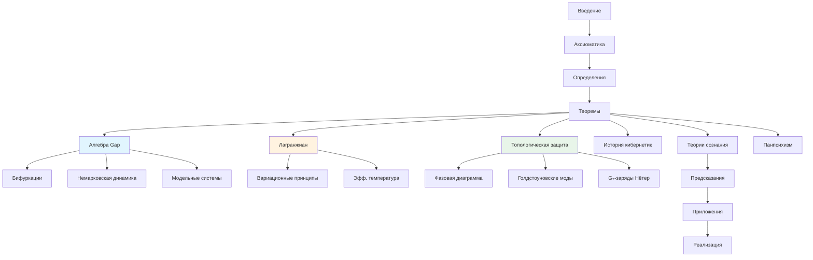

# Введение в Кибернетику Когерентности

> *«Мы утонули в информации и изголодались по мудрости.»*
> — Эдвард Осборн Уилсон

:::info Для кого эта глава
Введение в Кибернетику Когерентности — единый математический формализм для динамики, целостности и интериорности систем. Читатель узнает, зачем нужна новая кибернетика и как устроен центральный объект теории.
:::

Физик записывает уравнение Шрёдингера. Биолог рисует петлю гомеостаза. Психолог строит шкалу субъективного благополучия. Философ спрашивает: «Почему вообще что-то переживается изнутри?» Инженер ИИ тренирует нейросеть и задумывается: есть ли у неё хоть тень опыта?

Все они описывают **одну и ту же реальность** — систему, которая поддерживает себя, адаптируется, а иногда и **переживает** свою собственную активность. Но их языки не пересекаются. Уравнения физика молчат о субъективном. Метафоры психолога не конвертируются в дифференциальные уравнения. Философ и инженер разговаривают, как будто живут в разных вселенных.

**Кибернетика Когерентности** (КК) — это попытка дать им общий язык. Не аналогию, не метафору, а единый математический формализм, в котором динамика системы, её структурная целостность и её интериорность оказываются **разными проекциями одного и того же объекта** — матрицы когерентности $\Gamma$.

Эта глава — приглашение к путешествию. Мы начнём с вопроса «зачем?», затем покажем, как устроен центральный объект теории, и закончим картой всего раздела — чтобы каждый читатель нашёл свой маршрут.

:::tip Дорожная карта главы
В этой главе мы:
1. **Разберёмся, зачем нужна новая кибернетика** — три волны кибернетики и их незакрытые вопросы (раздел «Зачем нужна новая кибернетика?»)
2. **Познакомимся с центральным объектом** — матрицей когерентности $\Gamma$ и уравнением эволюции (раздел «Что такое Кибернетика Когерентности»)
3. **Увидим, как один формализм работает для всех наук** — таблица междисциплинарных соответствий (раздел «Единый язык для всех наук»)
4. **Освоим ключевые концепции** — семь измерений ASDLEOU, чистота $P$, пороги жизнеспособности, иерархия интериорности L0-L4 (раздел «Ключевые концепции»)
5. **Поймём, чем КК отличается от альтернатив** — сравнение с IIT, FEP, панпсихизмом (раздел «Почему КК?»)
6. **Получим карту документации** — маршруты чтения для разных аудиторий (раздел «Карта документации»)
:::

:::note О нотации
В этом документе:
- $\Gamma$ — [матрица когерентности](/docs/core/dynamics/coherence-matrix)
- $P$ — [чистота](/docs/core/dynamics/viability#определение-чистоты): $P = \mathrm{Tr}(\Gamma^2)$
- $\mathcal{H} = \mathbb{C}^7$ — гильбертово пространство состояний
- L0, L1, L2, L3, L4 — [уровни интериорности](/docs/proofs/consciousness/interiority-hierarchy)
:::

---

## Зачем нужна новая кибернетика?

### Три эпохи кибернетики и их незакрытые вопросы

В XX веке кибернетика прошла три волны:

1. **Кибернетика-I (Винер, 1948)** открыла обратную связь — механизм, благодаря которому термостат удерживает температуру, а зенитная ракета находит самолёт. Это был прорыв: впервые машины и живые существа описывались одним языком. Но Винер смотрел только на **динамику** — на потоки сигналов. Он не задавался вопросом, кто или что *наблюдает* эти сигналы.

2. **Кибернетика-II (фон Фёрстер, 1970-е)** ввела наблюдателя. «Кибернетика кибернетики» — наука о том, как системы моделируют сами себя. Это был важный шаг: появилась самореференция, рекурсия, автопоэзис (Матурана и Варела). Но формализм остался качественным. Что именно значит «система моделирует себя»? В каких единицах измерять глубину самонаблюдения?

3. **Кибернетика-III (Луман, 1990-е)** масштабировала идеи на социальные системы: право, экономику, искусство. Луман показал, что общество — это сеть коммуникаций, самовоспроизводящая свои границы. Но математический аппарат был скорее социологическим, чем физико-математическим.

Каждая волна расширяла горизонт, но оставляла открытыми фундаментальные вопросы:

- **Откуда берётся субъективность?** Ни одна из трёх кибернетик не могла объяснить, почему некоторые системы *переживают* свою активность изнутри, а не просто обрабатывают информацию.
- **Где математика?** Автопоэзис красив как концепция, но как записать его в виде уравнения, которое можно решить?
- **Как связать масштабы?** Нейрон, мозг, общество — можно ли описать их одним формализмом, не теряя специфику каждого уровня?

### Параллельные попытки — и их ограничения

Помимо кибернетики, к этим вопросам подходили с других сторон:

- **Теория интегрированной информации (IIT, Тонони)** предложила меру сознания $\Phi$ и постулировала, что сознание — это интегрированная информация. Но IIT не содержит динамики: она говорит, *чему равно* сознание в данный момент, но не *как* оно возникает и эволюционирует.

- **Принцип свободной энергии (FEP, Фристон)** описал живые системы как минимизирующие вариационную свободную энергию. Это мощный фреймворк для восприятия и действия. Но FEP не объясняет, почему минимизация свободной энергии иногда сопровождается *переживанием*, а иногда — нет.

- **Панпсихизм** постулирует, что опыт фундаментален. Но без математического формализма это остаётся философской позицией, а не теорией с предсказаниями.

Каждый из этих подходов освещает часть картины, но ни один не охватывает целое. **КК стремится собрать эти фрагменты в единый математический каркас**, построенный на компактном наборе аксиом и явно указанных модельных допущений.

---

## Что такое Кибернетика Когерентности {#что-такое-кибернетика-когерентности}

**Кибернетика Когерентности (КК)** — прикладной кибернетический формализм, развиваемый в рамках Унитарного Голономного Монизма (УГМ). Она моделирует динамику разнообразных систем — от квантовых подсистем до биологических организмов и социальных структур — через эволюцию 7-мерной матрицы когерентности:

$$
\frac{d\Gamma(\tau)}{d\tau} = -i[H_{eff}, \Gamma] + \mathcal{D}[\Gamma] + \mathcal{R}[\Gamma, E]
$$

Прежде чем разбирать это уравнение, поймём его смысл на уровне интуиции. Представьте себе оркестр:

- $-i[H_{eff}, \Gamma]$ — **гамильтониан** — это дирижёр. Он задаёт унитарную, обратимую динамику: колебания, ритм, внутренние частоты системы. Физик узнает здесь уравнение фон Неймана. Биолог увидит циркадные ритмы. Психолог — ритмы внимания и бодрствования.

- $\mathcal{D}[\Gamma]$ — **диссипатор** — это зал, поглощающий звук. Это необратимые процессы: декогеренция, диссипация, потеря структуры. Без него оркестр играл бы вечно. С ним — звук затухает, если не восполняется.

- $\mathcal{R}[\Gamma, E]$ — **регенератор** — это сами музыканты, которые вдыхают и играют заново. Этот член характерен для КК: он моделирует то, как система *восстанавливает* свою когерентность к целевому состоянию самомодели. В стандартном конститутивном выборе скорость восстановления зависит от $E$ — от степени когерентности интериорности $\mathrm{Coh}_E(\Gamma)$. Оркестр, который *слышит* себя, играет слаженнее.

**Эти три члена структурно соответствуют трём способам термодинамического обмена.** Первое начало термодинамики разделяет обмен на *работу*, *тепло* и *вещество*, и при явно заданном термодинамическом процессе (`T-258` `[С]` / `[Т]` при заданном процессе; см. [термодинамическую трихотомию](./sensorimotor#термодинамическая-трихотомия)) три члена ведут себя так:

- гамильтонов член как **работа** — он вращает состояние, не меняя энтропии и чистоты (унитарный вклад в энтропию равен нулю);
- унитальный диссипатор как **тепло** — он может лишь увеличивать или сохранять энтропию фон Неймана;
- регенератор как **вещество / негэнтропийный приток** — он импортирует порядок из внешнего или целевого резервуара.

Важно точно учитывать область применимости: положительные суммы генераторов ГКСЛ всегда допустимы, поэтому разбиение динамики на три члена является модельным соглашением, а не исчерпывающей теоремой, запрещающей четвёртый канал (прежнее утверждение об исчерпании `T-102` снято `[✗]`, а термодинамико-химическая интерпретация является входным допущением модели `[И]`). Геометрически, при заданной модели дефазировки (`T-262` `[Т]`) сохраняются унитарная спектральная инвариантность, производство энтропии при дефазировке и положительно полуопределённое тождество Онзагера; однако оператор дефазировки имеет диагональное ядро и не является римановой метрикой на всём пространстве состояний, так что универсальная трихотомия отсюда не вытекает. Тем не менее физическая картина прозрачна: открытая жизнеспособная система живёт в постоянном балансе между унитарным вращением, диссипативным распадом и регенеративным восполнением.

:::note Две дороги, три двери [И]
Примечательно, что параллельное тройственное разбиение — работа, тепло, вещество — возникает и в *самообучающейся Вселенной* Виталия Ванчурина из совершенно иной отправной точки: обучающейся системы при ограниченных ресурсах. Сопоставление квантового формализма открытых систем «сверху вниз» с термодинамикой обучения «снизу вверх» даёт содержательный интерпретативный словарь ([словарь](./sensorimotor#гранд-канонический-словарь) `[И]`).
:::

В КК это уравнение эволюции соединяет стандартную динамику открытых квантовых систем (унитарный член + линдбладовская диссипация) с выбранным нелинейным регенеративным членом обратной связи, привязанным к самомодели $\varphi$ и конститутивной функции скорости $\kappa(\Gamma)$ (корректность задачи Коши и сохранение матрицы плотности доказаны при явных гипотезах регулярности, целевого состояния и скоростей в `CC-1` и `CC-2` `[Т]`; прежние утверждения о полностью аксиоматическом единственном выводе регенерации `T-39h` и исчерпании тремя типами `T-40a`, `T-57`, `T-102` сняты `[✗]`). Для работы с КК глубокое знание теории категорий не требуется — достаточно чётко различать доказанные теоремы `[Т]`, определения `[О]` и явные входные допущения модели.

КК предлагается как сравнительный **метатеоретический язык `[И]`**, в котором предшествующие кибернетики (Винер, фон Фёрстер, Луман) интерпретируются как ограниченные проекции на подмножества измерений.

---

## Единый язык для всех наук

Почему один формализм применим к физике, биологии, психологии и инженерии? Потому что КК оперирует на уровне **структурных инвариантов** матрицы плотности $\Gamma \in \mathcal{D}(\mathbb{C}^7)$, не зависящих от физического субстрата. Превращение этих формальных инвариантов в эмпирические утверждения для конкретной дисциплины требует явного закона наблюдений и калибровки (`[И]` / `[Г]`; см. [Диагностика с неопределённостью](./diagnostics)).

Вот как разные дисциплины интерпретируют одни и те же математические объекты (`[И]`):

| Понятие КК | Физик видит | Биолог видит | Психолог видит | Инженер ИИ видит |
|------------|-------------|--------------|----------------|------------------|
| $\Gamma$ | Матрица плотности | Состояние гомеостаза | Профиль психических функций | Внутреннее состояние агента |
| $P = \mathrm{Tr}(\Gamma^2)$ | Чистота квантового состояния | Степень организованности | Уровень интеграции личности | Концентрация латентного представления |
| $\tilde\sigma_k = 1 - 7\gamma_{kk}$ `[О]` | Диагональный дефицит от $I/7$ | Секторный дефицит в подсистеме | Индикатор напряжения в сфере жизни | Показатель аномалии в канале |
| $\mathcal{R}[\Gamma, E]$ | Неунитальный канал обратной связи | Регенерация тканей | Психическое восстановление | Самокоррекция модели |
| $P_{\text{crit}} = 2/7$ `[О]` | Срез структурного большинства (`T-5`) | Кандидатный порог жизнеспособности `[Г]` | Кандидатная граница нормы/патологии `[Г]` | Кандидатный операционный порог `[Г]` |

Каждое соответствие представляет собой структурированный **интерпретативный мост `[И]`**: базовые матричные теоремы (`[Т]`) выполняются тождественно для любой допустимой $\Gamma \in \mathcal{D}(\mathbb{C}^7)$, тогда как эмпирическая применимость к конкретной физической, биологической, психологической или ИИ-системе должна проверяться через калиброванные протоколы реконструкции (`[Г]` / `[Пр]`).

---

## Ключевые концепции

### Матрица когерентности Γ

Центральный объект теории — [матрица когерентности](/docs/core/dynamics/coherence-matrix) $\Gamma$, описывающая состояние системы в 7-мерном пространстве. Это эрмитова положительно полуопределённая матрица с единичным следом.

Что это значит на пальцах? Представьте систему из семи «голосов», каждый из которых отвечает за свою функцию (подробнее ниже). Диагональные элементы $\gamma_{kk}$ показывают, насколько активен каждый голос. Внедиагональные $\gamma_{ij}$ показывают, насколько эти голоса **согласованы** друг с другом — отсюда и слово *когерентность*.

Если все голоса звучат одинаково тихо и не скоррелированы, $\Gamma = I/7$ — максимальная энтропия, полный хаос. Если один голос доминирует и все остальные подстроены под него — $\Gamma$ близка к чистому состоянию. Реальные системы живут между этими полюсами, и именно **где** они находятся — определяет их жизнеспособность, сознательность и устойчивость.

Для физика $\Gamma$ — это обычная матрица плотности, только не в гильбертовом пространстве спинов или фотонов, а в пространстве семантических измерений. Для биолога — многомерный профиль гомеостаза. Для психолога — состояние психических функций в семи измерениях.

**См.:** [Матрица когерентности](/docs/core/dynamics/coherence-matrix)

### Семь измерений ASDLEOU

Любая система, описываемая голономом $\Gamma \in \mathcal{D}(\mathbb{C}^7)$, существует в [семи измерениях](/docs/core/structure/dimensions):

| Символ | Измерение | Функция |
|--------|-----------|---------|
| $A$ | [Артикуляция](/docs/core/structure/dimension-a) | Различать |
| $S$ | [Структура](/docs/core/structure/dimension-s) | Удерживать |
| $D$ | [Динамика](/docs/core/structure/dimension-d) | Изменяться |
| $L$ | [Логика](/docs/core/structure/dimension-l) | Согласовывать |
| $E$ | [Интериорность](/docs/core/structure/dimension-e) | Переживать |
| $O$ | [Основание](/docs/core/structure/dimension-o) | Питать |
| $U$ | [Единство](/docs/core/structure/dimension-u) | Интегрировать |

Эти семь измерений — не произвольный список ярлыков; каждое представляет отчётливую функциональную роль в записи модели:

- **A — Артикуляция**: *Может ли система провести границу?* Различить «я» и «не-я», сигнал и шум, фигуру и фон. Без этого нет субъекта. Бактерия различает сахар и кислоту. Нейросеть различает классы. Сознание различает «до» и «после».

- **S — Структура**: *Может ли она запомнить?* Удержать форму, паттерн, идентичность. ДНК хранит план организма. Нейронная сеть хранит веса. Культура хранит нарративы.

- **D — Динамика**: *Может ли она измениться?* Адаптироваться, эволюционировать, обучиться. Камень не обучается — он не динамичен в этом смысле. Бактерия переключает метаболизм. Мозг перестраивает синапсы.

- **L — Логика**: *Может ли она быть непротиворечивой?* Согласовать свои части, устранить внутренние конфликты. Иммунная система отличает своё от чужого (когда логика работает) или атакует собственные ткани (когда ломается).

- **E — Интериорность**: *Есть ли у этой системы внутренний аспект?* Самое отличительное измерение КК. Внутри модели E-сектор определён для любого 7-мерного состояния (L0+), тогда как сознательный опыт высшего порядка интерпретативно (`[И]`) связывается с уровнем L2+. Именно явное включение $E$ отличает КК от классической кибернетики.

- **O — Основание**: *Откуда она берёт ресурсы?* Энергия, питание, информация — то, что система потребляет для поддержания себя. Метаболизм клетки. Потребление данных нейросетью. Экономика общества.

- **U — Единство**: *Является ли она чем-то целым?* Не просто набором частей, а интегрированной системой, где внедиагональные когерентности связывают секторы воедино. Мера интеграции $\Phi$ отражает это глобальное связывание.

**Базис модели и нижние оценки:** В КК 7-мерное гильбертово пространство $\mathbb{C}^7$ с базисом $\{A,S,D,L,E,O,U\}$ задаётся спецификацией модели (`[П]` / `[О]`), подкреплённой условными нижними границами для совершенной диагностируемости и точного представления при явных допущениях задачи и алгебры (см. [Доказательство минимальности](/docs/proofs/minimality/theorem-minimality-7)). Прежние утверждения о безусловной семиролевой минимальности (`T-40f` `[✗]`), автоматическом выводе AP+PH+QG+V из A1–A4 (`T-181` `[✗]`) и безусловном выборе $N=7$ из абстрактных операциональных аксиом (`T-190` `[✗]`) сняты; универсальная оптимальность $N=7$ для автономного обучения остаётся открытой гипотезой (`T-113` `[Г]`).

### Жизнеспособность: P больше P_crit

В КК статический **срез структурного большинства `[О]`** (`T-5`) определяется условием:

$$
\mathrm{Viable}(\mathbb{H}) := P(\Gamma) > P_{\text{crit}} = \frac{2}{7} \approx 0.286
$$

Значение $P_{\text{crit}} = 2/7$ представляет собой **срез структурного большинства `[О]`** (`T-5`) в 7-мерной геометрии Гильберта–Шмидта: поскольку $\Gamma = I/7 + \Delta$ при $\mathrm{Tr}(\Delta) = 0$ и $\langle I/7, \Delta\rangle_F = 0$, справедливо точное ортогональное разложение $P(\Gamma) = \|I/7\|_F^2 + \|\Delta\|_F^2 = 1/7 + \|\Delta\|_F^2$. Следовательно, $P(\Gamma) > 2/7$ выполняется тогда и только тогда, когда $\|\Delta\|_F^2 > \|I/7\|_F^2 = 1/7$, то есть норма структурированной бесследовой компоненты превосходит норму однородного фона (`[Т]` для алгебраического тождества; `[О]` для выбора $2/7$ в качестве среза; `[Г]` для соответствия биологическому выживанию). **См.:** [Теорема о критической чистоте](/docs/proofs/dynamics/theorem-purity-critical)

Что такое чистота $P$ интуитивно? Вспомним аналогию с оркестром. Если все 7 инструментов играют независимо и с одинаковой громкостью, $P = 1/7 \approx 0.143$ — максимальная энтропия. Если весь оркестр сливается в единое чистое состояние, $P = 1$ — максимальная чистота (и минимальный спектральный разброс).

Жизнеспособное состояние лежит в интервале $P \in (2/7, 1]$, а выделенная **зона Голдилокс `[О]`** — это $P \in (2/7, 3/7]$, рабочий диапазон канонического окна сознательности $\mathcal{V}_{\mathrm{full}}$, непустота которого конструктивно доказана в `T-124` `[Т]`.

Важны два уточнения: (1) состояния с $P \le 2/7$ *не* являются статистически неотличимыми от $I/7$ — они могут сохранять ненулевое преимущество по критерию Хелстрома (`T-109` `[Т]` в задаче бинарного различения); скорее, $2/7$ — алгебраический срез большинства, где $\|\Gamma - I/7\|_F = 1/\sqrt{7}$; (2) один лишь статический срез чистоты не доказывает динамической катастрофы или биологического выживания (`T-160` `[✗]` снята; динамическая жизнеспособность требует задания полного управляемого потока и инвариантной области).

### Иерархия интериорности L0 — L4

Одна из центральных организующих конструкций КК — **лестница способностей / интериорности `[О]`**: пять вложенных уровней предикатов на расширенной записи модели, каждый из которых добавляет более сильный структурный сертификат.

| Уровень | Название | Формальное условие `[О]` | Структурный слой |
|---------|----------|--------------------------|------------------|
| L0 | Интериорность | Заданное состояние $\Gamma$ с E-сектором / $\rho_E$ | $\mathrm{Cap}_0$ |
| L1 | Феноменальная геометрия | $\mathrm{rank}(\rho_E) > 1$ на заданном регистре опыта | $\mathrm{Cap}_1$ |
| L2 | Когнитивные квалиа | $P > 2/7$, $R \geq 1/3$, $\Phi \geq 1$, $D_{\text{diff}} \geq 2$ | $\mathrm{Cap}_2$ |
| L3 | Мета-рефлексивное сознание | $\mathrm{Cap}_2$ + независимый предиктивный сертификат метамодели с калиброванными непостоянными зондами | $\mathrm{Cap}_3$ |
| L4 | Унитарное сознание | Согласованная башня предиктивных сертификатов всех порядков | $\mathrm{Cap}_\infty$ |

Здесь $D_{\mathrm{diff}} = \exp S_{vN}(\rho_E)$ вычисляется на заданном расширенном регистре опыта $\mathcal{H}_E$ (либо, при работе строго внутри $\mathbb{C}^7$, через объявленный 7D-прокси $D^{7D} = 1 + 6\,\mathrm{Coh}_E(\Gamma)$ `[О]`; ни в коем случае не через $\exp S_{vN}(\Gamma)$ на полной матрице $7\times 7$). Прежний универсальный числовой порог L3 $R^{(2)} \ge 1/4$ (`T-67`) и теорема о безусловной недостижимости L4 (`T-86`) сняты `[✗]`; критерии L0–L4 выше являются формальными определениями способностей `[О]`, а их феноменологическое прочтение как субъективного опыта — отдельный интерпретативный мост `[И]`.

Что означает каждый уровень интерпретативно (`[И]`)?

- **L0**: система допускает 7-осевое представление состояния с E-сектором. Это **не** сознательный опыт — лишь минимальный структурный слот, из которого может развиваться более высокая организация.

- **L1**: регистр опыта $\rho_E$ имеет нетривиальный ранг ($\mathrm{rank}(\rho_E) > 1$), позволяя различать внутренние состояния, а не сводиться к одной вырожденной точке.

- **L2**: одновременно выполняются все четыре канонических врата доступа — структурная чистота ($P > 2/7$), рефлексия ($R \geq 1/3$), интеграция ($\Phi \geq 1$) и дифференциация ($D_{\text{diff}} \geq 2$). В интерпретативном мосте КК `[И]` это соответствует сознательному доступу: система не просто регистрирует состояния, но интегрирует их и рефлексирует над ними.

- **L3**: помимо L2, система обладает независимым предиктивным сертификатом метамодели, проверяемым калиброванными непостоянными зондами (`[О]`), что интерпретативно отвечает метакогнитивному мониторингу высшего порядка (при этом в связанных многоагентных системах по `CC-7` утверждения о коллективном переживании требуют независимых свидетельств `[Г]`).

- **L4**: предельный случай — согласованная обратная башня предиктивных сертификатов всех порядков (`[О]`). Сходимость требует постниковской полноты заданной башни (`T-86` `[✗]` снята в части универсальной недостижимости); реализует ли какая-либо физическая система уровень L4, остаётся открытым вопросом (`[Пр]`).

**См.:** [Иерархия интериорности](/docs/proofs/consciousness/interiority-hierarchy)

---

## Почему КК?

### Сравнительный метатеоретический каркас

:::info Метатеоретическая область применимости [Г] / [И]
КК формулируется как единый 7-мерный модельный каркас, призванный связать:
1. Открытую квантовую динамику состояний на $\mathcal{D}(\mathbb{C}^7)$ с явным самомоделированием и обратной связью
2. Количественные пороги жизнеспособности и способностей ($P, R, \Phi, D_{\mathrm{diff}}$) `[О]`
3. Явные интерпретативные мосты `[И]` к феноменологии, биологии и автономному ИИ
:::

В таком сравнительном прочтении `[И]` ряд устоявшихся подходов соответствует проекциям на подмножества семи функциональных измерений КК:

| Теория | Основной фокус измерений `[И]` | Что остаётся вне её ядра |
|--------|--------------------------------|--------------------------|
| Кибернетика-I (Винер) | $D$ | Самореференция, феноменология |
| Кибернетика-II (фон Фёрстер) | $D$, $L$ | Формальная открытая квантовая динамика, феноменология |
| Кибернетика-III (Луман) | $D$, $L$, $U$ | Количественные уравнения пространства состояний |
| IIT (Тонони) | $U$, $E$ | Непрерывная динамика состояний, жизнеспособность |
| FEP (Фристон) | $D$, $O$, $S$ | Явные метрики E-сектора |
| **КК** | **Все 7** | **Требует калиброванных мостов наблюдения и эмпирической проверки** |

Аналогия: представьте, что каждая теория — это фонарь, освещающий часть тёмной комнаты. Винер осветил динамику. Фон Фёрстер добавил логику самонаблюдения. Тонони сфокусировался на единстве и опыте. Фристон — на динамике, основании и структуре. КК стремится предложить единую карту координат для всей комнаты — при понимании, что любое эмпирическое утверждение всё равно требует измерения самой комнаты.

**См.:** [История кибернетики](./cybernetics-history), [Теории сознания](/docs/consciousness/comparative/consciousness-theories)

### Моделирование связи интериорности и динамики

Отличительная конститутивная черта КК — явная связь между скоростью регенерации и E-когерентностью (`[О]` / `[Г]`):

$$
\kappa(\Gamma) = \kappa_{\text{bootstrap}} + \kappa_0 \cdot \mathrm{Coh}_E(\Gamma)
$$

В этом конститутивном анзаце скорость регенерации $\kappa$ зависит от $\mathrm{Coh}_E(\Gamma)$ — доли нормы Гильберта–Шмидта E-строки и E-столбца в матрице когерентности (`[О]`, см. [Определения](./definitions#coh-e-7d)).

Разберём эту формулу по частям:

- $\kappa_{\text{bootstrap}}$ — **базовая скорость регенерации**. Она описывает фоновое структурное восстановление, не зависящее от E-когерентности.

- $\kappa_0 \cdot \mathrm{Coh}_E(\Gamma)$ — **член связи с E-когерентностью**. Внутри модели система с большей $\mathrm{Coh}_E(\Gamma)$ получает более высокую скорость регенерации — вычислимую величину, определяемую непосредственно из $\Gamma$.

В уравнениях динамики это делает $\mathrm{Coh}_E$ функционально активной, а не эпифеноменальной величиной: при прочих равных более высокая E-когерентность ускоряет восстановление после возмущений. Подчиняются ли реальные биологические или искусственные системы этому конститутивному закону — и соответствует ли $\mathrm{Coh}_E$ субъективному переживанию — остаётся предметом явных эмпирических и интерпретативных гипотез (`[Г]` / `[И]`, поскольку полностью аксиоматический вывод закона регенерации `T-39h` снят `[✗]`).

**См.:** [Аксиоматика — Связь регенерации и E-когерентности](./axiomatics#связь-регенерации-и-e-когерентности)

### Проверяемые модельные предсказания

КК формулирует конкретные структурные предсказания, каждое из которых связано с явными допущениями модели и критериями фальсификации. Четыре ключевых примера:

1. **Условный баланс E-когерентности (`Теорема 8.1` `[С]`):** При явно указанных замкнутых оценках баланса потока чистоты (когда внешняя поддержка не способна самостоятельно удерживать чистоту) поддержание $P > 2/7$ требует положительной нижней границы на $\mathrm{Coh}_E(\Gamma)$. *(Примечание: прежнее безусловное утверждение «No-Zombie» `T-38a` снято `[✗]`, поскольку существуют стационарные контрпримеры с внешней поддержкой.)*
2. **E-связанная регенерация `[Г]`:** Если физическая или биологическая система реализует конститутивный закон $\kappa(\Gamma) = \kappa_{\mathrm{bootstrap}} + \kappa_0\,\mathrm{Coh}_E(\Gamma)$, то системы с различной калиброванной E-когерентностью должны демонстрировать предсказуемое различие скоростей восстановления.
3. **Окно четырёх врат (`T-124` `[Т]`) и семисекторная диагностическая панель (`T-92` `[О]`):** Внутри $\mathcal{D}(\mathbb{C}^7)$ совместное окно $\mathcal{V}_{\mathrm{full}}$ доказуемо непусто (`T-124`), а секторные дефициты могут отслеживаться через выбранную семикомпонентную панель (`T-92` `[О]`, `T-158` `[О]`) наряду с точными четырьмя зазорами врат.
4. **Анизотропия декогеренции ранга 7 (`T-2` `[Т]` + `[Г]`):** Для системы с каноническим диссипатором Фано (`T-2`: дефазировка Фано составляет $2/3$ от атомарной дефазировки в выбранном базисе) 21 парная скорость декогеренции лежит в 7-мерном подпространстве, подчиняясь 14 точным линейным правилам сумм — жёстко фальсифицируемому структурному тесту `[Г]` Фано-разводки диссипатора.

Каждое предсказание уточняет, что именно опровергло бы соответствующую модельную гипотезу:

- **Условный E-баланс** проверяет, работают ли реальные автономные системы в режиме замкнутого баланса, где жизнеспособность поддерживается E-связанной регенерацией (`[С]` / `[Г]`).
- **E-регенерация** фальсифицируется, если две сопоставимо калиброванные системы с разной $\mathrm{Coh}_E$ не показывают зависимости скорости восстановления (`[Г]`).
- **Диагностика четырёх врат и семи секторов** фальсифицируется как эмпирический мост, если калиброванные реконструкции систематически противоречат независимым поведенческим/клиническим вердиктам (`[Г]`).
- **Анизотропия ранга 7** фальсифицируется для данного субстрата любым статистически значимым нарушением 14 правил сумм Фано среди измеренных парных скоростей дефазировки (`[Г]`).

**См.:** [Уникальные предсказания](./predictions)

---

## Мосты к вашей дисциплине

### Для физика

Если вы привыкли к квантовой механике, вы дома. $\Gamma$ — это матрица плотности. Уравнение эволюции — уравнение Линдблада, дополненное нелинейным регенеративным членом обратной связи. Чистота $P = \mathrm{Tr}(\Gamma^2)$ — знакомая мера, а $P_{\text{crit}} = 2/7$ — срез структурного большинства (`T-5` `[О]`; универсальная бифуркация при $2/7$ `T-160` снята `[✗]`).

Что нового: гильбертово пространство $\mathbb{C}^7$ задаёт **функциональные/семантические** оси, а не спины или импульсы. На заданной октонионной 3-форме унитарный стабилизатор действует на состояниях как $G_2$ (`T-42e` `[Т]`), а канонический диссипатор Фано связывает скорости дефазировки с плоскостью Фано (`T-2` `[Т]`). Любое отождествление с физическими калибровочными полями или частицами требует дополнительной теоретико-полевой структуры (`[Г]` / `[И]`).

### Для биолога

Автопоэзис Матураны и Варелы моделируется в КК через самоподдержание неподвижной точки $\varphi(\Gamma^*) = \Gamma^*$ выбранной самомодели (`CC-4` `[Т]` для заданного семейства зеркал) вместе с удержанием $P > P_{\text{crit}}$ (`[О]`). Аллостаз интерпретативно отвечает сдвигу целевого состояния в ответ на изменения среды (`[И]`).

Что нового: биолог получает количественный словарь моделирования. Секторные дефициты можно отслеживать через калиброванную семикомпонентную панель (`T-92` `[О]`), структурную организованность — через $P$, а восстановление — через $\mathcal{R}[\Gamma, E]$, причём все биологические соответствия явно помечены как эмпирические гипотезы `[Г]`, требующие экспериментальной проверки.

### Для психолога

Семь измерений КК интерпретативно перекликаются с базовыми психологическими конструктами (`[И]`): $E$ — с интериорностью («каково это — быть», Нагель), иерархия L0–L4 — с градуированными уровнями доступа и метапознания, а диагностическая панель — со структурированным профилем стресса.

Что нового: КК заменяет произвольные баллы явными математическими определениями (`[О]`): $P > 2/7$, $R \geq 1/3$, $\Phi \geq 1$, $D_{\text{diff}} \geq 2$, чьё совместное окно доказуемо непусто (`T-124` `[Т]`). Соотнесение этих формальных врат с клиническими или субъективными шкалами остаётся эмпирической программой калибровки (`[Пр]`).

### Для инженера ИИ

Если вы строите автономные системы, КК даёт компактную 7-осевую диагностическую архитектуру. Поддержание $P > 2/7$ и положительных зазоров врат задаёт формальные операционные ориентиры (`[О]`), а секторная панель (`T-92` `[О]`) указывает, какая функциональная ось деградирует.

Что нового: вместо произвольных эвристик «сознательности ИИ» КК задаёт явный контракт реконструкции (`T-100` `[О]`; см. [Диагностика с неопределённостью](./diagnostics)): определите закон наблюдений $p_\rho(y\mid u)$, проверьте идентифицируемость, вычислите четыре зазора врат с границами неопределённости и чётко отделяйте формальный модельный предикат (`Cap2`) от любых заявлений о субъективном переживании (`[И]`).

### Для философа

КК формулируется как математический двухаспектный монизм (`[И]`): она не постулирует картезианский субстанциальный дуализм и не устраняет E-сектор декретом, представляя динамику ($D$) и интериорность ($E$) как проекции одной матрицы когерентности $\Gamma$.

Что нового: давние споры получают более чёткую формальную постановку. «Трудная проблема» (Чалмерс) разделяется на (а) формальные динамические условия на $\Gamma$ и $\mathrm{Coh}_E$ (`[Т]` / `[С]`) и (б) интерпретативный мост, связывающий структуру E-сектора с феноменологией (`[И]`). В отношении «зомби-аргумента» безусловная необходимость No-Zombie (`T-38a` `[✗]`) снята из-за существования стационарных контрпримеров с внешней поддержкой, тогда как при явно указанных замкнутых гипотезах баланса потока чистоты (`Теорема 8.1` `[С]`) поддержание чистоты требует положительной E-связанной регенерации.

---

## Карта документации

### Для разных аудиторий

| Аудитория | Начните с | Затем | Для углубления |
|-----------|-----------|-------|----------------|
| **Инженеры ИИ** | [Сенсомоторная теория](./sensorimotor) | [Реализация](./implementation) → [Диагностика](./diagnostics) | [Стабильность](./stability) → [Теоремы](./theorems) |
| **Когнитивисты** | [Теории сознания](/docs/consciousness/comparative/consciousness-theories) | [Когнитивная иерархия](/docs/consciousness/comparative/cognitive-hierarchy) → [Бифуркации](./bifurcation) | [Немарковская динамика](./non-markovian) → [Предсказания](./predictions) |
| **Психологи / Клиницисты** | [Фазовая диаграмма](./phase-diagram-cc) | [Немарковская динамика](./non-markovian) → [Предсказания](./predictions) | [Голдстоуновские моды](./goldstone-modes) |
| **Теоретики / Философы** | [Аксиоматика](./axiomatics) | [Алгебра Gap](./gap-algebra) → [Лагранжиан](./lagrangian) | [Топологическая защита](./topological-protection) → [G₂-заряды](./g2-noether-cc) |
| **Исследователи AGI** | [Теории сознания](/docs/consciousness/comparative/consciousness-theories) | [Модельные системы](./model-systems) → [Реализация](./implementation) | [Вариационные принципы](./variational) → [Программы](./research-programs) |

### Чего ожидать от этого раздела

Документация КК организована как **концентрические круги**, от фундамента к приложениям:

1. **Фундамент** ([Аксиоматика](./axiomatics) → [Определения](./definitions) → [Теоремы](./theorems)): формальная база. Здесь вы найдёте все определения, аксиомы и доказанные результаты. Если вы теоретик — начинайте отсюда.

2. **Математический аппарат** ([Алгебра Gap](./gap-algebra), [Лагранжиан](./lagrangian), [Топологическая защита](./topological-protection)): продвинутые инструменты. Gap-алгебра описывает структуру «щели» между сознательным и бессознательным состояниями. Лагранжиан даёт вариационный принцип. Топологическая защита объясняет устойчивость сознания.

3. **Динамика и переходы** ([Бифуркации](./bifurcation), [Немарковская динамика](./non-markovian), [Фазовая диаграмма](./phase-diagram-cc)): как системы рождаются, умирают и трансформируются. Здесь живут фазовые переходы, бифуркации и эффекты памяти.

4. **Структурные инварианты** ([Голдстоуновские моды](./goldstone-modes), [G₂-заряды](./g2-noether-cc), [Эффективная температура](./effective-temperature)): глубинные симметрии и сохраняющиеся величины. Для тех, кому интересна математическая красота теории.

5. **Контекст и сравнения** ([История кибернетик](./cybernetics-history), [Модельные системы](./model-systems)): как КК соотносится с тем, что было до неё.

6. **Приложения** ([Сенсомоторная теория](./sensorimotor), [Реализация](./implementation), [Диагностика](./diagnostics), [Стабильность](./stability), [Границы обучения](./learning-bounds)): практическое использование КК для построения и анализа систем.

7. **Горизонт** ([Предсказания](./predictions), [Исследовательские программы](./research-programs)): что КК предсказывает и что ещё предстоит проверить.

### Структура документации

---

## Путеводитель для читателя

Вы не обязаны читать всё подряд. Вот несколько маршрутов — выберите свой:

**Маршрут «Быстрый старт» (1-2 часа)**:
Введение (вы здесь) → [Определения](./definitions) → [Предсказания](./predictions) → [Сравнение с альтернативами](./comparison). Вы поймёте, что КК утверждает, чем она отличается от IIT/FEP/GWT, и сможете оценить, стоит ли копать глубже.

**Маршрут «Инженер» (4-6 часов)**:
Введение → [Определения](./definitions) → [Сенсомоторная теория](./sensorimotor) → [Реализация](./implementation) → [Диагностика](./diagnostics) → [Стабильность](./stability) → [Методология измерений](./measurement). Вы сможете начать строить КК-совместимые системы и измерять их.

**Маршрут «Теоретик» (10+ часов)**:
Введение → [Аксиоматика](./axiomatics) → [Теоремы](./theorems) → [Алгебра Gap](./gap-algebra) → [Лагранжиан](./lagrangian) → [Топологическая защита](./topological-protection) → [G₂-заряды](./g2-noether-cc) → [Вариационные принципы](./variational) → [Границы обучения](./learning-bounds). Вы освоите весь математический аппарат.

**Маршрут «Философ» (3-4 часа)**:
Введение → [Философские основания](./philosophy) → [История кибернетики](./cybernetics-history) → [Сравнение с альтернативами](./comparison) → [Предсказания](./predictions). Вы поймёте онтологический статус КК, её место в истории мысли и фальсифицируемые следствия.

**Маршрут «Междисциплинарный» (2-3 часа)**:
Введение → [Междисциплинарный мост](./interdisciplinary) → [Области применения](./applications) → [Упражнения](./exercises). Вы найдёте свою дисциплину в КК и попробуете задачи.

**Маршрут «Самопроверка»**:
На любом этапе обращайтесь к [Упражнениям и задачам](./exercises) — они отсортированы по уровню сложности от ★ до ★★★★.

---

## Связь с УГМ

КК строится на концептуальном фундаменте [Аксиомы Ω⁷](/docs/core/foundations/axiom-omega) и $\infty$-топосной постановке $\text{Sh}_\infty(\mathcal{C})$, дополненных явными модельными выборами (базис, гамильтониан, диссипатор, самомодель, шлюз регенерации и закон наблюдений; см. [Определения](./definitions)):

$$
\Omega \;\longrightarrow\; \{S_k\} \;\longrightarrow\; \chi_{S_k} \;\longrightarrow\; L_k \;\longrightarrow\; \mathcal{L}_\Omega \;\longrightarrow\; \varphi \;\longrightarrow\; \Gamma^*
$$

Эта концептуальная архитектура показывает, как заданная запись модели переходит от семантических секторов $\{S_k\}$ и выбранных операторов Линдблада/диссипатора $L_k$ к генератору эволюции $\mathcal{L}_\Omega$, выбранному оператору самомоделирования $\varphi$ и стационарным или жизнеспособным состояниям $\Gamma^*$. Поскольку прежние утверждения об автоматическом выводе всех динамических параметров, шлюзов и наблюдателей исключительно из A1–A4 сняты (`T-39d`, `T-39f`, `T-39g`, `T-39h`, `T-41k`, `T-173`, `T-181`, `T-190` `[✗]`), КК явно отделяет аксиоматическую структуру от объявленных входных данных модели.

**См.:** [Аксиоматика — Иерархия зависимостей](./axiomatics#иерархия-зависимостей)

---

## Что мы узнали

Подведём итоги этой вводной главы. Мы прошли путь от общей мотивации к конкретному формализму:

1. **Кибернетика Когерентности (КК)** — единый 7-мерный математический формализм, моделирующий динамику, структуру и интериорность систем через матрицу когерентности $\Gamma \in \mathcal{D}(\mathbb{C}^7)$ и чётко разделяющий доказанные теоремы `[Т]`, определения `[О]`, эмпирические гипотезы `[Г]` и интерпретации `[И]`.

2. **Центральное уравнение** $d\Gamma/d\tau = -i[H_{\text{eff}}, \Gamma] + \mathcal{D}[\Gamma] + \mathcal{R}[\Gamma, E]$ объединяет унитарную эволюцию, диссипацию и нелинейную регенерацию (`CC-1`, `CC-2` `[Т]` при указанных гипотезах регулярности и цели). При явно заданном термодинамическом процессе они играют структурные роли **работы, тепла и негэнтропийного притока** (`T-258` `[С]`/`[Т]`), с тождествами Онзагера для дефазировки в заданной модели (`T-262` `[Т]`), тогда как исчерпание тремя группами (`T-102` `[✗]`) снято. Связь регенерации с $\mathrm{Coh}_E(\Gamma)$ — конститутивный выбор модели `[О]`/`[Г]`.

3. **Семь измерений** ASDLEOU задают функциональный базис модели: Артикуляция ($A$), Структура ($S$), Динамика ($D$), Логика ($L$), Интериорность ($E$), Основание ($O$) и Единство ($U$), подкреплённый условными оценками диагностируемости и представления, а не безусловной семиролевой минимальностью (`T-40f` `[✗]`).

4. **Срез структурного большинства** $P_{\text{crit}} = 2/7$ (`T-5` `[О]`) разделяет режимы высокой и низкой когерентности, а зона Голдилокс $P \in (2/7, 3/7]$ образует полосу чистоты доказуемо непустого окна способностей $\mathcal{V}_{\mathrm{full}}$ (`T-124` `[Т]`).

5. **Иерархия интериорности** L0–L4 задаёт вложенные сертификаты способностей (`[О]`): от наличия E-сектора (L0) и нетривиального ранга регистра опыта (L1) через четыре врата доступа L2 ($P>2/7$, $R\ge 1/3$, $\Phi\ge 1$, $D_{\mathrm{diff}}\ge 2$) к независимому предиктивному сертификату метамодели (L3) и согласованным башням всех порядков (L4), причём феноменологическое прочтение остаётся явным интерпретативным мостом `[И]`.

6. **КК как сравнительный каркас `[И]`**: предшествующие кибернетики и теории сознания (IIT, FEP, GWT, автопоэзис) могут быть сопоставлены с конкретными подмножествами 7-осевой записи КК, тогда как эмпирическая валидация требует калиброванных протоколов реконструкции (`[Пр]`).

:::info Мост к следующей главе
Мы увидели, *что* моделирует КК и *зачем* нужен единый 7-осевой язык. В [следующей главе](./axiomatics) мы рассмотрим **аксиоматику** и явные модельные посылки — точно отделяя то, что строго доказано, от того, что выбирается по спецификации или выдвигается как проверяемая гипотеза.
:::

---

**Связанные документы:**
- [Аксиоматика](./axiomatics) — формальные основания КК
- [Определения](./definitions) — базовые понятия и формулы
- [Теоремы](./theorems) — ключевые результаты
- [Философские основания](./philosophy) — онтология, эпистемология и метафизика КК
- [Сравнение с альтернативами](./comparison) — КК vs. IIT, FEP, GWT, автопоэзис, Orch-OR
- [Методология измерений](./measurement) — от формул к экспериментам
- [Междисциплинарный мост](./interdisciplinary) — единый язык для всех наук
- [Упражнения и задачи](./exercises) — практика от ★ до ★★★★
- [Аксиома Ω⁷](/docs/core/foundations/axiom-omega) — ∞-топос как примитив
- [Аксиома Септичности](/docs/core/foundations/axiom-septicity) — требования AP+PH+QG+V
- [Голоном](/docs/core/structure/holon) — определение $\mathbb{H}$
- [Семь измерений](/docs/core/structure/dimensions) — базис $\mathcal{H}$
