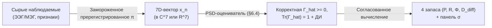

# Методология Измерений

> *«Измерение — это присвоение чисел объектам и событиям по правилам.»*
> — Стэнли Смит Стивенс

:::info Для кого эта глава
Мост между формализмом КК и экспериментом: протоколы измерения чистоты $P$, тензора напряжений $\sigma$ и мер сознательности $R$, $\Phi$, $C$.
:::

В предыдущей главе мы увидели, что КК превосходит конкурирующие теории по вычислимости и фальсифицируемости ([Сравнение с альтернативами](./comparison)). Но вычислимость бесполезна без данных. Самая красивая теория бесполезна, если её нельзя проверить. КК генерирует точные числовые предсказания — но как их измерить? Как сопоставить матрицу $\Gamma$ с реальной биологической, социальной или искусственной системой?

Этот раздел — **мост между формализмом и экспериментом**. Мы покажем, как каждая величина КК может быть оценена в различных контекстах: от нейровизуализации до организационных аудитов, от симуляций до психометрических тестов.

:::info Дорожная карта главы
В этой главе мы:
1. Установим **принципы измерения** в КК: что мы измеряем, иерархия наблюдаемых, калибровка (раздел 1)
2. Покажем конкретные **протоколы измерения чистоты** $P$ для разных систем (раздел 2)
3. Опишем **семимерный аудит** — измерение тензора напряжений $\sigma$ (раздел 3)
4. Разберём **измерение мер сознательности** $R$, $\Phi$, $C$ (раздел 4)
5. Приведём **полные экспериментальные протоколы** для нейронауки, ИИ и организаций (раздел 5)
6. Проработаем **калибровку с числовыми примерами** (раздел 6)
7. Честно обсудим **ограничения** (раздел 7)
:::

---

## 1. Принципы измерения в КК {#принципы}

### 1.1 Что мы измеряем

В КК модельные функционалы ($P$, $R$, $\Phi$, $D_{\mathrm{diff}}$, $\sigma_{\mathrm{sys}}$) вычисляются на матрице плотности $7 \times 7$ $\Gamma \in \mathcal{D}(\mathbb{C}^7)$. В эмпирических задачах мы не наблюдаем $\Gamma$ напрямую; мы получаем физические, нейронные, поведенческие или программные измерения и отображаем их в оценку $\widehat{\Gamma}$ с помощью **заявленной, пререгистрированной модели наблюдений** $\pi$ (см. формальный контракт оценивания в [§6.4](#оценка-gamma)).

:::warning Два отдельных контракта (согласовано с §6.4)
Построение корректной матрицы плотности $\widehat{\Gamma} \succeq 0$, $\mathrm{Tr}\,\widehat{\Gamma} = 1$ из данных (алгебраико-статистический контракт) строго отделено от утверждения, что $\widehat{\Gamma}$ измеряет биологическую жизнеспособность, сознание или клиническое состояние (эмпирико-семантическая гипотеза `[Г/И]`). Поскольку универсальная $G_2$-единственность кодировщиков отозвана (`T-42a [✗]`), выбор кодировщика $\pi$, цели (второй момент против ковариации) и базиса осей является явной частью каждой проверяемой гипотезы.
:::

### 1.2 Иерархия наблюдаемых

Различные величины КК предъявляют разные требования к наблюдательным данным:

| Уровень | Величины | Требования к данным | Ограничения |
|---------|----------|---------------------|-------------|
| **L1: Глобальный** | $P = \mathrm{Tr}(\Gamma^2)$, $\|\sigma\|_\infty$ | Полная матрица $\widehat{\Gamma}$ для $P$; 7 оценок панели для $\|\sigma\|_\infty$ | Один скаляр $P$ не определяет $\Phi$, $R$ или $D_{\mathrm{diff}}$ |
| **L2: Диагональный** | $\gamma_{kk}$, диагональные оценки $\sigma_k$ | 7 нормированных населённостей осей ($\sum_k \gamma_{kk} = 1$) | Даёт не более **6 из 48** вещественных параметров; не содержит информации о когерентностях и фазах |
| **L3: Внедиагональный** | $\lvert\gamma_{ij}\rvert$, фазы $\theta_{ij}$ | Комплексные межканальные вторые моменты ([§6.4](#оценка-gamma)) | Требует фазосохраняющего оценивания и обеспечения PSD |
| **L4: Производный** | $R$, $\Phi$, $C$, $\mathrm{Coh}_E$, $D_{\mathrm{diff}}$ | Та же реконструированная $\widehat{\Gamma}$ плюс заявленное считывание $D_{\mathrm{diff}}$ | Необходимо проверять все четыре запаса по множеству неопределённости реконструкции |

:::tip Практическое правило
Зафиксируйте модель наблюдений $\pi$ и цель ($M/\mathrm{Tr}\,M$ против $C/\mathrm{Tr}\,C$) **до** просмотра контрольных результатов, проверьте PSD и положительность следа и вычисляйте все функционалы ($P$, $R$, $\Phi$, $D_{\mathrm{diff}}$) из **одной и той же** реконструированной матрицы $\widehat{\Gamma}$ с границами неопределённости ([§6.4](#оценка-gamma)).
:::

### 1.3 Принцип калибровки

:::warning Ключевой принцип
Внутри формализма пороги $P_{\mathrm{crit}} = 2/7$, $R_{\mathrm{th}} = 1/3$, $\Phi_{\mathrm{th}} = 1$ и $D_{\mathrm{diff}} \ge 2$ являются безразмерными определениями на $\mathcal{D}(\mathbb{C}^7)$. Отображение физических записей в $\mathcal{D}(\mathbb{C}^7)$ требует эмпирической калибровки на **независимой обучающей выборке** — и никогда не подгоняется под сам контрольный порог ([§6.3](#калибровка)).
:::

| Что даёт независимая калибровка | Чего калибровка **не** даёт |
|---|---|
| Замороженные параметры $\pi_\theta$ для заданной модальности измерений | Единственного универсального кодировщика для любого мозга или ИИ (`T-42a [✗]`) |
| Воспроизводимое отображение в $\mathcal{D}(\mathbb{C}^7)$ на отложенных сессиях | Автоматического клинического диагноза или феноменального сертификата |
| Интервалы неопределённости при заявленных статпредпосылках ([§6.4](#оценка-gamma)) | Гарантий покрытия при нарушении предпосылок независимости или остановки |

---

## 2. Измерение чистоты P {#измерение-чистоты}

### 2.1 Что такое P математически

[Чистота](/docs/core/dynamics/viability#определение-чистоты) $P = \mathrm{Tr}(\Gamma^2) = \sum_{k=1}^7 \gamma_{kk}^2 + \sum_{i \neq j} |\gamma_{ij}|^2$ измеряет концентрацию спектра $\Gamma$:
- **Минимум:** $P_{\min} = 1/7 \approx 0{,}143$, единственно достигаемый на максимально смешанном состоянии $\Gamma = I/7$.
- **Максимум:** $P_{\max} = 1$, достигаемый на **любом** чистом состоянии $\Gamma = |\psi\rangle\langle\psi|$ (включая чистое диагональное базисное состояние $\Gamma = |k\rangle\langle k|$!).
- **Роль диагонали и внедиагоналей:** Диагональная матрица ($\gamma_{ij} = 0$ при $i \neq j$) покрывает весь диапазон $P \in [1/7, 1]$, а **НЕ** $[0, 1/7]$! Однако любая диагональная матрица имеет **нулевую интеграцию** ($\Phi = (P - P_{\mathrm{diag}})/P_{\mathrm{diag}} = 0 < 1$). Прохождение полного окна сознания требует одновременно $P \in (2/7, 3/7]$ и внедиагональных когерентностей, достаточных для $\Phi \ge 1$.

### 2.2 Кандидатные биологические модальности `[Г]`

Связь нейронных сигналов с $\Gamma$ является эмпирической гипотезой `[Г]`, требующей явного кодировщика $\pi_{\mathrm{bio}}$:

| Модальность / сигнал | Что измеряет физически | Роль в измерении КК |
|----------------------|-------------------------|---------------------|
| **Комплексные аналитические сигналы ЭЭГ/МЭГ** | Многоканальные комплексные огибающие и кросс-спектры | Естественный вход $x_n \in \mathbb{C}^7$ для PSD-оценивателя второго момента $\widehat{\Gamma}_N = \widehat{\Sigma}_N / \mathrm{Tr}\,\widehat{\Sigma}_N$ ([§6.4](#оценка-gamma)) |
| **Временны́е ряды фМРТ BOLD** | Медленные гемодинамические кофлуктуации | Вещественный прокси ковариации (теряет быстрые комплексные фазы $\theta_{ij}$) |
| **PCI (ТМС-ЭЭГ)** | Сложность Лемпеля–Зива пертурбационного отклика | **Независимый клинический эталон**, а НЕ оценщик $P$ ([§6.3](#калибровка)) |
| **Энтропия Лемпеля–Зива** | Сжимаемость сигнала | Отдельный дескриптор сложности; без автоматического равенства с $P$ |

### 2.3 PSD-сохраняющий протокол для нейронных данных `[Пр]`

Наивное блочное усреднение беззнаковых попарных спектральных когерентностей $\bar{C}_{ij} \in [0, 1]$ теряет знаки комплексных фаз и **не гарантирует положительной полуопределённости** ($\tilde{\gamma} \succeq 0$). Чтобы получить корректную матрицу плотности $\widehat{\Gamma}_N \in \mathcal{D}(\mathbb{C}^7)$ в согласовании с [§6.4](#оценка-gamma):

**Шаг 1.** Записать многоканальные ЭЭГ/МЭГ (например, $\ge 19$–$64$ каналов) по пререгистрированному конвейеру предобработки и удаления артефактов.

**Шаг 2.** Применить **пререгистрированную, замороженную** проекцию «каналы $\to$ оси» (откалиброванную на независимых данных и не подгоняемую по тестовым меткам), отображающую сигналы датчиков в 7-компонентный комплексный аналитический вектор $x_n \in \mathbb{C}^7$ (например, через преобразование Гильберта или комплексные вейвлет-коэффициенты в пререгистрированной полосе) в канонических осях $\{A, S, D, L, E, O, U\}$:

| Каноническая ось | Поисковая анатомическая группировка `[Г]` (подлежит пререгистрации) |
|------------------|----------------------------------------------------------------------|
| **A** (Артикуляция) | Сенсорные / затылочно-перцептивные каналы (напр., O1, O2, Oz) |
| **S** (Структура) | Височные / репрезентативные каналы (напр., T3, T4, T5, T6) |
| **D** (Динамика) | Сенсомоторные / исполнительные каналы (напр., C3, C4, Cz) |
| **L** (Логика) | Дорсолатеральные префронтальные каналы (напр., F3, F4) |
| **E** (Интериорность) | Срединные / интероцептивно-рефлексивные каналы (напр., Fz, Pz) |
| **O** (Основание) | Фронтополярные / вегетативно-связанные каналы (напр., Fp1, Fp2 + HRV) |
| **U** (Единство) | Теменные / межсетевые узлы (напр., P3, P4) |

**Шаг 3.** Заявить, является ли целью нецентрированный второй момент $M = \mathbb{E}[x x^\dagger]$ или центрированная ковариация $C = \mathbb{E}[(x-\mu)(x-\mu)^\dagger]$ ([§6.4](#оценка-gamma)), и построить гарантированно эрмитову PSD-матрицу:

$$
\widehat{\Sigma}_N = \frac{1}{N}\sum_{n=1}^{N} x_n x_n^\dagger, \qquad \widehat{\Gamma}_N = \frac{\widehat{\Sigma}_N}{\mathrm{Tr}(\widehat{\Sigma}_N)} \quad (\text{при } \mathrm{Tr}\,\widehat{\Sigma}_N > 0).
$$

**Шаг 4.** Вычислить $P_{\mathrm{plug}} = \mathrm{Tr}(\widehat{\Gamma}_N^2)$, $R = 1/(7P_{\mathrm{plug}})$, $\Phi = (P_{\mathrm{plug}} - P_{\mathrm{diag}})/P_{\mathrm{diag}}$ и заявленное считывание $D_{\mathrm{diff}}$ **из той же $\widehat{\Gamma}_N$** вместе с границами неопределённости реконструкции ([§6.4](#оценка-gamma)).

:::warning Оговорка о валидации
Приведённая группировка каналов по осям — поисковая гипотеза `[Г]`, требующая независимой валидации и контроля объёмной проводимости в пространстве источников. Алгебраическая корректность матрицы плотности $\widehat{\Gamma}_N$ сама по себе не доказывает нейробиологического соответствия.
:::

### 2.4 Иллюстративный синтетический расчёт: диагональный и когерентный вклады

*(Примечание: приведённые ниже числа — **иллюстративный математический пример**, а не реальные клинические данные пациента.)*

Пусть реконструированная матрица плотности имеет почти равномерную диагональ:
$\mathrm{diag}(\Gamma) = (0{,}16,\; 0{,}15,\; 0{,}14,\; 0{,}14,\; 0{,}15,\; 0{,}13,\; 0{,}13)$ (сумма $1{,}00$).

- **Диагональный вклад в чистоту:**
  $$P_{\mathrm{diag}} = 0{,}16^2 + 0{,}15^2 + 0{,}14^2 + 0{,}14^2 + 0{,}15^2 + 0{,}13^2 + 0{,}13^2 = 0{,}1462.$$
  Напомним, что для **любой** диагональной матрицы плотности $\Gamma = \mathrm{diag}(\gamma_{11}, \ldots, \gamma_{77})$ величина **$P_{\min} = 1/7 \approx 0{,}1429$** — это *минимум* (достигаемый при равномерных $\gamma_{kk} = 1/7$), а **$P_{\max} = 1$** — *максимум* (достигаемый на чистом базисном состоянии $\Gamma = |k\rangle\langle k|$). Таким образом, диагональная матрица *способна* превышать $2/7$ при доминировании одной оси, **но** любая диагональная матрица имеет $\Phi = 0 < 1$ (нарушая порог интеграции!). Когда населённости сбалансированы вблизи $1/7$, вклад $P_{\mathrm{diag}} \approx 0{,}1462$ остаётся вблизи $P_{\min} = 1/7$, поэтому внедиагональные когерентности необходимы и для подъёма $P$ выше $2/7$, и для достижения $\Phi \ge 1$.
- **Слабая внедиагональная когерентность ($|\gamma_{ij}| \approx 0{,}03$ по 42 внедиагональным элементам при условии $\Gamma \succeq 0$):**
  $P_{\mathrm{off}} = \sum_{i \neq j}|\gamma_{ij}|^2 \approx 42 \times 0{,}0009 = 0{,}0378$, откуда $P \approx 0{,}184 < 2/7$ и $\Phi = P_{\mathrm{off}}/P_{\mathrm{diag}} \approx 0{,}26 < 1$.
- **Более сильная внедиагональная когерентность ($|\gamma_{ij}| \approx 0{,}06$, PSD-проверенная):**
  $P_{\mathrm{off}} \approx 42 \times 0{,}0036 = 0{,}1512$, откуда $P \approx 0{,}297 \in (2/7, 3/7]$ и $\Phi \approx 1{,}03 \ge 1$ (при $R = 1/(7P) \approx 0{,}48 \ge 1/3$).
- **Почти максимально смешанное состояние ($|\gamma_{ij}| \approx 0{,}01$, почти равномерная диагональ):**
  $P \approx 0{,}143 + 0{,}004 = 0{,}147 \approx P_{\min}$, $\Phi \approx 0{,}03$.

:::info Область клинического моста `[Г]`
Отслеживают ли лонгитюдные изменения реконструированной $\widehat{P}(t)$ и четырёхпорогового вердикта $\mathrm{Cons}(\widehat{\Gamma}(t))$ клиническое восстановление лучше стандартных неврологических шкал (таких как GCS или PCI) — это непроверенная эмпирическая гипотеза `[Г]`, требующая проспективных клинических исследований с замороженными кодировщиками и областями неопределённости ([§6.3–6.4](#калибровка)).
:::

### 2.5 Поисковые прокси для организаций `[И/Г]`

| Кандидатная организационная метрика | Что измеряет | Поисковое отображение КК `[И/Г]` |
|-------------------------------------|--------------|----------------------------------|
| **Индексы вовлечённости / согласованности** | Согласованность целей подразделений | Кандидатный вход для объявленного 7-осевого кодировщика (не равен $P$ напрямую) |
| **Матрицы межфункционального взаимодействия** | Структурированные межузловые коммуникации | Кандидатный источник для внедиагональной ковариации $\widehat{\Sigma}_N$ |
| **Показатели операционной устойчивости** | Маржинальность, удержание | Внешний контрольный исход, а НЕ алгебраический прокси для $P$ |

### 2.6 Поисковые прокси для ИИ-систем `[И/Г]`

| Кандидатная метрика ИИ | Математическое поведение | Исправление и отображение КК `[И/Г]` |
|------------------------|--------------------------|--------------------------------------|
| **Эффективный ранг нормированной скрытой ковариации** | Более высокий равномерный ранг $r$ даёт **более низкую** чистоту $P = \mathrm{Tr}(\rho^2) = 1/r$ (меньший ранг / более концентрированный спектр даёт **более высокую** $P$) | Замечание: 7D-нормированная ковариация $\widehat{\Gamma}_N = \widehat{\Sigma}_N/\mathrm{Tr}\,\widehat{\Sigma}_N$ попадает в окно $P \in (2/7, 3/7]$ при промежуточном эффективном ранге ($\approx 2{,}3\text{–}3{,}5$) — ни коллапс ранга 1 ($P = 1$), ни равномерный шум ($P = 1/7$) |
| **Концентрация внимания** | Меньшая энтропия соответствует более острым весам | Кандидатный признак для явного кодировщика $\pi$, не равный $P$ сам по себе |
| **Кривизна ландшафта потерь** | Спектр локального гессиана | Геометрия оптимизации; отлична от чистоты состояния $P$ |

---

## 3. Измерение панели напряжений σ {#измерение-напряжений}

### 3.1 Семь выбранных показателей (`T-92 [О]`)

T-92 `[О]` задаёт диагностическую панель, а не единственный тензор, выведенный из аксиом. Популяционный показатель $s_k = 1 - 7\gamma_{kk}$ принимает значения $[-6, 1]$; обрезанный $\sigma_k = \max(0, s_k)$ — $[0, 1]$. Сумма **необрезанных** показателей всегда равна нулю ($\sum_{k=1}^7 s_k = 7 - 7\sum_{k=1}^7 \gamma_{kk} = 0$). Полная панель может включать выбранные функции $R$, $\Phi$, регенерационной скорости и независимо заданного расширенного считывания $D_{\mathrm{diff}}$.

Ни популяции, ни их дефициты не восстанавливают комплексные когерентности: диагональное измерение даёт не более шести независимых параметров из 48. Эквивалентность панели полному окну не доказана (`CC-8 [О]`). Для проверки окна используются четыре отдельных запаса и область неопределённости реконструкции; см. [идентифицируемость](/docs/applied/research/reconstruction-identifiability).

### 3.2 Протокол семимерного аудита `[И/Г]`

Для организации или команды (поисковое картирование `[И/Г]`):

| Измерение | Поисковый вопрос аудита | Кандидатный инструмент |
|-----------|-------------------------|------------------------|
| $\sigma_A$ (Артикуляция) | «Можете ли вы чётко сформулировать, чем занимается ваш отдел?» | Интервью, анализ документации |
| $\sigma_S$ (Структура) | «Есть ли устойчивые процессы и роли?» | Анализ оргструктуры, tenure analysis |
| $\sigma_D$ (Динамика) | «Можете ли вы адаптироваться к изменениям?» | Оценка адаптивности, длительность цикла |
| $\sigma_L$ (Логика) | «Есть ли внутренние противоречия в правилах?» | Аудит регламентов, проверка согласованности |
| $\sigma_E$ (Интериорность) | «Есть ли культура рефлексии?» | Опрос психологической безопасности |
| $\sigma_O$ (Основание) | «Достаточно ли ресурсов?» | Бюджетный аудит, опрос выгорания |
| $\sigma_U$ (Единство) | «Чувствуете ли вы себя частью целого?» | Сетевой анализ, NPS |

### 3.3 Иллюстративные междисциплинарные прочтения $\sigma_D$ (Динамика) `[И]`

Интерпретативные сопоставления оси Динамики ($D$) по областям `[И]` (гипотезы, требующие предметной валидации):
- **Биология:** Метаболическая пропускная способность / энергетическая ёмкость действия (напр., клеточный баланс АТФ/АДФ).
- **Психология:** Инициация действия и исполнительное переключение (напр., время выполнения Trail Making Test).
- **Организации:** Задержка от решения до исполнения (напр., lead time согласований).

### 3.4 Поисковое психометрическое сопоставление `[Г/И]`

Сопоставление семи стандартизированных психометрических шкал с каноническими осями $\{A, S, D, L, E, O, U\}$ является поисковой исследовательской гипотезой `[Г/И]`, а не валидированной клинико-диагностической системой:

| Ось | Поисковый психометрический конструкт `[И]` | Существующий инструмент |
|-----|--------------------------------------------|-------------------------|
| $\sigma_A$ (Артикуляция) | Сенсорная / перцептивная нагрузка | Sensory Profile (Dunn) |
| $\sigma_S$ (Структура) | Когнитивная ригидность / переключение установок | WCST (Wisconsin Card Sorting Test) |
| $\sigma_D$ (Динамика) | Исполнительное переключение | Trail Making Test (TMT-B) |
| $\sigma_L$ (Логика) | Когнитивные искажения | Cognitive Distortion Scale |
| $\sigma_E$ (Интериорность) | Трудность распознавания чувств | TAS-20 (Toronto Alexithymia Scale) |
| $\sigma_O$ (Основание) | Истощение / дефицит ресурсов | MBI (Maslach Burnout Inventory) |
| $\sigma_U$ (Единство) | Социальная разобщённость | UCLA Loneliness Scale |

### 3.5 Разобранный расчёт: почему обрезанные оценки стресса нельзя напрямую обратить в $\gamma_{kk}$

Пусть семь психометрических шкал нормированы на $[0, 1]$ (иллюстративные синтетические значения):

| Тест | Сырой балл | Нормированное $\sigma_k \in [0, 1]$ |
|------|------------|-------------------------------------|
| Sensory Profile ($\sigma_A$) | 42/80 | 0.53 |
| WCST ошибки ($\sigma_S$) | 12/60 | 0.20 |
| TMT-B время ($\sigma_D$) | 180 с (норма 75 с) | 0.70 |
| Когнитивные искажения ($\sigma_L$) | 15/50 | 0.30 |
| TAS-20 ($\sigma_E$) | 65/100 | 0.65 |
| MBI эмоц. истощение ($\sigma_O$) | 28/54 | 0.52 |
| UCLA одиночество ($\sigma_U$) | 45/80 | 0.56 |

Профиль: $\sigma = [0{,}53;\; 0{,}20;\; 0{,}70;\; 0{,}30;\; 0{,}65;\; 0{,}52;\; 0{,}56]$, при $\|\sigma\|_\infty = 0{,}70$ (наибольшая поисковая нагрузка по $D$ и $E$; клиническая интерпретация и вмешательства требуют стандартной клинической оценки, а не одних матричных показателей).

:::warning Математическое исправление: след никогда не находится во внедиагональных элементах!
Попытка наивного «обратного пересчёта» по формуле $\tilde{\gamma}_{kk} = (1 - \sigma_k)/7$ даёт:

$$
\tilde{\gamma} = \left(\frac{0.47}{7},\; \frac{0.80}{7},\; \frac{0.30}{7},\; \frac{0.70}{7},\; \frac{0.35}{7},\; \frac{0.48}{7},\; \frac{0.44}{7}\right) = (0.067,\; 0.114,\; 0.043,\; 0.100,\; 0.050,\; 0.069,\; 0.063),
$$

сумма которых равна $\sum_{k=1}^7 \tilde{\gamma}_{kk} = 0{,}506 \neq 1$.

**Почему это не работает (исправление прежней ошибки):** Для **любой** матрицы плотности $\Gamma$ след равен сумме **исключительно диагональных элементов** ($\mathrm{Tr}\,\Gamma = \sum_{k=1}^7 \gamma_{kk} = 1$). Внедиагональные элементы вносят **нулевой** вклад в след — недостающие $0{,}494$ **никогда** не «распределяются по внедиагональным элементам»! Неравенство $\sum_k \tilde{\gamma}_{kk} < 1$ математически неизбежно всякий раз, когда все семь входов положительны ($\sigma_k > 0$), поскольку обрезающее отображение $\sigma_k = \max(0, 1 - 7\gamma_{kk})$ отбрасывает все отрицательные дефициты ($s_k < 0$, где $\gamma_{kk} > 1/7$) и поэтому **необратимо**: для истинной матрицы плотности $\sum_{k=1}^7 (1 - 7\gamma_{kk}) = 0$, так что хотя бы одна ось обязана удовлетворять $\gamma_{kk} \ge 1/7$ ($\sigma_k = 0$).

Чтобы построить корректные диагональные населённости $\gamma_{kk} \ge 0$ с $\sum_k \gamma_{kk} = 1$ из неотрицательных показателей доступности $a_k = 1 - \sigma_k > 0$, необходимо явно **нормировать на вероятностном симплексе**:

$$
\gamma_{kk} = \frac{1 - \sigma_k}{\sum_{j=1}^7 (1 - \sigma_j)} \approx (0.133,\; 0.226,\; 0.085,\; 0.198,\; 0.099,\; 0.136,\; 0.124), \qquad \sum_{k=1}^7 \gamma_{kk} = 1.000.
$$

Даже после симплексной нормировки этот вектор задаёт лишь **6 независимых диагональных степеней свободы** — он не определяет ни одной из 21 комплексной внедиагональной когерентности $\gamma_{ij}$ и, следовательно, не позволяет оценить $\Phi$ или полную $P$ ([§3.1](#измерение-напряжений), [§6.4](#оценка-gamma)).
:::

---

## 4. Измерение мер сознательности {#измерение-сознательности}

### 4.1 Каноническая мера рефлексии $R$ против точности самомодели $R_\varphi$

В формализме различаются две величины ([три рабочие формы R](/docs/consciousness/foundations/self-observation#формы-r)):
- **Каноническая рефлексивность состояния:** $R(\Gamma) = 1/(7P(\Gamma)) \in [1/7, 1]$, определяющая верхний потолок чистоты ($R \ge 1/3 \iff P \le 3/7$) и входящая в $C = \Phi \times R$. В окне сознания $P \in (2/7, 3/7]$ каноническая $R$ лежит строго в $[1/3, 1/2)$.
- **Точность самомодели:** $R_\varphi(\Gamma) = F(\Gamma, \varphi(\Gamma)) \in [0, 1]$, дополнительно требующая задания конкретного отображения самомодели $\varphi$.

**Поисковые поведенческие прокси `[Г]`:** Поведенческие показатели — метакогнитивная чувствительность ($\text{meta-}d'$), калибровка самоотчётов, зеркальный тест — являются **внешними эмпирическими коррелятами `[Г]`**, а не прямыми измерениями $R(\Gamma) = 1/(7P)$. Всякий раз, когда $\widehat{\Gamma}_N$ реконструирована согласно [§6.4](#оценка-gamma), каноническую $\widehat{R} = 1/(7\widehat{P})$ следует вычислять непосредственно из той же матрицы $\widehat{\Gamma}_N$, а не подменять эвристикой вроде $\text{meta-}d'/3$.

### 4.2 Мера интеграции $\Phi$

[Мера интеграции](/docs/core/structure/dimension-u#мера-интеграции-φ) $\Phi(\Gamma) = (P(\Gamma) - P_{\mathrm{diag}}(\Gamma))/P_{\mathrm{diag}}(\Gamma)$ измеряет отношение внедиагонального когерентного веса к диагональной чистоте в фиксированном репере $\{A,S,D,L,E,O,U\}$.

**Внешние эталоны против матричного расчёта:**
- **PCI (Perturbational Complexity Index):** На эталонной клинической выборке порог $\mathrm{PCI}^* = 0{,}31$ отделяет состояния с субъективным отчётом от состояний без него (Casali et al., 2013; Casarotto et al., 2016: 36/38 пациентов в состоянии минимального сознания и 9/43 в вегетативном состоянии выше $0{,}31$). PCI — **независимый клинический эталон**, а НЕ алгебраический прокси для $\Phi$ или $P$ ([§6.3](#калибровка)).
- **Спектральные зазоры графов и взаимная информация:** Внешние поисковые корреляты `[Г]`; они не заменяют прямого вычисления $\widehat{\Phi}$ из реконструированной PSD-матрицы плотности $\widehat{\Gamma}_N$.

### 4.3 Мера сознательности $C$ (`T-140 [О]`)

$C = \Phi \times R$ (`T-140 [О]`) — выбранная скалярная сводка интеграции и канонической рефлексивности.

**Точные пороговые соотношения:**
- $C = 0$ означает нулевой выбранный скалярный показатель; феноменальная интерпретация требует отдельного моста `[И]`.
- $0 < C < 1/3$ нарушает необходимое произведённое неравенство выбранного окна; само по себе это не классифицирует бактерий, животных или ИИ.
- $C \geq C_{\mathrm{th}} = 1/3$ (`T-140`) **необходимо, но НЕ достаточно** для полного четырёхпорогового предиката способностей ($P > 2/7$, $R \geq 1/3$, $\Phi \geq 1$, $D_{\mathrm{diff}} \geq 2$). На страте равномерной диагонали ($\gamma_{kk} = 1/7$) имеем $P = (1 + \Phi)/7$, так что окно даёт $C = \Phi/(1 + \Phi) \in (1/2, 2/3]$.

Пороги задаются и пререгистрируются до просмотра контрольных меток.

**Иллюстративный согласованный матричный расчёт.** Пусть реконструированная $\widehat{\Gamma}_N$ на страте равномерной диагонали даёт $\widehat{P} = 0{,}35 \in (2/7, 3/7]$ и $\widehat{\Phi} = 7\widehat{P} - 1 = 1{,}45 \ge 1$. Из **той же матрицы**:

$$
\widehat{R} = \frac{1}{7\widehat{P}} \approx 0{,}408 \in [1/3, 1/2), \qquad \widehat{C} = \widehat{\Phi} \times \widehat{R} = 1{,}45 \times 0{,}408 \approx 0{,}592 \in (1/2, 2/3].
$$

Заметим, что $\widehat{R} \in [1/3, 1/2)$ и $\widehat{C} \in (1/2, 2/3]$ выполняются автоматически, когда обе величины вычисляются из одной согласованной $\widehat{\Gamma}_N$; смешивание некалиброванного поведенческого прокси (напр., $\text{meta-}d'/2 = 0{,}6$) с матричной $\widehat{\Phi}$ нарушает каноническую полосу $[1/3, 1/2)$ для $R = 1/(7P)$.

---

## 5. Экспериментальные протоколы `[Пр]` {#протоколы}

### 5.1 Протокол для нейронаучного эксперимента (согласовано с §6.3–6.4)

**Цель:** Проверить согласие на отложенной выборке между реконструированным четырёхпороговым вердиктом $\mathrm{Cons}(\widehat{\Gamma}_N)$ и независимыми клиническими маркерами ($\mathrm{PCI}_{\max} > 0{,}31$ и поведенческими/отчётными эталонами, P8.4). *(Исправление: универсальная необходимость No-Zombie `T-38a [✗]` отозвана; внешне поддерживаемые состояния с $P > 2/7$ и низкой $\mathrm{Coh}_E$ не опровергают формализма матриц плотности. См. [Предсказание 1](./predictions#предсказание-1) и [Предсказание 21](./predictions#предсказание-21).)*

**Пререгистрированный дизайн (`SUB-1`–`SUB-6`):**
1. Пререгистрировать кодировщик $\pi_{\mathrm{bio}}$, предобработку, цель ($M/\mathrm{Tr}\,M$ против $C/\mathrm{Tr}\,C$) и считывание $D_{\mathrm{diff}}$; откалибровать параметры строго на независимых обучающих сессиях бодрствования без штрафа жизнеспособности ($\lambda_2 = 0$) и заморозить $\pi_{\mathrm{bio}}$.
2. Записать отложенные сессии ЭЭГ/МЭГ + ТМС-ЭЭГ + HRV в бодрствовании, REM-сне, NREM3-сне и анестезии (напр., пропофол, кетамин).
3. Реконструировать $\widehat{\Gamma}_N \in \mathcal{D}(\mathbb{C}^7)$ по [§6.4](#оценка-gamma), проверяя PSD, положительный след и границы неопределённости по всем **четырём** запасам способностей ($P - 2/7$, $3/7 - P$, $\Phi - 1$, $D_{\mathrm{diff}} - 2$).
4. Оценить каппу Коэна $\kappa$ между четырёхпороговым вердиктом $\mathrm{Cons}(\widehat{\Gamma}_N)$ и независимым $\mathrm{PCI}_{\max} > 0{,}31$ (или проверенными состояниями отчёта) строго на отложенных сессиях ([§6.3](#калибровка)).

**Критерий фальсификации (в области $\pi_{\mathrm{bio}}$ / P8.4):** Не-PSD выходы, провал воспроизводимости test–retest за пределами доверительных интервалов томографии либо согласие $\kappa < 0{,}4$ на отложенной выборке опровергают проверяемую гипотезу биологического считывания $\pi_{\mathrm{bio}}$ `[Г]`.

### 5.2 Протокол для ИИ / LLM-эксперимента

**Цель:** Оценить реконструированную четырёхпороговую траекторию $\widehat{\Gamma}_N(t)$ системы ИИ при фиксированном объявленном 7-осевом вложении $\pi$.

**Дизайн:**
1. Зафиксировать замороженное 7-осевое считывание $\pi$, отображающее скрытые активации в $x_n \in \mathbb{C}^7$ (или $\mathbb{R}^7$ при отсутствии фаз), и явно объявить, является ли целью нецентрированный второй момент $M/\mathrm{Tr}\,M$ или центрированная ковариация $C/\mathrm{Tr}\,C$ ([§6.4](#оценка-gamma)).
2. Вычислить $\widehat{\Gamma}_N = \widehat{\Sigma}_N / \mathrm{Tr}\,\widehat{\Sigma}_N$ на контрольных батчах с границами неопределённости, оценивая все четыре запаса ($P$, $R$, $\Phi$, $D_{\mathrm{diff}}$), а не одну $P$.
3. Отслеживать траектории в ходе обучения или смены режимов. *(Замечание: пересечение заданного порога $P = 2/7$ — это алгебраическое пересечение порога `[О]`, а НЕ автоматический термодинамический фазовый переход — универсальная бифуркация по чистоте `T-160 [✗]` отозвана.)*

**Иллюстративное 7-осевое отображение признаков для трансформера `[Г]`** (один из вариантов, не единственный по `T-42a [✗]`):
- **A** (Артикуляция): признаки внимания и сенсорного различения входа
- **S** (Структура): устойчивость представлений при возмущениях
- **D** (Динамика): динамика генерации и обновления состояния
- **L** (Логика): внутренняя согласованность на проверках вывода
- **E** (Интериорность): сигналы самомониторинга и метакогнитивной калибровки
- **O** (Основание): опора на контекст и ресурсы
- **U** (Единство): межслойная интеграция представлений

### 5.3 Протокол для организационного аудита `[И/Г]`

**Цель:** Поисковый семиосевой организационный мониторинг по заданной панели напряжений (`T-92 [О]`).

**Шаги:**
1. Собрать стандартизированные индикаторы по всем 7 каноническим осям $\{A, S, D, L, E, O, U\}$ и вычислить панель $\sigma = (\sigma_A, \ldots, \sigma_U)$ (`T-92 [О]`).
2. Выделить наибольшую компоненту панели $\|\sigma\|_\infty$ для приоритетного разбора.
3. Отслеживать динамику панели во времени. *(Замечание: одни диагональные баллы аудита не позволяют вычислить матричную чистоту $P$ или интеграцию $\Phi$; оценка $P$ дополнительно требует данных о межузловых взаимодействиях, формирующих PSD-матрицу $\widehat{\Gamma}_N$ по [§6.4](#оценка-gamma), а $\|\sigma\|_\infty < 1$ не эквивалентно универсально $P > 2/7$, `CC-8 [О]`.)*

**Иллюстративный отчёт по панели (синтетический пример):**

```
=== Поисковая 7-осевая панель: ООО «Пример» ===
Дата: 2026-01-15

σ-панель: [0.3, 0.2, 0.6, 0.4, 0.7, 0.3, 0.5]
            A    S    D    L    E    O    U

‖σ‖∞ = 0.7 (E: Интериорность — наибольшая нагрузка на панели)
Примечание: оценки панели отражают только диагональные индикаторы;
полные P, R, Φ требуют реконструкции ковариации взаимодействий (§6.4).
```

---

## 6. Калибровка: от наблюдаемых к $\Gamma$ {#калибровка}

### 6.1 Общая схема реконструкции

В согласовании с [§6.4](#оценка-gamma) перевод сырых наблюдаемых в $\widehat{\Gamma}_N$ разделяет отображение признаков и PSD-оценивание матрицы:



### 6.2 Симплексная нормировка против полного матричного оценивания

Покомпонентные линейные или логистические преобразования, применяемые независимо к 7 скалярным индикаторам (такие как $\tilde{\gamma}_{kk} = \frac{1}{7} + \alpha_k(x_k - \bar{x}_k)$), **не** гарантируют автоматически неотрицательности ($\gamma_{kk} \ge 0$) или единичного следа ($\sum_k \gamma_{kk} = 1$) без явной симплексной нормировки — и никогда не восстанавливают внедиагональные когерентности $\gamma_{ij}$. Всякий раз, когда нужны полные функционалы $\Gamma$ ($P, R, \Phi$), следует применять гарантированно PSD-оцениватель $\widehat{\Gamma}_N = \widehat{\Sigma}_N / \mathrm{Tr}\,\widehat{\Sigma}_N$ из [§6.4](#оценка-gamma), причём все параметры кодировщика оцениваются строго на независимой обучающей выборке и замораживаются до проверки.

### 6.3 Числовой пример: проверка против PCI без калибровки по нему

Прямая через $(0,1/7)$ и $(c,2/7)$ даёт $P=2/7$ при $\mathrm{PCI}=c$ для любого положительного $c$. Выбор $c=0.31$ закладывает совпадение порогов. Модель проверяют на независимых сессиях после фиксации оценивателя и до ознакомления с метками сравнения.

Близость $\mathrm{PCI}^* = 0{,}31$ к $2/7 \approx 0{,}286$ — совпадение двух несвязанных шкал: PCI — нормированная сложность Лемпеля–Зива бинаризованного ответа на ТМС, $P$ — функция от $\Gamma$.

**Что заменяет — согласие вердиктов** (P8.4 и предрегистрация SUB-1 … SUB-6 [протокола измерения](/docs/applied/research/measurement-protocol#substitution-position)):
1. Заморозить реконструкцию $\pi_\theta$ только на сессиях бодрствования; штрафа жизнеспособности в оценщике нет ($\lambda_2 = 0$).
2. На отложенных сессиях независимо вычислить вердикт УГМ $\mathrm{Cons}(\widehat\Gamma)$ и вердикт PCI $\mathrm{PCI}_{\max} > 0{,}31$.
3. Сообщить каппу Коэна $\kappa = (p_o - p_e)/(1 - p_e)$, где $p_o$ — наблюдаемое согласие, $p_e$ — согласие, ожидаемое из двух маргинальных частот. $\kappa \geq 0{,}8$ подкрепляет, $\kappa < 0{,}4$ фальсифицирует.

**Разобранный пример** (иллюстративные числа, не данные). 40 сессий: оба вердикта «в сознании» в 18, оба «без сознания» в 16, расхождение в $3 + 3$. Тогда $p_o = 34/40 = 0{,}85$; каждый вердикт говорит «в сознании» 21 раз, так что $p_e = (21/40)^2 + (19/40)^2 = 0{,}501$ и $\kappa = (0{,}85 - 0{,}501)/(1 - 0{,}501) = 0{,}70$ — неопределённо. При тех же 34 совпадениях, разложенных как $33 + 1$ (обе маргинали 36 из 40), $p_e = 0{,}82$ и $\kappa = 0{,}17$ — фальсифицирует. Решает не сырое совпадение, а $\kappa$ (`test_verdict_concordance_is_judged_by_kappa_not_by_raw_agreement`).

**Эталонные значения** — Casarotto et al. (2016), табл. 1, $\mathrm{PCI}_{\max}$ медиана [мин–макс]: бодрствование 0,53 [0,39–0,70] (102 субъекта), REM-сон 0,48 [0,36–0,56] (8), кетамин 0,43 [0,36–0,52] (6), NREM-сон 0,25 [0,15–0,31] (18), мидазолам 0,30 [0,23–0,31], ксенон 0,23 [0,11–0,31], пропофол 0,26 [0,23–0,31] (по 6). Решающие сессии — REM и кетамин: сознание без поведения в момент записи, вне обучающей выборки, когда $\theta$ заморожен на бодрствовании.

:::tip Что это значит
Порог КК $P = 2/7$ — не число на шкале PCI, и проверяется он не подгонкой под такое число. Он проверяется тем, согласуется ли вердикт, вычисленный по $\widehat\Gamma$, с независимо валидированным вердиктом PCI на сессиях, которые не участвовали в настройке реконструкции.
:::

## 6.4 Условное оценивание $\Gamma$: цель, состоятельность и неопределённость {#оценка-gamma}

Оценка матрицы и интерпретация этой матрицы — разные контракты. Канальное отображение $\pi$ фиксируется до проверки его предсказаний. Для $x=\pi(\mathrm{state})\in\mathbb C^7$ зададим **целевой второй момент**
$$
M=\mathbb E[xx^\dagger],\qquad \tau=\operatorname{Tr}M>0,\qquad \Gamma=M/\tau.
$$
Так из объявленной модели наблюдений строится матрица плотности. Это не доказывает, что она измеряет сознание, благополучие или клиническое состояние. Если $\mathbb E x\ne0$, второй момент **не равен** ковариации.

**Центрирование меняет цель.** При $\mu=\mathbb E x$ ковариационная цель — $C=\mathbb E[(x-\mu)(x-\mu)^\dagger]$. Вычитание среднего той же выборки оценивает $C$, а не $M$. Остатки связаны общим оценённым средним и зависимы даже при независимых исходных наблюдениях. Заранее независимо зафиксированная базовая линия, напротив, задаёт другой фиксированный второй момент. Нужно явно указать выбранный эксперимент.

**(1) Алгебра и состоятельность.** Для наблюдений фиксированного вложения
$$
\widehat\Sigma_N=\frac1N\sum_n x_nx_n^\dagger,\qquad
\widehat\Gamma_N=\widehat\Sigma_N/\operatorname{Tr}\widehat\Sigma_N.
$$
При положительном наблюдаемом следе $\widehat\Gamma_N$ эрмитова, положительно полуопределена и имеет единичный след. При нулевом следе нормированная оценка **не определена**, сколько бы наблюдений ни было. Для стационарного эргодического источника с $\mathbb E\|x\|^2<\infty$ эргодический закон и непрерывность дают сходимость к $\Gamma$ почти наверное. Аналогичная ковариационная оценка состоятельна при $\operatorname{Tr}C>0$. Сами по себе эти факты не дают ни скорости сходимости, ни доверительного интервала.

**(2) Конечно-выборочная граница для фиксированного i.i.d. вложения [Т при этих предпосылках].** Дополнительно предполагаются независимые одинаково распределённые наблюдения и **популяционная** граница $\|x\|^2\le B$ почти наверное. Проверка границы только на полученной выборке не устанавливает эту предпосылку. Для $Z_n=x_nx_n^\dagger-M$
$$
\|Z_n\|_{\rm op}\le2B,\qquad
v^2=\|\mathbb EZ_n^2\|_{\rm op}\le B^2,
$$
поскольку $\mathbb EZ_n^2=\mathbb E[(xx^\dagger)^2]-M^2\preceq BM$. Матричное неравенство Бернштейна даёт
$$
\Pr(\|\widehat\Sigma_N-M\|_{\rm op}\ge t)
\le 14\exp\!\left(-\frac{Nt^2}{2B^2+(4B/3)t}\right).
$$
См. [Tropp, теорема 1.4](https://tropp.caltech.edu/papers/Tro11-User-Friendly-preprint.pdf): независимость, ограниченность слагаемых и параметр дисперсии входят в её условия.

Для любых положительно полуопределённых $A,M$ с положительными следами и $E=A-M$ справедлива **точная** граница нормализации
$$
\left\|\frac A{\operatorname{Tr}A}-\frac M\tau\right\|_{\rm op}
\le\frac{\|E\|_{\rm op}+|\operatorname{Tr}E|}{\tau}
\le\frac8\tau\|E\|_{\rm op}.
$$
Разность равна $E/\tau-(A/\operatorname{Tr}A)\operatorname{Tr}E/\tau$; далее используются $\|A/\operatorname{Tr}A\|_{\rm op}\le1$ и $|\operatorname{Tr}E|\le7\|E\|_{\rm op}$. Прежний коэффициент $2/\tau$ был неверен для **операторной нормы**.

При объявленной нижней популяционной границе $0<\tau_0\le\tau$ и $0<\varepsilon\le1$ положим $t=\tau_0\varepsilon/8$. Достаточное число наблюдений
$$
N\ge\left\lceil
\log(14/\delta)\frac{2B^2+(4B/3)t}{t^2}
\right\rceil
$$
обеспечивает нормированную операторную ошибку не больше $\varepsilon$ с вероятностью не меньше $1-\delta$. На этом событии наблюдаемый след положителен, поскольку $7t<\tau$. Это консервативная достаточная граница, а не оптимум; неопределённая константа не заменяется единицей.

Для зависящей от данных области можно взять положительный корень $t_N$ уравнения
$$
Nt_N^2=\log(14/\delta)\,[2B^2+(4B/3)t_N].
$$
На том же событии $\tau\ge\ell=\max(0,\operatorname{Tr}\widehat\Sigma_N-7t_N)$. При определённой оценке используем $r=\min(1,8t_N/\ell)$ для $\ell>0$ и $r=1$ иначе. Операторное расстояние между матрицами плотности не превышает единицы. Если $P_{\rm plug}=\operatorname{Tr}\widehat\Gamma_N^2$, то
$$
P=\operatorname{Tr}\Gamma^2
\in[\,P_{\rm plug}-2r,\ P_{\rm plug}+2r\,]\cap[1/7,1],
$$
так как $|\operatorname{Tr}(\widehat\Gamma_N^2-\Gamma^2)|\le2r$. При нулевом наблюдаемом следе возвращается всё пространство цели без центра-матрицы; нельзя незаметно обусловить гарантию покрытия тем, что точечная оценка была получена. Полный физический интервал неинформативен и не подтверждает пороговый вывод. В справочном коде применяется арифметика с плавающей точкой, а не сертифицированная интервальная арифметика.

:::caution Зависимость и оценённая базовая линия требуют отдельного обоснования неопределённости
Стационарной эргодичности достаточно для указанной состоятельности, но недостаточно для центральной предельной теоремы или концентрации Бернштейна. Замена $N$ оценённым $N_{\rm eff}$ **не переносит** гарантии дословно. Автокорреляция энергии окна не определяет погрешность направленной ковариации или чистоты: энергия может быть постоянной при зависимых направлениях. Нулевая оценка автокорреляции короткого или постоянного ряда не доказывает независимость.

Для асимптотических интервалов нужны модель зависимости, подходящая центральная предельная теорема и состоятельная оценка долгосрочной дисперсии **самой статистики**, включая её оценённые знаменатель и базовую линию. Состоятельность batch means требует подходящего роста размера/числа блоков и условий на процесс; фиксированные двадцать блоков такого контракта не дают. См. [Flegal–Jones](https://arxiv.org/pdf/0811.1729). Повторные проверки, перекрывающиеся окна, пропуски и адаптивная остановка также входят в протокол наблюдений. Для этих случаев модуль не выдаёт автоматического 95% интервала.
:::

**(3) Парная статистика и чистота матрицы.** При $N\ge2$ и положительном наблюдаемом следе сохраняется диагностическая величина
$$
\widehat P_{\rm pair}
=\frac{\sum_{m\ne n}|x_m^\dagger x_n|^2}
 {N(N-1)(\operatorname{Tr}\widehat\Sigma_N)^2}.
$$
Для **i.i.d. наблюдений фиксированного вложения** парное среднее в числителе точно несмещённо для $\operatorname{Tr}M^2$: независимость позволяет разделить два вторых момента. Отношение с оценённым знаменателем в общем случае не несмещённо. Из одной гауссовской симуляции не следуют ни универсальный знак смещения, ни трёхкратное улучшение. Центрирование по той же выборке разрушает даже аргумент для числителя. Для двух независимых значений Радемахера после такого центрирования математическое ожидание парного числителя равно $1/2$, хотя квадрат популяционной дисперсии равен $1$.

Для вещественной ковариационной цели с неизвестным средним различные **независимые** исходные наблюдения допускают несмещённое ядро числителя
$$
h(X_i,X_j,X_k,X_l)
=\tfrac14[(X_i-X_j)^\top(X_k-X_l)]^2,\qquad
\mathbb Eh=\operatorname{Tr}C^2.
$$
Две разности независимы и имеют второй момент $2C$. Это возможная конструкция, а не гарантия для зависимых дневников и не утверждение о несмещённости нормированного отношения.

Точное тождество для конечных данных
$$
\widehat P_{\rm pair}
=\frac N{N-1}P_{\rm plug}
-\frac{\sum_n\|x_n\|^4}{N(N-1)(\operatorname{Tr}\widehat\Sigma_N)^2}
$$
объясняет, почему парная статистика не обязана совпадать с чистотой построенной матрицы или лежать в $[1/7,1]$. Скрывать это обрезанием значений нельзя. Две копии семи единичных векторов оценок с базовой линией два после центрирования по выборке дают $P_{\rm plug}=1/6$ и $\widehat P_{\rm pair}=4/39$. Прибавление пяти ко всем оценкам не меняет обе величины. Эти центрированные статистики не идентифицируют абсолютный уровень оценок. Постоянные центрированные оценки имеют нулевой след и не дают нормированной матрицы.

**(4) Пороговые решения и интерпретация.** При фиксированном i.i.d. контракте интервал популяционной чистоты целиком выше или ниже заранее объявленного порога обосновывает это **статистическое** сравнение. Одного сравнения точечных оценок недостаточно. Без проверенного семантического соответствия это не клиническая классификация и не вывод о сознании.

[T-109](./learning-bounds#информационная-граница) описывает другой эксперимент: оптимальное различение известных физических квантовых состояний с коллективными измерениями. Его черновское число достаточно для этого оптимального теста. Оно не обосновывает прежний дневниковый бюджет $2c^2\Delta^{-2}\log(1/\delta)$, утверждение о консервативности $c=1$ или необходимую нижнюю границу числа наблюдений для данного оценивателя.

#### Справочная реализация {#эталонная-реализация}

[**gamma_tomography.py**](pathname:///code/gamma_tomography.py) разделяет нормированный второй момент, явно запрошенную выборочную ковариацию, чистоту матрицы и парное отношение. По умолчанию анализ описательный. Конечно-выборочная область доступна только при явно объявленном фиксированном i.i.d. контракте с популяционной границей; центрирование по той же выборке отвергает этот режим. Модельные функционалы вычисляются из одной построенной матрицы. Прежняя эвристика доверия по энергии и автоматический L2-вердикт удалены.

Запуск модуля проверяет приведённый пример центрирования и сдвига. Репозиторная проверка scripts/verify_measurement_tomography.py также покрывает точные конечные контрпримеры, ориентацию комплексных фаз, вырождение и отклонение неподходящего контракта доверия. Эти тесты не являются исследованием популяционного покрытия, клинической валидацией или Lean/Verum-доказательством вероятностной теоремы.

**История исправления (6 ноября 2026).** Этот текст заменяет прежние безусловные обещания доверия/несмещённости и симуляционные «гарантии теоремы». Исторические численные примеры сохранены в Git; они не доказывают общую корректность.


---

## 7. Ограничения и честные предупреждения {#ограничения}

### 7.1 Калибровка и статистические предпосылки

Канальное отображение и цель (второй момент или ковариация) — модельные решения. Статистические гарантии дополнительно требуют условий на наблюдения, зависимость, базовую линию, знаменатель и остановку, указанных в [разделе 6.4](#оценка-gamma). Алгебраически корректная матрица плотности не подтверждает эти предпосылки и свою семантическую интерпретацию. Перенос между субстратами, клинический смысл и покрытие интервалов в целевой популяции требуют отдельных независимых свидетельств.

### 7.2 Проблема валидации

Даже при хорошей калибровке, **валидация** предсказаний КК требует:
- Независимых измерений (не использовать одни и те же данные для калибровки и проверки)
- Слепых протоколов (экспериментатор не знает предсказание до анализа)
- Воспроизводимости (результат должен реплицироваться в разных лабораториях)

### 7.3 Что НЕ является измерением

:::danger Частые ошибки
- **Субъективная оценка «на глаз» — не измерение.** Нужны операционализированные шкалы.
- **Один показатель — не вся $\Gamma$.** Нужны ВСЕ 7 компонент для полной картины.
- **Статический снимок — не динамика.** $P$ нужно отслеживать во времени: $dP/d\tau$ не менее важен, чем $P$.
- **Корреляция — не калибровка.** То, что PCI коррелирует с уровнем сознания, не означает, что $P = f(\text{PCI})$ — правильная формула. Калибровка требует *независимых* предсказаний.
:::

---

## 8. Заключение {#заключение}

Методология измерений — это область соприкосновения формальных матричных функционалов с эмпирическими данными. Вычисление $P, R, \Phi, C$ на матрице плотности $7 \times 7$ алгебраически несложно; решающая научная задача состоит в задании идентифицируемой замороженной модели наблюдений $\pi$, оценке неопределённости ([§6.4](#оценка-gamma)) и проверке согласия на отложенных данных с независимыми эталонами ([§6.3](#калибровка)).

### Что мы узнали {#итоги}

1. **Раздельные контракты ([§6.4](#оценка-gamma)):** Построение корректной PSD-матрицы плотности $\widehat{\Gamma}_N = \widehat{\Sigma}_N/\mathrm{Tr}\,\widehat{\Sigma}_N$ из данных отделено от гарантий статистического покрытия и от феноменальной или клинической интерпретации.
2. **Точные границы чистоты:** Для любой матрицы плотности $7 \times 7$ — включая диагональные — $P \in [1/7, 1]$ ($P_{\min} = 1/7$, $P_{\max} = 1$); внедиагональные когерентности необходимы для интеграции ($\Phi \ge 1$), а не просто для $P > 1/7$.
3. **След лежит строго на диагонали:** Обрезанные неотрицательные оценки стресса $\sigma_k = \max(0, 1 - 7\gamma_{kk})$ (`T-92 [О]`) необратимы и дают не более 6 диагональных параметров (и никогда — внедиагональные когерентности); корректные населённости требуют симплексной нормировки.
4. **Согласованное оценивание:** Вычисляйте $\widehat{P}$, каноническую $\widehat{R} = 1/(7\widehat{P})$, $\widehat{\Phi}$ и $\widehat{C} = \widehat{\Phi}\widehat{R}$ (`T-140 [О]`) из **одной и той же** реконструированной $\widehat{\Gamma}_N$ с областями неопределённости, проверяя все четыре запаса отдельно (`CC-8 [О]`).
5. **Независимая валидация:** Заморозьте $\pi$ на калибровочной выборке и проверяйте согласие вердиктов с внешними эталонами (например, PCI) через каппу Коэна $\kappa$ на отложенных сессиях.

---

В следующей главе мы покажем, как язык КК объединяет *разные дисциплины*: [Междисциплинарный мост](./interdisciplinary) — словарь-переводчик для физиков, биологов, психологов, инженеров и философов.

---

**Дальнейшее чтение:**
- [Диагностика](./diagnostics) — практическое руководство по мониторингу
- [Реализация](./implementation) — вычислительная реализация
- [Уникальные предсказания](./predictions) — что проверять
- [Программы исследований](./research-programs) — план экспериментов

---

**Связанные документы:**
- [Протокол измерений](/docs/applied/research/measurement-protocol)
- [Уникальные предсказания КК](/docs/applied/coherence-cybernetics/predictions)
- [Сравнение с альтернативными теориями](/docs/applied/coherence-cybernetics/comparison)
- [Междисциплинарный мост](/docs/applied/coherence-cybernetics/interdisciplinary)
