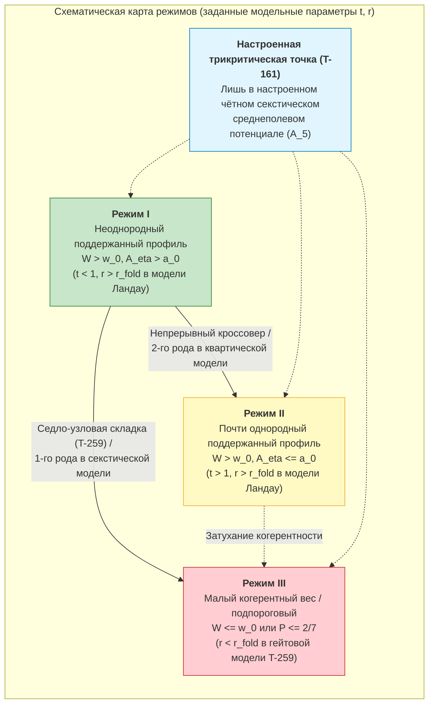
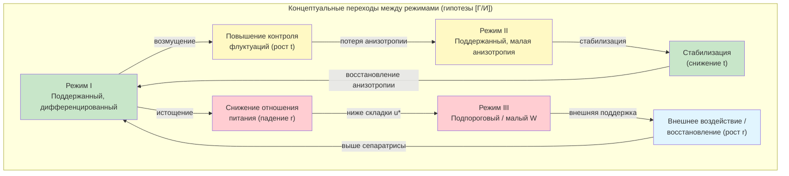

# Фазовая диаграмма: условные режимы и кибернетическая интерпретация

:::info Область применимости и ревизия
Настоящая глава посвящена анализу фазовых режимов в Кибернетике Когерентности (КК). Она разграничивает **строго доказанные** модельные результаты — прежде всего точное окно питания и седло-узловую складку в изотропном потоке первого порядка (`T-259`) — и **условные** среднеполевые конструкции Ландау (`T-161`), **определяемые** описательные режимы и панель напряжений (`T-92`, `CC-8`), а также **эмпирико-интерпретативные гипотезы** (`[Г]`/`[И]`), связывающие матричные режимы с клиническими состояниями. Универсальные утверждения о «ласточкином хвосте» и трёх обязательных фазах (`T-28 [✗]`), размерностно некорректная приведённая температура и универсальные клинические критические показатели ($\beta = 1/4$ для ПРЛ) отозваны.
:::

---

### Мост из предыдущей главы

В [предыдущей главе](./topological-protection) мы рассмотрели структурные механизмы, способные стабилизировать когерентность в заданных моделях. Даже при наличии таких механизмов изменение управляющих параметров — рост амплитуды шума/флуктуаций или падение регенеративного притока относительно дефазировки — переводит систему в качественно иные режимы работы. Данная глава упорядочивает эти режимы, отделяя **точные** результаты от **модельно зависимых**, и фиксирует операциональные условия любого эмпирического моста.

---

### Дорожная карта главы

В этой главе мы:

1. **Уточним управляющие координаты** $(t, r)$ со строгим соблюдением размерностей в согласовании с [Эффективной температурой](./effective-temperature) (разделы «Карта состояний», «Два параметра» и §1).
2. **Сформулируем точное изотропное окно питания (`T-259`)** — доказанные нижнюю и верхнюю границы по $x = \kappa_{\mathrm{eff}}/\Gamma_2$ и самосогласованную складку $S_5$-квинтики (§1.3).
3. **Определим описательные режимы Gap** — неоднородный поддержанный профиль, почти однородный поддержанный профиль и режим малого когерентного веса — не отождествляя описательные пороги с универсальными термодинамическими фазами (§2).
4. **Разграничим условные бифуркации и нормальные формы Ландау** — обычную квартическую модель среднего поля и точно настроенную чётную секстическую трикритическую модель (`T-161`), исправляя отозванное утверждение о катастрофе $A_4$ (`T-28 [✗]`) (§3).
5. **Оформим клиническое картирование и рычаги управления как проверяемые гипотезы `[Г/И]`** — требующие независимых клинических меток и идентифицируемой реконструкции (§4).
6. **Исправим статус панели напряжений (`T-92`, `CC-8`)** — отметив $\|\sigma_{\mathrm{sys}}\|_\infty < 1$ как заданную панель `[О]`, отдельную от четырёх точных запасов способностей, с каноническими именами осей $\{A, S, D, L, E, O, U\}$ (§5).
7. **Очертим точную область физических аналогий** — качественные параллели против формальных модельных словарей (`T-258`) (раздел «Аналогии»).

---

:::note О нотации
В этом документе:
- $\Gamma \in \mathcal{D}(\mathbb{C}^7)$ — [матрица когерентности](/docs/core/dynamics/coherence-matrix) в каноническом базисе 7 осей $\{A, S, D, L, E, O, U\}$ (**A**ртикуляция, **S**труктура, **D**инамика, **L**огика, Интериорность (**E**), Основание (**O**), Единство (**U**))
- $t = T_{\mathrm{eff}}/T_c$ — безразмерная приведённая температура, **корректная лишь после независимого задания положительных $T_{\mathrm{eff}}$ и $T_c$ в одинаковых единицах температуры/энергии** (см. [Эффективная температура §8](./effective-temperature#фазовая-диаграмма))
- $r = \kappa/\Gamma_2$ — безразмерное отношение скорости регенерации $\kappa$ к скорости дефазировки $\Gamma_2 > 0$ (в одинаковых единицах обратного времени)
- $\Gamma_2$ — скорость внедиагональной декогеренции ($= 2\gamma/3$ для однородной дефазировки Фано)
- $\kappa$ — полная скорость регенерации (например, $\kappa = \kappa_{\mathrm{bootstrap}} + \kappa_0 \cdot \mathrm{Coh}_E$ в выбранном кинетическом анзаце)
- $P = \mathrm{Tr}(\Gamma^2)$ — [чистота](/docs/core/dynamics/viability#определение-чистоты), с выбранным HS-порогом большинства $P_{\mathrm{crit}} = 2/7$ `[О]`
- $\sigma_{\mathrm{sys}}$ — выбранная 7-компонентная [панель напряжений](./definitions#тензор-напряжений) (`T-92 [О]`)
:::

Данный документ представляет кибернетический анализ, согласованный с [Режимами Gap и условными фазовыми моделями](/docs/core/dynamics/gap-phase-diagram) и [Эффективной температурой](./effective-temperature).

---

## Карта рабочих режимов {#карта-состояний}

Фазовая диаграмма суммирует, как стационарные режимы заданной динамической или статистической модели меняются при варьировании управляющих параметров. В Кибернетике Когерентности удобно представлять режимы в плоскости двух параметров, сопоставляющих **контроль флуктуаций/беспорядка** ($t$) и **баланс регенерации и диссипации** ($r$), помня при этом, что конкретные границы режимов зависят от **выбранного потенциала, кинетики и модели шума** ([Эффективная температура §8](./effective-temperature#фазовая-диаграмма)).

### Эвристическая аналогия с термодинамическими фазовыми диаграммами `[И]`

В термодинамике $(T, P)$-диаграмма воды разделяет кристалл, жидкость и пар линиями сосуществования, сходящимися в тройной точке. По эвристической аналогии `[И]` условные фазовые модели КК выделяют три качественных режима:

| Термодинамическая аналогия | Описательный режим КК `[О/И]` |
|----------------------------|-------------------------------|
| Температура $T$ | Безразмерное отношение флуктуаций $t = T_{\mathrm{eff}}/T_c$ (при согласованных единицах) |
| Давление / химический потенциал | Безразмерное отношение питания $r = \kappa/\Gamma_2$ |
| **Упорядоченная фаза** (кристаллическая анизотропия) | **Режим I** — неоднородный поддержанный профиль Gap с жизнеспособной чистотой |
| **Разупорядоченная фаза** (изотропная жидкость) | **Режим II** — почти однородный поддержанный профиль Gap ($W > w_0$, малая анизотропия) |
| **Разрушенная / истощённая фаза** | **Режим III** — малый когерентный вес ($W \le w_0$) / подпороговая чистота ($P \le 2/7$) |

Критически важно, что в отличие от термодинамических фаз в бесконечном объёме ($N \to \infty$), одиночная конечная матрица плотности $7 \times 7$ не обладает автоматической термодинамической сингулярностью: резкие бифуркации или среднеполевые переходы возникают лишь внутри **явно заданной динамической или статистической модели** (такой как седло-узловая складка `T-259` или выбранный потенциал Ландау).

---

## Два управляющих параметра и три описательных режима {#два-параметра}

### Контроль флуктуаций $t$ и баланс скоростей $r$

- **Отношение флуктуаций $t = T_{\mathrm{eff}}/T_c$ `[О]`:** Требует независимо откалиброванной эффективной температуры $T_{\mathrm{eff}}$ (через стационарную ФДТ $T_{\mathrm{eff}} = \mathrm{Var}(x)/(k_B \chi(0))$ либо заявленную конвенцию отношения скоростей $T_{\mathrm{ratio}} = (\Gamma_2/\kappa_0)T_{\mathrm{phys}}$) и опорного масштаба $T_c$ в **тех же единицах** ([Эффективная температура §§1–3](./effective-temperature)).
- **Отношение питания/регенерации $r = \kappa/\Gamma_2$ `[О]`:** Измеряет безразмерное отношение скорости регенерации $\kappa$ к скорости внедиагональной дефазировки $\Gamma_2 > 0$ в одинаковых единицах обратного времени.

### Исправление о независимости координат и «трёх неизбежных фазах» (`T-28 [✗]`)

:::warning Важные исправления (в согласовании с `T-28 [✗]` и [Эффективной температурой §8](./effective-temperature#фазовая-диаграмма))
1. **Зависимость координат в конвенции отношения скоростей:** Если выбрать $T_{\mathrm{eff}} = T_{\mathrm{ratio}} = (\Gamma_2/\kappa_0)\,T_{\mathrm{phys}}$ *и* положить $\kappa = \kappa_0$, то
   $$
   t \cdot r = \frac{T_{\mathrm{phys}}}{T_c}.
   $$
   При фиксированных $T_{\mathrm{phys}}$ и $T_c$ пара $(t, r)$ ограничена одной гиперболой, а не независимой двумерной плоскостью! Рассмотрение $t$ и $r$ как независимых координат требует либо независимой амплитудно-шумовой/ФДТ-температуры $T_{\mathrm{eff}}$, либо явно заданной отдельной полной скорости $\kappa \neq \kappa_0$.
2. **Отзыв универсального вывода трёх фаз из «ласточкина хвоста» $A_4$ (`T-28 [✗]`):** Прежний текст утверждал, что три фазы являются «неизбежным топологическим свойством катастрофы Уитни $A_4$». Это утверждение **отозвано** (`T-28 [✗]`): потенциал $A_4$ вида $x^5/5 + ax^3/3 + bx^2/2 + cx$ имеет производную четвёртой степени и поэтому не более **двух** невырожденных внутренних минимумов, а не трёх ([Режимы Gap §5](/docs/core/dynamics/gap-phase-diagram#катастрофы-уитни)). Ограничивающий **чётный секстический** потенциал (росток $A_5$, `T-161`) может иметь три минимума в выделенных областях параметров — и только когда такой редуцированный потенциал явно выведен или выбран.
:::

---

## 1. Управляющие параметры в кибернетическом контексте {#параметры}

### 1.1 Безразмерное отношение температур $t$ `[О]`

Когда эффективная температура $T_{\mathrm{eff}} > 0$ и опорный масштаб кроссовера/перехода $T_c > 0$ **независимо заданы в одинаковых единицах** (обе в кельвинах либо обе как энергии $\Theta_{\mathrm{eff}}, \Theta_c$):

$$
t := \frac{T_{\mathrm{eff}}}{T_c} = \frac{\Theta_{\mathrm{eff}}}{\Theta_c}.
$$

:::warning Исправление размерности (в согласовании с [Эффективной температурой §3](./effective-temperature#критическая-температура))
Прежняя формула $t = (\Gamma_2/\kappa_0) \cdot (k_B T_{\mathrm{phys}} \ln 21 / \mu^2)$ была **размерностно некорректной**: $k_B T_{\mathrm{phys}}$ имеет размерность энергии, тогда как безразмерный параметр массы $\mu^2$ — нет. Любой масштаб вида $T_* = \Delta / (k_B \ln 21)$ требует заявленной энергетической щели $\Delta = E_0 \mu^2$ (с явным физическим масштабом энергии $E_0$) и статистической модели вырождения $Z = 1 + 21 e^{-\Delta/(k_B T)}$ — и в такой модели $T_*$ является гладким **кроссовером** равных вероятностей аналитической конечной статсуммы, а не сингулярным фазовым переходом.
:::

| $t$ (в заданной модели Ландау/статмодели) | Качественный режим `[С/И]` |
|-------------------------------------------|----------------------------|
| $t \ll 1$ | Низкий масштаб флуктуаций относительно порога модели $T_c$; преобладают упорядоченные минимумы |
| $t \approx 1$ | Окрестность модельного кроссовера или среднеполевого порога |
| $t \gg 1$ | Высокий масштаб флуктуаций; преобладает изотропное/разупорядоченное распределение |

### 1.2 Безразмерное отношение питания $r$ `[О]`

При откалиброванных скоростях $\kappa \ge 0$ и $\Gamma_2 > 0$ в одинаковых единицах обратного времени:

$$
r := \frac{\kappa}{\Gamma_2}.
$$

В конкретном кинетическом анзаце $\kappa = \kappa_{\mathrm{bootstrap}} + \kappa_0 \cdot \mathrm{Coh}_E$ при фиксированных $\kappa_0 > 0$ и $\Gamma_2 > 0$ параметр $r$ строго возрастает по $\mathrm{Coh}_E$ (`[Т в заданном линейном кинетическом анзаце]`).

| $r$ | Физический смысл | Модельная интерпретация `[С/И]` |
|-----|------------------|---------------------------------|
| $r \gg r_{\mathrm{fold}}$ | Регенерация доминирует над дефазировкой | Поддерживается жизнеспособная стационарная ветвь (в пределах потолка рефлексивности) |
| $r \approx r_{\mathrm{fold}}$ | Окрестность границы складки | Пограничное поддержание; чувствительность к возмущениям |
| $r < r_{\mathrm{fold}}$ | Диссипация доминирует | В гейтовой модели живая стационарная ветвь отсутствует (`T-259`) |

:::info Эвристика $r_c$ vs. точная микроскопическая граница
Старая эвристика $r_c = P_{\mathrm{crit}}/(7P) \approx 2/(49P)$ **не выводится из микроскопического потока GKSL** и промахивается мимо точной гейтовой складки примерно на два порядка ($0{,}116$ против $21{,}48$ при $P^* = 3/7$). Для изотропного потока замещения следует использовать точную теорему `T-259` ниже!
:::

### 1.3 Точное окно питания (`T-259`) {#точное-окно-питания}

В каноническом изотропном потоке с дефазировкой Фано и замещением точная структура стационарных ветвей и окно жизнеспособности/рефлексивности строго доказаны:

#### Теорема T-259 (Окно сознания в отношении питания) `[Т в изотропной модели первого порядка]` {#теорема-окно-питания}

:::tip Утверждение (`T-259`) `[Т при заданном изотропном потоке с фиксированной целью]`
Рассмотрим изотропную модель: однородную дефазировку Фано со скоростью внедиагонального распада $\Gamma_2 > 0$ и поток замещения $\kappa_{\mathrm{eff}}(\rho^* - \Gamma)$ к равнонаселённой цели $\rho^*$ ($\mathrm{diag}(\rho^*) = 1/7$) с чистотой $P^*$ и когерентной массой $C^* = P^* - 1/7$. Пусть $x = \kappa_{\mathrm{eff}}/\Gamma_2$. Тогда:

1. **Стационарное состояние.** $\Gamma_\infty$ имеет точно $\mathrm{diag}(\Gamma_\infty) = 1/7$ и внедиагональные элементы $\lambda\,\gamma^*_{ij}$ с коэффициентом удержания $\lambda = x/(1+x)$; его чистота равна $P_\infty = 1/7 + \lambda^2 C^*$.
2. **Пол (жизнеспособность $\equiv$ интеграция на равнонаселённой страте).** $P_\infty > P_{\mathrm{crit}} = 2/7$ (эквивалентно $\Phi_\infty > 1$ на этой страте) тогда и только тогда, когда
   $$
   x > x_{\min} = \frac{\lambda_1}{1-\lambda_1}, \qquad \lambda_1 = \frac{1}{\sqrt{7P^* - 1}}.
   $$
   На потолочной цели $P^* = 3/7$: $x_{\min} = 1 + \sqrt{2} \approx 2{,}414$ (серебряное сечение).
3. **Потолок (рефлексивность).** $R_\infty = 1/(7P_\infty) \geq 1/3$ тогда и только тогда, когда $P_\infty \leq 3/7$. Для сверхчистой цели $P^* > 3/7$ окно двустороннее: $x \leq x_{\max} = \lambda_2/(1-\lambda_2)$ с $\lambda_2 = \sqrt{2}\,\lambda_1$ — диссипация ограничивает $P_\infty$ от чрезмерной чистоты (например, при $P^* = 0{,}60$ окно равно $x \in (1{,}268;\, 3{,}775]$).
4. **Нежизнеспособная цель.** Если $P^* \leq 2/7$, никакое конечное $x$ не даёт $P_\infty > 2/7$: подкритическая цель не может породить жизнеспособный стационар.
5. **Самосогласованный гейт: точная складка `[Т в модели]`.** Возврат $\kappa_{\mathrm{eff}} = \kappa \cdot g_V(P)\,(1 - 1/(7P))$ рождает живую стационарную ветвь через седло-узловую складку, и эта складка **точна**: при $s = 7P - 2$ и $c = 7P^* - 1$ самосогласованность вынуждает $\Lambda^2 = (s+1)/c$, а условие касания сводится к квинтике
   $$
   (2\Lambda - 1)\,(c^2\Lambda^4 - 1) \;=\; 4c\,\Lambda^2\,(1 - \Lambda),
   $$
   чей единственный корень $\Lambda^* \in (1/\sqrt{c};\, 1)$ задаёт складку в алгебраической форме: $u^* = \dfrac{c\Lambda^{*2} + 1}{c\Lambda^*(1-\Lambda^*)(c\Lambda^{*2} - 1)}$, $P_{\mathrm{fold}} = \dfrac{c\Lambda^{*2} + 1}{7}$. Классификация по целям полна: при $c < c^\dagger = 392/121 = 2^3 \cdot 7^2 / 11^2 \approx 3{,}240$ зажим $g_V$ на складке неактивен и правит корень квинтики; при $c \geq c^\dagger$ зажим достигается раньше — на зажатой ветви условие касания вырождается в $c\Lambda^2 + 2\Lambda - 1 = 0$, чья критическая точка лежит вне этой ветви, так что складка сидит на изломе $\Lambda^* = \sqrt{2/c}$: живая ветвь рождается при $P_{\mathrm{fold}} = 3/7$ ($R = 1/3$), с $u^* = 3/(\sqrt{2c} - 2)$. На стыковой цели $P^{*\dagger} = 513/847 \approx 0{,}606$ обе формулы дают $u^* = 11/2$ точно. При $c = 2$: $8\lambda^5 - 4\lambda^4 + 8\lambda^3 - 8\lambda^2 - 2\lambda + 1 = 0$, $\Lambda^* = 0{,}858013$, $u^* = 21{,}4811$, $P_{\mathrm{fold}} = 0{,}3532$ (контрольные точки: $c = 1{,}5 \Rightarrow u^* = 75{,}371$; $c = 3 \Rightarrow 6{,}61011$; зажатый режим $c = 4 \Rightarrow 3{,}62132$, $c = 6 \Rightarrow 2{,}04904$). **Галуа-статус `[Т]`:** квинтика при $c = 2$ неприводима над $\mathbb{Q}$ с группой Галуа $S_5$ (порядок $120$), следовательно **в радикалах неразрешима**: константа складки — алгебраическое число пятой степени без радикального выражения, в отличие от безгейтового пола $x_{\min} = 1 + \sqrt{2}$.

**Область физического моста (`[С при физическом согласовании скоростей]`):** Применение этих точных безразмерных порогов к биологической или искусственной системе дополнительно требует независимо измеренных скоростей $(\kappa, \Gamma_2)$, идентифицированной модели субстрата и проверки предпосылок изотропного потока с фиксированной целью.
:::

**Доказательство (1)–(4).** Однородная дефазировка Фано оставляет диагональ инвариантной, а замещение ведёт $\mathrm{diag}(\Gamma)$ к $\mathrm{diag}(\rho^*) = 1/7$. Каждый внедиагональный элемент удовлетворяет $\dot{\gamma}_{ij} = -\Gamma_2\gamma_{ij} + \kappa_{\mathrm{eff}}(\gamma^*_{ij} - \gamma_{ij})$, единственная неподвижная точка которого равна $\gamma_{\infty,ij} = \lambda \gamma^*_{ij}$ с $\lambda = x/(1+x)$. Отсюда $P_\infty = 1/7 + \lambda^2 C^*$. Строгая монотонность $\lambda(x)$ на $(0,\infty)$ переводит $2/7 < P_\infty \le 3/7$ напрямую в указанные границы; на равнонаселённой страте $\Phi = 7P - 1$, так что $P_\infty > 2/7 \iff \Phi_\infty > 1$. При $P^* \le 2/7$ неравенство $\lambda < 1$ даёт $P_\infty < P^* \le 2/7$. $\blacksquare$

В условном гранд-каноническом термодинамическом словаре (`T-258`, `[Т при явно заданном термодинамическом процессе]` + `[И]` для прочтения химического потенциала; см. [Сенсомоторная теория §1.3](/docs/applied/coherence-cybernetics/sensorimotor#теорема-термодинамическая-трихотомия)) унитарный вклад в энтропию равен нулю, а унитальный диссипатор не уменьшает энтропию; чтение отношения питания $r$ как аналога химического потенциала является **интерпретативным модельным словарём** (`[И/С]`), а не автоматическим термодинамическим тождеством без заданного резервуара и энергетического баланса.

---

## 2. Три описательных режима Gap `[О]` {#три-фазы}

Следуя [Режимам Gap и условным фазовым моделям §2](/docs/core/dynamics/gap-phase-diagram#три-фазы), для когерентностей выше заявленного амплитудного порога $S_\eta = \{(i,j) : i < j, |\gamma_{ij}| \ge \eta\}$ определим непрерывный когерентный вес и анизотропию профиля Gap `[О]`:

$$
g_{ij} = \frac{|\mathrm{Im}\,\gamma_{ij}|}{|\gamma_{ij}|}, \qquad W = \sum_{i \neq j} |\gamma_{ij}|^2, \qquad A_\eta = \mathrm{Var}_{S_\eta}(g_{ij}), \qquad J^2 := \|\mathrm{Im}\,\Gamma\|_F^2 = 2\sum_{i<j}|\gamma_{ij}|^2 g_{ij}^2.
$$

Выбор заявленных порогов $(w_0, a_0)$ разбивает поддержанные состояния на три **описательных режима `[О]`** (отличных от универсальных термодинамических фаз):

### 2.1 Схематическая карта режимов `[О/С]`

### 2.2 Режим I: Неоднородный поддержанный профиль Gap `[О]`

:::tip Определение Режима I `[О]`
**Описательный тест:** $W > w_0$ и $A_\eta > a_0$ (при отдельной проверке всех четырёх порогов способностей: $P \in (2/7, 3/7]$, $\Phi \ge 1$, $D_{\mathrm{diff}} \ge 2$).

- Поддержанные когерентности несут **дифференцированное** распределение фазового Gap ($A_\eta > a_0$).
- Условия $W > w_0$ и $A_\eta > a_0$ сами по себе **не** доказывают спонтанного нарушения $G_2$-симметрии или топологической защиты: последние требуют явной симметричной динамической модели и пространственной полевой структуры ([Режимы Gap §2, §8](/docs/core/dynamics/gap-phase-diagram)).
:::

**Эвристическое кибернетическое прочтение `[И]`:** Избирательная прозрачность и непрозрачность по каналам — одни межосевые связи фазово согласованы, другие несут ненулевой фазовый сдвиг. Любое сопоставление с ясным бодрствованием или адаптивной регуляцией является эмпирической гипотезой `[Г]`.

### 2.3 Режим II: Почти однородный поддержанный профиль Gap `[О]`

:::warning Определение Режима II `[О]`
**Описательный тест:** $W > w_0$ и $A_\eta \le a_0$.

- Когерентности остаются поддержанными ($W > w_0$), поэтому чистота ещё может превышать $2/7$, но распределение фазового Gap по поддержанным парам имеет малую дисперсию ($A_\eta \le a_0$).
- Отметим, что равномерные случайные фазы $\theta_{ij} \sim \mathrm{Unif}[0, 2\pi)$ **не** дают однородного Gap $g_{ij}$: точная индуцированная плотность равна $p(g) = \frac{2}{\pi\sqrt{1-g^2}}$ со средним $2/\pi$ и дисперсией $\frac{1}{2} - \frac{4}{\pi^2} \approx 0{,}0947$ (`[Т при равномерном распределении фаз]`, [Режимы Gap §2](/docs/core/dynamics/gap-phase-diagram#три-фазы)). Равенство временны́х средних по каналам не влечёт $G_2$-инвариантности.
:::

**Эвристическое кибернетическое прочтение `[И]`:** Поддержанная когерентность без избирательной дифференциации по каналам. Соотнесение Режима II с диффузной диссоциацией или делирием является эмпирической гипотезой `[Г]`, а не выведенной клинической теоремой.

### 2.4 Режим III: Малый когерентный вес / подпороговая чистота `[О]`

:::danger Определение Режима III `[О]`
**Описательный тест:** $W \le w_0$ (малый внедиагональный когерентный вес), либо в гейтовой динамической модели (`T-259`) $r < r_{\mathrm{fold}}$, ведущий к коллапсу к диагональным состояниям ($P \le 2/7$, $\Phi \to 0$).

- Важное алгебраическое различие: **чистое диагональное состояние** $\Gamma = |k\rangle\langle k|$ имеет $W = 0$ и $\Phi = 0$, но $P = 1 > 2/7$! Таким образом, малый внедиагональный вес $W \le w_0$ нарушает порог интеграции ($\Phi < 1$), даже если одна лишь чистота высока.
- В замкнутой базовой динамике Фано-дефазировки ($\kappa = 0$, связный $H$) максимально смешанное состояние $I/7$ ($P = 1/7$, $\Phi = 0$) является единственным линейным аттрактором; выход из-под закрытого гейта $g_V(P) = 0$ требует внешнего воздействия или иной спецификации гейта ([Устойчивость §6](./stability)).
:::

**Граница феноменологической интерпретации `[И/Г]`:** Невыполнение заданных предикатов способностей ($P \le 2/7$ или $\Phi < 1$) выводит матрицу за пределы определённого окна $\mathcal{V}_{\mathrm{full}}$. Связывание матричного коллапса с клинической комой или отсутствием субъективного опыта требует явного эмпирического и интерпретативного моста (`[Г/И]`) — универсальная необходимость No-Zombie (`T-38a [✗]`) отозвана.

---

## 3. Условные переходы и бифуркации {#переходы}

Резкие переходы между режимами возникают **только** тогда, когда заданы конкретный динамический поток или эффективный функционал свободной энергии Ландау и проверены их условия невырожденности и трансверсальности ([Режимы Gap §§4–7](/docs/core/dynamics/gap-phase-diagram#бифуркации)).

### 3.1 Непрерывный переход в квартической модели среднего поля `[С]`

:::info Условная среднеполевая модель `[С]`
В **выбранном** чётном квартическом скалярном потенциале Ландау $F(A) = \frac{a}{2} A^2 + \frac{u}{4} A^4$ ($u > 0$) с невырожденным линейным отображением параметра $a = a_0(t - 1)$ ($a_0 > 0$) минимизирующая амплитуда подчиняется закону $A \propto (1 - t)^{1/2}$ при $t < 1$ ($\beta = 1/2$), тогда как квадратичная наблюдаемая вроде $A^2$ масштабируется линейно как $(1 - t)^1$ ([Эффективная температура §9](./effective-temperature#параметр-порядка)).
:::

Это среднеполевое масштабирование **условно на выбор данной скалярной квартической модели**. В конечномерной шумовой системе без пространственного/термодинамического предела расходимости восприимчивости и времени релаксации сглаживаются в конечные кроссоверы, а не в точные сингулярности.

### 3.2 Разрывный скачок и гистерезис: точная складка (`T-259`) `[Т в модели]`

:::danger Седло-узловая складка в гейтовом изотропном потоке (`T-259`) `[Т в модели]`
В самосогласованном гейтовом потоке `T-259` снижение отношения питания $u = \kappa/\Gamma_2$ ниже точной складки $u^*$ уничтожает жизнеспособную стационарную ветвь через **седло-узловую бифуркацию**, вызывая скачкообразный сброс на подпороговую ветвь ($P \to 1/7$ при примитивной базе). Поскольку при $u > u^*$ живая ветвь сосуществует с мёртвой неподвижной точкой $I/7$, возвращение демонстрирует **бистабильность/гистерезис**: выход из-под гейта требует внешнего возмущения или перевода состояния выше сепаратрисы, а не простого восстановления $u > u^*$.
:::

### 3.3 Непрерывное затухание без анизотропии {#деградация-ii-iii}

В режимах, где фазовая анизотропия уже отсутствует (или на безгейтовой линейной ветви при убывающем $x$), снижение $r$ плавно уводит когерентный вес $W$ к нулю без седло-узлового скачка (`[С]` на безгейтовой ветви `T-259`). Сопоставление острой декомпенсации и постепенного когнитивного снижения с седло-узловой складкой и гладким затуханием является концептуальной гипотезой `[Г/И]`.

---

## Условная трикритическая точка (`T-161`) {#трикритическая-точка}

### 3.4 Точная область трикритических показателей (`T-161`)

:::warning Условная область — снятие прежнего универсального утверждения $\beta = 1/4$ / ПРЛ (`T-161`)
**Что строго доказано (`T-161`, `[Т в настроенной секстической скалярной среднеполевой модели]`):**
Для **специально настроенного чётного скалярного потенциала Ландау шестой степени**
$$
F(A) = \frac{a}{2} A^2 + \frac{u}{4} A^4 + \frac{w}{6} A^6 \qquad (w > 0),
$$
в точной **трикритической точке**, где **одновременно** $a = 0$ **и** квартический коэффициент обращается в нуль ($u = 0$), при невырожденном линейном температурном отображении $a \propto t - t^*$, классические полиномиальные среднеполевые показатели равны:
$$
\beta = \frac{1}{4}, \qquad \gamma = 1, \qquad \delta = 5, \qquad \alpha = \frac{1}{2}.
$$
Организующей особенностью является **секстический росток $A_5$** (а не $A_4$, исправляя `T-28 [✗]`). Определение показателя пространственной длины корреляции ($\nu$) дополнительно требует пространственной теории поля с градиентным членом $|\nabla A|^2$.

**Что отозвано / НЕ установлено:**
1. **Нет универсальности для полной 7D-матричной динамики:** Эти показатели являются алгебраическими следствиями настроенного чётного секстического скалярного среднеполевого анзаца, **а не** универсальными измеряемыми показателями уравнения GKSL $7 \times 7$. Двадцать одна пара когерентностей — это число внутренних мод, а не пространственная размерность или термодинамический предел $N \to \infty$ ([Эффективная температура §9](./effective-temperature#параметр-порядка)).
2. **Нет выведенного клинического предсказания для пограничного расстройства личности (ПРЛ):** Прежний текст утверждал, что ПРЛ соответствует трикритической точке, и предсказывал универсальный нейрофизиологический показатель $\beta = 1/4$ у пациентов с ПРЛ. Это утверждение **удалено**: настроенная скалярная нормальная форма среднего поля **не** выводит психиатрические диагнозы, клинические механизмы суицидальности или диагностические показатели ПРЛ. Любая эмпирическая проверка скейлинга флуктуаций в клинических выборках является самостоятельной клинической гипотезой `[Г]`, требующей пререгистрированных наблюдаемых, клинических контролей и статистического сравнения моделей.
:::

---

## 4. Поисковые клинические гипотезы `[Г/И]` {#клиника}

Сопоставление описательных матричных режимов с неврологическими или психиатрическими состояниями является **невалидированной эмпирической гипотезой `[Г]`** в сочетании с **интерпретативным мостом `[И]`** ([Режимы Gap §3](/docs/core/dynamics/gap-phase-diagram#клиническое-соответствие)). Ни одна из приведённых ниже таблиц не является клиническим диагностическим инструментом или медицинским руководством.

### 4.1 Поисковое сопоставление описательных режимов `[Г/И]`

| Описательный режим `[О]` | Математическая сигнатура | Поисковая клиническая гипотеза `[Г/И]` (не валидирована) |
|--------------------------|--------------------------|----------------------------------------------------------|
| **Режим I** | $W > w_0$, $A_\eta > a_0$, все пороги $\mathsf{Cap}_2$ выполнены | Структурированное бодрствующее познание с избирательной фазовой дифференциацией |
| **Режим II** | $W > w_0$, $A_\eta \le a_0$ | Диффузная недифференцированная когерентность (гипотетический аналог диссоциации/делирия) |
| **Режим III** | $W \le w_0$ или $P \le 2/7$, $\Phi < 1$ | Низкая интеграция / подпороговая чистота (гипотетический аналог глубокой седации/комы) |
| **Пересечение складки (`T-259`)** | Седло-узловая потеря живой ветви ($u < u^*$) | Резкая утрата сетевой интеграции при метаболическом/регуляторном срыве |

### 4.2 Гипотезы по подрежимам и наблюдаемым `[Г/И]` {#клиническое-отображение}

Внутри Режима I состояния могут различаться по рангу антисимметричной мнимой части $\mathrm{Im}\,\Gamma \in \mathfrak{so}(7)$ (имеющему чётные значения $0, 2, 4$ или $6$ — см. [Режимы Gap §8](/docs/core/dynamics/gap-phase-diagram#голдстоуновские-моды)), а также по четырём точным запасам $(P - 2/7,\, 3/7 - P,\, \Phi - 1,\, D_{\mathrm{diff}} - 2)$. Однако:
- Один лишь ранг матрицы **не** определяет психологические состояния («поток», «медитация») или баллы по шкале комы Глазго.
- Любая клиническая градация требует независимых эталонных клинических меток, лонгитюдных измерений, идентифицируемой реконструкции состояния ([Реконструкция и идентифицируемость](/docs/applied/research/reconstruction-identifiability)) и отложенной валидации.

### 4.3 Концептуальная схема переходов между режимами `[И]`

### 4.4 Операциональный протокол классификации режимов `[Пр/Г]`

:::info Операциональная классификация режимов `[Пр]`
1. **Реконструировать $\widehat{\Gamma}$ с оценкой погрешности:** Оценить $\widehat{\Gamma} \in \mathcal{D}(\mathbb{C}^7)$ через пререгистрированное, идентифицируемое считывание ([Измерение сознания](./measurement)); внешние клинические индексы вроде PCI служат независимой проверкой, а не заменой $P$.
2. **Проверить все четыре запаса способностей отдельно:** Вычислить $P - 2/7$, $3/7 - P$, $\Phi - 1$ и $D_{\mathrm{diff}} - 2$ с доверительными интервалами.
3. **Вычислить описательные наблюдаемые Gap:** Оценить когерентный вес $W$, амплитудно-маскированную дисперсию $A_\eta$ (указав $\eta$) и непрерывную меру $J^2 = \|\mathrm{Im}\,\Gamma\|_F^2$.
4. **Классифицировать режим (или выдать «неизвестно» при недостаточной поддержке):**
   - $W > w_0$ и $A_\eta > a_0$ $\Rightarrow$ **Режим I** (описательный)
   - $W > w_0$ и $A_\eta \le a_0$ $\Rightarrow$ **Режим II** (описательный)
   - $W \le w_0$ или $P \le 2/7$ $\Rightarrow$ **Режим III** (описательный)
:::

### 4.5 Гипотетические цели управления `[Г/И]`

Любое соответствие между модельными параметрами $(t, r)$ и клиническими вмешательствами (фармакологическими, поведенческими или нейромодуляторными) является строго **исследовательской гипотезой `[Г]`** и не может подменять доказательную медицину:

| Модельный режим | Математическая цель управления (`[С]` в модели) | Требование эмпирической клинической проверки (`[Г]`) |
|-----------------|-------------------------------------------------|------------------------------------------------------|
| **Режим I** | Сохранять положительные запасы по всем четырём порогам | Лонгитюдный мониторинг устойчивости с калиброванными считываниями |
| **Режим II** | Снизить эффективный шум / восстановить анизотропное выравнивание цели | Проверить, увеличивают ли вмешательства отложенную $A_\eta$ наряду с клиническими шкалами |
| **Режим III** | Подать внешнее воздействие для пересечения сепаратрисы (`T-259`) | Независимые медицинские протоколы; матричные модели не предписывают реанимацию |

---

## Рычаги управления в математических моделях {#управление-фазами}

В рамках заданной динамической модели (такой как `T-259` или выбранный стохастический градиентный поток) выделяются следующие направления управления:

1. **Модуляция масштаба флуктуаций/шума ($t$):** Изменение эффективной амплитуды шума или кривизны потенциала меняет стационарную дисперсию и анизотропию стохастического потока ([Эффективная температура §1.4](./effective-temperature#два-режима)).
2. **Модуляция отношения питания ($r = \kappa/\Gamma_2$):** Увеличение $\kappa$ или снижение $\Gamma_2$ сдвигает стационарный коэффициент удержания $\lambda = x/(1+x)$ в `T-259`. Заметим, что для сверхчистой цели ($P^* > 3/7$) увеличение $x$ выше $x_{\max}$ выводит $P_\infty > 3/7$ и **нарушает потолок рефлексивности** $R_\infty \ge 1/3$ (`T-259`, п. 3) — усиление питания не является монотонно полезным!
3. **Бистабильность и пересечение сепаратрисы:** В самосогласованном гейтовом потоке (`T-259`, п. 5), если траектория попала в бассейн мёртвой неподвижной точки $I/7$ (где $g_V(P) = 0$), простое увеличение $\kappa$ оставляет $I/7$ неподвижным; возврат на жизнеспособную ветвь требует **внешнего управляющего воздействия на состояние** или иного закона гейта ([Устойчивость §6](./stability)).

---

## 5. Связь с панелью напряжений (`T-92`, `CC-8`) {#тензор-напряжений}

Семикомпонентная [панель напряжений](./definitions#тензор-напряжений) $\sigma_{\mathrm{sys}} = (\sigma_A, \sigma_S, \sigma_D, \sigma_L, \sigma_E, \sigma_O, \sigma_U)^T$ сводит выбранные поосевые показатели нагрузки.

:::warning Исправление статуса: Определение `[О]`, а НЕ теорема `[Т]` (`T-92`, `CC-8`)
Согласно `T-92` `[О]` и `CC-8` `[О]` (см. [Теоремы КК §10.1](./theorems#теорема-101-эквивалентность-условий)):
- Условие $\|\sigma_{\mathrm{sys}}(\Gamma)\|_\infty < 1$ является **выбранной конвенцией семикомпонентной панели напряжений `[О]`**, а **НЕ** доказанной универсальной эквивалентностью `[Т]` жизнеспособности по чистоте ($P > P_{\mathrm{crit}} = 2/7$) или полному четырёхпороговому окну сознания $\mathcal{V}_{\mathrm{full}}$.
- Универсальная эквивалентность выбранной панели напряжений и жизнеспособности **отозвана**: точный мониторинг безопасности требует непосредственной проверки **четырёх отдельных запасов** ($P - 2/7$, $3/7 - P$, $\Phi - 1$, $D_{\mathrm{diff}} - 2$) с их строгими/нестрогими неравенствами (`T-92 [О]`, `CC-8 [О]`).
:::

В **канонических семи осях** $\{A, S, D, L, E, O, U\}$ (исправляя прежние ошибочные названия осей) поосевые компоненты напряжений несут следующие интерпретативные определения `[О/И]`:

| Компонента | Каноническая ось | Интерпретативный фокус `[И]` |
|------------|------------------|------------------------------|
| $\sigma_A$ | **A** — Артикуляция | Нагрузка на перцептивное различение и сенсорно-граневую артикуляцию |
| $\sigma_S$ | **S** — Структура | Структурная связность и поддержание устойчивых представлений |
| $\sigma_D$ | **D** — Динамика | Исполнение действий/процессов и динамическая пропускная способность |
| $\sigma_L$ | **L** — Логика | Согласованность, вывод и соблюдение ограничений |
| $\sigma_E$ | **E** — Интериорность | Нагрузка на переживательно-рефлексивную когерентность |
| $\sigma_O$ | **O** — Основание | Энергетическая/метаболическая база и ресурсная опора |
| $\sigma_U$ | **U** — Единство | Глобальная межосевая интеграция |

Предсказывает ли рост конкретной $\sigma_k$ переходы между режимами в реальной биологической или искусственной системе — это эмпирическая гипотеза `[Г]`, требующая независимо идентифицированного считывания осей.

---

## Аналогии с физикой конденсированных сред `[И]` {#аналогии-физика}

Физические фазовые диаграммы дают **концептуальные аналогии `[И]`**, а не автоматические математические изоморфизмы для конечной матрицы плотности $7 \times 7$:

### Термодинамические и КХД-аналогии `[И]`

| Физическая модель | Условная параллель в КК `[И/С]` | Ключевое ограничение |
|-------------------|---------------------------------|----------------------|
| **КХД $(T, \mu_B)$** | Параметры $(t, r)$, сопоставляющие масштаб флуктуаций и отношение питания (словарь `T-258` `[И/С]`) | В УГМ нет кварков, теории поля конфайнмента и бесконечного пространственного объёма |
| **Изинг / квартическое среднее поле Ландау** | Выбранный скалярный потенциал $F(A) = \frac{a}{2}A^2 + \frac{u}{4}A^4$ ($\beta = 1/2$) | Применимо лишь к этому выбранному потенциалу, а не универсально к GKSL |
| **Настроенная секстическая трикритическая модель** | Чётный секстический потенциал при $a = u = 0$ ($\beta = 1/4, \delta = 5, \alpha = 1/2$, `T-161`) | Требует точной настройки ($u = 0$) и чётной симметрии; росток $A_5$, а не $A_4$ |
| **Жидкие кристаллы (нематик–изотропная жидкость)** | Слабый скачок анизотропии против изотропной фазы | Эвристическая визуальная параллель для Режима I против Режима II |
| **Сверхпроводники** | Конденсат с нарушенной $U(1)$ против избирательного фазового выравнивания | Координатный диссипатор Фано нарушает непрерывную $G_2$ (`T-3`), поэтому точной $G_2$-голдстоуновской сверхтекучести нет |

Согласно `T-258` (`[Т при явно заданном термодинамическом процессе]`), унитарная динамика вносит нулевой вклад в изменение энтропии фон Неймана, а унитальная диссипация не уменьшает энтропию; расширение этого результата до гранд-канонического словаря $(T, \mu)$ требует явных модельных входов (теплового резервуара и химического потенциала), а не следует автоматически из самой матрицы.

---

## 6. Сводка статусов {#статусы}

| Утверждение | Статус | Ссылка |
|-------------|--------|--------|
| Изотропное окно питания $x_{\min}$, двусторонний потолок $x_{\max}$ и точная складка $S_5$-квинтики $u^*$ | `[Т]` в изотропной модели первого порядка (`[С]` для физического моста) | `T-259` |
| Унитарная энтропийная нейтральность и неубывание энтропии при унитальной диссипации | `[Т]` при заданном термодинамическом процессе | `T-258` |
| Гранд-каноническое отождествление $(T, \mu) \leftrightarrow (t, r)$ | `[И]` / `[С]` (модельный вход, не выведено) | `T-258` |
| Универсальный вывод трёх фаз из «ласточкина хвоста» $A_4$ | `[✗]` Отозвано | `T-28 [✗]` |
| Размерностно некорректная $t = (\Gamma_2/\kappa_0)(k_B T_{\mathrm{phys}}\ln 21 / \mu^2)$ | `[✗]` Удалено | [Эффективная температура §3](./effective-temperature#критическая-температура) |
| Трикритические показатели ($\beta = 1/4, \delta = 5, \alpha = 1/2$) | `[Т]` **только** в настроенной чётной секстической скалярной модели среднего поля (росток $A_5$) | `T-161` |
| Универсальное предсказание $\beta = 1/4$ / ПРЛ | `[✗]` Удалено | `T-161` |
| Три описательных режима Gap $(W, A_\eta)$ | `[О]` | [Режимы Gap §2](/docs/core/dynamics/gap-phase-diagram#три-фазы) |
| Панель напряжений $\|\sigma_{\mathrm{sys}}\|_\infty < 1$ | `[О]` (не эквивалентна универсально $P > 2/7$ или $\mathcal{V}_{\mathrm{full}}$) | `T-92`, `CC-8` |
| Клиническое картирование и рычаги вмешательства | `[Г]` / `[И]` | §4 |

---

## Что мы узнали {#что-мы-узнали}

- **Размерности и независимость координат критичны:** Безразмерная приведённая температура $t = T_{\mathrm{eff}}/T_c$ требует согласованных положительных единиц температуры/энергии; в конвенции отношения скоростей при $\kappa = \kappa_0$ координаты $t$ и $r$ связаны уравнением кривой, а не независимы.
- **Точные микроскопические границы следуют из явных потоков (`T-259`):** В изотропной модели с дефазировкой Фано и замещением жизнеспособность требует $x > x_{\min} = \lambda_1/(1-\lambda_1)$, сверхчистые цели задают потолок рефлексивности $x \le x_{\max}$, а самосогласованный гейт порождает точную седло-узловую складку, определяемую $S_5$-неприводимой квинтикой.
- **Описательные режимы — не универсальные термодинамические фазы:** Три режима Gap заданы операционально `[О]` через $(W, A_\eta)$, что исправляет отозванный вывод из катастрофы $A_4$ (`T-28 [✗]`).
- **Трикритические показатели строго условны (`T-161`):** Значения $\beta = 1/4, \delta = 5, \alpha = 1/2$ относятся исключительно к настроенному чётному секстическому скалярному потенциалу среднего поля (росток $A_5$) и не дают универсального предсказания для пограничного расстройства личности.
- **Панель напряжений является определением `[О]`, а не теоремой эквивалентности жизнеспособности (`T-92`, `CC-8`):** Точный мониторинг отслеживает все четыре запаса способностей ($P - 2/7$, $3/7 - P$, $\Phi - 1$, $D_{\mathrm{diff}} - 2$) в канонических осях $\{A, S, D, L, E, O, U\}$.

---

### Мост к следующей главе

Установив точное изотропное окно питания и разграничив описательные режимы и условные модели Ландау, в [следующей главе](./goldstone-modes) мы рассмотрим медленные линеаризованные моды вблизи стационарных состояний — отделяя точные нулевые орбитальные моды эквивариантных полей от затухающих мод при нарушении непрерывной симметрии.

---

## Связанные документы

- [Эффективная температура](./effective-temperature) — размерности, стохастические ФДТ-модели и ограничения координат фазовой диаграммы
- [Режимы Gap и условные фазовые модели](/docs/core/dynamics/gap-phase-diagram) — описательные режимы, бифуркации и уточнённая область $A_5$
- [Бифуркационный анализ](./bifurcation) — седло-узловая нормальная форма, реализующая `T-259`
- [Устойчивость: геометрические запасы и управляемая динамика](./stability) — точные запасы HS/Бюреса и поведение закрытого гейта
- [Определения КК](./definitions) — канонические 7 осей и панель напряжений (`T-92`)
- [Теоремы КК](./theorems) — точная область `CC-8` и порогов способностей
- [Предсказания КК](./predictions) — фальсифицируемые эмпирические гипотезы
- [Измерение сознания](./measurement) — реконструкция состояния и неопределённость
- [Реконструкция и идентифицируемость](/docs/applied/research/reconstruction-identifiability) — модели наблюдения
