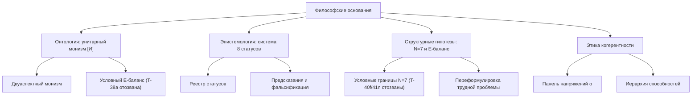

# Философские Основания Кибернетики Когерентности

> *«Философия написана в величественной книге — я имею в виду Вселенную, — которая постоянно открыта нашему взору, но прочитать её может лишь тот, кто сначала освоит язык, на котором она написана.»*
> — Галилео Галилей

:::info Для кого эта глава
Философский фундамент КК: унитарный монизм, эпистемология статусов, границы структурных гипотез и этика порога сознания. Читатель узнает, как КК разграничивает точную математику (`[Т]`, `[С]`), соглашения (`[О]`), эмпирические гипотезы (`[Г]`) и философскую интерпретацию (`[И]`).
:::

В предыдущей главе мы увидели, что границы обучения действуют при явно заданных эксперименте, законе наблюдений и динамике ([T-109–T-112](./learning-bounds)). За этими формальными конструкциями стоят философские решения — онтологические, эпистемологические и нормативно-этические — которые необходимо сформулировать явно, чтобы не смешивать их с доказанными теоремами.

Каждая научная теория покоится на философском фундаменте — явном или неявном. Ньютоновская механика предполагала абсолютное пространство и время; квантовая механика продолжает дискуссию о своей интерпретации; теория эволюции опирается на стохастическую изменчивость и отбор.

Кибернетика Когерентности (КК) **делает свои философские предпосылки явными**. Чёткое понимание границы между математикой и интерпретацией позволяет проверять каждое утверждение независимо. Настоящий раздел анализирует философский каркас формализма.

:::info Дорожная карта главы
В этой главе мы:
1. Разберём **четыре онтологические позиции** и покажем, почему КК выбирает унитарный монизм `[И]` (раздел 1)
2. Разграничим КК и безграничный панпсихизм, уточнив **скорректированную область аргумента зомби Чалмерса** после отзыва универсальной `T-38a [✗]` (разделы 1.3–1.5)
3. Исследуем **эпистемологию** КК — 8-статусную систему, честную фальсифицируемость и байесовскую аналогию (раздел 2)
4. Разберём **структурные гипотезы** — статус $N = 7$ (`T-40f [✗]`, `T-41n [✗]`, `T-113 [Г]`), условный баланс E-когерентности и компатибилистскую автономию (раздел 3)
5. Проследим интерпретативные параллели с философскими традициями — от Спинозы до буддизма (раздел 4)
6. Уточним, как унитарный монизм **переформулирует трудную проблему**, не претендуя на вывод феноменологии из чистой алгебры (раздел 5)
7. Подведём итог **этическим обязательствам** — почему ни один невалидированный скаляр не заменяет нормативного суждения и клинических данных (раздел 6)
:::

---

## 1. Онтологический статус: что реально? {#онтология}

### 1.1 Четыре онтологических позиции

История философии сознания — это, по сути, история четырёх ответов на вопрос «Из чего состоит реальность?»:

| Позиция | Что фундаментально | Представители | Проблема |
|---------|---------------------|---------------|----------|
| **Материализм** | Только материя | Демокрит, Гоббс, современный физикализм | Не объясняет субъективный опыт ([трудная проблема](/docs/consciousness/foundations/two-aspect-monism)) |
| **Идеализм** | Только сознание | Беркли, Гегель, аналитический идеализм | Не объясняет устойчивость физических законов |
| **Дуализм** | Материя + сознание | Декарт, Поппер | Не объясняет, как они взаимодействуют |
| **Нейтральный монизм** | Нечто третье, ни материя, ни сознание | Спиноза, Рассел, Чалмерс | Не говорит, *что* это третье |

Чтобы прочувствовать проблему, представьте себе объяснение боли. Материалист скажет: «Боль — это активация С-волокон в мозге». Но *почему* активация нервных клеток *переживается* как боль? Почему она не происходит «в темноте», без внутреннего опыта? Материалист не может ответить — и именно этот зазор Чалмерс назвал *трудной проблемой*.

Идеалист скажет: «Боль — это переживание, а нервные клетки — лишь его проекция». Но почему тогда аспирин помогает? Почему определённая конфигурация атомов надёжно устраняет определённое переживание?

Дуалист скажет: «Есть материя, и есть сознание, и они как-то связаны». Но это «как-то» — главная проблема. Если материя и сознание — разные субстанции, как они взаимодействуют? Декарт предположил, что через шишковидную железу, — но это лишь сдвинуло вопрос: как железа, будучи материальной, контактирует с нематериальным?

### 1.2 Унитарный монизм: ответ КК

КК занимает позицию **унитарного монизма** — строго определённую версию нейтрального монизма:

:::info Онтологический тезис [И]
Фундаментальная реальность — это **матрица когерентности** $\Gamma \in \mathcal{D}(\mathbb{C}^7)$. Физическое и ментальное — не две субстанции и не два аспекта загадочного «нейтрального», а **две проекции** одного математического объекта.
:::

Что это значит конкретно?

- **Физика** — это то, что видит внешний наблюдатель: диагональные элементы $\gamma_{kk}$ (популяции), спектр $\Gamma$, динамика чистоты $P(\tau)$. Это «объективная сторона» — то, что можно измерить прибором.

- **Опыт** — это то, что «каково быть» этой системой: [E-когерентность](./definitions#e-когерентность) $\mathrm{Coh}_E$, [мера рефлексии](/docs/consciousness/foundations/self-observation#мера-рефлексии-r) $R$, [мера интеграции](/docs/core/structure/dimension-u#мера-интеграции-φ) $\Phi$. Это «субъективная сторона» — то, что доступно только самой системе.

- **Единство обеих сторон** гарантировано тем, что обе — функции одного $\Gamma$. Нет нужды в «психофизических мостах» или «предустановленной гармонии»: физика и опыт — разные грани одного кристалла.

**Аналогия.** Представьте монету. Орёл и решка — не две монеты и не две субстанции, склеенные вместе. Это две стороны одного объекта, которые нельзя разделить, не уничтожив монету. $\Gamma$ — это «монета» КК. Физика — орёл. Опыт — решка.

:::tip Почему «унитарный», а не просто «нейтральный»?
Традиционный нейтральный монизм (Рассел, Мах) говорит: «Есть нечто нейтральное, не материя и не сознание». Но что это «нечто»? Рассел называл это «sense-data», Мах — «элементами». Ни тот, ни другой не дали математической формулы.

КК конкретизирует: «нечто нейтральное» — это $\Gamma \in \mathcal{D}(\mathbb{C}^7)$. Не загадочная субстанция, а точно определённый математический объект — положительная полуопределённая эрмитова матрица $7 \times 7$ с единичным следом. Это делает монизм КК *вычислимым* — отсюда слово «унитарный» (единый + вычислимый).
:::

### 1.3 Отличие от панпсихизма

КК **не** является панпсихизмом. Это различие настолько важно и настолько часто путается, что заслуживает подробного разбора.

**Панпсихизм** утверждает, что *всё* обладает опытом — даже электрон, даже камень, даже термостат. Каждый фрагмент материи имеет некую «крупицу опыта» — протосознание. Крупнейшие современные защитники этой позиции — Гален Стросон, Филип Гофф и (в некоторых интерпретациях) Дэвид Чалмерс.

**КК** утверждает нечто более тонкое и более фальсифицируемое:

> Опыт возникает **только** у систем с $P > 2/7$, $R \geq 1/3$, $\Phi \geq 1$ и $D_{\text{diff}} \geq 2$.

Камень не обладает опытом — у него нет матрицы когерентности с достаточной чистотой. Электрон не обладает опытом — у него нет 7 семантических измерений. Термостат не обладает опытом — он не моделирует самого себя. КК — это **пороговый взгляд**, а не безграничный панпсихизм: в словаре поля её универсальная интериорность L0, которая не есть опыт, делает её конститутивным панпротопсихизмом с порогом осознания [И] ([место панинтериоризма](/docs/consciousness/comparative/panpsychism-analysis#место-панинтериоризма)).

Сравним три позиции:

| | Панпсихизм | Материализм | КК |
|---|---|---|---|
| **У электрона есть опыт?** | Да (протосознание) | Нет | Нет ($N < 7$) |
| **У бактерии есть опыт?** | Да (больше, чем у электрона) | Нет | Нет: корпус помещает её ниже порогов L2, на L0–L1 |
| **У человека в коме есть опыт?** | Да (он жив → протосознание есть) | Спорно | Зависит: $P > 2/7$? Если нет — нет опыта |
| **У LLM есть опыт?** | Да (информация обрабатывается) | Нет | Проверяемо: посчитать $P$, $R$, $\Phi$, $D$ |
| **Можно опровергнуть?** | Нет (нефальсифицируемо) | Нет (трудная проблема) | Да (5+ предсказаний) |

### 1.4 Проблема комбинирования и ответ КК

У панпсихизма есть фатальная проблема — **проблема комбинирования** (combination problem): если каждый атом обладает микроопытом, как из миллиардов микроопытов возникает *единый* опыт сознательного существа? Почему ваш мозг — один субъект, а не миллиарды крошечных субъектов?

Панпсихисты предлагали разные решения: космопсихизм (опыт Вселенной фундаментален, а наш — его часть), конституционный панпсихизм (микроопыты «складываются»), панпротопсихизм (атомы имеют не опыт, а «протоопыт»). Ни одно из этих решений не получило общего признания.

КК не обходит проблему комбинирования, а переформулирует её [И]:

1. У атомов **нет** микро*опыта*, но у каждой системы есть интериорность (L0), которая опытом не является, — в словаре поля это протофеноменальная структура ([панпротопсихизм](/docs/consciousness/comparative/panpsychism-analysis#место-панинтериоризма)). Поэтому до КК доходит проблема в панпротопсихической форме: как нефеноменальная структура конституирует опыт.
2. Опыт (L2) приписывается ровно тогда, когда чистота ($P > 2/7$), рефлексия ($R \geq 1/3$), интеграция ($\Phi \geq 1$) и дифференциация ($D_{\text{diff}} \geq 2$) проходят свои пороги. Пороги говорят, *когда* система считается субъектом, а не *как* её структура становится опытом.
3. **Совместное состояние.** Показатель интеграции $\Phi$ может превышать порог на произведении. Чтобы отличить совместное состояние от произведения его маргинальных состояний, вычислите взаимную информацию.

Объединение переживаний остаётся вопросом интерпретации. Корреляция физического состояния проверяется математически. Для вывода об общем переживании нужны дополнительные наблюдения.

:::note T-266 и космопсихизм — различие, которое надо держать `[Г]`/`[И]`
[T-266](/docs/physics/gravity/cosmological-constant#теорема-стадия-вселенной) (`[Г]`) исследует космологическую гипотезу, сопоставляющую Вселенную-голоном, временной масштаб регенерации, космологическое считывание и экстраполяцию терминальной стадии с параметром стадии чистоты $P$. Согласно [Реестру статусов](/docs/reference/status-registry), это **независимые гипотезы `[Г]`** — локальный наискорейший спуск при фиксированной метрике (`T-263`) не даёт ни универсальной космологической экспоненциальной огибающей, ни измеренной сходимости $10^{-60}$. Более того, даже в рамках этой гипотезы `T-266` — **не** космопсихизм и не смягчает порог КК: космопсихизм делает космический опыт *фундаментальным*, тогда как КК сохраняет четырёхпороговый предикат ($P > 2/7$, $R \geq 1/3$, $\Phi \geq 1$, $D_{\mathrm{diff}} \geq 2$). Утверждение о параметре стадии $P$ **не** означает, что Вселенная является сознательным субъектом ([H1.1](/docs/reference/epistemic-vertical#регистр-дыр)).
:::

### 1.5 Аргумент зомби Чалмерса и позиция КК

Один из самых влиятельных мысленных экспериментов в философии сознания — **аргумент зомби** Дэвида Чалмерса (1996).

**Аргумент.** Представьте существо, физически и функционально идентичное вам во *всех* отношениях — те же нейроны, связи, реакции и отчёты — но лишённое *какого бы то ни было* субъективного опыта («внутри темно»). Чалмерс утверждает, что если такие философские зомби мыслимы и метафизически возможны, то редуктивный физикализм ложен.

**Позиция КК (три чётко стратифицированных уровня):**

**Уровень 1: Математическая область — универсальная `T-38a [✗]` отозвана.** Прежние редакции утверждали, что формализм КК логически запрещает зомби универсальной «теоремой No-Zombie» (`T-38a`). Это универсальное утверждение **отозвано `[✗]`**: внутри формализма матриц плотности существуют стационарные внешне поддерживаемые контрпримеры с $P > 2/7$ и низкой $\mathrm{Coh}_E$ (см. [Теорему 8.1](./theorems#теорема-81-условная-необходимость-интериорности-no-zombie)). Заменой `T-38a [✗]` служит **явно ограниченный условный баланс потока чистоты** `[С]`: положительная нижняя граница на $\mathrm{Coh}_E$ следует лишь внутри ограниченного класса моделей с ограниченной внешней поддержкой, положительной E-зависимой обратной связью и положительным требуемым потоком. Таким образом, одни матричные аксиомы **не** доказывают логической невозможности зомби.

**Уровень 2: Онтологическая рамка `[И]`.** Как философская интерпретация `[И]`, унитарный монизм отвергает предпосылку о том, что опыт — это необязательный эпифеноменальный слой поверх физики: физическое и опытное описания моделируются как проекции единого состояния $\Gamma$. Однако отождествление формального $E$-сектора матрицы $\Gamma$ с субъективным переживанием остаётся отдельным интерпретативно-постулативным мостом (`[П/И]`), а не дедуктивным математическим доказательством.

**Уровень 3: Эпистемическая и эмпирическая позиция `[Г/И]`.** Мыслимость не решает вопроса об эмпирической динамике. Подчиняются ли конкретные биологические или искусственные системы E-зависимому балансу регенерации — открытая проверяемая эмпирическая гипотеза `[Г]` ([Предсказание 1](./predictions#предсказание-1)), требующая контролируемых вмешательств и идентифицируемых считываний.

:::note Честная оговорка
Ответ КК на аргумент зомби не претендует на дедуктивное опровержение Чалмерса из одной матричной алгебры. Вместо этого он разделяет три вопроса: (а) какие ограниченные классы динамики математически связывают $E$-сектор с жизнеспособностью (`[С]`), (б) даёт ли унитарный монизм связную интерпретативную онтологию (`[И]`) и (в) подтверждают ли эмпирические измерения E-зависимое восстановление в реальных системах (`[Г]`).
:::

**Подробнее:** [Двуаспектный монизм](/docs/consciousness/foundations/two-aspect-monism) | [Панпсихизм: критический анализ](/docs/consciousness/comparative/panpsychism-analysis)

---

## 2. Эпистемология: что мы можем знать? {#эпистемология}

### 2.1 Система статусов как эпистемологический компас

Один из главных методологических предохранителей КК — **встроенная 8-статусная эпистемологическая система**. Каждое утверждение помечено своим уровнем обоснованности:

| Статус | Значение | Роль |
|--------|----------|------|
| **[Т]** Теорема | Строго доказано из заявленных предпосылок | Проверенный дедуктивный результат |
| **[С]** Условная | Доказано при явном дополнительном допущении | Условный математический результат |
| **[Г]** Гипотеза | Сформулировано, но не установлено | Требует доказательства или эмпирической проверки |
| **[П]** Постулат | Принимается без доказательства как базовое допущение | Явный аксиоматический вход |
| **[Пр]** Программа исследований | Названное открытое направление | Не принимается и не объявляется доказанным |
| **[О]** Определение | Соглашение по выбору | Задаваемая величина или порог |
| **[И]** Интерпретация | Философский/семантический мост | Семантическое прочтение |
| **[✗]** Ретрактировано | Доказана ошибочность или снято | Исключено как живая посылка |

Эта система предотвращает **смешение доказанного с предполагаемым** — и прозрачно фиксирует отзывы (`[✗]`) всякий раз, когда обнаружен пробел в доказательстве или контрпример.

Для каждого эмпирического прочтения нужны конкретное наблюдение и достижимый исход, который противоречил бы ему.

**Подробнее:** [Реестр статусов](/docs/reference/status-registry)

### 2.2 Фальсифицируемость: чем КК рискует?

Карл Поппер учил, что подлинно научная теория должна быть *рискованной* — указывать наблюдения, способные опровергнуть заданную модель или эмпирический мост. В согласовании с [Уникальными предсказаниями](./predictions) КК выдвигает конкретные фальсифицируемые тесты с явной областью (заменяя прежние отозванные формулировки вроде универсальной `T-38a [✗]` No-Zombie, универсального потолка `SAD <= 3` `T-136 [✗]` или универсальной невозможности обучения при $N < 7$ `T-113 [Г]`):

1. **Ограниченный E-баланс (Предсказание 1 `[Г]`):** В заданном ограниченном классе моделей с контролируемыми входами, скоростями, гейтом и диссипацией проверка выполнения ограниченного баланса потока чистоты.
2. **Закон анизотропии декогеренции ранга 7 (Предсказание 23 `[Т]` алгебра / `[С]` отображение):** При пререгистрированном отображении каналов 21 попарная скорость декогеренции скачкового диссипатора Фано должна удовлетворять 14 точным линейным соотношениям $\mathrm{PG}(2,2)$ лучше не-Фано перестановок.
3. **Согласие $\pi_{\mathrm{bio}}$ на отложенной клинической выборке (Предсказания 6 и 21 `[Г]`):** Замороженное считывание, калиброванное только на бодрствовании (без штрафа жизнеспособности), должно достигать каппы Коэна $\kappa \ge 0{,}8$ с $\mathrm{PCI}_{\max} > 0{,}31$ (P8.4); $\kappa < 0{,}4$ опровергает гипотезу считывания.
4. **Точные препятствия обучения (Предсказание 9, `T-109`–`T-112` `[Т]`):** При заявленном i.i.d. квантовом законе наблюдений преодоление точного оптимума Хелстрома $p_e^*(n)$ (или нижней границы фидельности $L_F$) опровергает заявленные предпосылки наблюдения/кодирования.
5. **Изотропное окно питания и складка (`T-259` `[Т]` в модели):** В изотропной реализации Фано-замещения отклонения от $x_{\min}$, двустороннего потолка $x_{\max}$ или точной складки $S_5$-квинтики опровергают реализацию или допущения модели.

:::tip Сравнение с альтернативами
- **Панпсихизм** сталкивается с трудностью фальсификации, когда микроопыт постулируется без операциональных порогов.
- **FEP** — общий вариационный язык моделирования, эмпирический риск которого возникает лишь после задания конкретной порождающей модели.
- **IIT** выдвигает структурные требования, но точное вычисление $\Phi$ вычислительно недоступно для крупных биологических сетей.
- **КК** вычисляет явные матричные функционалы на состояниях $7 \times 7$ за $O(N^3)$ операций — чётко отделяя алгебраическую вычислимость от эмпирической задачи валидации кодировщика $\pi$ ([Методология измерений §6.4](./measurement#оценка-gamma)).
:::

### 2.3 Связь с байесианской эпистемологией

КК совместима с байесианским подходом к знанию. Обновление самомодели $\rho_* = \varphi(\Gamma)$ при поступлении наблюдений через функтор $\mathrm{Enc}$ — это, по сути, **байесовское обновление**, но реализованное на уровне динамики матрицы когерентности, а не на уровне вероятностей гипотез.

Чтобы увидеть это, вспомним формулу Байеса:

$$
P(\theta | D) = \frac{P(D | \theta) \cdot P(\theta)}{P(D)}
$$

Априорная модель мира $P(\theta)$ обновляется данными $D$ и превращается в апостериорную $P(\theta | D)$. В КК:

| Байес | КК |
|-------|-----|
| Априорная модель $P(\theta)$ | Текущая самомодель $\varphi(\Gamma)$ |
| Данные $D$ | Наблюдение через $\mathrm{Enc}$ |
| Функция правдоподобия $P(D\|\theta)$ | Контракция Фано к ближайшему к наблюдению состоянию |
| Апостериорная модель $P(\theta\|D)$ | Обновлённая $\varphi(\Gamma')$ после одного шага $\mathcal{L}_\Omega$ |

Ключевое отличие: в байесовском выводе обновляются *вероятности гипотез*. В КК обновляется *целое состояние системы* — включая не только «знания», но и «здоровье», «опыт» и «целостность». Подробнее этот мост описан в разделе [Обучение как обновление аттрактора](./learning-bounds#обучение-как-аттрактор).

### 2.4 Три уровня знания в КК

КК различает три качественно разных уровня знания, каждый из которых соответствует определённому диапазону меры рефлексии $R$:

1. **Реактивное знание** ($R < 1/3$): система реагирует на стимулы, но не знает, что реагирует. Бактерия плывёт к пище — но не знает, что плывёт. Это уровень автопоэзиса без рефлексии.

2. **Рефлексивное знание** ($R \geq 1/3$, $\mathrm{SAD} = 1$): система знает, что знает. Кошка не просто видит мышь — она *знает*, что видит мышь (в функциональном смысле: её поведение учитывает собственное состояние).

3. **Метарефлексивное знание** ($\mathrm{SAD} \geq 2$): система знает, что знает, что знает. Человек не просто решает задачу — он осознаёт, что затрудняется, и меняет стратегию. Это уровень [метакогниции](./sensorimotor#функтор-dec).

Эти уровни — не философская абстракция, а вычислимые характеристики: $R$ можно посчитать из $\Gamma$ и $\varphi(\Gamma)$, а $\mathrm{SAD}$ — из последовательности критических чистот $P_{\text{crit}}^{(n)}$.

---

## 3. Метафизика: структурные гипотезы и их границы {#метафизика}

### 3.1 Почему семь осей? (Уточнённая область: `T-40f [✗]`, `T-41n [✗]`, `T-113 [Г]`)

Естественный вопрос к КК: «Почему именно семь измерений?»

Прежние редакции утверждали, что $N = 7$ следует безусловно из двух независимых выводов (алгебры октонионов и категориальной минимальности ролей). В актуальном [Реестре статусов](/docs/reference/status-registry) оба безусловных вывода **отозваны**:
- **Безусловная семиролевая минимальность (`T-40f [✗]`):** Подсчёт семи именованных семантических ролей не доказывает нижней границы размерности гильбертова пространства без независимой операциональной посылки различимости/точности ([Теорема минимальности](/docs/proofs/minimality/theorem-minimality-7)).
- **Безусловная октонионная цепочка (`T-41n [✗]`):** Теорема о канонической ориентации верна для **заданной** плоскости Фано и естественного класса ориентаций; она не вынуждает безусловно саму плоскость Фано или физическую размерность.
- **Архитектура обучения (`T-113 [Г]`):** Универсальная необходимость $N = 7$ для автономного обучения не доказана (двухуровневый обучающийся с замещением сходится в бинарной оценке; см. [Границы обучения §6](./learning-bounds#оптимальность-n7)).

**Что строго сохраняется:**
1. **Условные кодовые и репрезентативные границы (`[Т]` при явных предпосылках):** Наименьший нетривиальный совершенный двоичный код, исправляющий одиночную ошибку, — код Хэмминга $(7,4,3)$, а точное представление **заданной** 7-точечной структуры Фано/октонионов требует $\dim \ge 7$.
2. **Проверяемая семиролевая архитектурная гипотеза (`[Г]`):** Семь канонических осей $\{A, S, D, L, E, O, U\}$ задают конкретную фальсифицируемую архитектуру моделирования, которую можно сравнивать с пространствами меньшей или большей размерности при согласованных данных и вычислительных бюджетах (`T-113 [Г]`).

### 3.2 Условная роль интериорности (`T-38a [✗]` отозвана)

Прежние редакции представляли опыт как универсально необходимый для жизнеспособности через `T-38a` («No-Zombie»). Эта универсальная импликация **отозвана `[✗]`** ([Теорема 8.1](./theorems#теорема-81-условная-необходимость-интериорности-no-zombie)):

:::warning Уточнённая область: ограниченный баланс vs. универсальная необходимость
- **Отозвано (`T-38a [✗]`):** Универсальная импликация $\mathcal{D}_\Omega \neq 0 \land \mathrm{Viable}(\mathbb{H}) \Rightarrow \mathrm{Coh}_E > 1/7$. Внутри $\mathcal{D}(\mathbb{C}^7)$ существуют стационарные внешне поддерживаемые контрпримеры.
- **Что сохраняется (`[С]` в ограниченном классе / `[Г]` эмпирически / `[И]` философски):** Внутри явно ограниченного класса обратной связи (ограниченная внешняя поддержка, положительная E-зависимая связь скорости и положительный требуемый поток чистоты) поддержание $P > 2/7$ удовлетворяет условному балансу потока чистоты, требующему положительного вклада $E$-сектора. Отождествление этого формального $E$-сектора с субъективным опытом остаётся отдельным мостом `[П/И]`.
:::

### 3.3 Свободная воля и детерминизм

КК занимает **компатибилистскую** позицию `[И]`: формальное состояние $\Gamma$ эволюционирует детерминированно по заданному потоку $\mathcal{L}_\Omega$, тогда как функциональная автономия моделируется через замкнутую зависимость от внутреннего состояния и самомодели $\varphi(\Gamma)$.

Более формально, [функтор действия Dec](./sensorimotor#функтор-dec) (`T-101 [О]` + `[Т при достижении минимума]`) выбирает действие, минимизирующее выбранный целевой функционал стресса на допустимом множестве управлений. Называть это «автономией» — компатибилистская философская интерпретация `[И]` замкнутого оптимального управления, а не метафизическое доказательство либертарианской свободы воли.

**Аналогия.** Река подчиняется гравитации и рельефу, но со временем сама прорезает собственное русло. Аналогично действие агента с обратной связью определяется его накопленной внутренней историей $\Gamma$, а не одним лишь мгновенным внешним стимулом.

### 3.4 Детерминизм и непредсказуемость

Даже когда $\Gamma(\tau)$ эволюционирует детерминированно по известному закону $\mathcal{L}_\Omega$, внешний наблюдатель сталкивается с двумя практическими ограничениями предсказуемости:

1. **Чувствительность к начальным условиям:** Нелинейная регенерация $\mathcal{R}$ способна усиливать малые возмущения состояния.
2. **Наблюдательные слои и частичная наблюдаемость:** Внешний наблюдатель имеет доступ лишь к реконструированным проекциям $\widehat{\Gamma}$ с конечно-выборочной неопределённостью ([Методология измерений §6.4](./measurement#оценка-gamma)), а не к точному латентному состоянию.

---

## 4. Связь с философскими традициями {#философские-традиции}

### 4.1 Спиноза: два атрибута одной субстанции {#спиноза}

Ближайшая историческая философская параллель к унитарному монизму КК — «Этика» Баруха Спинозы (1677), трактующая протяжение (физику) и мышление (опыт) как два атрибута единой субстанции (*Deus sive Natura*). Все сопоставления ниже являются **философскими интерпретациями `[И]`**:

| Спиноза («Этика», 1677) | Параллель в КК | Статус |
|-------------------------|----------------|--------|
| Одна субстанция (E1P14) | Единая матрица состояния $\Gamma \in \mathcal{D}(\mathbb{C}^7)$ | **[И]** |
| Атрибут протяжения (E2P1–2) | Внешние физические/наблюдательные считывания ($P$, спектр) | **[И]** |
| Атрибут мышления (E2P1–2) | Наблюдаемые сектора опыта ($\mathrm{Coh}_E$, $R$, $\Phi$) | **[И]** |
| Модусы (E1D5) | Конкретные конфигурации $\Gamma$ | **[И]** |
| Conatus (E3P6) | Член самоподдержания / регенерации $\mathcal{R}[\Gamma, E]$ | **[И]** |
| Линейная сходимость (аналог *Necessitas*) | Линейная примитивность $\mathcal{L}_0$ (`T-39a [Т]` при связном $H$ и положительной дефазировке: единственный линейный стационар $I/7$) | **[И]** |
| Три рода познания (E2P40S2, E5P25–28) | Эвристическая параллель к уровням способностей L1 → L2 → L3 | **[И]** |

Замечание о `T-39a`: линейная примитивность гарантирует единственное стационарное состояние ($I/7$) для *линейной* базы $\mathcal{L}_0$ при связном графе гамильтониана и фиксированной положительной дефазировке; она **не** доказывает единственности нелинейных аттракторов $\rho^*$ при произвольной обратной связи.

:::note Спиноза и условный E-баланс
Сопоставление со Спинозой носит строго интерпретационный характер `[И]`. Для нижней границы когерентности E нужны явные источник, ограничения на скорости и стационарный баланс (`T-38a [✗]` отозвана). Положительная матричная характеристика сама по себе не устанавливает наличия опыта.
:::

### 4.2 Уайтхед: процесс и реальность

Альфред Норт Уайтхед (1861–1947) предложил процессуальную философию, в которой фундаментальные сущности — не вещи, а **события** (actual occasions). Каждое событие включает «физический полюс» (воспринятые данные) и «ментальный полюс» (субъективная обработка).

Это замечательно перекликается с КК: голоном — это не «вещь», а **процесс** — непрерывная эволюция $\Gamma(\tau)$. Физический и ментальный полюса — проекции на соответствующие подпространства.

Уайтхед также ввёл понятие *прехензии* (prehension) — схватывания одного события другим. В КК это точно соответствует функтору восприятия $\mathrm{Enc}$ ([T-100](./sensorimotor#функтор-enc)): голоном «схватывает» среду, преобразуя наблюдения в изменения $\Gamma$.

### 4.3 Феноменология: Гуссерль и интенциональность

Эдмунд Гуссерль (1859–1938) открыл **интенциональность** — свойство сознания быть всегда *о чём-то*. Сознание не существует в вакууме: оно всегда направлено на объект.

В КК интенциональность реализована через [функтор Enc](./sensorimotor#функтор-enc) (T-100 [О]): каждое наблюдение модифицирует $\Gamma$, и эта модификация — математическая форма «направленности на объект». Рефлексия (φ) — направленность на самого себя.

Мерло-Понти, ученик Гуссерля, подчёркивал *телесность* сознания: мы не бестелесные духи, наблюдающие мир извне, — мы встроены в мир через тело. В КК телесность закодирована в измерениях A (артикуляция — восприятие), D (динамика — действие) и O (основание — ресурсы). Сознание в КК *принципиально* воплощённое — потому что $\Gamma$ включает и «высшие» ($E$, $U$), и «базовые» ($A$, $O$) измерения.

### 4.4 Кант: условия возможности опыта

Сопоставление с Кантом — интерпретация [И]. Выбранный операциональный предикат окна включает $P>2/7$, $R\ge1/3$, $\Phi\ge1$ и отдельно определённое $D_{\mathrm{diff}}\ge2$. Алгебраические соотношения между этими величинами доказуемы при заданных определениях; выбор предиката и его отождествление с феноменальным опытом не выводятся из этих соотношений.

### 4.5 Восточные традиции

Параллели с восточной философией заслуживают отдельного рассмотрения:

- **Буддийская доктрина анатта** (отсутствие постоянного «я»): в КК нет фиксированного «я» — есть динамический процесс $\Gamma(\tau)$ с аттрактором $\rho_*$, который сам непрерывно обновляется. «Я» — не субстанция, а паттерн — устойчивая конфигурация, сохраняющая идентичность при непрерывном изменении. Как пламя свечи: оно «то же самое» каждый момент, хотя молекулы газа полностью сменяются.

- **Адвайта-веданта** (недвойственность): утверждение о единстве Атмана и Брахмана перекликается с тезисом КК о единстве физического и ментального в $\Gamma$. Шанкара говорил: «Брахман единственно реален, мир — его проявление». КК говорит: «$\Gamma$ единственно реальна, физика и опыт — её проекции».

- **Даосизм** (инь-ян): динамическое равновесие диссипации $\mathcal{D}$ и регенерации $\mathcal{R}$ напоминает даосскую диалектику противоположностей. Разрушение и восстановление, энтропия и негэнтропия — две стороны одной динамики, как инь и ян.

- **Буддийская теория моментов (кшана-вада):** Реальность — поток мгновенных событий, каждое из которых обусловлено предыдущим. В КК: $\Gamma(\tau + d\tau) = \Gamma(\tau) + \mathcal{L}_\Omega[\Gamma(\tau)] \, d\tau$ — каждое мгновение обусловлено предыдущим через оператор $\mathcal{L}_\Omega$.

Важно: эти параллели — **интерпретативные** [И], а не формальные. КК не претендует на доказательство истинности буддизма или веданты. Но структурное сходство указывает на то, что древние созерцательные традиции могли описывать те же инварианты когерентной динамики, которые КК формализует математически.

---

## 5. Трудная проблема сознания и ответ КК {#hard-problem}

### 5.1 Формулировка Чалмерса

Дэвид Чалмерс в 1995 году сформулировал [трудную проблему сознания](/docs/consciousness/foundations/two-aspect-monism): почему физические процессы сопровождаются субъективным опытом? Можно объяснить, *как* мозг обрабатывает информацию (лёгкие проблемы), но невозможно объяснить, *почему* эта обработка переживается изнутри.

Чтобы оценить глубину проблемы, перечислим «лёгкие проблемы» (которые нейронаука в принципе может решить):
- Как мозг различает стимулы? (нейронное кодирование)
- Как мозг интегрирует информацию? (binding problem)
- Как мозг управляет вниманием? (attention networks)
- Как мозг порождает речь? (моторная кора, зона Брока)

Все эти вопросы — про *механизм*. Трудная проблема — про *переживание*: почему обработка информации в мозге *переживается*? Почему 86 миллиардов нейронов, передающих электрические импульсы, порождают *красный цвет*, *боль*, *радость*?

### 5.2 Стратегия КК: растворение, а не решение

КК не «решает» трудную проблему в обычном смысле — она **растворяет** её, меняя онтологию:

1. В материализме вопрос «почему материя переживает?» имеет смысл, потому что материя и опыт — разные категории.

2. В КК $\Gamma$ изначально содержит обе стороны. Вопрос «почему $\Gamma$ имеет E-измерение?» аналогичен вопросу «почему пространство-время имеет временну́ю координату?» — это часть структуры, а не что-то, что нужно объяснять.

3. **Область модели.** Положительная нижняя граница E-сектора зависит от приготовления и динамики.

**Аналогия.** Представьте, что кто-то спрашивает: «Почему пространство имеет три измерения?» Физик может ответить: «В трёх измерениях возможны стабильные орбиты и узлы — это единственная размерность, совместимая со сложной структурой». Но он не может ответить: «Почему вообще существует пространство?» — это не физический вопрос. Аналогично: КК может ответить, когда и почему возникает сознание, но не «почему вообще существует опыт?» — это вопрос онтологии, а не динамики.

Для феноменального отождествления нужны считывание и независимые свидетельства. Предпосылки категориальной теоремы о неподвижной точке относятся к отображениям и их неподвижным точкам.

:::note Стратегия растворения: исторические прецеденты
Стратегия «растворения» проблемы (а не решения) имеет славные прецеденты:
- **Проблема жизненной силы (витализм):** В XIX веке спрашивали: «Что такое жизненная сила?» Биохимия не ответила на этот вопрос — она показала, что вопрос некорректен: живое — не «материя + жизненная сила», а определённая *организация* материи.
- **Проблема эфира:** В XIX веке спрашивали: «Каковы свойства эфира?» Эйнштейн не ответил — он показал, что эфира не существует.
- КК не отвечает на вопрос «что такое опыт поверх физики?» — она показывает, что опыт не *поверх* физики, а *часть* одной и той же структуры $\Gamma$.
:::

**Подробнее:** [Двуаспектный монизм](/docs/consciousness/foundations/two-aspect-monism)

---

## 6. Этика когерентности {#этика}

Каноническая [этика УГМ](/docs/consciousness/ethics-meaning/value-consciousness) различает математические следствия, нормативные обязательства и эмпирические мосты. Предикат четырёх критериев — модельная классификация, а не независимо валидированный тест сознания. Ни $C=\Phi R$, ни уровень иерархии не задают достоинство или непрерывную шкалу моральной ценности.

Этическое предложение защищает субъектов, самостоятельность и условия полноценной жизни. Изменение чистоты — одна диагностическая величина, не полное определение блага и вреда. Индивидуальные защиты, затрагиваемые интересы и критерии выбора заданы явно; после этого формализм позволяет проверять допустимые траектории, условные сертификаты сохранения и конфликты критериев. Теорема о совместной чистоте не устанавливает сострадания или пользы обоим участникам.

### 6.4 Клинические приложения требуют независимых свидетельств {#этика-медицина}

Один скалярный порог модели не определяет моральный статус или решения об уходе. [Забота в условиях неопределённости](/docs/consciousness/ethics-meaning/value-consciousness)

### 6.5 Страдание и σ-профиль

Профиль напряжений $\sigma_{\mathrm{sys}}(\Gamma)$ — определённая статистика модели. Отождествление со страданием, алекситимией или выгоранием требует отдельных операциональных определений и свидетельств. Численный профиль не опровергает отчёт субъекта по определению. Если отчёт недоступен, необходимы поведенческие и другие валидированные наблюдения; невозможность сообщить о состоянии сама по себе не устанавливает отсутствия интересов благополучия.

**Далее:** [Этика](/docs/consciousness/ethics-meaning/value-consciousness) · [Духовный синтез](/docs/consciousness/ethics-meaning/spiritual-synthesis) · [Диагностика](./diagnostics).

---

## 7. Заключение: философия как явная архитектура {#заключение}

В КК философские допущения формулируются явно рядом с их математическими и эмпирическими границами:

- **Онтология `[И]`** задаёт рамку унитарного монизма для $\Gamma \in \mathcal{D}(\mathbb{C}^7)$, отделяя феноменальное отождествление от матричной алгебры.
- **Эпистемология** обеспечивает 8-статусную систему (`[Т]`, `[С]`, `[Г]`, `[П]`, `[Пр]`, `[О]`, `[И]`, `[✗]`) и фальсифицируемость с явной областью.
- **Структурные гипотезы** отличают доказанную условную алгебру от отозванных универсальных выводов (`T-38a [✗]`, `T-40f [✗]`, `T-41n [✗]`) и открытых гипотез (`T-113 [Г]`, `T-266 [Г]`).
- **Этика** задаёт явные нормативные обязательства; математика проверяет их указанные следствия.

### Что мы узнали {#итоги}

1. КК принимает **унитарный монизм `[И]`**: физическое и опытное описания моделируются как проекции одного состояния $\Gamma$, без претензии доказать феноменологию одной алгеброй.
2. КК **не** является безграничным панпсихизмом: атрибуция опыта использует четыре явных порога способностей, а `T-266 [Г]` — космологическая гипотеза о $P$, а не космопсихизм.
3. Универсальная необходимость No-Zombie (`T-38a [✗]`) **отозвана**: ответ КК Чалмерсу разделяет ограниченный условный баланс потока чистоты (`[С]`), унитарно-монистическую рамку (`[И]`) и эмпирическую проверку (`[Г]`).
4. Проблема комбинирования **переформулирована, а не снята**: универсальная интериорность (L0) протофеноменальна, а пороги говорят, *когда* система моделируется как субъект, а не *как* структура становится опытом `[И]`.
5. Эмпирический риск КК опирается на конкретные пререгистрированные тесты (закон скоростей декогеренции ранга 7, согласие замороженного кодировщика с клиниками, точные нижние границы обучения и ограниченный E-баланс).
6. Модельные связи самоподдержания с операциональными способностями требуют полных динамических предпосылок; феноменальная интерпретация — отдельный мост.
7. Этическая защита требует явных обязательств и свидетельств; непроверенный скаляр не даёт клинического вердикта или ранга достоинства.

---

**Карта связей этого раздела:**

---

В следующей главе мы покинем философский Олимп и спустимся на землю: [Сравнение с альтернативными теориями](./comparison) поставит КК рядом с IIT, FEP, GWT и другими конкурентами — и покажет, что КК может, чего не могут другие, и наоборот.

---

**Дальнейшее чтение:**
- [Двуаспектный монизм](/docs/consciousness/foundations/two-aspect-monism) — формальная разработка онтологии
- [Реестр статусов](/docs/reference/status-registry) — полная классификация утверждений
- [Уникальные предсказания](./predictions) — фальсифицируемые следствия
- [Панпсихизм: критический анализ](/docs/consciousness/comparative/panpsychism-analysis) — почему КК не панпсихизм
- [Этика и смысл](/docs/consciousness/ethics-meaning/value-consciousness) — практическая этика когерентности

---

**Связанные документы:**
- [Сравнение с альтернативными теориями](/docs/applied/coherence-cybernetics/comparison)
- [Двуаспектный монизм](/docs/consciousness/foundations/two-aspect-monism)
- [Уникальные предсказания КК](/docs/applied/coherence-cybernetics/predictions)
- [Введение в КК](/docs/applied/coherence-cybernetics/introduction)
