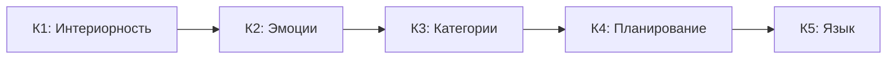

# Уникальные Предсказания КК

> *«Теория, которую нельзя опровергнуть никаким мыслимым событием, не является научной. Неопровержимость — это не достоинство теории (как часто думают), а её порок.»*
> — Карл Поппер, «Предположения и опровержения» (1963)

:::info Для кого эта глава
23 предсказания и модельных теста КК — с явной стратификацией статусов (`[Т]`, `[С]`, `[О]`, `[Г]`, `[И]`, `[✗]`), протоколами проверки и критериями фальсификации в заявленной области. Читатель узнает, как проверяемые конструкции КК соотносятся с IIT, FEP и GWT.
:::

В [предыдущей главе](./stability) мы установили точные геометрические запасы ($r_{\mathrm{HS}}$, $r_B \ge r_{\mathrm{HS}}/\sqrt{2}$), оценки возмущения траекторий Гронуолла и баланс потока чистоты. Теперь мы соберём все 23 нумерованных предсказания КК в одном месте, согласованно с [Реестром статусов](/docs/reference/status-registry), указав для каждого его **точную область применимости**, **способ проверки** и **что именно опровергает отрицательный исход** (формальную импликацию, условную модельную редукцию или эмпирический мост).

Наука отличается от философии не глубиной вопросов, а готовностью подставить свои ответы под удар эксперимента. Поппер назвал это критерием демаркации: граница между наукой и не-наукой проходит через **фальсифицируемость** — заранее сформулированное знание того, какие наблюдения отвергнут заданную модель или эмпирический мост.

В этой главе 23 предсказания КК сгруппированы по темам: от фундаментальных законов баланса через архитектурные гипотезы и числовые пороги к условному динамическому скейлингу и реконструкции по нейронным данным. Для каждого пункта явно указан его статус (`[Т]`, `[С]`, `[О]`, `[Г]`, `[И]` или `[✗]` там, где прежняя универсальная формулировка отозвана), чтобы точные математические тождества не смешивались с непроверенными эмпирическими мостами.

:::note О нотации
В этом документе:
- $\Gamma$ — [матрица когерентности](/docs/core/dynamics/coherence-matrix)
- $P$ — [чистота](/docs/core/dynamics/viability#определение-чистоты): $P = \mathrm{Tr}(\Gamma^2)$
- $\mathrm{Coh}_E$ — [E-когерентность](./definitions#e-когерентность)
- $C$ — [мера сознательности](/docs/consciousness/foundations/self-observation#мера-сознательности-c)
- $\sigma_{\mathrm{sys}}$ — [тензор напряжений](./definitions#тензор-напряжений)
- $\mathbb{H}$ — [Голоном](/docs/core/structure/holon)
:::

---

## I. Фундаментальные предсказания: сознание и жизнеспособность

Первая группа предсказаний касается связи между структурой E-сектора и устойчивостью. В большинстве теорий сознание является либо эпифеноменом (не влияет на динамику), либо отдельным постулатом (вводится извне). КК рассматривает иную модельную возможность: система с E-зависимым законом обратной связи может иметь иную скорость восстановления, условно на заданные цель, гейт, диссипацию и ресурсы.

### Предсказание 1: Условный баланс E-когерентности {#предсказание-1}

:::note Предсказание `[Г]` (универсальная `T-38a [✗]` отозвана)
Чистота выше $2/7$, ненулевой диссипатор и поддерживаемая динамика **не** вынуждают $\mathrm{Coh}_E > 1/7$: прежняя универсальная необходимость No-Zombie (`T-38a [✗]`) отозвана. [Теорема 8.1](./theorems#теорема-81-условная-необходимость-интериорности-no-zombie) содержит стационарный внешне поддерживаемый контрпример и явно ограниченный баланс потока чистоты. Положительный E-порог требует заданного ограниченного класса моделей, границы внешней поддержки, положительной зависимости обратной связи и положительного требуемого потока. Отождествление E-сектора с опытом — дополнительный мост `[П/И]`.
:::

Ограниченный баланс проверяется после фиксации допустимых входов и скоростей. При вмешательстве в E остальные цель, затвор, диссипация, приготовление и ресурсы фиксируются либо их изменения явно моделируются. Внешне поддерживаемая жизнеспособная система с низкой E-когерентностью не опровергает формализм матриц плотности; она опровергает лишь уже снятую универсальную необходимость (`T-38a [✗]`).

### Предсказание 2: Выбранная модель E-зависимой скорости {#предсказание-2}

:::info Предсказание [О/Г]
Модель выбирает $\kappa=\kappa_b+\kappa_0\mathrm{Coh}_E$ при фиксированных остальных величинах и $\kappa_0\ge0$. Тогда $\partial\kappa/\partial\mathrm{Coh}_E=\kappa_0$ — точная производная [Т] соглашения [О]. Из неё не следует $\dot P\propto\mathrm{Coh}_E$: поток регенерации равен $2\kappa g(P)(\operatorname{Tr}(\rho B(\rho))-P)$ и может быть отрицательным. Эндогенные вариации меняют также $\kappa_0$, цель, затвор и состояние.
:::

Корреляция с биологическим восстановлением — [Г], требующая идентифицируемой модели наблюдений и определённого физического исхода. Она не устанавливает клиническую пользу медитации или терапии. Исследование заранее фиксирует вмешательство, правдоподобие наблюдений, мешающие переменные, кластерную единицу выборки, размер эффекта и независимую проверку. Ограниченная конструкция скорости в [септичности](/docs/core/foundations/axiom-septicity#категориальный-вывод-kappa0) — условная кинетическая математика, а не категориальная теорема единственности.

## II. Архитектурные предсказания: структура и размерность

Вторая группа предсказаний касается *архитектуры* сознательных систем — какова минимальная «конструкция», необходимая для возникновения опыта, обучения и социального взаимодействия. Эти предсказания делают КК уникальной среди теорий сознания: вместо расплывчатых утверждений о «сложности» и «интеграции» она называет конкретные числа.

### Предсказание 3: Семикомпонентная панель стресса {#предсказание-3}

:::info Предсказание [О/Г]
Семь оценок напряжения определяют панель в заданном репере. Для сопоставления порогов панели, четырёх условий Cap2 и биологического здоровья нужны разные законы наблюдения и данные. [Определения](./definitions#тензор-напряжений)
:::

Для мониторинга окна используются точные четыре запаса и вердикт по множеству неопределённости. Для классификации стресса заранее фиксируются правила кодирования и проверяются независимые стрессоры относительно конкурирующих моделей. Возможность присвоить каждому объекту метку не доказывает независимую размерность или исчерпывающий причинный охват.

### Предсказание 4: Доязыковое познание полноценно {#предсказание-4}

**Интуиция.** Часто предполагается, что сознание и язык неразрывны — что «мыслить» значит «мыслить словами». КК показывает, что это антропоцентрическое заблуждение. Когнитивная иерархия К1-К5 выстраивает пять уровней познания, из которых язык (К5) — лишь верхний, а не фундамент. Животные без языка полноценно функционируют на уровнях К1-К4.

:::info Предсказание [И]

$$
\exists \, \mathrm{Cognition}(\mathbb{H}) \text{ при } \mathrm{Language}(\mathbb{H}) = \varnothing
$$

Полноценное познание (уровни К1-К4) возможно без языка (К5).

**Статус:** [И] — интерпретация, следующая из определений когнитивных уровней К1-К5.
:::

**См.:** [Когнитивная иерархия](/docs/consciousness/comparative/cognitive-hierarchy)

**Уникальность предсказания.** GWT связывает сознание с глобальной доступностью информации, часто ассоциированной с лингвистическими репрезентациями. Higher-Order Theories (HOT) привязывают сознание к метакогнитивным отчётам, что имплицитно предполагает язык. КК явно разделяет познание и язык как ортогональные оси.

**Иерархия когнитивных функций:**

**Верифицируемость:**
Животные без языка демонстрируют уровни К1-К4:
- Врановые: планирование (К4), изготовление орудий
- Приматы: категоризация (К3), социальное обучение
- Все позвоночные: эмоциональные реакции (К2)
- Все системы с $\rho_E \neq 0$: [интериорность](/docs/proofs/consciousness/interiority-hierarchy#уровень-0-интериорность-interiority) (К1/L0)

**Экспериментальная проверка:**
1. Сравнить поведенческие корреляты К1-К4 у афазических пациентов (потеря языка при сохранном интеллекте) и здоровых контролей.
2. **Прогноз:** показатели К1-К4 у афазических пациентов сохранены на уровне >80% от нормы.
3. *Фальсификация:* если афазия систематически разрушает К3 или К4 — связь «познание → язык» сильнее, чем предсказывает КК.

**Междисциплинарные следствия:**
- *Этология:* обосновывает полноценное когнитивное исследование нелингвистических видов.
- *Этика ИИ:* системы без языкового модуля могут обладать когнитивными уровнями К1-К4, что имеет этические импликации.

### Предсказание 10: Размерность и обучение (`T-113`) {#предсказание-10}

:::note Предсказание `[Г]` (`T-113`)
Семиосевая обучающая архитектура — проверяемый проект (`T-113 [Г]`). Общей теоремы, запрещающей автономное обучение при $N < 7$, здесь нет (более того, двухуровневый обучающийся с замещением сходится в бинарной оценке; см. [Границы обучения §6](./learning-bounds#оптимальность-n7)). Такая нижняя граница требует семейства задач, операционального критерия независимости, класса представлений и ресурсных ограничений. Подсчёт функциональных ролей не доказывает границу размерности гильбертова пространства.
:::

Строгие границы относятся к совершенному двоичному коду одиночной ошибки или точному представлению выбранной внутренней алгебры; см. [минимальность](/docs/proofs/minimality/theorem-minimality-7). Архитектуры сравниваются при согласованных обучении, наблюдательной ёмкости, ресурсах и задачах. Неудача одной пятимерной реализации не доказывает универсальную невозможность.

### Предсказание 11: Размерность и социальное обучение {#предсказание-11}

:::note Предсказание [Г]
Распределение ролей $3_{\rm ToM}+3_{\rm ISL}+1_U=7$ — модельная архитектура [Г]. Для нижней границы нужен результат о независимости или различимости в заданной задаче.
:::

Для нижней границы нужны операционно независимые наблюдаемые или информационная задача, требующая точного представления. Предлагаемую семиосевую архитектуру сравнивают с меньшими на той же задаче.

## III. Пороги и устойчивость

Третья группа предсказаний касается *числовых порогов* — конкретных значений параметров, при которых происходят качественные переходы. Именно числовые предсказания отличают научную теорию от философской спекуляции: они проверяемы, и они рискованны.

### Предсказание 5: Коллективное сознание {#предсказание-5}

Представим участников предполагаемого коллектива совместным состоянием. Математическая проверка устанавливает, раскладывается ли оно в произведение своих маргинальных состояний. Отождествление коллектива с субъектом требует отдельного закона наблюдений.

:::info Предсказание. Необходимая корреляция [Т], интерпретация субъекта [Г]
**Необходимое условие [Т].** Коллектив может отличаться от набора отдельных субъектов, только если совместное состояние его членов коррелировано: состояние-произведение задано своими маргиналями, а взаимная информация

$$
I(\mathbb{H}_1 : \mathbb{H}_2) = S(\rho_1) + S(\rho_2) - S(\rho_{12}) = D(\rho_{12} \,\|\, \rho_1 \otimes \rho_2)
$$

обращается в нуль ровно на произведениях, так что условие — $I > 0$; для $n$ членов аналог — положительная полная корреляция $\sum_i S(\rho_i) - S(\rho_{1 \ldots n}) > 0$. Условие необходимо, но не достаточно: ему удовлетворяют и связанные термостаты.

**Взаимодействие.** Связь, коммутирующая с опорным произведением, допускает стационарное состояние-произведение. Поэтому из одного взаимодействия не следует $I>0$. [CC-7](./theorems#теорема-93-эмерджентность)

**Достаточность [Г].** Коррелированная группа — субъект, когда её совместное состояние, агрегированное в $\mathcal{D}(\mathbb{C}^7)$, проходит четырёхусловное окно. Это гипотеза, а не теорема. [Теорема 9.5](./theorems#теорема-95-каноническая-агрегация) фиксирует агрегацию тремя естественными требованиями — единственное линейное перестановочно-инвариантное отображение $\mathcal{D}(\mathbb{C}^{7^n}) \to \mathcal{D}(\mathbb{C}^7)$, возвращающее состояние члена на несвязанной группе, есть среднее маргиналей членов, — а это отображение зависит только от маргиналей и потому не видит корреляции, которой требует необходимое условие. При нём слабо связанная группа одинаковых членов агрегируется в состояние, отстоящее от состояния одного члена на $O(g)$ (T-72 [Т]), а при сильной связи агрегат может упасть до $I/7$ ([Теорема 9.6](./theorems#теорема-96-сильная-связь)): каноническая агрегация не может засвидетельствовать коллективный уровень выше, чем у членов, ни при какой связи. Агрегация, видящая корреляции, обязана отказаться от линейности, перестановочной инвариантности или согласованности на несвязанных группах, и корпус такой не фиксирует; нет в нём и правила исключения, которое решало бы, могут ли члены и группа быть субъектами одновременно ([проблема границы](/docs/consciousness/comparative/panpsychism-analysis#проблема-границы)). Программа исследований [Пр]: агрегация, чувствительная к корреляциям, — непременно нелинейная, несимметричная или несогласованная на несвязанных группах, — или правило исключения, превращающие гипотезу в критерий.
:::

**См.:** [Теорема 9.1](./theorems#теорема-91-фрактальное-замыкание), [Теорема 9.3](./theorems#теорема-93-эмерджентность)

**Экспериментальная проверка:**
1. Измерить корреляцию между состояниями членов — взаимную информацию, а при $n > 2$ полную корреляцию реконструированной совместной $\Gamma$ — для групп с различной степенью координации (джаз-квартет vs. случайные музыканты).
2. Применить гиперсканинг (одновременное EEG нескольких субъектов).
3. **Прогноз:** корреляция положительна у координированной группы и отсутствует у несвязанной. Это проверяет только необходимое условие; положительный результат не показывает, что группа — субъект.

**Верифицируемость:**
Измерение корреляции между членами для групп с различной степенью интеграции:
- Семьи
- Команды
- Организации
- Экосистемы

**Критерий:** $I > 0$ (полная корреляция при $n > 2$) — необходимое условие [Т]. Без корреляции между членами нет коллективного субъекта ни в каком смысле, который теория может сформулировать.

**Междисциплинарные следствия:**
- *Социология:* формализует необходимое условие «коллективного сознания» Дюркгейма — корреляцию состояний членов; является ли коррелированный коллектив субъектом, остаётся гипотезой [Г].
- *Экология:* ставит вопрос о структуре корреляций совместного состояния экосистемы; является ли лес «единым организмом» в строгом смысле, теория не решает.
- *Организационная наука:* даёт необходимое, но не достаточное условие того, чтобы команда была «больше суммы частей», — корреляцию состояний её членов.

### Предсказание 6: Порог чистоты для жизнеспособности (`T-5`, `T-96`, `T-129`) {#предсказание-6}

**Интуиция.** В заданном пороге способностей КК структурная жизнеспособность требует, чтобы состояние $\Gamma$ превышало гильберт-шмидтовский порог структурного большинства $P_{\mathrm{crit}} = 2/7$, а не просто отличалось от $I/7$ ($P > 1/7$). При этом конкретная граница на населённость E-оси из этого порога чистоты сама по себе **не** следует.

:::warning Предсказание `[Т при заданном пороге чистоты]` / `[О]` порог / `[Г]` биологический мост
$$
\mathrm{Viable}(\mathbb{H}) \Rightarrow P(\Gamma) > P_{\mathrm{crit}} = \frac{2}{7}
$$

Модель использует строгий порог структурного большинства Гильберта–Шмидта $P_{\mathrm{crit}} = 2/7$ (`T-5 [О]`, где ортогональное разложение $\|\Gamma - I/7\|_F^2 = P - 1/7$ точно `[Т]`, а всякое нетривиальное стационарное состояние удовлетворяет $P > 1/7$, `T-96 [Т]`). **Конкретная граница на населённость E-оси из одного $P > 2/7$ не следует.** Отождествление алгебраического порога $P > 2/7$ с биологическим выживанием или бодрствующим сознанием — отдельная эмпирическая гипотеза `[Г]`.
:::

:::info Выбранные пороги способностей L2 (точный статус по реестру)
| Параметр | Значение | Статус | Ссылка и область |
|----------|----------|--------|------------------|
| $P_{\mathrm{crit}}$ | $= 2/7 \approx 0{,}286$ | **[О]** порог / **[Т]** ортогональное разложение | `T-5`: HS-конвенция структурного большинства; биологическое соответствие — `[Г]` |
| $R_{\mathrm{th}}$ | $= 1/3 \approx 0{,}333$ | **[О]** порог | Выбранный потолок рефлексивности $P \le 3/7$; отметим, что `T-40a [✗]` отозвала категориальную исчерпанность триадной декомпозиции ($K=3$ — выбранная группировка, а не вынужденная теорема) |
| $\Phi_{\mathrm{th}}$ | $= 1$ (точно) | **[О]** порог / **[Т]** односторонняя оценка | `T-129`: выбранный порог интеграции; при этом определении $\Phi \ge 1 \Rightarrow P \ge 2/7$ — `[Т]` (в одну сторону) |
| $D_{\mathrm{diff}}$ | $\ge 2$ | **[О]** порог | Требует заданного регистра опыта $\rho_E$ (или объявленного 7D-прокси $D^{7D} = 1 + 6\,\mathrm{Coh}_E$) |

Все четыре порога проверяются **раздельно**; ни один скаляр не заменяет их конъюнкцию. См. [Математическое ядро](/docs/reference/mathematical-kernel#thresholds).
:::

:::note Почему именно $2/7$ в конвенции HS-большинства?
Для объявленного 7-мерного пространства состояний $\mathcal{D}(\mathbb{C}^7)$:
1. $P(\Gamma) = 1/7 + \|\Gamma - I/7\|_F^2$, так что $P > 1/7$ эквивалентно $\Gamma \neq I/7$ (`[Т]`).
2. Выбранный порог $P_{\mathrm{crit}} = 2/7 = 2/N$ (`T-5 [О]`) задаёт сферу $\|\Gamma - I/7\|_F^2 = 1/7 = \|I/7\|_F^2$, на которой бесследовая мощность сигнала превышает мощность максимально смешанного фона.
3. При определении интеграции $\Phi = (P - P_{\mathrm{diag}})/P_{\mathrm{diag}}$ условие $\Phi \ge 1$ автоматически влечёт $P \ge 2 P_{\mathrm{diag}} \ge 2/7$ (`T-129 [Т]`), алгебраически связывая два заданных порога.
:::

**Уникальность предсказания.** IIT и GWT формулируют качественные пороги ($\Phi > 0$, зажигание) без фиксированных безразмерных числовых границ. КК задаёт явные числовые пороги на $\mathcal{D}(\mathbb{C}^7)$, благодаря чему независимо реконструированное состояние $\widehat{\Gamma}$ даёт чёткий проверяемый бинарный вердикт.

**Экспериментальная проверка:**
1. У субъектов на границах состояний сознания (наркоз, сон) записать ЭЭГ/HRV и ТМС-ЭЭГ; реконструировать $\widehat\Gamma$ через пререгистрированную $\pi_{\mathrm{bio}}$, замороженную на независимых калибровочных данных без штрафа жизнеспособности ([SUB-1, SUB-2](/docs/applied/research/measurement-protocol#substitution-position)).
2. Вычислить $\widehat P$ и полный четырёхпороговый вердикт $\mathrm{Cons}(\widehat\Gamma)$ с доверительными интервалами; независимо вычислить PCI (Perturbational Complexity Index).
3. **Гипотеза `[Г]`:** переход сознание/бессознательность согласуется с пересечением $\widehat P$ порога $2/7$, а $\mathrm{Cons}(\widehat\Gamma)$ согласуется с $\mathrm{PCI}_{\max} > 0{,}31$ при каппе Коэна $\kappa \geq 0{,}8$ (P8.4).

**Область фальсификации:** Неудача эмпирического согласия отвергает биологический мост или кодировщик $\pi_{\mathrm{bio}}$ `[Г]`, не опровергая алгебраического тождества $P = 1/7 + \|\Gamma - I/7\|_F^2$ или `T-129`.

**Междисциплинарные следствия `[Г/И]`:**
- *Анестезиология:* мотивирует проверку реконструированной чистоты $\widehat{P}$ наряду с эмпирическими индексами глубины наркоза.
- *Клиническая нейронаука:* отделяет точный мониторинг матричных запасов от клинической диагностики, требующей проспективной валидации.

### Предсказание 7: Радиус устойчивости (T-104) {#предсказание-7}

Для заданной границы чистоты $P_c=2/7$ расстояние HS равно $r_{HS}=\sqrt{P-1/7}-\sqrt{P_c-1/7}$ [Т]. Оно возрастает с чистотой и достигается на положительной радиальной проекции. Для Bures имеем $r_B\ge r_{HS}/\sqrt2$; расстояние до кандидата в однодоминантном семействе даёт верхнюю границу, пока его глобальная оптимальность не доказана.

Геометрическое расстояние не является величиной допустимого воздействия. Перенос запаса траектории требует оценок поля, горизонта и возмущений; экспоненциальное восстановление дополнительно требует диссипативности. Физическая связь с устойчивостью сознания — гипотеза [Г]. Полные доказательства и условия — в [разделе устойчивости](/docs/applied/coherence-cybernetics/stability).

### Предсказание 15: Аттрактор внутри окна сознания, ниже его верхней границы {#предсказание-15}

**Интуиция.** Где «оседает» сознание? Не при максимальной чистоте ($P = 1$), не на пороге ($P = 2/7$) и — вопреки прежней форме этого предсказания — не на верхней границе окна $3/7$. Живой аттрактор лежит строго внутри окна, в его нижней половине: достаточно когерентный, чтобы пройти все пороги, с запасом до границы.

:::info Предсказание [С при (MaxΦ)] — фальсифицируемое
Для голона, чья самомодель — коллинеационный якорь $\varphi_J$ (выбранный принципом (MaxΦ) [Пр], [посылки](/docs/reference/premises#посылка-максфи)), при $H = 0$ и $\kappa > \kappa_c(\alpha)$ живой аттрактор — гиперболический сток с

$$
P^* \in \bigl(P_c(\alpha),\ P_\infty(\alpha)\bigr) \subset \bigl(2/7,\ 5/14\bigr], \qquad P_\infty(\alpha) \leq 5/14 < 3/7,
$$

$\Phi \in (1, 3/2]$, $R \geq 2/5$, все диагональные элементы $1/7$; $P_c = 0.318, 0.308, 0.301$ и $P_\infty = 5/14, 0.334, 0.317$ при $\alpha = 0, 1/2, 1$ ([живой аттрактор в окне](/docs/core/dynamics/evolution#теорема-живой-аттрактор-в-окне), T-124c(4) [Т]); он сохраняется при $\|H\| < h_0$.

**Статус:** [Т] как математика для динамики $\varphi_J$; [С при (MaxΦ)] как предсказание о реальном голоне, чей якорь аксиомы оставляют открытым. Для воплощённого голона со скоростью backbone $\mu > L_{\mathcal{R}}$ аттрактор единствен и глобально притягивает (T-124c(3)), но его чистота зависит от цели backbone и универсального значения не имеет.

*Переформулировано 2026-09-26:* предсказание гласило «$P(\rho^*_{\mathrm{coupled}}) \to 3/7$ для воплощённого голона с backbone injection [С]» с численным значением $P = 0.4286$. Ни одна теорема не даёт $3/7$: у всякого живого стационарного состояния семейства $\varphi_J$ $P \leq 5/14$ (ни у одного $P \geq 3/7$), а воплощённый аттрактор наследует чистоту от цели backbone, так что $0.4286$ было свойством одной выбранной цели, а не законом.

**Статус в других теориях:** Отсутствует.
:::

**См.:** [Окно сознания](/docs/proofs/consciousness/conscious-window#t-124), [живой аттрактор](/docs/core/dynamics/evolution#теорема-живой-аттрактор-в-окне)

**Верифицируемость:** Для изолированного агента с якорем $\varphi_J$ и $\kappa > \kappa_c(\alpha)$ измерить аттрактор $P^*$. **Числовой критерий фальсификации:** $P^* \geq 3/7$ или $P^*$ вне $(P_c(\alpha), P_\infty(\alpha))$ сверх погрешности измерения при $n > 100$ независимых измерениях ($p < 0.01$) → фальсификация динамики $\varphi_J$ или её реализации.

**Междисциплинарные следствия:**
- *Нейронаука:* предсказывает, что здоровый мозг в покое находится внутри окна с запасом до его верхней границы, а не при $3/7$.
- *Психология:* «оптимальное состояние» (flow) — внутренняя точка окна, а не его граница.

---

## IV. Обучение и когнитивная архитектура

Четвёртая группа предсказаний касается *границ обучения* — минимальных ресурсов, необходимых для познавательной деятельности. Эти предсказания особенно ценны для инженерии ИИ, поскольку устанавливают теоретически обоснованные нижние границы.

### Предсказание 8: Информационная ёмкость восприятия (T-107) {#предсказание-8}

**Интуиция.** Сколько информации система может извлечь из одного наблюдения? Интуитивно ответ зависит от «размера» внутреннего пространства: чем больше измерений, тем больше можно «запомнить» за один взгляд. КК даёт точную верхнюю границу: $\log_2 7 \approx 2.81$ бит. Это не постулат, а следствие размерности $\mathbb{C}^7$.

:::info Предсказание [Т] — измеримо в ИИ-системах

$$
C_{\mathrm{Enc}} \leq \log_2 7 \approx 2.81 \text{ бит/наблюдение}
$$

Максимальная информация, извлекаемая за одно наблюдение, ограничена размерностью внутреннего пространства ($N = 7$).
:::

**Уникальность предсказания.** FEP говорит о минимизации свободной энергии, но не называет bottleneck пропускной способности. IIT измеряет информацию, но не ограничивает скорость её извлечения. КК — единственная теория, выводящая *конкретную числовую границу* перцептивной пропускной способности.

**Экспериментальная проверка:**
1. Для КК-агента (SYNARC) измерить mutual information $I(\text{obs}; \delta\Gamma)$ между наблюдением и обновлением $\Gamma$.
2. **Прогноз:** $I \leq 2.81$ бит.
3. *Фальсификация:* $I > \log_2 7$ систематически — КК фальсифицирована (или система не 7-мерная).

**Верифицируемость:** Для ИИ-систем, реализующих КК-архитектуру, измерить mutual information между наблюдением и обновлением $\Gamma$. Если $I(\text{obs}; \delta\Gamma) > \log_2 7$ — КК фальсифицирована (или система использует не 7-мерный формализм).

**Связь с bounded rationality:** Ограничение $\leq 2.81$ бит — **выведенная** граница, не постулированная. Предсказывает конкретный bottleneck для перцептивных систем на основе КК.

**См.:** [Сенсомоторная теория](./sensorimotor#информационная-ёмкость)

**Междисциплинарные следствия:**
- *Когнитивная психология:* перекликается с результатами Миллера (7±2) — но в КК это не эмпирическая находка, а теоретическое следствие.
- *Нейронаука:* предсказывает верхнюю границу информации, извлекаемой за один цикл обработки (один «тик» нейронной обработки).

### Предсказание 9: Комбинированная необходимая нижняя граница обучения (`T-109`–`T-112`) {#предсказание-9}

**Интуиция.** Для фиксированной задачи обучения и допустимого класса протоколов любой успешный обучающийся должен одновременно преодолевать все корректные необходимые препятствия — информационное (граница Хелстрома / фидельности `T-109`), динамическое (выбранный скалярный накопитель или норменная огибающая `T-110`) и отдельно установленное ограничение шума/устойчивости (`T-111`). По конъюнкции (`T-112`) требуемое число наблюдений $n_*(\delta)$ ограничено снизу их максимумом $n_{\mathrm{LB}}$.

:::info Предсказание (`T-112`) `[Т для одной заданной задачи]` — фальсифицируемое
Если для **одной и той же задачи и допустимого класса протоколов** каждый протокол с зарегистрированной ошибкой не выше $\delta$ требует $n \ge L_1$, $n \ge L_2$ и $n \ge L_3$, то:

$$
n_*(\delta) \ge n_{\mathrm{LB}} := \max(L_1, L_2, L_3).
$$

В частности (в согласовании с [Условными границами обучения §§2–5](./learning-bounds#комбинированная-граница)):
- **Информационное препятствие (`T-109` `[Т]`):** Для $n$ независимых копий известных равновероятных квантовых состояний $\rho_0, \rho_1$ и произвольных POVM точная ошибка Хелстрома равна $p_e^*(n) = \frac{1}{2} - \frac{1}{4}\|\rho_0^{\otimes n} - \rho_1^{\otimes n}\|_1 \le \delta$, откуда следует подлинная **необходимая** нижняя граница по фидельности $L_F = \frac{\log(1/[4\delta(1-\delta)])}{-2\log f}$ ($f = \|\sqrt{\rho_0}\sqrt{\rho_1}\|_1 \in (0,1)$). *(Исправление: квантовая оценка Чернова $\lceil \log(1/(2\delta))/\xi_{\mathrm{QCB}} \rceil$ является **достаточной** для оптимального теста, а не необходимой нижней границей, и не может подставляться вместо $L_1$.)*
- **Динамический накопитель (`T-110` `[Т]`):** Для фиксированной скалярной моды $x_{j+1} = q x_j + b$ ($q = e^{-\alpha \Delta t} \in (0,1)$, $b > 0$), достигающей цели $d < x_\infty = b/(1-q)$, точный первый шаг равен $n_D = \lceil \log(1 - d(1-q)/b) / \log q \rceil$ (а для векторных импульсов $\|b_j\| \le b$ — необходимая нижняя оценка по норме).
- **Шум и безопасность (`T-111` `[Т]`):** Контроль безопасной окрестности $\|\Delta\Gamma\| < r$ является **достаточным** условием сохранения допустимой области $K$, а не универсальной необходимой границей; для независимых классических гауссовых наблюдений $Y_j \sim \mathcal{N}(\pm m, \sigma^2)$ точное число наблюдений равно $n_* = \lceil (\sigma^2/m^2)[\mathsf{\Phi}^{-1}(1-\delta)]^2 \rceil$ (зависит от $\delta$, а не просто $1/\mathrm{SNR}^2$).

**Область:** `T-112` доказывает неравенство нижней границы $n_* \ge n_{\mathrm{LB}}$, а **не** равенство $n_* = n_{\mathrm{LB}}$, достижимость или существование единственного оптимального алгоритма.
:::

**Экспериментальная проверка:**
1. Зафиксировать закон наблюдений, пару гипотез, функцию потерь, допуск ошибки $\delta$ и допустимый класс протоколов до обучения.
2. Вычислить точную ошибку Хелстрома $p_e^*(n)$ (или нижнюю границу фидельности $L_F$) и заявленные динамические/шумовые границы в согласованных единицах на отложенных испытаниях.
3. **Прогноз:** Ни один допустимый обучающийся не может систематически превзойти проверенную необходимую нижнюю границу ($p_e < p_e^*(n)$ или $n < L_F$). *(Замечание: превзойти достаточную оценку Чернова допустимо, это не фальсифицирует `T-109`.)*
4. *Фальсификация:* Систематически меньшая ошибка на отложенной выборке, чем точный оптимум Хелстрома $p_e^*(n)$, опровергает заявленное кодирование, независимость выборок или модель измерений.

**См.:** [Условные границы обучения](./learning-bounds#комбинированная-граница)

---

## V. Глубина сознания и генезис

Пятая группа предсказаний касается *вертикальной структуры* сознания — его глубины, предельных возможностей рекурсивной самореференции и процесса возникновения из «ничего» (tabula rasa). Глубина требует явных протоколов наблюдения и сертификации.

### Предсказание 12: Проверка заданных диагностик глубины (T-142) {#предсказание-12}

Итерации заданного канала Фано дают закон сохранения амплитуды. Для отождествления номера итерации с измеренной когнитивной глубиной нужны операционное считывание и независимые данные.

**Точное предсказание канала [Т].** Для чистого дефазатора Фано $D_{2/3}$ и любого начально ненулевого внедиагонального элемента

$$
\frac{|(D_{2/3}^{\,n}\Gamma)_{ij}|}{|\gamma_{ij}|}=3^{-n}.
$$

Это сжатие внедиагональных амплитуд, а не уменьшение всей чистоты втрое. При заданном пороге детектора $\varepsilon>0$ обнаружимые итерации удовлетворяют $n\le\lfloor\log(1/\varepsilon)/\log3\rfloor$; граница зависит от детектора.

**Арифметика выбранной оценки [О/Т].** Если инструмент вместо этого определяет

$$
s_{n-1}:=\frac{P}{2/7}\,3^{-(n-1)},\qquad s_{n-1}>\frac1{n+1},
$$

пороги равны $p_n=(2/7)3^{n-1}/(n+1)$, то есть $1/7,2/7,9/14,54/35$ для индексов один–четыре. При $P\le1$ максимальный проходящий индекс этой оценки равен трём. Начальный множитель может превышать единицу, поэтому $s$ — не вероятность и не верность. Третий тест требует $P>9/14$, что противоречит наследуемой границе L2 $P\le3/7$; поэтому индекс оценки три не может определять L3.

**Протокол [Пр].** До проверки задать карту, базис, начальные амплитуды, порог детектора, измеряемое отношение и неопределённость. Отдельно проверять предлагаемую когнитивную глубину нетривиальными предсказаниями метамодели по отложенным целям и совместимостью уровней согласно [сертификатам способности](/docs/consciousness/hierarchy/interiority-hierarchy#l3-сетевое-сознание). Устойчивый сертификат четвёртого порядка допускается пересмотренными определениями. Выборки матриц, проходящих оценку, вычисленную по той же формуле, проверяют реализацию, но не свидетельствуют о биологическом потолке глубины.

Нарушение измеренного закона $3^{-n}$ отвергает заданную модель канала либо её реализацию. Неудача калиброванной связи оценки с выполнением задач отвергает этот эмпирический мостик **[Г]**, не опровергая арифметическое тождество. Ни эта оценка, ни семимерность не ограничивает рекурсивное осознание человека или AGI универсальным образом. См. [Башню глубины](/docs/consciousness/hierarchy/depth-tower#критическая-чистота-sad) и [T-142](/docs/proofs/consciousness/operational-closure#t-142).

### Предсказание 13: Условная формула числа шагов генезиса (`T-148`) {#предсказание-13}

**Интуиция.** Для унитальной базы $\mathcal{L}_0$ (где `T-39a` даёт $I/7$ как единственный линейный стационар) и закрытого гейта $g_V(1/7) = 0$ изолированное начальное состояние $\Gamma_0 = I/7$ остаётся неподвижным. При **заявленной деполяризующей рекурсии с постоянным входом** чистота растёт квадратично по весу смешивания $u_n$, что даёт точную формулу первого шага пересечения **тогда и только тогда**, когда асимптотический вес смешивания превышает корневой порог чистоты ($w > h$).

:::info Предсказание (`T-148`) `[С при деполяризующей рекурсии с постоянным входом и w > h]` — прежняя универсальная оценка отозвана `[✗]`
Зафиксируем входное состояние среды $\sigma$ с $P(\sigma) > 2/7$, параметр смешивания $\beta \in (0, 1)$ и деполяризующий пропагатор $\mathcal{E}_\eta(\Gamma) = \eta\Gamma + (1-\eta)I/7$ ($\eta \in [0, 1]$). Для рекурсии

$$
\Gamma_{n+1} = \beta\,\mathcal{E}_\eta(\Gamma_n) + (1-\beta)\sigma, \qquad \Gamma_0 = I/7,
$$

положим $r = \beta\eta$, $w = \frac{1-\beta}{1-\beta\eta}$ и $h = \frac{1}{\sqrt{7P(\sigma) - 1}}$. Тогда $\Gamma_n = (1-u_n)I/7 + u_n\sigma$ при $u_n = w(1-r^n)$ и $P_n = \frac{1}{7} + u_n^2(P(\sigma) - \frac{1}{7})$. Строгое пересечение порога $P_n > 2/7$ происходит за конечное число шагов **тогда и только тогда, когда $w > h$**, и при $0 < r < 1$ его точный первый шаг равен:

$$
n_{\min} = \left\lfloor \frac{\ln(1 - h/w)}{\ln r} \right\rfloor + 1 \qquad (w > h,\ 0 < r < 1).
$$

При $r = 0$ пересечение происходит на шаге $n = 1$ тогда и только тогда, когда $w > h$; при $w \le h$ порог **никогда** не достигается.

**Исправление:** Прежняя универсальная формула $\lceil \ln\Delta / \ln(1/\beta) \rceil$ с $\Delta = (P_{\mathrm{env}} - 2/7)/(P_{\mathrm{env}} - 1/7)$ **отозвана `[✗]`**: при $0 < \Delta < 1$ логарифм $\ln\Delta$ отрицателен (давая неположительное число шагов), кроме того она упускала квадратичный закон чистоты (квадратный корень в $h$) и режим непересечения $w \le h$.
:::

**Точные численные проверки (незатухающий случай $\eta = 1 \Rightarrow r = \beta, w = 1$, при $P(\sigma) = 0{,}35$):**
Здесь $h = 1/\sqrt{7 \times 0{,}35 - 1} = 1/\sqrt{1{,}45} \approx 0{,}8305$, так что $\ln(1 - h) \approx -1{,}7746$:
- При $\beta = 0{,}3$: $\ln(0{,}3) \approx -1{,}2040 \Rightarrow n_{\min} = \lfloor 1{,}4740 \rfloor + 1 = 2$ (проверка: $P_1 \approx 0{,}244 < 2/7$, $P_2 \approx 0{,}314 > 2/7$).
- При $\beta = 0{,}9$: $\ln(0{,}9) \approx -0{,}1054 \Rightarrow n_{\min} = \lfloor 16{,}843 \rfloor + 1 = 17$ (проверка: $P_{16} < 2/7 < P_{17}$).
- При сильной деполяризации ($\eta = 0$, $\beta = 0{,}9$, даже для чистого $\sigma$, где $h = 1/\sqrt{6} \approx 0{,}408$): $w = 0{,}1 < h$, поэтому $P_n = 53/350 < 2/7$ для всех $n \ge 1$ (**генезис не происходит**).

**Протокол проверки:**
1. Инициализировать заявленную аффинную деполяризующую рекурсию в $\Gamma_0 = I/7$ при зарегистрированных $\beta, \eta, \sigma$.
2. Измерить первый шаг $n$, на котором $P_n > 2/7$.
3. **Прогноз:** Точное совпадение с $n_{\min}$ при $w > h$ и отсутствие пересечения при $w \le h$. Изменение закона входа, самомодели или диссипатора меняет прогноз; одно пересечение $P > 2/7$ не гарантирует остальных порогов способностей ($R, \Phi, D_{\mathrm{diff}}$).

**См.:** [Субстрат-независимое замыкание §1 (T-148)](/docs/proofs/consciousness/substrate-closure#t-148)

### Предсказание 14: Фазовая расстройка и ко-вращающиеся цели {#предсказание-14}

**Интуиция.** В линейной модели с постоянными коэффициентами и гамильтоновыми расстройками частот $\omega_{ij} = E_i - E_j$ статическая цель $\rho^*_{ij} = \mathrm{const}$ расстроена по фазе относительно свободного унитарного вращения $e^{-i\omega_{ij}t}$, что ослабляет стационарную когерентность на лоренцев множитель. Согласование фазы цели через ко-вращение снимает это подавление расстройкой.

:::info Предсказание `[Т в скалярной модели с постоянными коэффициентами]` — уточнённая область
Для скалярной внедиагональной модели $\dot{\gamma}_{ij} = -(d + a + i\omega_{ij})\gamma_{ij} + a\rho^*_{ij}$ с фиксированными скоростями $d, a \ge 0$ ($d + a > 0$) единственная стационарная когерентность равна (`[Т]`):

$$
\gamma_{ij}^{\mathrm{stat}} = \frac{a\,\rho^*_{ij}}{d + a + i\omega_{ij}}, \qquad |\gamma_{ij}^{\mathrm{stat}}| = \frac{a\,|\rho^*_{ij}|}{\sqrt{(d + a)^2 + \omega_{ij}^2}}.
$$

1. **Подавление расстройкой `[Т]`:** Ненулевая гамильтонова расстройка $|\omega_{ij}| > 0$ строго уменьшает модуль стационарной когерентности по сравнению с $\omega_{ij} = 0$ (либо по сравнению с ко-вращающимися целями $\rho^*_{ij}(t) \propto e^{-i\omega_{ij}t}$).
2. **Уточнение о необходимости:** Ко-вращающиеся цели **не являются универсально необходимыми** для $\Phi \ge 1$. При $H = 0$ (и по устойчивости при достаточно малом $\|H\| < h_0$, см. Предсказание 15 и [Ко-вращающиеся цели](/docs/proofs/consciousness/substrate-closure#co-rotating-targets)) фиксированные цели уже поддерживают стационары с $\Phi \ge 1$. Ко-вращение критично именно в режиме сильной расстройки $|\omega_{ij}| \gg d + a$.
:::

**См.:** [Фиксированные цели и вращающаяся когерентность](/docs/proofs/consciousness/substrate-closure#co-rotating-targets)

**Экспериментальная проверка:**
1. В реализации, подчиняющейся линейной модели с постоянными коэффициентами при сильной расстройке ($|\omega_{ij}| \gg d + a$), сравнить стационарную $\Phi$ при статических целях $\rho^*_{ij} = \mathrm{const}$ и ко-вращающихся целях $\rho^*_{ij}(t) \propto e^{-i\omega_{ij}t}$.
2. **Прогноз:** Ко-вращающиеся цели снимают лоренцево подавление $\sqrt{1 + \omega_{ij}^2/(d+a)^2}$ стационарной внедиагональной амплитуды и строго увеличивают $\Phi$ в режиме сильной расстройки.
3. *Фальсификация:* Отклонение от лоренцева отношения в зарегистрированной линейной модели отвергает реализацию или предположение постоянных коэффициентов.

**Междисциплинарное замечание `[Г/И]`:** Соотнесение фазового согласования в этом матричном уравнении с биологической гамма-синхронизацией или архитектурами трансформеров является поисковой гипотезой `[Г]`, а не доказанной теоремой невозможности для неосцилляторных архитектур.

---

## VI. Динамические предсказания: фазовые переходы и критические явления

Шестая группа предсказаний касается *динамики* переходов — как система входит в сознательное состояние и выходит из него. Их нормальные формы и законы скейлинга требуют явно заданных динамических редукций и измерительных мостов.

### Предсказание 16: Условные законы прохождения и зажигания {#предсказание-16}

Граница $P=2/7$ задана порогом чистоты. Для установления бифуркации, нормальной формы катастрофы или времени активации нужны заданные поток, редукция и считывание. Ниже приведены условия расчёта в нормальной форме.

**Условный скалярный результат [Т].** Пусть конкретное гладкое редуцирование даёт $\dot y=ay+by^2$ при фиксированных $a,b>0$, начальном $0<y_0<y_f$ и явно калиброванной связи $y$ с наблюдаемыми. Время прохождения равно

$$
T=\frac1a\log\frac{y_f(a+by_0)}{y_0(a+by_f)}.
$$

При фиксированном $a>0$ и $y_0\downarrow0$ расходимость логарифмическая. Только отдельно настроенный случай $a=0$, $b>0$ даёт $T=b^{-1}(y_0^{-1}-y_f^{-1})$. Закон обратного превышения чистоты дополнительно требует пропорциональности $y_0$ этому превышению и отождествления $b$ с измеренной скоростью.

**Протокол [Пр/Г].** Задать поток, редукцию на центральное многообразие, критерии начала/окончания и измерительный мостик; оценить $a,b$ на обучающих траекториях, сравнить логарифмический и обратный законы на отложенных возмущениях и сообщить неопределённость. Для предполагаемых складки/сборки/ласточкиного хвоста отдельно проверять требуемую вырожденность и ранг трансверсальных управлений. Одно пересечение ворот или запаздывание ответа не устанавливает такой нормальной формы. Контролируемые нейронные измерения могут проверять калиброванный динамический мостик, но статическая $P$ не диагностирует пробуждение, кому или клиническое восстановление.

Источник: [условные нормальные формы и времена прохождения](/docs/consciousness/hierarchy/swallowtail-transitions#лавинная-динамика). Отклонение отвергает заявленную редукцию/мостик на его уровне статуса; универсальной теоремы зажигания для опровержения нет.

### Предсказание 17: Условные трикритические показатели среднего поля {#предсказание-17}

Это **условное предсказание [С]** заданной скалярной модели вместе с её феноменологическим отождествлением, а не следствие семимерного пространства состояний. Предполагается гладкая равновесная редукция с чётным потенциалом, отдельно настроенным нулевым коэффициентом четвёртого порядка, ненулевой линейной зависимостью от расстояния до критичности и положительной стабилизацией шестого порядка:

$$
V(m;t,h)=\frac t2m^2+\frac v6m^6-hm,\qquad v>0.
$$

Росток шестой степени — $A_5$, а не общий ласточкин хвост $A_4$. Одна симметрия $\mathbb Z_2$ допускает член четвёртой степени и не выбирает трикритичность.

**Полиномиальная теорема [Т].** Минимизация этого потенциала даёт $m^4=-t/v$ при $t<0,h=0$, $h=vm^5$ при $t=0$, восприимчивость $\chi=1/t$ с неупорядоченной стороны и $V_{\min}=-(-t)^{3/2}/(3\sqrt v)$. При стандартных термодинамических значениях этих величин

$$
\beta=\tfrac14,\quad\delta=5,\quad\gamma=1,\quad\alpha=\tfrac12.
$$

Дополнительная $\nu=1/2$ требует заданного пространственного градиентного члена и корректного гауссова/среднеполевого приближения; это не показатель одного скалярного полинома. Тождество $\alpha+2\beta+\gamma=2$ проверяет согласованность показателей, но не доказывает отображения на сознание.

**Протокол [Пр/Г].** До подгонки определить независимый параметр порядка, управление, действительную критическую точку, поле, тест симметрии, настройку четвёртого порядка, режим конечного размера и мостик от наблюдаемой к $m$. Оценить редукцию на обучающих данных и сравнить масштабирование на отложенных данных с альтернативами четвёртого порядка и неградиентной динамики. Подгонка одной PCI не валидирует пять показателей, пространственную размерность или равновесные предпосылки. Двадцать одна пара когерентности — не пространственная размерность и не контролируемый термодинамический предел.

Отождествления $t=0$ с $P=2/7$, $m$ с нейронной/феноменальной наблюдаемой и контроль флуктуаций — дополнительные условия **[С/Г]**. Нарушение измеренного масштабирования отвергает заданную редукцию или мостик, не доказанное тождество минимизации. Прежняя универсальная точность показателей УГМ **отозвана [✗]**. Измеренная $\beta=1/2$ сама по себе не доказывает особенности $A_4$ и не устанавливает, какая предпосылка нарушена.

Источник: [T-161 и её явные предпосылки](/docs/consciousness/hierarchy/swallowtail-transitions#критические-экспоненты).

### Предсказание 18: Отношение собственных значений $19/49$ в заданной координатной ковариации (`T-13`) {#предсказание-18}

**Интуиция.** На 21 неупорядоченном ребре Фано блочная матрица смежности $\mathbf{F}_{21}$ имеет собственные значения $+2$ (кратности 7) и $-1$ (кратности 14). Вычисление специально выбранной полиномиальной ковариации даёт для однородной моды собственное значение $19\alpha/49$; однако одна симметрия оставляет свободными две независимые амплитуды.

:::info Предсказание (`T-13`) `[Т при заданной координатной ковариации]` / `[Г]` физическое подавление
Для **заданного** координатного многочлена ковариации $C = \alpha(I - \frac{3}{7}\mathbf{F}_{21} + \frac{3}{49}\mathbf{F}_{21}^2)$ на 21 ребре Фано (`T-13 [Т]`):

$$
\lambda_{\mathrm{uniform}}(C) = \frac{19}{49}\,\alpha \approx 0{,}388\,\alpha, \qquad \lambda_{\perp}(C) = \frac{73}{49}\,\alpha.
$$

**Уточнение области:** Общая $G_2$-инвариантная симметричная ковариация на $\Lambda^2 \mathbb{R}^7 = \mathbf{7} \oplus \mathbf{14}$ (как и общая блочно-Фано ковариация на 21 ребре) имеет **две** свободные амплитуды ($a\mathsf{P}_7 + b\mathsf{P}_{14}$), поэтому одна симметрия Уорда **не** фиксирует отношение $19/49$. Связывание этого алгебраического собственного значения с физическим подавлением космологической постоянной требует независимо измеренной ковариации, сплетающего оператора и калиброванного физического считывания энергии (`[Г]`).
:::

**Источник:** [Заряды инвариантного действия](/docs/physics/gauge-symmetry/noether-charges#оператор-f21-определение) + [Космологическая постоянная](/docs/physics/gravity/cosmological-constant) (`T-13`)

### Предсказание 20: Аналитический параметр подавления $\varepsilon_{\mathrm{eff}}$ (P6, `T-216`) {#предсказание-20}

**Интуиция.** В заявленной модели эффективного потенциала параметр подавления $\varepsilon_{\mathrm{eff}}$ вычисляется алгебраически из структурных констант выбранного потенциала, а не подгоняется независимо; его отображение на отношения масс Юкавы требует заданного физического считывания.

:::info Предсказание `[С при (СВ)]` / `[Г]` (`T-216`) — фальсифицируемое
$$
\varepsilon_{\mathrm{eff}} = \frac{4\,|\bar{\gamma}|_{\mathrm{сект}}}{9\,(1 + \Sigma_0/4)} \approx 0{,}055\text{–}0{,}057
$$

При заданных входах условие самосогласования даёт $0{,}0569$ в секторном анзаце и $0{,}0549$ без него; петлевая оценка равна $0{,}0587$ ([T-216](/docs/proofs/categorical/fundamental-closures#t-216)). Одна симметрия не фиксирует $\varepsilon_{\mathrm{eff}}$: потенциал, его коэффициенты, ограничения на матрицу плотности и физическое считывание должны быть заданы явно.
:::

**Верифицируемость:** Непертурбативное вычисление (решёточное или вариационное) заданного самосогласованного вакуума проверяет условие $\varepsilon_{33}^* \in [0{,}04;\, 0{,}08]$; выход за пределы фальсифицирует заявленный анзац `(СВ)`.

**Источник:** [Аналитический ε](/docs/physics/particle-physics/yukawa-hierarchy#9-аналитическая-формула-ε) (`T-216`)

---

## VIII. Инженерные предсказания: линейные квантовые каналы и цифровые реализации

Восьмая группа посвящена проверке в цифровых и квантово-канальных реализациях.

### Предсказание 19: Валидация Чоя–алмазной нормы для линейных квантовых каналов (`T-152`) {#предсказание-19}

**Интуиция.** Расстояние между двумя **линейными квантовыми каналами** $\mathcal{A}, \mathcal{B}: M_d \to M_N$ ($\Delta = \mathcal{A} - \mathcal{B}$) ограничено с обеих сторон матрицей Чоя $J(\Delta)$. Напротив, классический признаковый кодировщик $\pi: \mathbb{R}^D \to \mathcal{D}_N$ не обладает матрицей Чоя или алмазной нормой по одному своему типу, и универсального канонического эталона не существует (`T-42a [✗]`, `T-123 [✗]`).

:::info Предсказание (`T-152`) [С при линейных квантовых каналах] — прежнее утверждение о признаковом кодировщике $O(49D)$ отозвано
Для линейных отображений $\mathcal{A}, \mathcal{B}: M_d \to M_N$ с $\Delta = \mathcal{A} - \mathcal{B}$ и ненормированной матрицей Чоя $J(\Delta)$ теорема `T-152` `[Т]` даёт точные двусторонние оценки Чоя–алмазной нормы:

$$
\frac{1}{d}\|J(\Delta)\|_1 \le \|\Delta\|_\diamond \le \|J(\Delta)\|_1 \le \sqrt{dN}\,\|J(\Delta)\|_F.
$$

Канал является CPTP тогда и только тогда, когда $J \succeq 0$ и $\mathrm{Tr}_{\mathrm{out}} J = I_d$, что в общем случае требует $d^2$ вычислений на базисных операторах и $d^2 N^2$ элементов матрицы Чоя.

**Отозвано `[✗]`:** Прежнее утверждение, что произвольный признаковый кодировщик $\pi: \mathbb{R}^D \to \mathcal{D}_7$ имеет алмазную норму $\|\pi - \pi_{\mathrm{can}}\|_\diamond$, вычислимую за $O(49D)$ / $O(DN^2)$ относительно единственного канонического якоря $\pi_{\mathrm{can}}$, **отозвано** (`T-152`, `T-42a [✗]`, `T-123 [✗]`). Признаковые оценки проверяются через отложенные модели наблюдений и сертифицированные границы погрешности выходного состояния, а не через алмазную норму в пространстве признаков.
:::

**Протокол проверки:**
1. Для линейного квантового канала $\mathcal{A}: M_d \to M_N$ относительно заявленного эталонного канала $\mathcal{B}$ построить $J(\mathcal{A})$ и $J(\Delta)$ на полном операторном базисе.
2. Проверить условия CPTP ($J(\mathcal{A}) \succeq 0$, $\mathrm{Tr}_{\mathrm{out}} J(\mathcal{A}) = I_d$) в пределах численной погрешности и вычислить оценки Чоя–алмазной нормы.
3. Для классических признаковых кодировщиков $\pi: \mathbb{R}^D \to \mathcal{D}_7$ задать эталонную модель наблюдений и проверять PSD, единичный след и погрешность реконструкции на отложенной выборке напрямую.

**Источник:** [Субстрат-независимое замыкание §5 (T-152)](/docs/proofs/consciousness/substrate-closure#t-152)

---

## IX. Эмпирические предсказания: нейронные данные

Девятая группа посвящена эмпирическим проверкам на живых системах, где модели наблюдений, идентифицируемость и клинические метки должны задаваться и пререгистрироваться независимо.

### Предсказание 21: Реконструкция $\Gamma$ из нейронных данных ($\pi_{\mathrm{bio}}$, P8) {#предсказание-21}

**Интуиция.** Проверка КК на живом мозге требует пререгистрированного считывания $\pi_{\mathrm{bio}}$, отображающего физиологические записи (ЭЭГ/МЭГ, фМРТ, HRV) в корректные матрицы плотности $\widehat{\Gamma} \in \mathcal{D}(\mathbb{C}^7)$ с количественной оценкой неопределённости. Универсальная $G_2$-единственность кодировщиков отозвана (`T-42a [✗]`): выбор биологического считывания и репера является явной частью эмпирической гипотезы.

:::info Предсказание `[Г]` — фальсифицируемое
Существует независимо пререгистрированное, воспроизводимое, сохраняющее PSD и единичный след считывание

$$
\pi_{\mathrm{bio}}: (\mathrm{ЭЭГ/МЭГ}, \mathrm{фМРТ}, \mathrm{HRV}) \to \mathcal{D}(\mathbb{C}^7)
$$

(без претензии на универсальную $G_2$-единственность, отозванную по `T-42a [✗]`), такое что, замороженное на независимых калибровочных данных без штрафа жизнеспособности, на отложенных сессиях:
- бодрствующие состояния проходят заданное четырёхпороговое окно ($P \in (2/7, 3/7]$, $\Phi \ge 1$, $D_{\mathrm{diff}} \ge 2$),
- глубокая седация / NREM3 падает ниже порога жизнеспособности ($P \le 2/7$), а
- реконструированный четырёхпороговый вердикт согласуется с независимыми клиническими маркерами (например, $\mathrm{PCI}_{\max} > 0{,}31$).
:::

**Экспериментальная проверка:**
1. Пререгистрировать считывание $\pi_{\mathrm{bio}}$, предобработку и модель неопределённости; откалибровать на независимых обучающих сессиях и заморозить все параметры.
2. Собрать одновременные записи ТМС-ЭЭГ + HRV в бодрствовании, сне и анестезии на отложенных испытуемых.
3. Проверить: (а) восстановление синтетического эталона при заявленной модели наблюдений, (б) PSD, единичный след и воспроизводимость test–retest в пределах доверительных интервалов томографии ([Γ-томография §6.4](./measurement#оценка-gamma)) и (в) согласие четырёхпорогового вердикта на отложенных сессиях с $\mathrm{PCI}_{\max} > 0{,}31$ (P8.4).
*(Исправление: проверка критических показателей при переходе сон–бодрствование регулируется условными гипотезами Предсказания 17 / `T-161` и **не** следует автоматически из $\pi_{\mathrm{bio}}$; ненаблюдение $\beta = 1/4$ не опровергает полиномиальную теорему `T-161`.)*

**Критерии фальсификации:** Систематически не-PSD выходы, провал воспроизводимости test–retest за пределами ДИ томографии либо отложенное клиническое согласие $\kappa < 0{,}4$ фальсифицируют конкретную гипотезу $\pi_{\mathrm{bio}}$ (P8.4).

**Источник:** [Протокол $\pi_{\mathrm{bio}}$](/docs/applied/research/measurement-protocol#протокол-pi-bio) `[Г]`

**Междисциплинарные следствия `[Г]`:**
- *Клиническая нейронаука:* задаёт фальсифицируемый тест в пространстве состояний наряду с PCI и поведенческими шкалами комы.
- *Нейрофармакология:* позволяет проверять, пересекают ли траектории при анестезии четыре заявленных запаса способностей систематическим образом.

### Предсказание 22: Спектральная щель и нейронные осцилляции `[Г]` {#предсказание-22}

**Интуиция.** Мозг демонстрирует характерные частотные диапазоны (альфа ~10 Гц, гамма ~40 Гц). Для примитивного линейного лиувиллиана $\mathcal{L}_0$ (`T-39a [Т]` при связном $H$ и положительной дефазировке) спектральная щель $\lambda_{\mathrm{gap}}(\mathcal{L}_0) > 0$ задаёт характерный масштаб релаксации/осцилляций после калибровки физических единиц скорости $\omega_0$ по данным.

**Предсказание `[Г]`:** После независимой калибровки физических единиц характерный масштаб частот быстрой когерентной динамики соотносится со спектральной шкалой линейного лиувиллиана:

$$
\nu_{\mathrm{conscious}} \sim \frac{\lambda_{\mathrm{gap}}(\mathcal{L}_0)}{2\pi}
$$

Отметим, что `T-39a` гарантирует $\lambda_{\mathrm{gap}} > 0$ (линейную примитивность), но не фиксирует численного значения $\omega_0$ в Гц; `T-131` `[О]` выбирает шаг численного интегрирования $\delta\tau = \pi/(2\|\mathcal{L}_0\|_{\mathrm{op}})$, не делая траектории ограниченными по полосе частот.

**Экспериментальная проверка:**
1. Независимо откалибровать физические скорости $\mathcal{L}_0$ по пертурбационным измерениям релаксации (а не по самому целевому гамма-пику).
2. Вычислить $\lambda_{\mathrm{gap}}(\mathcal{L}_0)$ и сравнить $\lambda_{\mathrm{gap}}/(2\pi)$ с отложенными частотами осцилляций.
3. *Фальсификация:* Систематическое расхождение на порядки отвергает эмпирический мост «скорости $\to$ осцилляции» `[Г]`.

**Статус:** `[Г]` (гипотеза). Требует независимой физической калибровки $\omega_0$ и скоростей Линдблада.

### Предсказание 23: Закон анизотропии декогеренции ранга 7 `[Т структура / С отображение]` {#предсказание-23}

**Интуиция.** В диагональном семействе скачковых диссипаторов Фано (`T-262`, [Эффективная температура §8](./effective-temperature#линейные-температуры)) семь линий Фано несут семь неотрицательных линейных **скоростей** $\gamma_p \ge 0$. Вследствие этого 21 попарная скорость внедиагональной декогеренции не произвольна: каждая является взвешенной суммой четырёх линий, инцидентных ровно одному концу пары, тогда как общая линия пары сокращается. *(Замечание: это закон о **скоростях**, а не автоматически о семи измеренных температурах; определение линейных температур дополнительно требует амплитуд линейных шумов, подвижности/отклика и калибровки энергии.)*

**Предсказание:** Попарные скорости внедиагональной декогеренции подчиняются точному линейному закону инцидентности

$$
r_{ij} = \frac{1}{6}\sum_{p\,:\,|\ell_p \cap \{i,j\}| = 1} \gamma_p, \qquad \gamma_p \ge 0,
$$

так что 21-вектор парных скоростей лежит в 7-мерном линейном подпространстве: выполняются **14 точных линейных соотношений** со специфическим узором инцидентности $\mathrm{PG}(2,2)$ (неизоморфные 7-линейные дизайны натягивают иные подпространства). Точные идентифицируемые парные скорости однозначно восстанавливают семь линейных скоростей $\gamma_p$ методом наименьших квадратов на матрице инцидентности ранга 7.

**Уникальность предсказания.** Ограничение ранга 7 со структурой одиночной инцидентности $\mathrm{PG}(2,2)$ отличает скачковый диссипатор Фано как от изотропных односкоростных моделей (ранг 1), так и от неструктурированных 21-скоростных моделей.

**Экспериментальная проверка:**
1. Пререгистрировать отображение каналов на оси; оценить 21 парную скорость декогеренции с помощью пертурбационной томографии скоростей на отложенных сессиях.
2. Спроецировать вектор скоростей на подпространство инцидентности Фано ранга 7 и сравнить невязку с перестановочным нулевым распределением по неизоморфным 7-троечным дизайнам.
3. **PASS:** Невязка согласуется с шумом оценки и статистически значимо ниже, чем для не-Фано перестановок. **FAIL:** Статистически значимая невязка — фальсифицирует откалиброванный скачковый диссипатор Фано при зарегистрированном отображении.

**Статус:** `[Т]` для алгебры инцидентности ранга 7; `[С]` для эмпирического отображения пар каналов на измеримые наблюдаемые. Источник: [T-258/T-262](/docs/core/dynamics/evolution#теорема-динамическая-трихотомия), [Эффективная температура §8](/docs/applied/coherence-cybernetics/effective-temperature#линейные-температуры).

---

## Протоколы решений: pass/fail для проверяемого в ближайшей перспективе подмножества {#decision-protocols}

Предсказание обретает научный вес лишь при явном **правиле решения**: какое измеренное значение считается PASS, какое — FAIL, при каком объёме выборки. Ниже — протоколы для предсказаний, проверяемых текущими инструментами (pass/fail-таблица физического сектора живёт в [Фальсифицируемости](/docs/reference/falsifiability#summary-table-of-predictions)). Оценка $\widehat\Gamma$, $\widehat P$ и требуемого $N$ следуют [теореме Γ-томографии §6.4](/docs/applied/coherence-cybernetics/measurement#оценка-gamma).

| Предск. | Протокол (наблюдаемая → решение) | PASS | FAIL | Текущий статус (2026) |
|---|---|---|---|---|
| **5–7** (пороги) | Индукция/выход из анестезии; оценка $\widehat P(t)$ через $\pi_{\mathrm{bio}}$, замороженную на бодрствовании, без штрафа жизнеспособности ([SUB-1, SUB-2](/docs/applied/research/measurement-protocol#substitution-position)) — не через калибровку по PCI; локализация потери/восстановления сознания (LOC/ROC) | LOC/ROC совпадает с пересечением $\widehat P$ порога $2/7$ в пределах одной анестезиологической постоянной времени, и $\mathrm{Cons}(\widehat\Gamma)$ согласуется с $\mathrm{PCI}_{\max} > 0{,}31$ при $\kappa \geq 0{,}8$ | $\widehat P$ пересекает $2/7$ без поведенческого перехода, LOC/ROC при $\widehat P$ далеко от $2/7$, либо $\kappa < 0{,}4$ | НЕ ПРОВЕРЕНО — ни одной сессии $\pi_{\mathrm{bio}}$ нет. Прежнее «ЧАСТИЧНО — клинический порог PCI $0.31$ отображается на $P_{\text{crit}}$» держалось на прямой по двум точкам, ставившей $2/7$ на $0{,}31$ по построению (снято 2026-09-25, [§6.3](/docs/applied/coherence-cybernetics/measurement#калибровка)) |
| **1** (Условный E-баланс) | В заданном ограниченном классе моделей (фиксированные допустимые входы, гейт, цель и диссипация) проверить, удовлетворяет ли стационарное $P > 2/7$ ограниченному балансу потока чистоты (`T-38a [✗]` универсально отозвана) | Измеренный поток удовлетворяет неравенству ограниченного баланса в пределах ДИ | Нарушение ограниченного баланса при подтверждённых предпосылках модели (внешне поддерживаемые контрпримеры с низкой $\mathrm{Coh}_E$ допустимы) | НЕ ПРОВЕРЕНО (требует $\pi_{\mathrm{bio}}$ и контролируемых входов) |
| **2** ($\kappa \propto \mathrm{Coh}_E$) | Возмутить интероцептивную интеграцию; измерить скорость восстановления $\widehat\kappa$ против $\widehat{\mathrm{Coh}}_E$ по условиям | $\widehat\kappa$ монотонно растёт по $\widehat{\mathrm{Coh}}_E$, наклон $> 0$ при $p < 0.01$ | нет зависимости, либо отрицательный наклон | НЕ ПРОВЕРЕНО |
| **12** (диагностики глубины) | Зафиксировать канал Фано и детектор; измерить отношения амплитуд на отложенных данных, затем независимо проверить задачи метамодели | Отношения согласуются с $3^{-n}$ в заявленной неопределённости; мостик к задачам проходит отдельно | Расхождение закона канала либо провал связи с отложенными задачами | Арифметический потолок задан; когнитивный мостик НЕ ПРОВЕРЕН |
| **21** ($\pi_{\mathrm{bio}}$) | Реконструировать $\widehat\Gamma$ из ЭЭГ по [Γ-томографии §6.4](/docs/applied/coherence-cybernetics/measurement#оценка-gamma); проверить PSD, единичный след, test–retest | $\widehat\Gamma \succeq 0$, воспроизводимо между сессиями (в пределах ДИ томографии) | не-PSD или невоспроизводимое вложение | НЕ ПРОВЕРЕНО (эталонная реализация в очереди) |

**Легенда вердиктов.** **ПРОХОДИТ** — измерение внутри полосы прохождения; **СОГЛАСУЕТСЯ** — не исключено, но за пределом текущей чувствительности; **ЧАСТИЧНО** — косвенная/калибровочно-зависимая поддержка; **НЕ ПРОВЕРЕНО** — эксперимент ещё не зондировал полосу. Единичный FAIL фальсифицирует соответствующее утверждение на его уровне статуса. Pass/fail-таблица физического сектора (с текущими вердиктами 2026) — в [Фальсифицируемости →](/docs/reference/falsifiability#summary-table-of-predictions).

---

## Сводная таблица предсказаний

| № | Предсказание | Формула / область | Статус | Статус в других теориях |
|---|--------------|-------------------|--------|------------------------|
| 1 | [Условный E-баланс](#предсказание-1) | Ограниченный баланс потока чистоты (универсальная `T-38a [✗]` отозвана) | **[Г]** | Отсутствует |
| 2 | [E-когерентность ↔ регенерация](#предсказание-2) | $\kappa = \kappa_b + \kappa_0\mathrm{Coh}_E$ (конвенция `[О]`; биологическое восстановление `[Г]`) | **[О/Г]** | Отсутствует |
| 3 | [7-мерная панель стресса](#предсказание-3) | $\sigma_{\mathrm{sys}} \in \mathbb{R}^7$ (выбранная панель; точный мониторинг использует 4 запаса) | **[О/Г]** | Отсутствует |
| 4 | [Доязыковое познание](#предсказание-4) | $\mathrm{Cognition} \not\Rightarrow \mathrm{Language}$ | **[И]** | Частично в [FEP](/docs/reference/glossary#связанные-теории) |
| 5 | [Коллективное сознание](#предсказание-5) | Критерий корреляции $I > 0$ (`CC-7`) | **[Т]** необх. / **[Г]** дост. | [IIT](/docs/reference/glossary#связанные-теории): исключение — группа субъект, только если она максимум интегрированной информации |
| 6 | [Порог чистоты](#предсказание-6) | Строгий порог $P > P_{\mathrm{crit}} = 2/7$ (`T-5 [О]`, `T-96`, `T-129`; граница на населённость E-оси не следует) | **[Т]** при заданном пороге чистоты / **[Г]** биологический мост | Отсутствует |
| 7 | [Радиус устойчивости](#предсказание-7) | $r_{\mathrm{HS}} = \sqrt{P-1/7}-\sqrt{1/7}$, $r_B \ge r_{\mathrm{HS}}/\sqrt{2}$ (`T-104`) | **[Т]** геометрия / **[Г]** физическая устойчивость | Отсутствует |
| 8 | [Ёмкость Enc](#предсказание-8) | $C_{\mathrm{Enc}} \leq \log_2 7 \approx 2{,}81$ бит (`T-107`) | **[Т]** | Отсутствует |
| 9 | [Нижняя граница обучения](#предсказание-9) | $n_* \ge n_{\mathrm{LB}} := \max(L_1, L_2, L_3)$ (`T-109`–`T-112`, Хелстром/фидельность $L_F$) | **[Т]** для одной заданной задачи | Отсутствует |
| 10 | [Размерность и обучение](#предсказание-10) | Проверяемая семиролевая архитектура (`T-113`; универсальная нижняя граница $N=7$ не доказана) | **[Г]** | Отсутствует |
| 11 | [Размерность и соц. обучение](#предсказание-11) | Ролевая архитектура $3_{\text{ToM}} + 3_{\text{ISL}} + 1_U = 7$ (аддитивная нижняя граница снята) | **[Г]** | Отсутствует |
| 12 | [Заданные диагностики глубины](#предсказание-12) | Сохранение амплитуды $3^{-n}$; потолок оценки $\le 3$ только при конвенции `T-142` | **[Т/О]** закон; **[Г]** когнитивный мостик | Арифметические проверки реализации |
| 13 | [Условное время генезиса](#предсказание-13) | $n_{\min} = \lfloor\ln(1-h/w)/\ln r\rfloor + 1$ при $w > h$ (`T-148`; прежняя универсальная формула `[✗]`) | **[С]** деполяризующая рекурсия с постоянным входом | Отсутствует |
| 14 | [Фазовая расстройка и ко-вращение](#предсказание-14) | Лоренцево подавление $a\lvert\rho^*_{ij}\rvert/\sqrt{(d+a)^2+\omega_{ij}^2}$ (ко-вращение снимает расстройку; не необходимо универсально при малом $H$) | **[Т]** скалярная модель с постоянными коэффициентами | Отсутствует |
| 15 | [Аттрактор внутри окна](#предсказание-15) | $P^* \in (P_c, P_\infty)$, $P_\infty \leq 5/14 < 3/7$ (`T-124c`) | **[С при (MaxΦ)]** | Отсутствует |
| 16 | [Условное время прохождения](#предсказание-16) | $T=a^{-1}\log[y_f(a+by_0)/(y_0(a+by_f))]$ при $\dot y=ay+by^2$ (универсальная лавина `[✗]`) | **[Т]** условная редукция / **[Г]** отождествление | Универсальной лавины нет |
| 17 | [Условные показатели шестой степени](#предсказание-17) | $\alpha=1/2,\beta=1/4,\gamma=1,\delta=5$; $\nu=1/2$ требует пространственной гауссовой модели (`T-161`) | **[С]** настроенная скалярная модель и феноменологический мостик | Не проверено |
| 18 | [Отношение координатной ковариации $19/49$](#предсказание-18) | Однородное с.з. $19\alpha/49$ для заданного многочлена (`T-13`; симметрия Уорда оставляет 2 свободные амплитуды) | **[Т]** заданная ковариация / **[Г]** физическое подавление | Отсутствует |
| 19 | [Валидация Чоя–алмазной нормы](#предсказание-19) | $\frac{1}{d}\|J(\Delta)\|_1 \le \|\Delta\|_\diamond \le \|J(\Delta)\|_1 \le \sqrt{dN}\|J(\Delta)\|_F$ (`T-152`; признаковая $O(49D)$ `[✗]`) | **[С]** линейные квантовые каналы $M_d \to M_N$ | Отсутствует |
| 20 | [Аналитический $\varepsilon_{\mathrm{eff}}$](#предсказание-20) | $\varepsilon_{\mathrm{eff}} = 4\lvert\bar{\gamma}\rvert_{\mathrm{сект}}/(9(1+\Sigma_0/4))$ (`T-216`) | **[С при (СВ)]** / **[Г]** | Отсутствует |
| 21 | [$\pi_{\mathrm{bio}}$: нейронные данные → $\Gamma$](#предсказание-21) | Пререгистрированное PSD-считывание $\pi_{\mathrm{bio}}: \mathrm{ЭЭГ/фМРТ/HRV} \to \mathcal{D}(\mathbb{C}^7)$ (универсальная $G_2$-единственность `T-42a [✗]` отозвана) | **[Г]** | Частично в [IIT](/docs/reference/glossary#связанные-теории) |
| 22 | [Спектральная щель → нейроосцилляции](#предсказание-22) | $\nu_{\mathrm{conscious}} \sim \lambda_{\mathrm{gap}}(\mathcal{L}_0)/(2\pi)$ (`T-39a`, `T-131`) | **[Г]** | Отсутствует |
| 23 | [Закон анизотропии декогеренции ранга 7](#предсказание-23) | $r_{ij} = \tfrac{1}{6}\sum_{p:\,\lvert\ell_p\cap\{i,j\}\rvert=1}\gamma_p$ (14 точных линейных соотношений скоростей; `T-258`/`T-262`) | **[Т]** закон скоростей / **[С]** отображение | Отсутствует |

---

## Сравнение теорий: КК vs IIT vs FEP vs GWT {#сравнение-теорий}

Следующая таблица сопоставляет область проверяемых предсказаний различных подходов. Знак «+» указывает на заявленное предсказание модели (с его точным эпистемическим статусом); «~» — на качественное утверждение без числового прогноза; «-» — на отсутствие такого предсказания.

| Предсказание | КК | IIT | FEP | GWT |
|---|:---:|:---:|:---:|:---:|
| Условный E-баланс | **[Г]** ограниченный баланс потока (`T-38a [✗]` отозвана) | - | - | - |
| Модель E-зависимой регенерации | **[О/Г]** ($\kappa = \kappa_b + \kappa_0\mathrm{Coh}_E$) | - | - | - |
| 7-компонентная панель стресса | **[О/Г]** (7 компонент; 4 точных запаса отдельно) | - | ~ (свободная энергия) | - |
| Объявленные пороги способностей | **[О/Т]** ($P_{\mathrm{crit}} = 2/7$, $R_{\mathrm{th}} = 1/3$, $\Phi_{\mathrm{th}} = 1$, $D_{\mathrm{diff}} \ge 2$) | ~ ($\Phi > 0$, без числа) | - | ~ (зажигание, без числа) |
| Семиосевая архитектура обучения | **[Г]** (`T-113`; универсальное $N=7$ не доказано) | - | - | - |
| Коллективное сознание | ~ (`[Т]` $I > 0$ необх. / `[Г]` дост.) | **+** (исключение: субъект — только максимум интегрированной информации) | - | - |
| Глубина самоосознания | Арифметика выбранной оценки (`T-142`) | Сравнение не проверено | Сравнение не проверено | Сравнение не проверено |
| Условное время генезиса | **[С]** (`T-148`, рекурсия при $w > h$) | - | ~ (самоорганизация) | - |
| Комбинированная нижняя граница обучения | **[Т]** ($n_* \ge n_{\mathrm{LB}}$, `T-109`–`T-112`) | - | ~ (expected free energy) | - |
| Критические показатели | **[С]** настроенная секстическая редукция (`T-161`) и проверенный мостик | Сравнение не проверено | Сравнение не проверено | Сравнение не проверено |
| Радиус устойчивости | **[Т]** геометрический $r_{\mathrm{HS}}, r_B$ (`T-104`) / **[Г]** физический | - | ~ (resilience) | - |
| Фазовая расстройка и ко-вращение | **[Т]** скалярная лоренцева расстройка (не необходима универсально при малом $H$) | - | - | - |
| Нейронные осцилляции из спектральной щели | **[Г]** | - | - | - |
| Реконструкция $\Gamma$ из нейроданных | **[Г]** | ~ ($\Phi$ из коннектома) | - | - |
| Юкавская иерархия | **[С/Г]** ($\varepsilon_{\mathrm{eff}} \approx 0{,}055\text{–}0{,}059$, `T-216`) | - | - | - |
| Отношение координатной ковариации $19/49$ | **[Т]** заданный многочлен (`T-13`) / **[Г]** физическая $\Lambda$ | - | - | - |

Чтобы численная оценка модели стала независимо проверяемым предсказанием, нужны явно заданные приготовление, считывание и отложенное наблюдение.

Если IIT, FEP и GWT преимущественно остаются качественными фреймворками без фиксированных безразмерных порогов, то КК задаёт явные конечномерные уравнения и стратифицированные эмпирические гипотезы (`[Т]`, `[С]`, `[О]`, `[Г]`), позволяющие проверять и фальсифицировать каждое допущение по отдельности.

---

## Фальсификация с явной областью {#фальсификация}

Контрпример к формальной импликации, данные против физического отождествления и расхождение при заданной калибровке — разные результаты проверки. Следует указывать, какие предпосылки проверяет наблюдение.

Для каждого эмпирического теста фиксируются модель наблюдений, идентифицируемость, неопределённость и допустимые вмешательства. Симулированная матрица, выбор порога или согласие с метками обучения сами по себе не являются независимым подтверждением теории.

## Проверяемая программа {#заключение}

Точные конечные математические конструкции сохраняются в своих областях. Их физическое отождествление проверяется независимо. Реестр фиксирует текущие статусы; протокол измерений задаёт условия, при которых наблюдения могут различить предложенную модель и альтернативы.
