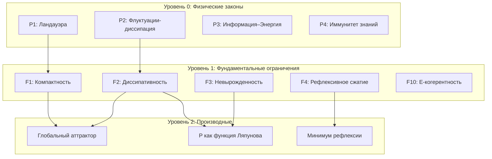

# Программы Исследований

> *«Не бывает окончательных теорий — бывают теории, которые ставят лучшие вопросы, чем предыдущие.»*
> — Дэвид Дойч, «Начало бесконечности»

:::tip Мост из предыдущей главы
В [предыдущей главе](./diagnostics) мы научились *диагностировать* когерентные системы: снимать $\sigma$-профиль, распознавать паттерны отказов, выбирать стратегии восстановления. Но диагностика работает с *уже установленными* закономерностями. Откуда эти закономерности берутся? Какие из них доказаны, а какие — лишь правдоподобные гипотезы? И какие вопросы КК *ещё не умеет* задавать? Программа исследований — это карта неизведанного.
:::

:::info Дорожная карта главы
В этой главе мы:
1. Построим **иерархию инвариантов** — трёхуровневую структуру ограничений (§1)
2. Разберём **физические законы** P1–P4, которые КК наследует от термодинамики (§2)
3. Опишем **фундаментальные ограничения** F1–F10 — минимальный базис для когерентных систем (§3)
4. Классифицируем **открытые проблемы** с указанием уровня сложности (§4)
5. Опишем **экспериментальную программу** — 5 конкретных протоколов (§5)
6. Наведём **междисциплинарные мосты** — точки контакта КК с нейронаукой, ИИ, биологией и организационной теорией (§6)
:::

Любая научная теория — не памятник, а инструмент. Она ценна не тем, что всё объяснила, а тем, какие **новые вопросы** она позволяет *точно сформулировать*. Теория Ньютона объяснила падение яблок и движение планет — но её подлинное величие в том, что она позволила *задать* вопрос об аномалии перигелия Меркурия. Из этого вопроса выросла общая теория относительности.

Кибернетика Когерентности (КК) находится на ранней стадии развития. Базовый конечномерный формализм выстроен: матрица когерентности $\Gamma \in \mathcal{D}(\mathbb{C}^7)$, открытая эволюция (`CC-1`, `CC-2` `[Т]` при указанных гипотезах регулярности и цели), канонические врата способностей (`[О]`) и условные оценки E-баланса (`Теорема 8.1` `[С]`; универсальный No-Zombie `T-38a` снят `[✗]`). За каждой теоремой и модельным выбором открываются десятки нерешённых вопросов: *какие пороги поддаются эмпирической калибровке?* *Какие ограничения фундаментальны, а какие выводимы?*

Данная глава — это **карта фронтира (`[Пр]`)**. Она описывает:

1. **Иерархию инвариантов** — трёхуровневую структуру ограничений, от физических законов через фундаментальные constraints до производных свойств.
2. **Физические законы** (P1-P4), которые КК наследует от термодинамики и теории информации — и которые она интерпретирует на новом языке.
3. **Фундаментальные ограничения** (F1-F10), которые предположительно образуют минимальный достаточный базис для существования когерентных систем.
4. **Открытые проблемы** — конкретные вопросы, каждый из которых может стать темой диссертации или программы исследований.
5. **Экспериментальную программу** — как перейти от теорем к лабораторным измерениям.
6. **Междисциплинарные мосты** — точки контакта КК с нейронаукой, ИИ, системной биологией и организационной теорией.

Читатель-теоретик найдёт здесь открытые гипотезы и маршруты доказательств. Экспериментатор — протоколы верификации. Инженер — ориентиры для построения систем, воплощающих принципы КК. А философ — пространство для рефлексии о границах формализма.

:::note О нотации
В этом документе:
- $\Gamma$ — [матрица когерентности](/docs/core/dynamics/coherence-matrix)
- $P$ — [чистота](/docs/core/dynamics/viability#определение-чистоты): $P = \mathrm{Tr}(\Gamma^2)$
- $\varphi$ — [оператор самомоделирования](/docs/proofs/categorical/formalization-phi)
- $\mathcal{D}[\Gamma]$ — [диссипативный член](/docs/core/dynamics/evolution#логический-лиувиллиан)
- $\mathrm{Coh}_E$ — [E-когерентность](./definitions#e-когерентность)
- $R$ — [мера рефлексии](/docs/consciousness/foundations/self-observation#мера-рефлексии-r)
:::

:::danger Программа исследований [Пр]
Этот раздел описывает открытую **программу исследований `[Пр]`**, а не формализованную или доказанную часть УГМ. Ограничения P1–P4 и F1–F10 **не выведены** из [аксиом УГМ](./axiomatics#аксиоматическая-база-краткая-справка) (`T-181` `[✗]` снята в части автоматического вывода). Формализация любого подмножества этих соотношений — открытая математическая и эмпирическая задача.
:::

---

## Иерархия инвариантов

### Зачем нужна иерархия?

Когда мы строим физику, мы не ставим все законы на один уровень. Закон сохранения энергии — фундаментальнее, чем закон Ома. Второе начало термодинамики — фундаментальнее, чем уравнение теплопроводности. Между ними существуют отношения **подчинения**: из более глубоких принципов *выводятся* более частные. Закон Ома — следствие микроскопической динамики электронов в кристаллической решётке. Уравнение теплопроводности — следствие второго начала.

Аналогичную иерархию предлагает КК для ограничений на когерентные системы. Ключевая идея: не все ограничения одинаково фундаментальны. Некоторые — **физические законы**, которые невозможно нарушить в принципе (как нельзя нарушить второе начало). Другие — **фундаментальные ограничения**, специфичные для когерентных систем, но, возможно, выводимые из физических законов плюс аксиоматика УГМ. Третьи — **производные свойства**, которые следуют из первых двух уровней.

Зачем это важно? Потому что понимание иерархии определяет **стратегию доказательств**. Если ограничение фундаментально — его нужно принять как аксиому или вывести из физики. Если оно производное — нужно найти путь вывода. Если два ограничения считались независимыми, но одно выводится из другого — мы упрощаем базис и углубляем понимание.

### Трёхуровневая структура (гипотеза)

КК предлагает организовать ограничения в иерархию с отношениями подчинения:

Стрелки на этой диаграмме означают отношение *подчинения*: нижнее ограничение (гипотетически) выводимо из верхнего. Обратим внимание на ключевую гипотезу: каждая стрелка — это **утверждение, требующее доказательства**. Структура диаграммы — программа исследований, а не доказанный результат.

---

## Уровень 0: Физические законы и структурные принципы (P1–P4) `[Пр]`

Физические ограничения (P1–P3) и проектный принцип структурной робастности (P4):

| Принцип | Формула | Область / Статус |
|---------|---------|------------------|
| P1 Ландауэр | $\Delta Q \geq k_B T \ln(2)\, n_{\mathrm{bits}}$ (эквивалентно $\Delta S_{\mathrm{env}} \geq k_B \ln(2)\, n_{\mathrm{bits}}$) | Термодинамика (физический закон) |
| P2 Флуктуационно-диссипативная теорема | $\sigma^2 = 2 T_{\mathrm{eff}} \gamma$ | Околоравновесная статистическая физика |
| P3 Граница «информация–мощность» | $\dot{Q}_{\mathrm{diss}} \geq k_B T \ln(2)\,\dot{I}_{\mathrm{erased}}$ ($\dot{S}_{\mathrm{env}} \geq k_B \ln(2)\,\dot{I}_{\mathrm{erased}}$) | Неравновесная термодинамика |
| P4 Иммунитет ядра знаний | $\|\Gamma(\tau) - \Gamma^*\|_F \leq \varepsilon$ при возмущениях внутри $r_{\mathrm{stab}}$ | Устойчивость аттрактора `[Пр]` / `[Г]` |

### P1: Принцип Ландауэра {#p1-принцип-ландауэра}

#### Историческая справка

В 1961 году Рольф Ландауэр, работавший в IBM, опубликовал одну из самых глубоких работ XX века: «Необратимость и выделение тепла в вычислительном процессе». Ландауэр показал, что **стирание** одного бита информации неизбежно выделяет не менее $k_B T \ln 2$ тепла в тепловой резервуар температуры $T$. Это следствие второго начала термодинамики: обратимые операции в принципе могут не рассеивать тепло, тогда как любое логически необратимое стирание увеличивает энтропию окружения.

В 2012 году группа Берю экспериментально подтвердила эту границу, манипулируя коллоидными частицами в двухъямной оптической ловушке в квазистатическом протоколе.

#### Формулировка

Стирание $n_{\mathrm{bits}}$ бит логической информации в тепловой резервуар температуры $T$ выделяет не менее $k_B T \ln(2)\, n_{\mathrm{bits}}$ тепла, увеличивая энтропию резервуара как минимум на:

$$
\Delta Q \geq k_B T \ln(2) \cdot n_{\mathrm{bits}}, \qquad \Delta S_{\mathrm{env}} = \frac{\Delta Q}{T} \geq k_B \ln(2) \cdot n_{\mathrm{bits}}
$$

#### Связь с КК `[Пр]`

**Связь с КК:** Ограничивает термодинамическую цену **регенерации $\mathcal{R}[\Gamma, E]$** (снижения энтропии), а не пассивной декогеренции.

Обратим внимание на направление второго начала: пассивная унитальная декогеренция $\mathcal{D}[\Gamma]$ *увеличивает* энтропию фон Неймана $S_{vN}(\Gamma)$ (чистая дефазировка в вырожденном базисе может происходить вообще без теплообмена). Напротив, **регенерация $\mathcal{R}[\Gamma, E]$** *уменьшает* энтропию системы $S_{vN}(\Gamma)$, восстанавливая чистоту $P$. По принципу Ландауэра поддержание отрицательной скорости изменения энтропии $\dot{S}_{\mathrm{reg}} < 0$ требует отвода тепловой мощности в среду температуры $T$ со скоростью не ниже:

$$
\dot{Q}_{\mathrm{export}} \geq k_B T \cdot \bigl(-\dot{S}_{\mathrm{reg}}(\Gamma)\bigr)
$$

Следовательно, **когерентная система не способна восстанавливать чистоту быстрее, чем позволяет доступный ей термодинамический бюджет мощности**. В КК это напрямую связывает регенеративную способность с ресурсным сектором $O$ (Основание) и термодинамическими оценками при конечных скоростях (при этом формальный вывод единственного шлюза регенерации из принципа Ландауэра `T-39g` снят `[✗]`).

### P2: Флуктуационно-диссипативная теорема {#p2-фдт}

#### Историческая справка

В 1905 году Альберт Эйнштейн объяснил броуновское движение — случайное блуждание пылинки в воде, связав коэффициент диффузии с вязкостью: $D = k_B T / (6\pi \eta r)$.

В 1951 году Герберт Каллен и Теодор Уэлтон обобщили эту связь в **флуктуационно-диссипативную теорему** (ФДТ): в системе вблизи теплового равновесия амплитуда спонтанных флуктуаций пропорциональна скорости диссипации. Формализация линейного отклика Кубо (1957) сделала ФДТ базовым инструментом статистической физики.

#### Формулировка

В классическом марковском околоравновесном пределе дисперсия шума $\sigma^2$, коэффициент затухания $\gamma$ и эффективная температура $T_{\mathrm{eff}}$ связаны соотношением:

$$
\sigma^2 = 2 T_{\mathrm{eff}} \gamma
$$

#### Связь с КК `[Пр]`

**Связь с КК:** Мотивирует стохастические расширения $\mathcal{D}[\Gamma]$ и калибровку эффективной температуры (см. [Эффективная температура](./effective-temperature)).

В стохастических моделях КК ФДТ подсказывает две проверяемые гипотезы (`[Г]`):

1. **Пропорциональность диссипации и шума.** Вблизи стационарного режима с линейным откликом более сильное диссипативное затухание сопровождается большими флуктуациями состояния.
2. **Операциональная оценка.** Измерение стационарной дисперсии флуктуаций может помочь оценить эффективное отношение шума к затуханию $T_{\mathrm{eff}}$ без прямого возмущения диссипатора — при условии выполнения гипотез линейного отклика и детального баланса в конкретном субстрате.

### P3: Связь информации и энергии {#p3-информация-энергия}

#### Историческая справка

Физическая связь информации и термодинамики восходит к демону Максвелла (1867), Сциларду (1929), Ландауэру (1961) и Беннетту (1982) и сегодня формализована в стохастической и квантовой термодинамике (Сагава–Уэда, Горовиц, Паррондо, Зайферт, Брандау–Хородецкие): **необратимая обработка информации и управление с обратной связью несут неизбежную термодинамическую цену**.

#### Формулировка

Для непрерывного необратимого стирания информации или индуцированного обратной связью снижения энтропии со скоростью $\dot{I}_{\mathrm{erased}} = dI_{\mathrm{erased}}/dt$ (в битах в единицу времени) при контакте с резервуаром температуры $T$ рассеиваемая мощность $\dot{Q}_{\mathrm{diss}}$ и скорость производства энтропии среды $\dot{S}_{\mathrm{env}} = \dot{Q}_{\mathrm{diss}}/T$ удовлетворяют размерностно согласованным границам:

$$
\dot{Q}_{\mathrm{diss}} \geq k_B T \ln(2) \cdot \dot{I}_{\mathrm{erased}}, \qquad \dot{S}_{\mathrm{env}} \geq k_B \ln(2) \cdot \dot{I}_{\mathrm{erased}}
$$

*(В натуральных единицах информации — натах в единицу времени — множитель $\ln 2$ опускается: $\dot{Q}_{\mathrm{diss}} \geq k_B T\,\dot{I}_{\mathrm{erased}}$ и $\dot{S}_{\mathrm{env}} \geq k_B\,\dot{I}_{\mathrm{erased}}$.)*

#### Связь с КК `[Пр]`

**Связь с КК:** Ограничивает устойчивую скорость активного восстановления когерентности при конечном притоке энергии и ресурсов.

Любое активное обновление $\Gamma$, снижающее энтропию или противодействующее диссипации — обучение, адаптация, регенеративная обратная связь — требует термодинамической работы, ограниченной P3. Это мотивирует качественный **треугольник ограничений** для открытых агентов (`[Пр]`):

- **Скорость адаптации / регенерации** ограничена доступной мощностью и ресурсами (P3, сектор $O$).
- **Точность самомодели** определяется выбранной динамикой самомоделирования (F4 / устойчивость полной динамики).
- **Устойчивость существования** зависит от баланса регенерации и декогеренции (F2).

В КК P3 мотивирует связь [O-измерения](/docs/core/structure/dimension-o) (Основание — энергетические и информационные ресурсы) с регенеративной способностью: устойчивый дефицит O ограничивает скорость восстановления чистоты $P$.

### P4: Иммунитет ядра знаний {#p4-иммунитет-ядра}

#### Историческая справка

В отличие от P1–P3, P4 **не является универсальным законом физики**, а представляет собой **проектный принцип структурной робастности `[Пр]` / `[Г]`**, вдохновлённый различением Имре Лакатоса (1970) между *твёрдым ядром* и *защитным поясом* исследовательской программы, а также биологическим гомеостазом и инвариантностью в теории управления.

#### Формулировка

В пределах заданного бассейна притяжения радиуса $r_{\mathrm{stab}}$ ограниченные внешние возмущения оставляют ядро аттрактора инвариантным (или асимптотически возвращают к нему):

$$
\|\delta \Gamma(0)\|_F < r_{\mathrm{stab}} \;\Longrightarrow\; \lim_{\tau \to \infty} \Gamma(\tau) = \Gamma^*
$$

#### Связь с КК `[Пр]`

**Связь с КК:** Связывает робастность ядра с локальной асимптотической устойчивостью аттрактора $\Gamma^*$ полной динамики (а не только с условием $\Gamma^* = \varphi(\Gamma^*)$).

В КК «ядро знаний» моделируется как локально устойчивое стационарное состояние $\Gamma^*$ полного эволюционного уравнения (с радиусом бассейна $r_{\mathrm{stab}}$; см. [Стабильность](./stability)). Возмущения внутри бассейна релаксируют обратно к $\Gamma^*$, тогда как достаточно сильные удары вне бассейна способны перебросить систему в другой аттрактор или ниже $P_{\mathrm{crit}} = 2/7$ (`T-5` `[О]`). Исследование условий, при которых когерентные архитектуры проявляют высокую устойчивость к состязательным атакам в задачах безопасности ИИ, остаётся открытой инженерной программой исследований (`[Пр]`).

---

## Уровень 1: Фундаментальные ограничения (F1-F10)

Минимальный достаточный набор (гипотетический):

| Ограничение | Формула | Связь с УГМ |
|-------------|---------|-------------|
| F1 Компактность | $\lVert\Gamma\rVert_F \leq R_{\max}$ | $\mathrm{Tr}(\Gamma) = 1$ |
| F2 Диссипативность | $\dot{W} \leq -\alpha W + \gamma(\lVert e\rVert)$ | [$\mathcal{D}[\Gamma]$](/docs/core/dynamics/evolution#логический-лиувиллиан) |
| F3 Невырожденность | $\lambda_{\min}(\Gamma) \geq \varepsilon$ | [Жизнеспособность](/docs/core/dynamics/viability) |
| F4 Рефлексивное сжатие | $\lVert\varphi(\Gamma_1) - \varphi(\Gamma_2)\rVert_F \leq k \lVert\Gamma_1 - \Gamma_2\rVert_F$, $k < 1$ | [Теорема 7.2](./theorems#теорема-72-условная-неподвижная-точка-рефлексии) |
| F5 Причинное замыкание | Выходы зависят только от внутренних состояний | [A-измерение](/docs/core/structure/dimension-a) |
| F6 Временная связность | $\Gamma(\tau+d\tau)$ зависит от $\Gamma(\tau)$ | [Эволюция](/docs/core/dynamics/evolution) |
| F7 Энергетический баланс | Приток ≥ Отток в среднем | [O-измерение](/docs/core/structure/dimension-o) |
| F8 Информационная ёмкость | Ограниченное число различимых состояний | $\dim(\mathcal{H}) = 7$ ([обоснование](/docs/core/foundations/axiom-omega#октонионная-структура)) |
| F9 Структурная стабильность | Малые возмущения → малые изменения | Топология $\mathcal{V}$ |
| F10 E-когерентность | $\kappa = \kappa_{\text{bootstrap}} + \kappa_0 \cdot \mathrm{Coh}_E(\Gamma)$ | [Аксиоматика](./axiomatics#связь-регенерации-и-e-когерентности) |

### Детальный разбор ограничений

#### F1: Компактность — система конечна {#f1-компактность}

**Интуиция.** Ни одна реальная система не обладает бесконечными ресурсами, бесконечным числом состояний или бесконечной когерентностью. F1 формализует эту очевидность: пространство состояний $\Gamma$ ограничено.

**Почему это необходимо?** Без F1 динамика может «убежать на бесконечность» — чистота $P$ может расти без предела, нормы могут расходиться, а математический аппарат (теоремы о существовании аттракторов, непрерывность отображений) перестаёт работать. Компактность — техническое, но критическое условие, обеспечивающее *существование* решений эволюционного уравнения.

**Что будет без F1?** Представьте систему, которая может накопить неограниченную когерентность. Такая система стала бы «бесконечно хрупкой»: сколь угодно малое возмущение — и бесконечная структура рушится. В реальности подобных систем не бывает: даже алмаз — один из самых структурированных объектов — конечен и ограничен.

**Связь с УГМ:** $\mathrm{Tr}(\Gamma) = 1$ гарантирует, что $\Gamma$ живёт в компактном множестве матриц плотности. Это следствие нормировки вероятностей — фундаментального требования квантовой теории.

#### F2: Диссипативность — энтропия всегда растёт {#f2-диссипативность}

**Интуиция.** Второе начало термодинамики в действии. Если систему оставить без «подпитки», она деградирует. Стакан с горячей водой остывает. Память стирается. Организм без пищи умирает. F2 говорит: существует *скорость* этой деградации, и она пропорциональна отклонению от равновесия.

**Почему это необходимо?** Без диссипации система была бы вечным двигателем — раз достигнув высокой когерентности, она удерживала бы её навсегда без затрат. Это противоречит всему опыту физики и биологии. Диссипативность создаёт **необходимость регенерации** (F10) — и тем самым делает *интериорность* функционально значимой.

**Что будет без F2?** Без диссипации регенерация $\mathcal{R}[\Gamma, E]$ перестаёт быть необходимой, и E-когерентность (F10) не играет балансирующей роли. В условных оценках E-баланса КК (`Теорема 8.1` `[С]`) ненулевая диссипация существенна для функциональной необходимости E-связанной регенерации (при этом универсальный No-Zombie `T-38a` снят `[✗]`).

**Связь с УГМ:** Диссипатор $\mathcal{D}[\Gamma]$ — генератор ГКСЛ — гарантирует CPTP-свойство линейной диссипации (тогда как полная нелинейная эволюция с $\mathcal{R}$ сохраняет матрицы плотности по `CC-2` `[Т]`, не обязанная быть линейно CPTP).

#### F3: Невырожденность — все измерения живы {#f3-невырожденность}

**Интуиция.** Ни одно из семи измерений системы не может полностью «погаснуть». Даже в самом стрессовом состоянии минимальная активность сохраняется во всех каналах.

**Почему это необходимо?** Если $\lambda_{\min}(\Gamma) = 0$, матрица $\Gamma$ теряет полный ранг — одно или несколько спектральных направлений обнуляются. Величины, требующие невырожденных состояний (например, конечная относительная энтропия $\mathrm{KL}(\rho\|\Gamma)$ или строгие внутренние зазоры), при этом становятся сингулярными.

**Что будет без F3?** Состояние может схлопнуться в собственное подпространство размерности $< 7$, включая состояния с нулевой E-строкой/столбцом (стационарные контрпримеры с внешней поддержкой к универсальному No-Zombie `T-38a` `[✗]` существуют именно при отсутствии замкнутых ограничений баланса). Таким образом, F3 — это условие регулярности внутри пространства состояний, а не безусловная теорема, запрещающая вырожденные состояния.

#### F4: Рефлексивное сжатие — самомодель стабильна {#f4-рефлексивное-сжатие}

**Интуиция.** Когда система моделирует себя, результат должен быть «ближе к истине», чем исходное приближение. Оператор самомоделирования $\varphi$ — сжимающее отображение: он уменьшает расстояние между любыми двумя состояниями.

**Почему это необходимо?** Без свойства сжатия самомодель могла бы *расходиться* — каждая итерация самонаблюдения увеличивала бы ошибку, и система «сходила бы с ума», теряя связь с реальностью. Теорема Банаха о неподвижной точке гарантирует: если $\varphi$ — сжатие с коэффициентом $k < 1$, то существует единственная неподвижная точка $\Gamma^* = \varphi(\Gamma^*)$, и итерации $\varphi^n(\Gamma_0)$ сходятся к ней из любого начального состояния.

**Что будет без F4?** Два сценария. Первый: $k = 1$ (изометрия) — самомодель не сходится, система вечно «колеблется» вокруг неподвижной точки, никогда не достигая самосогласованности. Второй: $k > 1$ (расширение) — самомодель расходится, малая начальная ошибка экспоненциально растёт. Оба сценария несовместимы с устойчивым сознанием.

**Связь с УГМ:** F4 формализует [Теорему 7.2 / `CC-4`](./theorems#теорема-72-условная-неподвижная-точка-рефлексии) `[Т]` для заданного сжимающего семейства зеркал.

**Область применимости (2026-09-25).** F4 выполняется для формы $k\,\mathcal{P}(\Gamma) + (1 - k)\rho_a$ с постоянными $k$ и якорем и унитальным $\mathcal{P}$ ([формализация φ, лемма 2.1](/docs/proofs/categorical/formalization-phi#25-сжимающий-оператор-самомоделирования)); самомодели УГМ, у которых вес $k = 1 - 1/(7P)$ зависит от состояния, ему не удовлетворяют — липшицева константа $\varphi_{\mathrm{coh}}$ в чистом состоянии равна $54/49$, у $\varphi_J$ в базисном состоянии — $1{,}129$, а у $\varphi_s$ не меньше восьми неподвижных точек. Сценарии выше из нарушения F4 не следуют: $\varphi_J$ не сжатие, но у неё ровно одна неподвижная точка, $\Gamma_{\eta_\infty}$ внутри окна, и изолированный голон, регенерирующий к ней, имеет один гиперболический сток в $\mathcal{V}_{\mathrm{full}}$ ([живой аттрактор в окне](/docs/core/dynamics/evolution#теорема-живой-аттрактор-в-окне) [Т]). Устойчивость самомодели — свойство полной динамики, а не сжатия $\varphi$; F4 — достаточное конструктивное условие, а не необходимое.

#### F5: Причинное замыкание — система автономна {#f5-причинное-замыкание}

**Интуиция.** Выходы системы определяются её внутренними состояниями, а не внешними причинами напрямую. Это не означает изоляцию — система получает входы из среды. Но её *реакции* опосредованы внутренним состоянием $\Gamma$.

**Почему это необходимо?** Без причинного замыкания система — просто «провод»: вход прямо определяет выход, без внутренней обработки. Такая система не может обладать ни памятью, ни самонаблюдением, ни автономией. F5 — минимальное условие *субъектности*.

**Что будет без F5?** Система становится полностью реактивной — стимул-ответная машина без внутреннего мира. Это предел бихевиоризма: описание поведения без апелляции к внутренним состояниям. КК утверждает, что такие системы не могут быть жизнеспособными ($P > 2/7$) в нестационарной среде.

#### F6: Временная связность — прошлое определяет настоящее {#f6-временная-связность}

**Интуиция.** Состояние системы в следующий момент определяется состоянием в текущий момент (плюс входы). Это марковость — или, для систем с памятью, условная марковость (марковость при расширении пространства состояний).

**Почему это необходимо?** Без F6 эволюция $\Gamma$ была бы «разорвана во времени» — состояние могло бы произвольно меняться без причин. Это противоречит самому понятию динамической системы. F6 обеспечивает *предсказуемость* — возможность вычислить будущее по настоящему.

**Что будет без F6?** Невозможно говорить о траекториях, аттракторах, устойчивости — весь математический аппарат динамических систем рассыпается. Нет обучения (нет связи между попытками), нет идентичности (нет связи между моментами).

#### F7: Энергетический баланс — система не может жить в долг {#f7-энергетический-баланс}

**Интуиция.** В среднем система должна получать не меньше ресурсов, чем тратит. Можно «жить в долг» короткое время (используя запасы), но в долгосрочной перспективе баланс должен сходиться.

**Почему это необходимо?** Регенерация $\mathcal{R}[\Gamma, E]$ требует энергии (P3). Диссипация $\mathcal{D}[\Gamma]$ рассеивает энергию (P1, P2). Если приток энергии через O-измерение систематически меньше оттока, регенерация не может компенсировать декогеренцию, и $P$ монотонно падает до $P \leq 2/7$ — смерть.

**Что будет без F7?** Система может временно существовать, истощая запасы — как голодающий организм расходует жировые отложения. Но без F7 нет *устойчивого* существования. Все живые системы решают эту проблему по-своему: фотосинтез, хищничество, потребление данных.

#### F8: Информационная ёмкость — конечная размерность {#f8-информационная-ёмкость}

**Интуиция.** Число *различимых* внутренних состояний системы конечно. Это не означает, что пространство состояний дискретно — $\Gamma$ принимает непрерывное множество значений. Но число *качественно различных* режимов ограничено размерностью: $\dim(\mathcal{H}) = 7$.

**Почему это необходимо?** Бесконечномерная система потребовала бы неограниченных ресурсов для оценивания и управления. Конечная размерность $\dim(\mathcal{H}) = 7$ фиксируется спецификацией модели КК (`[П]` / `[О]`), охватывающей семь функциональных осей $(A, S, D, L, E, O, U)$ и подкреплённой условными нижними оценками совершенной диагностируемости и точного представления (безусловная семиролевая минимальность `T-40f` и абстрактный операциональный вывод `T-190` сняты `[✗]`; оптимальность для обучения `T-113` остаётся `[Г]`).

**Что будет без F8?** Формально можно рассмотреть бесконечномерные обобщения, но они теряют ключевые свойства: сжатие $\varphi$ может не иметь неподвижной точки, компактность (F1) нарушается, вычисления становятся нетрактабельными.

#### F9: Структурная стабильность — малые причины, малые следствия {#f9-структурная-стабильность}

**Интуиция.** Если слегка «подтолкнуть» систему, она слегка изменится — не разрушится катастрофически и не «прыгнет» в совершенно другое состояние. Это топологическое условие непрерывности отображения $\Gamma \mapsto \dot\Gamma$.

**Почему это необходимо?** Без структурной стабильности теория не даёт предсказаний: малейшая ошибка в начальных условиях или параметрах приводит к произвольно большим отклонениям результата. Реальные системы приблизительны — ни один биологический параметр не известен точно. F9 гарантирует, что приблизительные знания дают приблизительно верные предсказания.

**Что будет без F9?** Хаос в строгом смысле: экспоненциальная чувствительность к начальным условиям. Интересно, что КК допускает хаос *внутри* области жизнеспособности (система может быть хаотической и живой), но запрещает хаос *на границе* — переход через $P_{\text{crit}}$ должен быть непрерывным.

#### F10: E-когерентность — опыт усиливает регенерацию {#f10-e-когерентность}

**Интуиция.** Скорость восстановления когерентности зависит от степени интегрированности E-когерентности (интериорного аспекта). Система с более развитой E-проекцией регенерирует быстрее, чем система с тем же состоянием, но без внутренней когерентности E-измерения. Для L2+-систем это проявляется как зависимость от качества сознательного опыта.

**Почему это необходимо?** F10 — это **ключевое ограничение КК**, отличающее её от всех предшествующих кибернетик. Без F10 E-когерентность не влияет на динамику — и опыт становится эпифеноменом. С F10 опыт *каузально значим*: он буквально ускоряет регенерацию. Это формализация интуиции: «осмысленная деятельность восстанавливает», «депрессия замедляет выздоровление».

**Что будет без F10?** Без конститутивной связи $\kappa = \kappa_{\text{bootstrap}} + \kappa_0 \cdot \mathrm{Coh}_E(\Gamma)$ (`[О]` / `[Г]`; полностью аксиоматический вывод регенерации `T-39h` снят `[✗]`) регенерация становится не зависящей от состояния ($\kappa = \kappa_{\text{bootstrap}}$), делая E-измерение динамически инертным. При F10 совместно с явными замкнутыми оценками баланса потока чистоты (`Теорема 8.1` `[С]`) поддержание $P > 2/7$ требует положительной $\mathrm{Coh}_E$ — тогда как без этих ограничений замкнутого баланса стационарные состояния с внешней поддержкой и $\mathrm{Coh}_E = 0$ всё же могут удерживать $P > 2/7$ (`T-38a` `[✗]`).

---

## Уровень 2: Производные ограничения

Ограничения, выводимые из Уровня 1. Точное число и структура — открытый вопрос.

### Гипотеза о подчинении инвариантов

:::info Гипотеза (не теорема)
Каждое ограничение Уровня 2 может быть выведено из ограничений Уровня 1.
:::

**Примеры предполагаемых выводов (гипотезы, требуют доказательства):**

$$
\begin{aligned}
\mathrm{F1} + \mathrm{F2} &\Rightarrow \text{Существование глобального аттрактора} \quad \text{(гипотеза)} \\
\mathrm{F2} + \mathrm{F3} &\Rightarrow P(\Gamma) \text{ есть функция Ляпунова} \quad \text{(гипотеза)} \\
\mathrm{F4} &\Rightarrow R(\Gamma) \geq 1 - k \text{ (минимум рефлексии)} \quad \text{(гипотеза)}
\end{aligned}
$$

:::info Статус доказательств
Эти импликации — **программа исследований**, не доказанные теоремы. Формальные доказательства требуют строгого вывода F1-F10 из Ω⁷ (открытый вопрос Q1).
:::

### Путь от гипотезы к теореме

Каждая из стрелок в диаграмме иерархии представляет *конкретную математическую задачу*. Рассмотрим пример:

**F1 + F2 → Глобальный аттрактор.** Компактность (F1) означает ограниченность пространства состояний. Диссипативность (F2) означает, что энергия (или обобщённая функция Ляпунова) убывает вдоль траекторий. По классической теории (Ладыженская, Темам), для диссипативной системы в компактном пространстве существует глобальный аттрактор — компактное множество, притягивающее все траектории. Для КК задача — показать, что этот аттрактор содержит *только* жизнеспособные состояния ($P > 2/7$) или включает также «мёртвую» точку $\Gamma = I/7$.

**F2 + F3 → P как функция Ляпунова.** Если система диссипативна и невырождена, можно ли показать, что $P(\Gamma)$ монотонно убывает вдоль свободных (без регенерации) траекторий? Это было бы аналогом H-теоремы Больцмана для когерентных систем: чистота *убывает* без активной поддержки, как энтропия *растёт* в замкнутой системе.

---

## Открытые вопросы

### Теоретические `[Пр]`

| № | Вопрос | Статус | Связь с документами |
|---|--------|--------|---------------------|
| Q1 | Условный вывод подмножеств F1–F10 из явных модельных посылок УГМ | `[Пр]` (автоматический вывод `T-181` `[✗]`) | [Аксиоматика](./axiomatics) |
| Q2 | Независимость и минимальность набора F1–F10 | `[Пр]` | — |
| Q3 | Функторное сопоставление $\mathbf{Hol}_{\mathrm{L2}}$ и IIT-подобных категорий агентов | `[Пр]` / `[Г]` (полная эквивалентность категорий не автоматична; ср. `T-58` `[✗]`) | [Панпсихизм](/docs/consciousness/comparative/panpsychism-analysis#теорема-об-эквивалентности-гипотеза) |
| Q4 | Формализация соответствия K1–K5 ↔ L0–L4 | `[Пр]` | [Когнитивная иерархия](/docs/consciousness/comparative/cognitive-hierarchy) (K1–K5 → L0–L4) |
| Q5 | Вычисление $\Phi_{\min}$ и границ связи для композиции | `[Пр]` (`CC-5` `[Т]` при слабой связи) | [Теорема 9.1](./theorems#теорема-91-фрактальное-замыкание) |

### Экспериментальные `[Пр]`

| № | Вопрос | Методы | Ссылки |
|---|--------|--------|--------|
| E1 | Проверка условного E-баланса (`Теорема 8.1` `[С]`) на замкнутых ИИ-агентах | Контролируемая абляция E-обратной связи при фиксированных внешних ресурсах | [Предсказания](./predictions#предсказание-1) |
| E2 | Корреляция $\mathrm{Coh}_E$ ↔ восстановление (`[Г]`) | Нейровизуализация + калиброванные лонгитюдные клинические данные | [Предсказания](./predictions#предсказание-2) |
| E3 | 7-мерная структура нейрокоррелятов (`[Г]`) | Мультимодальный анализ fMRI, EEG, вегетатики | [Приложения](./applications#для-когнитивистов) |
| E4 | Калибровка $\kappa_0$, $\omega_0$ (`[Пр]`) | Измерение скоростей восстановления при контролируемых возмущениях | [Реализация](./implementation#пороговые-значения) |

---

## Открытые проблемы {#открытые-проблемы}

Помимо основных вопросов Q1–Q5, перечисленных выше, КК порождает спектр конкретных исследовательских задач (`[Пр]`), организованных по математическому, вычислительному и концептуальному направлениям.

### Математические проблемы `[Пр]`

:::info Обозначения уровней сложности
- ⬜ **Бакалавриат** — решаема за семестр при знании линейной алгебры и квантовой механики
- 🟦 **Магистратура** — требует глубоких знаний функционального анализа или категорной теории
- 🟧 **Диссертация** — полноценная тема PhD, требующая разработки новых методов
- 🟥 **Открытая проблема** — может потребовать прорыва в математике
:::

**OP-1. Минимальность набора F1–F10.** 🟧 Являются ли все десять ограничений независимыми? Или некоторые выводимы из других? Например, при каких явных диссипативных и регенеративных параметрах F2 + F10 удерживают траектории строго внутри области $\lambda_{\min}(\Gamma) > 0$ (F3)? Доказательство или опровержение таких импликаций прояснит структуру семейства моделей.

**OP-2. Оценки коэффициента сжатия $k$.** 🟦 В F4 фигурирует коэффициент сжатия $k < 1$ для зеркал с фиксированными весами (`CC-4` `[Т]`). Какие скорости сжатия реализуемы для конкретных классов не зависящих от состояния зеркал, и какие аналогичные спектральные оценки якобиана управляют сходимостью, когда F4 не выполняется (как для зависящих от состояния самомоделей УГМ $\varphi_{\mathrm{coh}}$, $\varphi_J$)?

**OP-3. Бифуркации.** 🟧 Оценить заданный динамический поток и проверить предлагаемую редукцию к нормальной форме вблизи измеренного перехода (`T-160` `[✗]` снята в части универсальной бифуркации при $P = 2/7$; срез чистоты `T-5` `[О]` является отдельным модельным выбором).

**OP-4. Топология пространства неподвижных точек.** 🟧 *Решено для конкретного потока (`T-124c` `[Т]` при заданных цели, скоростях и инвариантной области).* Аттракторы являются свойствами выбранного потока — универсальное их число не следует из интервала чистоты или одного лишь стационарного уравнения. Например, у изолированного голона с $\varphi_{\mathrm{coh}}$ нетривиальных неподвижных точек нет, с $\varphi_s$ имеется не менее семи локально устойчивых вблизи базисных состояний, а при доминировании базовой подкачки — единственный гиперболический сток (`T-124c` `[Т]`). **Что остаётся открытым (`[Пр]`):** классификация $\mathrm{Fix}(\varphi)$ и бифуркаций аттракторов для более широких несжимающих семейств самомоделей.

**OP-5. Скорость обучения и спектральная щель.** 🟦 [Границы обучения](./learning-bounds) связывают пределы бинарного различения (`T-109` `[Т]`) и спектральные щели диссипативных генераторов со скоростью адаптации. Достижимы ли более точные конечно-временные оценки пропускной способности для конкретных 7-мерных архитектур и при каких операциональных посылках $N=7$ минимизирует сложность обучения (`T-113` `[Г]`)?

### Вычислительные проблемы `[Пр]`

**OP-6. Эффективное вычисление мер интеграции и робастных зазоров неопределённости.** ⬜ Отметим принципиальное различие: каноническое отношение интеграции КК $\Phi_{\mathrm{CC}}(\Gamma) = P/d - 1 = \sum_{i \neq j} |\gamma_{ij}|^2 / \sum_i \gamma_{ii}^2$ вычисляется **напрямую за время $O(N^2)$** (49 умножений при $N = 7$ — оно **не** является NP-трудным!). Напротив, вычисление **разбиение-зависимых мер интеграции** вроде $\Phi_{\mathrm{IIT}}$ NP-трудно при произвольном $N$, а сертификация зазоров врат КК $m(\rho) = (P - 2/7,\ R - 1/3,\ \Phi - 1,\ D_{\mathrm{diff}} - 2)$ на всём **томографическом доверительном множестве $K$** (см. [Диагностика с неопределённостью](./diagnostics)) сводится к невыпуклой оптимизации на $\mathcal{D}(\mathbb{C}^7) \cap K$. Разработка быстрых сертифицированных решателей внешних оценок для $\min_{\rho \in K} m_j(\rho)$ — а также точных сравнений $\Phi_{\mathrm{CC}}$ с разбиение-зависимыми мерами при $N=7$ — представляет собой конкретную вычислительную задачу (`[Пр]`).

**OP-7. Численные методы для эволюционного уравнения.** 🟦 Эволюция $\dot\Gamma = -i[H_{\text{eff}}, \Gamma] + \mathcal{D}[\Gamma] + \mathcal{R}[\Gamma, E]$ объединяет быстрые унитарные осцилляции, линейную диссипацию и нелинейную регенерацию — жёсткую задачу ОДУ с сохранением положительности (`CC-1`, `CC-2` `[Т]`). Проектирование схем высокого порядка, сохраняющих положительность и единичный след (например, split-step и экспоненциальных интеграторов) с сертифицированными оценками погрешности, остаётся активной численной задачей (`[Пр]`).

**OP-8. Симуляция популяций голономов.** 🟧 Одиночный голоном описывается $7\times 7$-матрицей плотности (48 вещественных параметров с учётом $\mathrm{Tr}(\Gamma) = 1$). Связанная популяция из $n$ голономов живёт в $(\mathbb{C}^7)^{\otimes n}$ либо отслеживает $O(n^2)$ парных связей в среднеполевых/редуцированных моделях (`CC-5`, `CC-7` `[Т]` при слабой связи). Масштабируемые методы симуляции (тензорные сети, среднее поле) со строгими оценками ошибки — открытая вычислительная задача (`[Пр]`).

### Концептуальные проблемы `[Пр]`

**OP-9. Границы применимости КК.** 🟥 Для каких классов физических и биологических систем редукция к 7-мерной матрице плотности эмпирически информативна, а где она теряет предсказательную силу? Формализация критериев выбора модели (сравнение 7D-моделей КК с моделями меньшей или большей размерности) требует как теории статистической идентифицируемости, так и философии моделирования (`[Пр]`).

**OP-10. Операциональные корреляты рекурсивного самомоделирования (SAD / L3).** 🟧 Прежние утверждения об универсальной эквивалентности SAD и уровней (`T-136`) и универсальном потолке глубины $\mathrm{SAD}_{\max} = 3$ (`T-217`) сняты `[✗]`; формальный уровень способностей L3 в КК вместо этого требует независимого предиктивного сертификата метамодели с калиброванными непостоянными зондами (`[О]`). Соотнесение конечной человеческой глубины метапознания с калиброванными предиктивными сертификатами и когнитивными архитектурами остаётся открытой эмпирической и теоретической задачей (`[Пр]`).

**OP-11. Этика когерентных систем.** 🟥 Поскольку универсальный No-Zombie (`T-38a`) снят `[✗]`, а феноменологическое приписывание способностям L2 остаётся явным интерпретативным мостом `[И]`, любая этическая рамка для искусственных или биологических систем должна учитывать **эпистемическую неопределённость** морального статуса наряду с формальными зазорами способностей ($P, R, \Phi, D_{\mathrm{diff}}$). Формулировка принципов предосторожного регулирования при неопределённости реконструкции — открытая философская задача (`[Пр]`).

---

## Критерии верификации гипотез `[Пр]`

| Гипотеза | Критерий верификации | Критерий фальсификации |
|----------|----------------------|------------------------|
| Иерархия P→F→D | Формальный вывод указанных D из явных посылок F | Контрпример, удовлетворяющий F и нарушающий D |
| Независимость F1–F10 | Контрмодель, показывающая независимость каждого F | Доказательство выводимости одного F из остальных |
| K↔L соответствие | Калиброванное операциональное соответствие | Система с K4 без сертификата L2 |
| Условный E-баланс (`Теорема 8.1` `[С]`) | Наблюдаемая E-зависимость при контролируемом замкнутом балансе | Нарушение заявленного неравенства баланса при его точных гипотезах *(контрпримеры с внешней поддержкой к универсальной `T-38a` `[✗]` уже известны)* |

---

## Экспериментальная программа `[Пр]` {#экспериментальная-программа}

> *«Теория без эксперимента — это философия. Эксперимент без теории — это бухгалтерия.»*
> — приписывается Максу Планку

КК — математический каркас моделирования, чья эмпирическая ценность определяется проверкой его калиброванных гипотез (`[Г]`). Ниже приведены пять кандидатных экспериментальных протоколов (`[Пр]`), сгруппированных по технической сложности. Каждый протокол требует пререгистрированного закона наблюдений и анализа неопределённости (см. [Диагностика с неопределённостью](./diagnostics)).

### Эксперимент 1: Корреляция E-когерентности и восстановления `[Пр]` {#эксп-1}

**Гипотеза КК `[Г]`:** В рамках конститутивной связи F10 скорость восстановления после стандартизованного возмущения положительно коррелирует с довозмущенческими прокси-оценками E-когерентности.

**Протокол:**
1. Набрать когорту из $n \geq 100$ испытуемых.
2. Оценить пререгистрированный прокси E-когерентности (например, шкалы осознанности/интероцепции MAAS/MAIA, маркеры ЭЭГ-синхронизации) с замороженными весами калибровки.
3. Применить стандартизованное когнитивное возмущение (контролируемое ограничение сна или когнитивную нагрузку).
4. Измерить скорость восстановления когнитивных показателей (рабочая память, внимание, время реакции).
5. Проверить положительную корреляцию скорости восстановления с пререгистрированным прокси $\mathrm{Coh}_E$ с учётом контрольных ковариат.

**Ожидаемый результат:** Положительная корреляция ($r \geq 0.3$) при выполнении эмпирического моста F10; нулевая или отрицательная корреляция фальсифицирует данную эмпирическую операционализацию F10.

**Сложность:** Средняя. Требует стандартного нейропсихологического и ЭЭГ-оборудования.

### Эксперимент 2: 7-мерная структура нейрокоррелятов `[Пр]` {#эксп-2}

**Гипотеза КК `[Г]`:** Многомерные нейронные и вегетативные записи при выполнении задач, нацеленных на семь функциональных ролей, обнаруживают экономную ~7-факторную структуру, соотносимую с ASDLEOU.

**Протокол:**
1. Собрать мультимодальные данные: fMRI (пространственное разрешение) + EEG (временное разрешение) + вегетативные показатели (GSR, HRV — кандидатные прокси O-сектора).
2. Провести задачи, нацеленные на семь ролей: различение ($A$), удержание ($S$), адаптивное изменение ($D$), логическую согласованность ($L$), интероцептивно-эмоциональную рефлексию ($E$), метаболическую нагрузку ($O$) и кросс-модальную интеграцию ($U$).
3. Применить кросс-валидированный факторный анализ (PCA, ICA, сравнение моделей для $k = 3 \dots 12$).
4. Проверить, превосходит ли $k \approx 7$ модели меньшей/большей размерности и согласуется ли интерпретативно с ASDLEOU.

**Ожидаемый результат:** Кросс-валидированный оптимум около 5–9 факторов (в идеале 7). Выраженное предпочтение существенно иной размерности ставит под сомнение эмпирическую адекватность 7-осевой редукции (`F8`).

**Сложность:** Высокая. Требует мультимодальной нейровизуализации и больших когорт.

### Эксперимент 3: Проверка условного E-баланса на ИИ-системах `[Пр]` {#эксп-3}

**Гипотеза КК `[Г]` / `[С]`:** У замкнутого КК-агента, работающего при ограниченных гипотезах баланса потока чистоты из `Теоремы 8.1` `[С]` (где внешняя поддержка не способна самостоятельно удерживать чистоту), абляция E-связанной регенерации сокращает горизонт жизнеспособности ($P > 2/7$) по сравнению с интактным контролем. *(Напомним, что универсальный No-Zombie `T-38a` снят `[✗]`: агент с неограниченной внешней накачкой способен удерживать $P > 2/7$ даже при $\mathrm{Coh}_E = 0$, поэтому контроль внешнего ресурсного бюджета обязателен.)*

**Протокол:**
1. Построить агента, управляемого эволюционным уравнением КК при явных ограничениях замкнутого ресурсного баланса.
2. Поместить его в нестационарную среду, требующую устойчивой адаптации.
3. Сравнить группу с абляцией (E-обратная связь обнулена при том же внешнем ресурсном бюджете) с контрольной группой (интактная E-связь).
4. Измерить горизонт выживания (число шагов до $P \leq 2/7$) и зазоры врат на серии случайных запусков.

**Ожидаемый результат:** При указанных гипотезах замкнутого баланса агенты с абляцией демонстрируют систематически меньший горизонт выживания. Нарушение этого предсказания при точных условиях `Теоремы 8.1` указало бы на ошибку реализации или несоблюдение посылок баланса.

**Сложность:** Средняя. Реализуемо на базе [SYNARC-симулятора](./implementation).

### Эксперимент 4: Критическое замедление вблизи невырожденной складки `[Пр]` {#эксп-4}

**Гипотеза КК `[С]` / `[Г]`:** Когда когерентная система приближается к **невырожденной седло-узловой складке** (при управляющем параметре $\mu \downarrow 0^+$ и положительной линейной калибровке параметр–чистота, по мере того как $P$ приближается к границе складки **сверху**, т. е. $P \downarrow P_{\mathrm{fold}}^+$), релаксация демонстрирует корневое критическое замедление (`T-53d` `[С]`): $\lambda_{\mathrm{slow}} = -2\sqrt{-ab}\sqrt{\mu} + O(\mu)$, так что $\tau_{\mathrm{recover}} \propto 1/\sqrt{\mu}$. *(Примечание: универсальное критическое замирание при $P_{\mathrm{crit}} = 2/7$ без заданной складки снято `[✗]` по `T-53d` и `T-160`.)*

**Протокол:**
1. Использовать контролируемую биологическую модель (культура нейронов, органоид мозга) или динамического КК-агента с верифицированной седло-узловой бифуркацией.
2. Постепенно ухудшать управляющие параметры (снижать ресурсы, усиливать шум), ведя систему **сверху вниз с жизнеспособной ветви** к границе складки.
3. Периодически подавать малые стандартизованные возмущения и измерять время восстановления $\tau_{\mathrm{recover}}$.
4. Проверить масштабирование $\tau_{\mathrm{recover}} \propto 1/\sqrt{\mu}$ (или $1/\sqrt{P - P_{\mathrm{fold}}}$ при проверенной линейной калибровке) против небифуркационных нулевых моделей.

**Ожидаемый результат:** Корневое масштабирование $\tau_{\mathrm{recover}} \propto 1/\sqrt{\mu}$ вблизи подлинной складки, отличающее бифуркации складки от гладкой линейной деградации.

**Сложность:** Высокая. Требует выявления подлинной складки и калибровки управляющего параметра.

### Эксперимент 5: Эмпирические пределы глубины рекурсивного метапознания у человека `[Пр]` {#эксп-5}

**Эмпирическая гипотеза `[Г]`:** Хотя прежнее утверждение об универсальном формальном потолке $\mathrm{SAD}_{\max} = 3$ снято (`T-136` `[✗]`, `T-217` `[✗]`), рабочая память и точность метапознания человека всё же могут обнаруживать практическое эмпирическое «узкое горлышко» около 3 рекурсивных уровней («я знаю», «я знаю, что я знаю», «я знаю, что я знаю, что я знаю»).

**Протокол:**
1. Разработать градуированные метакогнитивные задачи возрастающего порядка (уверенность 1-го порядка, мета-уверенность 2-го порядка, оценка устойчивости 3-го порядка, рекурсия 4-го порядка) с объективной калибровкой по эталону.
2. Измерить точность калибровки (AUROC / оценка Брайера) и время ответа на каждом порядке.
3. Проверить, разрушается ли надслучайная калибровка к 4-му порядку, и сопоставить с предиктивными метриками сертификата L3 (`[О]`).

**Ожидаемый результат:** Быстрая деградация надслучайной метакогнитивной калибровки в районе 3–4-го порядка, дающая эмпирические ориентиры для сертификатов способностей высшего порядка (`[Пр]`; см. [Pred 12](./predictions)).

**Сложность:** Средняя. Стандартные психометрические методы.

---

## Междисциплинарные мосты `[Пр]` {#междисциплинарные-мосты}

КК предлагает общий 7-осевой язык моделирования, эмпирическая ценность которого должна проверяться отдельно в каждой дисциплине (`[Пр]` / `[И]`). Ниже выделены четыре ключевых междисциплинарных исследовательских моста.

### Нейронаука: от коррелятов к калиброванной реконструкции `[Пр]` {#мост-нейронаука}

Современная нейронаука сознания находится в состоянии теоретического плюрализма: IIT, GWT, теории высших порядков и предиктивная обработка конкурируют за объяснение нейрокоррелятов сознания (NCC). КК предлагает сравнительный 7-осевой каркас (`[И]`), требующий явных законов наблюдений (`[Пр]`).

**Кандидатные мосты (`[И]` / `[Г]`):**

| КК-конструкция | Кандидатный нейрокоррелят `[И]` | Метод измерения |
|----------------|----------------------------------|-----------------|
| $P(\Gamma)$ — чистота | Реконструкция $\widehat\Gamma$ через $\pi_{\mathrm{bio}}$; Perturbational Complexity Index (PCI) — независимый вердикт для проверки согласия, а не прокси $P$ | EEG/HRV; TMS-EEG для PCI |
| $\mathrm{Coh}_E$ — E-когерентность | Маркеры интероцепции / гамма-синхронизации (30–100 Гц) | EEG/MEG |
| $R$ — мера рефлексии | Активация Default Mode Network / метакогнитивная калибровка | fMRI / поведенческие |
| $\sigma_k$ — диагностическая панель (`T-92` `[О]`) | Вегетативные и нейронные маркеры стресса | HRV, GSR, кортизол |
| L3 / рекурсивный мониторинг | Независимые предиктивные метакогнитивные тесты | Поведенческие задачи |

Особенно показательно отношение PCI (Casali et al., 2013; Casarotto et al., 2016) к КК. PCI измеряет сложность ответа мозга на магнитный импульс, и на его эталонной выборке порог $\mathrm{PCI}^* = 0{,}31$ отделяет состояния с отчётом от состояний без отчёта. КК не предсказывает числовой связи PCI с $P$: это несвязанные шкалы, и близость 0,31 к $2/7 \approx 0{,}286$ веса не имеет. Проверяемый мост — **согласие вердиктов**: $\mathrm{Cons}(\widehat\Gamma)$, где $\widehat\Gamma$ восстановлена через $\pi_{\mathrm{bio}}$, замороженную на бодрствовании, против $\mathrm{PCI}_{\max} > 0{,}31$ на тех же сессиях, с целевой каппой Коэна $\kappa \geq 0{,}8$ ([P8.4](/docs/applied/research/measurement-protocol#тестируемые-предсказания-p8) `[Пр]`).

**Ключевой эксперимент `[Пр]`:** Одновременное измерение PCI, гамма-синхронизации и активности DMN у пациентов с расстройствами сознания (вегетативное состояние, минимальное сознание, locked-in) с последующей реконструкцией 7-мерной $\widehat\Gamma$ с заранее замороженными параметрами и сравнением вердиктов (подгонка $\Gamma$ к диагностическим меткам пациентов сделала бы согласие автоматическим — [аргумент подстановки](/docs/applied/research/measurement-protocol#substitution-position)).

### Искусственный интеллект: от функции потерь к когерентности `[Пр]` {#мост-ии}

Современный ИИ оптимизирует скалярные функции потерь. КК исследует структурированную матричную альтернативу: мониторинг и регуляцию 7-мерной матрицы когерентности $\Gamma$ (`[Пр]`).

**Кандидатные мосты (`[Пр]` / `[Г]`):**

- **Постановка выравнивания → F10 `[И]`:** Формулирует поисковый подход к выравниванию в терминах согласования самомониторинга и целей управления агента с метриками благополучия человека.
- **Робастность → P4 `[Пр]`:** Исследует, демонстрируют ли агенты с большим радиусом устойчивости $r_{\mathrm{stab}}$ вокруг калиброванных аттракторов повышенную эмпирическую устойчивость к ограниченным входным возмущениям (без заявления об автоматическом иммунитете до проверки).
- **Интерпретируемость → ASDLEOU `[И]`:** Отображает внутреннюю телеметрию агента на 7 структурированных функциональных секторов (`A, S, D, L, E, O, U`) как компактный диагностический слой.
- **Масштабирование представлений → F8 `[Г]`:** Соотносит эмпирические законы масштабирования (Kaplan et al., 2020; Hoffmann et al., 2022) с открытой гипотезой `T-113` `[Г]` о минимальной функциональной размерности автономного обучения.

**Ключевой проект `[Пр]`:** Построение эталонного когерентного ИИ-агента на архитектуре SYNARC с явной 7-мерной матрицей $\Gamma$, сертифицированными границами неопределённости и контролируемыми экспериментами абляции. **См.:** [Реализация](./implementation).

### Системная биология: от сетей к когерентности `[Пр]` {#мост-системная-биология}

Системная биология изучает живые системы как сети взаимодействий — генные регуляторные сети, метаболические пути и сигнальные каскады. КК исследует, улавливает ли огрублённая 7-осевая матрица $\Gamma$ полезные системные инварианты (`[Пр]` / `[И]`):

- **Гомеостаз → $P > 2/7$ `[И]` / `[Г]`:** Сопоставляет физиологический гомеостаз с удержанием $P$ выше среза структурного большинства (`T-5` `[О]`, биологическое соответствие `[Г]`).
- **Аллостаз → управляемая $\Gamma(\tau)$ `[И]`:** Моделирует предиктивную регуляцию (Sterling, 2012) как упреждающее управление траекторией с учётом прогноза диссипативных нагрузок.
- **Апоптоз → управляемый распад к $I/7$ `[И]` / `[Г]`:** Моделирует программируемую клеточную смерть как упорядоченный переход ниже $P_{\mathrm{crit}}$ с проверяемой последовательностью падения секторов.
- **Рак → потеря устойчивости гомеостатического аттрактора `[И]` / `[Г]`:** Моделирует злокачественную дисрегуляцию как разрушение гомеостатического аттрактора и регуляторной обратной связи *(как показано выше в F4, устойчивость самомодели — свойство полной динамики, а не буквального сжатия $k < 1$ оператора $\varphi$)*.

**Ключевой эксперимент `[Пр]`:** Отслеживание огрублённых прокси когерентности (метаболических и транскрипционных профилей) в клеточных культурах при контролируемом апоптозе и дисрегуляции с проверкой пререгистрированных гипотез о траекториях.

### Организационная теория: от метафор к количественным панелям `[Пр]` {#мост-организации}

Теория организаций часто использует кибернетические метафоры («обратная связь», «обучающаяся организация», Сенге). КК предлагает проверить, добавляют ли структурированные 7-секторные измерительные панели предсказательную силу (`[Пр]` / `[И]`):

- **Организационный профиль → $\Gamma$ `[И]`:** Сопоставляет распределение ресурсов и межкомандную координацию с семью измерениями (`A, S, D, L, E, O, U`).
- **Организационная устойчивость → $r_{\text{stab}}$ `[И]` / `[Г]`:** Проверяет, предсказывают ли оценённые зазоры устойчивости выживание при рыночных шоках.
- **Культура обратной связи → $\mathrm{Coh}_E$ `[И]` / `[Г]`:** Проверяет, коррелируют ли рефлексивные практики (ретроспективы, прозрачные контуры обратной связи) с более быстрым восстановлением организаций (гипотеза F10).
- **Слияния и поглощения → композиция голономов `[И]` / `[Г]`:** Использует результаты для слабо- и сильносвязанной композиции (`CC-5`, `CC-7` `[Т]` в математической модели) как концептуальную оптику для анализа провалов интеграции после слияний.

**Ключевой проект `[Пр]`:** Разработка и валидация калиброванного 7-осевого инструмента организационной диагностики с явными интервалами неопределённости и лонгитюдным отслеживанием исходов.

---

## Связь с другими программами исследований `[Пр]`

| Программа | Пересечение с КК | Потенциальный вклад |
|-----------|-----------------|---------------------|
| IIT 4.0 | Мера интеграции $\Phi$ | Непрерывная открытая динамика, зазоры врат |
| Active Inference | $\mathcal{R}[\Gamma, E]$, сенсомоторный цикл | Явные метрики E-сектора, врата способностей |
| Global Workspace | Глобальная интеграция ($\Phi \ge 1$) | 7-осевое диагностическое разложение |
| Predictive Processing | Самомодель $\varphi$ | Матричный формализм пространства состояний |

### IIT 4.0 и КК: взаимное обогащение `[Пр]`

Теория Интегрированной Информации (IIT, Тонони и др.) и КК обе количественно формализуют интеграцию, но существенно различаются по структуре:

- IIT статически вычисляет $\Phi_{\mathrm{IIT}}$ на дискретных причинных механизмах (NP-трудно при произвольном $N$). КК моделирует непрерывную открытую динамику на $\mathcal{D}(\mathbb{C}^7)$ со спектральным отношением интеграции $\Phi_{\mathrm{CC}} = P/d - 1$, вычислимым за $O(N^2)$ (`[О]`).
- IIT постулирует 5 феноменологических аксиом. КК разделяет формальные определения `[О]`, динамические теоремы (`CC-1`, `CC-2` `[Т]`) и интерпретативные мосты `[И]`.
- IIT считает $\Phi > 0$ достаточным для сознания. КК требует одновременного выполнения четырёх врат способностей ($P > 2/7$, $R \ge 1/3$, $\Phi \ge 1$, $D_{\mathrm{diff}} \ge 2$ `[О]`).

**Открытый сравнительный вопрос (Q3 `[Пр]` / `[Г]`):** Описание точных функторов или соответствий между ограниченными подкатегориями $\mathbf{Hol}_{\text{L2}}$ и моделями агентов IIT (с учётом того, что частичные подъёмы и считывания не влекут автоматически полной эквивалентности категорий; ср. `T-58` `[✗]`).

### Active Inference и КК: два взгляда на самоподдержание `[Пр]`

Принцип свободной энергии (FEP, Фристон) описывает адаптивные системы как минимизирующие вариационную свободную энергию $F$. КК моделирует самоподдержание через баланс унитарной, диссипативной и регенеративной динамики. Сопоставление требует задания явной порождающей модели, семейства распознавания и целевого функционала (`[И]` / `[Пр]`; прежнее утверждение о выборе веса через свободную энергию `T-39e` снято `[✗]`):

$$
\Delta F = \underbrace{\mathrm{KL}[\Gamma \| \rho_*]}_{\text{расхождение с целью}} - \underbrace{\mathrm{KL}[\Gamma \| \Gamma_{\text{prior}}]}_{\text{обновление модели}} \qquad [\text{О}]
$$

Выяснение условий, при которых минимизация вариационной свободной энергии согласуется с удержанием зазора чистоты — и где они расходятся — остаётся активной теоретической задачей (`[Пр]`).

---

## Roadmap исследований `[Пр]`

### Фаза 1: Формализация (текущая) `[Пр]`
- [ ] Охарактеризовать точные модельные гипотезы, при которых выполняются подмножества F1–F10
- [ ] Установить независимость vs. избыточность внутри F1–F10
- [ ] Формализовать операциональные мосты между K1–K5 и L0–L4

### Фаза 2: Вычислительная реализация `[Пр]`
- [ ] Сертифицированные решатели зазоров для $(P, R, \Phi, D_{\mathrm{diff}})$ на доверительных множествах $K$
- [ ] Высокоточный симулятор динамики голономов, сохраняющий положительность
- [ ] Инструменты калибровки и аудита идентифицируемости

### Фаза 3: Экспериментальная валидация `[Пр]`
- [ ] Пререгистрированные протоколы измерения прокси $\mathrm{Coh}_E$ и согласия вердиктов с PCI (`P8.4`)
- [ ] Контролируемые тесты абляции при замкнутом балансе на ИИ-системах (`Теорема 8.1` `[С]`)
- [ ] Лонгитюдные клинические и психофизиологические пилотные исследования

### Фаза 4: Приложения `[Пр]`
- [ ] Диагностика безопасности автономного ИИ с учётом неопределённости
- [ ] Калиброванные исследовательские инструменты поддержки клинических решений
- [ ] Валидированная диагностика организационной устойчивости

---

## Заключение {#заключение}

> *«Подлинное открытие — не в том, чтобы найти новую землю, а в том, чтобы увидеть знакомый берег новыми глазами.»*
> — Марсель Пруст

Программа исследований КК (`[Пр]`) — это не один вопрос, а *созвездие* взаимосвязанных математических, вычислительных и эмпирических задач. Математик, проясняющий независимость внутри F1–F10, подсказывает экспериментатору, какие наблюдаемые необходимо измерять; нейробиолог, проверяющий 7-факторные реконструкции, уточняет калибровку модели; инженер, проводящий абляции при замкнутом балансе, даёт материал для философского анализа агентности и этики.

Ключевые ориентиры ближайшего будущего (`[Пр]`):

1. **Теоретическая ясность:** Установление точных условий достаточности и независимости внутри F1–F10 при явных допущениях модели (Q1–Q2).
2. **Вычислительные ориентиры:** Сохраняющие положительность симуляторы и контролируемые абляции при замкнутом балансе для проверки `Теоремы 8.1` `[С]` в SYNARC.
3. **Экспериментальный контакт:** Проверка пререгистрированного согласия вердиктов между реконструкциями $\widehat\Gamma$ с замороженными параметрами и независимым вердиктом PCI (`P8.4`).
4. **Междисциплинарный синтез:** Построение строгих калиброванных мостов к IIT, GWT и FEP без смешения формальных аналогий с доказанными эквивалентностями.

### Что мы узнали {#что-мы-узнали}

1. **Иерархия инвариантов `[Пр]`**: предлагаемые ограничения КК организованы в три слоя — термодинамические границы и принципы робастности (P1–P4), модельные ограничения (F1–F10) и кандидатные производные свойства — и явно помечены как программа исследований, а не выведенные теоремы.
2. **Термодинамическая согласованность (P1–P3)**: принцип Ландауэра ограничивает тепловую цену снижающей энтропию регенерации ($\dot{Q}_{\mathrm{export}} \ge k_B T(-\dot{S}_{\mathrm{reg}})$), ФДТ связывает равновесный шум и диссипацию, а граница «информация–мощность» $\dot{Q}_{\mathrm{diss}} \ge k_B T \ln(2)\,\dot{I}_{\mathrm{erased}}$ заменяет прежние размерностно несогласованные выражения; P4 является динамическим принципом устойчивости аттрактора, а не физическим законом.
3. **F10 как конститутивная гипотеза `[Г]`**: связь $\kappa = \kappa_{\text{bootstrap}} + \kappa_0 \cdot \mathrm{Coh}_E$ делает E-когерентность динамически активной в модели; при явных замкнутых оценках баланса потока чистоты (`Теорема 8.1` `[С]`) она даёт условную нижнюю границу на E, тогда как универсальный No-Zombie (`T-38a`) снят `[✗]`.
4. **11 открытых исследовательских проблем (`[Пр]`)**: включая сертифицированные томографические решатели зазоров (отметим, что само $\Phi_{\mathrm{CC}} = P/d - 1$ вычисляется за $O(N^2)$, а НЕ NP-трудно!), зависящую от потока топологию аттракторов (`T-124c` `[Т]`) и постретракционные метакогнитивные ориентиры (`T-136`, `T-217` `[✗]`).
5. **5 кандидатных экспериментальных протоколов (`[Пр]`)**: корреляция E-когерентности с восстановлением, 7-факторная структура нейрокоррелятов, контролируемые ИИ-абляции при замкнутом балансе, условное замедление у складки (`T-53d` `[С]`) и эмпирические пределы глубины метапознания у человека.
6. **4 междисциплинарных моста (`[Пр]` / `[И]`)**: нейронаука, ИИ, системная биология и организационная теория — каждый требует пререгистрированных законов наблюдений и эмпирической калибровки.

:::tip Мост к следующей главе
Эта глава очертила открытые *вопросы* и исследовательские программы (`[Пр]`). В [следующей главе](./applications) мы разберём **иллюстративные гипотетические сценарии (`[И]` / `[Пр]`)**, показывающие концептуальное применение формализма $\Gamma$ в ИИ-агентах, биологии, моделировании психического здоровья, образовании, организациях и экосистемах — чётко отличая синтетические учебные примеры от валидированных клинических или эмпирических измерений.
:::

---

**Связанные документы:**
- [Аксиоматика](./axiomatics) — формальные основания КК
- [Теоремы](./theorems) — доказанные результаты
- [Когнитивная иерархия](/docs/consciousness/comparative/cognitive-hierarchy) — уровни K1-K5
- [Предсказания](./predictions) — верифицируемые следствия
- [Реализация](./implementation) — вычислительные методы
- [Приложения](./applications) — практические области
- [Фальсифицируемость](/docs/reference/falsifiability) — критерии опровержения
- [Аксиома Ω⁷](/docs/core/foundations/axiom-omega) — ∞-топос как примитив
- [Сравнение с альтернативами](./comparison) — КК vs. IIT, FEP, GWT
- [Методология измерений](./measurement) — экспериментальные протоколы
- [Философские основания](./philosophy) — метафизический статус открытых вопросов
- [Междисциплинарный мост](./interdisciplinary) — как разные дисциплины могут внести вклад
