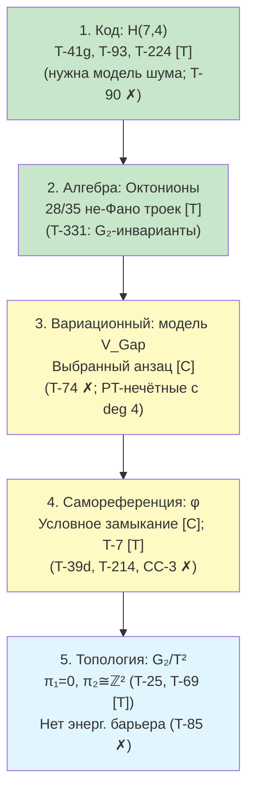

# Топологическая защита когерентности

:::info Для кого эта глава
Пять математических уровней, часто упоминаемых в связи с устойчивостью когерентности — кодовая структура, неассоциативная алгебра, эффективные потенциалы, самореференция и топология флагового многообразия — строго сверенные с доказанными теоремами и ретрактированными притязаниями.
:::

---

### Мост из предыдущей главы

В [предыдущей главе](./effective-temperature) мы ввели эффективную температуру $T_{\text{eff}}$ и обсудили, как Gap-когерентность деградирует, когда диссипация подавляет регенерацию. Это ставит центральный вопрос: биологические системы функционируют при $T_{\text{phys}} \approx 310\text{ K}$ в условиях непрерывного биохимического и нейронного шума, но когерентная когнитивная динамика сохраняется на длительных масштабах времени. Какие части формализма УГМ действительно вносят вклад в устойчивость, а какие являются чисто геометрическими/алгебраическими свойствами объемлющего пространства, а не физическими энергетическими барьерами?

В этой главе мы разбираем пять структурных уровней («щитов») формализма и чётко отделяем строго доказанные теоремы `[Т]` от условных динамических моделей `[С]`, интерпретаций `[И]` и ретрактированных утверждений `[✗]`.

---

### Дорожная карта главы

В этой главе мы:

1. **Сформулируем центральный вопрос**: как математическая структура соотносится с устойчивостью когерентности при шуме (раздел 0).
2. **Проведём аудит пяти структурных уровней** — кодового (Хэмминг $H(7,4)$), алгебраического (октонионный ассоциатор), вариационного (модельный потенциал $V_{\text{Gap}}$), категориального (неподвижные точки самомоделирования) и топологического ($\pi_2(G_2/T^2) \cong \mathbb{Z}^2$ при $\pi_1(G_2/T^2) = 0$) — отделяя точные теоремы от ретрактированных барьеров (разделы 1–5).
3. **Оценим независимость уровней и вероятности отказа** — показав, почему $P_{\text{fail}} = 0$ невозможно и почему выживание на конечном горизонте требует явной модели шума и регенерации (раздел 6).
4. **Разберём клинические интерпретации** — сон, психоз, кому — как гипотезы `[И]` об ослаблении динамической стабилизации (раздел «Патология»).
5. **Проведём аккуратную аналогию с квантовой коррекцией ошибок** — разграничив пассивную геометрию и то, что требует явной модели шума и декодера (раздел «QEC»).

---

:::note О нотации
В этом документе:
- $\Gamma$ — [матрица когерентности](/docs/core/dynamics/coherence-matrix)
- $\hat{\mathcal{G}}$ — [Gap-оператор](/docs/core/dynamics/gap-operator)
- $\mathrm{Gap}(i,j) = |\sin(\theta_{ij})|$ — мера зазора между измерениями
- $G_2 = \mathrm{Aut}(\mathbb{O})$ — [группа автоморфизмов октонионов](/docs/physics/gauge-symmetry/g2-structure)
- $T^2$ — максимальный тор $G_2$
- $V_{\text{Gap}}$ — [потенциал Gap](/docs/core/dynamics/gap-thermodynamics)
- $\varphi$ — [оператор самомоделирования](/docs/proofs/categorical/formalization-phi)
- PG(2,2) — [плоскость Фано](/docs/physics/gauge-symmetry/fano-selection-rules)
:::

## Почему сознание не разваливается? {#центральный-вопрос}

Задумайтесь о масштабе проблемы.

Каждую секунду ваш мозг обрабатывает миллионы сигналов. Нейроны гибнут и рождаются. Биохимический состав непрерывно колеблется. Температура тела — 37°C — это термодинамический ад для любой когерентной квантовой системы. Полупроводниковые квантовые компьютеры работают при температуре, близкой к абсолютному нулю, и даже там борются с декогеренцией. А сознание — явление, требующее *когерентности* между семью фундаментальными измерениями, — непрерывно существует при комнатной температуре, годами, десятилетиями, без перезагрузки.

**Почему оно не разваливается?**

Наивный ответ — «потому что мозг большой и сложный» — ничего не объясняет. Большие системы *более* подвержены декогеренции, не менее. Наивный квантовый ответ — «декогеренция уничтожает когерентность за фемтосекунды» — тоже не работает, потому что сознание *очевидно существует*.

В Когерентной Кибернетике пять различных математических структур традиционно объединяют под названием «пять щитов», относящихся к теории кодирования, неассоциативной алгебре, эффективным потенциалам, категориальной самореференции и топологии групп Ли. Однако критически важно различать **математическую структуру пространства состояний** и **физический энергетический барьер**: без явного канала регенерации, модели шума и считывания/декодера линейный диссипативный GKSL-поток приводит любое состояние к максимально смешанному $I/7$ (`T-39a [Т]`). Строгий аудит каждого щита показывает, что именно доказано `[Т]`, что выполняется условно в выбранной динамической модели `[С]`, а какие прежние универсальные притязания ретрактированы `[✗]`.

---

## Пять щитов Голонома {#пять-щитов}

Прежде чем разбирать математику каждого уровня, сведём пять структур с их выверенным статусом по реестру:

| Щит | Математический объект | Раздел математики | Проверенная область применимости |
|-----|-----------------------|-------------------|----------------------------------|
| **I** | Код Хэмминга $H(7,4)$ / плоскость Фано $\mathrm{PG}(2,2)$ | Теория кодирования | Алгебраическое разделение одиночных ошибок (`T-41g`, `T-41h`, `T-93`, `T-224 [Т]`); универсальная нижняя граница на Gap ретрактирована (`T-90 [✗]`) |
| **II** | Октонионный ассоциатор $[e_i, e_j, e_k]$ | Неассоциативная алгебра | 28/35 не-Фано троек неассоциативны `[Т]`; нет кубического $G_2$-инварианта только от $\mathrm{Im}\,\Gamma$ (`T-331 [Т]`) |
| **III** | Эффективный потенциал $V_{\text{Gap}}$ | Вариационное исчисление | Выбранный феноменологический анзац `[С]/[О]`; универсальный спектральный вывод ретрактирован (`T-74 [✗]`); PT-нечётные члены начинаются со степени 4 (`T-331 [Т]`) |
| **IV** | Неподвижные точки самомоделирования $\varphi$ | Теория категорий / динамика | Условная непрозрачность при замыкании (`T-7`); универсальные выводы Лавёра/$\varphi$ ретрактированы (`T-39d [✗]`, `T-214 [✗]`, `CC-3 [✗]`) |
| **V** | Флаговое многообразие $G_2/T^2$ | Алгебраическая топология | $\pi_1(G_2/T^2) = 0$, $\pi_2(G_2/T^2) \cong \mathbb{Z}^2$ (`T-25`, `T-69 [Т]`); **не создаёт физического энергетического барьера** (`T-69 [Т]`, `T-85 [✗]`) |

Отметим принципиальное отличие от наивной риторики «пяти неприступных стен»: фоновые алгебраические и топологические факты (щиты I, II, V) характеризуют **геометрию 7D-носителя и его симметрий**, тогда как реальная динамическая сохранность когерентности против теплового или стохастического шума зависит от явных скоростей диссипации/регенерации и модельных потенциалов (щит III) либо декодеров коррекции ошибок (щит I при заданном бинарном канале шума).

---

## 1. Кодовый уровень (Хэмминг $H(7,4)$) [Т / С] {#код-хэмминга}

### Интуиция: контрольная сумма для дискретных синдромов

Когда вы скачиваете файл из интернета, контрольная сумма позволяет обнаружить повреждение данных. Более совершенные коды (такие как двоичный код Хэмминга) не только *обнаруживают* одиночный битовый сбой, но и *локализуют* и исправляют его по синдрому.

Матрица инцидентности плоскости Фано $\mathrm{PG}(2,2)$ совпадает с проверочной структурой двоичного кода Хэмминга $H(7,4)$ с параметрами $[n=7, k=4, d=3]$. При **явно заданной модели бинарных ошибок и синдромном инструменте** одиночные сбои по осям порождают семь различных ненулевых 3-битовых синдромов и однозначно локализуются.

### Математическая формулировка

- **Совершенный двоичный код (`T-41g [Т]`, `T-41h [Т]`):** $H(7,4)$ — единственный совершенный двоичный код длины $7$, исправляющий одиночные ошибки ($2^3 = 7 + 1$); носителями его кодовых слов веса 3 служат семь линий Фано.
- **Разделение синдромов (`T-93 [Т]`):** Проверочная матрица $3 \times 7$ со всеми семью различными ненулевыми столбцами разделяет одиночные битовые сбои. Применение этого факта к физической коррекции ошибок требует явно заданных бинарного кодера, закона шума и синдромного декодера `[С]`.
- **Жёсткость диагностируемости (`T-224 [Т]`):** Требование совершенной локализуемости одиночного сбоя (D1–D2) вместе с нетривиальной грамматикой состояний (D3) вынуждает $n = 2^r - 1 \ge 7$; при $n = 7$ грамматика единственна с точностью до перенумерации ($H(7,4)$ / плоскость Фано $\mathrm{PG}(2,2)$, группа коллинеаций $\mathrm{PGL}(3,2)$), тогда как на всех более высоких ступенях $n \ge 15$ единственность нарушается ([Σ-исчисление](/docs/applied/research/syndrome-calculus#t-224)).

:::warning Ретрактированная универсальная нижняя граница на число Gap (`T-90 [✗]`)
Прежнее утверждение, будто сферическая упаковка вынуждает «не менее 3 из 21 пар измерений иметь ненулевой непрерывный фазовый Gap» — или даёт универсальный клинический критерий психоза — **ретрактировано (`T-90 [✗]`)**. Без заданных бинарного кодера, закона шума и декодера, отображающих непрерывные фазы $\theta_{ij}$ в двоичные слова, граница Хэмминга **не накладывает** нижней оценки на число ненулевых фазовых Gap. Кодовая граница $M \sum_{j=0}^{t} \binom{n}{j} \le 2^n$ остаётся верной строго как условная теорема кодирования для двоичных кодов с расстоянием $\ge 2t+1$.
:::

### Область применимости и ограничения

В явно закодированной бинарной или стабилизаторной кудитной реализации одиночная ошибка однозначно локализуется и исправляется, двойная обнаруживается, а тройная может переводить одно кодовое слово в другое. Однако в непрерывной эволюции матрицы плотности $\Gamma(\tau) \in \mathcal{D}(\mathbb{C}^7)$ без активного канала декодирования сама по себе инцидентность Фано не препятствует плавному дрейфу когерентностей к нулю под действием некомпенсированной диссипации (`T-39a [Т]`).

**См.:** [Код Хэмминга в Gap-динамике](/docs/core/dynamics/gap-dynamics#код-хэмминга), [Фано-канал](/docs/proofs/gap/fano-channel)

---

## 2. Алгебраический уровень (октонионный ассоциатор) [Т] {#ассоциатор}

### Интуиция: неассоциативная структура $\mathbb{O}$

Октонионы $\mathbb{O}$ — наибольшая из четырёх нормированных алгебр деления ($\mathbb{R}$, $\mathbb{C}$, $\mathbb{H}$, $\mathbb{O}$) — **неассоциативны**: $(a \cdot b) \cdot c \neq a \cdot (b \cdot c)$ для типичных троек мнимых единиц. Ассоциатор $[a, b, c] := (a \cdot b) \cdot c - a \cdot (b \cdot c)$ кодирует геометрию 4-формы $\psi = *\varphi_0$, инвариантной относительно $G_2 = \mathrm{Aut}(\mathbb{O})$.

### Математическая формулировка

- **Неассоциативные тройки `[Т]`:** Из $\binom{7}{3} = 35$ неупорядоченных троек мнимых базисных единиц октонионов $e_1, \ldots, e_7$ ровно $7$ лежат на линиях Фано (ассоциативные кватернионные подалгебры), а остальные $35 - 7 = 28$ троек имеют ненулевой ассоциатор $[e_i, e_j, e_k] \neq 0$.
- **Точная структура $G_2$-инвариантных полиномов (`T-331 [Т]`):** При разложении 7D-матрицы плотности $\Gamma = I/7 + S + iX$ (где $S = \operatorname{Re}(\Gamma - I/7)$ — вещественная симметричная бесследовая, а $X = \operatorname{Im}\Gamma$ — вещественная кососимметричная матрица) число независимых $G_2$-инвариантных полиномов до четвёртой степени включительно равно ровно **3 квадратичным, 5 кубическим и 21 квартичному** инвариантам. Принципиально важно:
  1. **Ни один кубический $G_2$-инвариант не зависит только от $X = \operatorname{Im}\Gamma$** (`T-331 [Т]`). Каждый $G_2$-инвариантный куб связывает $S$ и $X$ (либо зависит только от $S$).
  2. **Ни один $G_2$-инвариант степени $\le 3$ не является PT-нечётным** (`T-331 [Т]`). PT-нечётные $G_2$-инварианты появляются лишь начиная со **степени 4** (их ровно три).

:::warning Исправление прежних утверждений о кубическом ассоциаторе
Более ранние редакции утверждали, что октонионный ассоциатор автоматически порождает чисто фазовый кубический член $V_3(\operatorname{Im}\Gamma)$, вынуждающий универсальный барьер вокруг $\theta^* \neq 0$. По теореме **`T-331 [Т]`** никакой кубический $G_2$-инвариант не может зависеть только от $\operatorname{Im}\Gamma$, а согласно **`T-74 [✗]`** из примитивов не выводится единственный универсальный потенциал $V_{\text{Gap}}$. Неассоциативность фиксирует $G_2$-инвариантную тензорную алгебру (через 3-форму $\varphi_0$ и 4-форму $\psi = *\varphi_0$), ограничивая допустимые инвариантные связи в модельном потенциале, — но сама по себе не создаёт динамического барьера.
:::

**См.:** [G₂-разложение Gap-оператора](/docs/core/dynamics/gap-operator#g2-разложение), [Термодинамика Gap](/docs/core/dynamics/gap-thermodynamics#g2-инвариантный-кубик)

---

## 3. Вариационный уровень (модельный эффективный потенциал $V_{\text{Gap}}$) [С] {#энергетическая}

### Интуиция: шарик в модельной потенциальной яме

Если эффективная динамика редуцированного параметра порядка задаётся градиентным потоком ограниченного снизу потенциала $V_{\text{Gap}}$ с локальным минимумом вдали от нуля и высотой барьера $\Delta V > 0$, то малые возмущения возвращаются в этот минимум.

### Математическая формулировка и статус (`T-74 [✗]`, `T-331 [Т]`)

- **Ретрактированный универсальный спектральный вывод (`T-74 [✗]`):** Прежнее утверждение, будто единственный потенциал спектрального действия $V_{\text{Gap}} = V_2 + V_3 + V_4$ универсально следует из примитивов УГМ, **ретрактировано (`T-74 [✗]`)**. Спектральные разложения требуют заданной спектральной геометрии и обрезания; эффективный потенциал $V_{\text{Gap}}$ является **выбранной феноменологической моделью** `[О]/[С]`.
- **Допустимые $G_2$-инвариантные члены (`T-331 [Т]`):** В классе $G_2$-инвариантных полиномиальных потенциалов на $\Gamma = I/7 + S + iX$ квадратичные (3), смешанные $S$/$X$ кубические (5) и квартичные (21, включая 3 низших PT-нечётных) инварианты можно подобрать так, чтобы конкретная модель обладала нетривиальным минимумом с барьером $\Delta V > 0$.
- **Условная защита `[С]`:** Как только заданы конкретный ограниченный снизу эффективный потенциал $V_{\text{Gap}}$ и градиентная/ланжевеновская динамика, яма глубины $\Delta V > 0$ подавляет малые флуктуации, пока $\Delta V$ превосходит масштаб шума; сильный шум всё равно может вызывать перескок через барьер.

**См.:** [Термодинамика Gap](/docs/core/dynamics/gap-thermodynamics), [Фазовая диаграмма Gap](/docs/core/dynamics/gap-phase-diagram)

---

## 4. Категориальный уровень / самореференция (неподвижные точки $\varphi$) [С] {#категориальная}

### Интуиция: нетривиальность ограниченного самомоделирования

Для системы с оператором самомоделирования $\varphi: \mathcal{D}(\mathbb{C}^7) \to \mathcal{D}(\mathbb{C}^7)$ и условиями динамического замыкания возникает вопрос: может ли неподвижная точка $\varphi(\Gamma^*) = \Gamma^*$ оставаться полностью прозрачной ($\hat{\mathcal{G}}_* = 0$) при сохранении нетривиальной жизнеспособности и замыкания?

### Математическая формулировка и статус в реестре

- **Условная непрозрачность (`T-7 [Т]` в заданной модели замыкания):** При заявленных гипотезах жизнеспособности и замыкания в формализме Фано-канала полностью прозрачная конфигурация $\hat{\mathcal{G}} = 0$ несовместима с условием замыкания L4 (`L4 ≠ Gap = 0`; см. [Фано-канал](/docs/proofs/gap/fano-channel#l4-не-gap-0)).
- **Ретрактированные универсальные категориальные притязания:**
  - `T-39d [✗]`: Заявленная универсальная эквивалентность категориального, динамического и идемпотентного определений $\varphi$ **ретрактирована** (рефлектор образа-носителя существует в срезе над выбранным объектом; численные самомодели $\varphi: \mathcal{D}(\mathbb{C}^7) \to \mathcal{D}(\mathbb{C}^7)$ задаются отдельно).
  - `T-214 [✗]`: Универсальный запрет феноменального отображения по Лавёру **ретрактирован**.
  - `CC-3 [✗]`: Универсальная необходимость самомоделирования **ретрактирована** (существование тождественного отображения не устанавливает информационного самонаблюдения).

Отметим также, что теорема Лавёра о неподвижной точке устанавливает *существование* неподвижной точки для точечно-сюръективного отображения в декартово замкнутой категории — она **не** доказывает динамическую *сходимость* итераций и не мешает диссипативной системе покинуть область жизнеспособности (например, $I/7$ само является тривиальной неподвижной точкой линейного якорно-смешивающего отображения $\varphi_{\mathrm{lin}}(\Gamma) = R\Gamma + (1-R)I/7$). Таким образом, щит IV — это **условное структурное ограничение согласованности** на жизнеспособные самомоделирующие состояния, а не неразрушимый динамический барьер с $p_4 = 0$.

**См.:** [Самонаблюдение](/docs/consciousness/foundations/self-observation), [Формализация оператора φ](/docs/proofs/categorical/formalization-phi)

---

## 5. Топологический уровень (флаговое многообразие $G_2/T^2$) [Т — без энергетического барьера] {#топологическая}

### Интуиция: двумерные сферы против одномерных петель в однородном пространстве

Топология классифицирует непрерывные отображения с точностью до плавной деформации (гомотопии). Два разных вопроса никогда нельзя смешивать:
1. Существуют ли нестягиваемые **одномерные петли** ($S^1 \to M$), измеряемые фундаментальной группой $\pi_1(M)$?
2. Существуют ли нестягиваемые **двумерные сферы** ($S^2 \to M$), измеряемые второй гомотопической группой $\pi_2(M)$?

Для флагового многообразия $M = G_2/T^2$ (12-мерного компактного однородного пространства исключительной группы Ли $G_2$ по её максимальному тору $T^2$) ответы на эти два вопроса **кардинально различны**.

### Точная гомотопия $G_2/T^2$ {#топология-для-нематематиков}

Рассмотрим расслоение $T^2 \hookrightarrow G_2 \to G_2/T^2$. Его длинная точная последовательность гомотопических групп имеет вид:

$$
\cdots \longrightarrow \pi_2(G_2) \longrightarrow \pi_2(G_2/T^2) \longrightarrow \pi_1(T^2) \longrightarrow \pi_1(G_2) \longrightarrow \pi_1(G_2/T^2) \longrightarrow \pi_0(T^2) \longrightarrow \cdots
$$

Поскольку $G_2$ — компактная **односвязная** простая группа Ли ($\pi_1(G_2) = 0$, а $\pi_2(G) = 0$ для всякой компактной группы Ли $G$), тогда как тор $T^2 \cong S^1 \times S^1$ **линейно связен** ($\pi_0(T^2) = 0$) и имеет $\pi_1(T^2) \cong \mathbb{Z}^2$, точность последовательности немедленно даёт (`T-25 [Т]`, `T-69 [Т]`):

$$
\pi_1(G_2/T^2) = 0, \qquad \pi_2(G_2/T^2) \cong \pi_1(T^2) \cong \mathbb{Z}^2
$$

:::warning Критические исправления прежних редакций (`T-25`, `T-69`, `T-85 [✗]`)
1. **$\pi_1(G_2/T^2) = 0$ (а НЕ $\mathbb{Z}^2$):** Флаговое многообразие $G_2/T^2$ **односвязно**! Любая замкнутая одномерная петля $C: S^1 \to G_2/T^2$ стягиваема в точку. Топологически защищённых 1D-петель в $G_2/T^2$ **не существует**.
2. **Стабилизаторы орбит не определяются одним лишь рангом (`T-25`):** Хотя тождество размерности орбиты $\dim(G_2/H_{A_*}) = 14 - \dim H_{A_*}$ и $\pi_2(G_2/T^2) \cong \mathbb{Z}^2$ верны `[Т]` для заданной общей $T^2$-орбиты, прежняя классификация стабилизаторов только по рангу ретрактирована `[✗]`, поскольку стабилизатор зависит от полного разложения орбиты $G_7 + G_{14}$, а не от одного ранга непрозрачности.
3. **Нет физического энергетического барьера (`T-69 [Т]`):** Гомотопические классы в $\pi_2(G_2/T^2) \cong \mathbb{Z}^2$ классифицируют непрерывные отображения **двумерной сферы** $S^2 \to G_2/T^2$ (например, 2D-пространственные текстуры дефектов или двупараметрические семейства), а **не** одиночные 1D-траектории во времени $\Gamma(\tau)$. Более того, согласно **`T-69 [Т]`**, *топологические классы отображений в $G_2/T^2$ **не создают физического энергетического барьера**!*
4. **Ретрактированный вывод члена Берри из Келдыша (`T-85 [✗]`):** Эрмитовы следы не порождают мнимого топологического члена Берри; физическая кривизна Берри или топологическое действие требуют явно заданного расслоения собственных векторов и микроскопической полевой модели (`T-85 [✗]`).
:::

### 5.1 Почему 1D-контурные интегралы не квантуются {#топологический-заряд}

Более ранние версии этой страницы предлагали 1D-контурный интеграл $Q_{\text{top}}[C] = \frac{1}{2\pi}\oint_C \sum \epsilon_{ijk}^{\text{Fano}}\,\theta_{ij}\,d\theta_{jk}$ и утверждали, что $Q_{\text{top}}[C] \in \mathbb{Z}$ при $dQ_{\text{top}}/d\tau = 0$. Эта конструкция **математически несостоятельна и снята** по двум независимым причинам:

1. Поскольку $\pi_1(G_2/T^2) = 0$, любая замкнутая петля $C$ в $G_2/T^2$ гладко стягивается в точку, так что 1D-гомотопических инвариантов петель на $G_2/T^2$ не существует.
2. 1-форма $\alpha = \sum \epsilon_{ijk}^{\text{Fano}}\,\theta_{ij}\,d\theta_{jk}$ **не замкнута** ($d\alpha = \sum \epsilon_{ijk}^{\text{Fano}}\,d\theta_{ij} \wedge d\theta_{jk} \neq 0$), поэтому по теореме Стокса $\oint_C \alpha = \iint_D d\alpha$ непрерывно зависит от контура $C$, не квантуется целыми числами и не сохраняется при гладких деформациях.

### 5.2 Два целых числа второй гомотопии $(n_1, n_2)$ {#числа-намотки}

Подлинный топологический инвариант $G_2/T^2$ — это **вторая** гомотопическая группа (`T-25 [Т]`, `T-69 [Т]`):

$$
\pi_2(G_2/T^2) \cong H_2(G_2/T^2; \mathbb{Z}) \cong \mathbb{Z}^2
$$

порождаемая двумя целыми числами обхода $(n_1, n_2) \in \mathbb{Z}^2$, соответствующими двум простым кокорням алгебры $\mathfrak{g}_2$ (короткому корню $\alpha_1$ и длинному корню $\alpha_2$) для непрерывных отображений $f: S^2 \to G_2/T^2$.

- **Что $\pi_2(G_2/T^2) \cong \mathbb{Z}^2$ ДЕЙСТВИТЕЛЬНО гарантирует `[Т]`:** Два непрерывных отображения $f_1, f_2: S^2 \to G_2/T^2$ с разными $(n_1, n_2)$ нельзя непрерывно деформировать друг в друга *внутри фиксированного флагового многообразия $G_2/T^2$*.
- **Чего это НЕ гарантирует (`T-69 [Т]`):** Оно **не** приписывает топологического заряда одиночной точке $\Gamma(\tau) \in \mathcal{D}(\mathbb{C}^7)$ или 1D-кривой времени $\tau \mapsto \Gamma(\tau)$, **не** запрещает выход с орбиты $G_2/T^2$ внутрь стягиваемого выпуклого пространства состояний $\mathcal{D}(\mathbb{C}^7)$ (где $\Gamma \mapsto (1-t)\Gamma + t\,I/7$ гладко стягивает любое состояние к $I/7$), и **не** задаёт энергетической оценки $\Delta E_{\text{top}} \ge (|n_1|+|n_2|)\,\pi\mu^2/\lambda_4$ (эта формула удалена; любая физическая энергия дефекта требует явной пространственной теории поля с градиентным кинетическим членом).

### 5.3 Интерпретационное замечание [И]

Любая клиническая аналогия между гомотопическими классами $(n_1, n_2) \in \pi_2(G_2/T^2)$ и устойчивыми психологическими паттернами носит строго характер **неформальной метафоры `[И]`**: установление реального топологического препятствия в нейронной или когнитивной динамике потребовало бы выделения физического поля параметра порядка на 2-сфере со значениями строго в $G_2/T^2$ вместе с явным микроскопическим функционалом энергии, препятствующим уходу внутрь $\mathcal{D}(\mathbb{C}^7)$.

**См.:** [Стабилизаторы Gap-оператора](/docs/core/dynamics/gap-operator#стабилизаторы), [Фаза Берри](/docs/physics/cosmology-phys/berry-phase), [Термодинамика Gap](/docs/core/dynamics/gap-thermodynamics)

---

## 6. Разделение математических уровней и динамическое выживание {#независимость}

### 6.1 Пять различных структурных уровней [О]

Пять уровней относятся к действительно разным разделам математики, поэтому их формальные определения логически не сводятся друг к другу — однако **ни один** из них не гарантирует $P_{\text{fail}} = 0$ для физической когерентности:

| № | Уровень | Область | Строгий статус |
|---|---------|---------|----------------|
| 1 | Кодовый ($H(7,4)$) | Конечная теория кодирования ($\mathbb{F}_2$) | `[Т]` алгебраическое разделение одиночных ошибок (`T-41g`, `T-93`, `T-224`); физическая коррекция требует заданного закона бинарных ошибок и декодера (`T-90 [✗]`) |
| 2 | Алгебраический (ассоциатор) | Неассоциативная алгебра ($\mathbb{O}$) | `[Т]` 28/35 не-Фано троек неассоциативны; ограничивает $G_2$-инварианты (`T-331 [Т]`), сам по себе не является барьером |
| 3 | Вариационный ($V_{\text{Gap}}$) | Эффективные потенциалы | `[С]` условно при выбранном ограниченном снизу потенциале (`T-74 [✗]`, `T-331 [Т]`) |
| 4 | Самореференция ($\varphi$) | Категорное/динамическое замыкание | `[С]` условно при гипотезах замыкания (`T-7`); универсальные выводы ретрактированы (`T-39d [✗]`, `T-214 [✗]`, `CC-3 [✗]`) |
| 5 | Топологический ($G_2/T^2$) | Теория гомотопий | `[Т]` $\pi_1(G_2/T^2) = 0$, $\pi_2(G_2/T^2) \cong \mathbb{Z}^2$ (`T-25`, `T-69`); **нет физического энергетического барьера** (`T-69 [Т]`, `T-85 [✗]`) |

### 6.2 Схема архитектуры

---

## Почему $P_{\text{fail}} = 0$ невозможно: честный анализ отказов {#комбинированная-вероятность}

### Опровержение прежнего утверждения $P_{\text{fail}} = 0$

В прежних версиях перемножались пять чисел $P_{\text{fail}} = \prod_{i=1}^5 p_i$ и полагалось $p_1 = p_2 = p_4 = 0$ на том основании, что кодирование, неассоциативность октонионов и теорема Лавёра «структурно неустранимы», откуда выводилось $P_{\text{fail}} = 0$ («полное разрушение когерентности невозможно»). Этот вывод содержит **категориальную ошибку**:

1. **Фоновые структуры не останавливают диссипацию.** Пространство $\mathcal{D}(\mathbb{C}^7)$ выпукло и стягиваемо: при чисто диссипативной унитальной GKSL-эволюции со связным гамильтоновым графом любое начальное состояние экспоненциально сходится к $I/7$ (`T-39a [Т]`), где все когерентности и все фазовые Gap обращаются в нуль — хотя $H(7,4)$ по-прежнему имеет расстояние 3, $\mathbb{O}$ остаётся неассоциативной, а $\pi_2(G_2/T^2)$ по-прежнему равна $\mathbb{Z}^2$.
2. **Физическое выживание требует активной динамики и заданной модели шума.** Остаётся ли жизнеспособная траектория внутри $\{P > 2/7\}$ на конечном горизонте $[0, T]$, зависит от баланса между регенерацией $\mathcal{R}[\Gamma, E]$, диссипацией $\mathcal{D}(\Gamma)$ и стохастическим законом возмущений. По **`T-145 [✗]`** экспоненциальные оценки выживания на бесконечном горизонте не следуют из одномоментного второго момента шума; реальные вероятности выживания на конечном горизонте $1 - P_{\text{fail}}(T)$ требуют явно заданного стохастического процесса, контроля времени достижения границы и предположений о хвостах распределения.
3. **Механизмы отказа обычно скоррелированы, а не независимы.** Рост внешнего шума или подавление регенерации одновременно снижают чистоту $P$, ослабляют эффективные возвращающие силы и ухудшают точность самомоделирования $R$; поэтому наивное произведение независимых вероятностей $\prod p_i$ не является теоремой.

### Качественное сравнение механизмов устойчивости [И]

| Система | Механизмы стабилизации | Природа вероятности отказа |
|---------|------------------------|----------------------------|
| ДНК | Избыточность, ферментативная репарация, апоптоз, иммунитет | Конечная ненулевая скорость ($\sim 10^{-9}$ на основание за деление) |
| Голоном (модель УГМ) | Активная регенерация $\mathcal{R}$, модельный потенциал $V_{\text{Gap}}$, синдромное декодирование (если реализовано) | Конечная ненулевая $P_{\text{fail}}(T) > 0$, определяемая явной моделью шума и регенерации (`T-145 [✗]` для универсальных оценок на бесконечном горизонте) |
| Квантовый компьютер (QEC) | Активные стабилизаторные коды, логические кубиты | Конечная частота логических ошибок ниже физического порога |
| Клеточный гомеостаз | Буферизация, отрицательная обратная связь, обновление | Конечная вероятность отказа при экстремальном стрессе |

---

## Когда стабилизация ослабевает: клинические интерпретации {#патология}

Поскольку $P_{\text{fail}}$ **не** равно нулю, деградация когерентности при стрессе, наркозе, нейротоксичности или травме не порождает никакого парадокса: всякий раз, когда диссипация и шум превосходят активную регенерацию $\mathcal{R}$ и модельные возвращающие силы, когерентность падает и жизнеспособность может быть утрачена.

### Карта патологических состояний [И]

Следующая таблица фиксирует **интерпретационные гипотезы `[И]`**, сопоставляющие клинические режимы динамическим переменным (чистоте $P$, точности самомоделирования $R$, эффективному возвращающему потенциалу и уровню шума) — без обращения к ретрактированным топологическим барьерам:

| Состояние | Гипотетический динамический сдвиг [И] | Клиническая интерпретация |
|-----------|---------------------------------------|---------------------------|
| Здоровый сон (REM) | Сниженная возвращающая жёсткость, модуляция регенерации | Когерентность перераспределена, а не уничтожена; динамика сновидений |
| Медитативный транс | Контролируемое снижение эффективной жёсткости | Исследование доступных бассейнов пространства состояний при сохранении $P > 2/7$ |
| Психоделический опыт | Мелкий эффективный потенциал + повышенный шум/гибкость | Ослабление привычных бассейнов притяжения |
| Психотический эпизод | Высокий эффективный шум относительно возвращающих сил | Неустойчивые траектории Gap и нарушение согласованности самомодели/синдромов |
| Глубокий наркоз | Сильное подавление регенерации и самомоделирования $R$ | Чистота и интеграция приближаются к порогам жизнеспособности/сознательности |
| Кома / ПВС | Утрата активной регенерации и самомоделирования | Состояние дрейфует к $P_{\text{crit}} = 2/7$ или ниже него |

### Терапевтические импликации [И]

С точки зрения теории динамических систем (а не топологического «развязывания узлов») клинические вмешательства интерпретируются `[И]` как:

1. **Усиление возвращающей динамики / снижение шума**: фармакологическая или средовая стабилизация эффективного ландшафта аттракторов.
2. **Восстановление регенерации и точности самомоделирования**: реабилитационные или психотерапевтические протоколы, направленные на рост $R$ и $\mathrm{Coh}_E$.
3. **Контролируемый переход между аттракторами**: перевод системы из дезадаптивного метастабильного бассейна в более здоровый через структурированное возмущение и реконсолидацию.

---

## Связь с квантовой коррекцией ошибок {#квантовая-коррекция}

Аналогия между структурой Фано/Хэмминга в $\mathbb{C}^7$ и квантовой коррекцией ошибок (QEC) содержательна **ровно тогда, когда её предпосылки сформулированы явно**.

### Квантовая коррекция ошибок: краткий обзор

В квантовых вычислениях логическая информация кодируется в подпространстве физических кубитов так, что заданные операторы ошибок переводят кодовое подпространство в ортогональные подпространства ошибок, различаемые синдромными измерениями, что позволяет выполнить активное восстановление.

Ключевые элементы QEC:
- **Код**: изометрическое кодирование в избыточное физическое гильбертово пространство
- **Модель шума**: явный набор корректируемых операторов Крауса
- **Синдром и восстановление**: измерение синдрома и канал восстановления логического состояния

### Что даёт формализм Голонома и что необходимо добавить

| Элемент QEC | Математический аналог в УГМ | Точное требование |
|-------------|-----------------------------|-------------------|
| Скелет двоичного кода | Хэмминг $H(7,4)$ / плоскость Фано $\mathrm{PG}(2,2)$ (`T-41g`, `T-93`, `T-224 [Т]`) | Алгебраическая проверочная структура (`скорость = 4/7`) |
| Синдром | 3-битовая проверка чётности Фано | Требует заданного бинарного канала ошибок и синдромного инструмента (`T-93`, `T-90 [✗]`) |
| Активное восстановление | Регенеративный оператор $\mathcal{R}[\Gamma, E]$ / модельная возвращающая сила | Должно быть задано динамически; одна геометрия не откачивает энтропию |
| Защищённое подпространство | Стабилизаторная / декогеренционно-свободная структура | Требует согласованного по симметрии закона шума; $\pi_2(G_2/T^2)$ **не** даёт энергетического барьера (`T-69 [Т]`) |

### Эффективность и область применимости

Как классический двоичный код $H(7,4)$ обладает высокой скоростью:

$$
\text{Rate}_{\text{Hamming}} = \frac{k}{n} = \frac{4}{7} \approx 0.57
$$

по сравнению с 2D поверхностными кодами расстояния $d$ ($\text{Rate}_{\text{surface}} \sim 1/d^2$), ценой минимального расстояния $d = 3$ (коррекция только одиночных ошибок). Однако называть голономную защиту «строго пассивной и не требующей контроллера» значит завышать доказанное: пассивная защита от теплового шума в физических системах требует явной гамильтоновой щели / энергетического барьера и связи с термостатом, тогда как в УГМ фоновая геометрия (`H(7,4)`, `O`, `G_2/T^2`) должна сочетаться с активной термодинамической регенерацией $\mathcal{R}$ и верифицированной моделью шума для достижения динамической устойчивости.

---

## 7. Сводка статусов {#статусы}

| Результат | Статус | Ссылка |
|-----------|--------|--------|
| $H(7,4)$ — единственный совершенный код длины 7 с исправлением одиночных ошибок; носители Фано | **[Т]** | `T-41g`, `T-41h`, `T-93`, `T-224` |
| Универсальная граница Хэмминга ($\ge 3$ ненулевых непрерывных фазовых Gap) и критерий психоза | **[✗]** (ретрактировано) | `T-90 [✗]` |
| Октонионный ассоциатор ненулевой для 28 из 35 троек | **[Т]** | Алгебра $\mathbb{O}$ |
| $G_2$-инвариантные полиномы: 3 квадр., 5 куб., 21 кварт.; нет чисто $\mathrm{Im}\,\Gamma$-куба; PT-нечётные со степени 4 | **[Т]** | `T-331` |
| Универсальный спектральный вывод $V_{\text{Gap}}$ | **[✗]** (ретрактировано; выбранная модель `[С]/[О]`) | `T-74 [✗]` |
| Условная непрозрачность (`L4 ≠ Gap = 0`) при заявленном замыкании | **[Т]** (в заданной модели) | `T-7` |
| Универсальная категориальная эквивалентность $\varphi$, запрет Лавёра, необходимость самомодели | **[✗]** (ретрактировано) | `T-39d [✗]`, `T-214 [✗]`, `CC-3 [✗]` |
| $\pi_1(G_2/T^2) = 0$ и $\pi_2(G_2/T^2) \cong \mathbb{Z}^2$ | **[Т]** | `T-25`, `T-69` |
| Топологические классы отображений в $G_2/T^2$ **не создают** физического энергетического барьера | **[Т]** | `T-69` |
| Универсальный топологический член Келдыша–Берри и 1D-квантованный $Q_{\text{top}}[C] \in \mathbb{Z}$ | **[✗]** (ретрактировано) | `T-85 [✗]`, $\pi_1(G_2/T^2) = 0$ |
| Утверждение $P_{\text{fail}} = 0$ и выживание на бесконечном горизонте из одномоментного шума | **[✗]** (ретрактировано) | `T-39a`, `T-145 [✗]` |
| Клинические интерпретации, карта патологий и аналогия с QEC | **[И]** | Данный документ |

---

## Что мы узнали {#что-мы-узнали}

Строгий итог аудита пяти уровней:

- **Кодовый уровень (`T-41g`, `T-93`, `T-224 [Т]`):** $H(7,4)$ / $\mathrm{PG}(2,2)$ единственным образом реализует совершенную локализацию одиночных сбоев при $n = 7$, но требует заданной модели бинарных ошибок и синдромного инструмента; универсальная нижняя граница $\ge 3$ непрерывных Gap ретрактирована (`T-90 [✗]`).
- **Алгебраический и вариационный уровни (`T-331 [Т]`, `T-74 [✗]`):** Октонионы имеют 28/35 неассоциативных троек, а $G_2$-инвариантные полиномы насчитывают 3 квадратичных, 5 кубических и 21 квартичный генератор — при **отсутствии** чисто $\mathrm{Im}\,\Gamma$-куба и появлении PT-нечётных инвариантов лишь со степени 4 (`T-331 [Т]`). Эффективные потенциалы $V_{\text{Gap}}$ являются выбранными феноменологическими моделями (`T-74 [✗]`).
- **Категориальный уровень (`T-7`, `T-39d [✗]`, `T-214 [✗]`, `CC-3 [✗]`):** Непрозрачность выполняется условно при явных гипотезах замыкания, а не как неразрушимый барьер против диссипации.
- **Топологический уровень (`T-25`, `T-69 [Т]`, `T-85 [✗]`):** Флаговое многообразие $G_2/T^2$ **односвязно** ($\pi_1(G_2/T^2) = 0$, а НЕ $\mathbb{Z}^2$), поэтому квантованного 1D-петлевого заряда $Q_{\text{top}}[C]$ не существует. Вторая гомотопическая группа $\pi_2(G_2/T^2) \cong \mathbb{Z}^2$ классифицирует 2-сферы $S^2 \to G_2/T^2$ и по **`T-69 [Т]`** **не создаёт физического энергетического барьера**.
- **Невозможность $P_{\text{fail}} = 0$:** Фоновые алгебраические и топологические структуры не препятствуют диссипативному распаду к $I/7$ (`T-39a [Т]`). Реалистичное выживание на конечном горизонте требует активной регенерации $\mathcal{R}$ и явной стохастической модели шума (`T-145 [✗]`).

---

### Мост к следующей главе

Отделив подлинные алгебраические и топологические инварианты от динамических механизмов стабилизации, спросим теперь: в каких именно динамических *режимах* может существовать открыто-диссипативный Голоном? В [следующей главе](./phase-diagram-cc) мы рассмотрим **фазовую диаграмму** Когерентной Кибернетики, отображая устойчивые режимы, переходы и диагностические предвестники при явно заданных уравнениях динамики.

---

## Связанные документы

- [Gap-оператор](/docs/core/dynamics/gap-operator) — определение $\hat{\mathcal{G}}$, спектр, стабилизаторы
- [Динамика Gap](/docs/core/dynamics/gap-dynamics) — код Хэмминга, бифуркации
- [Термодинамика Gap](/docs/core/dynamics/gap-thermodynamics) — потенциал $V_{\text{Gap}}$, лагранжиан
- [Фазовая диаграмма Gap](/docs/core/dynamics/gap-phase-diagram) — пять типов защиты Gap
- [Фано-канал и Gap-теоремы](/docs/proofs/gap/fano-channel) — G₂-ковариантность, L4 $\neq$ Gap = 0
- [G₂-структура](/docs/physics/gauge-symmetry/g2-structure) — $G_2 = \mathrm{Aut}(\mathbb{O})$, плоскость Фано
- [G₂-заряды Нётер](/docs/physics/gauge-symmetry/noether-charges) — топологические заряды и защита
- [Теоремы КК](./theorems) — No-Zombie, композиция, эквивалентность
- [Самонаблюдение](/docs/consciousness/foundations/self-observation) — неподвижные точки $\varphi$
- [Формализация оператора φ](/docs/proofs/categorical/formalization-phi) — CPTP-каналы
- [Стабильность](./stability) — практические следствия топологической защиты
- [Философские основания](./philosophy) — метафизика устойчивости когерентности
