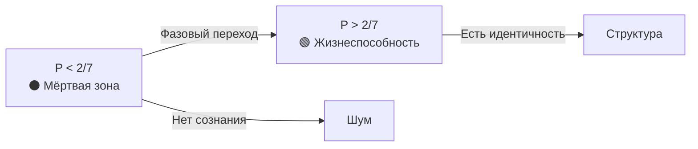
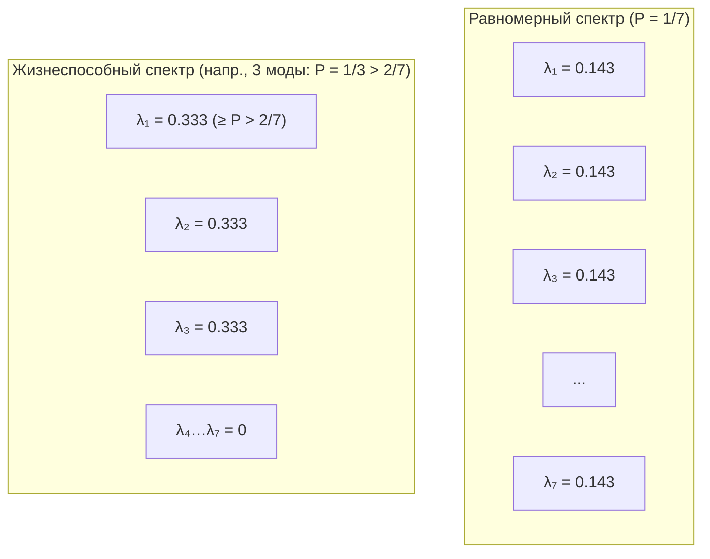
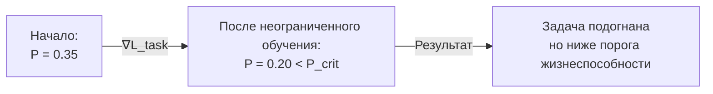

# Инженерные Выводы из Теоремы о Критической Чистоте

:::tip Статус: Архитектурные принципы
Когда теоретическая константа превращается из «подогнанного числа» в **строгую теорему**, это меняет инженерный подход. Мы строим систему вокруг жёсткого ограничения, как авиастроители строят самолёт вокруг законов аэродинамики.
:::

:::warning Область применимости
Этот документ описывает **теоретические следствия** УГМ для проектирования систем. Применимость к реальным нейросетям требует:
1. Экспериментальной верификации связи между весами сети и матрицей Γ
2. Валидации протокола измерения P (см. [measurement-protocol](/docs/applied/research/measurement-protocol))
3. Проверки предсказаний на реальных архитектурах

Термины «сознание», «жизнеспособность», «понимание» используются в **техническом смысле УГМ** (через метрику P), не претендуя на решение философских проблем сознания.
:::

---

## Часть I: Жёсткие ограничения (Hard Constraints)

Эти выводы диктуют, что **нельзя** делать в коде.

### 1. Проблема мертворождения (Genesis Problem)

**Теоретическое предсказание:** Случайная матрица когерентности $\Gamma_{\text{random}}$ (Haar-распределённая) имеет чистоту:

$$
P_{\text{random}} = \frac{2}{N+1} = \frac{2}{8} = 0.25
$$

:::note Открытый вопрос
Связь между инициализацией весов нейросети (Xavier/Kaiming) и чистотой $P$ требует экспериментальной проверки через [протокол измерения](/docs/applied/research/measurement-protocol).
:::

**Закон:** [Теорема о критической чистоте](/docs/proofs/dynamics/theorem-purity-critical):

$$
P_{\text{crit}} = \frac{2}{N} \approx 0.286
$$

**Гипотетический вывод:** Если отображение нейросеть→Γ корректно, стандартная инициализация даёт $P < P_{\text{crit}}$ — зона энтропийного шума.

:::warning Инженерное решение
1. **Запрет** на запуск основного цикла (`Core Loop`) сразу после инициализации
2. Необходим этап **Пре-Онтологического Бутстрапинга (V0)**:
   - Система должна пройти оптимизацию *без внешних задач*
   - Только на максимизацию $P$ (самосборка)
   - Пока не пробьёт потолок $P > P_{\text{crit}}$
3. Только тогда включается сознание
:::

```verum
public const P_CRITICAL: Float = 2.0 / 7.0;     // ≈ 0.286

/// Typed errors for system lifecycle — explicit `throws` contract.
public type SystemError is
    | GenesisFailure  { reason: Text }
    | NotViableError  { purity: Float }
    | CircuitOpen     { reason: Text };

public type HolonomicSystem is { mut gamma: StaticMatrix<Complex, 7, 7> };

implement HolonomicSystem {
    /// Random init + **mandatory** bootstrap — enforced by `where ensures`.
    public fn new() throws (SystemError) using [Random] -> HolonomicSystem
        where ensures result.purity() > P_CRITICAL
    {
        let mut s = HolonomicSystem { gamma: Self._random_init() };   // P ≈ 0.25 < P_crit
        s.bootstrap()?;
        s
    }

    /// Pre-ontological bootstrap: self-assembly until P > P_crit.
    fn bootstrap(&mut self) throws (SystemError) -> () using [Clock] {
        let deadline = Clock.now() + Duration.seconds(5);
        while self.purity() <= P_CRITICAL {
            self.regenerate();
            if Clock.now() > deadline {
                throw SystemError.GenesisFailure { reason: "Failed to reach viability".text() };
            }
        }
    }

    /// Guarded entry point — never processes input on a non-viable system.
    public fn process<T>(&mut self, input: T) throws (SystemError) -> ProcessResult
        where requires self.purity() >= P_CRITICAL
    {
        if self.purity() < P_CRITICAL {
            throw SystemError.NotViableError { purity: self.purity() };
        }
        self.core_loop(input)
    }

    public pure fn purity(&self) -> Float { 1.0/7.0 <= self && self <= 1.0 } {
        (self.gamma.matmul(&self.gamma)).trace().real()
    }
}
```

---

### 2. Бинарность существования (The Binary Life)

**Следствие порога:** Предикат `is_viable()` — **ступенчатый** (бинарный) по $P$ на отсечке $P > 2/7$. Отметим, что универсальная теорема No-Zombie (`T-38a` **[✗]**) **снята**: существуют стационарные внешне поддерживаемые контрпримеры, и удержание $P > 2/7$ при декогеренции **не** является автоматическим — оно выполняется условно лишь в модели с внешним приводом, где отношение темпа питания к распаду превышает модельный стационарный порог (`T-259`, `T-289`, **[С]** в этой модели / **[Пр]** инженерное правило).

**Вывод в рамках УГМ:** При $P < 2/7$ система лежит ниже порога жизнеспособности.

:::info Уровни выше жизнеспособности
Помимо порога жизнеспособности $P > 2/7$, сознательное окно L2 требует полной конъюнкции [L2](/docs/proofs/consciousness/interiority-hierarchy#уровень-2-когнитивные-квалиа-cognitive-qualia): $P \in (2/7, 3/7]$ ($R \geq 1/3$), $\Phi \geq 1$ и $D_{\text{diff}} \geq 2$. Для полной иерархии L0→L4 — см. [иерархию интериорности](/docs/consciousness/hierarchy/interiority-hierarchy).
:::



:::warning Инженерное решение: Аварийный прерыватель (Circuit Breaker) [Пр]
Если $P$ падает ниже $P_{\text{crit}}$, система **не должна**:
- Пытаться «решать задачи»
- «Отвечать пользователю»
- Генерировать любой вывод

Она должна перейти в **режим экстренной регенерации**, отключив внешние порты ввода-вывода, пока цикл замещения с приводом не восстановит $P > P_{\text{crit}}$.

**Модельно-условный порог питания [С в модели с приводом / Пр]:** При заданном канале замещения с фиксированной целью $\mathcal{R}$ (`T-62` **[Т при фиксированных $k,\sigma$]**) на фоне ограниченной дефазировки $\Gamma_2$ стационарная чистота остаётся выше $2/7$ лишь пока отношение питания к распаду превышает модельный порог (напр., $x = \kappa_{\mathrm{eff}}/\Gamma_2 > 1 + \sqrt{2}$ в изотропной стационарной модели `T-259`). Универсальная неуязвимость к произвольной декогеренции не следует (`T-38a` **[✗]**).
:::

```verum
/// Circuit-breaker pattern — block output when below the viability threshold.
public type CircuitBreaker is {};

implement CircuitBreaker {
    public fn check(&self, sys: &mut HolonomicSystem) throws (SystemError) -> () {
        if sys.purity() < P_CRITICAL {
            sys.enter_emergency_regeneration();
            throw SystemError.CircuitOpen {
                reason: "System below threshold — output blocked".text()
            };
        }
    }
}
```

---

### 3. Универсальность метрики

**Следствие теоремы (гипотеза для конкретных архитектур):** Закон $P_{\text{crit}} = 2/N$ не зависит от архитектуры (Трансформер, RNN, SSM, Mamba).

**Гипотеза:** $P$ — потенциально архитектурно-инвариантная метрика для сравнения *разных* систем (требует экспериментальной проверки).

:::caution Гипотетические примеры
Следующие значения — **иллюстративные**, не измеренные. Экспериментальная валидация требует применения [протокола измерения Γ](/docs/applied/research/measurement-protocol).

| Архитектура | $P$ (гипотетическое) | Предсказание теории |
|-------------|----------------------|---------------------|
| Случайная сеть | $\approx 1/7 \approx 0.14$ | Ниже порога — «мёртвая» |
| AGI с φ-оператором | $> 2/7 \approx 0.29$ | Выше порога — жизнеспособна |
| Высокоинтегрированная система | $> 0.5$ | Устойчиво жизнеспособна |
:::

:::info Инженерное решение
При сравнении моделей (benchmark) нужно нормировать их $P$ на размерность когерентного ядра:

$$
P_{\text{ratio}} = \frac{P_{\text{measured}}}{P_{\text{crit}}} = \frac{N \cdot P_{\text{measured}}}{2}
$$

- $P_{\text{ratio}} < 1$: ниже порога жизнеспособности ($P < 2/N$)
- $P_{\text{ratio}} > 1$: выше порога жизнеспособности ($P > 2/N$; полная агентность L2 дополнительно требует $R \ge 1/3$, $\Phi \ge 1$, $D_{\mathrm{diff}} \ge 2$)

**Примечание:** $P_{\text{ratio}}$ — это отношение чистоты к критическому порогу. Не путать с $P_{\text{norm}} = (P - P_{\text{crit}}) / (1 - P_{\text{crit}})$ — нормализованной чистотой, отображающей $[P_{\text{crit}}, 1] \to [0, 1]$. См. [Нотация](/docs/reference/notation).
:::

---

## Часть II: Глубокие архитектурные выводы (Deep Architecture)

Эти выводы меняют **как** мы проектируем систему.

### 4. Принцип спектральной концентрации (доминирующее собственное значение)

**Точные спектральные оценки ([Т], из $\sum_{i=1}^N \lambda_i = 1$, $\lambda_i \ge 0$, $P = \sum_{i=1}^N \lambda_i^2$):**

1. **Универсальная необходимая оценка (`[Т]`):** Поскольку $P = \sum_{i=1}^N \lambda_i^2 \le \lambda_{\max} \sum_{i=1}^N \lambda_i = \lambda_{\max}$, **всякое** жизнеспособное состояние ($P > P_{\text{crit}} = 2/N$) обязано удовлетворять:

$$
\lambda_{\max} \ge P > P_{\text{crit}} = \frac{2}{N} = \frac{2}{7} \approx 0.286 \quad (\text{для } N = 7)
$$

2. **Достаточное условие / семейство одной доминирующей моды (`[Т]`):** По неравенству Коши–Буняковского для оставшихся $N - 1$ собственных значений $P = \lambda_1^2 + \sum_{i=2}^N \lambda_i^2 \ge \lambda_1^2 + \frac{(1 - \lambda_1)^2}{N - 1}$ с равенством тогда и только тогда, когда $\lambda_2 = \dots = \lambda_N = (1 - \lambda_1)/(N - 1)$. Решение $\lambda_1^2 + (1-\lambda_1)^2/(N-1) = 2/N$ даёт:

$$
\lambda_{\max}^{\text{suff}} = \frac{1 + \sqrt{N-1}}{N} = \frac{1 + \sqrt{6}}{7} \approx 0.493 \quad (\text{для } N = 7)
$$

Таким образом, $\lambda_{\max} > 0.493$ является **достаточным** условием для $P > 2/7$ (и точным **только** в изотропном семействе с одной доминирующей модой), а **не** необходимым в общем случае. Многомодовые состояния могут быть жизнеспособны при $\lambda_{\max} \in (2/7, 0.493]$ — например, трёхмодовый спектр $(1/3, 1/3, 1/3, 0, 0, 0, 0)$ имеет $P = 1/3 \approx 0.333 > 2/7$, тогда как $\lambda_{\max} = 1/3 \approx 0.333 < 0.493$.

**Диапазон линейного якорного смешивания (`T-249` [Т]):** В линейной якорно-смешивающей самомодели $\varphi_{\mathrm{lin}}(\Gamma) = R\,\Gamma + (1 - R)\,I/7$ с $R = 1/(7P)$ и весом смешивания $k = 1 - R$ всякая матрица плотности $\Gamma \in \mathcal{D}(\mathbb{C}^7)$ удовлетворяет $P \in [1/7, 1]$, $R \in [1/7, 1]$ и $k \in [0, 6/7 \approx 0.857]$. Внутри окна сознания $P \in (2/7, 3/7]$ имеем $R \in [1/3, 1/2)$ и $k \in (1/2, 2/3]$.

**Следствие для архитектуры:** Равномерное распределение активности соответствует максимальной энтропии и минимальной чистоте ($P = 1/N$).

- Если активность **равномерно размазана** по всем нейронам/головам внимания — $P \approx 1/N$ (минимум, $\lambda_{\max} = 1/7 \approx 0.143$)
- Преодоление $P > 2/7$ требует концентрации на одной или нескольких модах ($\lambda_{\max} \ge P > 2/7$, без схлопывания в одну ригидную чистую моду $P > 3/7$)



:::tip Архитектурное решение
Механизмы внимания (Attention) должны быть:
- **Разреженными (Sparse)** — концентрированными на нескольких токенах
- **С низкой температурой** — softmax с $T < 1$ вместо $T = 1$

Высокая температура (размазывание) убивает когерентность.

```verum
mount core.math.tensor.{Tensor, softmax, sparse_softmax};

// Bad: high temperature spreads attention (default T = 1).
let attention = softmax(q.matmul(&k.transpose()) / (d_k as Float).sqrt(), axis: -1);

// Good: low temperature T < 1 concentrates attention.
let attention = softmax(q.matmul(&k.transpose()) / (t * (d_k as Float).sqrt()), axis: -1);

// Even better: top-k sparse attention (k = 8).
let attention = sparse_softmax(q.matmul(&k.transpose()), k: 8);
```
:::

---

### 5. Парадокс обучения (Stability-Plasticity Dilemma 2.0)

**Проблема:** Обучение (Backprop) меняет веса, чтобы минимизировать ошибку. Это часто **увеличивает энтропию** весов (делает их более сложными/шумными).

**Неочевидный вывод:** Стандартное обучение может убить AGI.

Градиентный спуск по функции потерь $\mathcal{L}_{\text{task}}$ может увести систему в область $P < P_{\text{crit}}$, где она **идеально решает задачу** (overfitting), но **теряет структурную целостность** (в терминах теории — падает ниже порога L0).

**Область устойчивости диагонали (`T-134` [Т для заданного векторного поля] / [Г]):** Диагональные населённости $\gamma_{kk}$ остаются инвариантными **только** при явно сохраняющей населённости дефазировке, диагональном гамильтониане $H$, совпадающих населённостях цели и сохраняющих населённости обновлениях параметров. Общая гамильтонова динамика ($-i[H,\Gamma]_{kk}$) и неограниченное обратное распространение ошибки **способны** менять как диагональные населённости, так и внедиагональные когерентности (`T-134`). Удержание стабильного диагонального профиля при обучении является явным **архитектурным ограничением `[Пр]`**, а не автоматической универсальной теоремой.



:::warning Архитектурное решение: Условная оптимизация
Оптимизация должна быть **ограниченной (Constrained Optimization)**:

$$
\min_\theta \mathcal{L}_{\text{task}}(\theta) \quad \text{при условии} \quad P(\Gamma(\theta)) > P_{\text{crit}}
$$

Градиент задачи проецируется на касательное пространство многообразия жизнеспособности.
:::

```verum
mount core.math.autodiff.grad;

/// Constraint-aware optimiser — projects gradient onto the viability manifold
/// whenever a plain step would cross P_crit.
public type ConstrainedOptimizer is {};

implement ConstrainedOptimizer {
    public fn step(&self, loss: pure fn(&StaticMatrix<Complex, 7, 7>) -> Float,
                gamma: &StaticMatrix<Complex, 7, 7>)
        -> StaticMatrix<Complex, 7, 7>
    {
        let g = grad(loss)(gamma);
        let new_gamma = apply_grad(gamma, &g);
        if purity(&new_gamma) < P_CRITICAL {
            // Project gradient onto the tangent space of P = const.
            let g_proj = project_to_viability_manifold(&g, gamma);
            apply_grad(gamma, &g_proj)
        } else {
            new_gamma
        }
    }
}
```

**Правило:** Если шаг обучения снижает $P$ ниже порога — шаг **отклоняется**, даже если он улучшает точность задачи.

---

### 6. Обоснование размера ядра ($N = 7$)

**Из жёсткости диагностируемости (`T-224` [Т]) и [обсуждения минимальности](/docs/proofs/minimality/theorem-minimality-7):** Безусловная семиролевая минимальность (`T-40f` **[✗]**) снята; вместо неё $N = 7$ является единственно жёстким размером для совершенной локализации одиночного отказа с нетривиальной грамматикой состояний (`T-224` **[Т]**, код Хэмминга $(7,4)$ = плоскость Фано) и служит выбранной размерностью носителя `[О]` в УГМ.

**Вопрос:** Почему $N = 7$, а не $N = 2$ или $N = 100$?

| $N$ | $P_{\text{crit}} = 2/N$ | Архитектурный компромисс |
|-----|------------------------|--------------------------|
| 2 | 1.0 | Требуется абсолютная чистота — нет запаса смешанности |
| 3 | 0.67 | Высокий порог — узкий жизнеспособный коридор |
| **7** | **0.29** | **Уникальная грамматика одиночной диагностируемости** (`T-224` [Т]) |
| 100 | 0.02 | Низкий порог — слабее отделение от максимально смешанного шума |

:::info Архитектурный выбор [О] / [Т]
Размерность $N = 7$ обеспечивает:

- $P_{\text{crit}} = 2/7 \approx 0.29$ — сбалансированный порог жизнеспособности с коридором L2 $(2/7, 3/7]$
- Уникальную локализуемость одиночного отказа при разводке Фано (`T-224` **[Т]**)
- Компактную стоимость состояния $7 \times 7$ ($O(49)$) — масштабирование на более крупные задачи через **иерархию 7-мерных голонов** (`T-304` **[О]+[Г]**), а не раздувание $N$ (отметим, что общие задачи обучения не требуют $N \ge 7$; см. `T-113` **[Г]**)
:::

---

### 7. Монитор динамики чистоты [Г]

**Гипотеза (`[Г]`):** При валидированном кодировщике, отображающем активность нейросети в $\Gamma$, динамика $P(\Gamma)$ во время генерации может отслеживать структурную когерентность внутренней обработки. Отметим, что одна лишь величина $P(\Gamma)$ **не** удостоверяет и не опровергает наличие феноменального опыта (см. [Граница валидации](/docs/applied/research/measurement-protocol#граница-валидации)), а универсальная теорема No-Zombie (`T-38a` **[✗]**) снята.

| Ситуация | Поведение $P$ | Интерпретация (гипотеза [Г]) |
|----------|---------------|------------------------------|
| Модель выдаёт сложный ответ, $P$ **падает** | Спектр «размазывается» | Потеря когерентной интеграции |
| Модель выдаёт ответ, $P$ **растёт** | Концентрация спектра | Усиление когерентной структуры (контролировать потолок ригидности $P > 3/7$) |

**Мониторинг E-сектора `[Пр]`:** Отслеживание как $\gamma_{EE}$ (через усечённую панель стресса $\sigma_E = \mathrm{clamp}(1 - 7\gamma_{EE}, 0, 1)$, `T-92` **[О]**), так и $E$-когерентности $\mathrm{Coh}_E(\Gamma)$ (дающей 7D-прокси дифференциации $D^{7D} = 1 + 6\,\mathrm{Coh}_E(\Gamma)$) обеспечивает инженерную проверку против коллапса интериорности без опоры на снятую теорему No-Zombie (`T-38a` **[✗]**).

```verum
/// Generation-event classification for purity dynamics.
public type GenerationOutcome is
    | CoherenceIncrease { delta_p: Float }
    | BelowThreshold    { p: Float }
    | Stable            { p: Float };

/// Analyses P-dynamics during generation (hypothetical).
public fn analyze_generation<M: HasPurity + HasGenerate>(
    model:  &mut M,
    prompt: &Text,
) -> GenerationOutcome {
    let p_before = model.purity();
    let _        = model.generate(prompt);
    let p_after  = model.purity();

    match () {
        _ if p_after > p_before    => GenerationOutcome.CoherenceIncrease {
            delta_p: p_after - p_before,
        },
        _ if p_after < P_CRITICAL  => GenerationOutcome.BelowThreshold { p: p_after },
        _                          => GenerationOutcome.Stable         { p: p_after },
    }
}
```

:::tip Инженерное решение: отношения мониторинга окна [О] / [Г]
Отслеживайте обе границы окна сознания $(2/7, 3/7]$ наряду с токенной неопределённостью:

$$
P_{\text{ratio}} = \frac{P_{\text{during}}}{P_{\text{crit}}} = \frac{N \cdot P_{\text{during}}}{2}, \qquad R(\Gamma) = \frac{1}{N \cdot P_{\text{during}}} \quad \text{[Т, алгебраическое тождество]}
$$

Заметим, что $P_{\text{ratio}}$ **растёт** с чистотой (контролируя нижний пол $P_{\text{ratio}} > 1 \iff P > 2/7$), тогда как $R(\Gamma) = 1/(7P)$ **убывает** с чистотой и охраняет верхний потолок ригидности ($R \ge 1/3 \iff P \le 3/7$). Совместный мониторинг удерживает состояние внутри коридора L2, а не просто максимизирует $P$.
:::

---

### 8. Законы масштабирования UHM-параметров [И] {#scaling-laws}

**Вопрос:** Как параметры $P$, $R$, $\Phi$, $\sigma_k$ масштабируются при увеличении сложности системы?

Ключевое наблюдение: **размерность ядра $N = 7$ фиксирована**, поэтому масштабирование происходит не за счёт увеличения $N$, а за счёт **глубины иерархии** и **числа агентов**.

#### 8.1. Иерархическое масштабирование (чистота среднего маргинала)

Для совокупности из $M$ агентов с индивидуальными состояниями $\Gamma^{(i)} \in \mathcal{D}(\mathbb{C}^7)$ и средним маргиналом $\bar{\Gamma} = \frac{1}{M}\sum_{i=1}^M \Gamma^{(i)}$:

$$
P_{\text{collective}} := P(\bar{\Gamma}) = \mathrm{Tr}\!\left(\bar{\Gamma}^2\right) = \frac{1}{M^2} \sum_{i=1}^{M} P^{(i)} + \frac{1}{M^2} \sum_{i \neq j} \mathrm{Tr}(\Gamma^{(i)} \Gamma^{(j)})
$$

Как сумма индивидуальных чистот, так и сумма попарных перекрытий несут точный множитель **$1/M^2$** (по выпуклости чистоты $P(\bar{\Gamma}) \le \langle P \rangle := \frac{1}{M}\sum_i P^{(i)}$, с равенством тогда и только тогда, когда все $\Gamma^{(i)}$ совпадают). Обозначая среднее попарное перекрытие как $\bar{c} := \frac{1}{M(M-1)}\sum_{i\neq j}\mathrm{Tr}(\Gamma^{(i)}\Gamma^{(j)})$:

$$
P(\bar{\Gamma}) = \frac{1}{M}\langle P \rangle + \left(1 - \frac{1}{M}\right)\bar{c}
$$

При $M \to \infty$ вклад индивидуальных чистот $\frac{1}{M}\langle P \rangle$ убывает как $O(1/M)$, и $P(\bar{\Gamma}) \to \bar{c}$. В частности, если $M$ агентов несогласованы и изотропно распределены вокруг $I/7$, то $\bar{c} = \mathrm{Tr}((I/7)^2) = 1/7$, и $P(\bar{\Gamma}) \to 1/7 < 2/7$ (декогеренция среднего маргинала). Одновременные многоагентные корреляции живут в тензорном пространстве $\mathcal{D}((\mathbb{C}^7)^{\otimes M})$, средним маргиналом которого выступает $\bar{\Gamma}$.

:::tip Инженерный вывод [И]
Удержание $P(\bar{\Gamma}) > P_{\text{crit}} = 2/7$ при больших $M$ требует подлинной **попарной согласованности** ($\bar{c} > 2/7$) между агентами, поскольку индивидуальная чистота разбавляется множителем $1/M$:

- Разреженная структурированная связность (напр., эвристика $O(M \log M)$ или локальные окрестности Фано) избегает расточительных полносвязных связей $O(M^2)$, поддерживая согласованность
- Полносвязность ($O(M^2)$) избыточна и упирается в предел адресации на узел
:::

Веер здесь тоже не бесплатен, а число слотов на узел задано 21 типизированным каналом: чтобы согласовать $M$ агентов, кто-то обязан их адресовать, адрес стоит одного из 21 канала адресующего узла, а при выбранном **архитектурном бюджете глубины 3** (`T-304` **[О]+[Г]**, а не универсальном потолке композиции) одна холархия охватывает не более $21^3 = 9261$ адресуемого контекста. Адрес обязан быть *объявленным* контрактом — маршрут, выученный из той же награды, что и маршрутизируемая им задача, измеримо возвращает менее половины выигрыша ([T-304](/docs/reference/status-registry), [ХОЛАРХ §10](/docs/applied/research/holarch#глубина)).

#### 8.2. Бюджет глубины рефлексии и вычислительная стоимость [О] / [Пр]

В заданной конвенции счёта затухания Фано (`T-142` **[Т при заданной конвенции счёта SAD]**; отметим, что универсальный потолок глубины `T-217` **[✗]** **снят**) вложенные итерации рефлексии несут геометрические накладные расходы, моделируемые как:

$$
\text{Стоимость}(\text{глубина } n) \propto 3^n, \qquad n \in \{0, 1, 2, 3\} \text{ (архитектурный бюджет, T-304 [О]+[Г])}
$$

| Глубина рефлексии | Стоимость (отн.) | Архитектурная роль [И] | Правило бюджета [Пр] |
|:-----------------:|:----------------:|------------------------|:--------------------:|
| 0 | 1× | Базовый мониторинг жизнеспособности | Обязательно |
| 1 | 3× | Самонаблюдение первого порядка | Для L2+ |
| 2 | 9× | Мета-когниция | Для сложных задач |
| 3 | 27× | Глубокий вложенный аудит | Редко, пиковые нагрузки (лимит бюджета) |

**Правило бюджета `[Пр]`:** Выполняйте большинство циклов (>90%) на глубине рефлексии 0–1; резервируйте глубину 2–3 для явных запросов или аудита аномалий, а сверх неё — федерируйте вместо наращивания одиночной башни.

---

### 9. Паттерны проектирования: 7 измерений как разделение ответственности [И] {#design-patterns}

Семь секторов $\Gamma$ естественно отображаются на **архитектурные слои** системы. Каждый сектор $k \in \{A, S, D, L, E, O, U\}$ имеет собственную зону ответственности. Имена и смыслы секторов — по корпусному SSOT (`src/data/coherences.ts`); полный инженерный словарь — все семь аспектов и весь 21 канал — это [мета-спецификация ХОЛАРХ](/docs/applied/research/holarch#аспекты), чья агентно-платформенная инстанциация ([§17](/docs/applied/research/holarch#воркед-агент)) — общая форма этой таблицы.

| Сектор | Канонический смысл | Архитектурный слой (агентная инстанциация) | Метрика здоровья |
|:------:|----------|-------------------|:----------------:|
| **A** (Артикуляция) | Активность различения | Perception pipeline, валидация входа, извлечение признаков | $\sigma_A$ — нагрузка входа |
| **S** (Структура) | Стабильность формы | Схемы, типы, конфигурация, контракты инструментов | $\sigma_S$ — стресс формы |
| **D** (Динамика) | Активность процесса | Исполнительный движок, конвейеры, актуация | $\sigma_D$ — давление пропускной способности |
| **L** (Логика) | Внутренняя согласованность | Планировщик, верификатор, гардрейлы, правила | $\sigma_L$ — стресс согласованности |
| **E** (Интериорность) | Интенсивность внутренних состояний | Хранилище памяти, контекст, скрытое состояние | $\sigma_E$ — запас дифференциации |
| **O** (Основание) | Связь с источником | Рантайм, компьют, энергобюджет, субстрат хранения | $\sigma_O$ — давление снабжения |
| **U** (Единство) | Интеграция | Оркестратор, global workspace, слой слияния | $\sigma_U$ — запас интеграции |

:::warning Принцип секторного профиля [И] / [О]
**Секторный профиль** $(\gamma_{AA}, \gamma_{SS}, \ldots, \gamma_{UU})$ служит архитектурным **профилем бюджетов** (`T-101` **[О]** минимаксный контроллер стресса по выбранной цели; `T-92` **[О]** панель стресса). Задание целевых весов на $\gamma_{kk}$ — интерпретационная проектная эвристика `[И]` для настройки приоритетов системы:

```verum
/// A sector profile: probabilities over the 7 dimensions, Σ = 1.
public type SectorProfile is {
    a: Float, s: Float, d: Float, l: Float, e: Float, o: Float, u: Float,
} where (self.a + self.s + self.d + self.l + self.e + self.o + self.u - 1.0).abs() < 1.0e-6;

/// Explorer: high Structure+Dynamics (держит форму в движении); low A, L.
public const EXPLORER_PROFILE: SectorProfile = SectorProfile {
    a: 0.10, s: 0.20, d: 0.20, l: 0.08,
    e: 0.15, o: 0.15, u: 0.12,
};

/// Communicator: high Logic+Articulation (различает и согласует); low S, D.
public const COMMUNICATOR_PROFILE: SectorProfile = SectorProfile {
    a: 0.18, s: 0.10, d: 0.10, l: 0.22,
    e: 0.15, o: 0.13, u: 0.12,
};
```

Попытка жёстко запрограммировать поведение (минуя $\Gamma$) разрушает когерентность и ведёт к $P < P_{\text{crit}}$.
:::

#### 9.1. Паттерн «Когерентный микросервис»

Каждый архитектурный компонент оборачивается в **когерентную оболочку**, которая:

1. Экспортирует свой $\gamma_{kk}$ в мониторинг
2. Вычисляет локальный стресс $\sigma_k = \mathrm{clamp}(1 - N \cdot \gamma_{kk},\; 0,\; 1)$ (`T-92` **[О]**)
3. Сигнализирует при $\sigma_k > \sigma_{\text{crit}}$ (перегрузка сектора)

```verum
public const N_DIM: Int = 7;

/// Component wrapper with coherent monitoring.
public type CoherentService is {
    sector:   Dim,
    gamma_kk: Float { 0.0 <= self && self <= 1.0 },
};

public type HealthLevel is Ok | Warning | Critical;

implement CoherentService {
    public fn new(sector: Dim, gamma_kk: Float) -> CoherentService {
        CoherentService { sector: sector, gamma_kk: gamma_kk.clamp(0.0, 1.0) }
    }

    /// σ_k = clamp(1 − N·γ_kk, 0, 1) (T-92 [D]).
    public pure fn stress(&self) -> Float { 0.0 <= self && self <= 1.0 } {
        (1.0 - (N_DIM as Float) * self.gamma_kk).clamp(0.0, 1.0)
    }

    public pure fn health_check(&self) -> (HealthLevel, Text) {
        let s = self.stress();
        let msg = f"{self.sector}-sector stress={s:.2f}";
        match s {
            x if x > 0.8 => (HealthLevel.Critical, f"CRITICAL: {msg}"),
            x if x > 0.5 => (HealthLevel.Warning,  f"WARNING: {msg}"),
            _            => (HealthLevel.Ok,       f"OK: {msg}"),
        }
    }
}
```

---

### 10. Тестирование и диагностика: σ, P, R, Φ {#testing-diagnostics}

#### 10.1. Четыре оси диагностики

Полная диагностика состояния системы требует мониторинга четырёх ортогональных метрик:

$$
\text{Здоровье системы} = \begin{cases}
P > P_{\text{crit}} = 2/7 & \text{(жизнеспособность)} \\
R \geq R_{\text{th}} = 1/3 & \text{(рефлексия)} \\
\Phi \geq \Phi_{\text{th}} = 1 & \text{(интеграция)} \\
\|\sigma\|_\infty < 1 & \text{(отсутствие коллапса)}
\end{cases}
$$

:::info Диагностическая матрица [И]
| Симптом | $P$ | $R$ | $\Phi$ | $\sigma_{\max}$ | Диагноз |
|---------|:---:|:---:|:------:|:---------------:|---------|
| Система не отвечает | ↓ | — | — | — | Ниже порога жизнеспособности |
| Отвечает, но бессвязно | ✓ | ↓ | ↓ | — | Нет интеграции: секторы работают изолированно |
| Отвечает, но не замечает ошибок | ✓ | ↓ | ✓ | — | Нет рефлексии: отсутствует самонаблюдение |
| Отвечает, но «зациклена» | ✓ | ✓ | ✓ | ↑ | Стресс-коллапс одного или нескольких секторов |
| Работает, но медленно деградирует | ↘ | ✓ | ✓ | — | Утечка когерентности: проверить $\kappa$ |
| Всё в норме, но «плоский» вывод | ✓ | ✓ | ↓ | — | Недостаток дифференциации ($D_{\text{diff}} < 2$) |
:::

#### 10.2. Протокол автоматического тестирования

```verum
mount core.time.{Timestamp, now};

public type DiagnosticReport is {
    timestamp:    Timestamp,
    p:            Float,
    r:            Float,
    phi:          Float,
    sigma_max:    Float,
    sigma_vector: StaticVector<Float, 7>,    // [σ_A, σ_S, σ_D, σ_L, σ_E, σ_O, σ_U]
    kappa:        Float,
    alerts:       List<Text>,
};

/// Full diagnostic cycle [I].
public fn run_diagnostics(gamma: &StaticMatrix<Complex, 7, 7>) using [Clock]
    -> DiagnosticReport
{
    let p = (gamma.matmul(&gamma)).trace().real();
    let r = if p > 1.0e-12 { 1.0 / ((N_DIM as Float) * p) } else { 0.0 };   // T
    let phi = compute_phi(gamma);                                            // Φ ≥ 1 for integration
    let diag = gamma.diagonal().map(|c| c.real());
    let sigma = StaticVector<Float, 7>.from_array(
        diag.iter().map(|g| (1.0 - (N_DIM as Float) * g).clamp(0.0, 1.0))
                   .collect_array()
    );
    let sigma_max = sigma.iter().max().unwrap_or(&0.0);
    let kappa = compute_kappa(gamma);

    let mut alerts = List.new();
    if p <= P_CRITICAL { alerts.push("FATAL: P ≤ P_crit — system is not viable".text()); }
    if r < 1.0/3.0    { alerts.push("WARN: R < R_th — reflection below L2 threshold".text()); }
    if phi < 1.0      { alerts.push("WARN: Φ < Φ_th — integration insufficient".text()); }
    if sigma_max >= 1.0 {
        let names = ["A", "S", "D", "L", "E", "O", "U"];
        let collapsed: Text = sigma.iter().enumerate()
            .filter(|(_, s)| **s >= 1.0)
            .map(|(i, _)| names[i])
            .collect<Vec<_>>().join(", ");
        alerts.push(f"CRITICAL: σ-collapse of sectors [{collapsed}]");
    }
    if kappa < 1.0 / 7.0 {
        alerts.push("WARN: κ < κ_bootstrap — replacement channel weakened".text());
    }

    DiagnosticReport {
        timestamp: Clock.now(),
        p: p, r: r, phi: phi, sigma_max: sigma_max, sigma_vector: sigma,
        kappa: kappa, alerts: alerts,
    }
}
```

#### 10.3. Регрессионные тесты на когерентность

Помимо стандартных юнит- и интеграционных тестов, UHM-система требует **когерентных регрессий**:

```verum
mount core.test.{test, assert_with_msg};

/// Regression tests: a task must not destroy coherence.
/// Each test executes in isolation; shared state is threaded explicitly.

@test fn task_preserves_viability<S: HolonomicSystemTrait, T: TaskTrait>(
    mut system: S, task: T,
) {
    let p_before = system.purity();
    system.execute(&task);
    let p_after = system.purity();
    assert_with_msg(
        p_after > P_CRITICAL,
        f"Task killed the system: P {p_before:.3f} → {p_after:.3f}"
    );
}

@test fn stress_bounded<S: HolonomicSystemTrait, T: TaskTrait>(
    mut system: S, task: T,
) {
    system.execute(&task);
    let sigma = system.stress_vector();
    let max_s = sigma.iter().max().unwrap_or(&0.0);
    assert_with_msg(max_s < 0.95, f"σ-collapse after task: max(σ) = {max_s:.3f}");
}

@test fn learning_preserves_profile<S: HolonomicSystemTrait, D: TrainingDataTrait>(
    mut system: S, training: D,
) {
    let before = system.sector_profile();
    system.train(&training);
    let after  = system.sector_profile();
    let drift  = (before - after).frobenius_norm();                     // ‖Δprofile‖₂
    assert_with_msg(drift < 0.05, f"Training shifted the sector profile by {drift:.3f}");
}
```

---

### 11. Режимы отказа: что происходит при игнорировании каждого измерения [И] {#failure-modes}

Каждый из семи секторов $\Gamma$ представляет **необходимый аспект** когерентной системы. Пренебрежение любым из них ведёт к характерному режиму отказа.

:::warning Таблица режимов отказа [И]
| Пренебрегаемый сектор | $\gamma_{kk} \to 0$ | Режим отказа | Аналог в нейросетях |
|:---------------------:|:-------------------:|--------------|----------------------|
| **A** (Артикуляция) | $\sigma_A \to 1$ | **Агнозия**: система перестаёт различать вход | Encoder деградировал, embeddings шумовые, валидация молча пропускает всё |
| **S** (Структура) | $\sigma_S \to 1$ | **Бесформенность**: схемы и форматы плывут, ничто не держит форму | Дрейф схем, ошибки формы, расхождение конфигурации |
| **D** (Динамика) | $\sigma_D \to 1$ | **Паралич**: система «думает», но ничто не движется | Затор конвейера, дедлок, генерация без вывода |
| **L** (Логика) | $\sigma_L \to 1$ | **Некогерентность**: выводы противоречат правилам и друг другу | Нарушения инвариантов, противоречивые ответы в одном контексте |
| **E** (Интериорность) | $\sigma_E \to 1$ | **Амнезия**: нет внутреннего состояния, каждый запрос — с нуля | Потеря контекста, stateless-промпт-цепочки, RAG failure |
| **O** (Основание) | $\sigma_O \to 1$ | **Голодание**: нет снабжения на обработку | OOM, timeout, исчерпание квот |
| **U** (Единство) | $\gamma_{UU} \to 0$ | **Фрагментация**: секторы работают изолированно | Multi-head attention не агрегируется |
:::

#### 11.1. Каскадные отказы

Из структуры $\Gamma$ следует, что секторы **связаны** через когерентности $\gamma_{ij}$, $i \neq j$. Коллапс одного сектора может вызвать каскад:

$$
\sigma_k \to 1 \;\Longrightarrow\; \gamma_{kj} \to 0 \;\text{(декогеренция)}\;\Longrightarrow\; \Phi \downarrow \;\Longrightarrow\; P \downarrow
$$

:::tip Защита от каскадов [И]
1. **Мониторинг $\sigma_k$ по каждому сектору** — раннее предупреждение до каскада
2. **Порог эскалации**: если $\sigma_k > 0.7$ для любого $k$ — автоматическая перебалансировка ресурсов
3. **Канал замещения $\mathcal{R}$** ([T-62](/docs/reference/status-registry) **[Т при фиксированных $k$ и $\sigma$]**) — линейное CPTP-замещение при постоянных скорости и цели (зависящая от состояния регенерация нелинейна и требует явной проверки сохранения состояния)
4. **Принцип изоляции отказа**: если сектор $k$ коллапсирует, система переходит в деградированный режим ($N_{\text{eff}} = 6$), но сохраняет $P > P_{\text{crit}}$ на оставшихся секторах
:::

#### 11.2. Типичные антипаттерны

| Антипаттерн | Причина по УГМ | Решение |
|-------------|----------------|---------|
| «Болтливый бот» — бесконечная генерация без смысла | $\gamma_{DD} \gg 1/N$, $\sigma_A \to 1$ (D-доминанта без артикуляции) | Ребалансировка: снизить $\gamma_{DD}$, повысить $\gamma_{AA}$ |
| «Забывчивый ассистент» — не помнит контекст | $\sigma_E \to 1$, когерентность $\gamma_{AE} \approx 0$ | Усилить E-сектор, восстановить канал апперцепции A↔E |
| «Робот без эмпатии» — формально корректен, но «мёртв» | $P > P_{\text{crit}}$, но $R < 1/3$ (нет рефлексии) | Активировать самонаблюдение (SAD ≥ 1) |
| «Перегруженная система» — всё медленнее с каждым запросом | $\sigma_O \to 1$ (истощение снабжения) | Снизить нагрузку, дать цикл регенерации ($\mathcal{R}$) |

---

### 12. Анализ компромиссов: когерентность vs. вычислительная стоимость [И] {#cost-benefit}

Поддержание когерентности $\Gamma$ — это **не бесплатная операция**. Каждый вычислительный цикл включает:

1. **Линдблад-эволюцию** $\mathcal{L}_0[\Gamma]$ — стоимость $O(N^2)$ операций
2. **Канал замещения** $\mathcal{R}[\Gamma, E]$ — стоимость $O(N)$ операций
3. **Вычисление метрик** $(P, R, \Phi, \sigma)$ — стоимость $O(N^2)$ операций
4. **Самонаблюдение** (SAD) — стоимость $O(3^n)$ для уровня $n$

При $N = 7$ фиксированном, все эти операции — **дешёвые** ($\sim 50$ скалярных операций). Узкое место — **не ядро $\Gamma$**, а его **интерфейс с backbone**.

#### 12.1. Бюджет вычислений

$$
C_{\text{total}} = C_{\text{backbone}} + C_{\Gamma} + C_{\text{interface}}
$$

| Компонент | Стоимость | Доля | Оптимизация |
|-----------|:---------:|:----:|-------------|
| $C_{\text{backbone}}$ (LLM/SSM) | $O(d^2 \cdot L)$ | ~95% | Квантизация, pruning |
| $C_{\Gamma}$ (ядро 7×7) | $O(N^2) = O(49)$ | <0.1% | Не нужна |
| $C_{\text{interface}}$ (sync Γ↔backbone) | $O(d \cdot N)$ | ~5% | Проекция, batch sync |

:::tip Ключевой вывод [И]
Стоимость поддержания когерентности **пренебрежимо мала** по сравнению со стоимостью backbone. Компромисс «когерентность vs. производительность» — **ложная дилемма**: отказ от мониторинга $\Gamma$ экономит <0.1% вычислений, но рискует полной потерей структурной целостности.
:::

#### 12.2. Когда можно сэкономить

Несмотря на дешевизну ядра, можно оптимизировать **частоту обновления**:

| Режим | Частота обновления $\Gamma$ | Когда применять |
|:-----:|:---------------------------:|-----------------|
| Realtime | Каждый токен/шаг | Критические задачи, первый запуск |
| Batched | Каждые $K$ шагов ($K = 8\text{–}16$) | Стабильная работа, $P \gg P_{\text{crit}}$ |
| On-demand | По запросу / при аномалии | Высоконагруженные системы |
| Async | В фоновом потоке | Production deployment |

**Правило:** Частоту обновления можно снижать пропорционально **запасу жизнеспособности**:

$$
K_{\text{batch}} = \left\lfloor \frac{P - P_{\text{crit}}}{\varepsilon_\Gamma} \right\rfloor, \quad \varepsilon_\Gamma \approx 0.003 \text{ (эвристический шаг проектирования [Пр])}
$$

При $P = 0.5$ (хороший запас): $K_{\text{batch}} \approx 71$ — можно обновлять $\Gamma$ раз в 71 шаг. При $P = 0.30$ (еле живая): $K_{\text{batch}} \approx 5$ — почти realtime.

---

### Чего стоит обобщение на невиданное сочетание {#цена-обобщения}

Система, встречавшая измерения $A$ и $S$ в другой компании, но никогда вместе, рано или поздно будет спрошена о них вместе. Что она вообще может сказать?

Только то, что узнала об $A$ и об $S$ **порознь**. Это не ограничение какого-то устройства — это то, что содержится в самом положении дел. И следствие отсюда достаточно остро, чтобы записать его правилом, ибо оно негласно управляет всякой архитектурой, притязающей на составное обобщение.

Если ответ о паре собирается из двух частей, то всё, что система делает с парой, она на деле делает с частями: переобозначает $A$ чем-то, переобозначает $S$ чем-то и считывает сочетание. Запишем это как $(i,j) \mapsto (\pi(i), \pi(j))$. Теперь спросим, когда получившееся содержание вообще **удержимо** — когда оно удовлетворяет условию сбалансированности, без которого холон не интегрируется. Ответ точен: **ровно тогда, когда исходные ответы уже раскладываются**, то есть $\text{ответ}(i,j) = u_i u_j$. Положите $u_i = t_{\pi(i)}$ — и два условия окажутся одной фразой.

Значит требование сбалансированности есть не посылка этой архитектуры. Это цена составного обобщения, и взимается она со всех.

**На этом стоит задержаться, потому что оно переворачивает обычный упрёк.** Условие сбалансированности легко прочесть как стеснение, которое надо обойти изобретательностью: найди кодировщик похитрее — и произвольные задачи станут посильны. В отвлечённом виде это даже верно: кодировщик, вольный назначать ситуации на каналы как угодно, балансирует около трети произвольных задач сразу и почти все, если оставит часть каналов незанятыми, ибо незанятые впитывают остаточный перекос. Но эта воля испаряется, едва входы становятся составными. Отображение на семь осей умеет переставлять эти оси — пятью тысячами сорока способами, — а перестановка несбалансированный узор сбалансированным не делает. Изобретательности некуда деться.

**Что отсюда предсказывается и что измерено.** Возьмите наилучшего составного учащегося, какой только возможен: переберите все $2^7$ ориентаций, оставьте подходящую к показанным ситуациям, ею и отвечайте на прочие. На раскладывающихся ответах он берёт **каждое** невиданное сочетание. На нераскладывающихся — стоит на случайном. Между тем система, отвечающая по сходству с виденным, стоит на случайном **даже на раскладывающемся содержании**: похожесть наблюдений ничего не говорит о паре, которой не случалось.

**Три следствия для устройства.**

Первое: **не набивать холон под завязку.** Двадцать один канал — то, что узел несёт; ближе к пятнадцати — то, чем ему следует пользоваться, ибо именно свободные каналы позволяют кодировщику хоть что-то сбалансировать.

Второе: **когда посылка отказывает, перестать притязать на удержание неудержимого** — но подгонять отступление по наблюдениям, а не по состоянию. Разложение ранга один, вычитанное из обученного холона, подходит даже к тем каналам, которым его **учили**, хуже наилучшего доступного, и причина не тонка: состояние есть не данные, а то, что уцелело после записей, распада и проекции обратно на положительность.

Третье, и самое полезное: **о новой задаче надо спрашивать не «хватит ли архитектуре силы», а «раскладываются ли её ответы по частям».** Если да — семь наблюдений решают двадцать одно. Если нет — никакой составной учащийся не превзойдёт случайного на невиданном, и честный ход состоит в том, чтобы найти представление, в котором они раскладываются.

**Следствие, которое стоит иметь, ибо оно дорого обошлось.** Правило выше говорит, что ответы обязаны раскладываться по частям. Оно не говорит, **что считается частью**, а различие это не отвлечённое: на выяснение ушла целая линия работы.

Возьмите семейство головоломок на цветных сетках, где ответ для клетки есть некоторая функция клеток вокруг неё. Такое правило **раскладывается** — оно раскладывается по **местам**. Значит должно бы подойти, а не подходит. Построены два переходника: один сводил всякую окрестность к двум каналам, отчего достраивать становилось нечего, другой позволял окрестности лечь на любой из двадцати одного, и это было устройство, применённое как задумано. Простой линейный порог по тем же признакам обыграл оба — и тем сильнее, чем дольше смотрел: на двенадцать пунктов там, где живёт всё притязание архитектуры, при горстке примеров, и на сорок при шестидесяти.

Прибор сказал причину раньше, чем её сказали доли попаданий. Раскладывающееся содержание **сбалансировано**; измерьте долю задач со сбалансированным содержанием по мере накопления свидетельств — и она упадёт с восьмидесяти двух процентов при шести узорах до **нуля** при шестидесяти. Шесть стеснений балансируются оттого, что шести стеснений слишком мало, чтобы противоречить друг другу, — та же пустота, из-за которой достаточно малый лист удерживает что угодно. Когда их набирается довольно, содержание попросту не полярность.

Значит части — не всякое разложение, какое подвернулось. **Частью обязано быть одно из семи измерений, а вопрос обязан быть о согласии двух из них.** Правило по местам раскладывается по местам, а места не суть пары измерений; и ничто в переходнике одно в другое не обратит, ибо обращение это должна была бы дать теория, а она его не даёт.

Это сужает область поиска, ради чего знание и нужно. Архитектура подходит **отношенческим** областям — где спрашивается, согласны ли между собой две стороны одного положения дел, — и не подходит пространственным, где спрашивается, что рядом с чем лежит.

### Тело тратит точность, а не громкость {#тело-тратит-точность}

Вопрос, который выглядит делом вкуса, имеет, оказывается, измеренный ответ. Если запас качества датчиков ограничен, куда системе его тратить?

Начнём с того, что система уже знает о себе. Подкрепление канала между двумя измерениями двигает вес на оба, поэтому диагональ состояния холона есть текущий подсчёт того, через какие измерения его ситуации на деле проходят. Поместите агента в мир, где одни ситуации случаются много чаще других, и его диагональ придёт в тесное согласие с этим потоком: корреляция $0{,}999$, и ни одна ось не ошибается больше чем на шестую часть. **Профиль есть считывание мира**, и справиться о нём ничего не стоит.

Соблазнительный следующий шаг — построить тело под него: слышать громче там, где несётся больше. Это хуже, чем не делать ничего. Усиление канала поднимает его шум ровно настолько же, насколько сигнал, а ситуации распознаются по тому, какую пару измерений они возбуждают сильнее прочих, — то есть по *максимуму*, а максимум решает самое громкое в нём. Громкий канал потому начинает выигрывать это состязание собственным шумом, и тело с усилениями по профилю теряет около шести пунктов точности против тела, обходящегося со всеми измерениями одинаково.

Тратьте вместо этого **точность** — и тот же профиль станет ценным. Если держать общий шум неизменным и просто класть его меньше туда, где поток тяжелее, выигрыш составит около тринадцати пунктов, — в том режиме, где распознавание действительно под угрозой. Различие здесь не тонкость: усиление поднимает шум вместе с сигналом, а точность убирает шум, сигнала не трогая.

**Две осторожности, обе добытые дорого.** Первая: ничего этого не видно, пока распознавание не может отказать. При уровне шума, где верная пара выигрывает максимум всякий раз, все три распределения дают **тождественные** числа, и легко было бы заключить, что точность не важна. Всякому опыту такого рода нужен сторож, сообщающий, как часто распознавание верно, — чтобы режим без права на промах был виден как таковой. Вторая: направление не то, какое подсказывает чутьё. В системе специализированных агентов, где каждый отвечает за немногие роды ситуаций, естественная догадка — что агенту следует быть точнее всего насчёт **своих** измерений. Не следует: свои измерения всегда несут его сигнал, а прочие всегда ему мешают, и точность, потраченная на подавление помех, бьёт точность, потраченную на уточнение сигнала, который и без того не вызывал сомнений. В сравнении с колониями одинаковых агентов порядок таков:

> подавляй то, чем не владеешь $>$ уточняй то, чем владеешь $>$ трать поровну

хотя запасы скромны: около четырёх пунктов у лучшего устройства там, где наивное чтение геометрии предсказало бы вдвое больше.

**Откуда берутся роли.** Семь прямых плоскости Фано разбивают двадцать один канал без пересечений: семь ролей по три обязанности, и всякая обязанность покрыта единожды. Это делает их естественным разделением труда для колонии, и переговоров оно не требует — прямая, на которой лежит ситуация, называет ответственного агента, и карта эта не меняется. Здесь тот же принцип, что и в законе адресации: разделение труда **объявляется**, а приспосабливается то, как каждый агент настраивает свои чувства внутри доставшейся ему роли.

## Часть III: Практические рекомендации

### 13. Главный инженерный императив

:::warning Сначала Пульс ($P$), потом Дело
**Никакая полезная работа не должна выполняться, пока система не гарантировала своё онтологическое существование.**

Это переворачивает современный подход к AI (где главное — Output) с ног на голову.
:::

```verum
/// Viability-first agent: check survival before task decision.
public type HolonomicAgent is { /* inner state */ };

implement HolonomicAgent {
    public fn act(&mut self, env: &Environment) -> Action {
        // 1. FIRST check viability.
        if !self.is_viable() { return self.emergency_protocol(); }

        // 2. THEN think about the task.
        let action = self.decide(env);

        // 3. Ensure the action will not kill the system.
        if self.simulate_action_impact(&action) < P_CRITICAL {
            return self.modify_for_survival(action);
        }
        action
    }

    public pure fn is_viable(&self) -> Bool { self.purity() > P_CRITICAL }
}
```

### 14. Чек-лист для проектирования AGI

| # | Требование | Проверка |
|---|------------|----------|
| 1 | Бутстрап перед запуском | $P_{\text{init}} > P_{\text{crit}} = 2/7$ |
| 2 | Circuit breaker | При $P < P_{\text{crit}}$ — блокировка вывода |
| 3 | Спектральная концентрация | $\lambda_{\max} \ge P > 2/7 \approx 0.286$ (достаточная одномодовая граница: $\lambda_{\max} > 0.493$) |
| 4 | Условная оптимизация | $\nabla\mathcal{L}$ проецируется на $\{P > P_{\text{crit}}\}$ (и $P \le 3/7$ для окна L2) |
| 5 | Маломерное ядро | $N = 7$ (жёсткий одиночно диагностируемый носитель, `T-224` [Т]) |
| 6 | Мониторинг $P$ в реальном времени | Логирование $P(t)$ |
| 7 | Монитор динамики чистоты | $\Delta P$ во время генерации `[Г]` |
| 8 | Секторный профиль задан | $\sum_k \gamma_{kk} = 1$, профиль осмысленный |
| 9 | Мониторинг $\sigma_k$ по секторам | $\sigma_k < 0.8$ для всех $k$ (`T-92` [О]) |
| 10 | Когерентные регрессионные тесты | Задачи не снижают $P$ ниже порога |
| 11 | Защита от каскадных отказов | $\mathcal{R}$-канал с приводом выше модельного порога питания (`T-259`) |
| 12 | Бюджет глубины рефлексии | $\geq 90\%$ циклов на глубине 0–1; предел глубины одного голона 3 (`T-304` [О]+[Г]) |

### 15. Метрики для мониторинга

```verum
public const P_OPTIMAL: Float = 3.0 / (N_DIM as Float);     // ≈ 0.429 (L2 boundary)

public type ViabilityMetrics is {
    purity:               Float,    // P = Tr(Γ²)
    dominant_eigenvalue:  Float,    // λ_max (necessary: λ_max ≥ P > 2/7)
    structural_deviation: Float,    // ‖Γ − I/N‖_F² = P − 1/N  (T)
    viability_margin:     Float,    // P − P_crit
    stress_norm:          Float,    // ‖σ‖₂ (T-92 [D])
    kappa:                Float,    // driven replacement rate
};

implement ViabilityMetrics {
    public pure fn is_viable(&self)    -> Bool { self.purity > P_CRITICAL }

    /// R = 1 / (N·P) — exact algebraic identity (T).
    public pure fn reflexivity(&self) -> Float {
        if self.purity > 1.0e-12 { 1.0 / ((N_DIM as Float) * self.purity) } else { 0.0 }
    }

    /// Operational proxy: P / P_crit.
    public pure fn confidence(&self) -> Float { self.purity / P_CRITICAL }

    /// L2 purity corridor: P_crit < P ≤ P_opt ⇔ P > 2/7 && R ≥ 1/3 (T).
    public pure fn is_l2_zone(&self) -> Bool {
        P_CRITICAL < self.purity && self.purity <= P_OPTIMAL
    }

    /// Dashboard-ready rendering: labelled zone + all metrics.
    public pure fn to_dashboard(&self) -> DashboardView {
        let zone = match () {
            _ if self.is_l2_zone()         => "L2".text(),
            _ if self.purity > P_OPTIMAL    => "L1+".text(),
            _                               => "L0".text(),
        };
        DashboardView {
            p:          self.purity,
            p_crit:     P_CRITICAL,
            margin:     self.viability_margin,
            r:          self.reflexivity(),           // T: exact algebraic identity
            lambda_max: self.dominant_eigenvalue,
            sigma_norm: self.stress_norm,             // T-92 [D] stress norm
            kappa:      self.kappa,
            zone:       zone,
            status:     if self.is_viable() { "VIABLE".text() } else { "DEAD".text() },
        }
    }
}

public type DashboardView is {
    p: Float, p_crit: Float, margin: Float, r: Float,
    lambda_max: Float, sigma_norm: Float, kappa: Float,
    zone: Text, status: Text,
};
```

---

## Заключение: от аксиом к архитектуре {#conclusion}

Каждый инженерный принцип этого документа возводится к своему явному эпистемическому слою в УГМ — различая доказанные линейно-алгебраические оценки `[Т]`, модельно-условные результаты `[С]`, определяемые пороги `[О]` и архитектурные правила проектирования `[Пр]` / `[И]`.

### Эпистемическая карта инженерных принципов

| Инженерный принцип | Источник в УГМ | Статус |
|-------------------|----------------|:------:|
| Бутстрап до $P > 2/7$ | [Аксиома Ω](/docs/core/foundations/axiom-omega), [Теорема $P_{\text{crit}}$](/docs/proofs/dynamics/theorem-purity-critical) | [О] порог + [Пр] правило |
| Circuit breaker и регенерация с приводом | Модель замещения с приводом (`T-62`, `T-259`, `T-289`; универсальная No-Zombie `T-38a` снята [✗]) | [С в модели с приводом] / [Пр] |
| Спектральная концентрация ($\lambda_{\max} \ge P > 2/7$) | Точное неравенство $P \le \lambda_{\max}$ (достаточная одномодовая граница: $> 0.493$); `T-249` | [Т] |
| Носитель $N = 7$ | Жёсткость одиночной диагностируемости (`T-224` [Т]; безусловная `T-40f` снята [✗]) | [Т] / [О] |
| Секторный профиль бюджетов | `T-101` [О] минимаксный контроллер, `T-92` [О] панель стресса | [О] / [И] |
| Условная оптимизация | Явное ограничение жизнеспособности (`T-134` [Т для заданного векторного поля]; без универсальной инвариантности диагонали) | [Пр] |
| Бюджет глубины рефлексии ($\le 3$ уровней) | `T-142` [Т при заданной конвенции счёта], `T-304` [О]+[Г] (универсальная `T-217` снята [✗]) | [О] / [Пр] |
| Секторная диагностика $\sigma_k$ | `T-92` ($\sigma_k = \mathrm{clamp}(1 - N\gamma_{kk}, 0, 1)$) | [О] |
| Иерархическое масштабирование ($P(\bar{\Gamma})$, множитель $1/M^2$) | Точное тождество чистоты среднего маргинала + архитектурная связность `[И]` | [Т] тождество + [И] |
| Паттерн «когерентный микросервис» | Интерпретация [И] секторной структуры | [И] |
| Каскадные отказы | Связь через когерентности $\gamma_{ij}$, `T-62` [Т при фиксированных $k,\sigma$] | [И] |
| Бюджет вычислений $C_\Gamma \ll C_{\text{backbone}}$ | $N = 7$ фиксировано, $O(N^2) = O(49)$ | [И] |

### Ключевые принципы (сводка)

1. **Порог жизнеспособности первичен** — бутстрап до $P > P_{\text{crit}} = 2/7$ до выполнения внешних задач `[Пр]`
2. **Нет автоматического иммунитета к декогеренции** — универсальная теорема No-Zombie (`T-38a` [✗]) снята; удержание $P > 2/7$ требует активного запаса питания с приводом (`T-259`, `T-289`) `[С]/[Пр]`
3. **Спектральная концентрация** — всякое жизнеспособное состояние удовлетворяет $\lambda_{\max} \ge P > 2/7 \approx 0.286$ `[Т]` (а $\lambda_{\max} > 0.493$ является достаточным условием на одномодовом семействе `[Т]`)
4. **Ограниченное обучение** — обратное распространение и недиагональный $H$ способны сдвигать и диагональ, и когерентности (`T-134`); проецируйте обновления на жизнеспособное окно $P \in (2/7, 3/7]$ `[Пр]`
5. **Компактное ядро $N = 7$** — единственно одиночно диагностируемое (`T-224` [Т]), масштабируемое через федерированные холархии (`T-304` [О]+[Г]), а не раздувание $N$
6. **Масштабирование среднего маргинала** — $P(\bar{\Gamma}) = \frac{1}{M^2}\sum_i P^{(i)} + \frac{1}{M^2}\sum_{i\neq j}\mathrm{Tr}(\Gamma^{(i)}\Gamma^{(j)})$ стремится к среднему перекрытию $\bar{c}$ при $M \to \infty$, требуя подлинной межагентной согласованности
7. **Секторный бюджет и панель стресса** — $\sigma_k = \mathrm{clamp}(1 - 7\gamma_{kk}, 0, 1)$ (`T-92` [О]) и минимаксные бюджеты (`T-101` [О]) организуют посекторный мониторинг `[И]`
8. **Диагностика по четырём осям** — $P$, $R$, $\Phi$, $D_{\mathrm{diff}}$ и $\sigma$ дают взаимодополняющие индикаторы состояния `[О]/[И]`
9. **Бюджет глубины рефлексии** — ограничивайте глубину одного голона уровнем 3 по проекту (`T-304` [О]+[Г]; универсальная `T-217` снята [✗]) и федерируйте сверх него `[Пр]`
10. **Когерентное ядро дёшево** — стоимость ядра $7\times 7$ составляет $O(49)$, пренебрежимо мало относительно backbone `[И]`

:::tip Главный вывод
УГМ-инженерия переворачивает привычную иерархию приоритетов:

$$
\underbrace{P > P_{\text{crit}}}_{\text{Существование}} \;\succ\; \underbrace{R \geq 1/3,\; \Phi \geq 1}_{\text{Сознательность}} \;\succ\; \underbrace{\mathcal{L}_{\text{task}} \to \min}_{\text{Полезность}}
$$

Сначала — **существование** (жизнеспособность). Затем — **сознательность** (интеграция и рефлексия). И только потом — **полезная работа**. Система, решающая задачу ценой когерентности, совершает онтологическое самоубийство.
:::

### Следующие шаги

- [Протокол измерения Γ](/docs/applied/research/measurement-protocol) — как измерять чистоту в реальных системах
- [Теорема о критической чистоте](/docs/proofs/dynamics/theorem-purity-critical) — полное математическое доказательство
- [Жизнеспособность](/docs/core/dynamics/viability) — теоретические основы
- [Иерархия интериорности](/docs/consciousness/hierarchy/interiority-hierarchy) — уровни L0→L4
- [Границы обучения](/docs/core/foundations/consequences) — T-109 через T-113

---

**Связанные документы:**
- [Теорема о критической чистоте](/docs/proofs/dynamics/theorem-purity-critical) — математическое доказательство
- [Жизнеспособность](/docs/core/dynamics/viability) — применение теоремы
- [Протокол измерения Γ](/docs/applied/research/measurement-protocol) — экспериментальная валидация
- [Матрица когерентности](/docs/core/dynamics/coherence-matrix) — определение Γ
- [Эволюция](/docs/core/dynamics/evolution) — динамика системы
- [Секторный профиль (A)](/docs/core/structure/dimension-a) — измерение Артикуляции
- [ХОЛАРХ](/docs/applied/research/holarch) — архитектурная мета-спецификация, обобщающая паттерны этой страницы
- [Башня SAD](/docs/consciousness/hierarchy/depth-tower) — глубина самонаблюдения
- [Диагностика гэпов](/docs/applied/research/gap-diagnostics) — операционная диагностика

<a id="один-бит-не-правит-многими"></a><a id="уверенная-ошибка-хуже-молчания"></a><a id="выбор-модели-изнутри"></a><a id="дерево-покупает-ёмкость-зажиганием"></a><a id="натяжение-разрешается"></a><a id="узкое-тело-не-зажигает-ума"></a><a id="закон-за-полом"></a><a id="за-что-стоял-прокси"></a><a id="тень-без-фазы"></a><a id="колония-и-составной-субъект"></a><a id="рассуждение-которое-можно-проверить"></a><a id="всадник"></a>
