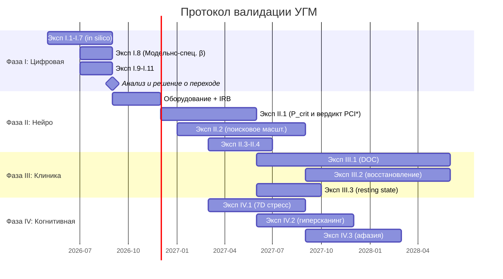

# Экспериментальный протокол валидации УГМ

:::warning Статус документа: [Пр] Исследовательская программа
Этот документ описывает **предельно полный экспериментальный протокол** для эмпирической валидации Универсальной Голографической Модели (УГМ). Протокол спроектирован по принципу максимальной фальсифицируемости: каждый эксперимент указывает **конкретный числовой результат**, который опровергает теорию.
:::

:::info Связь с другими документами
- [23 предсказания КК, из них 22 уникальных](/docs/applied/coherence-cybernetics/predictions) — полный список предсказаний с формулами
- [Протокол измерения Γ](/docs/applied/research/measurement-protocol) — операционализация π_bio для ИИ-систем
- [Критерии фальсифицируемости](/docs/reference/falsifiability) — формальные условия опровержения
- [Реестр статусов](/docs/reference/status-registry) — текущий эпистемический статус всех утверждений
:::

---

## 1. Стратегический замысел {#стратегия}

### 1.1. Проблема: эмпирический вакуум

УГМ — формально проработанная структура с явным [реестром статусов](/docs/reference/status-registry), разделяющим доказанные математические тождества `[Т]`, условные теоремы `[С]`, определения `[О]`, гипотезы `[Г]`, интерпретации `[И]`, программы исследований `[Пр]` и ретрактированные утверждения `[✗]`. Однако **её эмпирические мостовые предсказания пока не проверены**. Теория без эмпирики — философия, какой бы строгой ни была математика.

### 1.2. Ключевое наблюдение: PCI* — независимый вердикт, а не число для совпадения

Perturbational Complexity Index (PCI, введён Casali et al. 2013) даёт независимый алгоритм-специфичный эталон с опубликованным порогом: **PCI* = 0.31**, установленный ROC-анализом на benchmark из 150 субъектов (540 наборов ТМС-вызванных потенциалов), где истиной служит наличие или отсутствие субъективного отчёта; там — 100% чувствительность и специфичность (Casarotto et al. 2016). Порог УГМ — **P_crit = 2/7** на шкале чистоты. Два числа живут на несвязанных шкалах — PCI есть нормированная сложность Лемпеля–Зива бинаризованного ответа на ТМС, $P$ — функция Γ, — поэтому их близость (0.31 против 0.286) доказательной силы не имеет, и никакая нормировка π_bio не может подгоняться под неё: прямая через $(0, 1/7)$ и $(c, 2/7)$ «совпадает» с любым якорем $c$ ([измерение, §6.3](/docs/applied/coherence-cybernetics/measurement#калибровка)).

Это по-прежнему **первая точка контакта** теории с эмпирическими данными — в той форме, в которой она может провалиться: при π_bio, замороженном на бодрствовании, вердикт УГМ Cons(Γ̂) и вердикт PCI PCI_max > 0.31 вычисляются независимо на одних и тех же сессиях и сравниваются каппой Коэна ([P8.4, SUB-5](/docs/applied/research/measurement-protocol#substitution-position)); κ ≥ 0.8 подтверждает, κ < 0.4 фальсифицирует.

### 1.3. Принцип: от дешёвых проверок in silico — к решающим тестам вне выборки

Протокол организован в порядке возрастания стоимости и эмпирического охвата:
- **Сначала (Фаза I, in silico):** проверка точных математических тождеств выбранной численной реализации и тестирование зарегистрированных архитектурных гипотез против сопоставимых контролей (§2.3).
- **Основная эмпирическая проверка (Фаза II, Эксп. II.1):** проверка зарегистрированного пакета «кодировщик / модель наблюдения / пороги» вне выборки — замороженный $\pi_{\mathrm{bio}}$ проверяет $P_{\mathrm{crit}} = 2/7$ на определённой по отчётам границе потери сознания и согласие вердиктов $\kappa$ с независимым порогом $\mathrm{PCI}^*$ (`SUB-1`–`SUB-5`).
- **Поисковый модельно-специфичный тест масштабирования (Фаза II, Эксп. II.2):** **Предсказание 17** (критические экспоненты $\alpha=1/2$, $\beta=1/4$, $\gamma=1$, $\nu=1/2$, $\delta=5$) выполняется **лишь условно для настроенной $\mathbb{Z}_2$-симметричной секстичной скалярной модели среднего поля** (`T-161`: чётная симметрия, занулённый квартичный коэффициент, положительный секстичный член плюс градиентный член для $\nu=1/2$; не универсальный вывод УГМ). Проверка на нейроданных является поисковой совместной проверкой `[Г]` этого анзаца среднего поля и гипотезы монотонной связи `P8.3`; опровержение отклоняет данный редуцированный анзац, а не УГМ в целом.

### 1.4. Четыре фазы

| Фаза | Срок | Что | Почему сначала |
|------|------|-----|----------------|
| **I. Цифровая** | 0–6 мес. | 11 проверок моделей in silico и архитектурных абляций (§2.3) | Бесплатно, без этики, аудирует реализацию и архитектурные гипотезы |
| **II. Нейрокалибровка** | 6–18 мес. | π_bio, вневыборочный $P_{\mathrm{crit}}$ и согласие вердиктов PCI* (κ), поисковый тест масштабирования | Главная точка контакта с нейроданными |
| **III. Клиническая** | 12–36 мес. | Расстройства сознания, ассоциация восстановления, диапазон состояния покоя | Клиническая операционализация |
| **IV. Когнитивная** | 12–24 мес. | 7D-таксономия стресса, коллективная корреляция, прелингвистическое познание | Междисциплинарная валидация |

---

## 2. Фаза I: Цифровая валидация (0–6 мес.) {#фаза-1}

### 2.1. Обоснование

Фаза I проверяет явно заданную численную модель и архитектурные гипотезы. Встроенное в код алгебраическое тождество не является независимым свидетельством физической теории. Зафиксировать пространство состояний, репер, гамильтониан, скачки/скорости, самомодель, затвор, интегратор, численную ошибку и начальные условия. Нарушение точного тождества сначала требует проверки реализации; нарушение эмпирической гипотезы — пересмотра этой гипотезы.

### 2.2. Требования к Γ-нативному агенту

1. **Динамика сохраняет состояния:** заданный линейный GKSL-пропагатор либо нелинейное сохраняющее состояния ОДУ/обновление. Зависящая от состояния регенерация не становится автоматически линейным CPTP-каналом; [T-62](/docs/core/dynamics/evolution#теорема-сохранение-состояний) доказывает сохранение состояний при своих предпосылках.
2. **Фиксированный репер:** $\Gamma\in\mathcal D(\mathbb C^7)$ с отдельно заданными метками и считываниями.
3. **Полный проверяющий предикат:** вычислять каждый конъюнкт [Cap₂](/docs/reference/mathematical-kernel#thresholds), его запас и выбранные показатели стресса. Одного $C=\Phi R$ недостаточно.
4. **Фиксированное правило обучения:** определить функции потерь, допустимые обновления и резервный шаг при неудачной сертификации. Рост чистоты не является полным затвором.
5. **Воспроизводимость:** сохранять версию кода, seeds, полные состояния, остатки решателя и отображения интервенций.
6. **Сопоставимые контроли:** заранее задать задачи, наблюдаемые и бюджеты ресурсов. Требования к GPU зависят от эксперимента и реализации.

### 2.3. Эксперименты

#### Эксп. I.1: Абляция сектора (Pred 1, архитектурная гипотеза) {#эксп-1-1}

Зарегистрировать сохраняющее PSD/след отображение абляции E и сопоставимый контроль A; прежняя правка одной диагонали и строки не гарантировала след один. Начать с состояний, проходящих все заданные затворы, зафиксировать модель и сравнить времена первого выхода из заявленной области в парных прогонах. Оценить парный эффект и неопределённость по независимым seeds.

**Гипотеза:** абляция E сильнее сокращает выживание, чем абляция A, в этой архитектуре. Нулевой либо обратный эффект опровергает данный механизм; ни один исход не доказывает универсальную возможность или невозможность феноменальных зомби.

#### Эксп. I.2: Сертифицированная устойчивая окрестность (Pred 7) {#эксп-1-2}

Задать стационарную точку, векторное поле и проверенный локальный сертификат устойчивости. Возмущать через сохраняющее состояния отображение либо по явно допустимым PSD-направлениям. Сопоставлять траектории с сертифицированной окрестностью Ляпунова и всеми запасами до порогов. Чистота не определяет радиус бассейна; $\sqrt{P-2/7}$ не является точным радиусом, а произвольный белый матричный шум может нарушить PSD.

**Проверка:** каждая покрытая сертификатом траектория удовлетворяет его оценке. Поведение вне окрестности проверяет выбранную глобальную модель, а не обратное к локальной теореме.

#### Эксп. I.3: Типизированная информационная ёмкость (Pred 8) {#эксп-1-3}

Задать ансамбль, кодируемый в одно семиуровневое квантовое состояние, допустимую POVM и число независимых использований канала. Для каждого использования сравнить доступную взаимную информацию с границей Холево $\chi\le\log_2 7$; сообщать смещение оценивания и доверительные интервалы.

Эта граница не применима только потому, что программная память — матрица $7\times7$: точный вещественный признак или параметр может кодировать сколь угодно много классических битов. Для заявленного нарушения нужны те же физические предпосылки кодирования и измерения.

#### Эксп. I.4: Абляция размерности при обучении (Pred 10, гипотеза) {#эксп-1-4}

Сравнить заданных обучающихся агентов $N=5$ и $N=7$ на отложенных бинарных задачах с одинаковыми наблюдениями, возможностями оптимизации и бюджетами ресурсов. Включить корректные каналы замещения меньших размерностей как контроль. Сообщать точность, число примеров и отказы допустимости.

T-113 — гипотеза о выбранной функциональной архитектуре. Каналы замещения и обучение существуют уже при $N=2$; универсальная невозможность при $N<7$ либо гарантированное превосходство $N=7$ не следуют. Зарегистрированное преимущество, нулевой эффект либо обратный результат относятся к выбранным задаче и архитектуре.

#### Эксп. I.5: Затухание и сертифицированная глубина (Pred 12) {#эксп-1-5}

Для чистой итерации Фано проверить $S_n=3^{-n}$, где $S_n=\|\operatorname{offdiag}\mathcal P^n\Gamma\|_F/\|\operatorname{offdiag}\Gamma\|_F$ и начальная норма ненулевая. Для заданного канонического нелинейного отображения проверить дополнительный множитель $\prod(1-R)$. До вычисления обнаружимой глубины выбрать предел детектора $\varepsilon$.

Исторический заданный score даёт арифметический предел три при своём определении; это не $R$, вероятность выживания либо универсальный предел когнитивной глубины. Метакогнитивные пробы и совместимость башни проверяются отдельно, как в [T-142](/docs/proofs/consciousness/operational-closure#t-142).

#### Эксп. I.6: Условное время генезиса (Pred 13) {#эксп-1-6}

Реализовать заданную рекурсию $\Gamma_{n+1}=\beta\mathcal E_\eta(\Gamma_n)+(1-\beta)\sigma$, $\Gamma_0=I/7$, с постоянной $\sigma$, $0<\beta<1$ и деполяризующим $\mathcal E_\eta$. Записать $r=\beta\eta$, $w=(1-\beta)/(1-r)$ и $h=1/\sqrt{7P(\sigma)-1}$ при $P(\sigma)>2/7$.

**Точная проверка:** $P_n=1/7+w^2(1-r^n)^2(P(\sigma)-1/7)$. Пересечение существует тогда и только тогда, когда $w>h$; при $0<r<1$ первый такт равен $\lfloor\log(1-h/w)/\log r\rfloor+1$. Включить непересекающий контроль $\beta=0.9$, $\eta=0$ и чистую $\sigma$. Случай $r=0$ проверить прямо. Это условные тождества [T-148](/docs/proofs/consciousness/substrate-closure#t-148). Изолированное начальное $I/7$ при унитальном генераторе и закрытом затворе остаётся там; другие начальные состояния или самомодели не обязаны.

#### Эксп. I.7: Фиксированные и совращающиеся цели (Pred 14) {#эксп-1-7}

Зафиксировать модель, скорости и ненулевые разности энергий; сравнить фиксированные и совращающиеся цели по независимым seeds. В скалярном уравнении с постоянными коэффициентами $\dot\gamma=-(d+a+i\omega)\gamma+a\rho^*$ проверить стационарный модуль $a|\rho^*|/\sqrt{(d+a)^2+\omega^2}$ фиксированной цели. Затем проверить заданное вращающееся воздействие.

Универсального предсказания $\Phi(\text{fixed})<1$ нет: конструкция $H=0$, $\varphi_J$ имеет живые состояния окна. Наблюдение $\Phi\ge1$ при фиксированной цели не опровергает условную скалярную формулу.

#### Эксп. I.8: Критические показатели выбранного потенциала (Pred 17, предварительный) {#эксп-1-8}

Задать потенциал, управляющий параметр, равновесную ветвь и независимо проверенную симметрию. Приближать параметр к критической точке, решать уравнение ветви и оценивать независимо заданный параметр порядка с неопределённостью конечного окна. Сравнивать $1/4$, $1/2$ и другие показатели с поправками к масштабированию.

Случайная выборка состояний с заданной чистотой не порождает равновесный критический показатель. Закон $1/4$ условен относительно соответствующего симметричного вырождения; это не универсальное биологическое предсказание и не доказательство показателя PCI. Симуляция проверяет выбранную модель до обращения к нейроданным.

#### Эксп. I.9: Калиброванный кодировщик либо линейный канал (Pred 19) {#эксп-1-9}

Зафиксировать референсную модель только по калибровочным данным. Для признаковых оценивателей сравнивать отложенные правдоподобия наблюдений, идентифицируемые величины и неопределённость реконструкции. Единственного $\pi_{\mathrm{can}}$ нет; произвольное признаковое отображение не имеет алмазной нормы.

Если независимо заданы **линейные** каналы $M_d\to M_7$, проверить PSD и следосохраняющий частичный след матриц Чои, затем вычислить либо оценить алмазное расстояние по [T-152](/docs/proofs/consciousness/substrate-closure#t-152). Зарегистрировать допуск и наблюдательную модель до проверки; пятьдесят батчей не гарантируют сходимость либо расстояние ниже $0.1$.

#### Эксп. I.10: Скорость обучения в заданной модели различения (Pred 9) {#эксп-1-10}

Задать законы наблюдений, априорные классы, независимость, допустимые тесты и отложенный критерий успеха. Для квантового i.i.d. бинарного различения сравнить ошибку с точной величиной Хелстрома при каждом доступном $n$. Чернов даёт асимптотический показатель и достаточную конечновыборочную верхнюю оценку ошибки.

Для выбранного линейного накопителя проверить точное время пересечения; безопасность динамики обучения сертифицировать отдельно. Максимум корректных необходимых границ остаётся нижней границей и не обязан достигаться. См. [границы обучения](/docs/applied/coherence-cybernetics/learning-bounds).

#### Эксп. I.11: Размерность и социальное обучение (Pred 11, гипотеза) {#эксп-1-11}

Сравнить агентов $N=5$ и $N=7$ на отдельно операционализированных задачах ToM, межагентного обучения и стратегической координации. Зафиксировать оценочные данные и критерии успеха; сопоставить бюджеты коммуникации, памяти и обучения, сообщать величины эффектов с контролем множественных сравнений.

Возможное преимущество семимерного носителя проверяется сравнением с меньшими архитектурами на одной задаче при равных ресурсах. Подсчёт ролей сам по себе не даёт нижней границы.

### 2.4. Критерий перехода к Фазе II

Переходить, когда точные проверки реализации пройдены, наблюдательная модель идентифицируема для заявленных величин, а архитектурные проверки и контроль ресурсов опубликованы. Численные тождества, эмпирические гипотезы и феноменальные интерпретации требуют отдельных вердиктов. Пересматривать неудачные гипотезы до переноса на нейроданные; подтверждение каждого спекулятивного предсказания не требуется для корректности математического тождества.

---

## 3. Фаза II: Нейрокалибровка π_bio (6–18 мес.) {#фаза-2}

### 3.1. Обоснование

Центральная задача: построить мост **π_bio: (EEG, fMRI, HRV) → Γ ∈ D(ℂ⁷)** и проверить теоретический порог P_crit = 2/7 вне выборки: при π_bio, замороженном на бодрствовании, — P̂ в точке потери сознания, определённой по отчётам, против 2/7, и вердикт Cons(Γ̂) против независимо валидированного вердикта PCI PCI_max > 0.31 по каппе Коэна (P8.4).

### 3.1b. Формальное определение и идентификация π_bio [О/Г] {#pi-bio-definition}

:::info Определение (калиброванный нейронный оценщик состояния)
Нейронный кодировщик $\hat\pi_\theta:\mathcal O_{\mathrm{neural}}\to\mathsf D_7$ — объявленный **оценщик состояния** либо многозначная реконструкция при неполных данных. Его модель наблюдения $\mathsf O_\theta:\mathsf D_7\to\mathcal P(\mathcal O_{\mathrm{neural}})$, калибровка $\theta$, функциональный репер и допустимые состояния входят в спецификацию прибора. Softmax и нормированное разложение Холецкого при выполнении условий области дают допустимые состояния; этот нелинейный перевод признаков не становится CPTP-каналом. [Определения и теоремы обратной задачи](/docs/applied/research/reconstruction-identifiability).
:::

**Конструкция и требования (4 шага).**

**Шаг 1 (Объявленные кандидаты признаков [Г]).** Словарь признаков предрегистрируется. Функциональная версия ниже и спектральная версия [измерительного протокола](/docs/applied/research/measurement-protocol#шаг-1-диагональ) — **различные кандидаты кодировщиков**; один выбирается до просмотра исходов, другой используется только как зарегистрированное сравнение.

| Измерение | Кандидат нейронного признака | Извлечение |
|-----------|----------------------------|------------|
| A | Спектральная краевая частота | Спектр ЭЭГ, объявленная полоса |
| S | Дальние временные корреляции | DFA с объявленными масштабами |
| D | Перестановочная энтропия | Фиксированные порядок, лаг и окно |
| L | Theta-gamma PAC | Объявленный оценщик фазы/амплитуды |
| E | Прокси интериорности без PCI | Предрегистрированный независимый признак |
| O | HRV RMSSD | Одновременная ECG, фиксированное окно |
| U | Глобальная связность | Объявленные оценщик, каналы и эталон |

PCI, времена реакции и отчёты исключаются из подтверждающих входов предсказания (SUB-3/SUB-5). Назначение метки признаку не доказывает, что он наблюдает ось $\Gamma$; мост «признак—состояние» остаётся [Г].

**Шаг 2 (Замороженная нормировка [О/Г]).** Одна из кандидатных диагональных конвенций:

$$
\gamma_{kk}=\frac{\exp(\beta z_k)}{\sum_j\exp(\beta z_j)},\qquad z_k=(x_k-\mu_k)/\sigma_k.
$$

Требуется $\sigma_k>0$, заранее объявленная обработка постоянных и отсутствующих признаков и численно устойчивая реализация softmax. $\beta,\mu_k,\sigma_k$ и все альтернативы фиксируются по опорному ансамблю бодрствования (SUB-1), без подгонки чистоты к $2/7$ или согласия с PCI. Это задаёт конвенцию кодировщика, а не теорему идентификации состояния системы.

**Шаг 3 (Комплексные наблюдения и PSD-реконструкция).** Предлагаемая модульная связь

$$
|\gamma_{ij}|=\sqrt{\mathrm{Coh}_{ij}^{\mathrm{neural}}}\sqrt{\gamma_{ii}\gamma_{jj}}
$$

есть калибруемая гипотеза при $0\leq\mathrm{Coh}_{ij}^{\mathrm{neural}}\leq1$. Она обеспечивает лишь попарные PSD-границы $2\times2$; собранная матрица может не быть глобально PSD. **Величина** фазовой синхронизации — вещественный модуль. Знаковая фаза требует комплексного среднего $z_{ij}=\langle e^{i(\phi_i-\phi_j)}\rangle$ и объявленной калиброванной связи с $\arg\gamma_{ij}$. Кросс-частотные пары требуют реальной гармонической конвенции. Вещественный PLV, модули и $|\sin\theta_{ij}|$ не заменяют комплексные наблюдения [контрпримеры](/docs/applied/research/reconstruction-identifiability#phase-counterexamples).

Замороженный закон наблюдения подгоняется при $\Gamma\succeq0$, $\operatorname{Tr}\Gamma=1$. Линейные эрмитовы средние с известной положительной ковариацией дают выпуклую задачу с единственным решением, если проекции операторов порождают все 48 бесследовых эрмитовых направлений. Нелинейные модели требуют отдельного анализа локальной/глобальной идентификации. Публикуются невязки, неопределённость калибровки и доверительные множества. Отсутствующие знаковые фазы остаются неопределёнными; запрещено незаметно заполнять их нулями. В подтверждающем опыте $\lambda_1=\lambda_2=0$ (SUB-2).

**Шаг 4 (Фиксированный репер, идентификация и считывание).** Замораживаются семь меток, ось $E$, времена и фазовые эталоны. Остаточное отождествление выводится из плана наблюдения; произвольное прокрустово выравнивание по $G_2$ к среднему бодрствования может менять $\Phi$ и не доказывает ковариантность или единственность. Оно исключено из референсного протокола. Публикуются диапазоны величин по совместимым состояниям; определённый вердикт допустим только при постоянстве всего предиката на доверительном множестве. Расширение/подъём, используемое для $D$, также предрегистрируется и учитывается в неопределённости.

**Свойства π_bio.**

| Свойство | Статус | Условие |
|----------|--------|---------|
| Выход PSD и единичного следа | [Т] | Явные ограничения состояния, допустимый выход оптимизатора |
| Идентификация полного состояния | [Т] условно | Инъективный закон наблюдения; линейный критерий ID-2 либо отдельное доказательство |
| Устойчивость | [Т] условно | Положительное наименьшее сингулярное число/локальная обусловленность; количественная неопределённость |
| Ковариантность/остаточная симметрия | [Г] до проверки | Реальное действие на признаках и закон наблюдения, не одно выравнивание |
| Эмпирическая нейронная интерпретация | [Г] | Независимая калибровка и проверка вне выборки |
| CPTP | Не утверждается | Нелинейный оценщик векторов признаков не является линейным операторным каналом |

Одна калибровка не валидирует прибор. Успешная проверка вне выборки поддерживает **совместную зарегистрированную гипотезу наблюдения/порогов**. Она не доказывает онтологическое тождество восстановленного состояния или единственность среди альтернативных кодировщиков. Неудача отвергает эту совместную спецификацию; последующие альтернативы регистрируются заранее и публикуются вместе с неудачей, а не задним числом заменяют проверенный прибор. Дополнительно к SUB-1 … SUB-6 применяются [ID-A … ID-D](/docs/applied/research/reconstruction-identifiability#confirmatory).

### 3.2. Оборудование

| Компонент | Модель | Назначение | Бюджет |
|-----------|--------|-----------|--------|
| TMS-EEG | Nexstim NBS System 5 + 60-ch eXimia | Каузальная пертурбация + EEG | ~\$300K |
| HD-EEG | BioSemi ActiveTwo 128-ch | Высокоплотная ЭЭГ для спектрального анализа | ~\$80K |
| fMRI | 3T (доступ через университетский центр) | Пространственная локализация | По соглашению |
| HRV | Polar H10 + Empatica E4 | Вегетативные корреляты | ~\$2K |
| Полисомнография | Стандартный PSG-комплект | Стадии сна | ~\$30K |
| Нейронавигация | MRI-совместимый фреймлесс навигатор | Точность TMS-стимуляции | В составе Nexstim |

**Общий бюджет оборудования:** ~\$420K (при наличии fMRI-доступа).

### 3.3. Эксперимент II.1: порог P_crit вне выборки, согласие с PCI* (ключевой) {#эксп-2-1}

:::warning Это самый важный эксперимент всего протокола
Если при π_bio, замороженном на бодрствовании, P̂ на границе сознания/бессознательности, определённой по отчётам, = 2/7 ± 0.05, а вердикт УГМ согласуется с вердиктом PCI при κ ≥ 0.8, зарегистрированный пакет наблюдения и порогов получает эмпирическую поддержку при выполненной идентификации и статистическом критерии ниже. Неудача требует пересмотра пакета; неопределённый исход не считается подтверждением.
:::

**Субъекты:** N=50, здоровые, 18–45 лет, без неврологической/психиатрической патологии.

**Парадигма:** Пропофол-индуцированная потеря сознания с TMS-EEG мониторингом.

**Протокол (детальный):**

1. **Базовая линия (бодрствование):**
   - TMS-EEG: 200 триалов, стимуляция BA6/BA8 (120–160 V/m)
   - Вычислить PCI_wake
   - Субъективный отчёт: шкала сознания 0–10

2. **Титрация пропофола:**
   - Target-controlled infusion (TCI), модель Marsh или Schnider
   - 5 целевых уровней: Ce = 0.5, 1.0, 1.5, 2.0, 2.5 μg/ml
   - На каждом уровне (15 мин стабилизации):
     - TMS-EEG: 150 триалов
     - Вычислить PCI
     - Вербальный отчёт сознания (если возможен)
     - Isolated Forearm Technique (IFT) для подтверждения/опровержения сознания

3. **Определение порога (данные вывода):**
   - Для каждого субъекта: Ce_threshold — наименьшая концентрация, при которой утрачены и вербальный отчёт, и ответ IFT; граница фиксируется отчётами, а не PCI
   - На каждом уровне отдельно записать вердикт PCI PCI_max > PCI* = 0.31 (Casarotto et al. 2016); он сравнивается с вердиктом УГМ на шаге 6 и никогда не используется для установки границы

4. **Реконструкция Γ:**
   - Применить π_bio к EEG-данным каждого уровня
   - Алгоритм π_bio: замороженная модель наблюдения → PSD/следовые ограничения → совместимое множество и диапазоны величин (см. [Протокол измерения Γ](/docs/applied/research/measurement-protocol))
   - Параметры $\beta, \mu_k, \sigma_k$ заморожены на базовой линии бодрствования ([SUB-1](/docs/applied/research/measurement-protocol#substitution-position)); $\lambda_1 = \lambda_2 = 0$ (SUB-2); E — из наблюдаемой, отличной от PCI
   - Вычислить диапазоны P = Tr(Γ²) и Cons(Γ) на доверительном множестве каждого уровня; неоднозначный вердикт сообщить как неопределённый

5. **Считывание (без подгонки):**
   - Построить зависимость P(Ce) для всех 50 субъектов
   - Определить P на границе сознания: P_boundary = P(Ce_threshold)

6. **Согласие вердиктов (P8.4, SUB-5):**
   - На каждом уровне Cons(Γ̂) и PCI_max > 0.31 вычисляются независимо
   - Каппа Коэна по всем 300 сессиям (50 субъектов × базовая линия + 5 уровней); κ ≥ 0.8 подтверждает, κ < 0.4 фальсифицирует; сырое совпадение мерой не служит

**Статистический план и идентификация:**
- Публикуется разделение обучения/проверки по субъектам; шесть сессий одного субъекта зависимы и не являются шестью независимыми субъектами. Все выборы оценщика и исхода замораживаются до раскрытия результатов.
- Основная величина: популяционное среднее восстановленной чистоты на **границе утраты ответов**, с неопределённостью модели наблюдения и межсубъектной выборки. Исчезновение вербального/IFT-ответа — прокси вывода, а не доказательство отсутствия переживания; отсроченные отчёты и оценка исхода регистрируются отдельно.
- Допуск эквивалентности: $\delta=0.05$ вокруг $2/7$, объявленный заранее [Г]. Поддержка требует, чтобы корректно калиброванный 98%-й доверительный интервал **целиком лежал внутри** $[2/7-\delta,2/7+\delta]$ (два односторонних теста при $\alpha=0.01$ и выполненных предпосылках). Простое неотвержение равенства или включение $2/7$ в интервал не доказывает эквивалентность. См. [Schuirmann (1987), первичный вывод TOST и интервала $1-2\alpha$](https://doi.org/10.1007/BF01068419).
- Отвержение при большем заранее объявленном допуске $0.1$ требует, чтобы 98%-й интервал целиком лежал выше $2/7+0.1$ или ниже $2/7-0.1$. Промежуточный исход неопределён. Одной точечной оценки недостаточно.
- Вторичная величина: каппа Коэна между независимо вычисленными вердиктами. Неопределённость оценивается по субъектам с учётом повторных сессий. Заранее задаётся обработка неопределённых вердиктов УГМ, публикуются их доля и границы чувствительности; исключать их ради улучшения согласия запрещено. $\kappa\geq0.8$ и $\kappa<0.4$ — зарегистрированные эмпирические пороги [Г] с неопределённой промежуточной зоной.
- Пересчитать мощность и объём выборки с учётом выбранной проверки, пилотного шума, неопределённости калибровки и структуры повторений.

Эти исходы проверяют зарегистрированный пакет кодировщика/наблюдения/порогов. Диагностика структурной идентификации и согласие классификаторов публикуются раздельно. Успешная классификация сама по себе не устанавливает онтологию сознания.

### 3.4. Эксперимент II.2: Поисковый тест критического масштабирования (Pred 17, модельно-специфичный) {#эксп-2-2}

:::note Условная область действия модели (`T-161`)
Согласно [T-161](/docs/reference/status-registry) (**[Т для настроенной секстичной скалярной модели среднего поля]**), классические трикритические показатели среднего поля ($\alpha=1/2$, $\beta=1/4$, $\gamma=1$, $\nu=1/2$, $\delta=5$) требуют чётного ($\mathbb{Z}_2$-симметричного) секстичного скалярного потенциала с **занулённым квартичным коэффициентом** и положительным секстичным членом, плюс градиентный член для $\nu=1/2$. Они **не** являются универсальным следствием УГМ или $P_{\mathrm{crit}} = 2/7$ (универсальные выводы катастроф/бифуркаций `T-28` [✗] и `T-160` [✗] сняты). Данный эксперимент представляет собой **поисковый совместный тест `[Г]`** этого настроенного секстичного анзаца среднего поля совместно с замороженным $\pi_{\mathrm{bio}}$ и гипотезой монотонного прокси PCI `P8.3`.
:::

**Субъекты:** N=50, здоровые, 20–40 лет. Каждый — полная ночь в лаборатории сна.

**Парадигма:** TMS-EEG на каждой стадии сна (W→N1→N2→N3→REM→W).

**Протокол:**
1. Полисомнография: 8 часов записи, онлайн-скоринг стадий
2. TMS-EEG: 100 триалов каждые 15 мин (32+ точки за ночь на субъекта)
3. Для каждой точки: PCI, $P(\widehat\Gamma)$, стадия сна
4. Всего: ~1600 точек (50 × 32)

**Анализ:**
1. Для каждой точки: $x = P - P_{\mathrm{crit}} = P - 2/7$
2. Разделить по знаку $x$ (сторона порога УГМ, из $\widehat\Gamma$ при $\pi_{\mathrm{bio}}$, замороженном на бодрствовании), а не по $\mathrm{PCI} > \mathrm{PCI}^*$: два разбиения сравниваются (`P8.4`), а не отождествляются
3. Для $x > 0$: аппроксимировать $\mathrm{PCI} \sim x^\beta$ — PCI служит параметром порядка лишь при гипотезе монотонной связи `P8.3` `[Г]`, поэтому эта подгонка проверяет $\beta$ совместно с `P8.3` и замороженным кодировщиком
4. Извлечь $\beta$ с кластеризованным по субъектам 95% ДИ, включая чувствительность к конечному окну и поправки к масштабированию

**Модельно-специфичная цель `[Г]`:** $\beta = 1/4 \pm 0.05$ в настроенной $\mathbb{Z}_2$-симметричной секстичной скалярной модели среднего поля (`T-161`), в прямом сравнении с альтернативными гипотезами масштабирования: обычным средним полем ($\beta = 1/2$), 3D Изингом ($\beta \approx 0.326$) и гладким нестепенным кроссовером.

**Дополнительные модельно-специфичные экспоненты (при том же настроенном секстичном анзаце + градиентном члене для $\nu$):**
- $\alpha = 1/2$: масштабирование дисперсии $P$ вблизи порога
- $\nu = 1/2$: пространственная корреляционная длина (требует градиентного члена)
- $\gamma = 1$: восприимчивость (амплитуда вариабельности отклика вблизи порога)
- $\delta = 5$: критическая изотерма

**Фальсификация совместной редуцированной модели:**
- Кластеризованный по субъектам 95% ДИ для $\beta$ не пересекает $[0.20, 0.30]$ (или гладкая модель / обычное среднее поле описывает данные значимо лучше)
- $\nu \notin [0.45, 0.55]$ либо $\gamma \notin [0.90, 1.10]$ при объявленных определениях пространственного масштаба и отклика

Опровержение этих значений фальсифицирует **настроенный секстичный анзац среднего поля (`T-161`) и/или мост `P8.3`** — оно **не** опровергает ядро УГМ.

**Статистический план:** Нелинейная регрессия (степенной закон против гладкого кроссовера), блочный бутстрэп по субъектам для 95% ДИ, сравнение моделей (AIC/BIC) с $\beta = 1/2$, 3D Изингом $\beta \approx 0.326$ и гладкими сигмоидальными базовыми линиями.

### 3.5. Эксперимент II.3: Динамика зажигания (Pred 16) {#эксп-2-3}

**Субъекты:** N=30 (подвыборка Эксп. II.1).

**Протокол:**
1. На каждом уровне пропофола: замерить задержку T_ign до «вспышки» сложности после TMS
2. T_ign = время от TMS до первого PCI-всплеска (>50% от PCI_wake)

**Модельная гипотеза `[С]` / `[Г]`:** В условной модели замедления складки/считывания (`T-53d` **[С]**; универсальная остановка времени на $P = 2/7$ снята `[✗]`) $T_{\text{ign}}$ возрастает при приближении $P$ к $P_{\mathrm{crit}}$ (модельное масштабирование $\sim (P - P_{\text{crit}})^{-1}\kappa_0^{-1}$).

**Фальсификация:** $T_{\mathrm{ign}}$ не показывает систематической зависимости от $(P - P_{\mathrm{crit}})$ ($R^2 < 0.3$).

### 3.6. Эксперимент II.4: Спектральная щель и гамма-ритм (Pred 22) {#эксп-2-4}

**Субъекты:** N=30.

**Протокол:**
1. HD-EEG 128-ch, бодрствование, покой (10 мин с открытыми и закрытыми глазами)
2. Спектральный анализ: доминантная частота в гамма-диапазоне (30–100 Гц)
3. Вычислить λ_gap из линдбладовских параметров (калиброванных по EEG)
4. Сравнить ν_predicted = λ_gap/(2π) с измеренной доминантной частотой

**Предсказание `[Г]`:** ν_predicted ∈ [30, 100] Гц, совпадение с гамма-ритмом.

**Фальсификация:** λ_gap/(2π) вне [10, 200] Гц (с учётом погрешности калибровки).

---

## 4. Фаза III: Клиническая валидация (12–36 мес.) {#фаза-3}

### 4.1. Эксперимент III.1: Расстройства сознания (Pred 21) {#эксп-3-1}

**Субъекты:** N=80 (20 кома, 20 MCS, 20 VS/UWS, 20 здоровых контролей).

**Протокол:**
1. TMS-EEG + fMRI + HRV → π_bio → Γ
2. Вычислить $P, R, \Phi, \mathrm{Coh}_E$ (и объявленную $D_{\mathrm{diff}}$) для каждого субъекта
3. Классификация: оценить как нижний порог жизнеспособности $P > 2/7$, так и полную конъюнкцию `Cap₂` ($P \in (2/7, 3/7]$, $R \ge 1/3$, $\Phi \ge 1$, $D_{\mathrm{diff}} \ge 2$)
4. Сравнить с клинической классификацией (CRS-R шкала)

**Предсказание `[Г]`:**
- $P(\widehat\Gamma_{\mathrm{MCS}}) > 2/7$ для ≥90% MCS-пациентов
- $P(\widehat\Gamma_{\mathrm{VS}}) < 2/7$ для ≥80% VS-пациентов
- $P(\widehat\Gamma_{\mathrm{healthy}}) > 2/7$ (внутри окна $(2/7, 3/7]$) для 100%

**Фальсификация:** Чувствительность < 80% или специфичность < 75%.

**Клиническое значение:** Если замороженный $\pi_{\mathrm{bio}}$ и вердикт `Cap₂` воспроизводятся вне выборки на когортах DOC, они дают кандидатный инструмент прикроватного мониторинга, дополняющий TMS-PCI.

### 4.2. Эксперимент III.2: E-когерентность и восстановление (Pred 2) {#эксп-3-2}

**Субъекты:** N=60 (реабилитация после инсульта).

**Протокол:**
1. При поступлении: EEG → π_bio → Coh_E
2. Через 3 мес.: оценка восстановления (Barthel Index, mRS)
3. Корреляция Coh_E(t₀) vs скорость восстановления

**Предлагаемая связь [Г/Пр]:** предварительно выбранная цель корреляции Пирсона $r>0.3$ между калиброванной исходной $\widehat{\mathrm{Coh}}_E$ и независимо заданной скоростью восстановления. Это выбранный исследователем целевой эффект, а не следствие T-38a (снята [✗]). До проверки зафиксировать оценщик, исход, учёт смешивающих факторов и правило пропущенных данных.

**Правило решения [Пр]:** предварительно задать доверительный интервал и расчёт мощности для корреляции выбранной популяции. Подкреплять цель $r>0.3$ только при нижней границе интервала выше $0.3$; отвергать эту цель при верхней границе не выше $0.3$; иначе сообщать неопределённый результат. Одна выборка 60 не гарантирует ни одного исхода. Проверяется связь/измерительный мостик, а не математическая теорема исключения зомби.

### 4.3. Эксперимент III.3: Аттрактор внутри окна (Pred 15) {#эксп-3-3}

**Субъекты:** N=30, здоровые, resting state.

**Протокол:**
1. EEG + fMRI (resting state, 10 мин) → π_bio → Γ
2. Вычислить P
3. Повторить 5 сессий (разные дни) для каждого субъекта

**Модельная гипотеза `[Г]`:** $P(\text{resting state}) \in (2/7, 5/14]$, ниже верхней границы окна $3/7$ (мотивирована заданным потоком в `T-124c` **[Т при заданной цели, скоростях и инвариантной области]**; отметим, что универсальное значение аттрактора не следует из одного интервала чистоты).

**Фальсификация:** $P_{\mathrm{mean}} \geq 3/7$ или $P_{\mathrm{mean}} \leq 2/7$ при $N=30$.

---

## 5. Фаза IV: Когнитивная и социальная валидация (12–24 мес.) {#фаза-4}

### 5.1. Эксперимент IV.1: 7D стрессовый тензор (Pred 3) {#эксп-4-1}

**Протокол:**
1. Собрать базу 200+ стрессоров из литературы (психология, медицина, организационная наука)
2. 5 независимых экспертов: классификация каждого стрессора по 7 компонентам [A,S,D,L,E,O,U] (`T-92` **[О]**)
3. Межэкспертная надёжность: κ Коэна

**Предсказание `[О]` / `[Г]`:** высокое межэкспертное покрытие 7 компонентами при минимальной остаточной категории.

**Фальсификация:** ∃ класс стрессоров, неклассифицируемый ни по одному из 7 компонентов (согласие ≥4 из 5 экспертов).

### 5.2. Эксперимент IV.2: Коллективное сознание (Pred 5) {#эксп-4-2}

**Субъекты:** 10 групп по 4 человека (джазовые квартеты — координированные; случайные музыканты — некоординированные).

**Оборудование:** Гиперсканинг EEG (4 × 32-ch, синхронизация через LSL).

**Протокол:**
1. Одновременная EEG-запись 4 участников во время совместного исполнения
2. Вычислить полную корреляцию I группы (необходимое условие; интеграция Φ_⊗ целого критерием не служит, см. ниже)
3. Сравнить координированные vs некоординированные группы

**Предсказание:** $I > 0$ необходимо для нефакторизованной связности `[Т]` (при динамике произведений); коллективное феноменальное отождествление — гипотеза `[Г]`.

**Фальсификация:** I(координированные) ≤ I(случайные) (p < 0.05, Mann-Whitney).

### 5.3. Эксперимент IV.3: Прелингвистическое познание (Pred 4) {#эксп-4-3}

**Субъекты:** N=30 (15 пациентов с афазией Брока, 15 здоровых контролей).

**Протокол:**
1. Батарея невербальных когнитивных тестов: K1 (перцепция), K2 (эмоции), K3 (категоризация), K4 (планирование)
2. Сравнить: афатики vs здоровые по K1–K4

**Предсказание `[И]` / `[Г]`:** K1–K4 у афатиков сохранены на >80% от нормы (операционализировано в рамках определения сенсомоторного интерфейса `T-100` **[О]**).

**Фальсификация:** K3 или K4 систематически разрушены при афазии (снижение >50%).

---

## 6. Сводная таблица: все 23 предсказания × фазы {#сводная-таблица}

Статусы ниже согласованы с §2.3 и [Реестром статусов](/docs/reference/status-registry).

| # | Предсказание | Фаза | Критерий фальсификации (зарегистрированной модели/моста) | Статус по реестру |
|---|---|---|---|---|
| 1 | Абляция сектора (универсальная No-Zombie `T-38a` снята `[✗]`) | I.1 | Абляция $E$ не сокращает выживание сильнее контроля $A$ в зарегистрированной архитектуре | [Г] (архитектурная гипотеза) |
| 2 | $\mathrm{Coh}_E \leftrightarrow$ восстановление | III.2 | Верхняя граница ДИ для $r \le 0.3$ на предрегистрированной когорте | [Г] / [Пр] |
| 3 | 7D-панель стресса (`T-92`) | IV.1 | Неклассифицируемый стрессор по консенсусу экспертов | [О] / [Г] |
| 4 | Прелингвистическое познание (`T-100` [О]) | IV.3 | K3/K4 систематически разрушены при афазии | [И] / [Г] |
| 5 | Коллективная корреляция | IV.2 | $I(\text{коорд}) \le I(\text{случ})$ | [Т] связность / [Г] феноменология |
| 6 | Вневыборочный $P_{\mathrm{crit}} = 2/7$ и согласие с PCI* | II.1 | 98% TOST ДИ вне $[2/7 \pm 0.1]$ или $\kappa < 0.4$ | [Т] порог формализма / [Г] нейронный мост |
| 7 | Сертифицированная локальная окрестность устойчивости (`T-104`) | I.2 | Сертифицированная траектория нарушает заявленную локальную оценку | [Т на оболочке чистоты] / [С] |
| 8 | Типизированная квантовая ёмкость $\le \log_2 7$ | I.3 | Корректное 7-уровневое квантовое кодирование + POVM превышает границу Холево | [Т] (квантовое кодирование) |
| 9 | Скорость обучения в модели различения (`T-109`, `T-110`) | I.10 | Квантовая i.i.d. ошибка ниже Хелстрома или накопитель нарушает тождество пересечения | [Т] (в заданной модели) |
| 10 | Абляция размерности при обучении (`T-113`) | I.4 | $N=5$ не уступает $N=7$ на зарегистрированной задаче при равных ресурсах | [Г] (архитектурная гипотеза) |
| 11 | Размерность и социальное обучение | I.11 | $N=5$ не уступает $N=7$ на зарегистрированной задаче ToM/координации | [Г] |
| 12 | Затухание Фано и показатель глубины (`T-142`; универсальная `T-217` снята `[✗]`) | I.5 | Чистая итерация Фано отклоняется от $3^{-n}$ либо проба метакогниции проваливается | [Т при заданной конвенции счёта] / [Г] |
| 13 | Условная рекурсия генезиса (`T-148`) | I.6 | Рекурсия отклоняется от $P_n = 1/7 + w^2(1-r^n)^2(P(\sigma)-1/7)$ | [Т] (условная рекурсия) |
| 14 | Фиксированные и совращающиеся цели | I.7 | Скалярное уравнение отклоняется от $a\lvert\rho^*\rvert/\sqrt{(d+a)^2+\omega^2}$ | [С] (скалярная модель; нет универсального $\Phi<1$) |
| 15 | Аттрактор состояния покоя в окне (`T-124c`) | III.3 | $P_{\mathrm{mean}} \ge 3/7$ или $P_{\mathrm{mean}} \le 2/7$ | [Т при заданном потоке] / [Г] |
| 16 | Замедление зажигания (`T-53d`; универсальная остановка снята `[✗]`) | II.3 | $T_{\mathrm{ign}}$ не зависит от $(P - P_{\mathrm{crit}})$ ($R^2 < 0.3$) | [С] (условная складка/считывание) / [Г] |
| 17 | Поисковые критические экспоненты (`T-161`) | I.8 + II.2 | Настроенная секстичная модель отклоняется (I.8); нейроданные несовместимы с $\beta=1/4$ (II.2) | [Т для настроенной секстичной скалярной модели среднего поля] / [Г] |
| 18 | Уорд-подавление 19/49 | — | Несовместимость $\Lambda$-бюджета физического сектора | [С] / [Г] |
| 19 | Оценка Чои для линейных каналов (`T-152`) / валидация кодировщика | I.9 | Линейные каналы нарушают оценку алмазной нормы Чои или отложенное правдоподобие падает | [Т] (линейные каналы) / [Г] (кодировщики) |
| 20 | $\varepsilon_{\mathrm{eff}} \approx 0.059$ | — | $\varepsilon \notin [0.04, 0.08]$ | [С] |
| 21 | Реконструкция $\pi_{\mathrm{bio}}$ | II.1 + III.1 | Нарушение идентифицируемости ID-A–ID-D, ошибка > 30% или $\kappa < 0.4$ | [Г] |
| 22 | Спектральная щель и гамма-ритм | II.4 | $\lambda_{\mathrm{gap}}/(2\pi) \notin [10, 200]$ Гц | [Г] |
| 23 | Анизотропия декогеренции Фано ранга 7 (`T-226`) | I.12 | Нарушение 14 полярных правил сумм в томографии скоростей | [Т] (канал Фано) / [С] |

---

## 7. Трёхуровневая область опровержения {#фальсификация}

Поскольку точные алгебраические тождества, зарегистрированные эмпирические мосты и редуцированные эффективные модели имеют разные эпистемические статусы, провал эксперимента опровергает **лишь конкретный проверяемый слой**:

| Уровень | Что опровергнуто | Примеры | Следствие |
|---------|------------------|---------|-----------|
| **Уровень 1 — Математический / Реализация** | Ошибка реализации или нарушение математической посылки | Нарушение сохранения состояний (`T-62`), рекурсии (`T-148`), оценки алмазной нормы Чои (`T-152`), границы Холево при квантовом кодировании или правил сумм Фано (`T-226`) на канале Фано | Аудит кода и проверка выполнения формальных предпосылок; точные теоремы ошибками кода не опровергаются |
| **Уровень 2 — Зарегистрированный эмпирический мост / Архитектура** | Совместный пакет наблюдения/кодировщика/порогов или архитектурная гипотеза | Замороженный $\pi_{\mathrm{bio}}$ даёт $\kappa < 0.4$ против $\mathrm{PCI}^*$ либо 98% TOST ДИ вне $[2/7 \pm 0.1]$ (Эксп. II.1); полностью идентифицированные тождественные состояния дают противоречащие вердикты по отчётам; абляция $E$ или преимущество $N=7$ не подтверждаются в Эксп. I.1/I.4/I.11 | Отвергает данный зарегистрированный пакет кодировщика/моста или конкретную архитектурную гипотезу; требует проспективной ревизии и публикации |
| **Уровень 3 — Модельно-специфичный / Эффективный анзац** | Условная редуцированная модель или калибровочный параметр | $\beta \neq 1/4$ в Эксп. II.2 (опровергает настроенный секстичный скалярный анзац среднего поля `T-161` и/или `P8.3`); $P$ покоя вне $(2/7, 5/14]$ (`T-124c`); $\lambda_{\mathrm{gap}}/(2\pi)$ вне гамма-диапазона | Снимает или уточняет данную редуцированную модель, не затрагивая базовые тождества пространства состояний |

:::note Снятые универсальные триггеры опровержения
В прежних редакциях «обучение при $N < 7$», «внешне поддерживаемые зомби» и «глубина $\ge 4$» указывались как катастрофические опровержения аксиоматики. Эти триггеры сняты, поскольку соответствующие универсальные запреты уже отозваны в [Реестре статусов](/docs/reference/status-registry): обучающиеся агенты с каналом замещения существуют уже при $N=2$ (§2.3 Эксп. I.4, `T-113` [Г]), стационарные внешне поддерживаемые контрпримеры существуют (`T-38a` [✗]), а универсальный потолок глубины снят (`T-217` [✗]).
:::

**Привязка к формальным критериям ([Критерии фальсифицируемости](/docs/reference/falsifiability)):**

| Формальный критерий | Эксперимент | Операционализация |
|---|---|---|
| $\exists \rho_1, \rho_2: \mathcal{I}(\rho_1) = \mathcal{I}(\rho_2)$, но $\mathcal{F}(\rho_1) \neq \mathcal{F}(\rho_2)$ | III.1 (DOC) | Два полностью идентифицированных состояния с тождественными $P, R, \Phi, D_{\mathrm{diff}}$, но систематически различными вердиктами сознания (CRS-R / отчёты) |
| $\|\mathrm{Spec}(\rho_1) - \mathrm{Spec}(\rho_2)\|_2 < 0.01$ (спектральная идентичность) | II.1 ($P_{\mathrm{crit}}$) | Два состояния со спектрами в пределах 0.01 (не только $P$), но разными вердиктами по отчётам; расщеплённый вердикт PCI подкрепляет, но не решает — PCI не функция спектра |
| Расхождение полного предиката `Cap₂` и отчётов | II.1 ($P_{\mathrm{crit}}$) | Субъект проходит полную конъюнкцию `Cap₂` ($P \in (2/7, 3/7]$, $R \ge 1/3$, $\Phi \ge 1$, $D_{\mathrm{diff}} \ge 2$) при замороженном $\pi_{\mathrm{bio}}$, оставаясь заведомо бессознательным (одного $P > 2/7$ недостаточно) |
| Зарегистрированная архитектурная абляция (`T-113` [Г]) | I.4, I.11 | Агент $N=5$ при равных ресурсах не уступает $N=7$ на предрегистрированном наборе задач |

---

## 8. Контекст: сравнение с adversarial collaboration {#контекст}

Состязательная коллаборация консорциума Cogitate, финансируемая Templeton World Charity Foundation (грант 6 028 087 долларов США, 2019–2024), проверила теорию интегрированной информации (IIT) против теории глобального нейронального рабочего пространства (GNWT) на заранее зарегистрированных расходящихся предсказаниях (*Nature* 642, 133–142, опубликовано 30 апреля 2025 г.; 256 участников; фМРТ, МЭГ и внутричерепная ЭЭГ). По словам авторов, результаты «согласуются с некоторыми предсказаниями IIT и GNWT, но существенно подрывают ключевые положения обеих теорий»: для IIT — отсутствие устойчивой синхронизации внутри задней коры; для GNWT — общее отсутствие «зажигания» (ignition) при выключении стимула и ограниченное представление части измерений сознательного содержания в префронтальной коре. Никакого счёта или ранжирования одной теории над другой статья не даёт, а теории высшего порядка (HOT) среди проверенных не было. Изложение коллаборации в корпусе — [Теории сознания §9](/docs/consciousness/comparative/consciousness-theories#adversarial-collaboration).

**Сравнение УГМ с IIT/GWT/HOT:**

| | IIT | GWT | HOT | **УГМ** |
|---|---|---|---|---|
| Числовой порог | Φ > 0 (нет числа) | Нет | Нет | $P_{\mathrm{crit}} = 2/7$ (плюс $R \ge 1/3$, $\Phi \ge 1$, $D_{\mathrm{diff}} \ge 2$) |
| Критические экспоненты | Нет | Нет | Нет | Только модельно-специфичные (`T-161`: настроенный секстичный скалярный анзац среднего поля $\beta = 1/4$, не универсально) |
| Вычислимость $\Phi$ | NP-hard для >30 элементов | N/A | N/A | $P = \mathrm{Tr}(\Gamma^2)$, $\Phi = (P - P_{\mathrm{diag}})/P_{\mathrm{diag}}$ за $O(49)$ после реконструкции $\Gamma$ |
| Число свободных параметров | ~10³⁸ (все разбиения) | Не определено | Не определено | 48 координат состояния плюс отдельно объявленные параметры наблюдения, калибровки и динамики; это разные подсчёты |
| Основной фальсифицируемый тест | Структурные/синхр. предсказания | «Зажигание» | «Мета-когниция» | **Вневыборочный $P_{\mathrm{crit}} = 2/7$ при замороженном $\pi_{\mathrm{bio}}$ и согласие вердиктов с PCI* ($\kappa$, Эксп. II.1)**; поисковый тест масштабирования (Эксп. II.2) |

Числовое предсказание не защищено от методологических выборов. Кодировщик, нормировка, предпосылки идентификации состояния, диапазон подгонки экспоненты и определение исхода должны быть заморожены и сопоставлены с контролями до проверки. Только такой заданный эксперимент отличает предсказание от результата, внесённого анализом.

---

## 9. Временная шкала и зависимости {#timeline}

---

## 10. Заключение {#заключение}

Этот протокол организует **23 зарегистрированные проверки** по четырём фазам плюс проверки физического сектора:
- 11 верификаций моделей in silico и архитектурных абляций (Фаза I, 0–6 мес.) плюс проверка томографии скоростей (Pred 23)
- 4 эксперимента TMS-EEG / нейрокалибровки (Фаза II, 6–18 мес.)
- 3 клинических исследования / исследования состояния покоя (Фаза III, 12–36 мес.)
- 3 когнитивных/социальных исследования (Фаза IV, 12–24 мес.)
- 2 проверки физического сектора без выделенной фазы (Ward-подавление, Юкава)

**Наиболее решающий эмпирический тест** — **вневыборочный порог $P_{\mathrm{crit}} = 2/7$ и согласие вердиктов с PCI*** (Эксп. II.1, Pred 6/21): при $\pi_{\mathrm{bio}}$, замороженном на бодрствовании, сопоставление $\widehat P$ на определённой по отчётам границе потери сознания с $2/7$ через тест эквивалентности TOST и сравнение вердикта УГМ с независимо валидированным вердиктом $\mathrm{PCI}^*$ (каппа Коэна $\kappa$, `P8.4`, `SUB-1`–`SUB-5`). Если оба критерия выдержаны на отложенных сессиях при полной идентификации (`ID-A`–`ID-D`), зарегистрированный пакет «кодировщик / наблюдение / пороги» получает реальную эмпирическую поддержку; при провале этот пакет опровергнут.

**Поисковый тест критического масштабирования** (Эксп. II.2, Pred 17, `T-161`) отдельно проверяет, описывает ли настроенная $\mathbb{Z}_2$-симметричная секстичная скалярная редукция среднего поля ($\beta = 1/4$, совместно с монотонным прокси PCI `P8.3`) переход сон–бодрствование. Его провал опровергает именно этот анзац среднего поля, а не базовый формализм пространства состояний УГМ.

Каждый тест заранее задаёт свой замороженный прибор, область опровержения и критерий фальсификации.

---

**Связанные документы:**
- [23 предсказания КК](/docs/applied/coherence-cybernetics/predictions) — полный список с формулами
- [Протокол измерения Γ](/docs/applied/research/measurement-protocol) — операционализация для ИИ
- [Критерии фальсифицируемости](/docs/reference/falsifiability) — формальные условия опровержения
- [Bounds обучения](/docs/applied/coherence-cybernetics/learning-bounds) — T-109 через T-113
- [Стабильность](/docs/applied/coherence-cybernetics/stability) — T-104, радиус устойчивости

**Внешние ресурсы:**
- [COGITATE Results (Nature 2025)](https://www.nature.com/articles/s41586-025-08888-1) — консорциум Cogitate, adversarial collaboration IIT vs GNWT, *Nature* 642, 133–142
- [PCI (Casali et al. 2013)](https://www.science.org/doi/10.1126/scitranslmed.3006294) — индекс; порог PCI* = 0.31 валидирован в Casarotto et al. 2016, *Ann. Neurol.* 80: 718–729, doi:10.1002/ana.24779
- [ConTraSt Database](https://contrastdb.tau.ac.il/) — 412 экспериментов по теориям сознания
- [Del Cul et al. 2007](https://journals.plos.org/plosbiology/article?id=10.1371/journal.pbio.0050260) — нелинейный порог сознания
