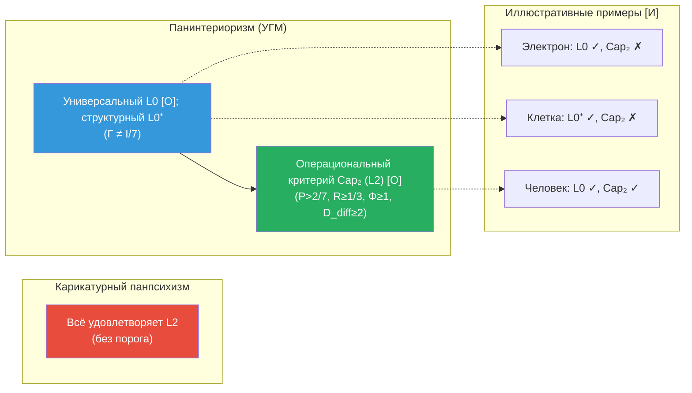
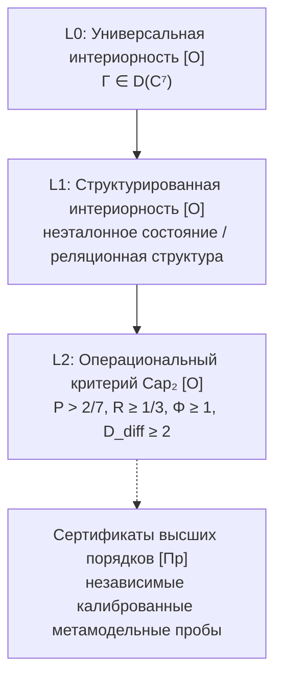

# Панпсихизм: Сравнительный Анализ

:::info Для кого эта глава
Вы узнаете, чем позиция УГМ (панинтериоризм) отличается от классического панпсихизма, расселианского монизма, космопсихизма и сознательного реализма Хоффмана, а также на какие вопросы о проблеме комбинации и проблеме границы конечномерный формализм УГМ отвечает, а какие оставляет открытыми.
:::

:::note О нотации
В этом документе:
- $\Gamma$ — [матрица когерентности](/docs/core/dynamics/coherence-matrix)
- $\varphi$ — [оператор самомоделирования](/docs/proofs/categorical/formalization-phi)
- $C$ — [мера сознательности](/docs/consciousness/foundations/self-observation#мера-сознательности-c)
- $\Phi$ — [мера интеграции](/docs/core/structure/dimension-u#мера-интеграции-φ)
- $R$ — [мера рефлексии](/docs/consciousness/foundations/self-observation#мера-рефлексии-r)
- $\rho_E$ — редуцированная матрица плотности расширенного экспериенциального регистра $\mathcal{H}_E$ ([измерение Интериорности](/docs/core/structure/dimension-e))
- L0, L1, L2 — [иерархия интериорности](/docs/consciousness/hierarchy/interiority-hierarchy) (универсальный L0 [О], операциональный критерий $\mathrm{Cap}_2$ [О], сертификаты высших порядков [Пр])
- $\mathbf{Hol}$ — [категория Голономов](/docs/proofs/categorical/categorical-formalism)
:::

## Страсбургская проблема: откуда берётся сознание? {#страсбургская-проблема}

В 1994 году в Страсбурге, на конференции *Toward a Science of Consciousness*, Дэвид Чалмерс задал вопрос, расколовший науку о сознании на два лагеря: **почему физические процессы сопровождаются субъективным опытом?** Почему не может существовать «зомби» — существо, физически идентичное человеку, но лишённое внутренних переживаний?

Этот вопрос — «трудная проблема сознания» (the hard problem) — породил три стратегии ответа:

1. **Элиминативизм** (Деннет): проблемы нет, субъективный опыт — иллюзия
2. **Эмерджентизм** (IIT, GWT): сознание возникает из сложности
3. **Панпсихизм**: сознание фундаментально — оно **всегда было**

Панпсихизм — самая радикальная и самая древняя из этих стратегий. Его идея предельно проста: если сознание не может возникнуть из несознательной материи (ибо непонятен механизм), значит, сознание — **фундаментальное свойство**, присущее всей материи с самого начала. Электрон обладает массой, зарядом, спином — и, возможно, каким-то элементарным «внутренним опытом».

Привлекательность этой позиции — в обходе трудной проблемы. Если сознание фундаментально, не нужно объяснять, как оно «возникает» из физики. Проблема, однако, смещается: если электрон обладает опытом, как опыт электрона **комбинируется** с опытом других электронов в единый человеческий опыт? Это **проблема комбинации** — главное затруднение панпсихизма.

---

## Определение панпсихизма

**Панпсихизм** (от греч. πᾶν — всё, ψυχή — душа) — метафизический тезис о том, что ментальность, переживание или протоопыт являются фундаментальной и повсеместной чертой физической реальности: по крайней мере некоторые (а в стандартных версиях — все) фундаментальные физические составляющие обладают экспериенциальным или протоэкспериенциальным аспектом.

На обычном языке панпсихизм нередко карикатурируют как утверждение, что «каждый физический объект — каждый камень, стол или термостат — является сознательным субъектом». Современные панпсихисты прямо отвергают эту карикатуру и проводят чёткое различие между фундаментальными составляющими, структурированными агрегатами и полноценными рефлексивными субъектами. Ниже рассмотрены основные варианты и их отношение к УГМ.

---

## Варианты панпсихизма {#варианты-панпсихизма}

### 1. Реалистический монизм / микропсихизм (Strawson) {#элиминативный}

**Гэлен Строусон** (р. 1952, сын философа П.Ф. Строусона) в статье *Realistic Monism: Why Physicalism Entails Panpsychism* (*Journal of Consciousness Studies* 13(10–11): 3–31, 2006) доказывал, что физикалист, признающий реальность опыта, обязан принять *микропсихизм*: «по крайней мере некоторые предельные составляющие (ultimates) внутренне включают опыт», а отвергая радикальную неоднородность на фундаментальном уровне — то и все они. Строусон отвергает радикальный эмерджентизм как непостижимый: по его мнению, переживание не может возникнуть целиком из чисто неэкспериенциальных составляющих.

**Что Строусон в действительности утверждает (и чего не утверждает):** Строусон прямо отвергает тезис, что всякий составной физический объект обладает полноценным рефлексивным сознанием (L2): *«Панпсихизм вовсе не требует считать, что такие вещи, как камни и столы, — субъекты опыта; я ни на минуту в это не верю».* Он не приписывает фундаментальным частицам ни рассуждения, ни рефлексивного самомоделирования и прямо называет проблему комбинации Уильяма Джеймса главным вызовом для своей позиции. (Прежние редакции этой страницы ошибочно называли позицию Строусона «элиминативным панпсихизмом», приписывали ему тезис «всё есть L2» и заявляли формальное опровержение `[Т]` через $\Gamma = I/7$; и эта атрибуция, и заявленное опровержение сняты.)

**Связь с УГМ:** Для максимально смешанного эталонного состояния $\Gamma = I/7$ точная арифметика даёт $P = 1/7$, каноническое $R = 1$, $\Phi = 0$ и выбранный показатель $C = \Phi R = 0$ **[Т]**/**[О]**, так что $I/7$ не проходит операциональный критерий $\mathrm{Cap}_2$ **[О]** (не выполнены пороги $P > 2/7$ и $\Phi \ge 1$). Эта арифметика исключает лишь искусственный тезис «каждое состояние проходит $\mathrm{Cap}_2$»; она не доказывает физического отсутствия опыта без эмпирического феноменального мостика **[И]**/**[Г]** и **не** является опровержением панпсихизма. На фоне действительного тезиса Строусона — универсальный экспериенциальный аспект в основании без приписывания субъектности камням и столам — универсальный L0 УГМ **[О]** с резким операциональным порогом для L2 **[О]** оказывается структурным соседом, а не опровержением **[И]**.

### 2. Конститутивный панпсихизм (в разборе Чалмерса и Гоффа) {#конститутивный}

**Филип Гофф** (р. 1977, Даремский университет) и **Дэвид Чалмерс** (р. 1966, NYU) разработали более утончённую позицию — микро-субъекты (элементарные носители протоопыта) **комбинируются** в макро-сознание, — но ни один из них не придерживается её сам: Чалмерс анализирует конститутивный панпсихизм, не присоединяясь к нему, а Гофф, предложивший для него решение через феноменальное связывание (2016), защищает космопсихизм в книге *Consciousness and Fundamental Reality* (2017); см. [точную постановку проблемы комбинации](#проблема-комбинации-точно). Популярная книга Гоффа *Galileo's Error: Foundations for a New Science of Consciousness* (2019) отстаивает панпсихизм в целом. (Прежние редакции представляли обоих авторов сторонниками этой позиции; эта атрибуция отозвана.)

**Утверждение:** Существуют микро-субъекты, и их комбинация конституирует макро-сознание.

**Проблема комбинации (combination problem):**

Центральная трудность конститутивного панпсихизма состоит в отсутствии общепризнанного структурного закона, объясняющего, как переживания микроуровня складываются в единый макроопыт: опыт целого **не сводится** к простой функции $f(C(X_1), C(X_2))$ изолированных показателей частей. Вы видите красное яблоко — но ваш опыт «красного яблока» не есть простая сумма отдельных микропереживаний. Между индивидуальными протоопытами и единым макроопытом сохраняется открытый объяснительный **разрыв**.

**Подход УГМ к составным состояниям:**

УГМ моделирует составные голономы через **тензорное произведение** пространств состояний:

$$
\mathbb{H}_{1 \otimes 2} := (\Gamma_{12} \in \mathcal{D}(\mathbb{C}^7 \otimes \mathbb{C}^7), \varphi_{12})
$$

где некоррелированные композиты описываются состояниями-произведениями $\Gamma_1 \otimes \Gamma_2$.

:::warning Статус: критерий того, когда, а не объяснение того, как
Даже с корреляцией вместо $\Phi_{12}$ УГМ даёт самое большее **критерий** — проходит ли коррелированный композит, представленный на $\mathcal{D}(\mathbb{C}^7)$, четырёхусловное окно, — и не объясняет **конституцию**: *как именно* микро-переживания объединяются в единое переживание. Это переформулировка проблемы, а не её решение в философском смысле; на что аппарат отвечает и на что нет, разобрано [ниже](#что-отвечает-аппарат-угм).
:::

#### Обнаруживает ли показатель композита корреляции? {#теорема-нередуцируемость}
**Почему она неверна.** У произведения спектр как раз факторизуется: собственные значения $A \otimes B$ — это произведения $\lambda_i \mu_j$, частичные следы возвращают ровно $\Gamma_1$ и $\Gamma_2$, взаимная информация равна нулю — шаг (c) ложен, а в шаге (d) терять нечего. На произведении данные шагов (a) и (b) совпадают (спектр есть произведение спектров, а при невырожденных спектрах собственные векторы — произведения собственных векторов), так что $\mu$ там ничего не теряет. Не служит признаком корреляции и условие $\Phi_{12} > 1$. Если понимать $\Phi_{12}$ как меру интеграции совместной матрицы $49 \times 49$ (другой страница не определяет), то чистота и диагональная чистота на произведениях мультипликативны, и тождество $P = P_{\text{diag}}(1 + \Phi)$ даёт

$$
1 + \Phi(\Gamma_1 \otimes \Gamma_2) = (1 + \Phi_1)(1 + \Phi_2).
$$

Разобранная пара: состояние $\Gamma_w = \tfrac12 \lvert u\rangle\langle u\rvert + \tfrac12 \cdot I/7$ с $u = (1, \ldots, 1)/\sqrt7$ проходит пороги чистоты, рефлексии и интеграции ($P = 5/14$, $R = 2/5$, $\Phi = 3/2$), а две его несвязанные копии имеют $\Phi(\Gamma_w \otimes \Gamma_w) = 21/4$ при $I(1{:}2) = 0$; два голонома с $\Phi_1 = \Phi_2 = 1$ дают ровно $\Phi_{12} = 3$. (Проверено численно на 200 случайных парах состояний $7 \times 7$: тождество выполняется с относительной погрешностью меньше $10^{-15}$, $\lvert I(1{:}2)\rvert \leq 2 \cdot 10^{-15}$; регрессионный тест `test_phi_of_a_product_factorises` в `website/scripts/check_core_numbers.py`.)

**Что вместо неё.**

- **В силе [Т]:** у коррелированного совместного состояния $\rho_{12} \neq \rho_1 \otimes \rho_2$ маргиналы не определяют совместного состояния; информация, которую отбрасывают частичные следы, равна $I(1{:}2) = S(\rho_1) + S(\rho_2) - S(\rho_{12}) = D(\rho_{12} \,\|\, \rho_1 \otimes \rho_2) > 0$ (стандартное тождество квантовой теории информации). При заданной динамике произведения и гамильтоновой связи [CC-7](/docs/applied/coherence-cybernetics/theorems#теорема-93-эмерджентность) **[Т]** устанавливает точный критерий стационарности: произведение стационарных состояний отдельных узлов остаётся стационарным тогда и только тогда, когда оно коммутирует со связью; любое отождествление некоммутирующих или коррелированных композитов с коллективным опытом остаётся эмпирической гипотезой **[Г]**, требующей независимых свидетельств. Корреляция выполняется и для классически коррелированных пар и сама по себе не выделяет интегрированного опыта.
- **Гипотеза [Г]:** феноменальный функтор, продолженный на составные состояния, колакс-моноидален, но не моноидален ровно на коррелированных совместных состояниях. Это не доказано: $F$ определён на $\mathcal{D}(\mathbb{C}^7)$, и чтобы применить его к состоянию на $\mathbb{C}^{7^N}$, сначала нужен канал агрегации, который теория не фиксирует (допущение 1 [ниже](#что-отвечает-аппарат-угм)). Программа исследований [Пр]: зафиксировать этот канал, затем доказать или опровергнуть колакс-свойство.

Для феноменальной интерпретации нужны отображение на композите и проверяемый критерий, при котором два свидетельства относятся к одному субъекту.

:::info Что решено и что остаётся
- **Отозвано [✗]:** «Решено [Т]: эмерджентность как необратимость когерентностной карты $\mu$» и «Решено [Т]: порог эмерджентности $\Phi_{12} = 1$ (T-129a)». Обе строки опирались на теорему, отозванную выше: у произведения двух голономов уровня L2 уже $\Phi_{12} \geq 3$ при $I(1{:}2) = 0$, а T-129a относится к отдельным состояниям на $\mathcal{D}(\mathbb{C}^7)$, не к композитам.
- **В силе [Т]:** у коррелированного композита есть совместное состояние, которое его части не определяют; отброшенная информация равна $I(1{:}2) > 0$ (стандартное тождество). При заданной динамике произведения и гамильтоновой связи CC-7 **[Т]** утверждает, что произведение стационарных состояний узлов остаётся стационарным тогда и только тогда, когда оно коммутирует со связью; коллективное экспериенциальное отождествление остаётся **[Г]**.
- **Открыто [Г]:** колакс-моноидальная переформулировка на коррелированных состояниях — до фиксации канала агрегации.
- **Открыто [Пр]:** конститутивный механизм — *как именно* коррелированный композит **переживается** как единый опыт. Это аналог трудной проблемы: УГМ может самое большее сформулировать *условие*, но не *содержание* объединённого переживания.
:::

### 3. Панпротопсихизм (Chalmers)

**Чалмерс** (2010, *The Character of Consciousness*) предложил смягчённую версию: всё обладает не «опытом», а «прото-ментальными» свойствами — чем-то, что само по себе не является сознанием, но при правильной комбинации порождает его.

**Аналогия:** H₂O. Ни водород, ни кислород по отдельности не мокрые. Но их комбинация — мокрая. «Протомокрость» водорода + «протомокрость» кислорода → мокрость воды. Аналогично: «протоопыт» электрона + «протоопыт» другого электрона + правильная комбинация → человеческий опыт.

**Соответствие в УГМ — уровень L0:**

По [каноническому определению](/docs/consciousness/hierarchy/interiority-hierarchy#уровень-0-интериорность-interiority) **[О]** уровень L0 универсален — всякой системе с $\Gamma \in \mathcal{D}(\mathcal{H})$ приписывается аспект интериорности. То, что описывает панпротопсихизм, концептуально соответствует **структурному** (неэталонному) подклассу состояний, не проходящих операциональный критерий $\mathrm{Cap}_2$ **[И]**:

$$
\mathrm{L0}^{+}(\Gamma) := (\Gamma \neq I/7) \quad \text{(структурная интериорность [О])}
$$

$\mathrm{L0}^{+}$ обозначает выбранный неэталонный подкласс $\Gamma \neq I/7$ **[О]**/**[И]**. Он содержит состояния, как проходящие, так и не проходящие $\mathrm{Cap}_2$; неэталонная структура не влечёт $C = 0$ или отсутствия переживания. Голый L0 и его философское прочтение отделены от операционального критерия.

### 4. Расселианский монизм (Russell, Strawson) {#расселианский}

**Бертран Рассел** в *The Analysis of Matter* (1927) указал на фундаментальный пробел в физике: она описывает только **структурные** свойства материи (массу, заряд, спин), определённые через отношения с другими объектами. Но что наполняет эту структуру **изнутри**? Физика молчит. Рассел предположил, что внутренняя природа материи может быть ментальной или протоментальной.

**Концептуальное соответствие в УГМ [И]:**

| Различение Рассела | Аналог в УГМ | Комментарий |
|--------|-----|-------------|
| Структурные / диспозициональные свойства ($S_{\mathrm{ext}}$) | Гамильтониан $H$, операторы Линдблада $\{L_k\}$ | Реляционная динамика = структура |
| Внутренняя природа ($I_{\mathrm{int}}$) | [Сектор интериорности](/docs/core/structure/dimension-e) (исходная ось $E$; расширенный регистр $\rho_E$, где объявлен) | Интериорность = внутреннее прочтение [И] |

Эта таблица задаёт философское соответствие **[И]**, а не математический функтор между формальными категориями. Среди существующих метафизических позиций расселианский монизм — ближайший структурный аналог [двуаспектного монизма](/docs/consciousness/foundations/two-aspect-monism) УГМ.

---

## Позиция УГМ: Панинтериоризм {#панинтериоризм}

### Определение

УГМ не принимает ни одну из форм панпсихизма. Вместо этого она предлагает **панинтериоризм** — позицию, согласно которой **всякая** система обладает интериорностью (L0 универсален по [каноническому определению](/docs/consciousness/hierarchy/interiority-hierarchy#уровень-0-интериорность-interiority)), всякая система с $\Gamma \neq I/7$ обладает структурной интериорностью (L0⁺), но **не все** обладают сознанием (L2).

:::warning Ключевое различие
УГМ утверждает **панинтериоризм**, а не панпсихизм:

$$
\forall \Gamma \neq I/7 : \mathrm{L0}^{+}(\Gamma) = \mathrm{true}
$$

Но **не**:

$$
\forall \Gamma : \mathrm{L2}(\Gamma) = \mathrm{true}
$$

:::

### Строгое включение $\mathrm{L2} \subsetneq \mathrm{L0}$ по операциональному критерию

$$
\mathrm{L0}(\Gamma) \not\Rightarrow \mathrm{L2}(\Gamma)
$$

**Проверка:**

По каноническому операциональному критерию $\mathrm{Cap}_2$ **[О]** уровень L2 требует $P > 2/7$ **[О]**, $R \geq R_{\text{th}} = 1/3$ **[О]**, $\Phi \geq \Phi_{\text{th}} = 1$ **[О]** (T-129; при этом [T-129a [Т]](/docs/proofs/consciousness/operationalization#t-129a-универсальность) доказывает одностороннюю алгебраическую импликацию $\Phi \ge 1 \Rightarrow P \ge 2/7$) и $D_{\text{diff}} \geq 2$ **[О]** (T-151) ([каноническая иерархия](/docs/consciousness/hierarchy/interiority-hierarchy)).

Для околоэталонной моды $\Gamma_e \approx I/7$ (например, изолированной элементарной моды):

$$
\Phi(\Gamma_e) \ll 1 \quad (\text{а } R(\Gamma_e) = 1/(7P) \approx 1 \text{ — формальный артефакт при } P \approx 1/7)
$$

Следовательно, $\mathrm{L0}(\Gamma_e) = \mathrm{true}$, но $\mathrm{L2}(\Gamma_e) = \mathrm{false}$: не выполнены пороги чистоты и интеграции. Величина $R=1/(7P)$ не меньше $1/7$ и стремится к $1$ вблизи $I/7$. Здесь вычисляется [заданный операциональный критерий](/docs/consciousness/hierarchy/interiority-hierarchy#уровень-0-интериорность-interiority) **[О]**, а не переживание электрона от первого лица. $\blacksquare$

### Канонические уровни интериорности (пересмотренные)

В пересмотренной [Иерархии интериорности](/docs/consciousness/hierarchy/interiority-hierarchy) УГМ различает универсальный L0 **[О]**, невырожденную феноменальную структуру L1 **[О]** и четырёхусловный операциональный критерий $\mathrm{Cap}_2 = (P > 2/7) \land (R \ge 1/3) \land (\Phi \ge 1) \land (D_{\mathrm{diff}} \ge 2)$ для L2 **[О]**. Прежние фиксированные скалярные пороги для L3 и L4 **отозваны [✗]** (см. [T-67 [✗]](/docs/consciousness/hierarchy/interiority-hierarchy), [T-86 [✗]](/docs/consciousness/hierarchy/swallowtail-transitions#l3-l4), [T-136 [✗]](/docs/consciousness/hierarchy/depth-tower#спектральная-формула-sad) и [T-217 [✗]](/docs/consciousness/hierarchy/interiority-hierarchy)); когнитивные сертификаты высших порядков остаются открытой программой исследований **[Пр]**, опирающейся на независимые калиброванные метамодельные пробы, а не на фиксированные скалярные неравенства.

---

## Сознательный реализм Хоффмана {#хоффман}

### Биография и интеллектуальная траектория

**Дональд Д. Хоффман** (р. 1955) — профессор когнитивных наук, философии и логики Калифорнийского университета в Ирвайне (UC Irvine). Начал карьеру с классической психофизики зрительного восприятия: его ранние работы (1980–2000-е) посвящены вычислительному моделированию восприятия формы, цвета и объектов.

Поворотный момент — осознание парадокса: если эволюция формирует восприятие, почему восприятие должно быть **истинным**? Совместно с Четаном Пракашем и Манишем Сингхом Хоффман формализовал этот вопрос в **теореме «Fitness Beats Truth»** (2009–2015), показав через эволюционные игровые модели, что организмы, воспринимающие «интерфейс» (сжатое адаптивное представление), систематически побеждают организмов с «истинным» восприятием.

Из этого результата Хоффман пришёл к радикальной онтологической позиции: пространство-время — не объективная реальность, а **пользовательский интерфейс** сознательных агентов.

:::warning Важная классификация
Хоффман **сам** отвергает ярлык «панпсихист». Его позиция — **объективный идеализм** (Conscious Realism): сознательные агенты — единственная фундаментальная реальность, а физический мир — производная их взаимодействий. Это ближе к Лейбницу (монадология) или Беркли, чем к Строусону или Гоффу.
:::

### Теорема «Fitness Beats Truth» (FBT) {#fbt}

**Утверждение** (Hoffman, Singh, Prakash 2015; формальное комбинаторное доказательство в Prakash et al. 2021): В конечных эволюционных играх при **равномерном априорном распределении по всем функциям выигрыша** на конечном пространстве состояний мира $W$ организмы со стратегией «интерфейс» (сжатие многие-к-одному, настроенное под выигрыш) асимптотически побеждают организмов со строго веридическим («истинным») восприятием (инъективные/гомоморфные отображения $W \to X$) по мере роста числа состояний мира.

**Простым языком.** Вообразите два организма в лесу. Первый видит мир «как есть» — различает 1000 оттенков зелёного у листвы. Второй сжимает: все съедобные — зелёные, все ядовитые — красные. При фиксированной однозадачной функции выигрыша, выбранной без структурной корреляции с физической геометрией, второй быстрее принимает решения и тратит меньше ресурсов на вычисление. Хоффман экстраполирует из этого, что восприятие пространства-времени является адаптивным интерфейсом, а не картой реальности — философский шаг, требующий допущений значительно сильнее самой комбинаторной теоремы (см. [область применимости ниже](#преимущества-хоффмана)).

:::note Связь с КК
КК допускает аналогичную интерпретацию [И]: восприятие агентом $\mathbb{H}$ своей среды $E$ опосредовано [функтором $F$](/docs/proofs/categorical/categorical-formalism#3-функтор-f-на-объектах), который не обязан быть точным — достаточно функциональной адекватности. Но КК не постулирует иллюзорность пространства-времени: оно [эмерджентно](/docs/core/foundations/spacetime), а не интерфейсно.
:::

### Полный формализм: сознательный агент

**Определение (Hoffman, Prakash 2014).** Сознательный агент (CA) — это шестёрка:

$$
C = (X, G, A, W, D, N)
$$

| Компонент | Описание | Пример |
|-----------|----------|--------|
| $X$ (опыт) | Все возможные переживания агента | Цвета, звуки, эмоции |
| $G$ (действия) | Все доступные действия | Движения, решения |
| $A: G \times W \to W$ | Действие $g$ в мире $w$ → новое состояние мира | Нажатие кнопки меняет экран |
| $W$ (мир) | Состояния мира (может быть другим агентом!) | Окружающая среда |
| $D: X \times G \to G$ | Переживание → решение (выбор действия) | Видишь опасность → бежишь |
| $N: W \times X \to X$ | Состояние мира → переживание | Фотоны → «красное» |

Ключевая идея: $W$ не обязан быть «физическим миром». Для двух агентов $C_1$ и $C_2$ миром каждого является **другой агент**. Физическое пространство-время — **эмерджентный интерфейс** сети взаимодействующих агентов.

### Композиция сознательных агентов {#композиция-ca}

**Теорема замыкания** (Hoffman, Prakash 2014): Для любых двух CA $C_1$ и $C_2$ их взаимодействие образует нового CA: $C_1 \otimes C_2 = C_{12}$.

Это означает, что **ConsAgents** — моноидальная категория. Хоффман интерпретирует это как принцип «сознательные агенты — всё, что есть».

:::note Параллель с КК
Пересмотренная [теорема КК о композиции](/docs/applied/coherence-cybernetics/theorems#теорема-91-фрактальное-замыкание) даёт условное сохранение для заданных устойчивых систем и согласованных считываний. Она не выводит универсально жизнеспособного/единственного агрегата или феноменальной комбинации. Тождество тензорного показателя выполняется и для несвязанных состояний и не задаёт этот мостик.
:::

### Позиция КК: панинтериоризм vs объективный идеализм {#панинтериоризм-vs-идеализм}

Хоффман и КК расходятся в ключевом онтологическом вопросе:

| | Хоффман (Conscious Realism) | КК (Панинтериоризм) |
|---|---|---|
| **Что фундаментально?** | Только сознательные агенты | Голономы $\mathbb{H}$ (универсальный L0 [О], операциональный критерий L2 [О], сертификаты высших порядков [Пр]) |
| **Есть ли несознательная реальность?** | Нет — всё сводится к CA | Да — L0 (интериорность) без прохождения $\mathrm{Cap}_2$ (L2) |
| **Отношение L0 и L2** | L0 = L2 (всё сознательно) | $\mathrm{L0} \supsetneq \mathrm{L2}$ по операциональному критерию [О] |
| **Физический мир** | Интерфейс (идеализм) | Эмерджентен (реален, структурно моделируется) |
| **Порог сознания** | Нет порога (всё — CA) | $\mathrm{Cap}_2$: $P > 2/7 \wedge R \geq 1/3 \wedge \Phi \geq 1 \wedge D_{\mathrm{diff}} \geq 2$ [О] |
| **Динамика** | Цикл $N \to D \to A$ (дискретный) | $\dot\Gamma = \mathcal{L}_\Omega[\Gamma]$ (непрерывная) |
| **Фальсифицируемость** | Низкая (нет количественных предсказаний) | Перспективные проверяемые предсказания [Пр]/[Г] |

### Структурное соответствие с сознательными агентами Хоффмана [И] {#функтор-хоффман}

Неформальное покомпонентное соответствие между сознательными агентами (CA) Хоффмана и элементами КК:

| Компонент CA | Неформальный аналог в КК |
|--------------|-------------------|
| $X$ (опыт) | [Экспериенциальное пространство](/docs/proofs/categorical/categorical-formalism#2-категория-exp) |
| $G$ (действия) | Пространство CPTP-каналов $\{\Psi\}$ |
| $N$ (восприятие) | [Функтор $F$](/docs/proofs/categorical/categorical-formalism#3-функтор-f-на-объектах) |
| $D$ (решение) | [Оператор $\varphi$](/docs/proofs/categorical/formalization-phi) |
| $A$ (действие) | [Регенеративный член](/docs/core/dynamics/evolution#3-регенеративный-член) $\mathcal{R}[\Gamma, E]$ |
| $W$ (мир) | Окружение $E$ в $\mathbb{H}$ |

:::info Статус [И] / [Пр]
Эта таблица представляет собой **неформальную интерпретационную аналогию [И]**, а не построенный функтор: отображение морфизмов, аксиомы функториальности и моноидальная совместимость между явно заданными категориями не установлены. Формализация функтора между $\mathbf{Hol}$ и $\mathbf{ConsAgents}$ остаётся недоказанной открытой программой исследований **[Пр]**.
:::

### Что Хоффман делает лучше КК {#преимущества-хоффмана}

1. **Эволюционная эпистемология (с указанием области применимости).** Теорема FBT (Hoffman, Singh & Prakash 2015; формальное доказательство в Prakash et al. 2021) является корректным комбинаторно-вероятностным результатом **при её явных допущениях** — прежде всего равномерном распределении по всем функциям выигрыша на конечном пространстве состояний и фиксированной однозадачной функции полезности. Её эмпирическая применимость к биологическому восприятию широко оспаривается (экологические выигрыши физически структурированы и гладки, а не равномерно случайны, а многозадачное обобщение при меняющихся целях поощряет восстановление латентной структуры мира), и сама теорема не влечёт онтологического идеализма или иллюзорности пространства-времени. Тем не менее даже при этом ограничении области применимости программа Хоффмана явно формализует компромисс между отбором и перцептивным сжатием, тогда как в КК аналогичного эволюционно-игрового результата нет.

2. **Доступность изложения.** «The Case Against Reality» (2019) — бестселлер; TED-talk с 3M+ просмотров. КК пока доступна только специалистам.

3. **Радикальность вопроса.** Хоффман ставит вопрос «что, если пространство-время — не реальность?» с максимальной остротой.

4. **Математическая элегантность.** Шестикомпонентная CA — минимальна и удобна для комбинаторики.

---

## Прецеденты и родственные программы: комбинация, границы, космопсихизм, идеализм {#прецеденты-и-родственные-программы}

Этот раздел сопоставляет панинтериоризм УГМ с литературой, которую страница до сих пор не цитировала: с проблемой комбинации в её нынешней постановке, с проблемой границы, с космопсихизмом и с аналитическим идеализмом. Для каждой темы названы источники, ведущие предложения и их статус, а затем — с пометкой интерпретации [И] — то, на что действительно отвечают результаты УГМ о составных системах, и допущения, на которых держится этот ответ.

### Место панинтериоризма в словаре поля {#место-панинтериоризма}

Поле сейчас работает с определениями Дэвида Чалмерса (Chalmers D. J., "The combination problem for panpsychism", в кн.: Brüntrup G., Jaskolla L. (eds.), *Panpsychism: Contemporary Perspectives*, Oxford University Press, 2016, pp. 179–214). *Панпсихизм*: некоторые фундаментальные физические сущности обладают сознательным опытом. *Панпротопсихизм*: фундаментальные физические сущности обладают протофеноменальными свойствами — «особыми свойствами, которые сами не феноменальны (обладание ими ничем не „ощущается“), но в совокупности могут конституировать феноменальные свойства». *Конститутивные* взгляды обосновывают макроопыт микроуровнем; *эмерджентные* допускают, что он возникает как нечто новое по контингентным законам.

По собственному определению иерархии интериорности, [L0](/docs/consciousness/hierarchy/interiority-hierarchy#уровень-0-интериорность-interiority) — «не „сознание“ и не „опыт“ в обычном смысле», а «математическое свойство объекта», а структура на [L1](/docs/consciousness/hierarchy/interiority-hierarchy#уровень-1-феноменальная-геометрия-phenomenal-geometry) «ещё не осознаётся»; «осознание появляется только на L2» — через рефлексию и интеграцию. В словаре Чалмерса это конститутивный панпротопсихизм со структурно-функциональным объяснением осознания [И] — форма панквалитизма Сэма Коулмана (качества без субъектов в основании, осознание, конституированное функционально), который Чалмерс разбирает среди комбинаторных вариантов. Отсюда три следствия.

1. Противопоставление, проведённое выше, — «панпсихизм = L2 для всех», — не есть противопоставление с полем: ни один современный панпсихист не приписывает электронам рефлексию (см. [поправку в §1](#элиминативный)). В силе остаётся другое отличие — резкий порог УГМ.
2. Проблема комбинации, которая касается УГМ, — это проблема панпротопсихизма: как нефеноменальная структура конституирует опыт. Чалмерс показывает, что у неё есть собственный разрыв — между нефеноменальным и феноменальным, — сверх уже известных.
3. Прежние редакции другой страницы корпуса называли ту же позицию «эмерджентизмом с точным порогом» и утверждали, что «проблема комбинации не возникает» ([Философские основания КК](/docs/applied/coherence-cybernetics/philosophy#онтология)). У двух прочтений разные трудности: панпротопсихизм упирается в только что названный разрыв; эмерджентизм избегает проблемы комбинации, но, по анализу Чалмерса, вынужден считать свой порог контингентным психофизическим законом и сталкивается с проблемой ментальной причинности. Корпус утверждал оба прочтения; с 2026-09-25 он держится одного — панпротопсихического прочтения этого раздела, при котором пороги говорят, *когда* система является субъектом уровня L2, а не *как* её структура становится опытом [И], — а эмерджентистская формулировка отозвана на той странице и в упражнениях, как и заявление о решении в [Теориях сознания, §24](/docs/consciousness/comparative/consciousness-theories#russellian), в обзоре раздела и в [доказательствах иерархии интериорности](/docs/proofs/consciousness/interiority-hierarchy) (§5.1).

### Проблема комбинации в точной постановке {#проблема-комбинации-точно}

Проблему поставил Уильям Джеймс (*The Principles of Psychology*, 1890, т. 1, гл. 6): «Возьмите фразу из дюжины слов, возьмите двенадцать человек и скажите каждому по одному слову. Затем поставьте их в ряд или соберите в кучу, и пусть каждый думает о своём слове сколь угодно сосредоточенно; нигде не возникнет сознания всей фразы». Название дал ей Уильям Сигер (Seager W., "Consciousness, information and panpsychism", *Journal of Consciousness Studies* 2(3): 272–288, 1995). Статья «Панпсихизм» Стэнфордской философской энциклопедии (Филип Гофф, Уильям Сигер и Шон Аллен-Херманссон, редакция 2022 года) фиксирует согласие: «И сторонники, и противники в целом согласны, что самая трудная проблема панпсихизма — та, что получила название „проблемы комбинации“».

Чалмерс (2016) делит проблему на три подпроблемы и ряд дополнительных аспектов и настаивает, что решение обязано покрыть их все:

| Подпроблема | Вопрос | Самая острая форма |
|---|---|---|
| Комбинация субъектов | Как микросубъекты складываются в макросубъекта? | *Суммирование субъектов*: для любой группы субъектов и любого ещё одного субъекта группа, по-видимому, может существовать без него |
| Комбинация качеств | Как из микрокачеств получаются макрокачества? | *Палитра*: горстка фундаментальных качеств против огромного разнообразия переживаемых |
| Комбинация структуры | Как из микроструктуры получается структура опыта? | *Структурное несоответствие*: структура опыта не похожа на физическую структуру мозга |
| Дополнительные аспекты | Единство, граница (Розенберг 1998), осознание, зернистость | Почему одно ограниченное, однородное, осознаваемое поле, а не рваный набор микропереживаний |

Двое авторов превратили проблему субъектов в выбор. Сэм Коулман (Coleman S., "The real combination problem: panpsychism, micro-subjects, and emergence", *Erkenntnis* 79(1): 19–44, 2014) доказывает, что «субъекты не могут комбинироваться»: точка зрения каждого субъекта исключает точки зрения остальных, поэтому слияние микросубъектов могло бы дать лишь нового, эмерджентного макросубъекта — что лишает панпсихизм его мотива; он советует отказаться от микросубъектов и оставить в основании качества без субъектов. Филип Гофф (Goff P., *Consciousness and Fundamental Reality*, Oxford University Press, 2017) выводит из той же проблемы несостоятельность микропсихизма и защищает космопсихизм с «обоснованием через включение» (grounding by subsumption; см. ниже); рецензия Дэниела Столджара (*Notre Dame Philosophical Reviews*, 2018.02.09) отвечает, что в интересующих нас случаях «обоснование и есть обоснование через анализ», так что включение выхода не даёт. Прежние редакции подраздела 2 выше представляли Гоффа и Чалмерса защитниками конститутивного панпсихизма микроуровня; ни тот, ни другой им не является (теперь подраздел говорит об этом): взвешенная позиция Гоффа в *Consciousness and Fundamental Reality* — космопсихизм, а Чалмерс анализирует конститутивный панпсихизм, не присоединяясь к нему.

### Ведущие предложения и их статус {#предложения-и-их-статус}

| Предложение | Кто | Что оно делает | Статус и чьё это суждение |
|---|---|---|---|
| Эмерджентный панпсихизм: макросубъекты возникают по новым законам | Грегг Розенберг (*A Place for Consciousness*, OUP 2004); теория интегрированной информации, прочитанная как такой закон | Избегает комбинации, делая макросубъектов фундаментальными | Платит ментальной причинностью и контингентными законами (Чалмерс 2016, который так же читает и IIT); энциклопедия называет взгляд Розенберга «формой многоуровневого эмерджентизма» |
| Феноменальное связывание | Гофф, "The phenomenal bonding solution to the combination problem" (в кн.: Brüntrup, Jaskolla 2016, pp. 283–302) | Феноменальное отношение между микросубъектами, например со-сознание, конституирует нового субъекта | «Один из наиболее многообещающих подходов», но с трудом избегает и единого вселенского субъекта, и раздробленных субъектов (Чалмерс 2016) |
| Квантовый холизм, комбинаторное «вливание» | Сигер, "Panpsychism, aggregation and combinatorial infusion", *Mind and Matter* 8(2): 167–184 (2010); Родольфо Гамбини и Хорхе Пуллин, *Mind and Matter* 22(1): 51–94 (2024) и *J. Consciousness Studies* 32(7): 7–32 (2025) | Запутанное целое — новая фундаментальная сущность; допущения о супервентности, на которых стоит проблема комбинации, на квантовом уровне не выполняются: пространство совместных состояний растёт экспоненциально | Заслуживает пристального рассмотрения, но «не похоже, чтобы существовала устойчивая запутанность на уровне мозга, которая для этого нужна», и остаётся опасение структурного несоответствия (Чалмерс 2016) |
| Панквалитизм с функциональным осознанием | Коулман (2012, 2014) | Качества без субъектов в основании; осознание конституируется функционально | Уязвим для разрыва между качеством и осознанием: качества без осознания остаются мыслимыми (Чалмерс 2016) |
| Формальное замыкание композиции | Hoffman D. D., Prakash C., "Objects of consciousness", *Frontiers in Psychology* 5: 577 (2014) | Теоремы: соединение двух сознательных агентов — сознательный агент | Доказано построением внутри сознательного реализма (Хоффман и Пракаш 2014); замкнутость формализма, а не сама по себе новый субъект [И] |
| Космопсихизм | Итай Шани (2015); Юдзин Нагасава и Кхай Уэйджер (2016); Гофф (2017) | Космос — единственный фундаментальный субъект; индивидуальные субъекты производны от него | Меняет комбинацию на обратную задачу, которая, по оценке Чалмерса (2016), кажется «столь же трудной, как исходная проблема комбинации» — [ниже](#космопсихизм) |

Общий статус, по оценке Чалмерса (2016): «Справедливо сказать, что ни одно из предложенных решений пока не получило широкой поддержки». Его вывод называет направления, которые больше всего стоит исследовать, — феноменальное связывание или квантовый холизм для субъектов, малые палитры для качеств, «принципы информационной композиции» для структуры и несколько дефляционное понимание осознания, — и добавляет, что совсем не ясно, могут ли они работать вместе.

### На что отвечает аппарат УГМ и что он оставляет открытым {#что-отвечает-аппарат-угм}

Конечномерный [аппарат составных систем](/docs/core/dynamics/composite-systems) задаёт совместные состояния в $D_{7^k}$ и CPTP-карты маргинализации/считывания. У произведения нет взаимной информации; сепарабельная смесь может быть коррелированной. Маргинали в общем случае не определяют совместного состояния **[Т]**. Эти факты различают виды корреляций, но не идентифицируют субъекта.

Сохранение при слабой связи условно: нужны устойчивое несвязанное равновесие, соответствующие предпосылки гиперболичности/сжатия, строгий запас по выбранному критерию и согласованное считывание. Одна жизнеспособность частей не доказывает жизнеспособности любого среднего агрегата или внутренней границы композита. Среднее маргиналей — одно симметричное CPTP-считывание после отождествления реперов подсистем; прежние безусловные выводы единственности и жизнеспособности отозваны. См. пересмотренные [результаты КК о композиции](/docs/applied/coherence-cybernetics/theorems#теорема-91-фрактальное-замыкание).

- **Комбинация субъектов.** Калиброванный сертификат $\mathrm{Cap}_2$ проверяет заданное семимерное считывание и переменную дифференциации. Интерпретация операционального критерия как переживания требует феноменального мостика **[И]**/**[Г]**. Определение T-153 **[О]** не опровергает возражение представимости. Универсальный запрет внутреннего мостика T-214 **[✗]** отозван: предпосылки оценщика Ловера не выполняются для произвольной внутренней карты.
- **Комбинация качеств и структуры.** Карта $D_{7^k}\to D_7$, её репер и феноменальное назначение задаются и калибруются. CPTP-считывание не увеличивает хордовое расстояние Бюреса и может отбрасывать совместную информацию. Семимодовый анзац не доказывает верного представления зрительного поля или любого субстрата. Точное восстановление T-253 относится к выбранному изометрическому коду, а не ко всем состояниям субстрата.
- **Единство.** Если заданная категория имеет терминальный объект, её нерв стягиваем; обычные когомологии этого нерва с постоянными коэффициентами в положительных степенях обращаются в ноль. Это утверждение о классифицирующем пространстве, а не обо всех внутренних/пучковых когомологиях, любой локальной системе коэффициентов или всех самомоделях. Для склейки нужны спуск и заданный класс препятствия. Граница субъекта из стягиваемости нерва не следует.

Теории композита нужны три дополнительных выбора **[О]**/**[Г]**: физическая группировка и эффективное считывание; правило вложенных или конкурирующих кандидатов в субъекты; феноменальный мостик. Увеличенный тензорный показатель их не выбирает: он может превосходить оба показателя частей даже для некоррелированного произведения, при неизменной маргинали пользователя. Проблема комбинации проверяет эти дополнительные конструкции, а не решается одной тензорной алгеброй.

### Проблема границы {#проблема-границы}

Проблема границы спрашивает, что задаёт края переживающего субъекта: почему мой опыт кончается на мне — не на каждом моём нейроне и не на мне вместе с моей комнатой. Её поставил Грегг Розенберг (Rosenberg G., "The boundary problem for phenomenal individuals", в кн.: Hameroff S. R., Kaszniak A. W., Scott A. C. (eds.), *Toward a Science of Consciousness II*, MIT Press, 1998) и развил в книге *A Place for Consciousness: Probing the Deep Structure of the Natural World* (Oxford University Press, 2004). Андрес Гомес-Эмильссон и Крис Перси сформулировали её одной строкой: «Если вы предложили механизм связывания, который создаёт более крупные, единые макро-1PP, то какой механизм останавливает этот процесс?» (1PP — перспектива первого лица).

- **Ответ самого Розенберга.** «Естественные индивиды» высших уровней возникают из низших, а опыт привязан к его «несущей» (carrier) теории причинности — это «форма многоуровневого эмерджентизма, согласно которой человеческие умы сосуществуют с микросубъектами сознания, порождающими их» (энциклопедия, статья «Панпсихизм», 2022). Чалмерс (2016) относит её к эмерджентному панпсихизму, в котором индивиды высших уровней оказывают небольшое нисходящее причинное действие.
- **Фекете, ван Леувен и Эдельман.** Томер Фекете, Кес ван Леувен и Шимон Эдельман (Fekete T., van Leeuwen C., Edelman S., "System, subsystem, hive: boundary problems in computational theories of consciousness", *Frontiers in Psychology* 7: 1041, 2016) показывают: любая градуированная мера сознания, признающая систему сознательной, признаёт сознательными и большинство её подсистем, и её «несущественно расширенные» версии, и группы индивидов — то есть либо измеряет нечто эпифеноменальное, либо влечёт «причудливое размножение умов», — если только она не опирается на внутренние, «системные» свойства, отделяющие системы, чьё существование есть факт, от систем, чьё существование есть интерпретация.
- **Теория интегрированной информации: исключение.** Опыт «определён»; сознательный комплекс — это множество элементов с максимальной интегрированной информацией, а «перекрывающиеся субстраты, задающие меньше интегрированной информации, исключаются» (Albantakis L. et al., "Integrated information theory (IIT) 4.0", *PLoS Computational Biology* 19(10): e1011465, 2023). Джулио Тонони и Кристоф Кох выводят следствие для групп: двое разговаривающих людей образуют интегрированную систему, но её интегрированная информация ниже, чем у каждого мозга, поэтому «должно быть два отдельных опыта, но никакой вышестоящей сознательной сущности» (препринт arXiv:1405.7089; опубликован как "Consciousness: here, there and everywhere?", *Philosophical Transactions of the Royal Society B* 370: 20140167, 2015). Чалмерс (2016, в примечании) возражает, что такое правило делает сознание внешним свойством: внутренне тождественные системы могут быть сознательными или нет в зависимости от окружения.
- **Топология электромагнитного поля.** Гомес-Эмильссон и Перси (Gómez-Emilsson A., Percy C., "Don't forget the boundary problem! How EM field topology can address the overlooked cousin to the binding problem for consciousness", *Frontiers in Human Neuroscience* 17: 1233119, 2023) предлагают считать, что топологически замкнутые «карманы» электромагнитного поля мозга дают не зависящие от наблюдателя жёсткие границы, и намечают трёхэтапную эмпирическую проверку. Заброшенность проблемы они документируют: поиск в Scopus нашёл 5 статей со словами «boundary problem» против 92 со словами «binding problem».

УГМ и проблема границы [И]:

1. **Вложенные кандидаты [Г].** Без правила исключения/границы несколько группировок могут проходить выбранный операциональный критерий. Это нерешённая задача отбора, а не доказательство переживания у каждой группировки.
2. **Считывание и сектор.** Пересмотренный T-253 допускает точное CPTP-восстановление на заданном изометрическом коде; он не даёт верного сжатия всех состояний произвольного большого субстрата в $D_7$. Разные допустимые секторы/реперы могут давать разные $\Gamma$ и канонические $\Phi$. Калиброванный внутренний выбор сектора и динамика остаются частью эмпирического мостика.
3. **Терминальный объект.** В CPTP-категории всех размерностей терминален одномерный тензорный элемент с картой отбрасывания. Это не семимерная матрица $I/7$. Назначение выбранного семимерного эталона терминальной точке другой реализации — дополнительные данные **[О]**. Стягиваемость нерва не вынуждает $C=0$ у физической Вселенной и не задаёт локальных границ субъектов.
4. **Что можно проверить.** После задания физической группировки, репера, идентифицируемого оценщика состояния, переменной дифференциации и временного протокола можно проверять сертификат $\mathrm{Cap}_2$. Феноменальность и индивидуализация субъекта требуют отдельно заданного мостика и свидетельств.

### Космопсихизм {#космопсихизм}

Космопсихизм обращает направление объяснения: космос как целое — единственный фундаментальный сознательный субъект, а индивидуальные умы производны от него. Для УГМ это важно потому, что и у неё на вершине формализма есть «единое» — терминальный объект, — и потому, что космопсихизм — главная альтернатива для всех, кто считает комбинацию снизу безнадёжной.

- **Источники.** Shani I., "Cosmopsychism: a holistic approach to the metaphysics of experience", *Philosophical Papers* 44(3): 389–437 (2015): всепроникающее космическое сознание — единственная онтологическая первооснова и почва, из которой возникают индивидуальные сознательные существа. Nagasawa Y., Wager K., "Panpsychism and priority cosmopsychism", в кн.: Brüntrup, Jaskolla (2016), pp. 113–129: космос — единственная базовая сознательная сущность, первичная по отношению к своим частям, по образцу приоритетного монизма Джонатана Шаффера (Schaffer J., "Monism: the priority of the whole", *Philosophical Review* 119(1): 31–76, 2010), который из квантовой запутанности выводит, что космос — единственный фундаментальный объект. Гофф (2017): космопсихизм с обоснованием через включение.
- **Статус.** Энциклопедия (2022) называет этих авторов среди тех, кого «привлекает космопсихизм, поскольку он лучше, чем микропсихизм, приспособлен к проблеме комбинации». Цена — обратная задача. Чалмерс (2016) назвал её проблемой декомпозиции — «как единый субъект порождает многих зависимых субъектов?» — и счёл, что такие проблемы «кажутся столь же трудными, как исходная проблема комбинации»; позднее, переименовав её в «проблему конституции», он оценил её как «очень серьёзную», находя при этом некоторые космические пути «более многообещающими, чем их аналоги в случае микропсихизма» (Chalmers D. J., "Idealism and the mind-body problem", в кн.: Seager W. (ed.), *The Routledge Handbook of Panpsychism*, Routledge, 2020, pp. 353–373).
- **УГМ [И]/[Г].** Терминальность — свойство заданной математической категории, а не отождествление космоса с $I/7$ или доказательство отсутствия опыта у Вселенной. Реализация Вселенной как голонома требует собственного физического пространства состояний, эффективной карты, часов, взаимодействий и граничных условий. В пересмотренном [T-266](/docs/physics/gravity/cosmological-constant#теорема-стадия-вселенной) **[Г]** назначение космической чистоты $P=3/7$, считывание Вселенной как голонома и экстраполяция терминальной стадии являются независимыми физическими гипотезами **[Г]**, а не измеренной стадией или универсальной космической теоремой. График чистоты или предполагаемая траектория не доказывают рождения, распада или феноменального угасания. Универсальный потолок глубины самореференции три отозван (T-136 **[✗]**, T-217 **[✗]**; T-218 **[Т для Sing-реализации]** не даёт универсального 3-усечения); вложенность и фибрантность Кана не определяют космической когнитивной глубины. УГМ может выбирать философскую позицию о космопсихизме, но конечный матричный формализм её не решает. Сам факт неопределённости совместных корреляций по маргиналям не даёт критерия субъекта.

### Аналитический идеализм {#аналитический-идеализм}

Аналитический идеализм — взгляд Бернардо Каструпа — утверждает, что существует только космическое сознание, а индивидуальные умы — его отщепившиеся части. Для УГМ это важно потому, что здесь единственный в этом разделе механизм границ субъекта, у которого есть клиническая модель, и потому, что у УГМ есть формальный аналог этого механизма.

- **Источник.** Kastrup B., "The universe in consciousness", *Journal of Consciousness Studies* 25(5–6): 125–155 (2018).
- **Содержание.** «Существует только космическое сознание. Мы, как и все другие живые организмы, — лишь диссоциированные альтеры космического сознания, окружённые его мыслями. Неживой мир вокруг нас — внешнее проявление этих мыслей. Живые организмы, с которыми мы делим мир, — внешние проявления других диссоциированных альтеров». Модель — диссоциативное расстройство идентичности: альтер — область психических содержаний, отрезанная от остальных диссоциацией, и этот разрез и есть граница субъекта. Каструп утверждает, что взгляд избегает трудной проблемы, проблемы комбинации и проблемы декомбинации.
- **Статус.** Позиция меньшинства. Чалмерс (2020, см. выше) находит космопсихизм тождества с такой раздробленностью «последовательным взглядом, который стоит принимать всерьёз», но массивно ревизионистским: «Он делает нас патологическими субъектами, которые совершенно не осведомлены о подавляющем большинстве переживаемого ими опыта», что «влечёт массовый провал интроспекции». Его вердикт об идеализме в целом: неправдоподобен, но «не значительно менее правдоподобен, чем его главные конкуренты».
- **УГМ [И].** Формальный аналог диссоциации — ограничение: самомодель индивида действует на его редуцированное состояние и не может достать до когерентностей, присутствующих только в совместном состоянии ([коллективное бессознательное, свойство 1](/docs/consciousness/subjects/collective-consciousness#определение-коллективного-бессознательного)). Различия — по существу. УГМ не постулирует космического субъекта; «внешнее проявление» в ней — внешняя сторона каждой $\Gamma$, а не проявление мыслей космического ума; а ограничение — нормальное отношение части к целому, а не патология. Каструп даёт границам механизм; частичный след УГМ описывает приватность, но не говорит, какие подсистемы являются субъектами.

### Сводка {#сводка-прецедентов}

| Проблема | Статус в литературе (чьё суждение) | Элемент УГМ | На что отвечает [И] | Что остаётся открытым |
|---|---|---|---|---|
| Комбинация субъектов | Открыта в литературе | Условная динамика композита; операциональное определение T-153 [О] | Проверяет заданную группировку/считывание | Феноменальная конституция и выбор границ; универсальный запрет T-214 [✗] отозван |
| Комбинация качеств | Открыта (Чалмерс 2016) | Феноменальный функтор на $\mathcal{D}(\mathbb{C}^7)$; восстановление среднего маргинала при согласованной агрегации и контролируемой слабой связи (CC-6 [Т]) | Пока ни на что | Какое состояние несёт содержание композита; агрегация только теряет различимость |
| Комбинация структуры | Открыта; аргумент о несоответствии — «серьёзный вызов» (Чалмерс 2016) | Стратифицированные условия существования субстрата C1–C3 (T-153a [Т] для необходимых условий; достаточность через изометрическую ретракцию T-253 [Т]/[С]) | Необходимые условия и изометрическое кодовое вложение | Даёт ли вложенный 7D-сектор структуру опыта |
| Несводимость целого | Стандартна для коррелированных состояний; для панпсихизма её отстаивали Сигер (2010), Гамбини и Пуллин (2024–2025) | Стандартное тождество взаимной информации; CC-7 [Т] (произведение стационарных состояний узлов стационарно тогда и только тогда, когда коммутирует со связью) | Совместное состояние не определяется частями | Верно для любой коррелированной пары; коллективное экспериенциальное отождествление остаётся [Г] |
| Граница | Заброшена (5 статей против 92, Гомес-Эмильссон и Перси 2023); IIT отвечает правилом исключения | Нет; вложенные субъекты допущены | Вычислимая проверка после выбора сектора | Выбор сектора и агрегации; размножение умов |
| Декомпозиция (космопсихизм, идеализм) | Открыта | Результат о терминальном нерве заданной категории; космическая реализация [Г] | Условная формальная конструкция | Космическая феноменальность, сектор и границы; нет отождествления с $I/7$ или универсального потолка глубины |

---

## Сравнительная таблица вариантов панпсихизма

| Вариант | Автор | Год | Утверждение | Соответствие в УГМ | Главная проблема |
|---------|-------|-----|-------------|-------------------|-----------------|
| Реалистический монизм / микропсихизм | Строусон | 2006 | У каждой предельной составляющей есть переживаемый аспект; камни и столы — не субъекты ([§1](#элиминативный)) | Универсальный L0 — близкий родственник [И] | Проблема комбинации, которую Строусон признаёт |
| Конститутивный микропсихизм | Разбирает Чалмерс; феноменальное связывание предложил Гофф — ни тот, ни другой не защищает его как свой взгляд ([§2](#конститутивный)) | 2016 | Микро-субъекты комбинируются | $\mathbb{H}_1 \otimes \mathbb{H}_2$; критерий стационарности/корреляции (CC-7) не является феноменальной конституцией [И] | Проблема комбинации (переформулирована, не решена) |
| Панпротопсихизм | Чалмерс | 2010 | Прото-ментальные свойства | L0 — интериорность | Нет механизма перехода L0→L2 |
| Расселианский | Рассел, Чалмерс, Гофф | 1927/2010 | Интринсик + структура | Сектор интериорности ($\rho_E$, где расширен) + $(H, \{L_k\})$ [И] | Нет динамики |
| Объективный идеализм | Хоффман | 2014 | Только CA, физика — интерфейс | Покомпонентная аналогия [И] | Нет порогов, низкая фальсифицируемость |
| Космопсихизм | Шани; Нагасава и Уэйджер; Гофф | 2015–2017 | Космос — единственный фундаментальный субъект | Терминальный объект $T$ — не субъект [И] | Проблема декомпозиции («конституции») |
| Аналитический идеализм | Каструп | 2018 | Только космическое сознание; мы — его диссоциированные альтеры | Частичный след как ограничение [И] | Массивно ревизионистский взгляд на интроспекцию (Чалмерс 2020) |
| **Панинтериоризм (УГМ)** | — | — | Всё имеет L0 [О], не всё проходит $\mathrm{Cap}_2$ (L2) [О] | $\mathrm{L0} \supsetneq \mathrm{L2}$ | Интериорность — примитив; не объясняет, *почему* она существует |

---

**Связанные документы:**
- [Когнитом Анохина](./cognitome-anokhin) — нейронная гиперсеть и проблема «Кто»
- [Теории сознания](./consciousness-theories) — IIT, FEP, автопоэзис и 30+ теорий
- [Когнитивная иерархия](./cognitive-hierarchy) — уровни K1-K5
- [Общая теория систем](./general-systems-theory) — от Берталанфи к КК
- [Иерархия интериорности](/docs/consciousness/hierarchy/interiority-hierarchy) — уровни L0→L4
- [Двуаспектный монизм](/docs/consciousness/foundations/two-aspect-monism) — онтология УГМ
- [Теоремы](/docs/applied/coherence-cybernetics/theorems) — эмерджентность, композиция
- [Категорный формализм](/docs/proofs/categorical/categorical-formalism) — категория $\mathbf{Hol}$, функтор $F$
- [Формализация φ](/docs/proofs/categorical/formalization-phi) — CPTP-каналы
- [Глоссарий](/docs/reference/glossary#связанные-теории) — сознательный реализм
- [Душа: декомпозиция](/docs/consciousness/comparative/soul-decomposition) — древнейшее имя интериорности, разложенное в Γ-формализме
- [Двухаспектный монизм: прецеденты](/docs/consciousness/foundations/two-aspect-monism#прецеденты-и-родственные-программы) — Паули и Юнг, Бом, Велманс, двухаспектная информация Чалмерса, расселианский монизм как поле
