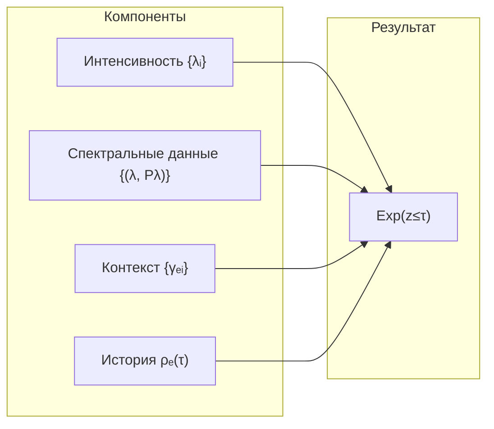

# Теория Интериорности

## «Каково быть летучей мышью?»

В 1974 году философ Томас Нагель опубликовал эссе, ставшее одним из самых цитируемых в философии сознания: *«What Is It Like to Be a Bat?»*. Его аргумент прост и разрушителен:

Летучая мышь воспринимает мир через эхолокацию. У неё есть **субъективный опыт** — «каково это быть» летучей мышью. Но никакое количество нейрофизиологических знаний о мозге летучей мыши не позволит нам **пережить** её опыт. Мы можем описать частоту ультразвука, нейронные паттерны обработки эхо — но между объективным описанием и субъективным переживанием остаётся пропасть.

Нагель поставил вопрос. Дэниэл Деннетт (1991) попытался его обойти, утверждая, что никакого «каково» не существует. Майкл Левин (2019) предположил, что субъективность распространена шире, чем мы думаем, — вплоть до клеточных агрегатов. Но ни один из подходов не дал **математического языка** для описания содержания опыта.

**УГМ предлагает язык для этого вопроса [И/Г].** Спектральный дескриптор использует заданное нормированное экспериенциальное состояние $\rho_E$ в дополненной реализации, а не буквальный частичный след одномерной исходной E-оси. Для идентификации физической или феноменальной цели нужны объявленное считывание и независимые свидетельства.

:::info Откуда мы пришли
[Предыдущая глава](./two-aspect-monism) предлагает двуаспектную интерпретацию. Здесь задаётся спектральный дескриптор, а его математическая конструкция отделяется от физического или феноменального приписывания.
:::

### Дорожная карта главы

1. **Редуцированная матрица $\rho_E$** — расширение и считывание, нужные для её определения
2. **Четыре компонента опыта** — интенсивность, качество, контекст, история
3. **Проективное пространство качеств** — геометрия, в которой живут ощущения
4. **Метрика Фубини–Штуди** — расстояние между качествами (насколько красный отличается от синего)
5. **Единство опыта** — как измерение $U$ обеспечивает целостность «Я»
6. **Примеры** — красный цвет и боль в терминах формализма

## Редуцированная матрица опыта

### Мотивация: как извлечь «опытную» часть из полного описания

Исходное состояние $7\times7$ имеет семь именованных осей. E — одно слагаемое, а не тензорная подсистема. Аналогия с секцией оркестра может мотивировать считывание, но не определяет частичный след и не восстанавливает экспериенциальный регистр из населённости и шести когерентностей.

### Определение

Выберем полное состояние $\rho_{\rm tot}$ на заданном тензорном произведении $\mathcal H_E\otimes\mathcal H_{\rm rest}$ и определим
$$
\rho_E=\operatorname{Tr}_{\mathcal H_{\rm rest}}\rho_{\rm tot}.
$$
Объявленный подъём может задавать $\rho_{\rm tot}=\mathcal E(\Gamma)$; другой вариант — независимое измерение полного состояния. Подъём, фактор и калибровка входят в дополненную запись. Сжатие — иная конструкция, требующая условной нормировки при ненулевом весе.

Для исходной одномерной оси $P_E\Gamma P_E=\gamma_{EE}P_E$ нормируется в $P_E$, если $\gamma_{EE}>0$. Тогда спектр равен $\{1\}$, энтропия нулевая; при нулевом весе условное состояние не определено. В частности, $\gamma_{EE}=0.20$ — вес, а не нетривиальный нормированный спектр.

:::note Сечение–ретракция не задаёт единственную реконструкцию опыта
Произведение $\Gamma\mapsto\Gamma\otimes\sigma$ имеет исходную маргиналь $\Gamma$ при любом состоянии регистра $\sigma$. Экспериенциальная маргиналь поэтому может быть чистой или смешанной при неизменных исходных данных. Прежние утверждения о Морита-эквивалентности 7D/42D и единственной PW-реконструкции отозваны; см. [исправленную реализацию](/docs/core/structure/dimension-e#rho-e-7d-42d). Выбор полной размерности сам по себе не выбирает экспериенциальный фактор, подъём или условное состояние.
:::

:::warning Информационная полнота
Частичный след в общем случае теряет корреляции. Добавление исходного E-звёздного контекста $\{\gamma_{Ej}:j\ne E\}$ и истории задаёт дескриптор, а не доказательство полной реконструкции совместного состояния или феноменального содержания. Любому утверждению о достаточности нужны [критерий слоёв наблюдения](/docs/applied/research/reconstruction-identifiability#fiber-theorem), заданное считывание и его эмпирическая интерпретация.
:::

## Базовое уравнение

Экспериенциальное содержание связано со спектральным разложением $\rho_E$:

$$
\rho_E |q_i\rangle = \lambda_i |q_i\rangle
$$

Это стандартная задача на собственные значения. $\rho_E$ — эрмитова матрица, поэтому по спектральной теореме она диагонализуема, и все собственные значения вещественны:

- $\lambda_i \in [0, 1]$ — **интенсивность** $i$-го компонента, $\sum_i \lambda_i = 1$
- $|q_i\rangle \in \mathcal{H}_E$ — **качество** $i$-го компонента
- $\mathcal{H}_E$ — гильбертово пространство [измерения Интериорности](/docs/core/structure/dimension-e)

**Интерпретация [И/Г]:** собственные значения и разрешённые спектральные подпространства — кандидатные дескрипторы интенсивности и качества. Их психологический смысл требует калиброванного считывания. При кратных значениях инвариантны спектральные проекторы, определённые ниже; выбор собственного базиса не добавляет наблюдаемой структуры.

:::warning Терминология
В этой главе «квалиа» обозначают выбранную интерпретацию L2. Её формальной классификации нужны объявленное $A_1$, строгое $P>2/7$, $R\ge1/3$, $\Phi\ge1$ и выбранная реализация $D_{\rm diff}\ge2$. При отсутствии данных реализации результат остаётся неопределённым; метрика или ворота не служат феноменальным сертификатом.

См. [Иерархию интериорности](/docs/proofs/consciousness/interiority-hierarchy) для формальных определений уровней.
:::

## Числовые примеры вычисления $\rho_E$ {#числовые-примеры-rho-e}

Это **выбранные спектры регистра**, а не реконструкции из исходных населённостей и не эмпирические определения сна, восприятия красного или медитации. При любом фиксированном допустимом исходном $\Gamma$ положим $\rho_{\rm tot}=\Gamma\otimes\operatorname{diag}(\lambda)$ и выберем второй фактор экспериенциальным регистром. Следующие прежние иллюстративные числа задают нормированные положительные шестимерные состояния регистра:

| Иллюстрация | Выбранный спектр $\lambda$ | Математическое прочтение |
|---|---|---|
| 1 (историческая метка «сон») | $(.17,.17,.17,.17,.16,.16)$ | Почти равномерный регистр |
| 2 (историческая метка «восприятие красного») | $(.52,.23,.11,.07,.04,.03)$ | Одно доминирующее собственное значение |
| 3 (историческая метка «медитация») | $(.38,.30,.15,.09,.05,.03)$ | Два ведущих собственных значения |

След по исходному фактору даёт заданное состояние регистра; след по регистру даёт **одну и ту же** исходную $\Gamma$ во всех трёх случаях. Шестимерный регистр выбран, а не выведен из шести исходных E-пар. Пример доказывает необходимость данных расширения. Он не задаёт уровни L0/L2 или действительные чистоту/рефлексию/интеграцию отсутствующей полной исходной матрицы; старые численные присваивания этих утверждений не обосновывали. Названия переживаний остаются гипотезами, требующими калиброванных наблюдений.

### Геометрическая интуиция: спектр $\rho_E$ в разных состояниях {#геометрия-спектра}

Спектр заданной $\rho_E$ лежит на $(n-1)$-симплексе. Психологические метки и уровни следующей исторической иллюстрации — предложенные интерпретации, а не измеренные примеры или следствия исходного частичного следа:

| Состояние | Паттерн спектра | $\lambda_1 / \lambda_2$ | Геометрическая аналогия |
|-----------|----------------|------------------------|------------------------|
| Глубокий сон (L0) | Плоский: $\lambda_i \approx 1/n$ | $\approx 1.0$ | Точка в центре симплекса — максимальная энтропия |
| Бодрствование (L2) | Пиковый: $\lambda_1 \gg \lambda_2$ | $2$--$5$ | Точка вблизи вершины — доминирует один компонент |
| Медитация (L2) | Двугорбый: $\lambda_1 \approx \lambda_2 \gg \lambda_3$ | $1.1$--$1.5$ | Точка на ребре симплекса — два сопоставимых компонента |
| Поток (flow) | Умеренно пиковый | $1.5$--$3$ | Между вершиной и ребром — фокус + контекст |
| Диссоциация | Плоский с разрывом $\gamma_{EU} \to 0$ | $\approx 1$ | Центр симплекса, но когерентности разорваны |

**Ключевой инвариант.** Отношение $\lambda_1/\lambda_2$ — мера **фокусировки** опыта:
- $\lambda_1/\lambda_2 \gg 1$: узкий фокус (восприятие одного объекта, острая боль)
- $\lambda_1/\lambda_2 \approx 1$: широкий охват (панорамное осознавание, «чистое сознание»)

При $\lambda_2>0$ это спектральное отношение инвариантно при унитарном сопряжении заданного регистра. Исходное действие $G_2$ сохраняет его только при доказанно совместимых подъёме/считывании. Психологические метки иллюстрации выше — гипотезы, а не следствия этой инвариантности.

---

## Экспериенциальное содержание: четыре компонента

Следующие четыре компонента задают выбранный дескриптор [О/И]. Им нужны дополненная реализация и сохранённая траектория; одна исходная $\Gamma$ не определяет произвольные данные расширения или своё прошлое:

$$
\mathrm{Exp}(z_{\le\tau}) := (\mathrm{Intensity}, \mathrm{Quality}, \mathrm{Context}, \mathrm{History})
$$

**Аналогия с палитрой художника.** Представьте палитру с красками. **Интенсивность** — сколько краски каждого цвета на палитре (много красного, мало синего). **Качество** — сами цвета (красный, синий, зелёный). **Контекст** — освещение в мастерской, которое меняет восприятие цветов. **История** — как палитра выглядела минуту назад (художник только что добавил жёлтый).

### Компонент 1: Интенсивность

Спектр собственных значений $\rho_E$:

$$
\mathrm{Intensity}(\rho_E) := \{\lambda_i\}_{i=1}^{n}, \quad \text{где } \rho_E|q_i\rangle = \lambda_i|q_i\rangle
$$

Интенсивность определяет амплитуду интериорного состояния (при L2+: **громкость**, **яркость**, **силу** переживания).

**Числовой пример.** Пусть $\rho_E$ имеет спектр $\{0.6, 0.3, 0.1\}$. Это означает: доминирующий компонент опыта занимает 60% «ширины полосы», второй — 30%, третий — 10%. Как яркая красная роза на фоне приглушённого зелёного сада с едва заметным жужжанием пчелы.

### Компонент 2: Качество

Каноническая спектральная запись имеет вид
$$
\rho_E=\sum_{\lambda\in\operatorname{Spec}(\rho_E)}\lambda P_\lambda,
\qquad \mathrm{Quality}_{\rm sp}(\rho_E):=\{(\lambda,P_\lambda)\}.
$$
Каждый $P_\lambda$ проектирует на всё собственное подпространство отдельного собственного значения $\lambda$. При простом значении это одномерный луч $P_\lambda=|q_\lambda\rangle\langle q_\lambda|$. При вырождении поворот базиса внутри подпространства меняет отдельные собственные векторы, не меняя $\rho_E$; состояние не идентифицирует эти лучи. Вблизи вырождения различение мод требует оценки спектрального зазора и ошибки. Метрика полного состояния ниже вообще не требует такого выбора.

Отдельно калиброванное отображение качеств в лучи может принимать значения в $\mathbb P(\mathcal H_E)$, не выбирая собственные векторы. Лучи отождествляют ненулевые векторы, различающиеся ненулевым комплексным множителем; нормированные представители различаются фазой. Прочтение этих данных как тембра, цвета или характера — эмпирический мост [И/Г], а не следствие диагонализации. См. [спектральное считывание и вырождения](/docs/proofs/categorical/categorical-formalism#3-функтор-f-на-объектах).

### Компонент 3: Контекст

Когерентности между измерением $E$ и остальными:

$$
\mathrm{Context}(\Gamma) := \{\gamma_{EA}, \gamma_{ES}, \gamma_{ED}, \gamma_{EL}, \gamma_{EO}, \gamma_{EU}\}
$$

Контекст модулирует опыт через [когерентности](/docs/core/dynamics/coherence-matrix#недиагональные-элементы-когерентности):

| Когерентность | Описание модуляции |
|---------------|-------------------|
| $\gamma_{EA}$ | Внимание — насколько активно система обрабатывает интериорное содержание |
| $\gamma_{ES}$ | Структурный контекст — телесные ощущения, пространственная привязка |
| $\gamma_{ED}$ | Динамический контекст — временная развёртка, ритм переживания |
| $\gamma_{EL}$ | Логический контекст — концептуальное оформление (при L2) |
| $\gamma_{EO}$ | Эмоциональный тон — связь с базовыми установками |
| $\gamma_{EU}$ | Единство — насколько опыт интегрирован в целостное «Я» |

### Компонент 4: История

Траектория эволюции $\rho_E$ в окне времени $T_{\mathrm{mem}}$:

$$
\mathrm{History}(\tau, T_{\mathrm{mem}}) := \{\rho_E(\tau') : \tau' \in [\tau - T_{\mathrm{mem}}, \tau]\}
$$

где $T_{\mathrm{mem}} > 0$ — характерное время памяти системы. История определяет адаптацию, привыкание, ожидания. Без истории невозможны **ожидание** (предсказание будущего $\rho_E$ на основе прошлого), **привыкание** (снижение интенсивности при повторном воздействии) и **удивление** (расхождение между ожидаемым и реальным $\rho_E$).

## Проективное пространство качеств

### Мотивация: почему качества живут в проективном пространстве

Качества опыта — не просто набор чисел. Они образуют **геометрическое пространство** со своей метрикой. Это пространство — проективное пространство $\mathbb{P}(\mathcal{H}_E)$.

Почему проективное, а не обычное? Потому что **глобальная фаза ненаблюдаема**: вектор $|q\rangle$ и $e^{i\theta}|q\rangle$ описывают одно и то же качество. Поэтому мы работаем не с векторами, а с **лучами** — классами эквивалентности:

$$
\mathbb{P}(\mathcal{H}_E) := (\mathcal{H}_E \setminus \{0\}) / \sim
$$

где отношение эквивалентности:

$$
|\psi\rangle \sim |\phi\rangle \quad \Leftrightarrow \quad \exists c \in \mathbb{C}^*: |\psi\rangle = c|\phi\rangle
$$

**Аналогия.** Подумайте о направлениях на компасе. Северо-восток — это направление, не точка. Удвоение стрелки компаса не меняет направления. Точно так же удвоение вектора $|q\rangle$ не меняет качества — направление то же.

**Топология** (для $\dim(\mathcal{H}_E) = n$):

| Свойство | Описание |
|----------|----------|
| Компактность | $\mathbb{P}(\mathbb{C}^n)$ компактно |
| Связность | $\mathbb{P}(\mathbb{C}^n)$ связно |
| Изоморфизм | $\mathbb{P}(\mathbb{C}^n) \cong S^{2n-1} / U(1)$ |
| Размерность | $\dim_{\mathbb{R}}(\mathbb{P}(\mathbb{C}^n)) = 2n - 2$ |

При конечном $n$ это проективное пространство линейно связно и компактно. Компактность даёт конечную $\varepsilon$-сеть при каждом $\varepsilon>0$, а не конечное число состояний: при $n>1$ лучей несчётно много. При $n>1$ диаметр FS равен $\pi/2$; при $n=1$ пространство состоит из одной точки. Непрерывный путь в математическом пространстве не доказывает возможность физического перехода при действительных управлениях.

## Метрика Фубини–Штуди {#метрика-фубини-штуди}

### Мотивация: как измерить расстояние между переживаниями

Интуитивно, красный «ближе» к оранжевому, чем к синему. Боль в пальце «ближе» к боли в руке, чем к запаху розы. Но можно ли это формализовать?

Выберем комплексное скалярное произведение и геометрию Фубини–Штуди на его пространстве лучей. Формула ниже использует **представителей единичной нормы**; для произвольных ненулевых представителей перекрытие делится на $\|\psi\|\,\|\phi\|$. После этого [результаты обогащённой Йонеды](/docs/proofs/categorical/categorical-formalism#enriched-yoneda) применимы к заданному метрическому пространству. Это не вывод единственной квантовой метрики из Ченцова–Петца: [Петц классифицирует семейство](/docs/core/foundations/mathematical-foundations#ченцов-петц), а психологической метрике нужна калибровка.

**Расстояние между качествами:**

$$
d_{FS}([|\psi\rangle], [|\phi\rangle]) := \arccos(|\langle\psi|\phi\rangle|) \in [0, \pi/2]
$$

где $[|\psi\rangle]$ — класс эквивалентности вектора $|\psi\rangle$ в $\mathbb{P}(\mathcal{H}_E)$.

**На пальцах:** Возьмите два вектора $|q_1\rangle$ и $|q_2\rangle$, представляющие два качества. Вычислите их скалярное произведение (по модулю). Если оно равно 1 — качества совпадают. Если 0 — максимально различны. Расстояние Фубини–Штуди — арккосинус этого модуля.

**Числовой пример.** Пусть $|q_{\text{red}}\rangle = \begin{pmatrix}1\\0\end{pmatrix}$ и $|q_{\text{orange}}\rangle = \begin{pmatrix}\cos 15°\\\sin 15°\end{pmatrix}$. Тогда:

$$d_{FS} = \arccos(|\cos 15°|) = 15° \approx 0.26 \text{ рад}$$

А для $|q_{\text{blue}}\rangle = \begin{pmatrix}0\\1\end{pmatrix}$:

$$d_{FS}(\text{red}, \text{blue}) = \arccos(0) = \pi/2 \approx 1.57 \text{ рад}$$

Заданные векторы имеют именно такой порядок расстояний. Их цветовые имена иллюстративны; предсказание о восприятии возникает только после независимой калибровки отображения цвета в луч.

**Свойства:**

| Условие | Значение | Интерпретация |
|---------|----------|---------------|
| $d_{FS} = 0$ | $\vert\psi\rangle = e^{i\theta}\vert\phi\rangle$ | Одинаковые качества |
| $d_{FS} = \pi/2$ | $\langle\psi\vert\phi\rangle = 0$ | Максимально различные качества |

**Инфинитезимальная форма** для дифференцируемого локального представителя единичной нормы:

$$
ds^2 = \langle d\psi|d\psi\rangle - |\langle\psi|d\psi\rangle|^2
$$

## Полная метрика на экспериенциальном пространстве

Зафиксируем экспериенциальный регистр размерности $n$, исходный E-проектор $P_E$, общие часы и окно $[-T,0]$ при $T>0$, а также запись
$$
X=(\rho_E,C_E,h),\qquad C_E=P_E\Gamma(I-P_E),\qquad
h\in C([-T,0],\mathcal D(\mathbb C^n)),\quad h(0)=\rho_E.
$$
Здесь $C_E$ — исходная E-звезда в матричной записи, отличная от скаляра $C=\Phi R$. Определим расстояние Буреса на нормированных состояниях регистра:
$$
F(\rho,\sigma)=\left(\operatorname{Tr}\sqrt{\sqrt\rho\,\sigma\sqrt\rho}\right)^2,
\qquad d_B(\rho,\sigma)=\sqrt{2(1-\sqrt{F(\rho,\sigma)})}.
$$
Это метрика и при кратных собственных значениях, и при неполном ранге; гладкая тензорная формула требует более строгих предпосылок. См. [конструкцию пространства состояний Буреса](/docs/proofs/categorical/categorical-formalism#631-bures-топология-на-densitymat).

Одна корректная метрика произведения на этих записях:
$$
d_{\mathcal E}(X_1,X_2)=\sqrt{d_\lambda^2+\alpha d_B(\rho_1,\rho_2)^2+\beta d_C^2+\gamma d_H^2},
$$
где
$$
d_\lambda=\|\operatorname{sort}\lambda(\rho_1)-\operatorname{sort}\lambda(\rho_2)\|_2,
\quad d_C=\|C_1-C_2\|_{\rm HS},\quad
d_H=\frac1T\int_{-T}^0\|h_1(s)-h_2(s)\|_{\rm HS}\,ds.
$$
Веса $\alpha,\beta,\gamma>0$ фиксированы. Неравенства треугольника компонент и затем евклидово неравенство доказывают неравенство треугольника произведения. Слагаемое Буреса различает текущие состояния; норма контекста — контексты; нулевой интеграл истории означает равенство всюду для непрерывных историй. Для лишь измеримых историй нужно факторизовать по равенству почти всюду. Спектральное слагаемое необязательно и избыточно для различимости, но может задавать калиброванный вес спектральных изменений. На физических системах или дополненных записях с другими скрытыми полями это лишь псевдометрика, если дескриптор не инъективен.

Прежняя сумма расстояний между произвольно занумерованными собственными лучами не является метрикой состояний: при $\rho=I_2/2$ базисы $(|0\rangle,|1\rangle)$ и $(|+\rangle,|-\rangle)$ дают сумму $\pi/2$, хотя состояние не изменилось. Спектральные проекторы и $d_B(\rho,\rho)=0$ устраняют неоднозначность. FS остаётся корректным для отдельно заданных отдельных лучей.

:::warning Калибровка и покрытие данными
Веса, выбор регистра, единицы времени и отображение контекста — входные данные модели, фиксируемые до подтверждающей проверки. Нужно согласовать действительные метки времени и сохранить отсутствующие интервалы; интерполяция является дополнительной моделью, а отсутствие истории нельзя молча заменять нулевым расстоянием. Математическая метрика не определяет психологическую шкалу несходства.
:::

:::info Условный совместный перенос [Т]
Пусть $U$ — исходный унитарный оператор, а $V$ — унитарное отождествление двух экспериенциальных регистров, применяемые к обеим сравниваемым записям. Потребуем
$$
\Gamma_a'=U\Gamma_aU^\dagger,\quad P_E'=UP_EU^\dagger,\quad
\rho_a'=V\rho_aV^\dagger,\quad h_a'(s)=Vh_a(s)V^\dagger\quad(a=1,2),
$$
при одинаковых координате времени, весах и объявленном семантическом отображении. Тогда $C_a'=UC_aU^\dagger$, поэтому все расстояния выше сохраняются в силу унитарной инвариантности спектра, функции $F$ и нормы HS. При фиксированной исходной E-оси нужно $UP_EU^\dagger=P_E$; общий поворот $G_2$ этому не обязан удовлетворять. Совместимый подъём/считывание должен обосновать отношение регистров; оно не следует из одной исходной ковариантности. Другие часы или морфологии требуют своего проверенного переноса, а не автоматического равенства феноменальной геометрии.
:::

## Уровни полноты описания

Это уровни подробности **выбранного дескриптора**, отличные от уровней способности [канонической иерархии](/docs/consciousness/hierarchy/interiority-hierarchy#типизированный-вход).

| Описание | Данные | Математическая область действия |
|---|---|---|
| Спектральное | Упорядоченные собственные значения с кратностями | Не определяет состояние регистра |
| Регистровое | $\{(\lambda,P_\lambda)\}$, эквивалентно $\rho_E$ | Определяет заданный нормированный регистр, включая вырождения |
| Контекстное | $(\rho_E,C_E)$ | Добавляет объявленную исходную E-звезду |
| С историей | $(\rho_E,C_E,h)$ | Добавляет записанную траекторию на общем окне |

Полнота здесь относится к перечисленным полям записи. Утверждение обо всём дополненном состоянии или феноменальной цели требует отдельной идентификации на слоях наблюдения.

## Проблема изоспектральности

Разные состояния регистра могут иметь одинаковый спектр. Например, $\rho_1=\operatorname{diag}(3/4,1/4)$ и $\rho_2=H\rho_1H^\dagger$ с унитарной матрицей Адамара $H$ — разные матрицы с одинаковыми собственными значениями. Их соответствующие спектральные проекторы различаются и $d_B(\rho_1,\rho_2)>0$.

Поэтому один спектр не идентифицирует состояние, а взвешенные проекторы идентифицируют. При вырождении смена собственного базиса внутри одного подпространства **не** создаёт другого состояния. Прочтение изоспектральных различий как «равная интенсивность, разное качество» — проверяемая интерпретация [И/Г] после фиксации считывания, а не вывод о двух переживаниях из одного уравнения собственных значений.

## Примеры когнитивных квалиа (L2)

Примеры ниже предлагают интерпретации в **объявленной модели L2**: $A_1\land(P>2/7)\land(R\ge1/3)\land(\Phi\ge1)\land(D_{\rm diff}\ge2)$ при выбранном режиме прокси/расширения. Ни предикат, ни спектральное имя не доказывают, что система знает о своём переживании; более высокие предсказательные утверждения о самомодели требуют своих сертификатов. Наблюдения и калибровка фиксируются до проверки предложенных прочтений.

### Красный цвет

| Компонент | Математическое представление | Феноменальная интерпретация |
|-----------|------------------------------|---------------------------|
| Интенсивность | $\lambda_{\text{red}} \in [0, 1]$ | Яркость |
| Качество | $[\vert q_{\text{red}}\rangle] \in \mathbb{P}(\mathcal{H}_E)$ | Оттенок красного |
| Контекст | $\gamma_{EA}$ (внимание), $\gamma_{EL}$ | Освещение, фон |
| История | $\rho_E(\tau - T_{\mathrm{mem}}) \to \rho_E(\tau)$ | Адаптация сетчатки |

Когда вы смотрите на красную розу: $\lambda_{\text{red}} \approx 0.7$ (доминирующий компонент), $|q_{\text{red}}\rangle$ определяет конкретный оттенок, $\gamma_{EA}$ высокое (вы обращаете внимание), $\gamma_{EO}$ задаёт эмоциональный тон (красота, радость). Через минуту адаптации $\lambda_{\text{red}}$ слегка снижается — история.

### Боль

| Компонент | Математическое представление | Феноменальная интерпретация |
|-----------|------------------------------|---------------------------|
| Интенсивность | $\lambda_{\text{pain}} \in [0, 1]$ | Сила боли |
| Качество | $[\vert q_{\text{pain}}\rangle] \in \mathbb{P}(\mathcal{H}_E)$ | Острая/тупая/пульсирующая |
| Контекст | $\gamma_{ES}$ (структура), $\gamma_{EO}$ | Локализация, эмоции |
| История | $\{\rho_E(\tau')\}_{\tau' \in [\tau - T_{\mathrm{mem}}, \tau]}$ | Сенситизация/десенситизация |

Различие между острой и тупой болью — это различие в $|q_{\text{pain}}\rangle$, а не в $\lambda_{\text{pain}}$. Сильная тупая боль ($\lambda = 0.8$, $|q_{\text{dull}}\rangle$) и слабая острая боль ($\lambda = 0.3$, $|q_{\text{sharp}}\rangle$) различаются по обоим компонентам.

## E-срез и полное содержание (T-301) {#e-срез-и-полнота}

E-срез — дескриптор заданной $\rho_E$ вместе с выбранными исходным контекстом и историей. Ни исходная метка E, ни общее утверждение Йонеды не задают расширение, единственный спектральный базис при вырождении или доказательство феноменальной полноты.

- Исходное состояние полного ранга имеет **48 вещественных координат**: семь вещественных населённостей с одним условием следа и 21 комплексную когерентность. «28» считает смешанные вещественные/комплексные позиции, а не независимые вещественные параметры. [Таксономия 21 пары](/docs/consciousness/phenomenology/qualia-structure#двадцать-один-и-семь) остаётся выбранной интерпретацией.
- Каждый поддержанный ориентированный цикл даёт инвариант диагональной перефазировки. Семь голономий Фано $H_p=\arg(\gamma_{ij}\gamma_{jk}\gamma_{ki})$ — семь выбранных показаний, а не единственные инварианты: полный $K_7$ имеет циклический ранг 15; разреженной поддержке нужен свой базис циклов. Отсутствие поддержки не есть нулевой угол.
- [Паспорт квалиа](/docs/consciousness/phenomenology/qualia-structure#паспорт-квалиа) сохраняет происхождение состояния/системы отсчёта, поддержку, считывание, расширение и неопределённость. L2 означает выбранное $A_1$ вместе со всеми четырьмя условиями Cap$_2$ [канонической иерархии](/docs/consciousness/hierarchy/interiority-hierarchy#типизированный-вход), а не пару порогов R/Phi или одно фазовое показание.

Это дополнительные друг к другу типизированные записи. Идентифицируют ли они целевое качество, определяют модель наблюдений и обоснованный эмпирический мост; подсчёт координат не создаёт такого моста.

## Связь с нейронаукой

Как $\rho_E$ соотносится с нейрокоррелятами сознания (NCC)?

В нейронауке NCC — это минимальный нейронный механизм, достаточный для конкретного переживания. В УГМ:

| Нейронаучный термин | Соответствие в УГМ |
|--------------------|--------------------|
| NCC (нейрокоррелят сознания) | Проекция $\Gamma$ на нейронный базис |
| Содержание сознания | $\rho_E$ (редуцированная матрица) |
| Уровень возбуждения | $\lambda_{\max}(\rho_E)$ (доминирующая интенсивность) |
| Связность (functional connectivity) | $\Phi$ (мера интеграции) |
| Нейронная дифференциация | $D_{\text{diff}}$ |

Эти соответствия — предлагаемые считывания [И/Г], а не выведенные тождества с нейронными механизмами. Исследование задаёт кодировщик, экспериенциальный регистр, закон наблюдения и независимую поведенческую цель. При проверке выбранной классификации L2 оцениваются $A_1$ и все четыре условия Cap$_2$, включая строгое $P>2/7$ и объявленное $D_{\rm diff}$, с сохранением неопределённости.

## Единство опыта

### Проблема связывания (binding problem)

Нейронаука знает, что цвет обрабатывается в зоне V4, форма — в зоне IT, движение — в MT. Но мы видим **единый** объект: красный мяч, летящий вправо. Как разнесённые по коре представления объединяются в целостный опыт?

### Решение УГМ

УГМ предлагает проверять объявленную исходную когерентность E–U и интеграцию регистра как предикторы заданного ответа связывания [Г]. Сначала это математические диагностики; психологическое объяснение требует проверки.

В **фиксированном измерительном базисе нормированного экспериенциального регистра** положим $r_{ab}=(\rho_E)_{ab}$ и определим
$$
\Phi_E:=\frac{\sum_{a\ne b}|r_{ab}|^2}{\sum_a r_{aa}^2}.
$$
Формула интеграции сохраняется с указанием действительных состояния и базиса. Знаменатель положителен для нормированного состояния. Это не исходная глобальная $\Phi$; одномерная сжатая E-ось даёт $\Phi_E=0$. В собственном базисе числитель равен нулю, поэтому нельзя выбирать базис после наблюдений ради подтверждения связывания.

Комплексное число $\gamma_{EU}$ нельзя упорядоченно сравнивать с нулём. Возможные объявленные вещественные предикторы:
$$
b_{EU}=|\gamma_{EU}|,\qquad
\chi_{EU}=\frac{|\gamma_{EU}|^2}{\gamma_{EE}\gamma_{UU}}\in[0,1]
\quad\text{при }\gamma_{EE}\gamma_{UU}>0.
$$
Граница следует из положительности главного минора $2\times2$. При нулевом знаменателе PSD требует нулевой когерентности, но нормированное отношение остаётся неопределённым. Знаковая вещественная часть требует отдельно фиксированного фазового эталона. Ни положительный модуль, ни порог $\Phi_E$ не доказывают единство «Я» и не устанавливают клиническую диссоциацию.

Проверяемая гипотеза связывания до результатов задаёт ответ (например, суждение о межмодальном соответствии), фиксированные кодировщик/базис регистра, неопределённость калибровки и кандидатный предиктор. Ответы на отложенных данных и управляемые изменения сравниваются с моделями, использующими отдельные населённости, глобальную $\Phi$ и трудность задачи. Нулевые результаты, пропуски и смена источника сохраняются; «порог диссоциации» нельзя подгонять по меткам подтверждающей выборки. Воспроизведённая предсказательная или интервенционная связь поддержала бы конкретный мост, а не неограниченное клиническое или феноменальное отождествление.

:::note Связь с выбранной иерархией
$C=\Phi R$ использует исходную глобальную интеграцию; ни $b_{EU}$, ни $\Phi_E$ не входят в неё отдельным слагаемым. L2 требует $A_1$ и всех четырёх условий Cap$_2$, включая строгую чистоту и объявленный режим дифференциации. Гипотеза связывания добавляет эмпирическую цель и протокол, а не заменяет ворота.
:::

## Структура экспериенциального пространства

**Пространство интенсивностей:** $(n-1)$-симплекс $\Delta^{n-1} = \{\boldsymbol{\lambda} : \lambda_i \geq 0, \sum_i \lambda_i = 1\}$

**Пространство лучей качеств, если выбрано это считывание:** $\mathbb P(\mathcal H_E)$. Полное состояние регистра представляется взвешенными спектральными проекторами или матрицей плотности.

## Для разных аудиторий

### Для инженеров

**Вычислительная сложность:**

| Операция | Сложность | Примечание |
|----------|-----------|------------|
| Собственные значения $\rho_E$ | $O(n^3)$ | Стандартная диагонализация |
| Метрика Фубини–Штуди | $O(n)$ | Скалярное произведение |
| Полная метрика $d_{\mathcal{E}}$ | $O(n^3+Mn^2)$ | $M$ матриц истории с подынтегральной нормой HS; заданная квадратура |

**Практическая дискретизация истории:** Храните $T_{\mathrm{mem}} / \Delta\tau$ состояний с шагом $\Delta\tau$. Типичное значение: 100-1000 временных точек.

### Для психологов

Теория интериорности предоставляет **математический язык для описания феноменологии**:

- **Спектр $\rho_E$** — количественная характеристика «палитры» интериорных состояний (при L2+: переживаний)
- **Метрика Фубини–Штуди** — мера «расстояния» между качествами (насколько красный отличается от синего)
- **Контекст** — как внимание, настроение и телесность модулируют опыт
- **История** — механизм адаптации, привыкания, сенситизации

### Для исследователей внутренних ландшафтов

Экспериенциальное содержание — это **карта внутреннего пространства**:

- **Интенсивность** отвечает на вопрос «насколько сильно?»
- **Качество** отвечает на вопрос «что именно?» (цвет, звук, эмоция, телесное ощущение)
- **Контекст** отвечает на вопрос «при каких условиях?» (фокус внимания, эмоциональный фон)
- **История** отвечает на вопрос «откуда пришло и куда движется?»

Изменённые состояния сознания характеризуются изменением **геометрии** этого пространства — расстояния между качествами могут сжиматься (синестезия) или расширяться (обострённое восприятие).

### Что мы узнали

- Выбранный дескриптор записывает нормированный регистр, канонические спектральные проекторы, исходный контекст и историю; полнота для дополнительной цели — отдельное утверждение об идентификации.
- FS — метрика на объявленных нормированных лучах. Бурес даёт метрику полного состояния, определённую и при вырождении; прежняя сумма по занумерованным собственным векторам её не задаёт.
- Равенство при смене систем отсчёта требует совместного унитарного переноса считывания/контекста/истории выше, включая E-проектор и общие часы. Одной принадлежности исходного преобразования к $G_2$ недостаточно.
- Изоспектральные состояния могут различаться, а разные собственные базисы одного вырожденного состояния не являются разными состояниями.
- Связывание через $b_{EU},\chi_{EU}$ или $\Phi_E$ в фиксированном базисе — эмпирическая гипотеза с объявленными ответом и контролями, а не клиническое следствие.
- L2 означает выбранное $A_1$ вместе со всеми четырьмя условиями Cap$_2$, включая строгую чистоту и типизированную дифференциацию; это не феноменальный сертификат.

:::tip Куда дальше
Теория интериорности задала кандидатные дескрипторы и проверки объявленных экспериенциальных считываний. Следующий вопрос: **как** система может наблюдать собственное содержание? Ответ даёт [Самонаблюдение](./self-observation) — оператор $\varphi$, мера рефлексии $R$ и мера сознательности $C = \Phi \times R$.

Для количественных определений стресса, капы и свободной энергии см. [определения Когерентной кибернетики](/docs/applied/coherence-cybernetics/definitions).
:::

---

**Связанные документы:**
- [Самонаблюдение](./self-observation) — оператор $\varphi$ и мера рефлексии R
- [Трудная проблема](./two-aspect-monism) — философский анализ
- [Измерение E](/docs/core/structure/dimension-e) — измерение опыта
- [Измерение U](/docs/core/structure/dimension-u) — измерение единства и мера $\Phi$
- [Иерархия интериорности](/docs/proofs/consciousness/interiority-hierarchy) — формальные определения L0→L1→L2→L3→L4
- [Матрица когерентности](/docs/core/dynamics/coherence-matrix) — определение $\Gamma$ и $\rho_E$
- [Определения КК](/docs/applied/coherence-cybernetics/definitions) — операциональные формулы для инженеров
