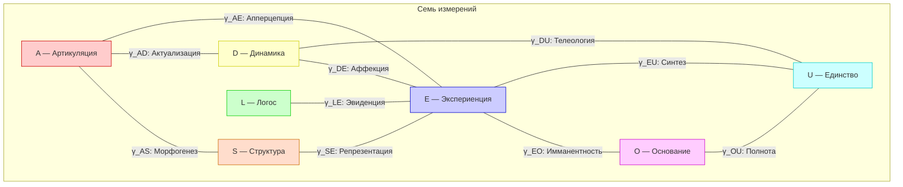
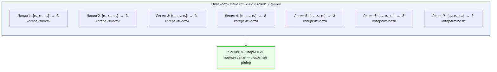

# Структура Квалиа: 21-парная Таксономия

:::info Область утверждений и редакция от 2026-10-29
Глава сохраняет 21-парную таксономию как **выбранную интерпретацию [И]** и задаёт её операционные проверки. Подсчёт матричных элементов не доказывает феноменальное переживание или полноту его описания. [Каноническая иерархия](/docs/consciousness/hierarchy/interiority-hierarchy#типизированный-вход) классифицирует расширенную запись
$$
z=(\Gamma,\mathsf E,\mathsf M,\mathsf Q),\qquad\Gamma\in\mathcal D(\mathbb C^7),
$$
где $\mathsf E$ задаёт опытную реализацию, $\mathsf M$ — реализованную самомодель и считывание, $\mathsf Q$ — независимые пробы и калибровку. Отсутствующие данные дают **неустановленный результат**, а не положительный или отрицательный феноменальный вердикт. Различаются определения [О], условные математические результаты [Т], интерпретации [И] и эмпирические гипотезы [Г].
:::

:::note Нотация и реализация
$\gamma_{ij}$ — элемент исходной матрицы в объявленном смысловом репере. $\rho_E$ — нормированное состояние на **отдельно заданном** опытном факторе или сжатии. Исходная E-ось одномерна: $P_E\Gamma P_E=\gamma_{EE}P_E$ нормируется в $P_E$ при ненулевом весе; при нулевом весе условное состояние не определено. Запись $\operatorname{Tr}_{-E}\Gamma$ не создаёт тензорного фактора внутри $\mathbb C^7$. См. [E-ось и опытная реализация](/docs/core/structure/dimension-e#rho-e-7d-42d).
:::

### Дорожная карта главы

1. Философская гипотеза и её эмпирический статус.
2. 21 исходная парная координата и выбранные смысловые имена.
3. Точные вычисления населённостей, фаз, носителя и циклов.
4. Различие исходных прокси и заданного опытного расширения.
5. Воспроизводимый паспорт со считыванием, неопределённостью и независимыми проверками.
6. Перенос между именами и морфологиями и обязательные машинные контрпримеры.

## Философская история: что такое квалиа? {#история}

Слово **квалиа** (лат. *qualia*, мн. ч. от *quale* — «какой», «какого рода») обозначает **субъективные качества переживаний**: каково это — видеть красный цвет, слышать до-мажор, чувствовать запах кофе. За этим простым вопросом стоит одна из глубочайших проблем философии.

### Льюис (1929): первое определение

Американский философ **Кларенс Ирвинг Льюис** в работе «Mind and the World Order» (1929) впервые ввёл термин «квалиа» в систематическое употребление. Он заметил: когда мы видим красную розу, есть нечто, что *невозможно передать слепому от рождения* — субъективное качество «красности». Это качество и есть quale. Льюис различал:

- **Quale** — непередаваемое субъективное качество (каково это — видеть красное)
- **Свойство** — объективная характеристика (длина волны 700 нм)

### Джексон (1982): комната Мэри

**Фрэнк Джексон** в знаменитом мысленном эксперименте «Комната Мэри» (1982) довёл проблему до предела:

> Мэри — блестящий нейробиолог, всю жизнь живущая в чёрно-белой комнате. Она знает *всё* о физике цвета: длины волн, работу колбочек сетчатки, нейронные корреляты. И вот однажды Мэри выходит из комнаты и впервые видит красную розу. **Узнаёт ли она что-то новое?**

Джексон утверждал: **да**. Мэри узнаёт, *каково это* — видеть красное. Значит, физические факты не исчерпывают реальность — существует нечто сверх них (квалиа).

### Деннет (1988): квалиа как иллюзия

**Дэниел Деннет** занял противоположную позицию. В статье «Quining Qualia» (1988) он аргументировал, что квалиа — это **философская иллюзия**: мы думаем, что переживаем нечто «невыразимое» и «приватное», но на самом деле вся информация о переживаниях кодируется в функциональных состояниях мозга. Никакого «остатка» после полного физического описания не остаётся.

### Позиция УГМ: квалиа как структура когерентности

УГМ предлагает двухаспектную интерпретацию: некоторые структуры внешнего описания системы допускают внутреннее прочтение [И]. Парный словарь ниже — один предложенный способ его организации. Принятие этого словаря не доказывает наличие определённого переживания у симулированной матрицы, робота или измеренной биологической системы.

Операционная задача — задать состояние, расширение и считывание, затем определить наблюдения и вмешательства, различающие конкурирующие интерпретации. Комната Мэри, философский зомби и инверсия спектра не разрешаются тождеством $\binom72=21$. [Послесловие](#populyarnoe-posleslovie) отделяет эти вопросы от измерений.

## Мотивация: откуда 21 тип? {#мотивация}

Выбранное исходное состояние — эрмитова матрица $7\times7$ в смысловом репере $\{A,S,D,L,E,O,U\}$. Предполагаемые роли меток [И]:

| Символ | Название | Предполагаемая роль |
|---|---|---|
| $A$ | Артикуляция | Различение |
| $S$ | Структура | Устойчивые формы |
| $D$ | Динамика | Процессы |
| $L$ | Логос | Логическая организация |
| $E$ | Опыт | Объявленное считывание интериорности |
| $O$ | Основание | Поддержка/источник |
| $U$ | Единство | Интеграция |

Есть 7 вещественных диагональных элементов и $\binom72=21$ неупорядоченная внедиагональная пара. Эрмитовость определяет обратный элемент сопряжением. Это подсчёт координат, а не количества датчиков, приводов, сенсорных модальностей или видов опыта физической системы.

На схеме показаны 10 выбранных парных имён; полный список дан ниже. Физическому или статистическому кодировщику нужны собственные закон наблюдения и калибровка. Смысловые имена сами не идентифицируют матрицу из данных.

## Интерпретация: 21-парная таксономия квалиа (И.1) {#таксономия}

:::info Интерпретация И.1: выбранная парная таксономия [И]
Каждой неупорядоченной паре смысловых осей сопоставляется предполагаемая опытная роль. Таблица исчерпывает **парные имена в этом репере**, а не возможное феноменальное содержание. Для применения имени к системе нужны наблюдательная модель, опытная реализация и независимо проверенное считывание. Интерпретация может оказаться неверной при правильной матричной арифметике.
:::

### Полная таблица 21 типа квалиа {#полная-таблица-21-типа-квалиа}

:::warning Статус имён
Комбинаторный подсчёт точен [Т]. Имена и описания ниже — предложенные смысловые соответствия [И/Г], а не измерения, диагнозы или следствия положительности. Прежний вывод всех смысловых имён из одной инцидентности не используется. Сравнение сохраняет объявленные репер и калибровку.
:::

| # | Пара | Когерентность | Имя | Феноменологическое содержание |
|---|------|---------------|-----|-------------------------------|
| 1 | $(A,S)$ | $\gamma_{AS}$ | **Морфогенез** | Кристаллизация различий в устойчивые формы — переживание «оформления» |
| 2 | $(A,D)$ | $\gamma_{AD}$ | **Актуализация** | Актуализация различения в процессе — переживание «восприятия» |
| 3 | $(A,L)$ | $\gamma_{AL}$ | **Предикация** | Различение, ставшее предикатом — переживание «суждения» |
| 4 | $(A,E)$ | $\gamma_{AE}$ | **Апперцепция** | Различение, вошедшее в интериорность — переживание «осознания» |
| 5 | $(A,O)$ | $\gamma_{AO}$ | **Спонтанность** | Возникновение различений без внешней причины — переживание «инсайта» |
| 6 | $(A,U)$ | $\gamma_{AU}$ | **Дифференциация** | Различение внутри целого — переживание «анализа» |
| 7 | $(S,D)$ | $\gamma_{SD}$ | **Персистенция** | Форма, сохраняющаяся через процесс — переживание «устойчивости» |
| 8 | $(S,L)$ | $\gamma_{SL}$ | **Номос** | Структура с логической необходимостью — переживание «порядка» |
| 9 | $(S,E)$ | $\gamma_{SE}$ | **Репрезентация** | Структура, представленная в интериорности — переживание «целостной формы» |
| 10 | $(S,O)$ | $\gamma_{SO}$ | **Архетип** | Формы из основания — переживание «глубинного паттерна» |
| 11 | $(S,U)$ | $\gamma_{SU}$ | **Симметрия** | Структурное единство — переживание «гармонии» |
| 12 | $(D,L)$ | $\gamma_{DL}$ | **Регуляция** | Логически управляемый процесс — переживание «контроля» |
| 13 | $(D,E)$ | $\gamma_{DE}$ | **Аффекция** | Действие процесса на интериорность — переживание «эмоции» |
| 14 | $(D,O)$ | $\gamma_{DO}$ | **Генезис** | Порождение из основания — переживание «творчества» |
| 15 | $(D,U)$ | $\gamma_{DU}$ | **Телеология** | Интегрированное направленное изменение — переживание «волевого усилия» |
| 16 | $(L,E)$ | $\gamma_{LE}$ | **Эвиденция** | Логическая связность в интериорности — переживание «очевидности» |
| 17 | $(L,O)$ | $\gamma_{LO}$ | **Фундирование** | Логика, укоренённая в основании — переживание «самоочевидности» |
| 18 | $(L,U)$ | $\gamma_{LU}$ | **Консистентность** | Логическая непротиворечивость целого — переживание «согласованности» |
| 19 | $(E,O)$ | $\gamma_{EO}$ | **Имманентность** | Основание, присутствующее внутри интериорности — переживание «присутствия» |
| 20 | $(E,U)$ | $\gamma_{EU}$ | **Синтез** | Интеграция интериорного содержания в целое — переживание «единства» |
| 21 | $(O,U)$ | $\gamma_{OU}$ | **Полнота** | Тождество источника и целого — переживание «завершённости» |

### Как читать таблицу: развёрнутый пример

Для проверки «Аффекции» пары $(D,E)$ сначала объявляют целевое различение — например, определённый ответ при контролируемом вмешательстве, — альтернативы, закон наблюдения и считывание. Состояние оценивают с неопределённостью, затем на независимо удержанных вмешательствах проверяют, улучшает ли DE-статистика прогноз цели. Сохраняют неудачи и успехи. Имя или самоотчёт не валидирует себя.

Численный пример носителя: взять диагональ $1/7$ и оставить ненулевыми только $\gamma_{DE}=ae^{i\theta}$ и сопряжённый элемент, где $0<a<1/7$. Собственные значения нетривиального блока равны $1/7\pm a$, поэтому состояние положительно. Изменение $a,\theta$ даёт воспроизводимые проверки статистик, но не приписывает эмоцию матрице. Прежние «профили человека» без реконструкции и калибровки не сохраняются как эмпирические типичные диапазоны.

### Параметрическая структура квалиа {#параметрическая-структура}

Для ненулевого элемента $\gamma_{ij}=|\gamma_{ij}|e^{i\theta_{ij}}$. Модуль и фаза — координаты; Gap — производная статистика, не третий независимый параметр.

| Статистика | Формула / область | Статус |
|---|---|---|
| Парный модуль | $\vert \gamma_{ij}\vert \le\sqrt{\gamma_{ii}\gamma_{jj}}$ | Амплитуда [Т] |
| Ориентированная фаза | $\arg\gamma_{ij}$ по модулю $2\pi$, только на ненулевом носителе | Зависит от репера [Т] |
| Парный Gap | $\vert \operatorname{Im}\gamma_{ij}\vert /\vert \gamma_{ij}\vert $ | Выбранная реперная статистика [О] |

«Интенсивность», «перспектива», «непрозрачность» — предполагаемые прочтения [И], требующие считывания и эмпирического моста. Gap не является процентом скрытой от наблюдателя информации или мерой алгоритмической несжимаемости. При нулевой амплитуде фаза отсутствует; записанный там нулевой Gap — соглашение, статус которого нужно сохранять.

#### Верхняя граница интенсивности

Из положительной полуопределённости следует $|\gamma_{ij}|^2\le\gamma_{ii}\gamma_{jj}$: определитель соответствующего главного блока $2\times2$ неотрицателен. При населённостях $0.15$ и $0.18$ модуль не превышает $\sqrt{0.027}\approx0.164$.

Оценка за границей означает несогласованность оценки, модели неопределённости или выбранного представления, а не установленный психологический дефект. Выполнение всех парных неравенств само не гарантирует положительность всей матрицы. Проверяется полное состояние; расхождение нельзя молча устранить проекцией, потеряв неопределённость.

#### Три параметра: аналогия

Аналогия с амплитудой и фазой звука помогает представить координаты, но не идентифицирует ощущение. В допустимом двухосном примере $a=.05$, $\theta=.3$ дают Gap $\approx.296$. Это **не** «30% скрытого переживания». Замена $\theta$ на $-\theta$ сохраняет модуль и Gap, обращая ориентированную фазу. [Контрпримеры идентифицируемости](/docs/applied/research/reconstruction-identifiability#phase-counterexamples) распространяют эту неоднозначность на голономию треугольника и спектр.

## Теорема о замкнутости таксономии (Т.1) {#замкнутость}

:::tip Теорема Т.1: замкнутость списка исходных пар [Т]
В заданном семимерном ортонормированном репере ровно 21 неупорядоченная пара различных осей. Эрмитова матрица имеет по одному комплексному элементу на пару; обратный определяется сопряжением.

**Доказательство.** $7\cdot6/2=21$, а $\gamma_{ji}=\overline{\gamma_{ij}}$. $\square$
:::

Прежний вывод «дополнительный тип квалиа невозможен» отозван. Подсчёт парных координат не доказывает, что каждая координата — феноменальный тип, и не исключает нелинейные, временные, контекстные или зависящие от расширения считывания. В размерности 6 пар 15; из этого не следует более бедная субъективная жизнь или отсутствие конкретных переживаний.

Полное считывание должно быть постоянно на каждом слое прообраза предлагаемой достаточной статистики. Если два допустимых расширенных состояния дают одну исходную статистику, но разные целевые считывания, полнота опровергнута. Пример с произведениями расширений приведён в [паспорте](#паспорт-квалиа).

:::info Устойчивость к смене репера
Одновременная перестановка осей и смысловых имён переставляет список пар. Сохранение конкретной ориентированной структуры Фано/октонионов дополнительно ограничивает карты репера. Общий поворот $G_2$ смешивает элементы и не сохраняет индексную таксономию. Выбранный диссипатор/инструмент может фиксировать репер, но ни этот выбор, ни абстрактный классификатор не выводит феноменологические имена. До сравнения переносятся также наблюдения, цели и считывания.
:::

## Фановская структура квалиа {#фано}

Выбранная плоскость Фано организует парный список в 7 троек. Тождества инцидентности полезны для адресации и диагностики, но не доказывают полноту опыта или дополнительный закон физической связи.

### Что такое проективная плоскость Фано?

Плоскость $\mathrm{PG}(2,2)$ имеет 7 точек и 7 прямых, по 3 точки на прямой; каждая пара точек лежит ровно на одной прямой. После сопоставления точек смысловым осям это объявленная структура инцидентности. Октонионная реализация дополнительно задаёт соглашение об умножении и ориентации.

### Секторная структура когерентностей

Три правильно ориентированные мнимые октонионные единицы прямой Фано вместе с единицей порождают кватернионную подалгебру. Это факт о выбранном умножении. Сам он **не** налагает дополнительного равенства на три произвольных комплексных элемента матрицы плотности.

Положительными должны быть все главные подматрицы, включая тройки вне прямых Фано. Для более сильных эмпирических секторных корреляций нужны закон связи/динамики и сравнение с непрямыми тройками. Внутри PSD-конуса малое изменение одной когерентности не обязано менять обе остальные. Инцидентность сама не является такой динамикой.

### Покрытие 21 пары Фано-триплетами

Равенство $7\cdot3=21$ покрывает все **рёбра** ровно один раз. Оно не покрывает все циклические соотношения: полный граф носителя $K_7$ имеет циклический ранг $21-7+1=15$, а семь треугольников прямых порождают только 7 независимых циклов. Остаётся 8 независимых фазовых координат. См. [T-317](/docs/reference/status-registry) и [декодер](#теорема-декодер).

У диагностики пары $(D,E)$ есть одна именованная прямая, но её значение и динамика не обязаны определяться двумя другими элементами на ней. Покрытие рёбер не доказывает замкнутость эмоционального пространства или факторизацию всех считываний через семь прямых.

### Что на самом деле проверяет прямая {#что-проверяет-прямая}

При **дополнительной модели** знаков рёбер $s_i s_j$, где $s_i\in\{-1,1\}$, любой треугольник удовлетворяет
$$
(s_i s_j)(s_j s_k)(s_k s_i)=+1.
$$
Это верно для любого треугольника, не только прямых Фано. Отрицательное произведение опровергает такую вершинную факторизацию на наблюдённом треугольнике. Оно не означает недопустимость матрицы или невозможность отрицательного высказывания.

Контрпример: диагональ $1/7$ и малые вещественные когерентности на одном треугольнике, одно ребро отрицательно. При общем модуле $a<1/14$ строгая диагональная доминантность гарантирует положительность, хотя произведение отрицательно. Различаются PSD-допустимость, чётность при кодовом предположении и эмпирическая интерпретация.

Семь успешных проверок прямых не сертифицируют глобальную факторизацию на $K_7$: нужен полный циклический базис фактического носителя. Код повторения и вершинно-знаковый код — разные кодировки; соглашение о чётности не устанавливает универсальный закон интегрируемого содержания. $\Phi$ зависит от квадратов модулей и не различает эти знаки.

### Двадцать один канал, семь красок {#двадцать-один-и-семь}

Историческая формула «21 канал, 7 красок» обозначает выбранную таксономию рёбер и семь проекций на треугольники. Эти числа не считают физические модальности и не задают исчерпывающую размерность феноменологии.

| Данные | Число на полном ненулевом носителе | Значение |
|---|---|---|
| Населённости | 7 значений, 6 независимых | Исходная диагональ |
| Модули | 21 | Внедиагональные амплитуды |
| Фазы с точностью до вершинной перефазировки | 15 | Полное циклическое считывание |
| Выбранные фазы треугольников Фано | 7 из этих 15 | Опорная проекция |

Подсчёт фактор-пространства предполагает полный носитель и объявленное фазовое соглашение. Все фазочувствительные наблюдения эмпирического репера тоже переносятся, а не отбрасываются. Для разреженного носителя число циклов равно $m-n+c$. Разложение представления $27\oplus14\oplus7$ — другая линейная конструкция, а не это фазовое фактор-пространство и не деление информации на публичную, приватную и феноменальную.

## Диагональные элементы: 7 модусов населённости {#населённости}

Диагональные населённости неотрицательны и дают $\sum_i\gamma_{ii}=1$. Это единичный полный **вес модели**, а не джоули, объём внимания или бюджет физического ресурса без отдельной калибровки.

«Активность» для $D$ и «интериорность» для $E$ — интерпретации выбранных осей. Рост населённости не обязательно означает измеренное изменение переживания человека. Клинические и поведенческие диапазоны требуют идентифицированных данных с неопределённостью; здесь не задаются нормы для медитаторов, спортсменов или математиков.

### Профили населённостей: примеры

Два сконструированных контроля разделяют величины. $I/7$ и $uu^\dagger$, $u_i=1/\sqrt7$, имеют одинаковые населённости и нулевой диагональный стресс, но чистоты $1/7$ и 1. Семейство
$$
\Gamma(t)=(1-t)I/7+tuu^\dagger,\qquad 0\le t\le1
$$
сохраняет диагональ, тогда как $P=(1+6t^2)/7$ и $\Phi=6t^2$ меняются. Населённости не определяют критерий когнитивной способности, опытную дифференциацию или феноменальную интерпретацию.

## Итого: 28 = 7 + 21 параметров содержания {#итого-28}

Историческое «28» считает 7 вещественных диагональных ячеек и 21 **комплексную** парную. Внутренняя область состояний следа 1 имеет вещественную размерность $6+2\cdot21=48$. Положительность ограничивает комбинации; полярная фаза не определена в нуле, а граничные страты фиксированного ранга имеют другую размерность.

Это размерность исходного математического многообразия, не теорема о 48-мерности мгновения человеческого опыта. Опытное расширение, история, внешняя память и составная система вносят дополнительные объявленные данные.

## Механизм: фазовый канал качества {#механизм-качества}

Здесь определяются измеримые фазовые диагностики и границы их применимости. Чтение их как качеств остаётся мостом [И/Г]. Исторические якоря T-300/T-301/T-302 сохранены ниже с явной математической областью утверждений.

### Размерности спектра и репера (T-300, область утверждения) {#теорема-пространство-качества}

Для невырожденного спектра в размерности 7 унитарная орбита имеет размерность $7^2-7=42$; шесть независимых собственных значений дают остальные координаты. При вырождении размерность орбиты меньше. Поэтому спектр не определяет состояние в репере.

Название остальных координат «качеством» — интерпретация, не теорема о размерности. Орбита $G_2$ не является автоматически калибровочной эквивалентностью эксперимента: преобразование только состояния меняет реперные наблюдаемые. Размерность орбиты также не доказывает нулевую энергетическую или управляющую стоимость движения. Эмпирическая эквивалентность указывает переносимые вместе со состоянием инструменты и считывания.

### Фазовый декодер (T-301, область утверждения) {#теорема-декодер}

При $\Gamma=S+iA$ матрица S вещественна и симметрична, A антисимметрична. Для выбранной октонионной 3-формы бесследовое вещественное операторное представление распадается как $27\oplus14\oplus7$; свёртка A с этой формой даёт семикомпонентную **реперную** линейную статистику. Это не нелинейный фазовый паспорт и не декодер феноменального содержания.

На графе ненулевых когерентностей ориентированный поддержанный цикл C имеет
$$
h_C=\arg\prod_{(i,j)\in C}\gamma_{ij}.
$$
При $\Gamma\mapsto U\Gamma U^\dagger$ с диагональным U вершинные фазы сокращаются, поэтому $h_C$ инвариантна. Необходимо наличие каждого ребра: отсутствующий носитель — не измеренный нулевой угол. Положительность не отменяет этого требования.

Остовный лес оставляет $m-n+c$ хорд. Их ориентированные фундаментальные циклы образуют целочисленный циклический базис; остальные фазы восстанавливаются по нему и ориентации по модулю $2\pi$. На полном носителе циклов 15, семи треугольников Фано недостаточно. Нулевые фазы **всех** базисных циклов эквивалентны положительно-вещественной связи после перефазировки. Просто вещественная связь слабее: знаково-фрустрированный треугольник имеет фазу $\pi$.

Хранятся носитель, вершины ориентированных циклов, фазы и амплитудное/логарифмическое свидетельство. Произведение может численно обнулиться при ненулевых сохранённых рёбрах; инструментальное разрешение — отдельный слой. Инвариантность и точная графовая алгебра не доказывают топологической защиты от физического шума.

### Границы наблюдения (T-302, исправление) {#теорема-разрыв}

Прежнее универсальное отождествление разрыва объяснения с нулевой ковариацией отозвано. Ковариация требует конкретной стохастической модели и считывания. Нулевая ковариация вообще не означает независимость или нулевую информацию; диагональные прыжки Линдблада сами не задают наблюдателя и доступные ему инструменты.

Точная замена — наблюдательная неидентифицируемость: если два допустимых расширенных состояния дают одинаковые законы всех разрешённых вмешательств, но разные целевые считывания, цель не идентифицируется этим дизайном. Это [критерий слоёв наблюдения](/docs/applied/research/reconstruction-identifiability#fiber-theorem), не теорема о внешней ненаблюдаемости опыта. Фазочувствительный инструмент может различать то, чего не видит диагональный.

### Направление объяснения {#направление}

Двухаспектная интерпретация предлагает внешнее и внутреннее прочтения заданной структуры. Она не следует из размерностей и не заставляет внешнее воздействие входить только в населённости. Гамильтониан, целевое состояние замещения и общие допустимые прыжки меняют разные части состояния.

До вывода об информационном потоке и причинном направлении записываются реальные наблюдение и управляемая динамика. Объявление канала «внутренним» или «приватным» не доказывает невозможности внешнего вмешательства.

### Сколько качества помещается внутри сознания {#сколько-качества-помещается}

При фиксированных диагонали и модулях $P$ и $\Phi$ не зависят от фаз, хотя положительность ограничивает совместно допустимые фазовые конфигурации. Из $\Phi\ge1$ не следует универсальная граница «0.64 радиана опыта». Числа конкретного равноамплитудного семейства не являются пределами для произвольных состояний и считываний.

У состояния ранга 1 поддержанные циклические произведения положительно-вещественны; это не значит «ничего не переживается». Ненулевая циклическая фаза тоже не устанавливает Cap$_2$. Тест фазового предиктора сохраняет задачу, разделение обучения/проверки, идентичность входов, ресурсы и контроль без предполагаемой фазовой структуры. Синтетический выигрыш в числе примеров проверял бы данный прогноз, а не феноменальный мост.

### Как квалиа умирают: выцветание, точно {#выцветание}

В заданной изотропной Фано-дефазировке каждая когерентность умножается на $e^{-\alpha\gamma t}$ при $\alpha=2/3$ и постоянной неотрицательной $\gamma$; населённости неизменны. Фаза поддержанного цикла сохраняется, а модуль произведения r рёбер убывает как $e^{-r\alpha\gamma t}$. Это исправляет прежнюю безусловную скорость $5\gamma/21$; другая нормировка канала должна задавать свою скорость.

За конечное точное время положительный множитель сохраняет носитель. В нуле фаза не определена; ниже инструментального порога её оценка может стать неустановленной. Это отличается от нулевой голономии. «Выцветание» обозначает поведение носителя, а не доказанную утрату переживания.

Фазово-согласованное замещение с подходящим вещественным множителем тоже может сохранять углы. Произвольная цель замещения, гамильтониан или возмущение — не обязаны. Совместный поток требует полного генератора. Дефазировка не доказывает выключение: любое диагональное состояние стационарно. См. [эволюция и сходимость](/docs/core/dynamics/evolution).

## Условия доступа к квалиа {#условия-доступа}

[Каноническая иерархия](/docs/consciousness/hierarchy/interiority-hierarchy#l2-когнитивные-квалиа) определяет
$$
A_2(z)=A_1(z)\land\mathsf{Cap}_2(z),\quad
\mathsf{Cap}_2(z)=(P>2/7)\land(R\ge1/3)\land(\Phi\ge1)\land(D(z)\ge2).
$$
A1 и D зависят от объявленного режима прокси/расширения. Одна рефлексия с интеграцией — **парная диагностика**, не этот полный предикат. Положительная классификация математической записи не сертифицирует феноменальное переживание независимо.

### Пошаговая логика условий доступа

1. Проверить состояние и репер. $R=1/(7P)$ — выбранная скалярная мера, не измеренная точность реализованной самомодели.
2. В **7D-прокси** A1 означает $\mathrm{Coh}_E>0$, а $D=1+6\mathrm{Coh}_E$. Это объявленный прокси: I/7 проходит A1 без E-связей.
3. В **режиме расширения** задать $\rho_E$ через lift/readout и нормировку; использовать $A_1:\operatorname{rank}\rho_E>1$, $D=\exp S(\rho_E)$. Объявляются разрешение ранга и неопределённость реконструкции.
4. Проверить все четыре запаса с их строгими/нестрогими границами. Недостающее расширение не заменяется парным gate или stress-панелью.
5. Для реконструированных состояний сообщить диапазон цели на сохраняемом множестве неопределённости. Надёжное подтверждение требует предиката для каждого допустимого состояния; иначе результат может остаться неустановленным.

Скалярное окно следует из определений; оно не доказывает сохранение жизнеспособности траектории или физический/феноменальный доступ. При P=2/7 строгий gate чистоты не пройден, даже если $\Phi=1$.

### Уровни доступа

| Уровень | Требуемая запись/свидетельство | Что не выводится |
|---|---|---|
| L0 | Допустимое исходное состояние | Физическая интериорность из матрицы |
| L1 | Объявленный прокси или нормированный тест расширения A1 | Эквивалентность этих режимов |
| L2 | A1 и четыре условия Cap$_2$ | Диагноз вида или феноменальный сертификат |
| L3 | L2 и независимый прогноз второго порядка | Сертификат из числа итераций/сходимости |
| L4 | Совместимые сертификаты всех порядков в идеальном определении | Все порядки из конечного набора тестов |

Прогнозный тест до исходов фиксирует пространства проб/целей и ошибки; требует одновременно ошибку $\le\varepsilon$ и вариацию цели $a>2\varepsilon$. Постоянный предиктор не проходит оба условия. Успех на конечном семействе не есть универсальное обобщение. Численные строки с уровнями термостата, собаки или человека без калиброванной реализации не сохраняются как свидетельство.

## Как прочитать паспорт квалиа состояния {#паспорт-квалиа}

Паспорт — запись со свидетельствами, не автоматический ответ «каково быть этой системой». Он именует источник, редакции состояния/репера, режим прокси/расширения, закон наблюдения, считывание, неопределённость и протокол проб.

| Слой | Сохраняемый результат | Обязательное уточнение |
|---|---|---|
| Исходное состояние | Населённости, комплексные связи, PSD/trace проверки | Измерено, выведено или симулировано |
| Парные диагностики | Модули и реперный Gap | Отсутствующая/слабо разрешённая фаза явна |
| Циклические диагностики | Носитель, ориентированный базис, фазы и амплитуды | 7 проекций Фано — подмножество |
| Опытная реализация | Total space, lift, readout, нормированное rho_E | Ось E не тензорная подсистема |
| Классификация модели | A1, 4 запаса и вердикт неопределённости | Точный режим; не только парный критерий |
| Метамодель | Независимые цели, пробы, ошибки и вариация | Конечное покрытие и совместимость |
| Интерпретация | Предлагаемая феноменальная/поведенческая цель | Отдельный эмпирический мост |

### Обязательства расширения и считывания {#extension-readout-contract}

Объявляются полное пространство, отображение расширения $\mathcal E$ либо измеренное совместное состояние и считывание $q_E$. Для тензорного фактора используется настоящий частичный след. Для сжатия задаются эффект или подпространство и условие ненулевого веса. Вычислять $\rho_E=q_E(\mathcal E(\Gamma))$ можно лишь после определения этих отображений и нормировки. Сохраняются разрешение ранга и вырожденность спектра: при повторном собственном значении отдельные собственные лучи не уникальны.

Одна матрица $\Gamma$ допускает расширения $\Gamma\otimes\sigma_1$ и $\Gamma\otimes\sigma_2$. При чистом $\sigma_1$ и $\sigma_2=I_6/6$ получаются $D^{\mathrm{ext}}=1$ и 6 при одинаковых исходных диагностиках. Секция–ретракция не идентифицирует эти дополнительные спектры. Прокси $D^{7D}=1+6\mathrm{Coh}_E$ задан отдельным соглашением. В хранении, API и тестах эти контракты различаются.

Эмпирическое считывание объявляет $p_z(y\mid u)$ для заранее выбранных вмешательств, калибровочные параметры, целевую величину и процедуру неопределённости. Идентифицируемая цель должна быть постоянна на слоях одинаковых законов всех разрешённых наблюдений. Точность реконструкции, успех прогноза, физическая реализация и феноменальная интерпретация — четыре разных утверждения.

В репозитории есть независимое воспроизведение доказательств ядром Lean: `verification/lean/ReadoutDescent.lean`; из корня репозитория запустите `python3 scripts/verify_readout_descent.py`. Его 16 проверок теорем и используемых аксиом и пять намеренно ложных контролей охватывают условный спуск считывания, единственность, композицию, доступность частичных действий и перенос. Предпосылки включают заданное сечение и сохранение слоёв наблюдения; одно сечение не устраняет неразличимость состояний. Это математическая проверка условных законов, а не нативный сертификат Verum, доказательство их реализации на Rust, эмпирическая идентификация или свидетельство феноменального переживания.

### Переименование и перенос морфологии {#morphology-transport}

Семимерная онтология не требует семи камер, суставов, приводов или модальностей. Каждая морфология объявляет типизированные порты, единицы, системы координат, время, калибровку, допустимые управления и идентификатор редакции. Исходные мультимодальные свидетельства и история хранятся отдельно от сводки фиксированного размера.

Для переименования наблюдений $T_Y$ и перестановки смыслового репера U проверяется, например,
$$
G_{m'}(T_Yy)=UG_m(y)U^\dagger
$$
на объявленной области — точно либо с указанной границей ошибки. Переносятся также действия, управляемые переходы, цели, E-метка, отображения расширения и считывания: одной связи кодировщиков недостаточно для поведенческой эквивалентности. Диаграмма действия/считывания должна коммутировать вдоль достижимых траекторий, на которых заявлен перенос. Одновременное переименование переставляет индексные диагностики; общий поворот $G_2$ или новая калибровка не являются автоматически безвредной заменой имён.

Для разных морфологий биекция может отсутствовать. Нужны отношение симуляции или уточнения, покрытие исходных состояний/действий, сохранение допустимого управления и накопленных границ ошибки. Проекция с потерями разрешает только цели, постоянные на её слоях. При смене топологии, носителя, часов или редакции источника без корректного переноса сохраняется свидетельство, но прежний сертификат становится неприменим. Нельзя чинить его ретроспективной подгонкой считывания на исходах подтверждения.

### Машинные обязательства и различающие контроли {#machine-obligations}

1. Проверять состояния, носитель и нормировку; различать отсутствие данных, наблюдённый ноль, неверный ввод, отказ и исчерпание ресурса. Одна нормированная E-ось не должна проходить как многомерный опытный регистр.
2. Сохранять контроль двух расширений выше и семейство $\Gamma(t)=(1-t)I/7+tuu^\dagger$: все Gap нулевые, но $t=0.45$ проходит скалярные пороги чистоты, рефлексии и интеграции, а $t=0.65$ нарушает порог рефлексии. Это не эмпирическое приписывание сознания.
3. Проверять одинаковые диагональ/модули/Gap при разных ориентированных голономиях и спектрах: [фазовая неидентифицируемость](/docs/applied/research/reconstruction-identifiability#phase-counterexamples). Нужны циклы вне Фано и нетреугольные циклы, отсутствующие рёбра, численное обнуление произведений, переименование и перефазировка с переносом опорных данных.
4. Проверять перенос источника, действия и считывания реальными методами и отрицательными контролями: корректное переименование датчиков сохраняет сравнение; изменённые единицы, устаревшая калибровка и непокрытый источник дают отказ/неопределённость. Новая морфология не получает сертификат по объявлению.
5. Замораживать калибровку, пробы и пороги до подтверждения. Проверять нетривиальный удержанный ответ и постоянную модель; не выбирать цель по тестовым исходам. Сохранять неудачные/недоступные пробы, оплаченный труд и полное происхождение входов.
6. Для потоков записывать времена захвата/прихода с неопределённостью, номера последовательности, потери, перестановку и переполнение. Замораживать причинную границу решения до действия; поздние данные не становятся прежним свидетельством. Диагностика квалиа не блокирует срок привода и не заменяет независимое обеспечение безопасности объекта.

Это исполнимые обязательства исследовательской программы. Глава не утверждает, что все они уже пройдены на роботе или что их прохождение без дополнительной эмпирической интерпретации решает философский мост.

## Экология краски {#экология-краски}

«Краска» здесь сокращённо обозначает выбранную циклическую фазовую наблюдаемую. После фиксации генератора, источника, цели, носителя и разрешения её эволюция — конкретная задача модели, а не сама по себе измеренное субъективное качество.

### Пишет только динамика

Чистая дефазировка сохраняет поддержанную фазу, ослабляя носитель. Другие допустимые члены — не обязаны: фиксированная цель замещения с иной комплексной фазой может менять фазу связи без гамильтониана. Одна унитарная динамика сохраняет ранг 1 и положительно-вещественные циклические произведения чистого состояния; сочетание дефазировки/управления может менять фазы смешанного состояния. Изменение приписывается полной реальной динамике, а не названию одного члена.

### Мир красит первым

Подпитка к внешней цели может переносить часть её фазовой структуры при объявленном законе смешивания/эволюции. Монотонное согласование, порог и стационарный профиль — результаты этого закона и параметров, а не теорема появления субъекта при пересечении $\Phi=1$. Отдельно проверяются все выбранные пороги и опытная реализация. Прежние иллюстративные проценты подпитки здесь не сохраняются как универсальное свидетельство.

### Внутри организма: одна краска на имя

При положительном главном сжатии на три оси и ненулевой нормировке произведение сохранившегося треугольника умножается на положительный вещественный масштаб, поэтому его фаза сохраняется. У других треугольников с отсутствующими вершинами нет поддержанного считывания; выбранному треугольнику тоже может недоставать ребра. Это условный перенос одной наблюдаемой, не полное разложение опыта.

Семь дочерних прямых не захватывают восемь независимых фазовых направлений вне Фано на полном K7. Инъекция, обратная связь и слияние требуют собственных реальных отображений и идентификаторов источников. Близость Бюреса ограничивает фазовую ошибку лишь при дополнительных нижних границах амплитуды и верхних границах ошибки: около нулевой амплитуды фаза меняется резко.

### Итоговая картина

Программа исследует, какие наблюдаемые сохраняются, возникают, теряются или становятся неустановленными при каждом переносе. Сохраняются parent/child lineage, фактический источник и редакция считывания; предсказанное действие проверяется на удержанном поведении. Чтение результата как общего или индивидуального феноменального субъекта — отдельная гипотеза, не последняя строка матричного вычисления.

## Язык качества {#язык-качества}

Язык этих диагностик проверяется без предположения о феноменальном доступе. Имена состояний, процессов и путей требуют объявленных целей и наблюдений. Обучение имени проверяет прогнозную задачу, но не валидирует феноменальную интерпретацию этого имени.

### Словам нужен правильный глаз

Если два состояния дают одинаковые разрешённые наблюдения, но разные целевые метки, ни один алгоритм обучения не идентифицирует обе по этому интерфейсу. Фазочувствительные метки требуют идентифицирующих фазовых данных; одних модулей недостаточно. Неподдержанная фаза — отсутствие свидетельства, не выдуманное слово «бесцветный». Классификатор проверяется на разделённых источниках и контроле этой неоднозначности.

### Глаголы: конец помнит путь

Конечное состояние вообще не идентифицирует породивший его процесс: разные управления и истории могут иметь один конец. Объявляются семейство процессов, начальные условия, времена наблюдений и шум. Классификатор последнего кадра обоснован только там, где цель по нему идентифицируема. Общий аттрактор часто стирает различия, а не сертифицирует путь.

### Дороги в один дом: трёхкадровая грамматика

Три кадра могут различить конкретное семейство траекторий с общим концом. Это не универсальный минимум и не достаточная статистика произвольной истории. Проверяется карта идентификации выбранного семейства, сохраняется неопределённость времени захвата; при совпадении разрешённых считываний нужны дополнительные наблюдения или неустановленный результат. Время жизни носителя зависит от динамики и разрешения, не является универсальной длительностью переживания.

### Что это покупает

Получаются опровержимые задачи приобретения: прочесть объявленную наблюдаемую, предсказать ответ на вмешательство, перенести предиктор по проверенной карте наблюдения/действия. Сравниваются полная временная информация и грубые проекции; сохраняются случаи, где проекция теряет цель. Такие тесты устанавливают операционные различения, не объявляя каждое успешно выученное имя переживаемым качеством.

## От имён к суждению {#от-слов-к-суждению}

Суждение сохраняет происхождение: измерено напрямую, реконструировано, симулировано, унаследовано по действительному переносу или дано как априорное предположение. Копии одного отчёта не являются независимыми наблюдениями. Составные утверждения сохраняют все необходимые посылки; противоречивые и отсутствующие источники не разрешаются уверенностью формулировки.

Калибровка и подтверждение — разные этапы. Независимое вмешательство может опровергнуть считывание; самоотчёт — ещё одно наблюдение со своей моделью правдоподобия, не привилегированное доказательство опыта. Неудача может касаться кодировщика, расширения, считывания либо эмпирического моста; запись указывает проверенное утверждение.

Производная чистоты может маркировать выбранное семейство процессов, но скалярная траектория не универсально достаточна для смысла сцены или истории. Обязательство — постоянство цели на слоях наблюдения. Сохранение этой границы делает программу различающей, в отличие от словаря, который всегда находит имя.

### Что мы узнали {#итоги}

1. 21 пара исчерпывает список исходных координат; феноменальные имена остаются интерпретацией.
2. Нормированная одномерная E-ось имеет нулевую энтропию; нетривиальное считывание расширения требует пространства, карты и нормировки.
3. Парный Gap, диагональный стресс, полные циклические фазы и четыре запаса до порогов когнитивной способности отвечают на разные вопросы.
4. Семь треугольников Фано покрывают рёбра, но не все 15 независимых циклов полного носителя.
5. Расширенная запись, неопределённость и независимые пробы — необходимые части операционного паспорта.
6. Переименование/перенос морфологии требуют совместимости источника, действия и считывания; единая семимерная модель не означает общее число датчиков.
7. Сохранение состояний, качество задачи, физическая безопасность и феноменальная интерпретация — отдельные утверждения с отдельными свидетельствами.

:::info Мост к следующей главе
Имя «Аффекция» для $(D,E)$ мотивирует гипотезы об эмоциональных считываниях. [Таксономия эмоций](/docs/consciousness/phenomenology/emotional-taxonomy) требует тех же типизированных наблюдений и калибровки; ни парное имя, ни $dP/dt$ сами не выводят все эмоции.
:::

## Популярное послесловие: вопросы, которые остаются {#populyarnoe-posleslovie}

После операционной формализации остаются философские вопросы. Следующие ответы разделяют соглашения модели, её математические следствия и ещё не проверенные утверждения.

### «Почему квалиа — именно когерентности, а не что-то ещё?»

Это предложенная интерпретация выбранного исходного представления. Подсчёт связей не задаёт исчерпывающей дилеммы «опыт — связи» или «опыта нет». Возможны временные и зависящие от расширения считывания; их нужно объявить. Полезное утверждение именует предсказываемые эмпирические различия и наблюдение, которое его опровергнет.

### «Это же просто корреляты сознания — а само переживание где?»

Двухаспектное тождество — онтологическое предложение [И]. Операционная модель может идентифицировать величины и проверять причинные/считывающие связи, не разрешая это предложение. Симуляция, значение метрики или нулевая ковариация не доказывают независимо, что реализация что-либо чувствует.

### «Что нового узнаёт Мэри, впервые увидев красное?»

Модель различает знание описания, приобретение нового состояния и нового считывания. Что изменилось — эмпирический вопрос объявленного протокола вмешательств. Таксономия не доказывает, что Мэри получает только когерентность, не узнаёт новых фактов или что философская проблема разрешена.

### «Возможен ли зомби — точная копия без переживаний?»

Диагональная матрица — корректное математическое состояние без внедиагонального носителя в выбранном репере. Название «зомби» — словарь модели, не теорема об отсутствии опыта. Возможность физически тождественной системы с иным переживанием зависит от принятого феноменального моста; матричная комбинаторика не решает вопрос.

### «Может, мой красный — это ваш синий?»

Межличностное и межморфологическое сравнение требует калиброванных наблюдений и обоснованного переноса реперов, расширений и считываний. Совпадение семи линейных голономий не идентифицирует полное фазовое состояние и не уравнивает содержание опыта. Инвариантность к диагональной перефазировке — точное алгебраическое свойство, не общее решение проблемы приватности или инверсии спектра.

### «И всё-таки: почему это ощущается *как-то*, а не никак?»

Двухаспектный тезис УГМ задаёт интерпретацию, операционная программа — проверки объявленных отношений состояния/считывания. Ни то ни другое не заменяется скалярным порогом. Оставшийся мост записывается открыто вместе с успешными различениями, неудачами и неопределённостью; название матричного критерия «сознанием» его не устанавливает.

## Связи

- [Каноническая иерархия](/docs/consciousness/hierarchy/interiority-hierarchy) — расширенная запись, прокси/расширение и прогнозные сертификаты.
- [E-ось и опытная реализация](/docs/core/structure/dimension-e#rho-e-7d-42d) — сжатие, расширение, считывание и контрпримеры.
- [Реконструкция и идентифицируемость](/docs/applied/research/reconstruction-identifiability) — слои наблюдения, неопределённость и фазовые неоднозначности.
- [Сенсомоторная теория](/docs/applied/coherence-cybernetics/sensorimotor) — контракты наблюдения/управления и физическая интерпретация.
- [Математическое ядро](/docs/reference/mathematical-kernel) — статусы и область формальных конструкций.
- [Эмпирическая программа](/docs/consciousness/empirical/structure) — предложенные тесты/опровержения; результаты проверяются по её собственным свидетельствам.
- [Матрица когерентности](/docs/core/dynamics/coherence-matrix) и [семантика Gap](/docs/physics/dual-aspect/gap-semantics) — исходные координаты и выбранные прочтения.
- [Условная минимальность](/docs/proofs/minimality/theorem-minimality-7) — объявленные алгебраические посылки, не полнота феноменологии.
- [Теория интериорности](/docs/consciousness/foundations/interiority-theory) и [T-146](/docs/proofs/consciousness/operational-closure#t-146) — предложения, требующие перечисленных типизированных различий.
