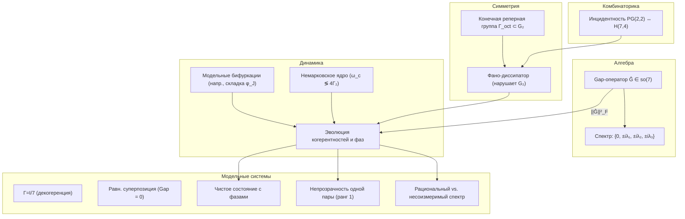

# Динамика Gap

:::info Для кого эта глава
Динамика когерентностей: Чой–Ямиолковский изоморфизм, бифуркации, код Хэмминга. Предполагается знакомство с [Gap-оператором](/docs/core/dynamics/gap-operator) и [термодинамикой Gap](/docs/core/dynamics/gap-thermodynamics).
:::

Эта глава посвящена тому, **как эволюционирует непрозрачность** между измерениями голонома. Если [Gap-оператор](/docs/core/dynamics/gap-operator) описывает «моментальный снимок» непрозрачности, а [термодинамика Gap](/docs/core/dynamics/gap-thermodynamics) — энергетический ландшафт, то данная глава отвечает на вопрос: **как система движется по этому ландшафту во времени?**

Читатель узнает:
- Как **самомоделирование** $\varphi$ влияет на Gap-профиль (через изоморфизм Чой–Ямиолковского)
- Почему живая система **обязана** сохранять когерентности (теорема о необходимости обобщённого $\varphi$)
- Как **код Хэмминга H(7,4)** из теории передачи данных появляется в структуре Gap-коррекции
- Какие **бифуркации** (внезапные скачки) возможны в Gap-ландшафте
- Как **память системы** порождает затухающие осцилляции Gap

:::tip Интуитивное объяснение
Вернёмся к аналогии с **витражным окном**. В [Gap-операторе](/docs/core/dynamics/gap-operator) мы описали, как измерить прозрачность каждой панели. Теперь зададим вопрос: **как эта прозрачность меняется со временем?**

Представьте, что витражное стекло «живое» — оно может менять свою прозрачность в ответ на свет, температуру и внутренние процессы. Иногда это изменение плавное (панель постепенно мутнеет или проясняется). Но иногда происходят **скачки** — панель, которая десятилетиями была мутной, внезапно становится прозрачной (аналог «озарения»), или наоборот (аналог «травмы»).

Особенно интересно, что у живого витража есть **память**: прошлые состояния влияют на текущую динамику. Поэтому после резкого изменения (травма) прозрачность **осциллирует** — качается туда-сюда, прежде чем установиться в новом положении (аналог «циклов горя»).
:::

Gap-динамика описывает эволюцию **непрозрачности** (opaqueness) между измерениями голонома. Данный документ рассматривает теорию бифуркаций Gap-ландшафта, немарковские эффекты памяти, связь с изоморфизмом Чой–Ямиолковского, аналогию с квантовой коррекцией ошибок через код Хэмминга H(7,4) и $G_2$-ковариантность диссипатора. Алгебраическая структура Gap-оператора определена в [Gap-операторе](/docs/core/dynamics/gap-operator).

---

## 1. Изоморфизм Чой–Ямиолковского для φ {#чой-ямиолковский}

### 1.1 Определение (Состояние Чой)

Для CPTP-канала $\varphi: \mathcal{D}(\mathcal{H}) \to \mathcal{D}(\mathcal{H})$ **состояние Чой** определяется как:

$$
J(\varphi) := (\varphi \otimes \mathrm{id})(|\Omega\rangle\langle\Omega|) \in \mathcal{L}(\mathcal{H} \otimes \mathcal{H})
$$

где максимально запутанное состояние:

$$
|\Omega\rangle = \frac{1}{\sqrt{7}} \sum_{i=1}^{7} |i\rangle \otimes |i\rangle
$$

**Свойства состояния Чой:**

| Свойство | Формулировка | Следствие |
|----------|--------------|-----------|
| Размерность | $J(\varphi) \in \mathbb{C}^{49 \times 49}$ | Полное описание канала |
| Эрмитовость | $J(\varphi)^\dagger = J(\varphi)$ | Спектральное разложение существует |
| Положительность | $J(\varphi) \geq 0$ | Полная положительность $\varphi$ |
| CPTP-условие | $\mathrm{Tr}_1(J(\varphi)) = I/7$ | Сохранение следа |
| Реконструкция | $\varphi(\Gamma) = 7 \cdot \mathrm{Tr}_2\left(J(\varphi) \cdot (I \otimes \Gamma^T)\right)$ | Восстановление канала из состояния Чой |

### 1.2 Блочная структура и фазовые свойства

:::tip Теорема 1.1 (Матрица Чой линейного диагонально-дефазирующего канала с фиксированными параметрами) [Т]
Для **линейного** CPTP-канала $\varphi_{\mathrm{diag}}(X) = k\,\mathrm{diag}(X) + (1-k)\,\mathrm{Tr}(X)\,\mathrm{diag}(w_1,\dots,w_7)$ с фиксированным $k \in [0, 1]$ и вероятностными весами $w_m \ge 0$, $\sum_m w_m = 1$:

**(a)** Поэлементная структура состояния Чой $J(\varphi_{\mathrm{diag}}) = \frac{1}{7}\sum_{a,b}\varphi_{\mathrm{diag}}(|a\rangle\langle b|)\otimes|a\rangle\langle b|$:

$$
\langle m, a \mid J(\varphi_{\mathrm{diag}}) \mid n, b\rangle = \frac{1}{7}\,\delta_{ab}\,\delta_{mn}\bigl(k\,\delta_{ma} + (1 - k)\,w_m\bigr)
$$

**(b)** При $m \neq n$: $[\varphi_{\mathrm{diag}}(\Gamma)]_{mn} = 0$ — диагонально-дефазирующий канал уничтожает все внедиагональные когерентности.

*(Примечание: если $k = k(\Gamma)$ зависит от состояния $\Gamma$, отображение нелинейно и не представляется одной матрицей Чой; приведённая формула относится только к линейным CPTP-каналам с замороженными параметрами.)*
:::

### 1.3 Необходимость когерентно-сохраняющего φ для интеграции

:::tip Теорема 1.2 (Необходимость когерентно-сохраняющего φ для интегрированных состояний) [Т]
**(a)** Диагональные состояния могут превышать $P_{\text{crit}} = 2/7$ (например, $\mathrm{diag}(1,0,\dots,0)$ имеет $P=1$, а $\mathrm{diag}(0.5, 0.1, 0.1, 0.1, 0.1, 0.05, 0.05)$ имеет $P = 0.295 > 2/7$), поэтому условие $P > 2/7$ само по себе **не** вынуждает ненулевых когерентностей.

**(b)** Однако **состояния с равномерной диагональю** ($\gamma_{ii} = 1/7$) имеют $P = 1/7 + \sum_{i\neq j}|\gamma_{ij}|^2$, а **порог интеграции** $\Phi(\Gamma) = \frac{\sum_{i\neq j}|\gamma_{ij}|^2}{\sum_i \gamma_{ii}^2} \ge 1$ окна сознания строго требует $\sum_{i\neq j}|\gamma_{ij}|^2 \ge \sum_i \gamma_{ii}^2 \ge 1/7 > 0$, то есть ненулевых внедиагональных когерентностей.

**(c)** Следовательно, самомодель, предназначенная для поддержания интегрированных состояний ($\Phi \ge 1$), не может быть чисто диагонально-дефазирующей и должна сохранять когерентности.
:::

Это мотивирует когерентно-сохраняющие самомодели, такие как $\varphi_{\text{coh}}$ через [Фано-структуру](/docs/physics/gauge-symmetry/fano-selection-rules) (в сочетании с неунитальными якорями, такими как $\varphi_J$, для изолированных аттракторов; см. [мёртвая изоляция](/docs/core/dynamics/evolution#теорема-мёртвая-изоляция)).

:::note Плоскость Фано PG(2,2)
Проективная плоскость над $\mathbb{F}_2$: 7 точек и 7 линий, каждая линия содержит 3 точки. В УГМ: 7 точек ↔ 7 измерений, 7 линий ↔ 7 Фано-триплетов. Подробнее: [Правила отбора Фано](/docs/physics/gauge-symmetry/fano-selection-rules).
:::

### 1.4 Фазовое действие линейного CPTP-канала

:::tip Теорема 1.3 (Фаза внедиагональных элементов в представлении Крауса) [Т]
Для линейного CPTP-канала $\varphi(\Gamma) = \sum_\alpha K_\alpha \Gamma K_\alpha^\dagger$ внедиагональные элементы преобразуются как:

$$
[\varphi(\Gamma)]_{ij} = \sum_\alpha \sum_{m,n} (K_\alpha)_{im}\,\gamma_{mn}\,(K_\alpha)_{jn}^*, \qquad \theta_{ij}^{\text{target}} = \arg\bigl([\varphi(\Gamma)]_{ij}\bigr) \quad (\text{при } [\varphi(\Gamma)]_{ij} \neq 0).
$$

Для диагонально-сохраняющего Фано-канала $\mathcal{P}_\alpha$ каждый внедиагональный элемент умножается на положительный вещественный коэффициент сжатия $c(\alpha) = (1-\alpha)/3 > 0$, оставляя фазу $\arg([\mathcal{P}_\alpha(\Gamma)]_{ij}) = \arg(\gamma_{ij})$ неизменной.
:::

### 1.5 Неподвижные точки φ против динамических стационарных состояний

:::tip Теорема 1.4 (Неподвижные точки φ против стационарных состояний потока) [Т]
**(a) Существование неподвижных точек $\varphi$:** Любое непрерывное отображение $\varphi: \mathcal{D}(\mathbb{C}^7) \to \mathcal{D}(\mathbb{C}^7)$ компактного выпуклого множества $\mathcal{D}(\mathbb{C}^7)$ имеет хотя бы одну неподвижную точку $\varphi(\rho_*) = \rho_*$ (теорема Брауэра о неподвижной точке).

**(b) Несовпадение на нетривиальных динамических аттракторах (T-96 / T-157):** Для полной эволюции $\dot{\Gamma} = \mathcal{L}_0[\Gamma] + \kappa(\Gamma)g_V(P)(\varphi(\Gamma) - \Gamma)$ с примитивной унитальной линейной частью $\mathcal{L}_0$ (единственное линейное стационарное состояние $I/7$) любое нетривиальное стационарное состояние $\Gamma^* \neq I/7$ с $\kappa g_V > 0$ необходимо удовлетворяет:

$$
\varphi(\Gamma^*) - \Gamma^* = -\frac{1}{\kappa(\Gamma^*)g_V(P(\Gamma^*))}\,\mathcal{L}_0[\Gamma^*] \neq 0.
$$

Таким образом, нетривиальный динамический аттрактор $\Gamma^*$ **не** является неподвижной точкой $\varphi$ (при $\varphi(\Gamma^*) = \Gamma^*$ регенерация обнуляется, и примитивность вынуждает $\Gamma^* = I/7$); дефект самопознания $\|\varphi(\Gamma^*) - \Gamma^*\|_F$ количественно контролируется теоремой [T-157](/docs/core/dynamics/evolution#теорема-согласованность-аттракторов).
:::

---

## 2. Комбинаторное соответствие с кодом Хэмминга H(7,4) {#код-хэмминга}

#### Теорема H(7,4) — комбинаторное соответствие инцидентности [Т] {#теорема-h74-формальная}

:::tip Статус [Т]
7 точек и 7 прямых плоскости Фано $\mathrm{PG}(2,2)$ канонически соответствуют двоичному коду Хэмминга $H(7,4) = [7,4,3]_2$ **[Т]**: 7 ненулевых векторов $\mathbb{F}_2^3$ образуют столбцы проверочной матрицы $H$ размера $3 \times 7$ (её 3 строки имеют вес 4 и порождают 7 кодовых слов веса 4 дуального симплекс-кода), тогда как дополнения 7 гиперплоскостей в $\mathbb{F}_2^3 \setminus \{0\}$ являются 7 прямыми $\mathrm{PG}(2,2)$ (образующими матрицу инцидентности $7 \times 7$ с весом строки 3 и весом столбца 3).
:::

**Обратное направление (селектор).** Теорема Σ (T-224) показывает, как совершенная двоичная синдромная диагностика одиночного сбоя совместно с нетривиальной грамматикой состояний и ограничениями интерференции выделяет $n = 7$ — см. [операциональные процессы](/docs/core/foundations/operational-processes#address) и [Σ-исчисление](/docs/applied/research/syndrome-calculus#t-224).

### 2.1 Структура кода H(7,4)

Код Хэмминга H(7,4) — классический двоичный линейный код $[7,4,3]_2$ с параметрами:
- **4 информационных бита** и **3 проверочных бита** (минимальное расстояние $d_{\min} = 3$: исправляет 1 битовую ошибку и обнаруживает 2 битовые ошибки в классических двоичных кодовых словах).

Проверочная матрица ($3 \times 7$, вес каждой строки равен 4, столбцы — ненулевые векторы $\mathbb{F}_2^3$):

$$
H = \begin{pmatrix}
1 & 0 & 1 & 0 & 1 & 0 & 1 \\
0 & 1 & 1 & 0 & 0 & 1 & 1 \\
0 & 0 & 0 & 1 & 1 & 1 & 1
\end{pmatrix}
$$

### 2.2 Структурная аналогия с измерениями УГМ [И]

| Код Хэмминга $H(7,4)$ | Комбинаторная метка УГМ | Область применимости |
|-------------|-----|------|
| 7 позиций битов | 7 базисных осей $\{A,S,D,L,E,O,U\}$ | Геометрия инцидентности $\mathrm{PG}(2,2)$ **[Т]** |
| 3 проверки чётности | 3-битный синдром адреса в $\mathbb{F}_2^3$ | Классическая адресация одиночного сбоя **[Т]** |
| Кодовое слово / ошибка бита | Фазово-когерентная аналогия | Только интерпретативная аналогия **[И]** |

### 2.3 Область применимости: отсутствие хэмминговой нижней границы на ненулевые Gap

:::warning Уточнение области применимости
Комбинаторный изоморфизм $\mathrm{PG}(2,2) \leftrightarrow H(7,4)$ относится к 7-точечной структуре инцидентности и классическим двоичным адресным синдромам. Он **не** доказывает автоматической коррекции внедиагональных квантовых фаз когерентности оператором $\mathcal{R}$ и **не** накладывает нижней границы в 3 ненулевых Gap из 21 когерентности: вещественные матрицы плотности — включая как Модель 2 ниже ($\Gamma = |\psi\rangle\langle\psi|$ с равными вещественными амплитудами, $P=1$), так и жизнеспособные состояния в $\mathcal{V}_{\mathrm{full}}$ вроде $\frac{1}{2}I_7/7 + \frac{1}{2}uu^\dagger$ ($P=5/14, R=0.40, \Phi=1.50$) — имеют $\mathrm{Gap}(i,j) = 0$ тождественно для всех 21 пары. Прежние утверждения о «квантовой границе Хэмминга ($\ge 3$ ненулевых Gap)» и автоматической коррекции когерентностей отозваны.
:::

---

## 3. Качественные бифуркации Gap-ландшафта {#бифуркации}

### 3.1 Gap-ландшафт

**Определение (Gap-ландшафт):**

$$
\mathcal{G}: \mathcal{D}(\mathbb{C}^7) \to [0,1]^{21}
$$

отображает матрицу когерентности $\Gamma$ (при $\gamma_{ij} \neq 0$) в вектор из 21 значения Gap $\mathrm{Gap}(i,j) = |\mathrm{Im}(\gamma_{ij})|/|\gamma_{ij}|$ для всех пар $(i,j)$ с $i < j$.

### 3.2 Бифуркации в конкретных потоках УГМ

В параметризованных нелинейных потоках УГМ $\dot{\Gamma} = \mathcal{L}_0[\Gamma] + \kappa(\Gamma)g_V(P)(\varphi(\Gamma)-\Gamma)$ наличие бифуркаций устанавливается для каждого явного выбора $(H, \mathcal{D}, \varphi, \kappa)$, а не предполагается универсально:

- **Доказанная седло-узловая бифуркация (складка) [Т]:** Для изолированного голона с якорем коллинеаций $\varphi_J$ при $H = 0$ доказан седло-узловой порог $\kappa_c(\alpha)$: при $\kappa < \kappa_c(\alpha)$ стационарных состояний с $P > 2/7$ нет, а при $\kappa > \kappa_c(\alpha)$ возникают гиперболический сток в $\mathcal{V}_{\mathrm{full}}$ и седло ([живой аттрактор в окне](/docs/core/dynamics/evolution#теорема-живой-аттрактор-в-окне)).
- **Прочие локальные бифуркации [Г]:** Вилочная бифуркация, бифуркация Хопфа (предельный цикл) и катастрофа сборки — стандартные возможности гладких параметрических семейств ОДУ, но они **не** доказаны как универсальные теоремы Gap-ландшафта УГМ (прежние общие «Теорема 4.1» и «Теорема 4.2» о нормальных формах, а также клинические сопоставления с психиатрическими расстройствами отозваны).

---

## 4. Немарковские эффекты {#немарковские-эффекты}

### 4.1 Уравнение с ядром памяти

**Определение (Немарковское уравнение когерентностей [О]):**

$$
\frac{d\gamma_{ij}}{d\tau} = -i\Delta\omega_{ij}\,\gamma_{ij} + \int_0^\tau K_{ij}(\tau - s)\, \gamma_{ij}(s)\, ds + \mathcal{R}_{ij}
$$

где:
- $\Delta\omega_{ij} = \omega_i - \omega_j$ — расстройка частот между измерениями $i$ и $j$
- $K_{ij}(\tau - s)$ — **ядро памяти**, моделирующее немарковскую память резервуара
- $\mathcal{R}_{ij}$ — регенеративный член

В отличие от марковского предела ($K_{ij}(t) = -\Gamma_2 \delta(t)$ — мгновенная декогеренция), ядро памяти с конечным временем затухания допускает временный обратный поток когерентности из окружения.

### 4.2 Затухающие осцилляции при экспоненциальном ядре памяти

#### Модельный анзац 5.0 / T-94 (Одноэкспоненциальное ядро памяти) [О/Г] {#теорема-ядро-экспоненциальное}

:::info Область применимости [О/Г]
Выбор экспоненциального ядра памяти $K(t) = -\Gamma_2 \omega_c e^{-\omega_c t}$ ($\omega_c > 0, \Gamma_2 > 0$) представляет собой стандартный **одномодовый / лоренцев анзац марковского вложения** (`[О/Г]`), характеризуемый частотой обрезания памяти $\omega_c$ и марковской скоростью декогеренции $\Gamma_2 = -\int_0^\infty K(t)\,dt$. (Компактность фазового тора состояния $(S^1)^{21}$ не определяет спектральную плотность резервуара и не вынуждает одноэкспоненциального ядра; прежний статус `[Т]` пересмотрен.)
:::

:::tip Теорема 5.1 (Режимы затухания для экспоненциального ядра памяти) [Т]
Рассмотрим скалярное интегро-дифференциальное уравнение с памятью $\dot{x}(\tau) = -\Gamma_2 \omega_c \int_0^\tau e^{-\omega_c(\tau-s)} x(s)\,ds$ ($\Delta\omega = 0$, $\mathcal{R} = 0$, $\Gamma_2 > 0$, $\omega_c > 0$). Однократное дифференцирование сводит его к точному ОДУ второго порядка:

$$
\ddot{x} + \omega_c \dot{x} + (\Gamma_2 \omega_c)\,x = 0
$$

с характеристическим уравнением $r^2 + \omega_c r + \Gamma_2 \omega_c = 0$ и дискриминантом $\Delta = \omega_c(\omega_c - 4\Gamma_2)$:

**(a) Недодемпфированный (осциллирующий) режим — $\omega_c < 4\Gamma_2$ ($\Delta < 0$):** комплексно-сопряжённые корни $r = -\gamma \pm i\omega_r$, где:

$$
\gamma = \frac{\omega_c}{2}, \qquad \omega_r = \sqrt{\omega_c \Gamma_2 - \frac{\omega_c^2}{4}} > 0
$$

порождающие затухающие осцилляции вида $x(\tau) = e^{-\gamma\tau}(C_1 \cos\omega_r\tau + C_2 \sin\omega_r\tau)$.

**(b) Критическое затухание — $\omega_c = 4\Gamma_2$ ($\Delta = 0$):** кратный корень $r = -2\Gamma_2$.

**(c) Передемпфированный (монотонный) режим — $\omega_c > 4\Gamma_2$ ($\Delta > 0$):** два различных отрицательных вещественных корня $r_\pm = \frac{-\omega_c \pm \sqrt{\omega_c(\omega_c - 4\Gamma_2)}}{2}$, дающие чисто экспоненциальную релаксацию без осцилляций. В **марковском пределе** ($\omega_c \gg 4\Gamma_2$) медленный корень стремится к $r_+ \approx -\Gamma_2$, восстанавливая стандартную экспоненциальную декогеренцию $x(\tau) \propto e^{-\Gamma_2\tau}$, тогда как быстрая мода памяти затухает как $e^{-\omega_c\tau}$.
:::

:::info Дискретная реализация [T-135]
Для цифрового агента экспоненциальное ядро памяти дискретизируется через Z-преобразование с $O(1)$ сложностью на шаг (вместо $O(T^2)$): вспомогательная переменная $M[n]$ с рекурсией $M[n+1] = e^{-\omega_c\delta\tau}M[n] + (-\Gamma_2\omega_c)\Gamma[n+1]$. Подробнее: [T-135 [Т]](/docs/proofs/consciousness/operationalization#t-135).
:::

### 4.3 Режимы экспоненциального ядра памяти

| Режим | Точное условие | Динамика когерентности |
|-------|----------------|------------------------|
| Недодемпфированный (осциллирующий) | $\omega_c < 4\Gamma_2$ | Затухающие осцилляции ($\gamma = \omega_c/2$, $\omega_r = \sqrt{\omega_c\Gamma_2 - \omega_c^2/4}$) |
| Критическое затухание | $\omega_c = 4\Gamma_2$ | Наибыстрейший бесосцилляционный спад ($r = -2\Gamma_2$) |
| Передемпфированный | $\omega_c > 4\Gamma_2$ | Монотонная биэкспоненциальная релаксация |
| Марковский предел | $\omega_c \gg 4\Gamma_2$ | Одноэкспоненциальная декогеренция $e^{-\Gamma_2\tau}$ |

---

## 5. Gap-оператор: сводка {#gap-оператор}

:::note Каноническое определение
Полное определение Gap-оператора $\hat{\mathcal{G}} = \mathrm{Im}(\Gamma) \in \mathfrak{so}(7)$, его алгебраические свойства, спектральная структура и таблица рангов непрозрачности приведены в [Gap-оператор](/docs/core/dynamics/gap-operator). Здесь дана только сводка ключевых результатов, используемых в динамических разделах.
:::

**Ключевые результаты из [Gap-оператора](/docs/core/dynamics/gap-operator):**

- $\hat{\mathcal{G}} \in \mathfrak{so}(7)$ — вещественная антисимметричная матрица, $\mathrm{spec}(\hat{\mathcal{G}}) = \{0, \pm i\lambda_1, \pm i\lambda_2, \pm i\lambda_3\}$.
- **Суммарный Gap:** $\mathcal{G}_{\text{total}} = \|\hat{\mathcal{G}}\|_F^2 = 2\sum_{i<j} |\gamma_{ij}|^2 \cdot \mathrm{Gap}(i,j)^2$ (см. [соглашение о норме](/docs/core/dynamics/gap-operator#g-total-definition)).
- **Связь с чистотой:** $P = P_{\text{sym}} + \mathcal{G}_{\text{total}}$ ([теорема 4.1](/docs/core/dynamics/gap-operator#связь-чистота)).
- **Спектральная формула:** $\mathcal{G}_{\text{total}} = 2(\lambda_1^2 + \lambda_2^2 + \lambda_3^2)$ ([теорема 3.1](/docs/core/dynamics/gap-operator#спектр)).
- **Ранг непрозрачности** = число ненулевых $\lambda_k \in \{0, 1, 2, 3\}$; максимальный ранг 3 совпадает с числом проверок чётности H(7,4) ([раздел 2](#код-хэмминга)).

---

## 6. $G_2$-ковариантность диссипатора {#g2-ковариантность}

Данный раздел рассматривает, как симметрия $G_2 = \mathrm{Aut}(\mathbb{O})$ взаимодействует с диссипативной динамикой. Подробная теория $G_2$-структуры изложена в [G₂-структура и плоскость Фано](/docs/physics/gauge-symmetry/g2-structure).

:::note DRY
Канонические доказательства $G_2$-ковариантности — в [Операторах Линдблада](/docs/core/operators/lindblad-operators#g2-ковариантность).
:::

### 6.1 Атомарный диссипатор нарушает $G_2$

:::tip Теорема 11.1 (Атомарный диссипатор НЕ $G_2$-ковариантен) [Т]

$$
\exists g \in G_2:\quad \mathcal{D}_{\text{atom}}[g\Gamma g^\dagger] \neq g\,\mathcal{D}_{\text{atom}}[\Gamma]\,g^\dagger
$$

Диагональная проекция (атомарное наблюдение) **не коммутирует** с $G_2$-преобразованиями.
:::

### 6.2 Фано-диссипатор: реперная ковариантность {#fano-frame-covariance}

:::tip Теорема 11.2 (Группа ковариантности Фано-диссипатора) [Т]
Поскольку $\mathcal{D}_{\text{Fano}} = \tfrac23\mathcal{D}_{\text{atom}}$ (Фано–атомная пропорциональность), Фано-диссипатор ковариантен относительно конечной реперной группы $\Gamma_{\!\text{oct}}\subset G_2$ — знаковых перестановок в $G_2$, порядок $1344 = 8\cdot168$, на линиях она действует через $\mathrm{Aut}(PG(2,2))\cong PSL(2,7)$ (до 2026-09-25 стояло «$\Gamma_{\!\text{oct}}\cong PSL(2,7)$» — группа была спутана со своим образом), — **не** относительно полной непрерывной $G_2$:

$$
\forall g \in \Gamma_{\!\text{oct}}:\quad \mathcal{D}_{\text{Fano}}[g\Gamma g^\dagger] = g\,\mathcal{D}_{\text{Fano}}[\Gamma]\,g^\dagger.
$$

Канонический вполне $G_2$-ковариантный диссипатор — это $\mathcal{D}_{G_2}$ (структурные константы $\varphi_{abc}$).
:::

**Доказательство:** Для $g\in\Gamma_{\!\text{oct}}$ элемент $g$ переставляет Фано-линии $\Rightarrow g\Pi_p g^\dagger = \Pi_{\sigma_g(p)} \Rightarrow \sum_p \Pi_p \Gamma \Pi_p$ инвариантна при переиндексации $\Rightarrow$ ковариантность выполнена. Общий $g\in G_2$ вращает координатные оси (неприводимость $\mathbf 7$, Шур), поэтому не переставляет координатные линии; полная $G_2$-ковариантность для пиннинг-диссипатора не выполняется. Полное изложение: [Фано-канал §5](/docs/proofs/gap/fano-channel#g2-ковариантность). $\blacksquare$

### 6.3 Степень $G_2$-нарушения

:::tip Теорема 11.3 (Степень $G_2$-нарушения аффинна по Фано-весу $\alpha$) [Т]
**(a)** $\alpha = 0$ (чистый Фано): ковариантность лишь относительно конечной реперной группы $\Gamma_{\!\text{oct}}$ — $G_2$-ковариантности нет ни при каком $\alpha$ ([Теорема 5.1b](/docs/proofs/gap/fano-channel#g2-ковариантность), [реперное решение D-0910](/docs/proofs/categorical/uniqueness-theorem#g2-ригидность)).

**(b)** $\alpha = 1$ (чистый атомарный): $G_2$ **полностью нарушена**.

**(c)** Промежуточные значения: $\Delta_{G_2}(\alpha) = \tfrac{2+\alpha}{3} \cdot \Delta_{\max}$, из $\mathcal{D}_\alpha = \tfrac{2+\alpha}{3}\mathcal{D}_{\mathrm{atom}}$.

Мера нарушения **аффинна** по $\alpha$ и строго положительна на $[0,1]$ — из пропорциональности $\mathcal{D}_{\mathrm{Fano}} = \tfrac23\mathcal{D}_{\mathrm{atom}}$.
:::

### 6.4 Размерность пространства параметров при каждом α

Поскольку $\mathcal{D}_{\mathrm{Fano}} = \tfrac{2}{3}\mathcal{D}_{\mathrm{atom}}$ нарушает непрерывную симметрию $G_2$ до конечной реперной группы $\Gamma_{\!\text{oct}}$ при **любом** $\alpha \in [0, 1]$ ([Теорема 5.1b](/docs/proofs/gap/fano-channel#g2-ковариантность)), пространство параметров состояний остаётся полным 48-мерным пространством $\mathcal{D}(\mathbb{C}^7)$ при любом $\alpha$, а $\alpha$ является свободным весом модели (прежняя `Теорема 11.4` и вариационная формула $\alpha^* \approx 1 - 2/(7P)$ отозваны).

---

## 7. Единая теорема самонаблюдения и Gap {#единая-теорема}

:::note DRY
Каноническая формулировка также в [Операторе φ](/docs/core/operators/phi-operator#единая-теорема-самонаблюдения).
:::

:::tip Теорема 12.1 (Фано-когерентное самомоделирование) [Т]
Канонический когерентно-сохраняющий линейный канал наблюдения $\mathcal{P}_\alpha$ и самомодель $\varphi_{\mathrm{coh}}$ параметризуются параметром сжатия $k$ и свободным Фано-весом $\alpha \in [0, 1]$:

**(a) Алгебраическая структура:** Плоскость Фано $\mathrm{PG}(2,2)$ определяет семь линейных проекторов $\Pi_p$, порождающих Фано–Линдблад-операторы $L_p^{\text{Fano}} = \Pi_p/\sqrt{3}$.

**(b) Сохранение фаз каналом $\mathcal{P}_\alpha$:** Фано-атомарный канал $\mathcal{P}_\alpha$ умножает каждую внедиагональную когерентность на положительный вещественный множитель $c(\alpha) = (1-\alpha)/3 \ge 0$, сохраняя фазы когерентностей при $c(\alpha) > 0$ ($\alpha < 1$).

**(c) Симметрия:** Непрерывная симметрия $G_2$ нарушена при любом $\alpha \in [0, 1]$ до конечной реперной группы $\Gamma_{\!\text{oct}}$, со степенью нарушения $\Delta_{G_2}(\alpha) = \tfrac{2+\alpha}{3}\Delta_{\max}$ (Теорема 11.3).

*(Примечание: для унитальной фазосохраняющей самомодели $\varphi_{\mathrm{coh}}$ теорема о мёртвой изоляции ([evolution.md](/docs/core/dynamics/evolution#теорема-мёртвая-изоляция)) уводит изолированную систему к $\Gamma = I/7$, где все внедиагональные когерентности обращаются в нуль; прежняя формула пункта (e) $\mathrm{Gap}^{(\infty)} = |\sin(\theta_{ij} - \arctan(\Delta\omega_{ij}/(\Gamma_2+\kappa)))|$ отозвана, так как аналогичный фазовый сдвиг $\theta^a_{ij} - \arctan(\Delta\omega_{ij}/\Gamma_{\mathrm{eff}})$ имеет место лишь для линейной релаксации к внешне заданному фиксированному когерентному якорю $\rho_a$, а не для фазосохраняющего $\varphi_{\mathrm{coh}}$.)*
:::

---

## 8. Модельные системы с точными Gap-профилями {#модельные-системы}

Пять аналитически решаемых конфигураций демонстрируют весь спектр Gap-профилей — от полной прозрачности до патологической непрозрачности.

### 8.1 Модель 1: Равномерная система ($\Gamma = I/7$)

$$
\gamma_{ij} = \frac{1}{7}\delta_{ij}
$$

| Параметр | Значение |
|----------|----------|
| Когерентности | Все $\gamma_{ij} = 0$ при $i \neq j$ |
| Gap | Не определён (деление на $\lvert\gamma_{ij}\rvert = 0$) |
| Чистота | $P = 1/7$ (минимальная) |

**Интерпретация:** Полностью декогерированная система. Нет связей между измерениями — нет Gap. Соответствует уровню L0 (нет самомоделирования).

### 8.2 Модель 2: Чистое состояние (равномерная суперпозиция)

$$
|\psi\rangle = \frac{1}{\sqrt{7}}\sum_{i=1}^{7} |i\rangle \quad \Rightarrow \quad \Gamma = |\psi\rangle\langle\psi|, \quad \gamma_{ij} = \frac{1}{7}
$$

| Параметр | Значение |
|----------|----------|
| Когерентности | Все $\gamma_{ij} = 1/7 \in \mathbb{R}$ |
| Gap | $\text{Gap}(i,j) = \lvert\sin(\arg(1/7))\rvert = \lvert\sin(0)\rvert = \mathbf{0}$ для всех пар |
| Чистота | $P = 1$ (максимальная) |

**Интерпретация:** Идеальная прозрачность. Внешнее $=$ внутреннее для всех каналов. Все когерентности вещественны — ранг непрозрачности 0 ([раздел 5](#gap-оператор)).

### 8.3 Модель 3: Чистое состояние с Фано-фазами

$$
|\psi\rangle = \frac{1}{\sqrt{7}}\sum_{i=1}^{7} e^{i\phi_i} |i\rangle \quad \Rightarrow \quad \gamma_{ij} = \frac{1}{7}e^{i(\phi_i - \phi_j)}
$$

- $|\gamma_{ij}| = 1/7$ для всех пар
- $\text{Gap}(i,j) = |\sin(\phi_i - \phi_j)|$
- $P = 1$

**Конкретный пример (фазы из октонионной структуры):**

Пусть $\phi_k = (k-1)\pi/7$, т.е. $\phi_1 = 0,\; \phi_2 = \pi/7,\; \phi_3 = 2\pi/7, \ldots, \phi_7 = 6\pi/7$.

| Пара | $\Delta\phi$ | Gap |
|------|:---:|:---:|
| A$\leftrightarrow$S | $\pi/7$ | $\sin(\pi/7) \approx 0.434$ |
| A$\leftrightarrow$D | $2\pi/7$ | $\sin(2\pi/7) \approx 0.782$ |
| A$\leftrightarrow$L | $3\pi/7$ | $\sin(3\pi/7) \approx 0.975$ |
| A$\leftrightarrow$E | $4\pi/7$ | $\sin(4\pi/7) \approx 0.975$ |
| A$\leftrightarrow$O | $5\pi/7$ | $\sin(5\pi/7) \approx 0.782$ |
| A$\leftrightarrow$U | $6\pi/7$ | $\sin(6\pi/7) \approx 0.434$ |
| S$\leftrightarrow$D | $\pi/7$ | $0.434$ |
| S$\leftrightarrow$L | $2\pi/7$ | $0.782$ |
| S$\leftrightarrow$E | $3\pi/7$ | $0.975$ |
| S$\leftrightarrow$O | $4\pi/7$ | $0.975$ |

:::info Наблюдение
Gap монотонно растёт с «расстоянием» между измерениями (в смысле циклического порядка). Ближайшие измерения прозрачнее, далёкие — непрозрачнее. Связь A$\leftrightarrow$S (артикуляция–структура) ближе и прозрачнее, чем A$\leftrightarrow$L (артикуляция–логика).
:::

### 8.4 Модель 4: Фазовая непрозрачность одной пары ($\gamma_{SE} = |\gamma_{SE}| \cdot e^{i\pi/2}$)

**Конфигурация с рангом непрозрачности 1** — максимальная фазовая непрозрачность на одной паре $(S, E)$:

$$
\gamma_{SE} = |\gamma_{SE}| \cdot e^{i\pi/2}, \quad \text{остальные когерентности} \in \mathbb{R}
$$

| Параметр | Значение |
|----------|----------|
| $\text{Gap}(S,E)$ | $\lvert\sin(\pi/2)\rvert = \mathbf{1}$ (максимальный) |
| $\text{Gap}(i,j)$ при $(i,j) \neq (S,E)$ | $0$ |
| Ранг непрозрачности | 1 |

**Интерпретация:** Когерентность $(S,E)$ имеет ненулевой модуль ($|\gamma_{SE}| > 0$) с чисто мнимой фазой, что даёт Gap-оператор $\hat{\mathcal{G}}$ ранга 1 (одна ненулевая сингулярная пара $\pm i|\gamma_{SE}|$). Отметим, что положительная полуопределённость $\Gamma$ ограничивает допустимый модуль $|\gamma_{SE}|$ при заданных остальных вещественных когерентностях (например, для $S = J_7 - I_7$ с $(S,E)\mapsto i$ матрица остаётся положительно полуопределённой вплоть до $\eta \approx 0{,}474$).

### 8.5 Модель 5: Рациональный против несоизмеримого спектра унитарных частот

Пусть $H_{\text{eff}} = \mathrm{diag}(\omega_1, \dots, \omega_7)$ диагонален. При чисто унитарной эволюции $\dot{\gamma}_{ij} = -i(\omega_i - \omega_j)\gamma_{ij}$ фаза когерентности вращается как:

$$
\text{Gap}(i,j;\, \tau) = \bigl|\sin\bigl(\theta_{ij}(0) - (\omega_i - \omega_j)\tau\bigr)\bigr|
$$

**Два контрастных спектральных режима:**

- **Целочисленный спектр Фибоначчи $\omega = (0, 1, 2, 3, 5, 8, 13)$:** Поскольку все частоты — **целые числа**, каждая разность $\Delta\omega_{ij} = \omega_i - \omega_j$ целочисленна, и каждое отношение частот $\Delta\omega_{ij}/\Delta\omega_{kl} \in \mathbb{Q}$ **рационально**. Следовательно, унитарная траектория строго **$2\pi$-периодична** (а не эргодична), и каждая пара периодически возвращается к начальной фазе.
- **Несоизмеримый спектр (например, $\omega_k = \varphi_{\mathrm{gold}}^k$ или рационально независимые $\sqrt{p_k}$):** Лишь когда разностные частоты $\Delta\omega_{ij}$ **рационально независимы** (несоизмеримы над $\mathbb{Q}$), вектор фаз $(\theta_{ij}(\tau))$ квазипериодически и всюду плотно наматывается на инвариантный тор, избегая точной одновременной периодичности.

:::info Область применимости [И]
Обладают ли какие-либо биологические системы спектрами Фибоначчи или золотого сечения — внешний эмпирический вопрос, не выводимый из аксиом УГМ.
:::

---

## 9. Связь с другими разделами {#связи}

### 9.1 Перекрёстные ссылки

| Тема | Документ | Содержание |
|------|----------|------------|
| Gap-оператор $\hat{\mathcal{G}}$ | [Gap-оператор](/docs/core/dynamics/gap-operator) | Определение $\hat{\mathcal{G}}$, $\mathcal{G}_{\text{total}}$, спектр, $G_2$-разложение, стабилизаторы |
| Матрица когерентности $\Gamma$ | [Матрица когерентности](/docs/core/dynamics/coherence-matrix) | Определение $\Gamma$, её свойства и вычисление |
| Уравнения эволюции | [Эволюция Γ](/docs/core/dynamics/evolution) | Полное уравнение движения, Лиувиллиан |
| Оператор $\varphi$ | [φ-оператор](/docs/core/operators/phi-operator) | Мастер-определение самомоделирования |
| Операторы Линдблада | [Линдблад-операторы](/docs/core/operators/lindblad-operators) | Структурные скачки и нарушение симметрии |
| $G_2$-структура | [G₂-структура](/docs/physics/gauge-symmetry/g2-structure) | Полная теория $G_2$-инвариантов |
| Правила отбора Фано | [Правила отбора Фано](/docs/physics/gauge-symmetry/fano-selection-rules) | Инцидентные тройки $\mathrm{PG}(2,2)$ |
| Gap-термодинамика | [Gap-термодинамика](/docs/core/dynamics/gap-thermodynamics) | Энтропия Gap и область термодинамического описания |

### 9.2 Логическая карта

### 9.3 Сводка статусов

| Результат | Статус | Раздел |
|-----------|--------|--------|
| Матрица Чой фиксированного линейного диагонально-дефазирующего канала | **[Т]** | [1.2](#чой-ямиолковский) |
| Необходимость сохранения когерентностей для $\Phi \ge 1$ / равномерной диагонали | **[Т]** | [1.3](#чой-ямиолковский) |
| Формула Крауса для фаз внедиагональных элементов | **[Т]** | [1.4](#чой-ямиолковский) |
| Неподвижные точки $\varphi$ против нетривиальных стационарных состояний (T-96 / T-157) | **[Т]** | [1.5](#чой-ямиолковский) |
| Комбинаторное соответствие инцидентности $\mathrm{PG}(2,2) \leftrightarrow H(7,4)$ | **[Т]** | [2](#код-хэмминга) |
| Седло-узловая складка для $\varphi_J$ (прочие бифуркации зависят от модели) | **[Т]/[Г]** | [3](#бифуркации) |
| Анзац экспоненциального ядра памяти (T-94) | **[О/Г]** | [4.2](#теорема-ядро-экспоненциальное) |
| Немарковские режимы ($\omega_c < 4\Gamma_2$ осциллирует, $\omega_c > 4\Gamma_2$ передемпфирован) | **[Т]** | [4.2](#немарковские-эффекты) |
| Свойства Gap-оператора | **[Т]** | [Gap-оператор](/docs/core/dynamics/gap-operator#свойства) |
| Спектральная интерпретация Gap | **[Т]** | [Gap-оператор](/docs/core/dynamics/gap-operator#спектр) |
| Атомарный диссипатор не $G_2$-ковариантен | **[Т]** | [6.1](#g2-ковариантность) |
| Фано-диссипатор: реперно ($\Gamma_{\!\text{oct}}$)-ковариантен, не полной $G_2$ ($\mathcal{D}_{\text{Fano}}=\tfrac23\mathcal{D}_{\text{atom}}$) | **[Т]** | [6.2](#fano-frame-covariance) |
| Степень $G_2$-нарушения $\tfrac{2+\alpha}{3}\Delta_{\max}$, аффинна по $\alpha$ | **[Т]** | [6.3](#g2-ковариантность) |
| Фано-когерентный канал наблюдения $\mathcal{P}_\alpha$ (Теорема 12.1) | **[Т]** | [7](#единая-теорема) |
| Модели 1–5 (точные аналитические примеры) | **[Т]** | [8](#модельные-системы) |

---

**Связанные документы:**
- [Gap-оператор](/docs/core/dynamics/gap-operator) — определение, спектр и ранг непрозрачности
- [Термодинамика Gap](/docs/core/dynamics/gap-thermodynamics) — энергетический ландшафт, вакуум, потенциал V_Gap
- [Операторы Линдблада](/docs/core/operators/lindblad-operators) — диссипаторы и G₂-ковариантность
