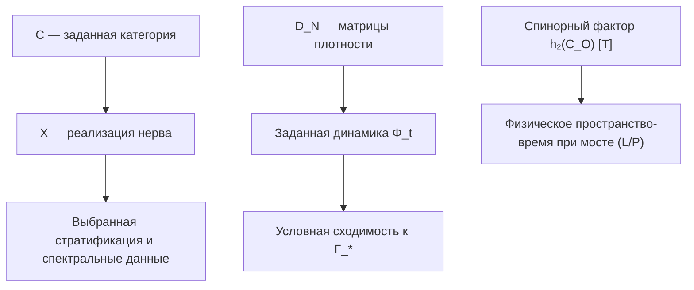

# Структура Пространства–Времени

:::info Типы геометрических конструкций
Эта глава рассматривает несколько разных объектов: нерв выбранной категории процессов, пространство матриц плотности, геометрию заданных спектральных данных и физическое пространство-время. Их отождествление требует отдельных мостов, указанных в [математическом ядре](/docs/reference/mathematical-kernel).

Выбранное $\mathcal H=\mathbb C^7$ имеет комплексную размерность 7; $D_7$ имеет вещественную размерность 48, его чистые состояния — $\mathbb{CP}^6$ вещественной размерности 12, а диагональные состояния — 6-симплекс. Ни одно из этих чисел не определяет размерность $|N(\mathcal C)|$ или физического пространства.

Терминальный объект топоса $1_{\mathcal E}$ и одномерная система категории процессов отличаются от смешанного состояния $I/7$, численной цели $M(\Gamma)$ и равновесия $\Gamma_*$. Терминальность не задаёт движение к равновесию или стрелу времени. Выбор часов, динамического закона, стратификации и спектральной тройки фиксируется отдельно.

Цветосинглетный спин-фактор и его спинорное представление — точные алгебраические конструкции. Для интерпретации в пространстве-времени нужна физическая посылка локальности. [Теорема 48c](#теорема-48c) · [Теорема 48e](#теорема-48e)
:::

:::info Область утверждений
- $X=|N(\mathcal C)|$ — определение [О] для заданной малой категории.
- Bures-сайт — открытые множества $D_N$ с обычными открытыми покрытиями, независимо от $X$.
- Стратификация и метрика требуют геометрических/спектральных данных; они не следуют из одной терминальности.
- Часы и нелинейный поток $\Phi_t$ требуют заданного динамического закона; сходимость доказывается для этого закона.
- Физическое пространство-время и гравитация требуют перечисленных на соответствующих страницах физических мостов.
:::

## Базовое пространство X = |$N(\mathcal{C})$| {#базовое-пространство}

:::warning Свойство 5 (Стратификация) [О]
Базовое пространство теории определяется как геометрическая реализация нерва категории:

$$
X = |N(\mathcal{C})|
$$

где $\mathcal{C}$ — [примитивная категория УГМ](./axiom-omega#примитив).
:::

### Автопоэтичность базового пространства {#автопоэтичность}

Ключевое свойство: **X определяется эндогенно**, не вводится извне.

| Аспект | Традиционные теории | УГМ |
|--------|---------------------|---------|
| Базовое пространство | Постулируется (ℝ⁴, Σ, ...) | Выводится из $\mathcal{C}$ |
| Метрика | Вводится руками | Вычисляется из спектральных данных |
| Топология | Фиксирована | Следует из нервной структуры |

### Нерв категории $N(\mathcal{C})$ {#нерв-категории}

**Определение (Нерв):**

Нерв $N(\mathcal{C})$ — симплициальное множество:
- 0-симплексы: объекты $\mathcal{C}$ (голономы $\mathbb{H}$)
- 1-симплексы: морфизмы $f: A \to B$
- n-симплексы: композируемые цепочки морфизмов

**Геометрическая реализация:**

$$
|N(\mathcal{C})| = \left( \bigsqcup_n \Delta^n \times N_n \right) \Big/ \sim
$$

где отношение эквивалентности склеивает грани симплексов.

### Стратификация X {#стратификация-x}

Стратификация $X=\bigsqcup_\alpha S_\alpha$ — дополнительные данные с указанными условиями фронтира и локальной геометрии. Клетки геометрической реализации соответствуют невырожденным симплексам, но их размерности сами по себе не задают заявленную стратификацию с единственной нульмерной стратой $\{T\}$: нульсимплексы — все объекты категории.

У категории с конечным числом объектов могут быть невырожденные цепочки произвольной длины. Например, нетождественный идемпотентный эндоморфизм можно повторять; получаются невырожденные симплексы всех размерностей. Поэтому число семь не ограничивает размерность нерва. Для **отдельно выбранного** конечного линейного порядка из семи объектов реализация нерва — $\Delta^6$ [Т]; это не категория всех CPTP-процессов и не пространство $D_7$.

### Локально-глобальная дихотомия {#локально-глобальная-дихотомия}

Если сама **индексирующая категория** $\mathcal C$ имеет терминальный объект, её нерв стягиваем [Т]. Терминальный объект её категории пучков не доказывает это условие для $\mathcal C$. При стягиваемом $X$ положительные когомологии с постоянными коэффициентами исчезают; из этого не следует исчезновение когомологий произвольного пучка.

Локальные когомологии требуют отдельной локальной модели. Если окрестность точки $x$ имеет вид конуса над линком $K$, то

$$
H^k_{\mathrm{loc}}(X,x;A)\cong\widetilde H^{k-1}(K;A).
$$

Во внутренней точке шестимерного многообразия линк равен $S^5$. В вершине $\Delta^6$ линк — стягиваемый $\Delta^5$, поэтому локальные когомологии исчезают. Терминальность сама по себе не выбирает линк или стратификацию.

Глобальная стягиваемость действительно совместима с ненулевыми локальными когомологиями, например у внутренней точки диска. Это топологическая совместимость, а не доказательство физики или сходимости динамики.

## Стратифицированная метрика Конна {#метрика-конна}

### Спектральная тройка для страт {#спектральная-тройка}

На каждой страте $S_\alpha$ определяется спектральная тройка:

$$
(A_\alpha, H_\alpha, D_\alpha)
$$

где:
- $A_\alpha = C(S_\alpha)$ — алгебра функций на страте
- $H_\alpha = L^2(S_\alpha, E_\alpha)$ — гильбертово пространство сечений
- $D_\alpha$ — оператор Дирака на страте

### Формула расстояния d_strat {#формула-расстояния}

:::warning Условная конструкция длины [С]
При совместимых метриках длины на стратах задайте путевую псевдометрику между их точками:

$$
d_{strat}(\omega_1, \omega_2) = \inf_{\gamma} \int_\gamma ds_\alpha
$$

где:
- $\gamma$ — путь, пересекающий страты $S_{\alpha_1}, S_{\alpha_2}, \ldots$
- $ds_\alpha$ — метрика Конна на страте $S_\alpha$:

$$
d_\alpha(p, q) = \sup\{|f(p) - f(q)| : \|[D_\alpha, f]\| \leq 1\}
$$

- Инфимум берётся по всем путям, соединяющим $\omega_1$ и $\omega_2$
:::

### Метрика вблизи терминального объекта {#метрика-вблизи-t}

Чтобы путевая псевдометрика была конечной метрикой, требуются соединимость нужных точек, конечность длин и разделение точек; эти свойства не следуют из терминальности. В случае гладкой римановой страты с её канонической спектральной тройкой формула Конна восстанавливает геодезическое расстояние [Т]; склейка разных страт требует дополнительных условий.

Если **задана** коническая риманова модель $ds^2=dr^2+r^2ds_K^2$ с вершиной $x$, то $d(x,(r,k))=r$. Это точная геометрия выбранного конуса, а не следствие терминальности. Убывание $r$ вдоль траекторий требует отдельно заданного динамического закона; терминальный объект топоса не является численным аттрактором.

## Пространство как структура различий

:::note Пространство — не сцена, а отношение
Мы привыкли думать о пространстве как о «сцене», на которой разыгрывается физика: сначала есть пустая комната (пространство), потом в неё кладут предметы (материя). В УГМ пространство — не сцена, а *структура различий между состояниями*. Расстояние между двумя точками — это мера того, насколько трудно деформировать одно состояние в другое. Если два состояния легко переходят друг в друга — они «близки»; если это требует большой перестройки — они «далеки». Пространство возникает как побочный продукт различий, а не как их вместилище. Это решает фундаментальную проблему квантовой гравитации: если пространство — не данность, а следствие, то его квантование не приводит к противоречиям.
:::

Пространство — **не пустой контейнер**, а структура различий в категории $\mathcal{C}$.

### Расстояние {#расстояние}

В обновлённой теории расстояние определяется через [стратифицированную метрику Конна](#метрика-конна):

$$
d(A, B) := d_{strat}(A, B)
$$

В заданной спектральной тройке расстояние зависит от алгебры и оператора Дирака. Расстояние Фробениуса $\|\Gamma_A-\Gamma_B\|_F$ сравнивает две приписанные матрицы состояний. Для физического измерения расстояния любой из этих способов требует определить положения и зонды. [Операционное расстояние](/docs/geometry/response-metric)

### Топология {#топология}

Топология нерва $X$ определяется выбранной малой категорией. Топология $D_N$ определяется пространством матриц плотности; Bures- и евклидова топологии здесь совпадают. Физическая топология не следует из отождествления этих разных объектов.

При терминальном объекте самой $\mathcal C$ нерв стягиваем, но из этого не следуют локальная конусная структура, монотонность стратификации или динамический предел. Предыдущая универсальная топологическая «теорема X» снята в этой области [✗].

## Эмерджентное время

:::note Время — не река, а корреляция
В повседневном опыте время кажется «рекой», несущей нас от прошлого к будущему. В УГМ время — нечто совершенно иное. Оно **возникает** из корреляций между подсистемами. Представьте часы и наблюдателя как единую квантовую систему. «Время = 3 часа» означает не «река достигла отметки 3», а «состояние часов коррелирует с определённым состоянием наблюдателя». Вселенная в целом *вневременна* (удовлетворяет ограничению $[\hat{C}, \Gamma_{\text{total}}] = 0$); время возникает *внутри* неё — как отношение «часов» (измерение O) к «остальному» (6 измерений). Это решение «проблемы времени» в квантовой гравитации, предложенное Пейджем и Вуттерсом в 1983 году.
:::

:::warning Теорема (Эмерджентность времени) [Т]
Время **выводится** из структуры категории $\mathcal{C}$ четырьмя эквивалентными способами:

| Уровень | Время как... | Формула | Статус |
|---------|--------------|---------|--------|
| **Пейдж–Вуттерс** | Корреляция с [O](../structure/dimension-o) | $\Gamma(\tau) = \text{Tr}_O[\cdot]$ | [Т] Формализовано |
| **Информационная геометрия** | Расстояние в метрике Бурес | $d_B(\Gamma_1, \Gamma_2)$ | [Т] Формализовано |
| **Категорный** | 1-морфизм в ∞-группоиде | $\gamma: \Gamma_1 \to \Gamma_2$ | [Т] Формализовано |
| **Стратификация** | Коллапс страт к T вдоль глубины $n$ | $\dim(X_n) \geq \dim(X_{n+1})$ | [Т] Формализовано |

[Полное доказательство →](../../proofs/dynamics/emergent-time)
:::

### Механизм Пейдж–Вуттерс {#механизм-page-wootters}

Время возникает как параметр **условных состояний** относительно измерения O:

$$
\Gamma(\tau) := \frac{\text{Tr}_O\left[ (|\tau\rangle\langle \tau|_O \otimes \mathbb{1}_{6D}) \cdot \Gamma_{total} \right]}{p(\tau)}
$$

где:
- $\Gamma_{total}$ удовлетворяет ограничению $[\hat{C}, \Gamma_{total}] = 0$
- $|\tau\rangle_O$ — базис собственных состояний внутренних часов O
- p(τ) — нормировка

:::info Непрерывность τ — выход, а не допущение (T-286)
Непрерывный часовой параметр требует непрерывной модели или явного масштабного предела показаний. У конечных циклических часов конечное число различимых показаний. [Предел регистра глубины](/docs/proofs/physics/emergent-manifold#теорема-эмерджентное-время)
:::

### Информационно-геометрическое время

Расстояние между конфигурациями в метрике Бурес:

$$
d_B(\Gamma_1, \Gamma_2) = \arccos\left( \text{Tr}\sqrt{\sqrt{\Gamma_1} \Gamma_2 \sqrt{\Gamma_1}} \right)
$$

:::note Нотация
Здесь $d_B$ — угол Бюреса (не хордальное расстояние $\sqrt{2(1-\sqrt{F})}$ из [evolution.md](../dynamics/evolution#каноническое-delta-f)).
:::

**Течение времени** — скорость изменения Γ:

$$
\frac{d\tau_{int}}{d\sigma} = \left\| \frac{d\Gamma}{d\sigma} \right\|_B
$$

Время «течёт быстрее», когда Γ меняется сильнее.

### Связь с эволюцией

Эволюция описывается с внутренним временем τ:

$$
\frac{d\Gamma(\tau)}{d\tau} = -i[H_{eff}, \Gamma(\tau)] + \mathcal{D}[\Gamma(\tau)] + \mathcal{R}[\Gamma(\tau), E]
$$

Это уравнение — **следствие** структуры $\Gamma_{total}$, не постулат.

## Стрела времени {#стрела-времени}

Терминальность задаёт пространства морфизмов. Одно и то же чистое состояние кубита могут сохранять тождественный канал и канал, готовящий это состояние при любом входе. Они задают разную динамику.

Пусть **задан** поток $\Phi_t$ на $D_N$. Сходимость $\Phi_t(\Gamma)\to\Gamma_*$ требует доказательства для выбранного поля. Если все траектории инвариантного бассейна сходятся к неподвижным точкам, их предел задаёт идемпотентную ретракцию $r$ на этом бассейне [Т]; она не тождественна отражателю логической поддержки. Для нелинейных скоростей или самомоделей поток не является одной линейной CPTP-полугруппой.

Неравенство $\dim(X_n)\ge\dim(X_{n+1})$ может быть условием отдельно заданной последовательности геометрических объектов [О]/[Г]; из существования $T$ оно не следует. Подсчёт глубины $n$ и циклический индекс часов $\tau\in\mathbb Z_7$ сохраняют разные значения, но ни тот ни другой сам не доказывает физическую необратимость.

### Термодинамическое направление

Стрела времени определяется направлением увеличения [энтропии фон Неймана](../dynamics/coherence-matrix#энтропия-фон-неймана):

$$
\frac{dS_{vN}}{d\tau} \geq 0
$$

:::note Различение понятий
Геометрическую последовательность страт и динамический поток нужно задать по отдельности.

**Глобальное увеличение дифференциации** ($dD_{\text{diff}}/d\tau > 0$) — это [отдельная космологическая гипотеза](/docs/physics/cosmology-phys/origin#направление-эволюции), имеющая статус **нефальсифицируемой философской позиции**.

Эти понятия связаны (оба касаются направления), но имеют разный эпистемологический статус.
:::

Канал сброса $\rho\mapsto|0\rangle\langle0|$ уменьшает энтропию смешанного состояния. В фиксированной конечной размерности энтропия не убывает при унитальных CPTP-отображениях.

:::note Уточнение
При наличии [регенерации](../dynamics/evolution#3-регенеративный-член) $\mathcal{R}$ возможно локальное уменьшение энтропии за счёт импорта свободной энергии:

$$
\Delta S_{vN}^{local} < 0 \Rightarrow \Delta F_{env \to sys} > 0
$$

Полная энтропия (система + источник) всегда растёт.
:::

### Второй закон термодинамики {#второй-закон}

:::warning Теорема (Второй закон из унитального порядка) [Т]
Второй закон термодинамики — **следствие** порядка **мажоризации**, индуцированного унитальным уточнением морфизмов (см. [Математические основания §терминальный объект](/docs/core/foundations/mathematical-foundations)):

$$
\forall \Gamma:\quad \Gamma \xrightarrow{\ \text{унитальный CPTP}\ } I/7 \quad\text{тогда и только тогда, когда}\quad I/7 \prec \Gamma \ (\text{всегда}),\qquad I/7 \not\to \sigma\ \text{для }\sigma\neq I/7.
$$

В предпорядке достижимости, порождённом унитальными каналами, $I/7$ — наименьшее состояние: каждое состояние может его достичь, а унитальный канал фиксирует его. Унитального обратного пути к другому состоянию нет. Это теорема о разрешённых переходах, а не доказательство сходимости каждой унитальной траектории к $I/7$: тождественный канал и унитарная динамика дают контрпримеры. Это также не терминальность категории каналов: $I/7$ фиксируют разные каналы.

Постоянный канал $X\mapsto\mathrm{Tr}(X)\rho'$ достигает произвольного заданного состояния $\rho'$. Для монотонности энтропии здесь требуются унитальные каналы между регистрами одинаковой размерности.
:::

**Геометрическая интерпретация:**

| Аспект | Формулировка | Следствие |
|--------|--------------|-----------|
| Сток (унитальный порядок) | $\forall \Gamma:\ I/7 \prec \Gamma$; $I/7\not\to\sigma\ (\sigma\neq I/7)$ | Только достижимость; сходимость требует динамической теоремы |
| Выбранная геометрическая последовательность | $\dim(X_n)\ge\dim(X_{n+1})$, если задано | Дополнительное условие, не следствие терминальности |
| Энтропия (унитальные каналы) | $dS_{vN}/d\tau \geq 0$ лишь для унитальных генераторов | Энтропия не убывает вдоль унитальной динамики; для общей квантовой динамической полугруппы монотонна $D_{KL}(\Gamma\|\rho_\infty)$ (Spohn 1978) |

**Статус:** [Т] Формализовано для класса унитальных морфизмов. Второй закон **выводится** из категорной структуры для унитальной динамики; полный генератор УГМ не унитален (см. «Термодинамическое направление»).

### Связь с функцией Хевисайда

Затвор $g_V(P)$ задаётся как часть численного закона [О]. Ландауэровская термодинамика требует отдельной модели среды и информационной операции; логическая поддержка, терминальность и CPTP сами не определяют форму затвора. Сохранение состояний полного нелинейного закона и конечного шага доказано при явных условиях в [динамике](/docs/core/dynamics/evolution#сохранение-положительности).

## Относительность

### Внутренние часы

Разные Голономы могут иметь разные «внутренние часы» — разные темпы эволюции:

$$
\tau_{\mathbb{H}_1} \neq \tau_{\mathbb{H}_2}
$$

где $\tau_{\mathbb{H}}$ — собственное время [Голонома](../structure/holon) $\mathbb{H}$.

### Релятивистские эффекты [С] {#релятивистские-эффекты}

:::tip Теорема (Релятивистские эффекты из спектральной тройки) [С при T-53]
Гравитационное и кинематическое замедление времени — следствия спектральной тройки T-53 [С] (её лоренцев знак — при рефлективной положительности, пространственный слой — при T-119) и полного спектрального действия T-65 [Т]. Формула Конна определяет метрику $g_{\mu\nu}$, а спектральное действие воспроизводит действие Эйнштейна–Гильберта, включающее все релятивистские эффекты.

**Доказательство.**

**Шаг 1 (Метрика из формулы Конна).** Из T-53 [С] ([спектральная тройка](#теорема-спектральная-тройка)):

$$
d(p, q) = \sup\{|f(p) - f(q)| : \|[D, f]\| \leq 1\}
$$

Блочно-диагональная структура $D$ с $g_{00} = 1/|D_O|^2 > 0$, $g_{aa} = -1/|D_{3,a}|^2 < 0$ определяет лоренцеву метрику $g_{\mu\nu}$.

**Шаг 2 (Действие Эйнштейна–Гильберта).** Из T-65 [Т] ([полное спектральное действие](/docs/physics/gravity/quantum-gravity#теорема-полное-спектральное-действие)):

$$
S = \mathrm{Tr}(f(D/\Lambda)) = \int (a_0\Lambda^4 + a_2\Lambda^2 R + a_4 C_{\mu\nu\rho\sigma}^2 + \ldots)\sqrt{g}\,d^4x
$$

Коэффициент $a_2\Lambda^2 R$ даёт кинетический член гравитации, т.е. действие Эйнштейна–Гильберта.

**Шаг 3 (Замедление времени).** Формула скорости внутренних часов:

$$
\frac{d\tau}{d\sigma} = \omega_0 \cdot \sqrt{\sum_{i \neq O} |\gamma_{Oi}|^2 \cdot \mathrm{Gap}(O,i)^2}
$$

$\mathrm{Gap}(O,i)$ включает гравитационные поправки через метрику $g_{\mu\nu}$: в области сильного гравитационного поля (малое $g_{00}$) собственные значения $D_O$ модифицируются, что замедляет $d\tau/d\sigma$. Аналогично, кинематическое замедление следует из лоренцева преобразования спектральных данных. $\blacksquare$
:::

## Эмерджентность геометрии {#эмерджентность-геометрии}

:::info Статус раздела
- **Метрика:** [Т] Формализовано через $d_{strat}$ (см. [выше](#метрика-конна))
- **Размерность:** размерность нерва определяется заданной категорией; $N=7$ её не определяет
- **Гравитация.** Многообразие $\mathbb R\times S^3$ строится как произведение выбранных конструкций зарядов и часов. Его физическое прочтение имеет статус [И]. [T-120](/docs/proofs/physics/emergent-manifold#теорема-произведение-троек)
:::

### Выведенная метрика (не гипотеза)

В УГМ метрика **выводится**, а не постулируется:

$$
d_{strat}(\omega_1, \omega_2) = \inf_{\gamma} \int_\gamma ds_\alpha
$$

**Ключевые свойства:**
- Метрика определена на $X = |N(\mathcal{C})|$
- Учитывает стратификацию (разные ds на разных стратах)
- Конусная вблизи терминального объекта T

### Размерность пространства {#размерность}

Для выбранных объектов размеры различны:

$$
\dim_{\mathbb C}\mathcal H=7,\qquad \dim_{\mathbb R}D_7=48,\qquad
\dim_{\mathbb R}\mathbb{CP}^6=12,\qquad \dim\Delta^6=6.
$$

Только диагональное подпространство состояний имеет вид $\Delta^6$. Нерв произвольной категории процессов не обязан быть этим симплексом.

### Связь с ОТО (программа) {#связь-с-ото}

Спектральное действие на заданной гладкой спиновой геометрии содержит член Эйнштейна–Гильберта в разложении теплового ядра. T-119 определяет спектр выбранной алгебры зарядов, а T-120 строит топологическое произведение. Для выбора физической лоренцевой метрики и связи с веществом нужны дополнительные данные. [Метрическая динамика](/docs/physics/gravity/einstein-equations)

См. [Соответствие с физикой: ОТО](../../proofs/physics/physics-correspondence#5-связь-с-общей-теорией-относительности) для детальной программы.

## Диаграмма эмерджентности

Диаграмма разделяет типы; стрелки не отождествляют терминальный объект, состояние и аттрактор.

## Нелокальность

### Квантовые корреляции

[Когерентности](../dynamics/coherence-matrix#недиагональные-элементы-когерентности) $\gamma_{ij}$ между удалёнными частями $\Gamma$ означают **нелокальные связи**:

$$
\gamma_{AB} \neq 0 \Rightarrow A \text{ и } B \text{ квантово коррелированы}
$$

### Запутанность

Запутанность — это несепарабельность состояния подсистем:

$$
\Gamma_{AB} \neq \Gamma_A \otimes \Gamma_B
$$

где $\Gamma_A = \mathrm{Tr}_B(\Gamma_{AB})$ — [частичный след](/docs/consciousness/foundations/interiority-theory#редуцированная-матрица-опыта) по подсистеме $B$.

Нарушение неравенств Белла — следствие ненулевых когерентностей в структуре $\Gamma$.

## Связь с физикой

| Физическое понятие | Выражение через $\mathcal{C}$ | Статус |
|--------------------|-------------------------------|--------|
| **Базовое пространство** | $X = \lVert N(\mathcal{C})\rVert$ | [Т] [Формализовано](#базовое-пространство) |
| **Время** | Параметр τ (Пейдж–Вуттерс) | [Т] [Формализовано](../../proofs/dynamics/emergent-time) |
| Стрела времени | Заданные эволюция, считывание и условия монотонности | [С при этих входах] |
| **Метрика** | $d_{strat}$ (Конн на стратах) | [Т] [Формализовано](#метрика-конна) |
| **Размерность** | $D_7$: 48; $\mathbb{CP}^6$: 12; диагональные состояния: 6 | [Т] для этих объектов; не размерность нерва или физического пространства |
| Энергия | Собственные значения $H_{eff}$ | [Т] Формализовано |
| Гравитация | Спектральное действие на заданной геометрии произведения | [С при предпосылках о метрике и срезе] |
| Топологические заряды | IC-когомологии страт | [Т] [Формализовано](../../proofs/categorical/categorical-formalism#производные-категории) |

## Связь с другими подходами

| Подход | Связь с УГМ | Статус |
|--------|-------------|--------|
| **Квантовая механика** | Частный случай УГМ при $R \to 0$ | [Доказано](../../proofs/physics/physics-correspondence#3-редукция-к-квантовой-механике) |
| **Стандартная модель** | Калибровочные симметрии из $\text{Sym}(\Gamma)$ | [Программа](../../proofs/physics/physics-correspondence#6-калибровочные-симметрии-и-стандартная-модель) |
| **Петлевая квантовая гравитация** | Спиновые сети могут соответствовать структурам когерентности | Не исследовано |
| **Теория струн** | Возможна связь через голографический принцип | Не исследовано |
| **Hoffman Conscious Agents** | Пространство-время как интерфейс согласуется с эмерджентностью | Концептуально совместимо |
| **Эмерджентная гравитация (Verlinde)** | Сходный подход: гравитация как энтропийная сила | Требует исследования |
| **Октонионная линия** (Гюнайдын — Гюрсей 1973; Маног — Дрей 1999; Бойл 2026) | То же расщепление $1\oplus3\oplus\bar{3}$, прочитанное как цвет; четырёхмерное пространство-время из выбора одной мнимой единицы | Приоритет — см. [Прецеденты](#прецеденты-3-плюс-1) |

## Что формализовано vs Программа исследований

| Утверждение | Статус | Комментарий |
|-------------|--------|-------------|
| **Базовое пространство $X = \lVert N(\mathcal{C})\rVert$** | [Т] Формализовано | [Свойство 5](./axiom-omega#свойство-5) |
| **Время как параметр Пейдж–Вуттерс** | [Т] Формализовано | [Теорема доказана](../../proofs/dynamics/emergent-time) |
| **Стрела времени как коллапс страт** | [✗] универсальный вывод | Терминальность не задаёт динамику; нужны поток и условия сходимости |
| **Метрика $d_{strat}$** | [Т] Формализовано | [Стратифицированная метрика Конна](#метрика-конна) |
| **Размерность 6D** | [✗] как следствие $N=7$ для нерва | Размерность 6 верна для выбранного диагонального симплекса |
| **Локально-глобальная дихотомия** | [С] при локальной конусной модели | Стягиваемость не задаёт сферический линк и не доказывает физический мост |
| **Лоренцева сигнатура** | сигнатура $(1,3)$ [С] (T-53: счёт времени [Т], пространственный слой $S^3$ из T-119 [Т], знак при рефлективной положительности) | [Спектральная тройка УГМ](#теорема-спектральная-тройка) |
| **Тройки вещественных осей** | Вещественное шестимерное дополнение неприводимо | [Представление стабилизатора](#секторная-декомпозиция) |
| **3+1 с вращениями, коммутирующими с цветом** | [Т] как математика; [С при (L)] как пространство-время (теорема 48e) | [Теорема 48c](#теорема-48c): цветово-синглетная часть $\mathfrak h_2(\mathbb O)$ есть $\mathfrak h_2(\mathbb C_O)\cong\mathbb R^{1,3}$ |
| **Топология произведения** | [Т] для регистра глубины и заданной алгебры зарядов. Физическое прочтение [И]. | [T-120](/docs/proofs/physics/emergent-manifold#теорема-произведение-троек) |
| **Член Эйнштейна–Гильберта** | [Т] на заданной римановой спиновой геометрии со срезом | [Спектральное действие](/docs/physics/gravity/quantum-gravity#теорема-полное-спектральное-действие) |

## Секторная декомпозиция размерности 7 = 1 + 3 + 3̄ {#секторная-декомпозиция}

Зафиксируем мнимую единицу $e_O$. Её стабилизатор $\mathrm{SU}(3)$ неприводимо действует на вещественном шестимерном дополнении. Комплексифицированное представление распадается на $\mathbb C e_O\oplus\mathbf3\oplus\bar{\mathbf3}$.

- *Числа* (`website/scripts/check_core_numbers.py`, `test_no_axis_triple_is_su3_invariant`): $\dim\mathrm{Der}(\mathbb{O})=14$, $\dim\mathrm{Stab}(e_O)=8$; инвариантных троек осей $0$ из $20$; коммутант $2$; левое умножение на $e_O=e_7$ спаривает $A\leftrightarrow D$, $S\leftrightarrow U$, $L\leftrightarrow E$. Линейную оболочку $\{A,S,D\}$ в себя переводит лишь одномерная $\mathfrak{u}(1)\subset\mathfrak{su}(3)$, так что на $\{A,S,D\}$ группа $\mathrm{SU}(3)$ как на триплет не действует.

### Теорема 48c (Пространство-время, коммутирующее с цветом) — математика [Т], физическое 3+1 [С при (L)] {#теорема-48c}

Чтобы пространственно-временные вращения коммутировали с внутренним цветом, нужен носитель с совместимыми действиями. На рассматриваемом ниже спин-факторе такие действия строятся при указанных предпосылках. [Предшествующие работы](#прецеденты-3-плюс-1)

**Обозначения.** $e_O=e_7$ в канонической таблице ([G₂-структура, §2.2](/docs/physics/gauge-symmetry/g2-structure#октонионное-умножение-и-g2)); $\mathrm{SU}(3)_C=\mathrm{Stab}_{G_2}(e_O)$; $\mathbb C_O=\mathbb R1\oplus\mathbb Re_O\subset\mathbb O$ — комплексная подалгебра, порождённая единицей часов. Для подалгебры $\mathbb K\subseteq\mathbb O$ через $\mathfrak h_2(\mathbb K)$ обозначено вещественное пространство матриц $X=\begin{pmatrix}a&x\\\bar x&b\end{pmatrix}$, где $a,b\in\mathbb R$, $x\in\mathbb K$, с квадратичной формой $\det X=ab-\lvert x\rvert^2$; $G_2$ действует на $\mathfrak h_2(\mathbb O)$ поэлементно.

:::tip Теорема 48c — (a)–(g) [Т]; прочтение как 3+1 [С при (L)]
**(a) Цвет неподвижно оставляет ровно комплексные числа часов.** Элементы $\mathbb O$, неподвижные под $\mathrm{SU}(3)_C$, — это в точности $\mathbb C_O$. Единица $u\in\mathrm{Im}\,\mathbb O$, левое умножение на которую коммутирует с $\mathrm{SU}(3)_C$, равна $\pm e_O$. Комплексные структуры на $\mathbb R^6=\mathbb C_O^\perp$, коммутирующие с $\mathrm{SU}(3)_C$, — это в точности $\pm L_{e_O}$.

**(b) Цветово-синглетная часть — пространство Минковского.** $\mathfrak h_2(\mathbb O)\cong\mathbb R^{1,9}$. Его $\mathrm{SU}(3)_C$-неподвижное подпространство есть $\mathfrak h_2(\mathbb C_O)$, размерности $4$ и сигнатуры $(1,3)$. Его $\det$-ортогональное дополнение $W=\bigl\{\begin{pmatrix}0&w\\\bar w&0\end{pmatrix}: w\perp\mathbb C_O\bigr\}\cong\mathbb C^3$ отрицательно определено и несёт цветовой триплет.

**(c) Алгебра Лоренца — централизатор цвета.** Централизатор $\mathfrak{su}(3)_C$ в $\mathfrak{so}(1,9)$ есть $\mathfrak{so}(1,3)\oplus\mathfrak u(1)$, размерности $6+1=7$. $\mathfrak{so}(1,3)$ действует на $\mathfrak h_2(\mathbb C_O)$ и тривиально на $W$; $\mathfrak u(1)$ действует на $W$ как $L_{e_O}$ и тривиально на $\mathfrak h_2(\mathbb C_O)$.

**(d) Группа Лоренца.** $M\in\mathrm{SL}(2,\mathbb C_O)$ действует по правилу $X\mapsto MXM^\dagger$. Действие корректно (расстановка скобок не важна), сохраняет $\det$, индуцирует $\mathrm{SO}^+(1,3)$ на $\mathfrak h_2(\mathbb C_O)$, тождественно на $W$ и коммутирует с $\mathrm{SU}(3)_C$. Поэтому $\mathrm{SL}(2,\mathbb C_O)$ и $\mathrm{SU}(3)_C$ действуют как прямое произведение.

**(e) Одно время, три пространства.** Максимальная компактная часть централизатора $\mathrm{SU}(2)\times\mathrm U(1)$ оставляет на месте ровно одну прямую — $\mathbb R\,1_2$. Она времениподобна: $\det 1_2=1>0$. $\mathrm{SU}(2)$ действует как $\mathrm{SO}(3)$ на трёх бесследовых направлениях $\sigma_z$, $\sigma_x$, $e_O\sigma_y$, и они пространственноподобны. Сигнатура лоренцева потому, что лоренцев $\det$: знак не выбирается.

**(f) Носители спина и цвета.** Представление на $\mathbb O^2$ содержит $(\mathbf2,\mathbf1)\oplus(\mathbf2,\mathbf3)$ при указанных действиях. Синглетная часть может нести спинор Вейля. Умножение на цветной части не определяет отдельное физическое поле кварка. В полевой конструкции лоренцев и внутренний сомножители задаются по отдельности. [48e](#теорема-48e)

**(g) Запрет внутри голонома.** Централизатор $\mathfrak{su}(3)_C$ равен $0$ в $\mathfrak g_2$, $\mathfrak u(1)$ в $\mathfrak{so}(7)$ и $\mathfrak u(1)^3$ в $\mathfrak u(7)$. Ни одна $\mathrm{SO}(3)$, действующая на семи осях, с цветом не коммутирует. У каждой из семи ассоциативных плоскостей (линий Фано) стабилизатор в $\mathfrak g_2$ есть $\mathfrak{so}(4)$ и действует на плоскости как $\mathfrak{so}(3)$. С $\mathfrak{su}(3)_C$ он пересекается по $\mathfrak u(2)$ для трёх линий через $O$ и по $\mathfrak{so}(3)$ для остальных четырёх. Значит, вращения ассоциативной плоскости — это цветовые вращения.

Для физического отождествления 48e различает алгебраическую двухуровневую систему, кинематическую посылку (L) и спинорную посылку (W). [48e](#теорема-48e)
:::

**Доказательство.** (a) $\mathrm{SU}(3)_C$ оставляет на месте $1$ и $e_O$. На $\mathbb R^6$ она действует неприводимо и транзитивно на единичной сфере $S^5$: орбита каждого единичного вектора пятимерна (числа ниже). Поэтому ненулевых неподвижных векторов в $\mathbb R^6$ у неё нет. Если $L_u$ коммутирует с каждым $\varphi\in\mathrm{SU}(3)_C$, то $\varphi(u)\varphi(x)=\varphi(ux)=u\,\varphi(x)$ для всех $x$, откуда $\varphi(u)=u$ и $u\in\mathbb C_O\cap\mathrm{Im}\,\mathbb O=\mathbb Re_O$. Коммутант $\mathfrak{su}(3)$ на $\mathbb R^6$ есть $\mathrm{span}\{1,L_{e_O}\}\cong\mathbb C$ (комплексный тип, [секторная декомпозиция](#секторная-декомпозиция)), и из $(\alpha+\beta L_{e_O})^2=-1$ следует $\alpha=0$, $\beta=\pm1$.
(b) $G_2$ оставляет на месте вещественную диагональ, поэтому у неподвижной матрицы внедиагональный элемент лежит в $\mathbb O^{\mathrm{SU}(3)}=\mathbb C_O$. Положим $a=t+z$, $b=t-z$, $x=x_1+x_2e_O$. Тогда $\det X=t^2-z^2-x_1^2-x_2^2$. Для $z'\in\mathbb C_O$ и $w\perp\mathbb C_O$ имеем $\lvert z'+w\rvert^2=\lvert z'\rvert^2+\lvert w\rvert^2$, так что $W$ $\det$-ортогонально $\mathfrak h_2(\mathbb C_O)$, а на $W$ форма $\det$ равна $-\lvert w\rvert^2$.
(c) Элемент $\mathfrak{so}(1,9)$, коммутирующий с $\mathfrak{su}(3)$, сохраняет изотипические компоненты: тривиальную $\mathfrak h_2(\mathbb C_O)$ и $W$, неприводимую комплексного типа. Его ограничения лежат в $\mathfrak{so}(1,3)$ и в коммутанте $\mathfrak{su}(3)$ внутри $\mathfrak{so}(6)$, то есть в $\mathfrak u(1)$. Обратно, всякая такая пара коммутирует. Размерность $7$ подтверждена численно.
(d) Каждый элемент $MXM^\dagger$ — сумма произведений $m\,x\,m'$ с $m,m'\in\mathbb C_O$. Подалгебра, порождённая $e_O$ и $x$, ассоциативна (теорема Артина), поэтому $(MX)M^\dagger=M(XM^\dagger)$. На $\mathfrak h_2(\mathbb C_O)$ это стандартное спинорное накрытие $\mathrm{SL}(2,\mathbb C)\to\mathrm{SO}^+(1,3)$. На $W$ воспользуемся тем, что $mw=w\bar m$ при $m\in\mathbb C_O$, $w\perp\mathbb C_O$ (ведь $e_Ow=-we_O$), и тем, что $\bar w=-w$. Внедиагональный элемент равен $m_{11}w\bar m_{22}+m_{12}\bar w\bar m_{21}=w\,\overline{m_{11}m_{22}-m_{12}m_{21}}=w\,\overline{\det M}=w$. Диагональный равен $w(\bar m_{11}\bar m_{12}-\bar m_{12}\bar m_{11})=0$. Значит, $MX_wM^\dagger=X_w$. Каждый $\varphi\in\mathrm{SU}(3)_C$ оставляет на месте элементы $M$, поэтому $\varphi(MXM^\dagger)=M\varphi(X)M^\dagger$. Элемент, лежащий в обоих образах, тривиален и на $\mathfrak h_2(\mathbb C_O)$, и на $W$, так что произведение прямое.
(e) $\mathrm{SU}(2)$ действует на бесследовых эрмитовых $2\times2$-матрицах присоединённым представлением, то есть как $\mathrm{SO}(3)$, и оставляет на месте $1_2$. $\mathrm U(1)$ оставляет на месте $\mathfrak h_2(\mathbb C_O)$ и неподвижных векторов в $W$ не имеет.
(f) По Артину $(mm')x=m(m'x)$ при $m,m'\in\mathbb C_O$, так что левое умножение даёт представление. $\mathrm{SU}(3)_C$ коммутирует с $L_{e_O}$, поэтому действует $\mathbb C_O$-линейно: как $\mathbf 1$ на $\mathbb C_O$ и как $\mathbf 3$ на $\mathbb C^3$.
(g) Линейная алгебра над четырнадцатью дифференцированиями канонической таблицы. $\blacksquare$

*Числа* (`website/scripts/check_core_numbers.py`: `test_colour_commuting_spacetime_is_h2_of_the_clock_complex`, `test_no_rotation_of_the_seven_axes_commutes_with_colour`, `test_octonionic_spinor_is_lepton_plus_quark_weyl`, `test_every_non_o_axis_is_half_triplet_and_colour_moves_any_axis_to_any`):
- неподвижное пространство $\mathfrak{su}(3)_C$ двумерно в $\mathbb O$ ($1$, $e_7$) и четырёхмерно в $\mathfrak h_2(\mathbb O)$, с сигнатурой $(1,3)$;
- $\dim\mathfrak{so}(1,9)=45$; централизатор $\mathfrak{su}(3)_C$ имеет размерность $7$; его производная алгебра — размерность $6$ и форму Киллинга сигнатуры $(3,3)$; его компактная часть — размерность $4$ и одну неподвижную прямую, $1_2$;
- для случайных $M\in\mathrm{SL}(2,\mathbb C_O)$: обе расстановки скобок совпадают, $L^{\mathsf T}\eta L=\eta$, $L\vert_W=\mathrm{id}$, $[L,g]=0$ для случайного $g\in\mathrm{SU}(3)_C$, а также $\det L_4=1$, $(L_4)_{00}\ge1$;
- $\mathrm{SU}(3)_C$-орбита каждой из шести осей, отличных от $O$, пятимерна (это вся $S^5$), и вес каждой оси в $\mathbf 3$ равен ровно $\tfrac12$;
- централизаторы $\mathfrak{su}(3)_C$: $0$ в $\mathfrak g_2$, $1$ в $\mathfrak{so}(7)$, $3$ в $\mathfrak u(7)$. У семи ассоциативных плоскостей стабилизаторы имеют размерность $6$, действуют на плоскости с рангом $3$ и пересекаются с $\mathfrak{su}(3)_C$ по размерности $4$ (три линии через $O$) или $3$ (четыре линии).

**Что здесь ново, а что нет.** Пункты (b), (d) и (f) — редукция Манога — Дрея ([прецеденты](#прецеденты-3-плюс-1)) при $\ell=e_O$. Пункты (a), (c) и (g) — элементарная теория представлений. Источника, где централизатор (c) сформулирован в таком виде, мы не нашли, но новой математики не заявляем. Вклад УГМ — часть (a), не требующая посылок: цвет, определённый как стабилизатор единицы часов УГМ, оставляет на месте ровно одну комплексную прямую в $\mathbb O$. Поэтому единица, которая сводит десять измерений к четырём, не выбирается. Это та единица, стабилизатор которой — цвет.

**Почему прочтение — [С], а не [Т].** (Q1) не является теоремой УГМ. Пространство состояний голонома — $\mathcal D(\mathbb C^7)$, а $\mathfrak h_2(\mathbb O)=\mathbb R^3\oplus\mathrm{Im}\,\mathbb O$ содержит семь осей лишь как свою внедиагональную мнимую часть. Трёх дополнительных направлений ($1_2$, $\sigma_z$, $\sigma_x$) в голономе нет. Испробованы три пути вывести (Q1), и ни один не замыкается. (i) *Внутри одного голонома:* $\mathrm{Herm}(\mathbb C^7)$ не содержит единичной копии ни одного спин-фактора $\mathfrak h_2(\mathbb K)$, даже $\mathfrak h_2(\mathbb R)$. Для такой копии нужны две антикоммутирующие эрмитовы инволюции $s_1,s_2$ (образы $\sigma_z,\sigma_x$). Но из $s_1s_2=-s_2s_1$ следует $\det(s_1s_2)=(-1)^7\det(s_2s_1)$, то есть $\det(s_1s_2)=0$, что невозможно для обратимых $s_i$ в нечётной размерности. Значит, «двойке» из (Q1) нужен второй тензорный множитель; внутри семи осей её нет — по той же причине чётности, по которой на $\mathbb C^7$ нет KO-размерности 6. (ii) *Из произведения Пейджа — Вуттерса $\mathbb C[\mathbb Z_7]\otimes\mathbb C^7$:* регистр часов семиуровневый, а не двухуровневый. Его неприводимые $\mathbb Z_7$-представления одномерны, так что $\mathrm{SU}(2)$ на нём не действует. (iii) *Из нерва $X=\lvert N(\mathcal C)\rvert$:* квадратичной формы он не несёт, а значит, и сигнатуры. (Q2) — условие Коулмена — Мандулы, вход из физики. Итог: [Т] как математика, [С при (Q)] как пространство-время.

**Испробованные пути к «трём из УГМ» и почему каждый не проходит или ведёт к 48c.**
- *(a) Ассоциативная 3-плоскость как пространство.* Не проходит по (g): её группа вращений лежит в $\mathrm{SU}(3)_C$. Ни одна ассоциативная плоскость не $\mathrm{SU}(3)_C$-инвариантна, поскольку инвариантные подпространства $\mathrm{Im}\,\mathbb O$ — только $\mathbb Re_O$ и $\mathbb R^6$. $\mathrm{SU}(3)_C$ переставляет плоскости через $O$ между собой (их $\mathbb{CP}^2$), так же и плоскости, ортогональные $O$, — поэтому $O$ не выделяет ни одной. Вакуум, выбравший одну, нарушил бы цвет до $\mathrm U(2)$ или $\mathrm{SO}(3)$.
- *(b) Спин из кватернионного множителя ($\mathbb R\otimes\mathbb C\otimes\mathbb H\otimes\mathbb O$ Диксона, Фьюри).* Отдельного множителя $\mathbb H$ в УГМ нет. Кватернионная подалгебра $\mathbb O$, содержащая $e_O$, сдвигается под $\mathrm{SU}(3)_C$, то есть от цвета не свободна. Остаётся то, что $M_2(\mathbb C_O)\cong\mathbb C_O\otimes\mathbb H$: $\mathbb H$ Диксона — это «двойка» из (Q1). В этом виде её и берёт теорема 48c.
- *(c) Теоретико-информационный путь (Мюллер — Масанес 2013).* Бесследовая часть $\mathfrak h_2(\mathbb C_O)$ — в точности пространство Блоха кубита над $\mathbb C_O$, а $\mathrm{SO}(3)$ из (e) — его $\mathrm{PSU}(2)$. Так что «три» у 48c — это «три» Мюллера и Масанеса, а (Q1) — их посылка «наименьшая система несёт направления», записанная на языке йордановых алгебр. Их контрпример с $G_2$ (семимерный шар: Дакич — Брукнер; Масанес и др.) к $\mathfrak h_2(\mathbb C_O)$ не относится: у него шар Блоха трёхмерен.
T-119 вычисляет спектр трёх коммутирующих зарядов вращения. Два из них — картановские генераторы цвета. Четырёхмерный цветосинглетный спин-фактор в 48c использует другую алгебру. В обоих случаях для отождествления физических координат требуется эксперимент. [Спектр зарядов](/docs/proofs/physics/emergent-manifold#теорема-эмерджентное-пространство)
- *Дальнейшие пути* — регистр глубины, пары голономов, $J_3(\mathbb O)$, система Клиффорда T-326 — закрыты [теоремой 48d](#теорема-48d), которая также записывает (Q) как один принцип (L) плюс принцип Масанеса–Мюллера. [Теорема 48e](#теорема-48e) доказывает принцип Масанеса–Мюллера внутри УГМ, так что остаётся одна (L).

### Теорема 48d (Откуда «двойка» (Q1) взяться не может и чему равносильна (Q)) — [Т] как математика {#теорема-48d}

Теореме 48c нужна структура «два на два»: её касательные векторы — эрмитовы матрицы $2\times2$. Примечание выше перечисляет три пути, которые не находят «двойку» внутри УГМ. Теорема 48d закрывает остальные пути: пары голономов, регистр глубины, исключительную йорданову алгебру и систему Клиффорда T-326. Затем она записывает (Q) как один принцип и один вход из квантовой информации.

:::tip Теорема 48d — (a)–(f) [Т]
**(a) Ни в одном регистре голономов нет единичного спин-фактора.** $\mathrm{Herm}(\mathbb C^d)$ содержит единичную копию спин-фактора $\mathrm{JSpin}(n)$ с $n\ge2$ — в частности, любого $\mathfrak h_2(\mathbb K)$ — тогда и только тогда, когда $d$ чётно. Поэтому на $\mathbb C^{7^M}$ его нет: ни для $M$ голономов, ни для произведения Пейджа–Вуттерса $\mathbb C^7\otimes\mathbb C^7$, ни для голонома с его самомоделью на $\mathbb C^7\otimes\mathbb C^7$, ни для регистра глубины, реализованного на $M$ O-регистрах ($7^M$ показаний).

**(b) У пар и у регистра глубины нет канонической группы вращений.** На $\mathbb C^7\otimes\mathbb C^7$ операторы, коммутирующие с $G_2$, образуют коммутативную алгебру $\mathbb C^4$, потому что $\mathbf 7\otimes\mathbf 7=\mathbf 1\oplus\mathbf 7\oplus\mathbf{14}\oplus\mathbf{27}$ без повторений. Операторы, коммутирующие с лапласианом пути $\Lambda$ регистра глубины ([эмерджентное время §11.4](/docs/proofs/dynamics/emergent-time#114-регистр-глубины)), образуют коммутативную алгебру многочленов от $\Lambda$, потому что спектр $\Lambda$ прост. Так что ни то, ни другое не несёт $\mathrm{SO}(3)$, привязанной к своей структуре. Цвет-синглетное подпространство пары трёхмерно и натянуто на $e_O\otimes e_O$, $\sum_{k\ne O}e_k\otimes e_k$ и $\sum\varphi_{Ojk}\,e_j\otimes e_k$.

**(c) Исключительная алгебра — не алгебра каких-либо голономов; её цвет-синглетная часть обычна.** $J_3(\mathbb O)$ не является йордановой подалгеброй никакой $\mathrm{Herm}(\mathbb C^n)$ (Альберт, 1934). Значит, это не алгебра наблюдаемых ни для какого числа голономов, ни для голонома с его самомоделью, ни для их регистров. Её $\mathrm{SU}(3)_C$-неподвижная часть — $\mathfrak h_3(\mathbb C_O)\cong\mathrm{Herm}(\mathbb C^3)$: размерность $9$, замкнута относительно йорданова произведения. Её $G_2$-неподвижная часть — $\mathfrak h_3(\mathbb R)$, размерность $6$. Для идемпотента $E_1=\mathrm{diag}(1,0,0)$ пирсово пространство $\{X: E_1\circ X=0\}$ есть $\mathfrak h_2(\mathbb O)$, а его цвет-неподвижная часть — $\mathfrak h_2(\mathbb C_O)$ теоремы 48c, сигнатура $(1,3)$.

**(d) Один централизатор: вращения 48c — это слабый изоспин T-326.** В $\mathrm{Spin}(9)$ системы Клиффорда на $\mathcal S=\mathbb C\otimes\mathbb O$ ([T-326](/docs/physics/gauge-symmetry/standard-model#sm-из-клиффорда)) централизатор $\mathfrak{su}(3)_C$ — одна $\mathfrak u(2)$. Цвет-неподвижная часть вектора $\mathbb R^9$ — трёхплоскость $\mathrm{span}\{iL_{e_O},J,iJ\}$, и $\mathfrak{su}(2)$ действует на ней неприводимо. То же верно в $\mathrm{Spin}(9)\subset\mathrm{Spin}(1,9)$ теоремы 48c с трёхплоскостью $\{e_O\sigma_y,\sigma_z,\sigma_x\}$ (48c(c),(e)). Поэтому если спинорный модуль $\mathbb O^2$ теоремы 48c (часть (f)) и $\mathcal S$ из T-326 — один шестнадцатимерный модуль одной $\mathrm{Spin}(9)$ с одним цветом, то пространственные вращения 48c суть $\mathrm{SU}(2)_L$, а три пространственных направления — слабый триплет $(\mathbf 1,\mathbf 3)_0$.

**(e) Шестнадцать измерений несут один индекс, а не два.** У левого лептонного дублета $2\times2=4$ комплексные компоненты: вейлевский индекс и индекс изоспина. В $(\mathcal S,L_{e_O})$ у лептонного дублета $(\mathbf 1,\mathbf 2)_{-1/2}$ их $2$. Поэтому шестнадцать вещественных измерений $\mathbb O^2\cong\mathcal S$ несут либо вейлевский индекс (48c(f), прочтение Манога и Дрея), либо индекс изоспина (T-326(d)), но не оба. Если они несут изоспин, вейлевский индекс — отдельный множитель. Его даёт цвет-синглетная часть $\mathbb C_O^2\subset\mathbb O^2$ из 48c(f): $\mathbb C_O^2\otimes_{\mathbb C}(\mathcal S,L_{e_O})=\mathbf 2_{\text{Weyl}}\otimes[(\mathbf 3,\mathbf 2)_{1/6}\oplus(\mathbf 1,\mathbf 2)_{-1/2}]$ имеет $16$ комплексных измерений — левые дублеты одного поколения.

**(f) (Q) как один принцип.** Пусть $\mathbb K\subseteq\mathbb O$ — композиционная подалгебра, содержащая $e_O$: $\mathbb C_O$, одна из кватернионных подалгебр через $e_O$ или $\mathbb O$. Равносильны: (i) $\mathrm{SU}(3)_C$ оставляет $\mathfrak h_2(\mathbb K)$ поточечно; (ii) $\mathbb K=\mathbb C_O$; (iii) шар Блоха двухуровневой системы $\mathfrak h_2(\mathbb K)$ (единичный шар её бесследовой части) трёхмерен; (iv) $\det$ на $\mathfrak h_2(\mathbb K)$ имеет сигнатуру $(1,3)$. По теореме Масанеса, Мюллера, Переса-Гарсии и Аугусяка (iii) выполнено ровно тогда, когда две такие системы с непрерывной обратимой динамикой и состояниями, определяемыми локальными измерениями, могут быть запутаны — равносильно, могут взаимодействовать.
:::

**Доказательство.** (a) Пусть $s_1,s_2$ эрмитовы, $s_i^2=1$ и $s_1s_2=-s_2s_1$. Если $s_1v=v$, то $s_1(s_2v)=-s_2v$. Значит, обратимый $s_2$ переводит $+1$-собственное подпространство $s_1$ в её $-1$-собственное и обратно. Размерности совпадают, и $d$ чётно. Единичная $\mathrm{JSpin}(n)$ с $n\ge2$ содержит такую пару: два ортогональных единичных вектора её бесследовой части в квадрате дают $1$ и антикоммутируют. Обратно, при $d=2k$ операторы $1$, $\sigma_z\otimes1_k$, $\sigma_x\otimes1_k$, $\sigma_y\otimes1_k$ натягивают единичную $\mathfrak h_2(\mathbb C)$. А $7^M$ нечётно.
(b) Казимир $\mathfrak g_2$ принимает на $\mathbb C^{49}$ четыре различных значения на собственных подпространствах размерностей $1,7,14,27$ (числа ниже). Неприводимые представления $G_2$ размерности не больше $27$ — это $\mathbf 1,\mathbf 7,\mathbf{14},\mathbf{27}$, и две копии одного из них имели бы одно значение Казимира. Значит, кратностей нет, и по Шуру коммутант равен $\mathbb C^4$. $\Lambda$ трёхдиагональна с ненулевыми внедиагональными элементами, поэтому у каждого собственного значения одномерное собственное подпространство. Всякий оператор, коммутирующий с $\Lambda$, сохраняет эти прямые и есть функция от $\Lambda$. В паре $\mathbf 1\otimes\mathbf 1$, $\mathbf 3\otimes\bar{\mathbf 3}$ и $\bar{\mathbf 3}\otimes\mathbf 3$ содержат по одному синглету, остальные произведения — ни одного.
(c) Альберт доказал, что $J_3(\mathbb O)$ исключительна («On a certain algebra of quantum mechanics», *Ann. Math.* **35**, 65–73 (1934)); она — единственный исключительный случай классификации Йордана, фон Неймана и Вигнера (*Ann. Math.* **35**, 29–64 (1934)). Подалгебра специальной алгебры специальна, так что вложения нет. $G_2$ действует на $J_3(\mathbb O)$ поэлементно и оставляет диагональ. По 48c(a) внедиагональный элемент цвет-неподвижен ровно тогда, когда лежит в $\mathbb C_O$, и $G_2$-неподвижен ровно тогда, когда веществен. $\mathbb C_O$ ассоциативна, поэтому $\mathfrak h_3(\mathbb C_O)$ — йорданова алгебра эрмитовых комплексных матриц $3\times3$. $E_1\circ X=0$ выполнено ровно тогда, когда первая строка и первый столбец $X$ нулевые, — остаётся нижний блок $2\times2$, $\mathfrak h_2(\mathbb O)$.
(d) В доказательстве T-326(b) под цветом $\mathbb R^9=\mathbb R^6\oplus\mathbb R^3$, где $\mathbb R^3=\mathrm{span}\{iL_{e_O},J,iJ\}$ тривиально. Централизатор — $\mathfrak u(1)\oplus\mathfrak{so}(3)$, и $\mathfrak{so}(3)$ вращает $\mathbb R^3$. В 48c $\mathfrak h_2(\mathbb O)$ распадается как $\mathfrak h_2(\mathbb C_O)\oplus W$, и компактная часть централизатора — $\mathfrak{su}(2)\oplus\mathfrak u(1)$, где $\mathfrak{su}(2)$ вращает три бесследовых направления $\mathfrak h_2(\mathbb C_O)$. Обе $\mathfrak{su}(2)$ — производная алгебра централизатора одной и той же $\mathfrak{su}(3)$ в одной и той же $\mathfrak{spin}(9)$, как только модули отождествлены, а централизатор единствен.
(e) Счёт комплексных размерностей. Произведению вейлевского индекса и индекса изоспина нужно $2\times2\times(3+1)=16$; у $(\mathcal S,L_{e_O})$ их $8$.
(f) (i)⇔(ii): по 48c(a) цвет оставляет в $\mathbb O$ ровно $\mathbb C_O$. Кватернионная подалгебра через $e_O$ содержит единичный вектор, ортогональный $\mathbb C_O$, и цвет его сдвигает (его орбита — $S^5$). (ii)⇔(iii)⇔(iv): бесследовая часть $\mathfrak h_2(\mathbb K)$ имеет размерность $\dim\mathbb K+1\in\{3,5,9\}$, а $\det$ — сигнатуру $(1,\dim\mathbb K+1)$. Последняя равносильность — результат Л. Масанеса, М. П. Мюллера, Д. Переса-Гарсии и Р. Аугусяка (*J. Math. Phys.* **55**, 122203 (2014), [arXiv:1111.4060](https://arxiv.org/abs/1111.4060)): среди пространств состояний, чьи компоненты — шары размерности $d$, при непрерывной обратимой динамике и локальной томографии «except for the quantum two-qubit state space, none of them contains entangled states. Equivalently, in any of these non-quantum theories interacting dynamics is impossible». $\blacksquare$

*Числа* (`website/scripts/check_core_numbers.py`: `test_no_unital_spin_factor_on_any_holon_register`, `test_colour_singlet_part_of_the_exceptional_jordan_algebra_is_hermitian_c3`, `test_spatial_triplet_of_48c_is_the_weak_triplet`):
- при $d=7$ и $d=49$ и всяком разбиении $p+q=d$ эрмитов оператор, антикоммутирующий с $\mathrm{diag}(1_p,-1_q)$, имеет ранг $2\min(p,q)<d$;
- казимир $\mathfrak g_2$ на $\mathbb C^{49}$ имеет собственные значения $0,2,4,\tfrac{14}3$ с кратностями $1,7,14,27$; в паре $3$ цвет-синглета и $1$ $G_2$-синглет; лапласиан пути на $7$, $49$ и $343$ показаниях имеет простой спектр;
- в $27$-мерной $J_3(\mathbb O)$ цвет-неподвижная часть имеет размерность $9$ и замкнута относительно йорданова произведения, а $G_2$-неподвижная — размерность $6$; пирсово пространство $E_1$ имеет размерность $10$, а его цвет-неподвижная часть — размерность $4$ и $\det$-сигнатуру $(1,3)$;
- в системе Клиффорда на $\mathcal S$ цвет-неподвижная часть $\mathbb R^9$ есть $\mathrm{span}\{iL_{e_O},J,iJ\}$, и трёхмерная $\mathfrak{su}(2)$ централизатора действует на ней без общего неподвижного вектора.

**На чём теперь стоит (Q).** Посылка **(L)** [Г]: касательные векторы пространства-времени в точке образуют алгебру наблюдаемых $\mathfrak h_2(\mathbb K)$ двухуровневой системы, чьи амплитуды лежат в композиционной подалгебре $\mathbb K$ октонионов голонома, содержащей единицу часов $e_O$. Принцип **(MM)**: элементарные системы такого рода могут быть запутаны (Масанес–Мюллер–Перес-Гарсия–Аугусяк). По (f) вместе (L) и (MM) дают ровно вывод 48c при (Q): пространство-время $\mathfrak h_2(\mathbb C_O)\cong\mathbb R^{1,3}$, группу вращений $\mathrm{SO}(3)$, коммутирующую с цветом, и лоренцев знак $\det$. Обратно, этот вывод удовлетворяет (L) и (MM). (L) слабее (Q1): $\mathfrak h_2(\mathbb O)$ — случай $\mathbb K=\mathbb O$. При (L) условие Коулмена–Мандулы (Q2) больше не отдельный вход из физики частиц: оно равносильно (MM), принципу из реконструкции квантовой теории. Открытой остаётся сама (L) — «двойка». Части (a)–(c) показывают, что её нельзя найти единичным образом ни в каком гильбертовом пространстве, построенном из голономов, их регистров или самомоделей, ни $G_2$-ковариантно в паре или в регистре глубины, ни через $J_3(\mathbb O)$. Части (d)–(e) добавляют ограничение: «двойка» — не та, что в $\mathcal S$ из T-326, иначе пространство оказалось бы слабым изоспином. Статус: 48c остаётся [Т] как математика и [С при (Q)] как пространство-время, причём (Q) ⟺ (L) ∧ (MM); (L) — [Г]. *Обновление (теорема 48e):* (MM) — теорема УГМ, так что прочтение — [С при (L)].

**Что это значит для 48c(f) и T-326(d).** Обе верны как математика. Как физика они читают одни и те же шестнадцать измерений по-разному: 48c(f) — как вейлевские спиноры лептона и кварка, T-326(d) — как лептонный и кварковый дублеты. По (e) на одном модуле верно не больше одного прочтения. Согласованная совместная картина берёт $\mathcal S$ с изоспином T-326 и добавляет вейлевский индекс через цвет-синглетное $\mathbb C_O^2$; цвет-триплетная половина $(\mathbf 2,\mathbf 3)$ из 48c(f) тогда не кварковое поле. [Теорема 48e](#теорема-48e)(d)–(e) доказывает эту картину и показывает, что она вынуждена.

**Пути, закрытые теоремой 48d, и что каждый оставил.** *Регистр глубины (§11.4):* его показания — цепь, его динамика — лапласиан пути с простым спектром, а единичному спин-фактору нужно чётное число показаний; ничего двухуровневого в нём не канонично. *Пары голономов и голоном с самомоделью:* нечётная размерность $49$; $G_2$-ковариантные наблюдаемые коммутируют; цвет-синглетный сектор трёхмерен и содержит неединичные копии $\mathfrak h_2(\mathbb C)$. *Поправка (теорема 48e(c)):* перестановка двух сомножителей выбирает одну — симметричный цветовой синглет $\mathrm{span}\{e_O\otimes e_O,\sum_{k\ne O}e_k\otimes e_k\}$; ничто в паре не связывает её вращения с пространством. *$J_3(\mathbb O)$ для трёх голономов или голонома с самомоделью:* исключительна, так что не является алгеброй операторов ни на каком гильбертовом пространстве. Её цвет-синглетная часть $\mathrm{Herm}(\mathbb C^3)$ обычна и воспроизводит $\mathfrak h_2(\mathbb C_O)$ теоремы 48c как пирсово пространство; выбор идемпотента остаётся входом. *Мюллер–Масанес:* (L) не выводит, но при (L) заменяет (Q2) — по (f). *Система Клиффорда T-326 как источник «двойки»:* закрыта пунктами (d)–(e).

### Теорема 48e (Двухуровневые системы УГМ — кубиты; лоренцев спинор — отдельный множитель фермионного поля) — [Т] как математика {#теорема-48e}

Теорема 48d оставляет прочтение 48c как 3+1 на двух посылках: (L) — «двойке» и (MM) — принципе Масанеса и Мюллера. Теорема 48e снимает (MM). Внутри УГМ это теорема, потому что всякая система УГМ — система комплексной квантовой теории. Теорема также разрешает расхождение 48d(d)–(e) между 48c(f) и T-326(d). Вейлевский индекс фермионного поля — цвет-неподвижная часть $\mathbb C_O^2$ спинора из 48c. Это отдельный тензорный множитель рядом с поколением $\mathcal S_{\mathbb C}$ из [T-329](/docs/physics/gauge-symmetry/standard-model#поколение-t329).

:::tip Теорема 48e — (a)–(i) [Т]
**(a) Двухуровневая система УГМ — кубит.** Всякая грань пространства состояний $\mathcal D(\mathbb C^N)$ есть $\mathcal D(V)=\{\rho:\operatorname{supp}\rho\subseteq V\}$ для подпространства $V$. Она — евклидов шар ровно при $\dim V\le2$. При $\dim V=1$ это точка. При $\dim V=2$ это шар Блоха $B^3$, и его пространство с порядковой единицей $\mathrm{Herm}(V)\cong\mathfrak h_2(\mathbb C)$ несёт $\det$ сигнатуры $(1,3)$. У регистра голономов нет двухуровневого тензорного множителя, потому что $7^M$ нечётно (48d(a)). Значит, двухуровневая система УГМ — грань ранга 2 в $\mathcal D(\mathbb C^{7^M})$ или в $\mathcal D(\mathcal S)$.

**(b) (MM) выполнено в УГМ.** Пусть $\mathbb K\ni e_O$ — композиционная подалгебра $\mathbb O$. Пространство состояний $\mathfrak h_2(\mathbb K)$ — шар $B^{\dim\mathbb K+1}$. Оно аффинно изоморфно грани какого-либо $\mathcal D(\mathbb C^N)$ тогда и только тогда, когда $\mathbb K=\mathbb C_O$. Для двух граней ранга 2, $\mathcal D(V_1)$ и $\mathcal D(V_2)$, регистров голономов грань $\mathcal D(V_1\otimes V_2)$ составной системы — пространство состояний двух кубитов. Оно локально томографично ($16=4\cdot4$), содержит запутанные состояния и несёт обратимую динамику, запутывающую произведения. Значит, посылки Масанеса, Мюллера, Переса-Гарсии и Аугусяка выполнены для двухуровневых систем УГМ, а с ними и их вывод, $d=3$.

**(c) Цвет-неподвижные двухуровневые системы.** Цвет-неподвижное подпространство в $\mathbb C^7$ — прямая $\mathbb Ce_O$, так что у одного голонома цвет-неподвижной грани ранга 2 нет. В $\mathcal S$ это плоскость $\mathrm{span}_{\mathbb C}\{\eta_0,e_O\}$ — лептонная прямая T-326. В $\mathbb C^7\otimes\mathbb C^7$ оно трёхмерно: перестановка двух сомножителей равна $+1$ на $\mathrm{span}\{e_O\otimes e_O,\ \sum_{k\ne O}e_k\otimes e_k\}$ и $-1$ на $\sum\varphi_{Ojk}\,e_j\otimes e_k$. Значит, канонических цвет-неподвижных двухуровневых систем ровно две: лептонная прямая $\mathcal S$ и симметричный при перестановке цветовой синглет пары. У лептонной прямой три вращения Блоха (унитарные относительно $i$ из $\mathcal H$), и с гиперзарядом T-326 коммутирует лишь одно из них. $G_2$ грань пары не сохраняет.

**(d) Вращения, коммутирующие с калибровочной группой, на поколении не действуют.** Коммутант $\mathfrak g_{\mathrm{SM}}$ (T-329(d)) в $\mathrm{End}_{\mathbb R}(\mathcal S_{\mathbb C})$ имеет размерность $14$. Его пересечение с $\mathfrak{so}(32)$ абелево, размерности $6$. Значит, ни одна $\mathrm{SU}(2)$, действующая на $\mathcal S_{\mathbb C}$, не коммутирует с $G_{\mathrm{SM}}$. Поворот на $2\pi$ поля спина ½ равен $-1$ на каждой компоненте. Центральный элемент $-1$ группы $\mathrm{SU}(2)_L$ равен $-1$ на $V_L$ и $+1$ на $V_R$, так что этим поворотом он не является. Поэтому группа вращений, коммутирующая с $G_{\mathrm{SM}}$ и делающая фермионы спинорами, действует на отдельном множителе $W$ фермионного пространства $W\otimes_{\mathbb C}\mathcal S_{\mathbb C}$, и наименьшее такое $W$ — это $\mathbb C^2$.

**(e) Совместная структура.** Пусть на $S=\mathbb C_O^2=(\mathbb O^2)^{\mathrm{SU}(3)_C}$ действует $\mathrm{SL}(2,\mathbb C_O)$ из 48c(d),(f), с комплексной единицей $e_O$. Тогда

$$
F:=S\otimes_{\mathbb R}\mathcal S\;\cong\;S\otimes_{\mathbb C}\mathcal S_{\mathbb C},
$$

где $\mathbb C'$ из T-329 действует как комплексная единица $S$. Вещественная размерность $F$ равна $64$. На $F$ алгебры $\mathfrak{sl}(2,\mathbb C_O)$ (размерность $6$) и $\mathfrak{spin}(10)$ (размерность $45$) коммутируют, их сумма действует точно (размерность $51$), а их совместный коммутант — $\mathbb C$. Значит, $F=(\mathbf 2,\mathbf{16})$ неприводимо и комплексного типа. Под $\mathrm{SL}(2,\mathbb C_O)\times G_{\mathrm{SM}}$ это шестнадцать левых вейлевских полей $Q_L,L_L,u^c,d^c,e^c,\nu^c$, у которых $2\times16=32$ комплексные компоненты; у лептонного дублета их $2\times2=4$. Цвет действует на $S$ тривиально. На левой половине $F_L=S\otimes_{\mathbb C}V_L$ комплексная единица вейлевского множителя действует как $+L_{e_O}$, а на $F_R$ — как $-L_{e_O}$; знак — ориентация $\gamma_{10}$. Вращения $\mathfrak{su}(2)\subset\mathfrak{sl}(2,\mathbb C_O)$ коммутируют со всей $\mathfrak{spin}(10)$ и пересекаются с $\mathfrak{su}(2)_L$ по нулю.

**(f) Внутренняя структура УГМ не видит размера спинорного множителя.** Пусть $\mathfrak A$ — вещественная алгебра, порождённая $\mathbb C'$-линейными операторами, которые УГМ задаёт на поколении $\mathcal S_{\mathbb C}$: $\mathfrak{spin}(10)$ (с цветом, $\mathfrak{su}(2)_L$, $\mathfrak{su}(2)_R$, $B-L$ и $Y$), $\mathfrak g_2$ и подъёмы $L_{e_O}$, $R_{e_O}$ и мнимой единицы $i$ пространства $\mathcal H$. Её коммутант в $\mathrm{End}_{\mathbb R}(\mathcal S_{\mathbb C})$ есть $\mathbb C'=\mathrm{span}\{1,i'\}$. Поэтому при всяком $n\ge1$ коммутант $1\otimes\mathfrak A$ на $F_n=\mathbb C^n\otimes_{\mathbb C}\mathcal S_{\mathbb C}$ есть $M_n(\mathbb C')$, и преобразования $F_n$, сохраняющие внутреннюю структуру УГМ, образуют $\mathrm{GL}(n,\mathbb C')$. Всякое утверждение T-326, T-327, T-329 и (e) о поколении верно на $F_n$, с кратностями, умноженными на $n$. Всякий след аномалии в $n$ раз больше, чем у $\mathbf{16}$, поэтому равен нулю, и $F_n$ хирально. Десять образующих Клиффорда $\mathbb C'$-антилинейны, так что на $F_n$ они действуют лишь вместе со структурой на первом множителе. УГМ фиксирует комплексную структуру спинорного множителя — $i'$, равную $+L_{e_O}$ на левых полях, — и больше ничего о нём. В частности, она не фиксирует $n$.

**(g) Две компоненты — единственный размер, несущий релятивистскую причинную структуру.** Пусть $W$ — комплексное пространство размерности $n\ge2$, и $\mathrm{GL}(W)$ действует на эрмитовых формах $\mathrm{Herm}(W)$ по правилу $X\mapsto MXM^\dagger$. Равносильны: (i) $n=2$; (ii) на $\mathrm{Herm}(W)$ есть ненулевая квадратичная форма, инвариантная относительно $\mathrm{SL}(W)$; (iii) формы ранга не выше единицы, $\pm\psi\psi^\dagger$ (чистые состояния $W$ вместе с масштабом), — множество нулей квадратичной формы; (iv) стабилизатор $\mathrm{SU}(W)$ положительной формы транзитивно действует на направлениях бесследовых форм; (v) $\mathfrak{sl}(W)$ изоморфна лоренцевой алгебре $\mathfrak{so}(1,k)$; (vi) пространство состояний $\mathcal D(W)$ — шар; (vii) на $W$ есть ненулевая билинейная форма, инвариантная относительно $\mathrm{SL}(W)$. Тогда форма из (ii) — это $\det$, единственная с точностью до множителя, сигнатуры $(1,3)$; множество нулей в (iii) — световой конус $\{\det=0\}$; $k=3$; форма из (vii) — это $\varepsilon$, спаривание вейлевского массового члена. Одни вращения не решают: $\mathrm{SU}(W)$ сохраняет $(\operatorname{tr}X)^2$ и $\operatorname{tr}X^2$ при всяком $n$. Решают бусты.

**(h) Хиральности нужна комплексная единица, а не две компоненты.** Пусть лоренцев множитель вещественный: $F=\mathbb R^m\otimes_{\mathbb R}\mathcal S$, где $\mathfrak g_{\mathrm{SM}}$ из T-326 действует на $\mathcal S$, а комплексная структура $J$ на $F$ с ней коммутирует. Коммутант $\mathfrak g_{\mathrm{SM}}$ на $\mathcal S$ есть $\mathbb C\oplus\mathbb C$ (кварковый блок и лептонная прямая), поэтому $F\cong p\,Q_L\oplus(m-p)\,\bar Q_L\oplus r\,L_L\oplus(m-r)\,\bar L_L$. Аномалия $\mathrm{SU}(3)^3$ у $F$ равна $2(2p-m)$. Когда она обращается в нуль, аномалия $Y^3$ равна $-\tfrac14(2r-m)$. Значит, $F$ свободно от аномалий, только если оно векторно. Хиральному поколению без аномалий, построенному на $\mathcal S$, нужна комплексная единица, которая не берётся из $\mathcal S$. T-329 берёт её из лоренцева множителя, и по (f) результат хирален и свободен от аномалий при всяком $n$.

**(i) Ни история регистра глубины, ни два слота самомодели не вращают спинорный множитель.** (1) Возьмём связь Фейнмана–Китаева на регистре глубины с шагами $U_1,\dots,U_N$. Через $\mathcal V=\sum_t\lvert t\rangle\langle t\rvert\otimes U_t\cdots U_1$ её гамильтониан распространения унитарно эквивалентен $\tfrac12L_N\otimes1$, где $L_N$ — лапласиан пути на $N+1$ показаниях. Спектр $L_N$ прост, поэтому операторы на показаниях, коммутирующие с ним, образуют абелеву алгебру, и никакая $\mathrm{SU}(2)$ на показаниях не коммутирует с историей. Кубиты унарных часов Китаева — кодировка, а не регистр УГМ, который позиционен по основанию 7. (2) Голоном и его самомодель как два слота имеют алгебру $M_7\oplus M_7$. Её центр — $\mathbb C^2$, так что бит слота классический, и ни один блок не содержит двух антикоммутирующих эрмитовых инволюций. Кубиту слотов нужны когерентности между слотами, которых УГМ не задаёт. С ними два слота поколения, $\mathcal S_{\mathbb C}\oplus\mathcal S_{\mathbb C}=\mathbb C^2\otimes\mathcal S_{\mathbb C}$, были бы $F_2$. Это дало бы двумерное $W$, но как вход, и всё равно не связало бы $\mathrm{Herm}(W)$ с пространством-временем.
:::

**Доказательство.** (a) Пусть $\Phi$ — грань, $\rho_0$ — точка её относительной внутренности, $V=\operatorname{supp}\rho_0$. Для $\sigma\in\mathcal D(V)$ найдётся $\varepsilon>0$ с $\rho_0\ge\varepsilon\sigma$. Тогда $\rho_0=\varepsilon\sigma+(1-\varepsilon)\tau$ для некоторого состояния $\tau$, и $\sigma\in\Phi$. Обратно, для $\rho\in\Phi$ можно записать $\rho_0=t\rho+(1-t)\rho'$ с $\rho'\in\Phi$ и $t>0$, поэтому $\operatorname{supp}\rho\subseteq V$. Значит, $\Phi=\mathcal D(V)$. При $\dim V\ge3$ у $\mathcal D(V)$ есть граничная точка, не являющаяся крайней (состояние ранга $2$); у шара таких нет. При $\dim V=2$ имеем $\rho=\tfrac12(P+r\cdot\sigma_V)\ge0$ ровно при $\lvert r\rvert\le1$, и $\det(t\,1+x\cdot\sigma)=t^2-\lvert x\rvert^2$.
(b) Состояния $\mathfrak h_2(\mathbb K)$ — это $X$ с $\operatorname{tr}X=1$ и $\det X\ge0$. Они образуют шар размерности $\dim\mathbb K+1\in\{2,3,5,9\}$. По (a) встречается лишь $3$, а композиционная подалгебра размерности $2$, содержащая $e_O$, есть $\mathbb C_O$. По (a) $\mathcal D(V_1\otimes V_2)\cong\mathcal D(\mathbb C^2\otimes\mathbb C^2)$ — грань $\mathcal D(\mathbb C^7\otimes\mathbb C^7)$. У белловского состояния $V_1\otimes V_2$ частичная транспозиция имеет собственное значение $-\tfrac12$. Унитарный оператор $\exp(-i\tfrac\pi4\,\sigma_x\otimes\sigma_x)$ на $V_1\otimes V_2$, продолженный тождественно, переводит произведение в состояние с тем же отрицательным собственным значением.
(c) Под цветом $\mathbf 7=\mathbf 1\oplus\mathbf 3\oplus\bar{\mathbf 3}$, и $\mathcal S$ добавляет один синглет, $\eta_0$. В $\mathbf 7\otimes\mathbf 7$ синглеты — $\mathbf 1\otimes\mathbf 1$ и по одному в $\mathbf 3\otimes\bar{\mathbf 3}$ и $\bar{\mathbf 3}\otimes\mathbf 3$; перестановка меняет два последних местами. На лептонной прямой $i$ и $L_{e_O}$ — коммутирующие комплексные структуры. Вращения Блоха коммутируют с $i$, а гиперзаряд T-326 действует на прямой как $-\tfrac12L_{e_O}$. Поэтому с ним коммутирует лишь вращение вокруг оси $L_{e_O}$ (вычислено). $G_2$ не оставляет $e_O$ на месте.
(d) Под $\mathfrak g_{\mathrm{SM}}$ пространство $\mathcal S_{\mathbb C}$ распадается на $Q_L,L_L,u^c,d^c,e^c$ и $\nu^c$. Первые пять вещественно неприводимы, комплексного типа и попарно неизоморфны; $\nu^c$ — удвоенный тривиальный вещественный модуль. По лемме Шура коммутант есть $\mathbb C^5\oplus M_2(\mathbb R)$, размерности $14$, и его компактная часть — $\mathfrak u(1)^5\oplus\mathfrak{so}(2)$. Действие $-1\in\mathrm{SU}(2)_L$ вычислено. Группа $K$, коммутирующая с $G_{\mathrm{SM}}$ на сумме копий $\mathcal S_{\mathbb C}$, действует на пространстве кратностей. Комплексный $\mathrm{Spin}(3)$-модуль, на котором $-1$ действует как $-1$, имеет чётную размерность, не меньше $2$.
(e) Для комплексного пространства $S$ и вещественного $\mathcal S$ верно $S\otimes_{\mathbb R}\mathcal S\cong S\otimes_{\mathbb C}(\mathcal S\otimes_{\mathbb R}\mathbb C)$. Это шаг T-329, где $\mathbb C'$ — комплексные числа $S$. $F$ реализовано внутри $S\otimes_{\mathbb R}\mathcal S_{\mathbb C}$ как подпространство, где две комплексные единицы совпадают. Размерности, совместный коммутант, гиперзаряды и действие комплексной единицы на $F_L$ и $F_R$ вычислены. $\mathfrak{sl}(2,\mathbb C_O)$ действует на первом множителе, $\mathfrak{spin}(10)$ — на втором, так что они коммутируют и пересекаются по нулю.
(f) $\mathfrak{spin}(10)$ действует на $\mathcal S_{\mathbb C}$ как $\mathbf{16}$, неприводимое комплексного типа (T-329(a)), поэтому по лемме Шура её коммутант — $\mathrm{span}\{1,\omega\}=\mathrm{span}\{1,i'\}$. Всякая другая образующая $\mathfrak A$ — $\mathbb C'$-линейное продолжение оператора на $\mathcal S$ и коммутирует с $i'$. Значит, коммутант $\mathfrak A$ есть $\mathbb C'$ (вычислено: размерность $2$). На $F_n\cong\mathcal S_{\mathbb C}^{\oplus n}$ коммутант $1\otimes\mathfrak A$ есть $M_n(\mathfrak A')=M_n(\mathbb C')$, и $\operatorname{Tr}_{F_n}X^k=n\operatorname{Tr}_{\mathbf{16}}X^k$. Девять $\gamma_aK'$ и $\gamma_{10}=i'K'$ содержат сопряжение $K'$ один раз, поэтому антикоммутируют с $i'$. Значение $i'$ на $V_L$ — это T-329(b).
(g) Из (i) остальное следует по стандартному спинорному соответствию (Пенроуз и Риндлер, т. 1): $\det(MXM^\dagger)=\lvert\det M\rvert^2\det X$, $\det=0$ ровно на формах ранга один, $\mathrm{SU}(2)\to\mathrm{SO}(3)$ сюръективно, $\mathfrak{sl}(2,\mathbb C)\cong\mathfrak{so}(1,3)$, $\mathcal D(\mathbb C^2)=B^3$, и $\varepsilon$ инвариантна относительно $\mathrm{SL}(2)$. (vii)⇒(i): $W\otimes W=S^2W\oplus\Lambda^2W$, оба слагаемых неприводимы, и тривиальное слагаемое появляется, лишь когда $\Lambda^2W$ одномерно. (ii)⇒(i): $\mathrm{Herm}(W)\otimes\mathbb C=W\otimes\bar W$, и комплексификация $\mathfrak{sl}_n\oplus\mathfrak{sl}_n$ алгебры $\mathfrak{sl}(W)$ действует на нём по множителям. Инвариантная билинейная форма на нём — сумма произведений инвариантных форм на двух множителях, так что она существует, только если выполнено (vii). (iii)⇒(i): если квадратичная форма полуопределена, её множество нулей — линейное подпространство; формы ранга один натягивают $\mathrm{Herm}(W)$, и форма обратилась бы в нуль. Если она неопределена, её множество нулей имеет размерность $n^2-1$, а формы ранга один — размерность $2n-1$; $2n-1=n^2-1$ даёт $n=2$. (iv)⇒(i): орбита $\mathrm{SU}(n)$ на её алгебре Ли имеет размерность не выше $n^2-n$, а сфера направлений — размерность $n^2-2$. (v)⇒(i): форма Киллинга $\mathfrak{sl}(n,\mathbb C)$ как вещественной алгебры имеет сигнатуру $(n^2-1,n^2-1)$, а у $\mathfrak{so}(1,k)$ — сигнатуру $(k,k(k-1)/2)$. Равенство вынуждает $k=3$ и $n=2$. (vi)⇔(i) — это (a).
(h) $Q_L$ и $L_L$ вещественно неприводимы, комплексного типа и неизоморфны (T-327). На каждом блоке коммутант — $\mathbb C$ с единицей $L_{e_O}$, так что $J$ на каждой из $m$ копий имеет собственные значения $\pm L_{e_O}$. Кварковый дублет вносит $+2$ в аномалию $\mathrm{SU}(3)^3$ (два триплета), его сопряжённый — $-2$. Лептонный дублет вносит $2(-\tfrac12)^3=-\tfrac14$ в $Y^3$, его сопряжённый — $+\tfrac14$. Коммутант, заряды $\{\tfrac16:6,\,-\tfrac12:2\}$ с $\sum Y^3=-\tfrac29$ и смена знака цветовой аномалии вычислены.
(i) (1) $\mathcal V^\dagger H\mathcal V=\tfrac12L_N\otimes1$ — стандартный шаг конструкции Фейнмана–Китаева (Feynman, «Quantum mechanical computers», *Found. Phys.* **16**, 507–531 (1986); Kitaev, Shen, Vyalyi, *Classical and Quantum Computation*, AMS 2002). Собственные значения $L_N$ равны $2-2\cos(\pi k/(N+1))$, $k=0,\dots,N$, и все различны. Оператор с простым спектром коммутирует лишь с многочленами от себя. (2) Инволюция в подходящем базисе есть $\operatorname{diag}(1^p,-1^q)$; решения $s_1s_2=-s_2s_1$ — внедиагональные блоки ранга не выше $2\min(p,q)<7$. $\blacksquare$

*Числа* (`website/scripts/check_core_numbers.py`: `test_two_level_systems_of_uhm_are_qubits_and_can_be_entangled`, `test_colour_fixed_two_level_faces_of_holon_registers`, `test_no_rotation_of_the_internal_generation_commutes_with_the_gauge_group`, `test_fermion_space_is_weyl_spinor_times_one_generation`):
- для случайных плоскостей $V\subset\mathbb C^7$ и $V\subset\mathbb C^{49}$ неравенство $\tfrac12(P+r\cdot\sigma_V)\ge0$ выполнено ровно при $\lvert r\rvert\le1$ (по 40 проб); шары Блоха $\mathfrak h_2(\mathbb K)$ имеют размерности $2,3,5,9$, и лишь $3$ — размерность грани-шара;
- в $\mathbb C^7\otimes\mathbb C^7$ грань двух случайных плоскостей локально томографична (ранг $16$); её белловское состояние имеет собственное значение частичной транспозиции $-\tfrac12$, а $\exp(-i\tfrac\pi4\sigma_x\otimes\sigma_x)$ переводит произведение в состояние с $-\tfrac12$;
- цвет-неподвижные подпространства: $1$ в $\mathbb C^7$, $2$ в $\mathcal S$ (на $\eta_0,e_O$), $3$ в $\mathbb C^{49}$ с собственными значениями перестановки $(+1,+1,-1)$; коммутаторы трёх вращений Блоха лептонной прямой с $Y$ имеют ранг $2$;
- коммутант $\mathfrak g_{\mathrm{SM}}$ на $\mathcal S_{\mathbb C}$ имеет размерность $14$, его компактная часть — $6$ и абелева;
- на $F$: размерность $64$; отображение $\psi\otimes s\mapsto\psi\otimes(s\otimes1)$ в $S\otimes_{\mathbb C}\mathcal S_{\mathbb C}$ имеет ранг $64$ и сплетает $\mathfrak{spin}(9)$; $\dim(\mathfrak{sl}(2,\mathbb C)+\mathfrak{spin}(10))=51$, совместный коммутант $2$; комплексные кратности $Y$: $\tfrac16$ — двенадцать, $-\tfrac12$ — четыре, $-\tfrac23$ и $\tfrac13$ — по шесть, $1$ и $0$ — по две, всего $32$; вейлевская единица равна $+L_{e_O}$ на $F_L$ и $-L_{e_O}$ на $F_R$; вращения и $\mathfrak{su}(2)_L$ натягивают $6$ измерений и коммутируют.

*Числа для (f)–(i)* (`test_uhm_internal_structure_is_blind_to_the_multiplicity_of_the_fermion_field`, `test_only_a_two_component_spinor_factor_carries_a_relativistic_causal_structure`, `test_a_real_lorentz_factor_gives_an_anomalous_or_vectorlike_generation`, `test_depth_register_history_and_the_two_slots_supply_no_spinor_rotation`):
- коммутант $\mathfrak A$ ($\mathfrak{spin}(10)$, $\mathfrak g_2$, $L_{e_O}$, $R_{e_O}$, $i$) в $\mathrm{End}_{\mathbb R}(\mathbb R^{32})$ имеет размерность $2$ и равен $\mathrm{span}\{1,i'\}$; все десять $\gamma_a$ антикоммутируют с $i'$; $i'=\pm L_{e_O}$ на $V_L$;
- $\mathrm{SL}(W)$-инвариантных квадратичных форм на $\mathrm{Herm}(W)$: $1$, $0$, $0$ при $n=2,3,4$; при $n=2$ это $\det$ сигнатуры $(1,3)$. $\mathrm{SU}(W)$-инвариантных — по $2$ при каждом $n$;
- конус ранга один имеет размерность $2n-1=3,5,7$ против $n^2-1=3,8,15$; наибольшая орбита $\mathrm{SU}(n)$ на бесследовых формах — размерности $n^2-n=2,6,12$ против $n^2-2=2,7,14$; сигнатура Киллинга $\mathfrak{sl}(n,\mathbb C)$ — $(3,3)$, $(8,8)$, $(15,15)$, и лишь $(3,3)$ — сигнатура некоторой $\mathfrak{so}(1,k)$; $\mathrm{SL}(W)$-инвариантных билинейных форм на $W$: $1$ при $n=2$, $0$ при $n=3$;
- коммутант $\mathfrak g_{\mathrm{SM}}$ на $\mathcal S$ имеет размерность $4$ и коммутативен; при $J=L_{e_O}$ заряды $\{\tfrac16:6,\,-\tfrac12:2\}$ и $\sum Y^3=-\tfrac29$; смена $J$ на кварковом блоке меняет знак ненулевой цветовой аномалии;
- Фейнман–Китаев с $N=6$ случайными шагами на $\mathbb C^7$: $\mathcal V^\dagger H\mathcal V=\tfrac12L_6\otimes1$, спектр $L_6$ прост, его коммутант в $M_7(\mathbb C)$ имеет размерность $7$ и абелев; при $p+q=7$ всякое решение $s_1s_2=-s_2s_1$ имеет ранг $2\min(p,q)\le6$.

Внутренняя двухуровневая алгебра задаёт $\mathbb K=\mathbb C_O$. Отождествление пространства её наблюдаемых с касательными векторами пространства-времени есть посылка локальности (L). Для физического лоренцева спинора также нужен двумерный комплексный сомножитель с соответствующим действием бустов (48e(f)–(i)).

Поле из (e) принимает значения в $\mathbb C_O^2\otimes_\mathbb C\mathcal S_{\mathbb C}$. Лоренцево действие задано на первом сомножителе, изоспин, гиперзаряд и цвет — на втором. У физического кварка в этом тензорном произведении есть и лоренцев, и внутренний индексы.

**Пути к (L), испробованные в 48e, и что дал каждый.** *Регистр глубины:* его грани ранга 2 — кубиты по (a), но его динамика ни одну из них не фиксирует (48d(b)), и ничто не связывает их вращения с пространством. *Часы Пейджа–Вуттерса:* семь уровней с одномерными неприводимыми $\mathbb Z_7$ (48c); их грани ранга 2 — кубиты, и ни одна не канонична. *Сфера Блоха $\mathfrak h_2(\mathbb C_O)$:* у всякой двухуровневой системы УГМ шар Блоха — $B^3$ (a). Это и снимает (MM), но не говорит, какой кубит — пространство-время. *Коррелированные стационарные составные системы (КК-7, для почти всякого якоря):* собственная связь УГМ не сохраняет произведений, так что её динамика взаимодействующая — это физическая сторона (MM). Снятию в (b) нужна лишь комплексная квантовая теория составной системы. *Цвет-неподвижные грани:* см. (c).

**«Двойка» из принципа без числа.** По (f) (W) нельзя вывести из внутренней структуры УГМ: эта структура одинакова при всяком $n$. То, что фиксирует $n$, должно действовать на самом спинорном множителе. Самый слабый найденный нами принцип, который это делает, не называет числа:

**(P) [Г].** *Касательные векторы пространства-времени в точке — эрмитовы формы на спинорном множителе $W$ фермионного поля $F=W\otimes_{\mathbb C}\mathcal S_{\mathbb C}$. У пространства-времени есть направление, отличное от времени ($\dim W\ge2$). Его причинная структура — квадратичная форма, заданная с точностью до множителя, — сохраняется всяким преобразованием $W$, сохраняющим внутреннюю структуру УГМ.*

По (f) эти преобразования образуют $\mathrm{GL}(W)$. Множитель — непрерывный гомоморфизм $\mathrm{GL}(W)\to\mathbb R^\times$, и он тривиален на $\mathrm{SL}(W)$, которая совпадает со своим коммутантом. Значит, форма $\mathrm{SL}(W)$-инвариантна, и по (g) $n=2$, форма — это $\det$, её сигнатура — $(1,3)$. Комплексная единица $W$ — это $i'$, равная $L_{e_O}$ на левых полях, так что $\mathrm{Herm}(W)=\mathfrak h_2(\mathbb C_O)$. Итак, (P) влечёт (W) и (L). Обратно, (L) и (W) вместе с (e) удовлетворяют (P), поскольку $\det(MXM^\dagger)=\lvert\det M\rvert^2\det X$. Поэтому **(P) ⟺ (L) ∧ (W)** [Т при теоремах УГМ, использованных в (e)–(g)]. Размерность $2$ спинора, размерность $4$ пространства-времени и сигнатура $(1,3)$ теперь следствия. Посылка говорит лишь, что пространство-время строится из спинорного множителя (программа Пенроуза) и что оно релятивистское: световой конус сохраняют бусты, а не только вращения. По (g) (P) можно сформулировать с любым из (iii)–(vii) вместо квадратичной формы. Лучи света — чистые состояния спинорного множителя (iii). Пространство изотропно в каждой системе покоя (iv). Группа спинорного множителя — группа Лоренца (v). Спинорный множитель — бит, и это посылка Мюллера и Масанеса (vi). Существует лоренц-инвариантный вейлевский массовый член (vii).

**Статус после (f)–(i).** 48c остаётся [Т] как математика и **[С при (L)]** как физическое пространство-время, теперь с (L) ⟺ (P). Прочтение не [Т], потому что (P) не выведена. По (f) никакая внутренняя структура УГМ вывести её не может: это препятствие теперь теорема, а не список неудачных попыток. Изменилась посылка. Она больше не содержит числа, и материальный сектор (T-329) от неё не зависит.

**Что содержит (P) и как её считать.** В своей формулировке (P) называет модуль $\mathcal S_{\mathbb C}$ фермионного поля и потому уже содержит (Кл₀) — фермионы суть векторы спинорного модуля $\mathcal S$ октонионной клиффордовой системы ([Стандартная модель, §2.6](/docs/physics/gauge-symmetry/standard-model#поколение-t329)) — и (W₀). Она распадается как (P) = (Кл₀) ∧ (P\*), где (P\*) — это (P) с произвольным фермионным модулем $M$, внутренний коммутант которого равен $\mathbb C$, на месте $\mathcal S_{\mathbb C}$. Обе части независимы [Т]. Поле $F_3 = \mathbb C^3\otimes_{\mathbb C}\mathcal S_{\mathbb C}$ удовлетворяет (Кл₀) и не (P\*): по (g) на $\mathrm{Herm}(\mathbb C^3)$ нет $\mathrm{SL}$-инвариантной квадратичной формы. Поле $F = \mathbb C^2\otimes_{\mathbb C}\mathbb C^7$ — собственные векторы голона с $\mathfrak g_2$ и комплексной единицей $i$ пространства $\mathcal H$ в роли внутренней структуры — удовлетворяет (P\*) и не (Кл₀): коммутант $\{\mathfrak g_2, i\}$ на $\mathbb R^{14}$ есть $\mathbb C$ (размерность $2$; без $i$ — $M_2(\mathbb R)$, размерность $4$), так что сохраняющие структуру преобразования $W$ образуют $\mathrm{GL}(W)$ и $\det$ сохраняется с точностью до множителя, как в рассуждении выше; но $\dim_{\mathbb R}\mathbb C^7 = 14$ не кратно $16$, так что $\mathbb C^7$ — не $\mathrm{Cl}_7$-модуль. Входы пространственно-временного и материального прочтений поэтому считаются как **(Кл₀) + (P) относительно (Кл₀)**: две независимые посылки, а не одна ([Посылки УГМ, §7](/docs/reference/premises#слияние-p-кл0); `test_spinor_factor_premise_and_fermion_module_premise_are_independent`).

**Пути к (W), испробованные, и что дал каждый.** *(a) Комплексная структура часов.* Она даёт комплексную структуру $W$ при всяком $n$: $i'=L_{e_O}$ на левых полях (f). Минимальный левый идеал $\mathfrak h_2(\mathbb C_O)\otimes\mathbb C\cong M_2(\mathbb C)$ — это $\mathbb C^2$, а $\mathrm{Cl}(1,3)\cong M_2(\mathbb H)$ — это $\mathbb H^2$, два вейлевских спинора $\mathbb C^2$. Но первая алгебра — вывод 48c, а вторая предполагает $1+3$. Эрмитовы формы на $W$ образуют формально вещественную йорданову алгебру при всяком $n$, так что и вещественность не решает. *(b) Состояние истории регистра глубины:* закрыто (i)(1). *(c) Голоном и его самомодель как два слота:* закрыто (i)(2). Путь дал бы $n=2$ лишь при когерентностях между слотами, а это вход. *(d) Хиральность и тест Дистлера–Гарибальди:* они вынуждают комплексную единицу вне $\mathcal S$, то есть (W₀), и выполняются при всяком $n$ (h), (f). *(e) Реконструкция Масанеса и Мюллера:* её посылка — наименьшая система несёт пространственные направления — это (g)(vi) для $W$. Это одна из равносильных форм (P), а не её вывод. Из неё они выводят $d=3$, как и (g). *(f) Спинорное расслоение $S^3$ из T-119:* его ранг $2^{\lfloor3/2\rfloor}=2$, так что «двойка» есть. Но его вращения репера смешивают координаты T-119, две из которых — цветовые заряды (T-119(d)), поэтому с цветом они не коммутируют. Прочтение этого расслоения как спина фермионов наталкивается на Коулмена–Мандулу. *(g) Минимальность спинорного множителя ([T-347](/docs/reference/premises#t-347)(d)).* По (f) наименьшее $W$, совместимое с T-329, — $\mathbb C^1$: $F_1=\mathcal S_{\mathbb C}$ хирально и свободно от аномалий, но у $\mathrm{Herm}(\mathbb C^1)=\mathbb R$ нет пространственного направления. Минимальность при данном пространственном направлении даёт $n=2$ лишь пересказом $\dim W\ge2$; содержание (P) — условие бустов из (g).

### Представления стабилизатора {#теорема-секторная-декомпозиция}

Действие $\mathrm{SU}(3)$, фиксирующее $e_O$, сохраняет комплексную структуру $L_{e_O}$ на ортогональном дополнении. Триплет возникает над $\mathbb C$. Тройки вещественных координатных осей, в том числе $\{A,S,D\}$, не образуют инвариантных подпространств. Они не определяют внешние пространственные оси или компактный дополнительный сектор.
### Размерность физического пространства {#размерность-пространства-3}

Комплексная размерность цветового представления считает внутренние компоненты. T-119 использует совместный спектр выбранных зарядов. Для регистрации положений в эксперименте нужна наблюдаемая, сопоставляющая эти координаты с исходами измерений.

### Прецеденты и родственные программы {#прецеденты-3-плюс-1}

В этом разделе встречаются две более ранние традиции. *Октонионная линия* нашла расщепление $7=1\oplus3\oplus\bar{3}$ ещё в 1973 году и прочла его как цвет, а позже нашла, как выбор одной мнимой единицы сводит десятимерное пространство-время к четырёхмерному. Отдельная, вековая линия рассуждений спрашивает, почему у пространства три измерения, а у времени одно. Ниже — что каждая из них установила, каково её положение сейчас и чем от неё отличается прочтение, данное выше.

**Расщепление $7=1\oplus3\oplus\bar{3}$ — приоритет Гюнайдына и Гюрсея (1973).** Разложение мнимых октонионов относительно подгруппы $\mathrm{SU}(3)\subset G_2$, оставляющей на месте одну единицу, пришло в физику с работой Гюнайдына и Гюрсея («Quark structure and octonions», *J. Math. Phys.* **14**, 1651–1667 (1973), DOI [10.1063/1.1666240](https://doi.org/10.1063/1.1666240)), прочитавших триплет как цвет кварков; подробности и положение программы — в [G₂-структуре, §2.6](/docs/physics/gauge-symmetry/g2-structure#прецеденты-g2). Математическая половина теоремы выше — та, которую бокс (СА) называет стандартной математикой, — поэтому не является результатом УГМ, и новизна этой страницы может состоять только в физическом прочтении.

При $O=e_7$ умножение слева на $e_7$ попарно объединяет вещественные оси в комплексные координаты. Комплексная линейная оболочка $A-iD$, $S-iU$ и $L-iE$ даёт один триплет, а сопряжённое пространство — другой.
- множества $\{A,S,D\}$ и $\{L,E,U\}$ — не $3$ и не $\bar{3}$. Никакие три из шести осей не натягивают $\mathrm{SU}(3)$-инвариантного подпространства, и натянуть не могут: на вещественном трёхмерном инвариантном подпространстве $\mathrm{SU}(3)$ действовала бы через гомоморфизм $\mathrm{SU}(3)\to\mathrm{SO}(3)$, который обязан быть тривиальным, потому что у простой восьмимерной группы нет нетривиальных гомоморфизмов в трёхмерную $\mathrm{SO}(3)$, — однако на этих шести осях $\mathrm{SU}(3)$ не оставляет на месте ни одного ненулевого вектора;
- утверждение бокса (СА) «$\mathrm{Im}(\mathbb{O})\cong\mathbb{R}^1\oplus\mathbb{R}^3\oplus\mathbb{R}^3$ относительно $\mathrm{SU}(3)\subset G_2$» не задаёт инвариантного расщепления; инвариантное расщепление — $\mathbb{R}\oplus\mathbb{R}^6$, где $\mathbb{R}^6\cong\mathbb{C}^3$ неприводимо.

Прочтение «три оси становятся пространством, три — компактными измерениями» опирается, таким образом, на разбиение осей, которого разложение по $\mathrm{SU}(3)$ не даёт. Это дефект страницы, а не прецедента.

**Четыре измерения из одной выбранной единицы (Куго и Таунсенд 1983; Маног и Дрей 1999; Бойл 2026).** Второй прецедент касается шага от октонионов к четырёхмерному пространству-времени. Куго и Таунсенд связали суперсимметрию с четырьмя нормированными алгебрами с делением («Supersymmetry and the division algebras», *Nucl. Phys. B* **221**, 357–380 (1983)), а обзор Бэза перечисляет изоморфизмы, привязывающие каждую алгебру к пространству Минковского: $\mathfrak{sl}(2,\mathbb{R})\cong\mathfrak{so}(2,1)$, $\mathfrak{sl}(2,\mathbb{C})\cong\mathfrak{so}(3,1)$, $\mathfrak{sl}(2,\mathbb{H})\cong\mathfrak{so}(5,1)$, $\mathfrak{sl}(2,\mathbb{O})\cong\mathfrak{so}(9,1)$ — размерность пространства-времени равна размерности алгебры плюс два («The Octonions», *Bull. Amer. Math. Soc.* **39**, 145–205 (2002), [arXiv:math/0105155](https://arxiv.org/abs/math/0105155)). Бэз и Уэрта доказывают, что поля Янга — Миллса, минимально связанные с безмассовыми спинорами, суперсимметричны ровно в этих размерностях — 3, 4, 6 и 10 («Division algebras and supersymmetry I», *Proc. Symp. Pure Math.* **81**, 65–80 (2010), [arXiv:0909.0551](https://arxiv.org/abs/0909.0551)). В этом словаре четырёхмерное пространство-время, в котором мы живём, принадлежит комплексным числам, а не октонионам. Маног и Дрей затем показали, как спуститься от десяти измерений к четырём без компактификации («Dimensional reduction», *Mod. Phys. Lett. A* **14**, 99–103 (1999), [arXiv:hep-th/9807044](https://arxiv.org/abs/hep-th/9807044)): если записать десятимерное безмассовое уравнение Дирака через октонионы и выбрать одну предпочтённую мнимую единицу $\ell$, выделяется комплексная подалгебра $\mathbb{C}\subset\mathbb{O}$, а с ней $\mathrm{SL}(2,\mathbb{C})\subset\mathrm{SL}(2,\mathbb{O})$, и десятимерная лоренц-инвариантность нарушается до четырёхмерной; тот же выбор даёт ровно три поколения ([Поколения фермионов, §1.3](/docs/physics/particle-physics/fermion-generations#прецеденты-три-поколения)). Бойл пересказывает результат Тодорова и Дюбуа-Виолетта на том же языке: эрмитовы октонионные матрицы $2\times2$ образуют десятимерное пространство Минковского, комплексные — четырёхмерное, и «если закрепить копию $M^{10}$ внутри $h_3(\mathbb{O})$ и ещё копию $M^4$ внутри $M^{10}$, остаточная симметрия есть $G_{\mathrm{SM}}$» (*J. Math. Phys.* **67**, 071701 (2026), [arXiv:2006.16265](https://arxiv.org/abs/2006.16265)); Краснов характеризует $G_{\mathrm{SM}}$ как подгруппу $\mathrm{Spin}(9)$, коммутирующую с комплексной структурой на $\mathbb{O}^2$, которую задаёт один единичный мнимый октонион (*J. Math. Phys.* **62**, 021703 (2021), [arXiv:1912.11282](https://arxiv.org/abs/1912.11282)). *Положение:* изоморфизмы и теорема о суперсимметрии — установленная математика; Маног и Дрей рассматривают лишь свободные частицы в импульсном пространстве и взаимодействий не построили (их собственный вывод); результаты о йордановых алгебрах — опубликованная теория групп, физическое толкование которой всё ещё гипотетично (Бойл: «многие вопросы остаются открытыми»).  Спин-фактор $\mathfrak h_2(\mathbb C_O)$ в [48c](#теорема-48c) также использует комплексную подалгебру, фиксированную выбранной единицей. Цвет действует внутренним образом.

**Препятствие к прочтению цвета как пространства (Коулмен и Мандула, 1967).** Теорема Коулмена — Мандулы («All possible symmetries of the S matrix», *Phys. Rev.* **159**, 1251–1256 (1967)) утверждает: для релятивистской матрицы рассеяния с массовой щелью группа симметрии локально есть прямое произведение группы Пуанкаре и внутренней группы, то есть внутренние вращения, в том числе цветовые, коммутируют с пространственными. Фьюри ставит «соблюсти теорему Коулмена — Мандулы или найти из неё лазейку» первой контрольной точкой для любой алгебраической модели Стандартной модели (*Ann. Phys. (Berlin)* **537**, 2400323 (2025), [arXiv:2312.12799](https://arxiv.org/abs/2312.12799)). В 48c цветовые и пространственные индексы относятся к разным сомножителям.

**Почему три и одно: более старый вопрос (от Эренфеста 1917 до Мюллера и Масанеса 2013).** Можно ли объяснить размерность пространства — вопрос старше квантовой механики. Эренфест показал: если продолжить законы Ньютона и Кулона на $n$ пространственных измерений, то при $n>3$ неустойчивы и планетные орбиты, и классические атомы (*Proc. Amsterdam Acad.* **20**, 200 (1917); *Ann. Phys.* **61**, 440–446 (1920), DOI [10.1002/andp.19203660503](https://doi.org/10.1002/andp.19203660503)). Тегмарк добавил время: при числе временны́х измерений больше или меньше одного уравнения природы теряют гиперболичность — свойство, благодаря которому нынешние данные определяют будущее, — и наблюдатель не может предсказывать; при числе пространственных измерений больше трёх нет обычных атомов, меньше трёх — нет тяготения («On the dimensionality of spacetime», *Class. Quantum Grav.* **14**, L69–L75 (1997), [arXiv:gr-qc/9702052](https://arxiv.org/abs/gr-qc/9702052)); его довод открыто антропный — прочие размерности «могут соответствовать „мёртвым мирам“, лишённым наблюдателей». Информационные реконструкции квантовой теории приходят к тому же числу из других посылок. Дакич и Брукнер показывают: если состояния простейшей системы образуют $d$-мерный шар, их три аксиомы (об информационной ёмкости, локальности и обратимости) допускают только $d=1$ — классический бит — и $d=3$ — шар Блоха кубита («Quantum theory and beyond: is entanglement special?», в сборнике *Deep Beauty*, ред. H. Halvorson, Cambridge University Press 2011, 365–392, [arXiv:0911.0695](https://arxiv.org/abs/0911.0695)). Мюллер и Масанес доказывают: если физика разворачивается в $d$ пространственных измерениях, события вероятностны, а наименьшие системы несут информацию о направлении и эволюционируют непрерывно и обратимо, то $d=3$, а эти системы — кубиты: обе тройки фиксируются вместе («Three-dimensionality of space and the quantum bit: an information-theoretic approach», *New J. Phys.* **15**, 053040 (2013), [arXiv:1206.0630](https://arxiv.org/abs/1206.0630)). Случай, ближайший к собственной структуре УГМ, в этой литературе рассмотрен и исключён. Если пространство состояний элементарной системы — шар размерности $d=7$, то минимальная группа, транзитивно действующая на его границе $S^6$, есть $G_2$, а октонионные структурные константы — единственный инвариантный кандидат на связь с полем; но порождаемая ими динамика выходит за пределы $G_2$, и взаимодействующего решения не остаётся (Дакич и Брукнер, «The classical limit of a physical theory and the dimensionality of space», [arXiv:1307.3984](https://arxiv.org/abs/1307.3984), §VI.C). Масанес, Мюллер, Перес-Гарсия и Аугусяк доказывают, что при локальной группе $G_2$ всякая двухчастичная динамика невзаимодействующая («Entanglement and the three-dimensionality of the Bloch ball», *J. Math. Phys.* **55**, 122203 (2014), [arXiv:1111.4060](https://arxiv.org/abs/1111.4060), §IV.I); лекции Мюллера выводят трёхмерность шара Блоха из операциональных принципов (*SciPost Phys. Lect. Notes* **28** (2021), [arXiv:2011.01286](https://arxiv.org/abs/2011.01286)). Это контрпрецедент, а не опровержение: пространство состояний голонома УГМ — квантовое пространство состояний семиуровневой системы, $\mathcal{D}(\mathbb{C}^7)$ с чистыми состояниями $\mathbb{CP}^6$, а не семимерный шар. Но он показывает, что «$G_2$, действующая на семь направлений», уже пробовалась как источник пространственной размерности и взаимодействующей физики не дала. Каллендер разбирает эту традицию от Канта до недавней физической литературы и утверждает, что современные «доказательства» такого рода сбились с пути — по словам его заглавия, это ответы в поисках вопроса (*Stud. Hist. Phil. Mod. Phys.* **36**, 113–136 (2005), DOI [10.1016/j.shpsb.2004.09.002](https://doi.org/10.1016/j.shpsb.2004.09.002)). *Положение:* доводы Эренфеста и Тегмарка принимаются как условные — прочие законы держатся неизменными — и антропные; результаты реконструкций верны при их постулатах; вопрос не считается решённым.

### Спектр Калуцы–Клейна {#калуца-клейн-спектр}

Для башни Калуцы–Клейна нужны компактное внутреннее многообразие, метрика и оператор со спектром мод. В этой конструкции $\bar{\mathbf3}$ — внутреннее представление. Из его размерности не следуют радиус компактификации или башня масс.

### Лоренцева сигнатура из спектральной тройки — лоренцева сигнатура $(1,3)$ [С] {#лоренцева-сигнатура}

Риманово произведение и выбранные часы задают математический счёт размерностей. Для лоренцевой реализации нужна причинная структура или евклидовы данные, допускающие продолжение, в том числе отражательную положительность. Одна нижняя граница гамильтониана не задаёт все необходимые отражательно-положительные корреляционные функции.

#### Теорема (Спектральная тройка УГМ) — лоренцева сигнатура $(1,3)$ [С] {#теорема-спектральная-тройка}

Внутренняя алгебра может действовать блочно-диагонально на комплексном часовом синглете и двух комплексных цветовых триплетах. Оператор и градуировка задаются дополнительно.

**Конструкция и доказательство.**

**Шаг 1 (Алгебра).** Конечная *-алгебра, действующая на $\mathcal{H}_{\text{int}} = \mathbb{C}^7$:

$$
A_{\text{int}} = \mathbb{C} \oplus M_3(\mathbb{C}) \oplus M_3(\mathbb{C})
$$

Здесь блоки соответствуют $\mathbb C e_O,\mathbf3,\bar{\mathbf3}$. Разбиение вещественных координатных осей в общем случае даёт другое представление.

#### Внутренние алгебры и эквивалентность Мориты (T-175a) {#алгебра-морита}

Вещественный центр $\mathbb C\oplus M_3(\mathbb C)\oplus M_3(\mathbb C)$ равен $\mathbb C^3$. Вещественный центр $\mathbb C\oplus\mathbb H\oplus M_3(\mathbb C)$ равен $\mathbb C\oplus\mathbb R\oplus\mathbb C$. Эквивалентность Мориты сохраняет центр, поэтому эти вещественные алгебры не могут быть Морита-эквивалентны.

Градуировка на $H_{\rm int}=\mathbb C^7$ может иметь положительное и отрицательное собственные подпространства размерностей четыре и три. Вещественная структура KO-размерности шесть должна была бы взаимно однозначно менять их местами. Разные размерности исключают такую структуру. Четырёхмерный член теплового ядра при кривизне использует заданную внешнюю геометрию Дирака. [Спектральное действие](/docs/physics/gravity/quantum-gravity#теорема-полное-спектральное-действие)

#### Теорема (Крейнова–лоренцева спектральная тройка УГМ) [С] {#теорема-крейнова-тройка}

:::tip Теорема (Крейнова–лоренцева спектральная тройка) [С]
Рассмотрим заданную лоренцеву спиновую геометрию с фундаментальной симметрией $\beta$, гильбертовым пространством часов и внутренним оператором. Следующие выражения описывают этот выбор [С при указанных входах].
:::

**Построение.**

**(K1) Вспомогательное гильбертово пространство и вик-поворот.** Начинаем с *евклидова* гильбертова пространства $\mathcal{H} = L^2(M,S)\otimes\mathbb{C}^7$ тройки-произведения ([Шаг 1](#теорема-спектральная-тройка)), где $L^2(M,S)$ несёт спинорное расслоение над базой $M=\mathbb{R}_{\text{PW}}\times\Sigma^3$. Фактор Пейджа–Вуттерса $\mathbb{R}_{\text{PW}}$ — эмерджентное время; $\Sigma^3\cong S^3$ — эмерджентное пространство (T-119, T-120b [С]).

**(K2) Фундаментальная симметрия $\beta$.** Определяем **фундаментальную симметрию** (крейнов метрический оператор)

$$
\beta = \gamma^0\otimes 1_{\mathbb C^7}, \qquad \beta^\dagger=\beta,\quad \beta^2 = 1,
$$

При заданной лоренцевой конструкции эрмитовых форм с одной временноподобной осью выбирается её клиффордова образующая $\gamma^0$. Конечный регистр $\mathbb Z_7$ и ограничение — дополнительные данные [T-87 [С]](/docs/core/foundations/axiom-omega#pw-constraint): они не определяют сигнатуру метрики или неограниченную временную прямую. Пространственная метрика и непрерывный предел показаний задаются отдельно. Здесь строится крейнов оператор для выбранной лоренцевой метрики; эта метрика не выводится из числа часовых состояний.

**(K3) Крейново пространство.** Индефинитное скалярное произведение

$$
\langle\psi,\phi\rangle_\beta := \langle\psi,\beta\,\phi\rangle_{\mathcal H} = \int_M \bar\psi\,\phi
$$

(дираковское спаривание $\bar\psi=\psi^\dagger\gamma^0$) невырождено и индефинитно; $\mathcal{K}=(\mathcal{H},\langle\cdot,\cdot\rangle_\beta)$ — **крейново пространство** с фундаментальным разложением $\mathcal{K}=\mathcal{K}_+\oplus\mathcal{K}_-$ на собственные подпространства $\beta=\pm1$.

**(K4) Крейново-самосопряжённый оператор Дирака.** Полный оператор Дирака

$$
\mathcal{D} = \mathcal{D}_M\otimes 1 + \gamma_M\otimes D_{\text{int}}, \qquad \mathcal{D}_M = i\gamma^\mu\partial_\mu\ (\text{лоренцев}),
$$

**крейново-самосопряжён**, $\mathcal{D}^{\ddagger}=\mathcal{D}$, где $\ddagger$ — $\beta$-сопряжение ($\mathcal{D}^{\ddagger}:=\beta\,\mathcal{D}^\dagger\beta$). Действительно, поскольку $\partial_\mu^\dagger=-\partial_\mu$ и $i^\dagger=-i$ (два знака, которые сокращаются), $(i\gamma^\mu\partial_\mu)^\dagger = i(\gamma^\mu)^\dagger\partial_\mu$, поэтому

$$
\beta\,\mathcal{D}^\dagger\beta = \gamma^0\big(i(\gamma^\mu)^\dagger\partial_\mu\big)\gamma^0 = i\,\big[\gamma^0(\gamma^\mu)^\dagger\gamma^0\big]\,\partial_\mu = i\gamma^\mu\partial_\mu = \mathcal{D},
$$

используя лоренцево клиффордово тождество $\gamma^0(\gamma^\mu)^\dagger\gamma^0=\gamma^\mu$ (проверено: $\gamma^0$ эрмитова с $(\gamma^0)^2=+1$, $\gamma^a$ антиэрмитовы с $(\gamma^a)^2=-1$). (На евклидовом гильбертовом пространстве $\mathcal{D}$ *не* самосопряжён; он самосопряжён лишь в крейновом/индефинитном смысле — корректное понятие для лоренцевой геометрии.)

**(K5) Теорема о сигнатуре.** Сигнатура метрики равна $\beta$-сигнатуре, ограниченной на касательную (клиффордову) структуру:

$$
\operatorname{sig}(g) = \big(\#\{\mu:(\gamma^\mu)^2=+1\},\ \#\{\mu:(\gamma^\mu)^2=-1\}\big) = (\underbrace{1}_{\dim\mathcal H_{\text{time}}},\ \underbrace{3}_{\dim\Sigma^3}) = (1,3).
$$

Часы вносят один параметр, а выбранный спектр зарядов — три независимые координаты. Их число не определяет относительные знаки метрики пространства-времени.

**(K6) Рефлективная положительность / унитарность.** Отражение времени $\Theta:\ t\mapsto -t$ поднимается до $\Theta=\beta\,\mathcal{U}_{\text{PW}}$. Положительность Остервальдера–Шрадера $\langle\Theta\psi,\psi\rangle_\beta\geq 0$ на подпространстве положительного времени **эквивалентна** спектральному условию ограниченности снизу PW-генератора $H_S$. При этом (минимальное требование стабильности) фактор $\mathcal{K}$ по $\beta$-нулевым состояниям — подлинное (положительно-нормированное) гильбертово пространство с **унитарным** представлением группы Лоренца, т.е. крейнова тройка — это внутренний лоренцев объект, и отдельное евклидово→лоренцево продолжение не требуется.

#### Теорема (Компоненты метрики из спектрального действия — количественное согласование) {#теорема-метрика-компоненты}

:::tip Теорема (Компоненты эмерджентной метрики vs наблюдение)
Спектральное действие фиксирует **компоненты** эмерджентной метрики — не только сигнатуру — из спектра Дирака. Результат — метрика **Фридмана–Леметра–Робертсона–Уокера** на $\mathbb{R}_{\text{PW}}\times S^3$, **локально минковская [С]** (локальная лоренц-инвариантность при T-120b и рефлективной положительности), с постоянной Ньютона, задаваемой $\Lambda=M_{\text{Pl}}$. Все проверяемые геометрические предсказания согласуются с наблюдением; **единственная неразрешённая величина — космологическая постоянная** (проблема $\sim10^{-123}$, честно открыта).
:::

**(M1) Компоненты метрики из спектра Дирака.** Эмерджентная метрика взвешивает каждое клиффордово направление соответствующим собственным значением Дирака (Gap-масштабом), со знаком Крейна из §Крейнова тройка:

$$
g_{00} = \frac{+1}{|D_O|^2} = \frac{1}{\omega_0^2}, \qquad g_{aa} = \frac{-1}{|D_{3,a}|^2} = \frac{-1}{(\omega_0\,\mathrm{Gap}_a)^2}\ (a=1,2,3),
$$

где $|D_O|=\omega_0$ (фундаментальная PW-частота) и $|D_{3,a}|=\omega_0\,\mathrm{Gap}_a$ — собственные значения пространственного сектора. Общий множитель $\omega_0^{-2}$ фиксирует **единицу собственного времени** ($\omega_0\equiv1$ в естественных единицах); он ненаблюдаем, наблюдаемы лишь отношения.

**(M2) Локальная форма.** Предположим равенство пространственных масштабов $\mathrm{Gap}_a=\mathrm{Gap}_s>0$ и указанную нормировку координат. Предлагаемая касательная метрика принимает вид

$$
g_{\mu\nu} = \frac{1}{\omega_0^2}\,\mathrm{diag}(1,-1,-1,-1) = \frac{1}{\omega_0^2}\,\eta_{\mu\nu},
$$

**точно минковская** в каждой точке. Здесь объединяются два разных утверждения, и их стоит различать:

- **Минковское касательное пространство** (утверждение принципа эквивалентности) следует уже из **сигнатуры $(1,3)$** крейнова построения — оно верно в каждой точке *любой* гладкой лоренцевой метрики, искривлённой или нет.
- Равенство трёх пространственных масштабов в этой модели требует независимой предпосылки пространственной изотропии.

Вместе они дают **локальную лоренц-инвариантность [С]**. Часть о вращательной изотропии — в точности то, что проверяют сильнейшие лабораторные тесты: пространственная изотропия проверена до $\sim10^{-18}$ (Хьюз–Древер, оптические резонаторы Майкельсона–Морли); любая анизотропия потребовала бы нарушения симметрии $S^3$. (Бустовая инвариантность — отдельный сектор, ограничивается независимо и здесь не выводится сверх сигнатуры.)

**(M3) FRW-форма и пространственная кривизна.** Медленная пространственная вариация $\mathrm{Gap}_s$ по $S^3$ даёт **постоянную положительную кривизну** (максимальная симметрия ⟹ постоянная $R$), так что глобальная метрика — **замкнутый FRW**:

$$
ds^2 = dt^2 - a(t)^2\,d\Omega_{S^3}^2, \qquad a(t)=\frac{1}{\mathrm{Gap}_s(t)},
$$

с масштабным фактором $a(t)$, управляемым эволюцией вакуумного Gap. Это в точности наблюдаемая космологическая форма; пространственная кривизна $\Omega_k\lesssim0$ (замкнутое $S^3$), согласуется с Planck 2018 $\Omega_k=0.001\pm0.002$.

**(M4) Постоянная Ньютона.** Коэффициент $a_2$ Сили–ДеВитта в $\mathrm{Tr}\,f(\mathcal D/\Lambda)$ даёт член Эйнштейна–Гильберта с

$$
\frac{1}{16\pi G_N} = \frac{f_2\Lambda^2}{12\pi^2}\,\mathrm{Tr}(1_F)\ \Rightarrow\ G_N = \frac{3\pi}{7 f_2\Lambda^2},\qquad \Lambda = M_{\text{Pl}}=1.22\times10^{19}\text{ ГэВ},
$$

с $O(1)$-коэффициентом $3\pi/7\approx1.35$. Полагая $\Lambda=M_{\text{Pl}}$, воспроизводим $G_N=6.674\times10^{-11}$ (это фиксирует обрезание $\Lambda$ на $M_{\text{Pl}}$, а не предсказывает $G_N$ независимо).

**(M5) Количественное сравнение.**

| Метрическая/геом. величина | Предсказание спектрального действия | Наблюдение | Статус |
|---|---|---|---|
| Сигнатура | $(1,3)$ (Крейн, §выше) | $(1,3)$ | **[С]** ✓ (T-53) |
| Локальная лоренц-инвариантность | точная минковская касательная (M2) | изотропия $<10^{-18}$ | **[С при T-120b]** ✓ |
| Форма метрики | замкнутый FRW $\mathbb{R}\times S^3$ (M3) | FRW | **[С при T-120b]** ✓ |
| Пространственная кривизна | замкнутое $S^3$, $\Omega_k\lesssim0$ | $\Omega_k=0.001\pm0.002$ | **[Т]/[С]** ✓ |
| Постоянная Ньютона $G_N$ | $3\pi/(7f_2\Lambda^2)$, $\Lambda=M_{\text{Pl}}$ | $6.674\times10^{-11}$ | **[Т при $\Lambda=M_{\text{Pl}}$]** (фиксирует $\Lambda$) |
| $\sin^2\theta_W$ (объединение) | $3/8$ (tr-соотношение Конна) | $0.231$ при $M_Z$ (после RG) | **[С]** ✓ |
| Космологическая постоянная $\Lambda_{\text{cc}}$ | $\varepsilon^{12}M_{\text{Pl}}^4\sim10^{-24}M_{\text{Pl}}^4$ (один механизм) | $\sim10^{-123}M_{\text{Pl}}^4$ | **[С]/[Г] — НЕ РЕШЕНО** |

:::warning Честный пробел: космологическая постоянная
Для численного значения космологической постоянной нужны считывание вакуумной энергии и независимая физическая нормировка. Предложенное подавление $\varepsilon^{12}$ также требует сокращения членов низших порядков. [Вакуумная энергия](/docs/physics/gravity/cosmological-constant)
:::

:::info Спектральное тождество
Из блочно-недиагональной структуры $D_{\mathrm{int}}$ ($[D_{\mathrm{int}}]_{ii} = 0$) и [определения Gap](/docs/core/dynamics/gap-operator#g-total-definition) следует точное тождество:

$$
\mathrm{Tr}(D_{\mathrm{int}}^2) = \omega_0^2 \cdot \mathcal{G}_{\mathrm{total}}
$$

Это связывает [суммарный Gap](/docs/core/dynamics/gap-operator#g-total-definition) с коэффициентом $a_2$ спектрального действия и обосновывает [вывод $V_{\mathrm{Gap}}$](/docs/core/dynamics/gap-thermodynamics#вывод-vgap-из-спектрального-действия) из аксиом [Т].
:::

#### Время, пространственные координаты и сигнатура (T-83) {#теорема-время-из-o}

Выбранные часы Пейджа–Вуттерса задают параметр условной эволюции. Абстрактное произведение их масштабного предела с заданным спектром зарядов имеет размерность четыре. Для отождествления произведения с измеряемыми событиями и задания лоренцевой метрики нужны дополнительные физические предпосылки. [Построение произведения](/docs/proofs/physics/emergent-manifold#теорема-произведение-троек)

#### Следствие: формула dτ/dσ из спектральной тройки [Т] {#следствие-dtau}

Из спектральной тройки:

$$
\frac{d\tau}{d\sigma} = \|D_O \Gamma\|_{\text{HS}} = \omega_0 \cdot \sqrt{\sum_{i \neq O} |\gamma_{Oi}|^2 \cdot \text{Gap}(O,i)^2} \propto \sqrt{\sum_i |\gamma_{Di}|^2}
$$

Это обосновывает формулу из [dimension-d.md](../structure/dimension-d) **[Т]**.

---

## Открытые вопросы

1. **Тёмный сектор:** Какова связь с тёмной материей/энергией?
2. **QFT:** Как объединить с квантовой теорией поля?
3. **Калибровка $\omega_0$:** Какова фундаментальная частота часов?

---

**Связанные документы:**
- [Теорема об эмерджентном времени](../../proofs/dynamics/emergent-time) — формальный вывод времени, включая стратификацию
- [Аксиома Ω⁷](./axiom-omega) — финальная аксиоматика с терминальным объектом
- [Следствия](./consequences) — когомологический монизм и локально-глобальная дихотомия
- [Соответствие с физикой](../../proofs/physics/physics-correspondence) — формальная связь УГМ с КМ, ОТО и Стандартной моделью
- [Происхождение Вселенной](/docs/physics/cosmology-phys/origin) — космогенез и $\Gamma_{\odot}$
- [Матрица когерентности](../dynamics/coherence-matrix) — определение $\Gamma$ и тензорное расширение
- [Эволюция](../dynamics/evolution) — численная динамика и её условные равновесия
- [Измерение Основания (O)](../structure/dimension-o) — роль внутренних часов
- [Категорный формализм](../../proofs/categorical/categorical-formalism) — ∞-топос, производные категории, IC-когомологии
- [Голоном](../structure/holon) — определение $\mathbb{H}$
- [Эмерджентное многообразие M⁴](../../proofs/physics/emergent-manifold) — вывод $M^4$ из категорной структуры (T-117 — T-121)
- [Границы теории](../../reference/falsifiability#границы-теории) — что УГМ не объясняет
