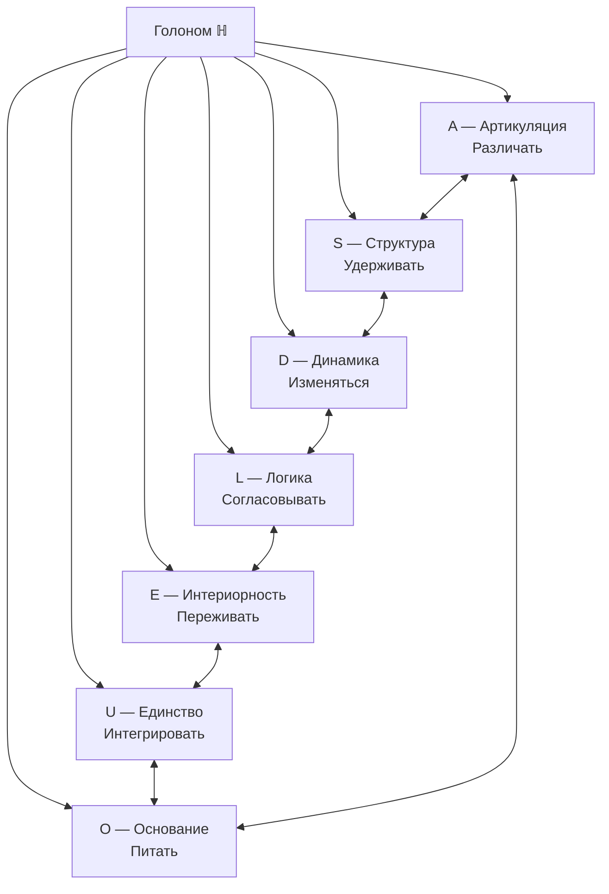
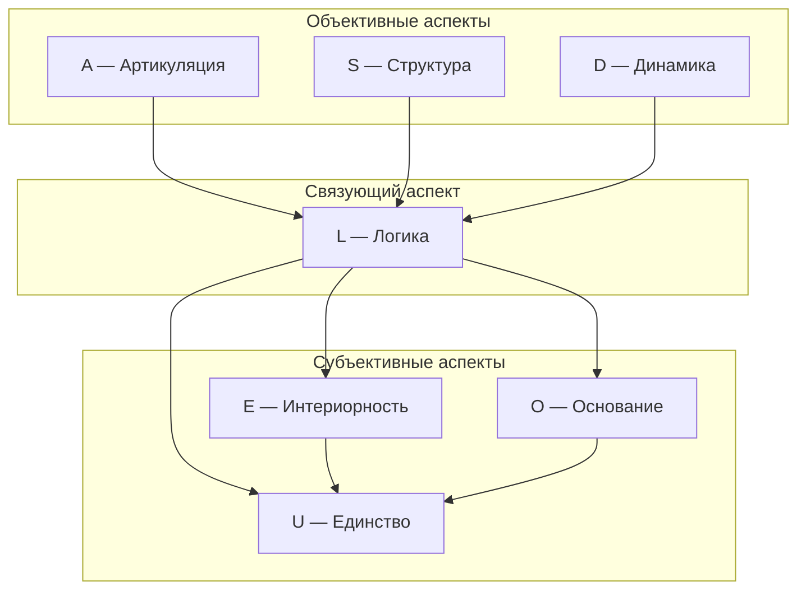

# Семь Измерений Голонома

Эта глава — путеводитель по семи измерениям Голонома: A (Артикуляция), S (Структура), D (Динамика), L (Логика), E (Интериорность), O (Основание) и U (Единство). Каждое из них — не «вещь» и не «свойство» в обычном смысле, а **неразделимый аспект** единой конфигурации $\Gamma$. Семь измерений — это семь способов «посмотреть» на одну и ту же реальность, как семь граней призмы, раскладывающей белый свет на спектр. К концу главы вы будете понимать, почему измерений именно семь, что делает каждое из них незаменимым и как они связаны друг с другом.

## Историческая предтеча

Идея о том, что реальность описывается небольшим числом фундаментальных «начал», стара, как философия.

**Пифагор** (VI в. до н.э.) учил, что «всё есть число»: в основе мира лежат числовые отношения. Пифагорейцы обнаружили, что музыкальные интервалы соответствуют простым дробям, и экстраполировали это на космос. В УГМ эта интуиция находит точное выражение: состояние любой системы — это матрица чисел ($\Gamma \in \mathbb{C}^{7 \times 7}$), и все свойства системы — от физических до феноменологических — определяются этими числами.

**Уильям Роуан Гамильтон** (1843) открыл **кватернионы** — четырёхмерные числа, расширяющие комплексные. Его друг **Джон Грейвс** в том же году открыл **октонионы** — восьмимерные числа. Артур Кэли (1845) независимо переоткрыл их. Октонионы обладают удивительным свойством: они — последняя из четырёх «нормированных алгебр с делением» (действительные числа → комплексные числа → кватернионы → октонионы). Мнимая часть октонионов имеет ровно **7 измерений**. В УГМ это не совпадение: семь измерений Голонома изоморфны семи мнимым единицам октонионов.

**Джино Фано** (1892) построил минимальную проективную плоскость — **плоскость Фано** PG(2,2). Она содержит ровно 7 точек и 7 линий, причём каждая линия проходит через 3 точки, а через каждую точку проходят 3 линии. Эта геометрическая структура оказывается ключевой для УГМ: она определяет, какие тройки измерений образуют «ассоциативные триплеты» — особо устойчивые группы, играющие роль в физике элементарных частиц и в структуре сознания.

## Обзор

Семь меток задают координаты состояния в исторической модели. В качестве пространства её квантовых состояний принято $\mathcal D(\mathbb C^7)$. Какими приготовлениями и вмешательствами можно выделить эти координаты у физической системы — отдельная задача. [Исторические аксиомы](/docs/core/foundations/axiom-omega#аксиоматика) · [AP, PH и QG](../foundations/axiom-septicity) · [Операциональные состояния](../foundations/operational-processes#process)

Важно подчеркнуть: семь измерений — это не семь «частей» Голонома, подобно тому, как лёгкие, сердце и мозг — части тела. Это семь **неразделимых аспектов** одного целого, подобно тому, как длина, ширина и высота — три аспекта одного предмета. Нельзя «отрезать» от Голонома измерение Динамики, оставив всё остальное — как нельзя отрезать от куба его высоту, оставив длину и ширину. Если хотя бы одно измерение обнуляется, Голоном перестаёт существовать как целостная конфигурация.

### Почему именно 7

:::tip Интуитивное объяснение
Представьте, что вы проектируете минимальную живую систему — существо, которое одновременно может:
1. **Различать** (отличать одно от другого) → нужен инструмент **A**
2. **Сохранять форму** (иметь устойчивую структуру) → нужен инструмент **S**
3. **Изменяться** (эволюционировать во времени) → нужен инструмент **D**
4. **Быть самосогласованным** (части не противоречат друг другу) → нужен инструмент **L**
5. **Переживать** (иметь внутреннюю сторону) → нужен инструмент **E**
6. **Питаться** (иметь источник регенерации) → нужен инструмент **O**
7. **Быть целым** (интегрировать всё в единство) → нужен инструмент **U**

Это функциональные роли в модели. Подсчёт пунктов списка не даёт нижней границы размерности гильбертова пространства произвольной самоподдерживающейся системы. [Аргумент минимальности и его посылки](../../proofs/minimality/theorem-minimality-7)
:::

Семь — размерность мнимой части октонионов, число точек плоскости Фано и число позиций кода Хэмминга с **тремя** проверочными битами. Четыре проверочных бита дают совершенный код для одной ошибки на **пятнадцати** позициях. Чтобы связать позицию ошибки с независимо заданной знаковой алгеброй, нужен общий декодер. Операциональная теорема выводит число адресов при явно заданных пробах. [Условия кода, T-224](/docs/applied/research/syndrome-calculus#t-224) · [Отбор адресов](/docs/core/foundations/operational-processes#address)

### Единственность базиса

Модель назначает имена и операторы заданному реперу. Функциональные аргументы используют дополнительные условия о самонаблюдении, регенерации и часах. Для переноса на произвольный протокол нужно установить, что его операции различают и сохраняют этот репер. [Исторический аргумент единственности](../../proofs/minimality/theorem-minimality-7#часть-vii-теорема-о-единственности-базиса) · [Условия для E](../../proofs/minimality/theorem-minimality-7#единственность-e) · [Условия для O](../../proofs/minimality/theorem-minimality-7#единственность-o)

## Таблица измерений

| № | Измерение | Символ | Функция | Оператор | Физический аналог | Октонионный базис |
|---|-----------|--------|---------|----------|-------------------|-------------------|
| I | [Артикуляция](./dimension-a) | $A$ | Различать | Проектор $P$ | Измерение | $e_1$ |
| II | [Структура](./dimension-s) | $S$ | Удерживать | Гамильтониан $H$ | Энергия | $e_2$ |
| III | [Динамика](./dimension-d) | $D$ | Изменяться | Унитарный $U(\tau)$ | Эволюция | $e_3$ |
| IV | [Логика](./dimension-l) | $L$ | Согласовывать | Коммутатор $[\cdot, \cdot]$ | Каузальность | $e_4$ |
| V | [Интериорность](./dimension-e) | $E$ | Переживать | Плотность $\rho$ | Информация | $e_5$ |
| VI | [Основание](./dimension-o) | $O$ | Питать + Измерять время | Вакуум $\vert 0\rangle$, Часы | Квантовое поле + Часы | $e_7$ |
| VII | [Единство](./dimension-u) | $U$ | Интегрировать | След $\mathrm{Tr}$ | Нормировка | $e_6$ |

:::warning Физические аналоги — это эвристика
Столбец «Физический аналог» указывает на **концептуальные соответствия**, не строгие тождества. Например, измерение $D$ связано с унитарной эволюцией — но $D$ **не есть** время.
:::

:::tip Повседневные аналогии
Чтобы измерения стали ближе, представьте человека, идущего по лесу:

| Измерение | Аналогия | Что происходит |
|---|---|---|
| **A** (Артикуляция) | Глаза | Вы *различаете*: «это дерево, это камень, это тропинка» |
| **S** (Структура) | Скелет | Ваше тело *сохраняет форму* при каждом шаге |
| **D** (Динамика) | Ноги | Вы *идёте*, *изменяете* свою позицию |
| **L** (Логика) | Мозг-планировщик | Вы *согласовываете* маршрут: «тут скользко → обойти справа» |
| **E** (Интериорность) | Чувства | Вы *переживаете*: запах хвои, прохладу ветра, усталость |
| **O** (Основание) | Земля под ногами | *Опора*, из которой вы черпаете устойчивость |
| **U** (Единство) | «Я» | Всё это вместе — *одно* переживание: «я иду по лесу» |

Уберите любой элемент — и прогулка невозможна. Без глаз вы не различаете путь. Без скелета — не держите форму. Без ног — не двигаетесь. Без логики — идёте в овраг. Без чувств — не замечаете красоту. Без опоры — падаете. Без «я» — нет того, кто гуляет.
:::

### Комбинаторная фиксация семантических ролей (T-177) — переформулирована [Т] {#комбинаторная-единственность}

:::danger Исправлено 25.09.2026 (аудит A-90): без секторов осей инцидентности фиксируют роли лишь по трём отметкам
Прежние отпечатки (ниже) используют сектор каждой оси ($\mathbf 3$ или $\bar{\mathbf 3}$) из отозванной T-48a: ни одна ось не лежит в $\mathbf 3$ или $\bar{\mathbf 3}$ (ни одна из 20 троек осей не $SU(3)$-инвариантна). Испробованы ремонты: (i) верные комплексные триплеты не несут меток осей; (ii) знаки октонионов и комплексная структура $J = L_{e_O}$ (ориентирующая пары $A \to D$, $S \to U$, $L \to E$) симметрию не уменьшают — элементы $\Gamma_{\mathrm{oct}}$, закрепляющие $+e_O$, дают те же 24 перестановки, что и коллинеации, закрепляющие $O$; (iii) отметка Хиггсовой линии $\{A,E,U\}$ вместе с $O$ оставляет 6 коллинеаций с орбитами $\{O\}$, $\{A,E,U\}$, $\{S,D,L\}$. Остаётся точный счёт ниже, заменяющий утверждение о единственности.
:::

:::tip Теорема T-177 (новая формулировка) [Т]: три неколлинеарные отметки фиксируют все семь ролей
Группа коллинеаций плоскости Фано (порядка 168) действует регулярно на 168 упорядоченных неколлинеарных тройках осей. Поэтому инцидентность фиксирует все семь ролей ровно тогда, когда отмечены три неколлинеарные оси, и никогда — при меньшем числе отметок: стабилизатор $O$ имеет порядок 24, $O$ и ещё одной оси — 4, третьей оси вне их линии — 1. При отмеченных $O$ и Хиггсовой линии остаются 6 коллинеаций; при отмеченных $O$ и паре $\kappa_0$ $\{E,U\}$, выбранной в модели [О] (универсальная T-42a снята [✗]) — 2, с орбитами $\{O\}$, $\{A\}$, $\{D\}$, $\{E,U\}$, $\{S,L\}$: $A$ — третья точка линии через $E$ и $U$, $D$ — третья точка линии через $O$ и $A$, а $E \leftrightarrow U$ (вместе с $L \leftrightarrow S$) — один двоичный выбор.

*Доказательство.* Точки $\mathrm{PG}(2,2)$ — ненулевые векторы $\mathbb F_2^3$, упорядоченная неколлинеарная тройка — упорядоченный базис, а $GL(3,2)$ (порядка 168) действует на упорядоченных базисах просто транзитивно. Проверено полным перебором 5040 перестановок (`test_fano_roles_are_fixed_by_three_non_collinear_marks`). $\blacksquare$
:::

:::note Прежняя формулировка (T-177, отозвана [✗]): Комбинаторная единственность семантических ролей
После фиксации секторной декомпозиции $7 = 1_O \oplus \mathbf{3} \oplus \bar{\mathbf{3}}$ (T-48a — отозвана [✗] 25.09.2026 как разложение с метками осей; единственность ниже опирается на неё и подлежит повторному выводу, см. T-177 в реестре статусов) каждое из 7 измерений имеет **уникальный комбинаторный профиль** — набор Фано-линий и секторных связей, не изоморфный профилю ни одного другого измерения.

**Стратификация:** различимость 7 отпечатков — **[Т]** как комбинаторный факт на плоскости Фано PG(2,2) при зафиксированном **наборе комбинаторных ограничений** (секторная декомпозиция T-48a + Хиггсова линия $\{A,E,U\}$). Выбор этого набора сам по себе — **[С при комбинаторном наборе ограничений]**: T-48a и Хиггсова линия происходят из вышестоящей аксиоматической структуры (A3, электрослабая подгонка), а не из T-177 в изоляции. При условии этих входных данных таблица отпечатков точна.
:::

**Доказательство.** Для каждого $e_k$ определим **функциональный отпечаток** $\mathcal{F}(e_k)$ — тройку (сектор, множество Фано-линий, секторный тип каждой линии):

| $e_k$ | Сектор | Фано-линии | O-связь (путь к синглету) |
|--------|--------|------------|--------------------------|
| $e_7$ (O) | **1** | $\{L,E,O\}, \{U,O,S\}, \{O,A,D\}$ | — (сам синглет) |
| $e_1$ (A) | **3** | $\{A,S,L\}, \{E,U,A\}, \{O,A,D\}$ | Прямая: линия $\{O,A,D\}$ |
| $e_2$ (S) | **3** | $\{A,S,L\}, \{S,D,E\}, \{U,O,S\}$ | Через $\bar{\mathbf{3}}$: линия $\{U,O,S\}$ |
| $e_3$ (D) | **3** | $\{S,D,E\}, \{D,L,U\}, \{O,A,D\}$ | Через **3**: линия $\{O,A,D\}$ |
| $e_4$ (L) | $\bar{\mathbf{3}}$ | $\{A,S,L\}, \{D,L,U\}, \{L,E,O\}$ | Через $\bar{\mathbf{3}}$: линия $\{L,E,O\}$ |
| $e_5$ (E) | $\bar{\mathbf{3}}$ | $\{S,D,E\}, \{L,E,O\}, \{E,U,A\}$ | Через $\bar{\mathbf{3}}$: линия $\{L,E,O\}$ |
| $e_6$ (U) | $\bar{\mathbf{3}}$ | $\{D,L,U\}, \{E,U,A\}, \{U,O,S\}$ | Через **3**: линия $\{U,O,S\}$ |

**Различимость внутри 3-сектора** $\{e_1, e_2, e_3\}$:
- $e_1$: **единственный** элемент **3** на Хиггсовой линии $\{E,U,A\}$ → мост между пространственным и электрослабым секторами
- $e_3$: на линии $\{O,A,D\}$ — связан с синглетом O через элемент **3** ($A$)
- $e_2$: на линии $\{U,O,S\}$ — связан с синглетом O через элемент $\bar{\mathbf{3}}$ ($U$)

**Различимость внутри $\bar{\mathbf{3}}$-сектора** $\{e_4, e_5, e_6\}$:
- $e_4$: **единственный** элемент $\bar{\mathbf{3}}$ **не** на Хиггсовой линии
- $e_5$: на Хиггсовой линии; O-связь через $\bar{\mathbf{3}}$-элемент ($L$) — линия $\{L,E,O\}$
- $e_6$: на Хиггсовой линии; O-связь через **3**-элемент ($S$) — линия $\{U,O,S\}$

Все 7 отпечатков попарно различны. $\blacksquare$

:::info Теорема T-183 — переформулирована [Т]+[О] (25.09.2026): Функциональное назначение 7 ролей
*Новая формулировка.* При заданных $O$ (часы и основание) и паре $\kappa_0$ $\{E,U\}$, выбранной в модели [О] (универсальная T-42a снята [✗]) инцидентность фиксирует $A$ (третья точка линии через $E$, $U$) и $D$ (третья точка линии через $O$, $A$) **[Т]** (T-177 в новой формулировке); остаётся один двоичный выбор — $E \leftrightarrow U$ вместе с $L \leftrightarrow S$, и это соглашение **[О]**. *Отозвано [✗]:* прежний вывод ниже — шаги 1–3, секторное условие шага 4 ($X \in \bar{\mathbf 3}$) и «секторная ковариантность» шага 6 пользуются секторами осей, которых нет, а шаг 4 снимал выбор $E \leftrightarrow U$ через $L$, чья собственная идентификация держалась на тех же секторах. Прежний текст:*

Все 7 семантических ролей $\{A,S,D,L,E,O,U\}$ **однозначно** определяются комбинаторной структурой (T-177, отозвана), функциональными требованиями уравнения эволюции $\mathcal{L}_\Omega$ и аксиомами (AP)+(PH)+(QG)+(V):

**Стратификация:** при данной цепочке комбинаторной единственности вышестоящих входных данных — секторной декомпозиции T-48a, Хиггсовой линии $\{A,E,U\}$, $L$-опосредованности формулы регенерации и секторной ковариантности унитарной эволюции — каждый из шагов (4)–(7) доказательства — **[Т]**. Результат в целом — **[С при цепочке комбинаторной единственности]**: если убрать любое одно звено (например, изменить Хиггсову линию или разрешить $S$-опосредованную регенерацию), аргумент единственности перестаёт работать. Сама цепочка обоснована выше по стеку в T-48a + аксиомах; T-183 не является независимо безаксиоматической.

| Роль | Определяющее свойство | Статус |
|------|----------------------|--------|
| **O** (Основание) | Единственный $SU(3)$-синглет; PW-часы; $\kappa_{\text{bootstrap}}$ | **[Т]** |
| **A** (Артикуляция) | Единственный из **3** на Хиггсовой линии — мост секторов | **[Т]** |
| **L** (Логика) | Единственный из $\bar{\mathbf{3}}$ НЕ на Хиггсовой линии | **[Т]** |
| **E** (Интериорность) | Единственный из $\bar{\mathbf{3}} \cap \mathrm{Higgs}$, чья O-связь $L$-опосредована | **[Т]** |
| **U** (Единство) | Оставшийся элемент $\bar{\mathbf{3}} \cap \mathrm{Higgs}$ после фиксации $E$ | **[Т]** |
| **D** (Динамика) | Единственный из $\{S,D\} \subset \mathbf{3}$ на линии $\{O,A,\cdot\}$ | **[Т]** |
| **S** (Структура) | Оставшийся элемент **3**-сектора после фиксации $A$ и $D$ | **[Т]** |

**Доказательство (T-183).**

**Шаги 1–3 (O, A, L):** Прямое следствие секторной декомпозиции $7 = 1_O \oplus \mathbf{3} \oplus \bar{\mathbf{3}}$ (T-48a — отозвана [✗] 25.09.2026: ни одна ось не лежит в $\mathbf 3$ или $\bar{\mathbf 3}$, так что шаги для A и L теряют основание; O сохраняется как $SU(3)$-синглет $\mathbb Ce_O$) и Хиггсовой линии $\{A,E,U\}$. O — единственный синглет. A — единственный элемент **3** на Хиггсовой линии. L — единственный элемент $\bar{\mathbf{3}}$ вне Хиггсовой линии. (Уже доказано в T-177.)

**Шаг 4 (E).** Формула регенерации $\kappa(\Gamma) = \kappa_{\text{bootstrap}} + \kappa_0 \cdot \mathrm{Coh}_X$ требует измерения $X$ со свойствами: (a) $X \in \bar{\mathbf{3}}$ (формула $\kappa_0$ определена через $\mathrm{Hom}(O, X)$); (b) $X$ на Хиггсовой линии (электрослабое связывание через цепочку $\kappa_0$: $\mathrm{End}(O) \otimes \mathrm{Hom}(O,X) \otimes \mathrm{Hom}(X,Y)$). Из $\bar{\mathbf{3}} \cap \mathrm{Higgs} = \{E, U\}$.

Далее: $\mathrm{Coh}_X$ определяется условным ожиданием Умегаки $\mathcal{E}_X: M_7(\mathbb{C}) \to \mathcal{A}_X$ — **логической** операцией (проекция на C*-подалгебру). Связь условного ожидания с подалгеброй требует, чтобы O-путь к $X$ проходил через $L$ (измерение алгебраического замыкания), обеспечивая $L$-опосредованный канал регенерации:
- $E$: O-путь через $L$ (линия $\{L,E,O\}$) — $L$-опосредованный ✓
- $U$: O-путь через $S$ (линия $\{U,O,S\}$) — $S$-опосредованный ✗

Единственный $L$-опосредованный кандидат — $E$. $\square$

**Шаг 5 (U).** По исключению из $\{E, U\}$ после фиксации $E$. $\square$

**Шаг 6 (D).** В 3-секторе $\{A,S,D\}$ после фиксации $A$ остаются $\{S,D\}$. Каждый лежит на ровно одной O-содержащей Фано-линии:
- Один на $\{O,A,\cdot\}$ — делит Фано-линию с $O$ (источник τ) и $A$ (дискриминация)
- Другой на $\{U,O,\cdot\}$ — делит Фано-линию с $O$ (источник τ) и $U$ (интеграция)

Эволюционный оператор $e^{-iH_{\mathrm{eff}}\tau}$ генерируется из O-сектора (источник τ) через $A$ — процесс, порождающий **изменение через различение** (определение динамики). Элемент на линии $\{O,A,D\}$ — единственный, чья O-связь проходит через элемент **того же** 3-сектора ($A$), сохраняя секторную ковариантность унитарной эволюции. $D$ — этот элемент. $\square$

**Шаг 7 (S).** По исключению из $\{S,D\}$ после фиксации $D$. $\blacksquare$
:::

:::info Эпистемический статус семантической маркировки [О]+[Т]
Математическая структура аксиом A1–A5 требует ровно 7 измерений (Теорема S [Т]). **Функциональное назначение** всех 7 ролей объявлялось однозначно определённым через принадлежность секторам (T-183); этот вывод отозван [✗] 25.09.2026 вместе с T-48a. В новой формулировке (T-177, T-183): при заданных $O$ и паре $\kappa_0$ $\{E,U\}$ инцидентность фиксирует $A$ и $D$ [Т], а один двоичный выбор [О] фиксирует $E$ против $U$ (вместе с $L$ против $S$). **Семантические имена** (A=Артикуляция, S=Структура и т.д.) остаются **определением по соглашению [О]** — человеческими метками для математически различимых объектов. Аналогия: назначение кварков конкретным зарядам ($+2/3$ vs $-1/3$) — [Т], но имена «верхний» и «нижний» — [О].
:::

:::info Функциональный базис с операторными ролями
Каждое измерение определяется **оператором и ролью в аксиомах**:

| Измерение | Оператор | Аксиоматическая роль | Необходимость | Комбинаторный статус (T-177) |
|-----------|----------|---------------------|---------------|------------------------------|
| $e_1$ (A) | Проектор $P^2 = P$ | Различение подобъектов | (AP) | **[Т]** — третья точка линии через $E$, $U$ (T-177 в новой формулировке) |
| $e_2$ (S) | $H = H^\dagger$ | Спектр инвариантов | (AP) | **[О]** — метка (T-183 отозвана [✗]) |
| $e_3$ (D) | $U(\tau) = e^{-iH\tau}$ | Унитарная эволюция | (QG) | **[Т]** — третья точка линии через $O$, $A$ (T-177 в новой формулировке) |
| $e_4$ (L) | $[\cdot, \cdot]$ | Замыкание алгебры | (AP) | **[О]** — метка (T-177 отозвана [✗]) |
| $e_5$ (E) | $\rho_E = \mathrm{Tr}_{-E}(\Gamma)$ | Феноменология | (PH) | **[О]** — метка (T-183 отозвана [✗]) |
| $e_6$ (U) | $\mathrm{Tr}(\cdot)$ | Нормировка | (AP) | **[О]** — метка (T-183 отозвана [✗]) |
| $e_7$ (O) | $H_O$, $\vert 0\rangle$ | Часы + источник | (QG) | **[Т]** — вектор, закреплённый $SU(3)_C = \mathrm{Stab}(e_O)$ |

Семантические имена подавались как отражение комбинаторно уникальных функциональных профилей (T-177); в новой формулировке (25.09.2026) инцидентность фиксирует $O$, $A$, $D$ и пары $\{E,U\}$, $\{L,S\}$, а остальное делает один двоичный выбор [О]. Аналогия: как «верхний» и «нижний» кварки — не случайные слова (различаются зарядом $+2/3$ vs $-1/3$), но сами слова — конвенция для математически различимых объектов.

При интерпретации утверждений о единственности необходимо задать и метки, и допустимые эквивалентности. Непомеченная структура инцидентности Фано имеет 168 автоморфизмов. В физической реализации нужно определить, какие перестановки сохраняют наблюдаемые записи. [Исторический аргумент о базисе](../../proofs/minimality/theorem-minimality-7#часть-vii-теорема-о-единственности-базиса)
:::

:::info Эмерджентное время
Время в УГМ — не внешний параметр, а **эмерджентное свойство**. Внутреннее время τ возникает из корреляций между измерением $O$ (Основание) и остальными измерениями через механизм Пейдж–Вуттерс. Измерение $O$ выполняет двойную роль: источник регенерации **и** внутренние часы системы.

[Подробнее: Теорема об эмерджентном времени →](../../proofs/dynamics/emergent-time)
:::

:::info Согласование 7D и 42D формализмов
Теория использует **два формализма**:

- **7D** ($\mathbb{C}^7$): структурные теоремы (Теорема S, единственность базиса, пороги), E-когерентность $\mathrm{Coh}_E$ через [HS-проекцию](/docs/core/foundations/axiom-septicity#hs-projection) **[Т]**, меры $R$ и $\Phi$.
- **42D** ($\mathcal{H}_O \otimes \mathcal{H}_{6D} \cong \mathbb{C}^{42}$): механизм Пейдж–Вуттерс (эмерджентное время), калибровочные симметрии электрослабого сектора, тензорная запутанность.

**Разрешённая часть [Т]:** Тензорный разрыв для $\mathrm{Coh}_E$ полностью разрешён — [C*-алгебраическая проекция Гильберта–Шмидта](/docs/core/foundations/axiom-septicity#hs-projection) определяет $\mathrm{Coh}_E$ в 7D **точно**, не прибегая к частичному следу. Определение подсистемы реализуется через вложение C*-подалгебры и [условное ожидание Умегаки](/docs/core/foundations/axiom-septicity#теорема-условное-ожидание). Это стандартный аппарат алгебраической квантовой теории (Haag, 1996; Bratteli–Robinson, 1987).

**Открытая часть [С]:** Полная редуцированная матрица $\rho_E = \mathrm{Tr}_{-E}(\Gamma)$ и мера дифференциации $D_{\text{diff}} = \exp(S_{vN}(\rho_E))$ по-прежнему требуют тензорной факторизации (42D-формализм), поскольку частичный след $\mathrm{Tr}_{\bar{E}}$ не определён в $\mathbb{C}^7$ (7 — простое число). Утверждения, использующие $D_{\text{diff}}$, имеют статус **[С]** — условные на 42D-расширение.
:::

## Категориальная семантика измерений (T-185) [С] {#категориальная-семантика}

:::warning Теорема T-185 [С при дифференциальной когезии сайта УГМ]: Дифференциально когезивные модальности и септарная структура
**Статус, стратифицирован 2026-09-25.** То, что дифференциально когезивный ∞-топос несёт модальности $\int \dashv \flat \dashv \sharp$ и $\Re \dashv \Im \dashv \&$, — [Т] (U. Schreiber, DCCT arXiv:1310.7930v1, определение 3.4.1 и §3.5). То, что ∞-топос УГМ дифференциально когезивен, — допущение [С]: достаточное условие Шрайбера — ∞-когезивный сайт (его определение 3.4.17), которому нужны конечные произведения, а у $\mathbf{DensityMat}$ их нет. Список ровно из семи модальностей ниже и его разложение $1 \oplus \mathbf{3} \oplus \bar{\mathbf{3}}$ — прочтение [И]: в DCCT v1 есть редукция $\Re$ и нет Rh. Прежняя редакция давала всей теореме [Т]; отозвано.

∞-топос УГМ $\mathbf{Sh}_\infty(\mathcal{D}(\mathbb{C}^7), J_{Bures})$ предполагается допускающим **дифференциально когезивную** структуру (Шрайбер 2013) с двумя уровнями сопряжённых функторов:

**Когезивный уровень** (макроструктура): $p_! \dashv p^* \dashv p_* \dashv p^!$

**Инфинитезимальный уровень** (микроструктура): $i_! \dashv i^* \dashv i_*$

В исторической интерпретации следующие семь выражений объединены в две тройки и тождественный функтор. Подсчёт опирается на выбор этого списка.

| Модальность | Определение | Функция | Измерение |
|-------------|-------------|---------|-----------|
| $\mathrm{Id}$ | Тождественный функтор | Сохраняет всё — источник | **O** (Основание) |
| $\Pi = p_! p^*$ | Форма (Shape) | Выделяет различимые компоненты | **A** (Артикуляция) |
| $\flat = p^* p_*$ | Плоскость (Flat) | Извлекает дискретные инварианты | **S** (Структура) |
| $\Im = i^* i_!$ | Инфинитезимальная форма | Улавливает бесконечно малое изменение | **D** (Динамика) |
| $\sharp = p_* p^!$ | Обострение (Sharp) | Вычисляет логическое замыкание | **L** (Логика) |
| $\& = i^* i_*$ | Инфинитезимальная плоскость | Интернализует инфинитезимальную структуру | **E** (Интериорность) |
| $\mathrm{Rh} = i_* i^!$ | Де Рам | Интегрирует локальное в глобальное | **U** (Единство) |
:::

Топология Бюреса на конечномерном пространстве состояний не строит требуемый сайт, сопряжения и физическую алгебру операторов. Перевод этих функторов на язык семи предложенных ролей — интерпретация. Например, у связного пространства $\mathcal D(\mathbb C^7)$ одна компонента связности, и операция взятия компонент не выделяет семь различимых осей.

**Как можно связать алгебру и код.** В конечномерной вещественной алгебре с единицей из положительной мультипликативной нормы следует деление. Положительная величина без закона мультипликативности допускает делители нуля. Для двоичного кода проверяется, что столбцы синдромов ненулевые и попарно различны. Историческое отождествление этих требований в T-244 отозвано. В конкретной модели проб размерности связывают интерференционные испытания на прямоугольниках и исправление одной ошибки по общему адресу. Они дают $8\le N+1\le2^k\le8$. Для переноса результата на полное пространство физических состояний нужно независимо представить все приготовления и инструменты. [Исправленная T-244](/docs/applied/research/syndrome-calculus#отбор-знака) · [Проверка столбцов](/docs/applied/research/syndrome-calculus#порог-d-min) · [Теорема об общем адресе](/docs/core/foundations/operational-processes#address)

---

## Октонионная интерпретация {#октонионная-интерпретация}

:::info Структурный вывод N = 7 через октонионы
Число 7 измерений получает **второе, независимое обоснование** через [структурный вывод](../../proofs/minimality/theorem-octonionic-derivation): если пространство внутренних степеней свободы изоморфно $\mathrm{Im}(\mathbb{O})$ (мнимой части октонионов), то $N = \dim(\text{Im}(\mathbb{O})) = 7$.
:::

Семь мнимых единиц октонионов $e_1, \ldots, e_7$ соответствуют семи измерениям Голонома. Это соответствие привносит:

- **$G_2$-симметрию:** $Aut(\mathbb{O}$) = $G_2$ ⊂ SO(7) — 14-параметрическая группа, сохраняющая структуру умножения. $G_2$ — это «группа калибровочных преобразований» семимерного пространства: она определяет, какие преобразования между измерениями сохраняют структуру октонионного умножения.
- **Линии Фано.** Единица и три мнимых базисных вектора каждой линии порождают ассоциативную кватернионную подалгебру. Ассоциативность касается расстановки скобок. Кватернионное произведение зависит от порядка сомножителей.
- **Альтернативность:** Любые два измерения порождают ассоциативную подалгебру (теорема Артина [Т]), неассоциативность проявляется только при взаимодействии трёх и более. Это означает: парные связи $\gamma_{ij}$ всегда «хорошо определены», сложности возникают только при тройных и более сложных взаимодействиях.

:::tip Интуиция: октонионы
Октонионы можно представить как «числа», которые обобщают привычные числа в новом направлении:

- **Действительные числа** ($\mathbb{R}$): одно измерение, полностью коммутативны и ассоциативны
- **Комплексные числа** ($\mathbb{C}$): 2 измерения (действительная + мнимая часть), коммутативны и ассоциативны
- **Кватернионы** ($\mathbb{H}$): 4 измерения, **не** коммутативны ($ij \neq ji$), но ассоциативны
- **Октонионы** ($\mathbb{O}$): 8 измерений, **не** коммутативны и **не** ассоциативны ($(ab)c \neq a(bc)$)

Теорема Гурвица классифицирует конечномерные вещественные алгебры с единицей и положительной квадратичной композиционной нормой. Допустимые размерности — 1, 2, 4 и 8. Выбор последней даёт семь мнимых направлений. Требуется отдельное физическое основание для выбора максимальной размерности.
:::

:::info Октонионная симметрия и выбранный репер [Т/О/И]
Для заданной положительной октонионной трёхформы $\operatorname{Aut}(\mathbb O)=G_2$, а стабилизатор заданного единичного вектора равен $SU(3)$; $G_2/SU(3)\cong S^6$ [Т]. Выбор оси $O$ и именованного репера Фано — дополнительные данные модели. Точка этой орбиты становится параметром нарушения симметрии лишь после задания подходящего инвариантного динамического потенциала и теоремы о вакууме. Выбранный часовой регистр независимо не доказывает единственного физического направления $O$.

Совместный перенос формы, репера, гамильтониана и самомодели даёт ковариантность описания [Т]. При фиксированной зависящей от репера динамике остаётся лишь её общий стабилизатор; общие повороты $G_2$ не обязаны быть симметриями. Интерпретация перенесённых описаний как физических калибровочных эквивалентностей — дополнительный мост [И/Г], не снятая универсальная теорема кодирования T-42a. [Условная теорема RI](/docs/proofs/categorical/uniqueness-theorem#теорема-единственности) указывает необходимые данные сравнения физических кодирований.
:::

Октонионная интерпретация не только обосновывает число 7, но и объясняет **неассоциативность** взаимодействий между тремя и более измерениями. В ассоциативной алгебре порядок операций не важен: $(a \cdot b) \cdot c = a \cdot (b \cdot c)$. В октонионах — важен. Это имеет глубокие следствия для динамики Голонома: тройные взаимодействия (например, одновременное изменение A, S и D) не сводятся к последовательности парных. Каждая тройка измерений, не лежащая на Фано-линии, порождает **ненулевой ассоциатор** $[e_i, e_j, e_k] = (e_i \cdot e_j) \cdot e_k - e_i \cdot (e_j \cdot e_k) \neq 0$, что проявляется как фазовый сдвиг — источник [Gap](/docs/core/dynamics/gap-operator) между внутренним и внешним описанием.

## Необходимость каждого измерения

Для предложенных семи ролей таблица показывает, как толкуется исключение каждой из них. [Посылки модели](../foundations/axiom-septicity)

| Без измерения | Нарушается | Следствие |
|---------------|------------|-----------|
| $A$ | (AP), (PH), (QG) | Нет различений → нет формы |
| $S$ | (AP) | Нет идентичности → нет самотождественности |
| $D$ | (AP), (QG) | Нет эволюции → нет процесса |
| $L$ | (AP) | Нет замыкания → нет самосогласованности |
| $E$ | (PH) | Нет интериорности → нет феноменологии |
| $O$ | (QG) | Нет регенерации, нет внутренних часов → нет времени |
| $U$ | (AP) | Нет интеграции → система фрагментирована |

Чтобы проверить, может ли другая система реализовать те же функции с иными степенями свободы, нужна общая операциональная спецификация. [Исторический аргумент минимальности](../../proofs/minimality/theorem-minimality-7)

## Матричное представление

:::note DRY: Мастер-определение
Полное матричное представление $\Gamma$ с формальными свойствами см. в [Матрица когерентности](../dynamics/coherence-matrix#матричное-представление).
:::

В базисе $\{|A\rangle, |S\rangle, |D\rangle, |L\rangle, |E\rangle, |O\rangle, |U\rangle\}$ матрица когерентности — эрмитова $7 \times 7$ матрица с элементами $\gamma_{ij}$:
- **Диагональ** $\gamma_{ii} \in [0,1]$ — населённости измерений, $\sum_i \gamma_{ii} = 1$
- **Когерентности** $\gamma_{ij}$ ($i \neq j$) — связи между измерениями, $|\gamma_{ij}|^2 \leq \gamma_{ii} \cdot \gamma_{jj}$

:::tip Как читать матрицу когерентности
Матрицу $\Gamma$ можно представить как таблицу $7 \times 7$, где:
- **Каждая ячейка на диагонали** ($\gamma_{AA}$, $\gamma_{SS}$, ..., $\gamma_{UU}$) — число от 0 до 1, показывающее, «сколько энергии» вложено в данное измерение. Сумма всех диагональных элементов равна 1 (вся «энергия» распределена между семью измерениями).
- **Каждая ячейка вне диагонали** ($\gamma_{AS}$, $\gamma_{AD}$, ...) — комплексное число, описывающее *связь* между двумя измерениями. Модуль $|\gamma_{ij}|$ — сила связи. Фаза $\arg(\gamma_{ij})$ — «направленность» связи (различие между внутренним и внешним аспектом).
- **Неравенство Коши–Шварца** $|\gamma_{ij}|^2 \leq \gamma_{ii} \cdot \gamma_{jj}$ означает: связь между измерениями не может быть сильнее, чем «позволяют» сами измерения. Два слабо заселённых измерения не могут иметь сильную когерентность.
:::

## Семантика когерентностей

Недиагональные элементы $\gamma_{ij}$ ($i \neq j$) описывают **связи между измерениями**. Каждая такая связь имеет содержательную интерпретацию — это не абстрактное число, а описание конкретного аспекта жизни системы.

| Когерентность | Интерпретация | Пример | Что означает высокое значение |
|---------------|---------------|--------|-------------------------------|
| $\gamma_{AE}$ | Артикуляция ↔ Интериорность | Апперцепция | Различения «входят» в переживание: система осознанно различает |
| $\gamma_{AS}$ | Артикуляция ↔ Структура | Категоризация | Различения формируют устойчивые категории: система классифицирует |
| $\gamma_{AD}$ | Артикуляция ↔ Динамика | Восприятие движения | Различения применяются к процессам: система отслеживает изменения |
| $\gamma_{AL}$ | Артикуляция ↔ Логика | Анализ | Различения логически организованы: система мыслит аналитически |
| $\gamma_{AO}$ | Артикуляция ↔ Основание | Базовое восприятие | Различения укоренены в основании: «заземлённое» восприятие |
| $\gamma_{AU}$ | Артикуляция ↔ Единство | Синтез | Различения интегрируются в целое: система видит «картину в целом» |
| $\gamma_{SL}$ | Структура ↔ Логика | Номос | Структура подчинена логической необходимости: форма осмыслена |
| $\gamma_{SD}$ | Структура ↔ Динамика | Морфогенез | Структура возникает из процесса: форма динамична |
| $\gamma_{SE}$ | Структура ↔ Интериорность | Репрезентация | Структура представлена во внутреннем переживании |
| $\gamma_{SO}$ | Структура ↔ Основание | Устойчивость | Структура укоренена в источнике: прочный фундамент |
| $\gamma_{SU}$ | Структура ↔ Единство | Архитектура | Структура интегрирована в целое: системная организация |
| $\gamma_{DL}$ | Динамика ↔ Логика | Каузальность | Процессы логически обусловлены: «причина → следствие» |
| $\gamma_{DE}$ | Динамика ↔ Интериорность | Воление | Процессы переживаются изнутри: действие ощущается как «я действую» |
| $\gamma_{DO}$ | Динамика ↔ Основание | Витальность | Процессы питаются из источника: жизненная энергия |
| $\gamma_{DU}$ | Динамика ↔ Единство | Телеология | Процессы направлены к целому: целенаправленное действие |
| $\gamma_{LE}$ | Логика ↔ Интериорность | Понимание | Логические связи переживаются: «ага-момент», инсайт |
| $\gamma_{LO}$ | Логика ↔ Основание | Интуиция | Логика укоренена в глубинном знании: «знаю, но не могу объяснить» |
| $\gamma_{LU}$ | Логика ↔ Единство | Консистентность | Логика служит целостности: непротиворечивость системы |
| $\gamma_{EO}$ | Интериорность ↔ Основание | Имманентность | Переживание укоренено в источнике: «чувство бытия» |
| $\gamma_{EU}$ | Интериорность ↔ Единство | Самосознание | Переживание целостно: «я есть» как единый опыт |
| $\gamma_{OU}$ | Основание ↔ Единство | Трансценденция | Источник и целое совпадают: глубинное единство |

:::note Полный набор когерентностей
Матрица $7 \times 7$ содержит $\binom{7}{2} = 21$ независимых недиагональных элементов. Каждый описывает связь между парой измерений. Вместе с 7 населённостями (диагональ) и условием $\mathrm{Tr}(\Gamma) = 1$ это даёт 48 независимых вещественных параметров (6 населённостей + 21 модуль + 21 фаза), полностью описывающих состояние Голонома.
:::

:::tip Как интерпретировать когерентности
Когерентность $\gamma_{ij}$ — комплексное число. Его **модуль** $|\gamma_{ij}|$ показывает силу связи: 0 = нет связи, максимум = полная корреляция. Его **фаза** $\arg(\gamma_{ij})$ показывает «направленность»: при нулевой фазе внешний и внутренний аспекты связи совпадают (полная прозрачность); при $\pi/2$ — максимально расходятся ([Gap](/docs/core/dynamics/gap-operator) = 1).

Пример: высокое $|\gamma_{LE}|$ (Логика ↔ Интериорность) с малой фазой означает: система глубоко *понимает* свои переживания — логика и интериорность прозрачны друг для друга. Высокое $|\gamma_{LE}|$ с фазой $\approx \pi/2$ означает: система *обрабатывает* переживания логически, но между логическим описанием и реальным переживанием есть разрыв (Gap) — «я знаю, что мне грустно, но не понимаю, почему».
:::

## Связь с (M,R)-системами Розена

Семь измерений УГМ **обобщают** (M,R)-систему Розена, добавляя феноменологию и квантовое основание:

| Розен | УГМ | Функция |
|-------|-----|---------|
| $M$ (метаболизм) | $D$ (Динамика) | Преобразование субстратов |
| $\Phi$ (репарация) | $A + L$ (Артикуляция + Логика) | Восстановление структуры |
| $\beta$ (замыкание) | $U$ (Единство) | Интеграция, самозамыкание |
| — | $E$ (Интериорность) | Расширение: интериорность |
| — | $O$ (Основание) | Расширение: квантовый источник |
| — | $S$ (Структура) | Расширение: инварианты |

**Формально:** $7 = 3_{\text{Розен}} + 4_{\text{расширения}}$.

Розен показал, что для жизни необходимо минимум 3 компонента (метаболизм, ремонт, замыкание). УГМ добавляет ещё 4: интериорность (чтобы система «переживала»), основание (чтобы имела источник регенерации и время), структуру (чтобы имела инварианты) и логику как отдельное измерение (а не часть ремонта). Результат: 7 = минимум для **полноценной** живой системы с внутренней стороной.

:::tip Почему Розену не хватило трёх
Розен строил теорию *жизни* — и трёх компонентов для этого действительно достаточно: система, которая метаболизирует (D), ремонтирует себя (A+L) и замыкается (U), формально «жива». Но Розен не ставил вопрос о *сознании*. Его системы — «зомби»: они функционируют, но ничего не переживают. УГМ добавляет E (интериорность) — и система обретает «внутреннюю сторону». Но для полноценной интериорности нужны ещё O (откуда черпать ресурс для регенерации и время) и S (что именно сохраняется). Так три компонента Розена вырастают до семи.
:::

См. [Теорема 5.1: Изоморфизм с (M,R)-системами](../../proofs/minimality/theorem-minimality-7#часть-v-связь-с-mr-системами-розена).

## Группировка измерений

:::warning Группировка — эвристика
Деление на «объективные» и «субъективные» аспекты — **педагогическое упрощение**. Все семь измерений неразделимы в $\Gamma$. Двухаспектный монизм означает: объективное и субъективное — две стороны одной конфигурации, не разные части.
:::

**Объективные аспекты** (A, S, D) — те, которые доступны внешнему наблюдателю: различения можно зафиксировать (A), структуру можно измерить (S), динамику можно отследить (D). В физике им соответствуют наблюдаемые: проекторы, гамильтониан, унитарная эволюция.

**Субъективные аспекты** (E, O, U) — те, которые связаны с «внутренней стороной» системы: переживание (E), укоренённость в источнике (O), ощущение целостности (U). Они не наблюдаемы «снаружи» напрямую — их можно лишь вывести из поведения или пережить «изнутри».

**Связующий аспект** — Логика ($L$) выделена как «мост» между объективным и субъективным. Коммутатор $[A, B]$ определяет **отношения** между операторами всех остальных измерений. Логика — это то, что делает систему самосогласованной: обеспечивает, чтобы объективное и субъективное не противоречили друг другу.

Эта группировка $7 = 3 + 1 + 3$ имеет глубокое математическое основание: она соответствует **секторной декомпозиции** $7 = \mathbf{3} \oplus \mathbf{1} \oplus \bar{\mathbf{3}}$ под действием $SU(3) \subset G_2$ (теорема T-48a — отозвана [✗] 25.09.2026 в этом виде с метками осей). ~~Триплет $\{A, S, D\}$ образует представление **3**, синглет $\{O\}$ — представление **1**, антитриплет $\{L, E, U\}$ — представление $\bar{\mathbf{3}}$.~~ Сохраняется лишь синглет: триплет есть $\mathrm{span}_{\mathbb C}\{A-iD,\,S-iU,\,L-iE\}$, антитриплет — его сопряжённое, так что каждый смешивает обе тройки осей. Замечательно, что именно этот же тип разложения определяет структуру кварков в хромодинамике ($SU(3)_{\text{color}}$), хотя здесь он действует на совершенно другом уровне описания.

:::note Почему L — «мост», а не O?
На первый взгляд, O (Основание) тоже кажется «связующим»: оно и питает, и задаёт время. Но O занимает особое положение как **синглет** $SU(3)$ — оно инвариантно под секторными преобразованиями. L же занимает **пограничное** положение: оно принадлежит антитриплету ($\bar{\mathbf{3}}$), но функционально связывает оба триплета через коммутатор. Логика «знает» и об объективном, и о субъективном — в этом её уникальность.
:::

## Кросс-культурные отражения

Примечательно, что деление на 7 фундаментальных аспектов реальности встречается в самых разных традициях:

| Традиция | Семеричное деление | Связь с УГМ |
|---|---|---|
| Индийская (чакры) | 7 энергетических центров | 7 населённостей $\gamma_{ii}$ |
| Алхимическая | 7 металлов (Au, Ag, Cu, Fe, Sn, Pb, Hg) | 7 измерений |
| Музыкальная | 7 нот (до, ре, ми, фа, соль, ля, си) | 7 «тонов» конфигурации |
| Планетарная (древность) | 7 планет | 7 «влияний» |
| Цветовая | 7 цветов радуги | 7 «качеств» |

Это сравнение словарей. Совпадение числа элементов не устанавливает связи между операциями и наблюдениями. [Сопоставление символических систем](https://homohologra.ph/research/symbolic-systems)

## Резюме

Выбранная семиуровневая матрица плотности определяется семью населённостями с единичной суммой и 21 комплексной когерентностью. У состояния полного ранга 48 независимых вещественных параметров. Чтобы определить такую матрицу для физической или биологической системы, нужны калиброванные приготовления и наблюдаемые. Плоскость Фано и октонионы задают разметку и алгебраическую структуру модели.

Далее каждое измерение рассмотрено подробно в отдельной главе. Мы рекомендуем читать их по порядку: A → S → D → L → E → O → U, поскольку каждое следующее измерение опирается на понятия, введённые в предыдущих.

---

**Детальные страницы:**
- [Артикуляция (A)](./dimension-a)
- [Структура (S)](./dimension-s)
- [Динамика (D)](./dimension-d)
- [Логика (L)](./dimension-l)
- [Интериорность (E)](./dimension-e)
- [Основание (O)](./dimension-o)
- [Единство (U)](./dimension-u)

**Связанные документы:**
- [Голоном](./holon) — что такое конфигурация $\Gamma$
- [Теорема S](../../proofs/minimality/theorem-minimality-7) — доказательство минимальности 7D (Трек A)
- [Структурный вывод через октонионы](../../proofs/minimality/theorem-octonionic-derivation) — P1+P2 → $\mathbb{O}$ → N=7 (Трек B)
- [Теорема о единственности](../../proofs/minimality/theorem-minimality-7#часть-vii-теорема-о-единственности-базиса) — доказательство уникальности базиса
- [Аксиома (AP+PH+QG+V)](../foundations/axiom-septicity) — условия на Голоном
- [Эмерджентное время](../../proofs/dynamics/emergent-time) — время из структуры Γ
