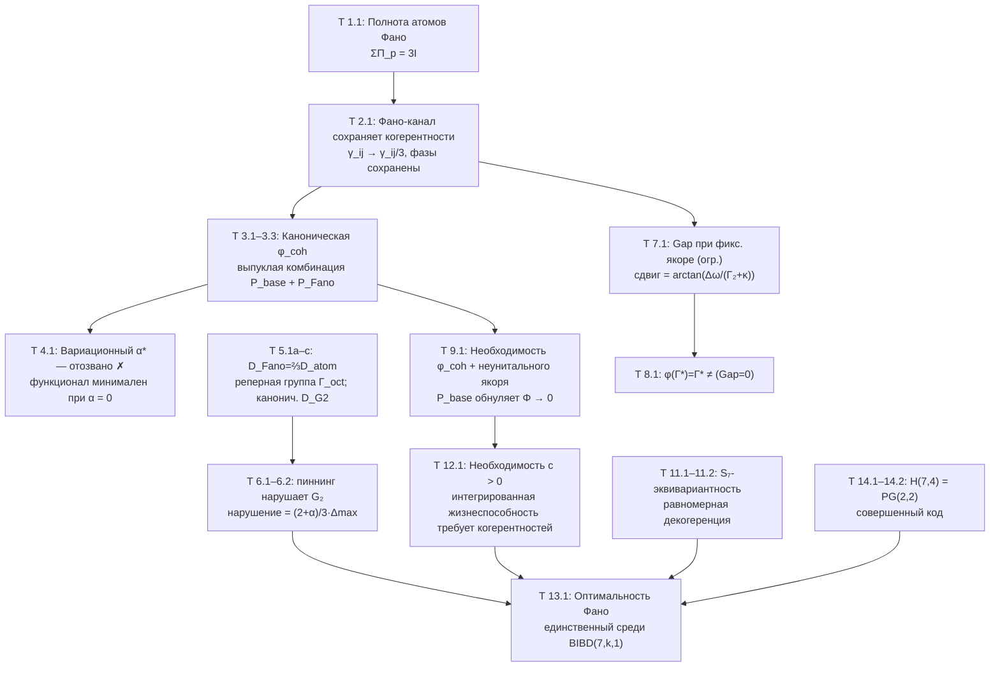

# Доказательства: Фано-канал и ключевые Gap-теоремы

:::info Для кого эта глава
Читатель найдёт здесь доказательства центральных теорем Фано-канала и Gap-динамики: сохранение когерентностей Фано-каналом, точную Фано–атомную пропорциональность $\mathcal{D}_{\text{Fano}}=\tfrac23\mathcal{D}_{\text{atom}}$ (с ковариантностью относительно конечной реперной группы $\Gamma_{\!\text{oct}}$ и каноническим $G_2$-ковариантным диссипатором $\mathcal{D}_{G_2}$), стационарный Gap при фиксированном якоре, различие между L4 и $\mathrm{Gap}=0$, оптимальность Фано-канала среди BIBD$(7,k,1)$-каналов и комбинаторную связь с кодом Хэмминга $H(7,4)$. Базовые теоремы канала имеют статус **[Т]**; отозванные утверждения (§4) и уточнения области применимости (§7, §9, §12–13) отмечены явно.
:::

Данный документ содержит доказательства и точные границы применимости центральных теорем Фано-канала и Gap-динамики (см. [реестр статусов](/docs/reference/status-registry)).

---

## 1. Фано-предиктивный канал {#фано-канал}

### 1.1 Полнота атомов Фано

:::tip Теорема 1.1 (Полнота атомов Фано) [Т]
Для 7 линий [плоскости Фано](/docs/physics/gauge-symmetry/fano-selection-rules) $PG(2,2)$ определены проекции на 3-мерные подпространства:

$$
\Pi_p = \sum_{i \in \mathrm{line}_p} |i\rangle\langle i|, \quad p = 1, \ldots, 7
$$

Каждое измерение лежит на ровно 3 Фано-линиях, следовательно:

$$
\sum_{p=1}^{7} \Pi_p = 3I
$$
:::

**Доказательство.** Свойство плоскости Фано: каждая из 7 точек инцидентна ровно 3 линиям. Для любого $i$: $\sum_p \Pi_p |i\rangle\langle i| = \sum_{p: i \in \mathrm{line}_p} |i\rangle\langle i| = 3|i\rangle\langle i|$. Суммируя по $i$: $\sum_p \Pi_p = 3I$. $\square$

### 1.2 Фано-структурированные операторы Линдблада

:::tip Определение (Фано-операторы Линдблада) [Т]
Для каждой Фано-линии $p = (i,j,k)$ определяется оператор Линдблада:

$$
L_p^{\text{Fano}} := \frac{1}{\sqrt{3}}\,\Pi_p = \frac{1}{\sqrt{3}}(|i\rangle\langle i| + |j\rangle\langle j| + |k\rangle\langle k|)
$$

**Проверка CPTP:**

$$
\sum_{p=1}^{7} (L_p^{\text{Fano}})^\dagger L_p^{\text{Fano}} = \frac{1}{3}\sum_{p=1}^{7} \Pi_p = \frac{1}{3} \cdot 3I = I \quad \checkmark
$$
:::

### 1.3 Фано-предиктивный канал

$$
\mathcal{P}_{\text{Fano}}(\Gamma) := \sum_{p=1}^{7} L_p^{\text{Fano}}\,\Gamma\,(L_p^{\text{Fano}})^\dagger = \frac{1}{3}\sum_{p=1}^{7} \Pi_p\,\Gamma\,\Pi_p
$$

---

## 2. Теорема: Фано-канал сохраняет когерентности [Т] {#теорема-фано-канал}

:::tip Теорема 2.1 (Фано-канал сохраняет когерентности) [Т]
Для произвольной матрицы когерентности $\Gamma$:

**(a)** Диагональные элементы сохраняются точно:

$$
[\mathcal{P}_{\text{Fano}}(\Gamma)]_{ii} = \gamma_{ii}
$$

**(b)** Недиагональные элементы сохраняются с коэффициентом $1/3$:

$$
[\mathcal{P}_{\text{Fano}}(\Gamma)]_{ij} = \frac{1}{3}\gamma_{ij} \quad \text{для всех } i \neq j
$$

**(c)** Фазы когерентностей сохраняются в точности:

$$
\arg([\mathcal{P}_{\text{Fano}}(\Gamma)]_{ij}) = \arg(\gamma_{ij}) = \theta_{ij}
$$
:::

**Доказательство.**

**(a)** $[\sum_p \Pi_p\,\Gamma\,\Pi_p]_{ii} = \sum_{p: i \in \mathrm{line}_p} \gamma_{ii} = 3\gamma_{ii}$. С множителем $1/3$: $\gamma_{ii}$. $\checkmark$

**(b)** В $PG(2,2)$ любые две различные точки лежат на **ровно одной** линии. Для пары $(i,j)$, $i \neq j$, ровно одна линия $p^*$ содержит обе точки:

$$
\left[\sum_p \Pi_p\,\Gamma\,\Pi_p\right]_{ij} = \sum_{p: \{i,j\} \subseteq \mathrm{line}_p} \gamma_{ij} = 1 \cdot \gamma_{ij}
$$

С множителем $1/3$: $\gamma_{ij}/3$. $\checkmark$

**(c)** $\arg(\gamma_{ij}/3) = \arg(\gamma_{ij})$, поскольку $1/3 > 0$. $\checkmark$ $\square$

:::info Следствие (Фундаментальное)
В отличие от канонического $\varphi_{\text{base}}$, который [уничтожает все когерентности](/docs/core/dynamics/gap-dynamics#чой-ямиолковский), Фано-канал **масштабирует** амплитуды когерентностей без фазового искажения. Это делает его основой для когерентно-сохраняющего самомоделирования $\varphi_{\text{coh}}$.
:::

#### Следствие 2.1a — независимость коэффициента сжатия Фано-канала от состояния [Т] {#state-independence-alpha}

:::tip Следствие 2.1a
Коэффициент сжатия $c_F = 1/3$ — эквивалентно, поглощение Фано $\alpha = 1 - c_F = 2/3$ — **не зависит от состояния**: для каждого $\Gamma \in \mathcal D(\mathbb C^7)$ и каждой внедиагональной пары $(i,j)$, $i \neq j$,
$$[\mathcal{P}_\mathrm{Fano}(\Gamma)]_{ij} = \tfrac{1}{3}\,\gamma_{ij}.$$
**Доказательство.** Вывод теоремы 2.1(b) использует **только** комбинаторный факт, что ровно одна Фано-прямая $p^* \in \mathrm{PG}(2,2)$ содержит пару $\{i,j\}$ (определяющее свойство BIBD$(7,3,1)$), вместе с нормировочным коэффициентом $1/3$ от трёх прямых, инцидентных каждой точке. Ни один из шагов не ссылается на элементы $\Gamma$. Следовательно, коэффициент сжатия — функция геометрии $\mathrm{PG}(2,2)$ в чистом виде. $\blacksquare$

**Следствие (независимость сжатия от состояния):**
Данное следствие устанавливает, что коэффициент сжатия $c_F = 1/3$ (и поглощение $\alpha = 2/3$) равномерно переносится на **каждое** состояние $\Gamma \in \mathcal{D}(\mathbb{C}^7)$ исключительно из комбинаторной единственности $\mathrm{PG}(2,2)$ (`T-82` единственность Фано [Т]). *(Примечание: прежний универсальный потолок глубины самосознания, выводившийся итерацией фиксированного Фано-канала, отозван [✗], поскольку операциональный уровень L4 задаётся совместимой башней предсказаний, а не итерацией фиксированного канала; см. [Голоном](/docs/consciousness/hierarchy/interiority-hierarchy).)*
:::

### Числовой пример {#числовой-пример-фано}

:::note Пример: действие Фано-канала на конкретную матрицу
Рассмотрим $7 \times 7$ матрицу когерентности $\Gamma$ с диагональю $\gamma_{ii} = 1/7$ (равновесное распределение) и несколькими ненулевыми когерентностями:

$$
\gamma_{12} = 0.05 + 0.03i, \quad \gamma_{13} = 0.04, \quad \gamma_{45} = -0.02 + 0.01i
$$

(остальные недиагональные элементы равны нулю или малы).

**Шаг 1.** Вычисляем диагональные элементы $\mathcal{P}_{\text{Fano}}(\Gamma)$:

$$
[\mathcal{P}_{\text{Fano}}(\Gamma)]_{ii} = \gamma_{ii} = \frac{1}{7} \approx 0.1429
$$

Диагональ не изменилась — вероятности секторов сохранены точно.

**Шаг 2.** Вычисляем недиагональные элементы. По теореме 2.1(b):

$$
[\mathcal{P}_{\text{Fano}}(\Gamma)]_{12} = \frac{1}{3}(0.05 + 0.03i) = 0.0167 + 0.01i
$$

$$
[\mathcal{P}_{\text{Fano}}(\Gamma)]_{13} = \frac{1}{3} \cdot 0.04 = 0.0133
$$

$$
[\mathcal{P}_{\text{Fano}}(\Gamma)]_{45} = \frac{1}{3}(-0.02 + 0.01i) = -0.0067 + 0.0033i
$$

**Шаг 3.** Проверяем сохранение фаз (теорема 2.1(c)):

$$
\arg(\gamma_{12}) = \arctan(0.03/0.05) \approx 30.96° \quad \Rightarrow \quad \arg(\gamma_{12}/3) = 30.96° \;\checkmark
$$

$$
\arg(\gamma_{45}) = \arctan(0.01/(-0.02)) + \pi \approx 153.43° \quad \Rightarrow \quad \arg(\gamma_{45}/3) = 153.43° \;\checkmark
$$

**Итог:** модули когерентностей уменьшились ровно в 3 раза, фазы сохранились без искажения, диагональ не тронута. Именно это отличает Фано-канал от атомарного $\mathcal{P}_{\text{base}}$, который обнулил бы $\gamma_{12}$, $\gamma_{13}$, $\gamma_{45}$ полностью. Для сбалансированного состояния ($\gamma_{ii} = 1/7$) полное уничтожение когерентностей роняет чистоту до $P = 1/7 < P_{\text{crit}} = 2/7$ [О] и обнуляет интеграцию $\Phi$. Фано-канал даёт «мягкое» наблюдение, сохраняющее треть амплитуд когерентностей без фазового искажения.
:::

---

## 3. Каноническая форма φ_coh [Т] {#phi-coh}

:::tip Теорема 3.1 (Каноническая форма $\varphi_{\text{coh}}$) [Т]
Каноническое когерентно-сохраняющее самомоделирование:

$$
\varphi_{\text{coh}}(\Gamma) = k \cdot \left[\alpha \cdot \mathcal{P}_{\text{base}}(\Gamma) + (1 - \alpha) \cdot \mathcal{P}_{\text{Fano}}(\Gamma)\right] + (1 - k) \cdot \Gamma_{\text{anchor}}
$$

где:
- $\mathcal{P}_{\text{base}}(\Gamma) = \sum_m P_m\,\Gamma\,P_m = \mathrm{diag}(\Gamma)$ — атомарный канал
- $\alpha \in [0, 1]$ — **параметр глубины декогеренции**
- $k < 1$ — параметр сжатия
- $\Gamma_{\text{anchor}}$ — якорное состояние

**CPTP-проверка:** $\mathcal{P}_\alpha = \alpha\,\mathcal{P}_{\text{base}} + (1-\alpha)\,\mathcal{P}_{\text{Fano}}$ — выпуклая комбинация CPTP-каналов, следовательно CPTP. $\checkmark$
:::

### Целевые когерентности

:::tip Теорема 3.2 (Целевые когерентности $\varphi_{\text{coh}}$) [Т]
**(a)** Модуль целевой когерентности (при диагональном якоре):

$$
|\gamma_{ij}^{\text{target}}| = \frac{k(1-\alpha)}{3} \cdot |\gamma_{ij}|
$$

**(b)** Целевая фаза **сохраняется**: $\theta_{ij}^{\text{target}} = \theta_{ij}$.

**(c)** Целевой Gap **сохраняется**: $\mathrm{Gap}^{\text{target}}(i,j) = \mathrm{Gap}(i,j)$.
:::

### Явные коэффициенты Крауса

:::tip Теорема 3.3 (Явные коэффициенты $c_{mn}$) [Т]
Коэффициенты разложения канонического $\varphi_{\text{coh}}$:

$$
c_{mn} = \begin{cases} k & m = n \text{ (атомарный и Фано-канал оба сохраняют диагональ)} \\ (1-\alpha) k / 3 & m \neq n \end{cases}
$$

а якорь добавляет $(1-k)\,[\Gamma_{\text{anchor}}]_{mn}$. Каждая пара $(m,n)$ лежит ровно на одной Фано-линии, так что третий случай «$0$ для $(m,n)$ вне общей Фано-линии» пуст. *Исправлено 2026-09-25:* теорема печатала $c_{mm} = \alpha^* k$ и этот пустой третий случай; диагональный коэффициент равен $\alpha k + (1-\alpha)k = k$ (как в [$G_2$-структуре, теорема 10.5](/docs/physics/gauge-symmetry/g2-structure)), а $\alpha^*$ отозвано.

При заданном Фано-весе коэффициенты определены через:
- [Фано-структуру](/docs/physics/gauge-symmetry/fano-selection-rules) $PG(2,2)$
- Фано-вес $\alpha$ — свободный параметр; его вариационное значение $\alpha^*$ отозвано (§4)
- Параметр сжатия $k$
:::

---

## 4. Вариационное определение α* — отозвано 2026-09-25 [✗] {#alpha-star}

:::tip Теорема 4.1 (Вариационное определение $\alpha^*$) — отозвана [✗]
Оптимальный параметр определяется [вариационным принципом](/docs/proofs/dynamics/fep-derivation):

$$
\alpha^* = \arg\min_{\alpha \in [0,1]} \mathcal{F}[\mathcal{P}_\alpha; \Gamma]
$$

Приближённая формула для системы с чистотой $P > P_{\text{crit}}$:

$$
\alpha^* \approx 1 - \frac{P_{\text{crit}}}{P} = 1 - \frac{2}{7P}
$$

| Чистота $P$ | $\alpha^*$ | Интерпретация |
|-------------|-----------|---------------|
| $P = 1$ (чистое) | $\approx 0.71$ | Существенное Фано-участие |
| $P = 0.5$ | $\approx 0.43$ | Баланс атомарного и Фано |
| $P \to P_{\text{crit}}$ | $\to 0$ | Почти полностью Фано (минимальное разрушение когерентностей) |
:::

**Почему отозвано.** $\mathcal{F}[\psi;\Gamma] = S_{\text{spec}}(\psi(\Gamma)) + D_{KL}(\psi(\Gamma)\|\Gamma) = -\mathrm{Tr}(\psi(\Gamma)\log\Gamma)$ линеен по $\psi(\Gamma)$ ([вывод FEP](/docs/proofs/dynamics/fep-derivation), врезка об отзыве), а $\mathcal{P}_\alpha(\Gamma) = \Delta(\Gamma) + \tfrac{1-\alpha}{3}(\Gamma - \Delta(\Gamma))$, где $\Delta$ — диагональная часть, аффинен по $\alpha$. Поэтому для $\Gamma$ полного ранга

$$
\mathcal{F}(\alpha) = \mathcal{F}(0) + \frac{\alpha}{3}\left[D_{KL}(\Gamma\|\Delta\Gamma) + D_{KL}(\Delta\Gamma\|\Gamma)\right],
$$

и минимум на $[0,1]$ достигается при $\alpha = 0$ (чистый Фано), как только у $\Gamma$ есть когерентности; у внутреннего значения $1 - 2/(7P)$ вывода нет. Проверено на 400 случайных состояниях с $P$ от $0{,}19$ до $0{,}91$: минимум при $\alpha = 0$ во всех 400. Поэтому вес $\alpha$ в $\varphi_{\text{coh}}$ — свободный параметр.

---

## 5. Ковариантность Фано-диссипатора [Т] {#g2-ковариантность}

:::tip Теорема 5.1a (Фано–атомная пропорциональность) [Т]
Фано-диссипатор **точно пропорционален** атомарному диссипатору на $\mathrm{Herm}(\mathbb{C}^7)$:

$$
\mathcal{D}_{\text{Fano}} = \tfrac{2}{3}\,\mathcal{D}_{\text{atom}}.
$$
:::

**Доказательство.** Фано-канал $\mathcal{P}_{\text{Fano}}(\Gamma) = \tfrac13\sum_{p=1}^{7}\Pi_p\,\Gamma\,\Pi_p$ действует поэлементно так. Каждая точка $PG(2,2)$ лежит на $r=3$ линиях, поэтому диагональный элемент сохраняется трижды: $\tfrac13\cdot 3\gamma_{ii} = \gamma_{ii}$ (диагональ сохраняется). Каждая пара $\{i,j\}$ лежит ровно на $\lambda=1$ линии, поэтому недиагональный элемент сохраняется один раз: $\tfrac13\gamma_{ij}$ (когерентности сжимаются в $\tfrac13$). Значит $\mathcal{P}_{\text{Fano}} = \tfrac13\,\mathrm{Id} + \tfrac23\,\Delta$, где $\Delta(\Gamma) := \mathrm{diag}(\Gamma)$ — сжатие на диагональ (пиннинг). Поскольку $\sum_p (L_p^{\text{Fano}})^\dagger L_p^{\text{Fano}} = \tfrac13\sum_p \Pi_p = I$, диссипатор Линдблада равен каналу минус тождество:

$$
\mathcal{D}_{\text{Fano}} = \mathcal{P}_{\text{Fano}} - \mathrm{Id} = \tfrac23(\Delta - \mathrm{Id}) = \tfrac23\,\mathcal{D}_{\text{atom}}. \qquad\square
$$

:::info Следствие — структурное происхождение $\alpha = 2/3$
Константа смешивания $\alpha = 2/3$, используемая во всём корпусе, **не является свободным параметром**: это константа униформизации BIBD$(7,3,1)$, $\alpha = 1 - c = 1 - \tfrac{k-1}{v-1} = 1 - \tfrac13 = \tfrac23$ — рассеиваемая доля когерентности за один Фано-шаг. Теорема 5.1a выводит её из одной лишь геометрии инцидентности.
:::

:::warning Теорема 5.1b (Группа ковариантности пиннинг-диссипаторов) [Т]
Поскольку $\mathcal{D}_{\text{Fano}} = \tfrac23\mathcal{D}_{\text{atom}}$, оба диссипатора имеют **одинаковые** группы симметрии: оба ковариантны ровно относительно мономиальных унитарных $U(1)^7 \rtimes S_7$ (в частности, оба $S_7$-эквивариантны). Элементы $G_2$ среди них образуют конечную **октонионную реперную группу** $\Gamma_{\!\text{oct}}$ — знаковые матрицы перестановок в $G_2$, порядок $1344 = 2^3\cdot 168$; на семи линиях Фано она действует через фактор $\mathrm{Aut}(PG(2,2)) \cong PSL(2,7)$ (порядок 168), ядро — $8$ смен знаков. **Ни один** из них не ковариантен относительно полной непрерывной $G_2$.

*Исправлено 2026-09-25:* теорема определяла $\Gamma_{\!\text{oct}} := \mathrm{Aut}(PG(2,2)) \cong PSL(2,7)$ (порядок 168), «реализованную внутри $G_2$ как перестановки базиса, сохраняющие семь линий Фано». Так группа была спутана со своим образом: голой перестановкой базиса автоморфизмом $\mathbb{O}$ является лишь $21$ коллинеация из $168$, остальным $147$ нужны смены знаков, а среди $1344$ подъёмов нет подгруппы, изоморфной $PSL(2,7)$ (расширение нерасщепимо).
:::

**Доказательство.** (Мономиальная ковариантность.) Мономиальная унитарная $U|k\rangle = e^{i\theta_k}|\sigma(k)\rangle$ переводит диагональные элементы в диагональные, а внедиагональные — во внедиагональные, так что $\mathrm{diag}(U\Gamma U^\dagger) = U\,\mathrm{diag}(\Gamma)\,U^\dagger$; значит, $\mathcal{D}_{\text{atom}}$, а с ним и $\mathcal{D}_{\text{Fano}} = \tfrac23\mathcal{D}_{\text{atom}}$, коммутирует с $\mathrm{Ad}_U$. Обратно, ковариантная $U$ переводит $\ker\mathcal{D}_{\text{atom}}$ — диагональные матрицы — в себя и потому мономиальна. Мономиальный элемент $G_2 \subset SO(7)$ веществен, то есть это знаковая матрица перестановки, и такие матрицы, сохраняющие $\varphi$, образуют $\Gamma_{\!\text{oct}}$. На линиях та же ковариантность читается так: $g \in \Gamma_{\!\text{oct}}$ переставляет координатные линейные проекторы, $g\Pi_p g^\dagger = \Pi_{\sigma_g(p)}$, и переиндексация суммы $\sum_p \Pi_p\,\cdot\,\Pi_p$ даёт $\mathcal{D}_{\text{Fano}}[g\Gamma g^\dagger] = g\,\mathcal{D}_{\text{Fano}}[\Gamma]\,g^\dagger$.

(Отсутствие полной $G_2$-ковариантности.) Группа $G_2$ связна, поэтому непрерывное отображение $g\mapsto\sigma_g$ в дискретное 7-элементное множество координатных линий постоянно; условие $g\Pi_p g^\dagger = \Pi_p\ \forall g$ сделало бы $\mathrm{span}(\text{линия }p)$ 3-мерным $G_2$-инвариантным подпространством. Но фундаментальное представление $\mathbf{7}$ группы $G_2$ **неприводимо** (Картан, 1894), поэтому по лемме Шура оно не имеет нетривиальных собственных инвариантных подпространств — противоречие. Общий $g\in G_2$ переводит $\Pi_p$ в проектор ранга 3 на *повёрнутое* 3-подпространство, а не в какой-либо $\Pi_q$; эквивалентно, $\mathrm{diag}(g\Gamma g^\dagger)\neq g\,\mathrm{diag}(\Gamma)\,g^\dagger$. Значит, пиннинг-диссипаторы нарушают $G_2$ до $\Gamma_{\!\text{oct}}$. $\square$

**Машинная проверка (2026-09-25).** Полный перебор $7!\cdot 2^7$ знаковых перестановок: октонионное произведение сохраняют $1344$, все с определителем $+1$; различных перестановочных частей $168$ — ровно коллинеации, — знаковых элементов $8$, голых перестановок $21$; ни одна из $5376$ пар Гурвица в $\Gamma_{\!\text{oct}}$ (инволюция и элемент порядка 3 с произведением порядка 7) не порождает подгруппу порядка $168$; транспозиция $(0\,1)$, не являющаяся коллинеацией, коммутирует с $\mathcal{D}_{\text{Fano}}$ точно.

:::tip Теорема 5.1c (Канонический $G_2$-ковариантный диссипатор) [Т]
Существует истинно $G_2$-ковариантный диссипатор Линдблада на $\mathbb{C}^7$, построенный из ассоциативной калибровочной 3-формы $\varphi$ (октонионных структурных констант):

$$
(A_a)_{bc} := \tfrac{1}{\sqrt 6}\,\varphi_{abc}\ (a=1,\dots,7), \qquad
\mathcal{D}_{G_2}[\Gamma] = \sum_{a=1}^{7}\Big(A_a\Gamma A_a^\dagger - \tfrac12\{A_a^\dagger A_a,\Gamma\}\Big).
$$

Тогда (i) $\sum_a A_a^\dagger A_a = I$ (CPTP) из тождества свёртки $\sum_{a,b}\varphi_{abc}\varphi_{abd}=6\,\delta_{cd}$; и (ii) $\mathcal{D}_{G_2}[g\Gamma g^\dagger] = g\,\mathcal{D}_{G_2}[\Gamma]\,g^\dagger$ для **всех** $g\in G_2$, так как $\varphi$ (а значит, и набор операторов $\{A_a\}$) — $G_2$-инвариантный тензор.
:::

**Доказательство.** (i) $\big(\sum_a A_a^\dagger A_a\big)_{cd} = \tfrac16\sum_{a,b}\varphi_{abc}\varphi_{abd} = \tfrac16\cdot 6\delta_{cd} = \delta_{cd}$. (ii) $g\in G_2 = \{g\in SO(7): g^\ast\varphi = \varphi\}$ сохраняет $\varphi$; так как $A_a = \varphi(e_a,\cdot,\cdot)$ преобразуется по $\mathbf 7$ под действием $G_2$, свёртка $\sum_a A_a(\cdot)A_a^\dagger$ коммутирует с $\mathrm{Ad}_g$. По лемме Шура $\mathcal{D}_{G_2}$ действует как скаляр на каждой изотипической компоненте $\mathrm{End}_0(\mathbb C^7) = \mathbf 7\oplus\mathbf{14}\oplus\mathbf{27}$ (три определяемые Казимиром скорости распада). $\square$

:::note Кинематика vs. динамика — точная роль $G_2$
Теоремы 5.1a–c устраняют прежнее завышение («Фано-диссипатор $G_2$-ковариантен») и заменяют его корректной, более сильной картиной:

- **Кинематически** $G_2 = \mathrm{Stab}(\varphi)$ — калибровочная группа *голономного представления*: физическим инвариантом является октонионная 3-форма. Именно на этом основан счёт параметров $48\to34$ в [теореме единственности](/docs/proofs/categorical/uniqueness-theorem#g2-ригидность): $G_2$-инвариантны только спектр (6) и $\varphi$-относительные углы (28) — кинематические инварианты; по [реперному решению D-0910](/docs/proofs/categorical/uniqueness-theorem#g2-ригидность) все 48 параметров физичны, как только репер закреплён.
- **Динамически** физический диссипатор УГМ — пиннинг-форма (Фано), которая выделяет функциональный репер $\{A,S,D,L,E,O,U\}$ и потому нарушает $G_2$ до конечной реперной группы $\Gamma_{\!\text{oct}}$. Несломанный $\mathcal{D}_{G_2}$ (Теорема 5.1c) — симметричная референсная динамика; динамика УГМ — её реализация в фиксированном репере. Это расщепление кинематическая-$G_2$ / динамическая-$\Gamma_{\!\text{oct}}$ **и есть** «цена самонаблюдения», отслеживаемая параметром $\alpha$.
- Отбор $k=3$ **не** опирается на $G_2$-ковариантность: он следует из минимальности ранга Хои (ранг $=7$, T11), замыкания BIBD$(7,3,1)$ (T13) и совершенного кода Хэмминга $H(7,4)$ (T8–T9).
:::

---

## 6. Пиннинг-диссипаторы НЕ вполне G₂-ковариантны [Т] {#атомарный-не-g2}

:::tip Теорема 6.1 (Пиннинг-диссипаторы нарушают $G_2$) [Т]
Атомарный диссипатор $\mathcal{D}_{\text{atom}}[\Gamma] = \mathrm{diag}(\Gamma) - \Gamma$ — и, по Теореме 5.1a, Фано-диссипатор $\mathcal{D}_{\text{Fano}} = \tfrac23\mathcal{D}_{\text{atom}}$ — **не** ковариантен относительно полной непрерывной $G_2$:

$$
\exists g \in G_2: \quad \mathcal{D}_{\text{atom}}[g\Gamma g^\dagger] \neq g\,\mathcal{D}_{\text{atom}}[\Gamma]\,g^\dagger.
$$

Оба ковариантны в точности относительно конечной реперной группы $\Gamma_{\!\text{oct}}\subset G_2$ (Теорема 5.1b); вполне $G_2$-ковариантный диссипатор — это $\mathcal{D}_{G_2}$ (Теорема 5.1c).
:::

**Доказательство.**

**(a)** $\mathcal{D}_{\text{atom}}[\Gamma] = \mathrm{diag}(\Gamma) - \Gamma$.

**(b)** Ковариантность требует $\mathrm{diag}(g\Gamma g^\dagger) = g \cdot \mathrm{diag}(\Gamma) \cdot g^\dagger$ для всех $\Gamma$, т.е. чтобы $g$ коммутировал с пиннингом $\Delta$.

**(c)** Это верно тогда и только тогда, когда $g$ переставляет координатный базис (мономиальный $g$); общий $g \in G_2 \subset \mathrm{SO}(7)$ не мономиален (неприводимость $\mathbf 7$, Теорема 5.1b).

**(d)** Контрпример: вращение $g$ в плоскости $(e_1, e_2)$ при $\gamma_{12} \neq 0$ даёт $\mathrm{diag}(g\Gamma g^\dagger) \neq g \cdot \mathrm{diag}(\Gamma) \cdot g^\dagger$, поскольку левая часть обнуляет когерентность в повёрнутом базисе, а правая — нет. Максимальная группа ковариантности — конечная $\Gamma_{\!\text{oct}}$. $\square$

### Степень G₂-нарушения

:::tip Теорема 6.2 (Степень нарушения определяется $\alpha$) [Т]
Для смешанного канала $\mathcal{P}_\alpha = \alpha\,\mathcal{P}_{\text{base}} + (1-\alpha)\,\mathcal{P}_{\text{Fano}}$ $G_2$-нековариантность

$$
\Delta_{G_2}(\alpha) := \sup_{g \in G_2} \|\mathcal{P}_\alpha \circ \mathrm{Ad}_g - \mathrm{Ad}_g \circ \mathcal{P}_\alpha\|_{\text{op}}
$$

**строго положительна при каждом** $\alpha\in[0,1]$. Поскольку оба пиннинг-диссипатора нарушают $G_2$ (Теорема 5.1b), смешанный диссипатор равен $\mathcal{D}_\alpha = \tfrac{2+\alpha}{3}\,\mathcal{D}_{\text{atom}}$, откуда $\Delta_{G_2}(\alpha) = \tfrac{2+\alpha}{3}\,\Delta_{\max}$, с минимумом $\tfrac23\Delta_{\max}$ в чисто-Фано точке $\alpha=0$. Полная $G_2$-ковариантность достигается только диссипатором на структурных константах $\mathcal{D}_{G_2}$ (Теорема 5.1c), нигде на пиннинг-семействе.
:::

---

## 7. Равновесный Gap при фиксированном якоре [Т (ограниченно)] {#равновесный-gap}

:::tip Теорема 7.1 (Стационарный Gap при фиксированном когерентном якоре) [Т (ограниченно)]
Рассмотрим линейное уравнение релаксации недиагональных элементов под действием **фиксированной, внешне заданной постоянной когерентной цели** $\gamma_{ij}^{\text{target}} \neq 0$ с постоянной скоростью $\kappa > 0$, диагональной частотной расстройкой $\Delta\omega_{ij} = \omega_i - \omega_j$ и скоростью дефазировки $\Gamma_2 > 0$:

$$
\dot\gamma_{ij} = -(i\Delta\omega_{ij} + \Gamma_2 + \kappa)\gamma_{ij} + \kappa\,\gamma_{ij}^{\text{target}}.
$$

Его единственное стационарное решение удовлетворяет $(\Gamma_2 + \kappa + i\Delta\omega_{ij})\gamma_{ij}^{(\infty)} = \kappa\,\gamma_{ij}^{\text{target}}$ и даёт стационарный Gap:

$$
\mathrm{Gap}^{(\infty)}(i,j) = \left|\sin\left(\theta_{ij}^{\text{target}} - \arctan\frac{\Delta\omega_{ij}}{\Gamma_2 + \kappa}\right)\right|.
$$

Стационарная фаза отстаёт от фазы фиксированной цели $\theta_{ij}^{\text{target}}$ на угол $\arctan(\Delta\omega_{ij}/(\Gamma_2 + \kappa))$ за счёт унитарного вращения.
:::

:::warning Ограничение применимости — отозвано для изолированной унитальной $\varphi_{\mathrm{coh}}$ [✗]
Теорема 7.1 **не** применима к изолированному голоному с унитальной когерентно-сохраняющей самомоделью $\varphi_{\mathrm{coh}}$ из теоремы 3.1 (с диагональным якорем $\Gamma_{\mathrm{anchor}} = I/7$). Для $\varphi_{\mathrm{coh}}$ величина $\gamma_{ij}^{\mathrm{target}} = \frac{k(1-\alpha)}{3}\gamma_{ij}$ пропорциональна самой $\gamma_{ij}$, поэтому внедиагональное уравнение однородно со строго положительным затуханием $\Gamma_2 + \kappa\!\left(1 - \frac{k(1-\alpha)}{3}\right) > 0$, и $\gamma_{ij}^{(\infty)} = 0$ тождественно ([мёртвая изоляция](/docs/core/dynamics/evolution#теорема-мёртвая-изоляция) [Т]). Формула выше справедлива только при фиксированном внешнем когерентном якоре либо самосогласованно в нетривиальной неподвижной точке неунитального канала наподобие $\varphi_J$ (где $\gamma_{ij}^{\mathrm{target}} = [\varphi_J(\Gamma^*)]_{ij}$ сама определяется нелинейным уравнением неподвижной точки).
:::

### Физическая интуиция {#интуиция-равновесный-gap}

:::note Что означает формула стационарного Gap при внешнем якоре
**Суть формулы.** При фиксированной внешней когерентной цели $\gamma_{ij}^{\text{target}}$ даже в стационарном режиме (когда амплитуды когерентностей перестали меняться) фаза не совпадает с целевой: унитарная расстройка сдвигает её на $-\arctan(\Delta\omega_{ij} / (\Gamma_2 + \kappa))$.

**Почему унитарное вращение сдвигает Gap?** Частотная расстройка $\Delta\omega_{ij} = \omega_i - \omega_j$ вращает фазы когерентностей как $e^{-i\Delta\omega_{ij}\tau}$, тогда как дефазировка ($\Gamma_2$) и релаксация к фиксированному якорю ($\kappa$) демпфируют амплитуду без компенсации вращения. В стационарном режиме фаза отстаёт от $\theta_{ij}^{\text{target}}$ на угол, определяемый отношением скорости вращения $\Delta\omega_{ij}$ к полному демпфированию $\Gamma_2 + \kappa$.

**Предельные случаи (при фиксированной ненулевой $\gamma_{ij}^{\text{target}}$):**
- При $\Delta\omega_{ij} = 0$: $\mathrm{Gap}^{(\infty)} = |\sin(\theta_{ij}^{\text{target}})| = \mathrm{Gap}^{\text{target}}$ — стационарный Gap совпадает с якорем.
- При $|\Delta\omega_{ij}| \gg \Gamma_2 + \kappa$: $\arctan \to \pm\pi/2$, а $|\gamma_{ij}^{(\infty)}| \to 0$ (быстрая расстройка размывает наведённую когерентность).
- При $\kappa \to \infty$: $\arctan \to 0$, $\mathrm{Gap}^{(\infty)} \to \mathrm{Gap}^{\text{target}}$ — сильное якорение подавляет фазовый сдвиг.
:::

---

## 8. L4 ≠ Gap = 0 [Т] {#l4-не-gap-0}

:::tip Теорема 8.1 (Неподвижные точки самомодели не эквивалентны Gap = 0) [Т]
Неподвижная точка самомодели $\varphi(\Gamma^*) = \Gamma^*$ (а операционально — уровень L4, определяемый как совместимая башня предсказаний в [Голономе](/docs/consciousness/hierarchy/interiority-hierarchy)) **не** эквивалентна нулевой мнимой части ($\mathrm{Gap} = 0$):

**(a)** В точке $\varphi(\Gamma^*) = \Gamma^*$ модель воспроизводит фактический Gap состояния: $\mathrm{Gap}_{\text{perceived}} = \mathrm{Gap}_{\text{actual}}$.

**(b)** При этом $\Gamma^*$ может иметь ненулевые мнимые когерентности (например, комплексно-калибровочная неподвижная точка якоря коллинеаций $\varphi_J$), так что $\mathrm{Gap}_{\text{actual}} \neq 0$ совместим с $\varphi(\Gamma^*) = \Gamma^*$.

**(c)** Обратно, полная прозрачность ($\mathrm{Im}\,\Gamma = 0$, то есть $\mathrm{Gap}(i,j) = 0$ для всех ненулевых когерентностей) — независимое алгебраическое условие, выполняющееся для всех вещественных матриц плотности (включая чистые вещественные суперпозиции и вещественно-калибровочную неподвижную точку $\varphi_J$); оно не влечёт $\varphi(\Gamma^*) = \Gamma^*$ и не следует из него.
:::

---

## 9. Необходимость обобщённого φ [Т] {#необходимость-phi-coh}

:::tip Теорема 9.1 (Необходимость $\varphi_{\text{coh}}$) [Т]
Каноническая $\varphi_{\text{base}}$ (декогерирующее самонаблюдение) **несовместима** с жизнеспособностью:

**(a)** $\varphi_{\text{base}}$ уничтожает все когерентности: $[\varphi_{\text{base}}(\Gamma)]_{ij} = 0$ при $i \neq j$.

**(b)** При $\gamma_{ij} = 0$: $P \leq \max(\gamma_{ii}) \leq 1$, но при $\gamma_{ii} \approx 1/7$: $P \approx 1/7 < P_{\text{crit}} = 2/7$.

**(c)** Для достижения $P > P_{\text{crit}}$ при нулевых когерентностях требуется патологическая локализация.

**(d)** Следовательно, живая самомодель **обязана** сохранять когерентности: необходима обобщённая $\varphi_{\text{coh}}$.
:::

**Необходимо, но не достаточно (2026-09-25).** Сохранение когерентностей не удерживает изолированный голон живым. С якорем $I/7$ канал $\varphi_{\mathrm{coh}}$ унитален, а унитальная самомодель не может поднять чистоту: изолированный голон, регенерирующий к ней, сходится к $I/7$ при любом $\kappa$ ([мёртвая изоляция](/docs/core/dynamics/evolution#теорема-мёртвая-изоляция) [Т]). Нужен ещё и неунитальный якорь. Его даёт саморегистрирующая $\varphi_s$ ([оператор φ](/docs/core/operators/phi-operator#phi-s)), и её самоподдерживающиеся аттракторы лежат вблизи базисных состояний — это локализация пункта (c), теперь порождённая динамикой ([самоподдерживающиеся аттракторы](/docs/core/dynamics/evolution#теорема-самоподдерживающийся-аттрактор) [Т]). Локализация — цена ковариантного относительно фаз якоря, а не жизни: якорь коллинеаций $\varphi_J$ держит изолированный голон при $P \in (2/7, 5/14)$ со всеми диагональными элементами $1/7$ — вся чистота сверх $1/7$ несётся когерентностями, $\sigma_k = 0$ на каждой оси, — при $\kappa > \kappa_c(\alpha)$ ([живой аттрактор в окне](/docs/core/dynamics/evolution#теорема-живой-аттрактор-в-окне) [Т]; якорь выведен с точностью до фазовой калибровки в [T-334](/docs/core/operators/phi-operator#t-334)). Поэтому пункт (c) — та альтернатива, которую исключает (d), а $\varphi_J$ осуществляет ту, которой (d) требует.

---

## 10. Эквивалентность BIBD-каналов [Т] {#bibd-эквивалентность}

:::tip Теорема 10.1 (Эквивалентность BIBD-каналов, T1) [Т]
Все $(v,k,\lambda)$-BIBD каналы с одинаковыми $v$ и $k$ (но произвольным $\lambda$) порождают **один и тот же** CPTP-канал. Контракция когерентностей $c = (k-1)/(v-1)$ не зависит от $\lambda$.
:::

**Следствие:** Для $v = 7$, $k = 3$: Фано-канал ($\lambda = 1$, $b = 7$) и любой $(7,3,\lambda)$-BIBD канал дают одинаковую контракцию $c = 1/3$. Вопрос «почему $\lambda = 1$?» заменяется вопросом «почему $k = 3$?».

*Какое разложение, а не только какой канал (26.09.2026).* Канал $c = 1/3$ линий не знает: его дают все $30$ плоскостей Фано на семи осях и многие другие наборы Крауса. Среди его крауссовых представлений семью операторами, пропорциональными проекторам, — любых рангов и весов — встречаются лишь разложения по линиям $30$ плоскостей, с вынужденными рангом $3$ и весом $1/3$, и ровно одна плоскость инвариантна относительно группы репера $\Gamma_{\!\text{oct}}$ — октонионная ([T13, усиленная](/docs/core/operators/lindblad-operators#t13-sharp)). При данном канале на вопрос «почему эти семь линий, с $\lambda = 1$?» отвечают, таким образом, острота, минимальность и группа репера. Что это даёт для ассоциаторной связи $\kappa$: [T-331(g)](/docs/core/dynamics/gap-thermodynamics#t-331g).

Доказательство: [Операторы Линдблада](/docs/core/operators/lindblad-operators#теорема-bibd-эквивалентность).

---

## 11. $S_7$-эквивариантность и равномерная контракция [Т] {#s7-эквивариантность}

:::tip Теорема 11.1 ($S_7$-эквивариантность, T5) [Т]
Атомарный диссипатор $\mathcal{D}_\text{atom}$ с операторами $L_k = |k\rangle\langle k|$ коммутирует с любой перестановкой:
$$
\mathcal{D}_\text{atom}[U_\sigma \Gamma U_\sigma^\dagger] = U_\sigma \, \mathcal{D}_\text{atom}[\Gamma] \, U_\sigma^\dagger \quad \forall\, \sigma \in S_7
$$
:::

:::tip Теорема 11.2 (Равномерная контракция, T6) [Т]
Следствие T5: $\mathcal{D}_\text{atom}[\Gamma]_{ij} = -\gamma_{ij}$ для **всех** $i \neq j$. Все когерентности декогерируют с одинаковой скоростью — **безусловно** (без дополнительного предположения однородности).
:::

Доказательство: [Операторы Линдблада](/docs/core/operators/lindblad-operators#s7-эквивариантность).

---

## 12. Голая атомарная дефазировка и неунитальная когерентная обратная связь [✗ / Ограниченно] {#необходимость-c-положительное}

:::tip Теорема 12.1 (Эффект $c = 0$ при голом/унитальном наблюдении, T7 — ограниченно) [Т (голый) / ✗ (безусловно)]
При **голой** атомарной дефазировке ($c = 0$, $\alpha = 1$, без неунитального когерентного якоря) все внедиагональные когерентности затухают как $e^{-\Gamma_2\tau}$ и обнуляются каналом $\mathcal{P}_{\text{base}}(\Gamma) = \mathrm{diag}(\Gamma)$. Вследствие этого интеграция $\Phi(\Gamma) = P_{\text{coh}} / P_{\text{diag}}$ монотонно падает к $0 < \Phi_{\text{th}} = 1$ [О], а чистота $P > 2/7$ [О] могла бы сохраняться лишь ценой неинтегрированной диагональной локализации ($\Phi = 0$).

**Отзыв безусловной необходимости [✗]:** Прежнее безусловное утверждение о том, что $c > 0$ ($\alpha < 1$) необходимо для *любого* жизнеспособного закона обратной связи, **отозвано** (см. [Операторы Линдблада](/docs/core/operators/lindblad-operators#теорема-полнота-покрытия)): неунитальный когерентный якорь наподобие самомодели коллинеаций $\varphi_J$ ([T-334](/docs/core/operators/phi-operator#t-334)) способен удерживать живой интегрированный аттрактор в $\mathcal{V}_{\mathrm{full}}$ даже при $\alpha = 1$ ($c = 0$), когда $\kappa > \kappa_c(1)$.
:::

Подробнее: [Операторы Линдблада](/docs/core/operators/lindblad-operators#теорема-полнота-покрытия).

---

## 13. Ограниченная оптимальность Фано-канала среди BIBD(7,k,1) [Т (ограниченно)] {#оптимальность-фано}

:::tip Теорема 13.1 (Оптимальность Фано в классе $\mathrm{BIBD}(7,k,1)$, T10) [Т (ограниченно)]
Среди нетривиальных $S_7$-эквивариантных $\mathrm{BIBD}(7,k,1)$-каналов (**при фиксированном $\lambda = 1$**, что оставляет лишь $k \in \{2, 3\}$), удовлетворяющих полноте покрытия пар (T2 [Т]) и равномерному сжатию внедиагональных элементов (T6 [Т]), Фано-канал ($k = 3$, $c = 1/3$) превосходит $k = 2$ ($c = 1/6$) как по сохранению когерентностей, так и по числу операторов Крауса:

| Критерий | $k = 2$ | $k = 3$ | Оптимальный ($\lambda=1$) |
|----------|:---:|:---:|:---:|
| Контракция $c$ | 1/6 | **1/3** | $k = 3$ |
| Число операторов $b$ | 21 | **7** | $k = 3$ |
| Полная $G_2$-ковариантность | **Нет** [Т] | **Нет** — нарушается до конечной $\Gamma_{\!\text{oct}}$ (Теорема 5.1b) [Т] | — |
| Острое минимальное разложение и $\mathrm{PG}(2,2)$ / $H(7,4)$ | Нет | **Да** (Теорема 10.1 / T13) [Т] | $k = 3$ |

*Уточнение области:* Снятие ограничения $\lambda = 1$ допускает дополнительные симметричные блок-схемы $(7,4,2)$ ($c = 1/2$) и $(7,6,5)$ ($c = 5/6$), обе с $b = 7$ острыми операторами Крауса ([Операторы Линдблада, T13](/docs/core/operators/lindblad-operators#t13-sharp)).
:::

Доказательство: [Операторы Линдблада](/docs/core/operators/lindblad-operators#теорема-оптимальность-фано).

---

## 14. Связь с кодом Хэмминга H(7,4) [Т] {#код-хэмминга}

:::tip Теорема 14.1 (Граница Хэмминга, T8) [Т] (стандартная)
Код H(7,4) — единственный совершенный одноошибочный двоичный код длины 7: $2^3 = 7 + 1$.
:::

:::tip Теорема 14.2 (H(7,4) = PG(2,2), T9) [Т] (стандартная)
Кодовые слова веса 3 кода H(7,4) образуют **ровно 7 троек**, совпадающих с линиями плоскости Фано PG(2,2); это дополнения 7 ненулевых слов дуального к нему симплексного кода $S(3,7)$, все веса 4 (исправлено 28.09.2026: теорема помещала слова веса 3 в $S(3,7)$). Проверочная матрица H(7,4) однозначно определяет PG(2,2).
:::

**Интерпретация:** Автопоэзис как самокоррекция ошибок — система различает 8 ситуаций ({нет возмущения} ∪ {возмущение в измерении $i$}), что требует минимум $\lceil\log_2 8\rceil = 3$ независимых наблюдения. Совершенный код H(7,4) реализует оптимальную коррекцию.

---

## 15. Сводка: единая картина {#сводка-единая-картина}

Четырнадцать теорем этого документа не являются разрозненными результатами — они образуют единую логическую цепочку, в которой каждое звено необходимо и достаточно обосновано предыдущими.

### Логическая цепочка

### Нарратив: от полноты к единственности

**Фундамент (Т 1.1).** Всё начинается с комбинаторного факта: 7 линий плоскости Фано $PG(2,2)$ покрывают каждую из 7 точек ровно 3 раза. Это даёт разрешение единицы $\sum \Pi_p = 3I$, из которого немедленно следует CPTP-свойство канала.

**Когерентно-сохраняющее наблюдение (Т 2.1).** Фано-канал не уничтожает когерентности — он масштабирует их модули на $1/3$, сохраняя фазы. Это критическое отличие от атомарного канала, который обнуляет всю недиагональ. В сочетании с неунитальным якорем (таким как $\varphi_J$) именно это делает возможной интегрированную жизнеспособность ($\Phi \ge 1$) при самонаблюдении.

**Конструкция самомодели (Т 3.1–4.1).** Из Фано-канала и атомарного канала строится каноническое самомоделирование $\varphi_{\text{coh}}$ — выпуклая комбинация двух CPTP-каналов. Утверждалось, что параметр смешивания фиксирует вариационный принцип; это отозвано (§4), так что Фано-вес $\alpha$ остаётся свободным параметром конструкции.

**Симметрийная селекция (Т 5.1, 6.1–6.2).** Фано-канал и атомарный канал имеют одну и ту же конечную группу ковариантности $\Gamma_{\!\text{oct}}$ (Теорема 5.1b); ни один не $G_2$-ковариантен, а степень $G_2$-нарушения $\tfrac{2+\alpha}{3}\Delta_{\max}$ растёт монотонно с $\alpha$ от $\tfrac23\Delta_{\max}$ при $\alpha = 0$. Полная непрерывная $G_2$-ковариантность достигается только диссипатором на структурных константах $\mathcal{D}_{G_2}$ (Теорема 5.1c).

**Динамика Gap (Т 7.1, 8.1).** При фиксированном внешнем когерентном якоре унитарная расстройка создаёт стационарный фазовый сдвиг $\arctan(\Delta\omega_{ij}/(\Gamma_2+\kappa))$ (тогда как изолированная унитальная $\varphi_{\mathrm{coh}}$ релаксирует к $\gamma_{ij}^{(\infty)}=0$ по теореме о мёртвой изоляции). Неподвижные точки $\varphi(\Gamma^*)=\Gamma^*$ (и операциональный L4) алгебраически независимы от полной вещественности ($\mathrm{Gap}=0$).

**Необходимость когерентностей (Т 9.1, 12.1).** Атомарное наблюдение ($c = 0$) уводит интеграцию $\Phi \to 0$ и подавляет когерентно-зависимую регенерацию, оставляя лишь неинтегрированные диагональные состояния. Поддержание интегрированного жизнеспособного состояния ($\Phi \ge 1$) требует составного наблюдения ($c > 0$) в паре с неунитальным якорем (например, $\varphi_J$).

**Демократия и оптимальность (Т 11.1–11.2, 13.1).** $S_7$-эквивариантность гарантирует, что все когерентности декогерируют одинаково — ни один сектор не привилегирован. Среди всех BIBD$(7,k,1)$-каналов, удовлетворяющих этому и $c > 0$, Фано-канал ($k = 3$) — единственный оптимальный по большему сжатию ($c = 1/3$ против $1/6$) и минимальному числу операторов ($b = 7$ против $21$); его группа ковариантности — конечная реперная группа $\Gamma_{\!\text{oct}}$, а не вся $G_2$ (Теорема 5.1b).

**Замыкание на теорию кодирования (Т 14.1–14.2).** Структура Фано-канала изоморфна совершенному коду Хэмминга $H(7,4)$: различение $2^3 = 8$ двоичных одноошибочных синдромов на 7 координатах реализуется единственным совершенным двоичным кодом длины 7.

### Итог

Фано-канал выделяется среди $S_7$-эквивариантных BIBD$(7,k,1)$-каналов условиями:
1. **Размерность $N = 7$** (аксиома септичности)
2. **CPTP** (физичность квантового канала)
3. **Инвариантность относительно реперной группы $\Gamma_{\!\text{oct}}$** (выделяющей октонионную плоскость Фано среди 30 плоскостей на 7 осях, Теорема 10.1 / T13; полная непрерывная $G_2$-ковариантность отозвана в Теореме 5.1b)
4. **Оптимальность среди BIBD$(7,k,1)$** (максимальное сохранение когерентностей $c = 1/3$ при минимальном остром числе операторов $b = 7$)

Из этих условий следуют плоскость Фано, равномерное сжатие $c_F = 1/3$ и комбинаторная связь с $H(7,4)$. Вариационный $\alpha^*$ отозван (§4), так что Фано-вес $\alpha$ остаётся свободным.

---

## Связанные документы

- [Gap-оператор](/docs/core/dynamics/gap-operator) — определение $\hat{\mathcal{G}}$, спектр, G₂-разложение
- [Динамика Gap](/docs/core/dynamics/gap-dynamics) — Чой–Ямиолковский, бифуркации
- [Фано-правила отбора](/docs/physics/gauge-symmetry/fano-selection-rules) — плоскость Фано $PG(2,2)$
- [Формализация φ](/docs/proofs/categorical/formalization-phi) — вариационная характеризация
- [G₂-структура](/docs/physics/gauge-symmetry/g2-structure) — $G_2 = \mathrm{Aut}(\mathbb{O})$
- [Операторы Линдблада](/docs/core/operators/lindblad-operators#редукция-моста) — полная цепочка T1–T10
- [Октонионная деривация](/docs/proofs/minimality/theorem-octonionic-derivation#мост) — мост к УГМ
- [Реестр статусов](/docs/reference/status-registry) — классификация всех результатов
