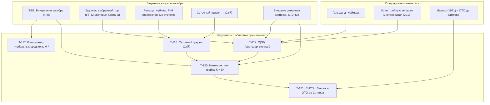

# Эмерджентное многообразие M⁴

В этой главе зафиксированы точное математическое содержание и границы результатов `T-117`–`T-121` и `T-120b`. Вместе сеточный предел регистра глубины (`T-118`) и флуктуации вручную выбранного максимального тора $\mathfrak{u}(3)$ (`T-119`) строят коммутативную алгебру $C_0(\mathbb{R}) \otimes C(S^3)$, которая соединяется с внешне заданной римановой метрикой и спиновым оператором Дирака на $\mathbb{R}\times S^3$ (`T-120`). Поскольку **две из трёх координат зарядов в `T-119(d)` являются цветовыми картановскими генераторами $\subset \mathrm{SU}(3)_C \subset G_2$**, интерпретация этого спектра как физического пространства встречает прямое **препятствие Коулмена–Мандулы**.

Подлинно конструктивный путь к операциональной геометрии пространства-времени — свободный от цветозаряженных координат и импортированных континуальных метрик — реализуется трёхмерным палиндромным квантовым клеточным автоматом Вейля со схемой Странга, инфракрасный лоренцев световой конус которого проверен в `website/research/operational-reconstruction/verify_foundational_bounds.py`, совместно с [Общей предельной метрикой](/docs/geometry/common-limit) и [Проверенными сетевыми результатами](/docs/reference/network-results).

---

## 1. Постановка проблемы {#постановка}

### 1.1 Границы фоновой независимости

При отмеченной октонионной единице $e_O$ стабилизатор $\mathrm{SU}(3) \subset G_2$ действует на $\mathbb{C}^7 = \mathbb{C}e_O \oplus \mathbf{3} \oplus \bar{\mathbf{3}}$. Спектральная тройка-произведение вида

$$
(A, H, D) = \bigl(C^\infty(M^4) \otimes A_{\mathrm{int}},\; L^2(M^4, S) \otimes H_{\mathrm{int}},\; D_{M^4} \otimes 1 + \gamma_5 \otimes D_{\mathrm{int}}\bigr)
$$

требует как топологического/гладкого многообразия $M^4$, так и внешне заданных римановой метрики, спинорного расслоения $S$ и оператора Дирака $D_{M^4}$. Теоремы ниже строят из выбранных операторов тензорного произведения лишь коммутативную топологическую алгебру $C_0(\mathbb{R}\times S^3)$; метрика, спиновая структура, лоренцева сигнатура и представления материи остаются внешними входными данными.

### 1.2 Сводка математических шагов

| Шаг | Конструкция | Фактическое математическое содержание | Ссылка |
|---|---|---|---|
| 1 | Глобальные средние по узлам | Оценка нормы коммутатора $\le M^{-1}\|[A,B]\|$ (без локальных областей) | `T-117 [Т]` |
| 2 | Временна́я алгебра | Сеточный предел выборки собственных значений регистра глубины в $C_0(\mathbb{R})$ | `T-118 [Т]` |
| 3 | Пространственная алгебра | Флуктуации вручную выбранного тора $\mathfrak{u}(3)$ (2 цветовых генератора Картана) $\to C_0(\mathbb{R}^3)^+ \cong C(S^3)$; метрика/спинор/оператор Дирака на $S^3$ заданы вручную | `T-119 [Т]` |
| 4 | Тройка-произведение | Тензорное произведение с внешним спиновым оператором Дирака на некомпактном $\mathbb{R}\times S^3$ (резольвента некомпактна; KO-6 на $\mathbb{C}^7$ невозможна) | `T-120 [Т]` |
| 5 | Классификация метрик и де Ситтер | Стандартная 4D классификация Лавлока и учебная ОТО пространства де Ситтера для заданных метрических уравнений | `T-121 [Т]`, `T-120b [С]` |

---

## 2. Математические предпосылки {#предпосылки}

### 2.1 Композитная алгебра

Для $M$ копий семимерного регистра:

$$
\mathcal{H}_M = \bigotimes_{m=1}^{M} \mathcal{H}_{\mathrm{int}}^{(m)}, \qquad \dim(\mathcal{H}_M) = 7^M, \qquad
A_M = \bigotimes_{m=1}^{M} A_{\mathrm{int}}^{(m)}, \qquad A_{\mathrm{int}} = \mathbb{C} \oplus M_3(\mathbb{C}) \oplus M_3(\mathbb{C}) \quad (\text{`T-53 [Т]`}).
$$

### 2.2 Глобальные средние по узлам

Для всякого ограниченного одноузельного оператора $O$ на $\mathbb{C}^7$ определим его **глобальное** среднее по всем $M$ тензорным сомножителям:

$$
\bar{O} := \frac{1}{M}\sum_{m=1}^{M} O^{(m)}, \qquad O^{(m)} = I \otimes \cdots \otimes O \otimes \cdots \otimes I.
$$

Никакой пространственной решётки, структуры локальности или локальных областей огрубления $\Lambda_\ell(x)$ на неструктурированном тензорном произведении $(\mathbb{C}^7)^{\otimes M}$ не задаётся.

### 2.3 Счётчик глубины и суммарные часы

Сумма $M$ одинаковых семиуровневых часов даёт $6M+1$ периодических показаний с периодом $2\pi/\omega_0$. Позиционное чтение $M$ регистров как цифр счётчика глубины по основанию 7 при ограничении Фейнмана–Китаева даёт $N + 1 = 7^M$ упорядоченных отсчётов. В `T-118` используется именно этот счётчик глубины ([Регистр глубины](/docs/proofs/dynamics/emergent-time#114-регистр-глубины)).

---

## 3. Теорема T-117: Оценка коммутатора глобальных средних по узлам {#теорема-коммутативность-макроалгебры}

**Теорема T-117 (`[Т для средних ограниченных одноузельных операторов]`).**
Пусть $A, B$ — ограниченные операторы на $\mathbb{C}^7$ с одноузельными вложениями $A^{(m)}, B^{(m)}$ в $(\mathbb{C}^7)^{\otimes M}$ и глобальными средними $\bar{A} = M^{-1}\sum_{m=1}^M A^{(m)}$, $\bar{B} = M^{-1}\sum_{m=1}^M B^{(m)}$. Поскольку операторы на разных тензорных сомножителях коммутируют ($[A^{(m)}, B^{(n)}] = 0$ при $m \neq n$),

$$
\|[\bar{A}, \bar{B}]\| = \frac{1}{M^2}\left\|\sum_{m=1}^{M} [A^{(m)}, B^{(m)}]\right\| \le \frac{1}{M}\|[A, B]\| \;\xrightarrow{M\to\infty}\; 0.
$$

**Область применимости.** Это элементарная оценка нормы для **глобальных** средних на неструктурированном тензорном произведении: она не содержит **никаких локальных областей**, пространственной метрики, гамильтониана взаимодействия или убывания корреляций. Применение центральной предельной теоремы для флуктуаций взаимодействующих состояний отдельно требует явных гипотез пространственной кластеризации. $\blacksquare$

---

## 4. Теорема T-118: Сеточный предел выборки регистра глубины {#теорема-эмерджентное-время}

**Теорема T-118 (Сеточный предел регистра глубины) `[Т]`.**
Пусть $A_N \cong \mathbb{C}^{N+1}$ — диагональная коммутативная алгебра регистра глубины с $N+1$ упорядоченными собственными значениями, отображёнными в узлы сетки $t_k = (k - m)\,\Delta t$ ($k = 0, \dots, N$). В масштабном пределе $\Delta t \to 0$, $m\,\Delta t \to \infty$, $(N - m)\,\Delta t \to \infty$ множества узлов сходятся к $\mathbb{R}$ в пунктированном смысле Хаусдорфа, а выборка $s_N(f) = \bigl(f(t_k)\bigr)_{k=0}^N$ индуцирует инъективный изометрический $*$-гомоморфизм

$$
C_0(\mathbb{R}) \hookrightarrow \prod_N A_N \Big/ \bigoplus_N A_N.
$$

**Доказательство.** Для всяких $f \in C_0(\mathbb{R})$ и $\varepsilon > 0$ выберем $R > 0$ так, чтобы $|f(t)| < \varepsilon$ при $|t| > R$. Как только $[-R, R] \subset [-m\Delta t, (N-m)\Delta t]$, всякое $t \in [-R, R]$ удалено не более чем на $\Delta t/2$ от некоторого узла $t_k$, так что равномерная непрерывность даёт $\|s_N f\| \ge \|f\|_\infty - \omega_f(\Delta t/2)$, откуда $\lim_{N\to\infty} \|s_N f\| = \|f\|_\infty$. $\blacksquare$

**Область применимости.** `T-118` — чисто кинематический **сеточный предел выборки** на $\mathbb{R}$ при заданных шаге $\Delta t$ и удаляющейся базовой точке $m$. Физическая калибровка часов и лоренцева эволюция во времени остаются отдельными входами ([Эмерджентное время](/docs/proofs/dynamics/emergent-time#114-регистр-глубины)).

---

## 5. Теорема T-119: Спектр флуктуаций вручную выбранного тора $\mathfrak{u}(3)$ {#теорема-эмерджентное-пространство}

**Теорема T-119 (Спектр трёх выбранных коммутирующих зарядов) `[Т]`.**
Зафиксируем отмеченную ось $e_O$ и комплексную структуру $J = L_{e_O}$ на $e_O^\perp$ ($J e_O = 0$). **Выберем вручную** три коммутирующих эрмитовых генератора $H_1, H_2, H_3$ на $\mathbb{C}^7$, натягивающих максимальный тор группы $\mathrm{U}(3) = \mathrm{Stab}_{\mathrm{SO}(7)}(e_O) \cap C(J)$: конкретно, **два цветовых картановских генератора из $\mathfrak{su}(3)_C \subset \mathfrak{g}_2$** вместе с $iJ$. Для $M$ голономов и точного (faithful) одноузельного состояния $\omega$ с $\mu_i = \omega(H_i)$ положим $\bar{H}_i = \frac{1}{M}\sum_{m=1}^M H_i^{(m)}$ и $F_i = \sqrt{M}(\bar{H}_i - \mu_i)$.

- **(a) Средние заполняют октаэдр.** На $\mathbb{C}^7$ совместные собственные значения $(H_1, H_2, H_3)$ равны $0$ (на $e_O$) и $\pm w_1, \pm w_2, \pm w_3$ (линейно независимые). На $(\mathbb{C}^7)^{\otimes M}$ совместные спектры $(\bar{H}_i)$ заполняют весовой октаэдр $\mathcal{O} = \mathrm{conv}\{\pm w_a\} \cong B^3$ с шагом $O(1/M)$, изометрически вкладывая $C(\mathcal{O})$ в $\prod_M A_M / \bigoplus_M A_M$. Поскольку $\mathcal{O}$ стягиваем и имеет край $S^2$, $K$-теоретическая двойственность Пуанкаре не выполняется ($K^0 = \mathbb{Z}$, $K_1 = 0$).
- **(b) Флуктуации заполняют $\mathbb{R}^3$; минимальная унитизация даёт $C(S^3)$.** Так как $\omega$ точно, $\mu$ лежит во внутренности $\mathcal{O}$, и совместные спектры $\{(n - M\mu)/\sqrt{M} : |n|_1 \le M\}$ заполняют всякий шар в $\mathbb{R}^3$ с шагом $O(1/\sqrt{M})$, изометрически вкладывая $C_0(\mathbb{R}^3)$ в $\prod_M A_M / \bigoplus_M A_M$. Присоединение единицы **по определению** даёт минимальную унитизацию $C_0(\mathbb{R}^3)^+ \cong C(S^3)$ (одноточечную компактификацию; иные унитальные пополнения дают $T^3$, $\mathbb{RP}^3$ или $\beta\mathbb{R}^3$).
- **(c) Вручную заданная риманова спиновая тройка на $S^3$.** $S^3$ замкнута, ориентируема, односвязна и параллелизуема, с единственной гладкой структурой (Моиз 1952) и единственной спиновой структурой ($H^1(S^3;\mathbb{Z}_2) = 0$). **После ручного задания римановой метрики $g$, спинорного расслоения $S$ и спинового оператора Дирака $D_g$ на $S^3$** стандартная тройка Дирака $(C^\infty(S^3), L^2(S^3, S), D_g)$ удовлетворяет аксиомам Конна (Connes 2013, [arXiv:0810.2088](https://arxiv.org/abs/0810.2088)). Ни $g$, ни $D_g$ из $\mathcal{D}(\mathbb{C}^7)$ не выводятся.
- **(d) Цвет-синглетное препятствие.** Эрмитовы операторы на $\mathbb{C}^7$, коммутирующие с $\mathrm{SU}(3)_C$, суть $\mathrm{span}\{P_O, P_{\mathbf{3}}, P_{\bar{\mathbf{3}}}\}$, бесследовая часть которых имеет размерность **2**, а не 3. Поэтому построение трёх координат в (a)–(b) **вынуждает брать два из трёх генераторов из цветовой подалгебры Картана $\subset \mathfrak{su}(3)_C \subset \mathfrak{g}_2$**.

**Доказательство.** (a) Поскольку $[H_i, H_j] = 0$, совместный спектр $(\bar{H}_i)$ в весовых координатах есть $\frac{1}{M}\{n \in \mathbb{Z}^3 : |n|_1 \le M\}$, каждая точка $\mathcal{O} = \{|x|_1 \le 1\}$ отстоит от точки спектра не далее чем на $\sqrt{3}/(2M)$, и равномерная непрерывность даёт изометричность выборки. (b) Для любого радиуса $R$, как только шар радиуса $R\sqrt{M}+1$ вокруг $M\mu$ лежит в $M\mathcal{O}$, округление к $(\mathbb{Z}^3 - M\mu)/\sqrt{M}$ приближает всякое $|x| \le R$ с точностью $\sqrt{3}/(2\sqrt{M})$; присоединение $\mathbb{C}1$ к $C_0(\mathbb{R}^3)$ даёт $C(S^3)$ по Гельфанду–Наймарку. (c) Стандартное направление «только если» теоремы реконструкции Конна для замкнутого спинового 3-многообразия с выбранной римановой метрикой $g$. (d) $\mathbb{C}^7 = \mathbb{C}e_O \oplus \mathbf{3} \oplus \bar{\mathbf{3}}$ состоит из трёх неэквивалентных неприводимых представлений $\mathrm{SU}(3)_C$, поэтому по лемме Шура коммутант равен $\mathbb{C}^3$ (бесследовая размерность 2). $\blacksquare$

*(Численная проверка в `website/scripts/check_core_numbers.py`, `test_emergent_space_is_the_octahedron_and_its_fluctuations_the_three_sphere`.)*

**Физическое препятствие `[И]` (Коулмен–Мандула).** Поскольку две из трёх координат в (a)–(b) являются цветовыми генераторами Картана в $\mathrm{SU}(3)_C \subset G_2$, группа Вейля цвета переставляет координаты, а вращения $\mathrm{SU}(3)_C$ смешивают их с некоммутирующими внутренними генераторами. Прочтение этого спектра зарядов как физического трёхмерного пространства нарушает разделение внутренних калибровочных и пространственно-временных симметрий (препятствие Коулмена–Мандулы; см. §11.4 ниже).

### Ранг выбранной алгебры зарядов {#шаг-2c-ранг}

На октонионах с отмеченной единицей часов $e_O$:
1. $\mathfrak{su}(3) = \mathrm{Stab}_{\mathrm{Der}(\mathbb{O})}(e_O)$ имеет размерность $8$ внутри $\dim\mathrm{Der}(\mathbb{O}) = 14$.
2. Её коммутант на вещественной 6-плоскости $e_O^\perp$ двумерен и натянут на $I$ и комплексную структуру $J = L_{e_O}$ ($J^2 = -I$, $[J, \mathfrak{su}(3)] = 0$), давая $\mathfrak{u}(3) = \mathfrak{su}(3) \oplus \mathfrak{u}(1)_J$ размерности $9$.
3. Ранг $\mathfrak{u}(3)$ (размерность максимального тора) равен $3$.

---

## 6. Теорема T-120: Произведение с внешним некомпактным спиновым оператором Дирака {#теорема-произведение-троек}

**Теорема T-120 (Спектральные данные произведения на некомпактном $M^4 = \mathbb{R}\times S^3$) `[Т при заданных сомножителях и метрике]`**.
Объединение коммутирующих предельных алгебр $A_{\mathrm{time}} \cong C_0(\mathbb{R})$ (`T-118`), $A_{\mathrm{space}} \cong C(S^3)$ (`T-119`) и $A_{\mathrm{int}} = \mathbb{C} \oplus M_3(\mathbb{C}) \oplus M_3(\mathbb{C})$ (`T-53`) — при $\|[F_i, a]\| \le M^{-1/2}\|[H_i, a]\| \to 0$ для фиксированного одноузельного $a \in A_{\mathrm{int}}$ — даёт алгебру $C_0(\mathbb{R}\times S^3) \otimes A_{\mathrm{int}}$. При **внешне заданных** римановой метрике и спиновой структуре на $M^4 = \mathbb{R} \times S^3$ формируется оператор-произведение

$$
\bigl(C_0^\infty(M^4) \otimes A_{\mathrm{int}},\; L^2(M^4, S) \otimes H_{\mathrm{int}},\; D_{M^4} \otimes I + \gamma_5 \otimes D_{\mathrm{int}}\bigr).
$$

**Принципиальные аналитические и алгебраические ограничения:**
1. **Некомпактность резольвенты:** Поскольку $M^4 = \mathbb{R} \times S^3$ **некомпактно**, внешний спиновый оператор Дирака $D_{M^4}$ **не** обладает компактной резольвентой; выполняется лишь условие *локальной компактности* $a(D_{M^4} + i)^{-1} \in \mathcal{K}$ для $a \in C_0(M^4)$, поэтому следы теплового ядра требуют пространственно-временной локализации или компактификации.
2. **Внешняя метрика и сигнатура:** И риманова метрика $g$, и спиновый оператор Дирака $D_{M^4}$ задаются извне; лоренцева сигнатура требует отдельных причинных/аналитических данных.
3. **Отсутствие KO-размерности 6 на $\mathbb{C}^7$:** Нечётная внутренняя размерность 7 запрещает вещественную структуру KO-размерности 6 (`T-178 [✗]`, [Квантовая гравитация](/docs/physics/gravity/quantum-gravity#теорема-полное-спектральное-действие)). $\blacksquare$

---

## 7. Теорема T-121: Стандартная 4D классификация Лавлока {#теорема-лавлок-замыкание}

**Теорема T-121 (`[Т при стандартных 4D гипотезах Лавлока]`).**
На внешне заданном гладком четырёхмерном многообразии теорема Лавлока (1971) утверждает, что всякий локальный диффеоморфно-ковариантный симметричный бездивергентный тензор, зависящий от $g_{\mu\nu}$ и её производных до второго порядка, является линейной комбинацией $G_{\mu\nu}$ и $g_{\mu\nu}$. Эта классификация не фиксирует ни $G_N$, ни $\Lambda$, ни $S_{\mathrm{matter}}$, ни отображения внутренних матриц когерентности в $g_{\mu\nu}$ ([Уравнения Эйнштейна](/docs/physics/gravity/einstein-equations#34-ограничения-аргумента-лавлока)).

---

## 8. Следствие T-120b: Стандартная учебная ОТО пространства де Ситтера {#следствие-вакуумная-топология}

**Следствие T-120b (`[Т]` как стандартная ОТО при заданном вакуумном уравнении, $\Lambda > 0$, максимальной симметрии и слоении $k=+1$).**
Это следствие представляет собой стандартную учебную ОТО пространства де Ситтера на внешне заданной 4D лоренцевой метрике:

1. При заданном вакуумном уравнении Эйнштейна $R_{\mu\nu} = \Lambda g_{\mu\nu}$ с константой $\Lambda > 0$ и максимальной симметрией пространства-времени постоянная секционная кривизна даёт $R_{\mu\nu\rho\sigma} = \frac{\Lambda}{3}(g_{\mu\rho}g_{\nu\sigma} - g_{\mu\sigma}g_{\nu\rho})$ и $H^2 = \Lambda/3$ (локально пространство де Ситтера).
2. Выбор полного односвязного глобального пространства де Ситтера и его замкнутого однородного слоения $k=+1$ даёт $ds^2 = dt^2 - a^2(t)\,d\Omega_3^2$ с $a(t) = H^{-1}\cosh(Ht)$, пространственные сечения которого суть круглые 3-сферы $S^3$.

Положительная $\Lambda$ в равной мере допускает плоские ($k=0$, $a(t) = a_0 e^{Ht}$) и открытые ($k=-1$, $a(t) = H^{-1}\sinh(Ht)$) координатные карты ([Carroll, GR notes, §8](https://ned.ipac.caltech.edu/level5/March01/Carroll3/Carroll8.html)). Ни $\Lambda > 0$ (`T-71 [Г]`), ни максимальная симметрия, ни замкнутое слоение $k=+1$ не выводятся из УГМ или из спектра `T-119`.

---

## 9. Точная сводка статусов {#каскад-статусов}

| Результат | Точное математическое содержание | Внешние входы / препятствия |
|---|---|---|
| `T-117` | Оценка нормы коммутатора глобальных средних $\le M^{-1}\|[A,B]\|$ | Нет локальных областей, метрики или кластеризации при взаимодействии |
| `T-118` | Сеточный предел выборки $C_0(\mathbb{R})$ собственных значений регистра глубины | Шаг $\Delta t$ и удаляющаяся база; нет физической калибровки часов |
| `T-119` | Спектр флуктуаций $C_0(\mathbb{R}^3)^+ \cong C(S^3)$ вручную выбранного тора $\mathfrak{u}(3)$ | 2 из 3 координат — цветовые генераторы Картана (препятствие Коулмена–Мандулы); $g, S, D_g$ на $S^3$ заданы вручную |
| `T-120` | Тройка-произведение на некомпактном $\mathbb{R}\times S^3$ | Внешние метрика и оператор Дирака; **некомпактная резольвента**; нет KO-6 на $\mathbb{C}^7$ (`T-178 [✗]`) |
| `T-121` | Стандартная 4D теорема Лавлока | Требует заданного 4-многообразия и диффеоморфно-инвариантного метрического действия |
| `T-120b` | Стандартная учебная ОТО де Ситтера (слоение $k=+1$) | Требует заданных $R_{\mu\nu}=\Lambda g_{\mu\nu}$, $\Lambda>0$ (`T-71 [Г]`), максимальной симметрии и слоения $k=+1$ |

---

## 10. Подлинный конструктивный путь: операциональная геометрия и 3D QCA Вейля {#нет-новых-вопросов}

Поскольку `T-119`–`T-120` опираются на цветозаряженные координаты и внешне заданные континуальные операторы Дирака, они **не** дают физически состоятельного вывода пространства-времени. Конструктивный путь в операциональной реконструкции строит геометрию непосредственно из локальной конечномерной динамики и протоколов вмешательства:

1. **ИК лоренцев световой конус 3D палиндромного QCA Вейля со схемой Странга:** Верифицированный непосредственно в `website/research/operational-reconstruction/verify_foundational_bounds.py`, трёхмерный палиндромный квантовый клеточный автомат Вейля с расщеплением Странга порождает эмерджентный инфракрасный лоренцев дисперсионный конус ($\omega^2 \approx c_{\mathrm{eff}}^2 |\mathbf{k}|^2$) из строго локальных дискретных унитарных шагов на решётке — без привлечения цветовых генераторов Картана и без импорта континуального оператора Дирака.
2. **Операциональные сетевые метрики:** Минимальные стоимости вмешательств и время первого отклика определяют направленные и симметричные метрики и конструктивные масштабные пределы на конечных и предельных сетях ([Метрика отклика](/docs/geometry/response-metric), [Общая предельная метрика](/docs/geometry/common-limit), [Проверенные сетевые результаты](/docs/reference/network-results)).

---

## 11. Проверки согласованности и препятствий {#согласованность}

### 11.1 Связь со спектральным действием `[Т при заданной геометрии]`

В `T-65` гравитационный коэффициент Эйнштейна–Гильберта возникает исключительно из внешне заданной метрики внутри $D_{M^4}$, умноженной на $\mathrm{Tr}(I_{\mathbb{C}^7}) = 7$.

### 11.2 Регистр глубины Пейджа–Вуттерса `[Т]`

Одиночные циклические часы периодичны; `T-118` опирается на $M$-регистровый позиционный счётчик глубины с убывающим шагом и удаляющимися концами.

### 11.3 Комплексифицированное секторное разложение `[Т]`

Под действием $\mathrm{SU}(3)_C = \mathrm{Stab}_{G_2}(e_O)$ вещественное дополнение $e_O^\perp \cong \mathbb{R}^6$ неприводимо и распадается на $\mathbf{3} \oplus \bar{\mathbf{3}}$ лишь после комплексификации.

### 11.4 Прямое препятствие Коулмена–Мандулы относительно $G_2$ и $\mathrm{SU}(3)_C$

**Прежние утверждения о том, что «$G_2$ не действует на $M^4$», ошибочны и удалены.** По `T-119(d)` цветосинглетные эрмитовы операторы на $\mathbb{C}^7$ имеют не более чем 2-мерную бесследовую часть, поэтому **две из трёх пространственных координат, построенных в `T-119`, являются цветовыми картановскими генераторами $\subset \mathrm{SU}(3)_C \subset G_2$**. Следовательно:

- Цветовая подгруппа $\mathrm{SU}(3)_C \subset G_2$ действует **нетривиально** на пространственном многообразии $\Sigma^3 = S^3$ из `T-119`: её группа Вейля переставляет координатные оси, а общие преобразования $\mathrm{SU}(3)_C \subset G_2$ переводят выбранные генераторы Картана в некоммутирующие цветовые генераторы.
- Отождествление $\Sigma^3$ с физическим пространством тем самым смешивает внутреннюю калибровочную симметрию с пространственными сдвигами и вращениями, порождая прямое **препятствие Коулмена–Мандулы** (которого алгебраическая форма спин-фактора `T-48c` избегает на уровне одного касательного пространства, а конструктивный путь 3D QCA Вейля и операциональных сетей избегает полностью).

### 11.5 Независимость от внутренних неподвижных точек

Условия стационарности $\rho_* = \varphi(\Gamma)$ ограничивают одноузельную динамику на $\mathcal{D}(\mathbb{C}^7)$ и не определяют макроскопической геометрии пространства-времени.

---

## 12. Граф зависимостей {#граф-зависимостей}

---

## Приложение: используемые стандартные теоремы {#приложение}

### A.1 Теорема Гельфанда–Наймарка (1943)

Всякая унитальная коммутативная $C^*$-алгебра $A$ изометрически $*$-изоморфна $C(X)$ для единственного (с точностью до гомеоморфизма) компактного хаусдорфова пространства $X$.

### A.2 Теорема реконструкции Конна (2008, 2013)

Замкнутое гладкое спиновое многообразие $\Sigma^p$ с римановой метрикой $g$ задаёт коммутативную спектральную тройку $(C^\infty(\Sigma^p), L^2(\Sigma^p, S), D_g)$, удовлетворяющую семи аксиомам Конна (размерность, регулярность, конечность, ориентируемость, двойственность Пуанкаре, условие первого порядка и абсолютная непрерывность), и обратно такая коммутативная тройка определяет единственное замкнутое гладкое спиновое многообразие (Connes, *J. Noncommut. Geom.* **7**, 1–82 (2013), [arXiv:0810.2088](https://arxiv.org/abs/0810.2088)).

### A.3 Квантовая центральная предельная теорема (1989)

Для квантовой спиновой системы на пространственной решётке $\mathbb{Z}^d$ с конечным радиусом взаимодействия и экспоненциальным кластерированием макроскопические средние сходятся к классическим/гауссовым флуктуационным наблюдаемым (Goderis–Verbeure–Vets, *Probab. Theory Relat. Fields* **82**, 527–544 (1989)). Отметим, что `T-117` доказывает лишь неструктурированную глобальную оценку нормы $\|[\bar{A}, \bar{B}]\| \le M^{-1}\|[A,B]\|$ и **не** устанавливает решёточной кластеризации.

### A.4 Произведение спектральных троек (1996–1997)

На компактных сомножителях $(A_1 \otimes A_2, H_1 \otimes H_2, D_1 \otimes I + \gamma_1 \otimes D_2)$ образует тройку-произведение KO-размерности $d_1 + d_2 \pmod 8$, если оба сомножителя несут вещественные структуры (Chamseddine–Connes 1996). В `T-120` первый сомножитель $\mathbb{R}\times S^3$ некомпактен (некомпактная резольвента), а второй сомножитель $\mathbb{C}^7$ не допускает структуры KO-размерности 6 (`T-178 [✗]`).

---

**Связанные документы:**
- [Проверенные сетевые результаты](/docs/reference/network-results) — машинно проверенная операциональная геометрия и фундаментальные границы (`verify_foundational_bounds.py`)
- [Общая предельная метрика](/docs/geometry/common-limit) — конструктивные масштабные пределы операциональных расстояний
- [Теорема об эмерджентном времени](/docs/proofs/dynamics/emergent-time) — регистр глубины (`T-118`)
- [Пространство-время](/docs/core/foundations/spacetime) — алгебраический спин-фактор (`T-48c`) и `T-53`
- [Уравнения Эйнштейна](/docs/physics/gravity/einstein-equations) — условная вариация Эйнштейна–Гильберта и ограничения Лавлока (`T-121`)
- [Квантовая гравитация](/docs/physics/gravity/quantum-gravity) — спектральное действие на произведении (`T-65`)
- [Реестр статусов](/docs/reference/status-registry) — `T-117`–`T-121`
