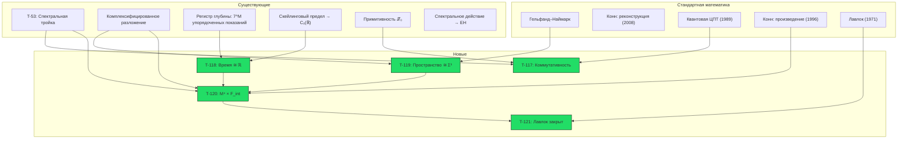

# Эмерджентное Многообразие M⁴

Регистр глубины с заданным масштабным пределом даёт $\mathbb R$. Флуктуации трёх выбранных коммутирующих зарядов дают $C_0(\mathbb R^3)$, а спектр её минимальной унитизации равен $S^3$. Произведение $\mathbb R\times S^3$ — математическая конструкция [Т]. Два заряда несут цвет. Физическая интерпретация, метрика и динамика требуют отдельных предпосылок. [Операционные метрические пределы](/docs/geometry/common-limit)

---

## 1. Постановка проблемы {#постановка}

### 1.1 Пробел фоновой независимости

При выбранной октонионной единице $e_O$ стабилизатор действует на $\mathbb C^7=\mathbb C e_O\oplus\mathbf3\oplus\bar{\mathbf3}$. Спектральное действие на произведении также использует спиновое многообразие, метрику и дифференциальный оператор:

$$
(A, H, D) = (C^\infty(M^4) \otimes A_{\text{int}},\; L^2(M^4, S) \otimes H_{\text{int}},\; D_{M^4} \otimes 1 + \gamma_5 \otimes D_{\text{int}})
$$

Ниже строится топологическое пространство. Представления вещества и константы связи задаются отдельно.

### 1.2 Стратегия решения

В построениях используются следующие алгебры и предельные переходы.

| Шаг | Содержание | Источник |
|-----|-----------|---------|
| 1 | Композитная алгебра | Тензорное произведение [Т] |
| 2 | Временна́я C*-алгебра | $\mathbb{C}[\mathbb{Z}_N] \to C(S^1)$ для суммарных O-часов; $C_0(\mathbb{R})$ как скейлинговый предел регистра глубины (T-118 [Т]) |
| 3 | Пространственная C*-алгебра | Совместный спектр трёх коммутирующих вращательных зарядов, вычислен: октаэдр (средние), $\mathbb R^3$ (флуктуации), $C(S^3)$ после минимальной унитизации (T-119 [Т]) |
| 4 | Многообразие | Гельфанд–Наймарк [стандартная математика]; условия Конна выполнены для тройки Дирака $S^3$ (T-119(c) [Т]) |
| 5 | Произведение | Шаги 1–4 (T-120 [Т]) |

---

## 2. Математические предпосылки {#предпосылки}

### 2.1 Композитные системы

Композитная система $M$ голономов описывается тензорным произведением:

$$
\mathcal{H}_M = \bigotimes_{m=1}^{M} \mathcal{H}_{\text{int}}^{(m)}, \quad \dim(\mathcal{H}_M) = 7^M
$$

Алгебра наблюдаемых:

$$
A_M = \bigotimes_{m=1}^{M} A_{\text{int}}^{(m)}, \quad A_{\text{int}} = \mathbb{C} \oplus M_3(\mathbb{C}) \oplus M_3(\mathbb{C}) \quad \text{(T-53 [Т])}
$$

### 2.2 Макроскопические наблюдаемые

Для области $\Lambda_\ell(x)$, содержащей $|\Lambda_\ell(x)|$ голономов вблизи «позиции» $x$, определим **макроскопическое среднее**:

$$
\bar{O}(x) := \frac{1}{|\Lambda_\ell(x)|} \sum_{m \in \Lambda_\ell(x)} O^{(m)}
$$

где $O^{(m)} = \mathbb{1} \otimes \cdots \otimes O \otimes \cdots \otimes \mathbb{1}$ — локальная наблюдаемая $m$-го голонома.

### 2.3 Эффективные часы и временна́я алгебра

Сумма $M$ одинаковых семиуровневых часов даёт $6M+1$ показаний при периоде $2\pi/\omega_0$. Если использовать регистры как разряды счётчика глубины с заданным ограничением Фейнмана–Китаева, получаются $7^M$ упорядоченных показаний. В T-118 используется этот счётчик. [Регистр глубины](/docs/proofs/dynamics/emergent-time#114-регистр-глубины)

---

## 3. Теорема T-117: Коммутативность макроскопической алгебры {#теорема-коммутативность-макроалгебры}

**T-117 [Т для средних ограниченных одноузельных операторов].** Пусть $A^{(m)},B^{(m)}$ — копии ограниченных наблюдаемых, действующие в узле $m$ тензорного произведения, а $\bar A=M^{-1}\sum_m A^{(m)}$, $\bar B=M^{-1}\sum_m B^{(m)}$. Операторы разных узлов коммутируют, поэтому

$$
\|[\bar A,\bar B]\|\le M^{-2}\sum_m\|[A^{(m)},B^{(m)}]\|\le M^{-1}\|[A,B]\|.
$$

Коммутативность средних не устанавливает убывание пространственных корреляций в семействе взаимодействующих состояний. Для применения центральной предельной теоремы к флуктуациям необходимо проверить её условия кластеризации.

---

## 4. Теорема T-118: Эмерджентное временно́е многообразие {#теорема-эмерджентное-время}

:::tip Теорема T-118 (Эмерджентное временно́е многообразие) [Т]
Временна́я часть $A_{\text{macro}}$ — диагональная алгебра $A_N \cong \mathbb{C}^{N+1}$ регистра глубины с показаниями $t_k = (k - m)\,\Delta t$ в макроскопической единице — сходится к $C_0(\mathbb{R})$, алгебре непрерывных функций, стремящихся к нулю на бесконечности, в скейлинговом пределе $\Delta t \to 0$, $m\,\Delta t \to \infty$, $(N - m)\,\Delta t \to \infty$: множества показаний сходятся к $\mathbb{R}$ в пунктированном смысле Хаусдорфа, а выборка — инъективный изометрический $*$-гомоморфизм $C_0(\mathbb{R}) \to \prod_N A_N/\bigoplus_N A_N$.
:::

**Доказательство.**

**Шаг 1.** Показания часовых регистров считываются позиционно при заданном ограничении Фейнмана–Китаева. Полученные $N+1$ отсчётов образуют упорядоченную цепь и индексируют условные динамические состояния. [Регистр глубины](/docs/proofs/dynamics/emergent-time#114-регистр-глубины)

**Шаг 2 (Скейлинговый предел).** Теорема 11.5 эмерджентного времени: показания образуют сетку шага $\Delta t$, которая начиная с некоторого номера покрывает всякий $[-R, R]$; вычисление значений в показаниях — $*$-гомоморфизм $s_N: C_0(\mathbb{R}) \to A_N$, и $\|s_N f\| \geq \|f\|_\infty - \omega_f(\Delta t/2)$ по равномерной непрерывности, так что $\limsup_N \|s_N f\| = \|f\|_\infty$. $\blacksquare$

Начало отсчёта в первом показании даёт полупрямую. Если базовая точка в макроскопических единицах удаляется от обоих концов, получается прямая, используемая в T-120.

**Зависимости:** эмерджентное время, теоремы 11.1 и 11.5 [Т]; стандартная математика: Гельфанд–Наймарк.

---

## 5. Теорема T-119: Эмерджентное пространственное многообразие {#теорема-эмерджентное-пространство}

:::tip T-119. Спектр выбранных зарядов [Т]
Пусть $J=L_{e_O}$ на $e_O^\perp$ (и $0$ на $e_O$), и пусть $H_1,H_2,H_3$ — эрмитовы генераторы на $\mathbb C^7$ максимального тора группы $\mathrm U(3)=\mathrm{Stab}_{\mathrm{SO}(7)}(e_O)\cap C(J)$: два картановских генератора $\mathfrak{su}(3)_C$ и $iJ$. Равносильно — максимального тора $\mathrm{SO}(7)$, оставляющего ось часов; $\operatorname{rank}\mathrm{SO}(7)=3$. Для $M$ голономов положим $\bar H_i=\frac1M\sum_m H_i^{(m)}$ и $F_i=\sqrt M\,(\bar H_i-\mu_i)$, где $\mu_i=\omega(H_i)$ для точного (faithful) состояния $\omega$ одного голонома.

**(a) Средние: октаэдр.** Совместные собственные значения $(H_1,H_2,H_3)$ на $\mathbb C^7$ — это $0$ (на $e_O$) и $\pm w_1,\pm w_2,\pm w_3$ с линейно независимыми $w_a$. Совместные спектры $(\bar H_i)$ заполняют весовой октаэдр $\mathcal O=\mathrm{conv}\{\pm w_a\}$ с шагом $O(1/M)$. Выборка $f\mapsto f(\bar H)$ вкладывает $C(\mathcal O)$ изометрически в $\prod_M A_M/\bigoplus_M A_M$. $\mathcal O\cong B^3$ — многообразие с краем $S^2$, и его $K$-теоретическая двойственность Пуанкаре не выполняется.

**(b) Флуктуации: $\mathbb R^3$, а после единицы — $S^3$.** Совместные спектры $(F_i)$ заполняют всякий шар в $\mathbb R^3$ с шагом $O(1/\sqrt M)$. Выборка вкладывает $C_0(\mathbb R^3)$ изометрически в $\prod_M A_M/\bigoplus_M A_M$. *Пространственная алгебра*, определённая как унитальная C*-алгебра, порождённая этим образом, есть минимальная унитизация $C_0(\mathbb R^3)^+\cong C(S^3)$.

**(c) Многообразие и условия Конна.** $\Sigma^3:=S^3$ — замкнутое ориентируемое односвязное спиновое 3-многообразие с единственной гладкой структурой. Для всякой римановой метрики $g$ на нём тройка Дирака $(C^\infty(S^3),L^2(S^3,S),D_g)$ удовлетворяет всем семи условиям Конна, включая условие первого порядка и двойственность Пуанкаре.

**(d) Цвет-синглетные координаты дают два измерения.** Эрмитовы операторы на $\mathbb C^7$, коммутирующие с $\mathrm{SU}(3)_C$, — это $\mathrm{span}\{P_O,P_{\mathbf 3},P_{\bar{\mathbf 3}}\}$; их бесследовая часть двумерна. Поэтому «3» в (a)–(c) требует двух цветовых картановских генераторов, и это $\Sigma^3$ не цвет-синглетно.
:::

**Доказательство.** (a) $H_i$ коммутируют: они лежат в одном торе. Их совместные собственные значения вычислены (числа ниже). В весовых координатах это $0,\pm e_1,\pm e_2,\pm e_3$. На $(\mathbb C^7)^{\otimes M}$ операторы $\bar H_i$ коммутируют точно, и их совместные собственные значения — средние $M$ весов: $\frac1M\{n\in\mathbb Z^3:\lvert n\rvert_1\le M\}$ (вес $0$ позволяет сумме пройти меньше $M$ шагов). Все эти точки лежат в $\mathcal O=\{\lvert x\rvert_1\le1\}$, и каждая точка $\mathcal O$ удалена от ближайшей из них не более чем на $\sqrt3/(2M)$. Как в [T-118](#теорема-эмерджентное-время), $\lVert f(\bar H)\rVert=\max_{\mathrm{spec}}\lvert f\rvert\ge\lVert f\rVert_\infty-\omega_f(\sqrt3/(2M))$, так что выборка изометрична в фактор-алгебре. $\mathcal O$ — компактное выпуклое тело с внутренностью, поэтому гомеоморфно $B^3$. Двойственность Пуанкаре для замкнутого 3-многообразия $X$ дала бы $K^0(X)\cong K_1(X)$. Для стягиваемого $\mathcal O$ имеем $K^0=\mathbb Z$ и $K_1=0$.
(b) Совместный спектр $(F_i)$ — это $\{(n-M\mu)/\sqrt M:\lvert n\rvert_1\le M\}$. Точное $\omega$ даёт каждому совместному собственному значению положительный вес, поэтому $\mu$ — внутренняя точка $\mathcal O$. Для данного $R$, как только $M$ столь велико, что шар радиуса $R\sqrt M+1$ вокруг $M\mu$ лежит в $M\mathcal O$, округление любого $x$ с $\lvert x\rvert\le R$ до решётки $(\mathbb Z^3-M\mu)/\sqrt M$ не выводит из ограничения и сдвигает $x$ не более чем на $\sqrt3/(2\sqrt M)$. Значит, спектры заполняют шар, и $\lVert f(F)\rVert\to\lVert f\rVert_\infty$ для $f\in C_0(\mathbb R^3)$. Образ не содержит единицы, потому что её нет в $C_0(\mathbb R^3)$. Поэтому образ $+\,\mathbb C1$ — минимальная унитизация, чей спектр — одноточечная компактификация $\mathbb R^3\cup\{\infty\}=S^3$.
(c) $S^3$ компактна, ориентируема и параллелизуема, значит, спинова (со единственной спиновой структурой, так как $H^1(S^3;\mathbb Z_2)=0$), и односвязна. Её гладкая структура единственна (Моиз, 1952: у всякого топологического 3-многообразия одна гладкая структура с точностью до диффеоморфизма). Для замкнутого спинового многообразия тройка Дирака удовлетворяет условиям Конна; это половина «только если» теоремы реконструкции (Connes, *J. Noncommut. Geom.* **7**, 1–82 (2013), [arXiv:0810.2088](https://arxiv.org/abs/0810.2088); J. M. Gracia-Bondía, J. C. Várilly, H. Figueroa, *Elements of Noncommutative Geometry*, Birkhäuser 2001, гл. 10–11). Условие первого порядка выполнено, потому что $[D,a]=c(da)$ действует клиффордовым умножением, которое коммутирует с умножением на функции, а на коммутативной алгебре $b^\circ=b$. Двойственность Пуанкаре — фундаментальный класс $[D]\in K_3(S^3)$. Круга нет: многообразие установлено в (b) через Гельфанда–Наймарка, а не предположено ради проверки аксиомы.
(d) $\mathbb C^7=\mathbb Ce_O\oplus\mathbf 3\oplus\bar{\mathbf 3}$ — три неэквивалентных неприводимых, поэтому по Шуру коммутант равен $\mathbb C^3$. $\blacksquare$

*Числа* (`website/scripts/check_core_numbers.py`, `test_emergent_space_is_the_octahedron_and_its_fluctuations_the_three_sphere`): три генератора коммутируют; их совместный спектр на $\mathbb C^7$ — начало и три антиподальные пары ранга $3$, и в весовых координатах у каждой ненулевой точки $\lvert w\rvert_1=\lvert w\rvert_\infty=1$; при $M=10$ и $M=40$ случайные точки $\mathcal O$ лежат не дальше $\sqrt3/(2M)$ от спектра средних; при $M=10^6$ и внутреннем $\mu$ случайные точки $[-3,3]^3$ лежат не дальше $\sqrt3/(2\sqrt M)$ от спектра флуктуаций; ковариация $(H_i)$ в $I/7$ невырождена; цветовой коммутант на $\mathbb C^7$ имеет размерность $3$.

**Единственный выбор — назван.** Другие унитальные пополнения $C_0(\mathbb R^3)$ дают другие компактификации: координатные резольвенты $(F_i\pm i)^{-1}$ — $(\mathbb R\cup\infty)^3=T^3$, все ограниченные непрерывные функции — компактификацию Стоуна–Чеха $\beta\mathbb R^3$, проективное пополнение — $\mathbb{RP}^3$. Одноточечная компактификация — наименьшая компактификация $\mathbb R^3$, и вращения ковариации флуктуаций на неё продолжаются (на $T^3$ — нет). T-119 берёт её по определению, как T-118 берёт $C_0(\mathbb R)$, а не $C_b(\mathbb R)$. Это определение, а не гипотеза об УГМ. Его физическое содержание: «пространство» означает наблюдаемые, которые при больших флуктуациях становятся постоянными.

**Метрика не фиксирована.** Ковариация $(F_i)$ в состоянии $I/7$ равна $\tfrac27\cdot1$ в весовых координатах. Она даёт $\mathbb R^3$ плоскую метрику, которая продолжается на $S^3$ лишь конформно (стереографическая проекция). T-119 фиксирует многообразие, а не метрику. Метрика динамическая и входит через спектральное действие (T-65).

**Прочтение как физического пространства: [И].** Три заряда вращают три комплексные плоскости $\{A,D\},\{S,U\},\{L,E\}$, на которые $L_{e_O}$ разбивает шесть осей вне $O$; неподвижная ось — часы. Так $7=1+2\cdot3$ даёт одну ось часов и $\operatorname{rank}\mathrm{SO}(7)=3$ коммутирующих заряда. Но по (d) координаты цветозаряжены: группа Вейля $\mathrm{SU}(3)_C$ их переставляет, а цветовые вращения смешивают их с некоммутирующими зарядами. Прочтённое как физическое пространство, это $\Sigma^3$ встречает препятствие Коулмена–Мандулы, которое [теорема 48c](/docs/core/foundations/spacetime#теорема-48c) обходит. Оба результата дают один счёт $1+3$, но одной картиной пока не стали ([теорема 48d](/docs/core/foundations/spacetime#теорема-48d)).

### Ранг алгебры зарядов {#шаг-2c-ранг}

Максимальный тор $\mathrm U(3)$ имеет три независимых генератора. В пункте (b) совместный спектр флуктуаций действительно заполняет $\mathbb R^3$. Сам по себе ранг даёт верхнюю границу числа коммутирующих координат.

**Вычисление, целиком из октонионов**:

1. $\mathfrak{su}(3) = \mathrm{Stab}_{\mathrm{Der}(\mathbb O)}(e_1)$ восьмимерна (§C, проверено: $\dim\mathrm{Der}(\mathbb O)=14$, $\dim\mathrm{Stab}=8$).
2. Её коммутант на $6$-мерном дополнении $\mathrm{span}(e_2,\dots,e_7)$ двумерен; вычитая единицу, остаётся **комплексная структура** $J$ с $J^2 = -I$ (невязка $1{,}3\times10^{-15}$) и $[J,\mathfrak{su}(3)] = 0$ (невязка $1{,}1\times10^{-15}$). Значит $J$ *выведена*, а не постулирована, и пространственная алгебра наблюдаемых есть

$$
\mathfrak{su}(3)\oplus\mathfrak u(1)_J \;=\; \mathfrak u(3), \qquad \dim = 9 \ \text{(проверено)} .
$$

3. Ранг есть размерность централизатора типичного элемента. Измерено на $20$ случайных элементах: **ровно $3$**, каждый раз. Для сравнения ни один из кандидатов-«размерностей» не равен $3$: $\dim\mathfrak u(3) = 9$, $\dim\mathfrak{su}(3) = 8$, $\dim G_2 = 14$.

$$
\boxed{\,d_s \;=\; \operatorname{rank}\mathfrak u(3) \;=\; 3\,}
$$
---

## 6. Теорема T-120: Произведение спектральных троек {#теорема-произведение-троек}

:::tip T-120. Произведение спектральных троек
В пределе $M\to\infty$ макроскопические алгебры времени, пространства и внутренняя коммутируют и порождают $C_0(\mathbb R)\otimes C(S^3)\otimes A_{\text{int}}=C_0(M^4)\otimes A_{\text{int}}$. Для всякой римановой метрики на $M^4$ тройка-произведение

$$
(C^\infty(M^4) \otimes A_{\text{int}},\; L^2(M^4, S) \otimes H_{\text{int}},\; D_{M^4} \otimes 1 + \gamma_5 \otimes D_{\text{int}})
$$

есть произведение при выбранных римановой метрике и спиновой структуре на $M^4=\mathbb R\times S^3$. Для этого некомпактного многообразия нужны соответствующие условия локальной компактности или локализованный след. У семимерного конечного сомножителя нет вещественной структуры KO-размерности шесть.
:::

**Доказательство.**

**Шаг 1 (Временна́я компонента).** $A_{\text{time}} \cong C_0(\mathbb{R})$ как скейлинговый предел регистра глубины (T-118 [Т]).

**Шаг 2 (Пространственная компонента).** $A_{\text{space}} \cong C(S^3)$ (T-119 [Т]).

**Шаг 3 (Внутренняя компонента).** $A_{\text{int}} = \mathbb{C} \oplus M_3(\mathbb{C}) \oplus M_3(\mathbb{C})$ (T-53 [Т]).

**Шаг 4.** Для регистра глубины можно выделить отдельный тензорный сомножитель. Для фиксированной одноузельной наблюдаемой $a$ вклад в коммутатор $[F_i,a]$ даёт только один узел. Следовательно, $\|[F_i,a]\|\le \|[H_i,a]\|/\sqrt M$, и в пределе флуктуации коммутируют с локальными считываниями.

**Шаг 5 (Произведение алгебр).**

$$
C_0(\mathbb R)\otimes C(S^3)\otimes A_{\rm int}\cong C_0(\mathbb R\times S^3)\otimes A_{\rm int},
$$

где $M^4 := \mathbb{R} \times \Sigma^3$.

**Метрика и сигнатура.** Оператор Дирака произведения использует выбранную метрику внешнего сомножителя. Вещественная структура KO-размерности шесть обменивала бы положительное и отрицательное киральные подпространства равной размерности. Для $\mathbb C^7$ это невозможно. Лоренцева реализация требует дополнительных причинных или аналитических данных. [Спектральное действие](/docs/physics/gravity/quantum-gravity#теорема-полное-спектральное-действие)

---

## 7. Теорема T-121: Замыкание пробелов Лавлока {#теорема-лавлок-замыкание}

**T-121 [Т для заданной четырёхмерной метрической теории].** На гладком четырёхмерном многообразии классификация Лавлока даёт тензор Эйнштейна и метрический член для локального естественного симметричного бездивергентного метрического тензора указанного дифференциального порядка. Ковариантность относительно диффеоморфизмов задаётся геометрическим действием. Коэффициенты и отображение внутренней матрицы в метрику пространства-времени требуют отдельных входов. [Уравнения Эйнштейна](/docs/physics/gravity/einstein-equations#34-ограничения-аргумента-лавлока)
---

## 8. Следствие T-120b: Геометрия вакуума при заданных предпосылках {#следствие-вакуумная-топология}

:::info Следствие T-120b [С при заданном положительном вакуумном поле и замкнутом слоении]
Спектр $\Sigma^3\cong S^3$, вычисленный в выбранной конструкции пространственной алгебры T-119, не зависит от энергетического отображения. Сам по себе он не выбирает круглую метрику. Обратно, $\Lambda>0$ само по себе не определяет пространственную топологию или знак кривизны выбранного сечения.

Зафиксируем четырёхмерное вакуумное уравнение Эйнштейна $R_{\mu\nu}=\Lambda g_{\mu\nu}$, заданную постоянную $\Lambda>0$ и максимальную симметрию пространства-времени. В соответствующей конвенции кривизны анзац постоянной кривизны даёт

$$
R_{\mu\nu\rho\sigma}=\frac{\Lambda}{3}(g_{\mu\rho}g_{\nu\sigma}-g_{\mu\sigma}g_{\nu\rho}),\qquad H^2=\frac{\Lambda}{3}.
$$

Это локальная геометрия де Ситтера **[Т при этих входах]**. Выбор её полного односвязного глобального продолжения и замкнутого однородного слоения даёт, в единицах $c=1$,

$$
ds^2=dt^2-a^2(t)d\Omega_3^2,\qquad a(t)=H^{-1}\cosh(Ht).
$$

Сечения — круглые $S^3$ с секционной кривизной $1/a(t)^2>0$; это выбранная реализация $k=+1$.
:::

**Условный вывод.** Свёртка тензора постоянной кривизны в размерности четыре даёт $R_{\mu\nu}=3K g_{\mu\nu}$, поэтому $K=\Lambda/3$. Уравнение Фридмана для замкнутого слоения имеет вид $\dot a^2+1=H^2a^2$; приведённое $a(t)$ его решает. При отдельно заданных пространственной полноте, односвязности и постоянной положительной пространственной кривизне классификация пространственных форм даёт $S^3$. Топологию обеспечивают эти предпосылки; ни знак $\Lambda$, ни стягиваемость пространства матричных конфигураций их не обеспечивают.

Положительная $\Lambda$ допускает также плоские и открытые координатные области де Ситтера: $a(t)=a_0e^{Ht}$ при $k=0$ и $a(t)=H^{-1}\sinh(Ht)$ при $k=-1$ соответственно. Поэтому положительная кривизна **пространства-времени** и знак **пространственной** кривизны — разные утверждения ([Кэрролл, конспект ОТО, §8](https://ned.ipac.caltech.edu/level5/March01/Carroll3/Carroll8.html)). Без максимальной симметрии пространства-времени вакуумное уравнение Эйнштейна допускает ненулевую кривизну Вейля и не вынуждает постоянную секционную кривизну.

Для отождествления Gap-считывания с космологической постоянной нужна физическая модель. Замкнутые круглые пространственные сечения также предполагают топологию, глобальное решение и выбор слоения.

---

## 9. Результаты и предпосылки {#каскад-статусов}

T-118 строит предел часового регистра. T-119 определяет совместный спектр выбранных зарядов. T-120 строит произведение при выбранной внешней метрике. T-121 применяет локальную четырёхмерную классификацию при заданной метрической динамике.

---

## 10. Открытые физические вопросы {#нет-новых-вопросов}

Для отождествления спектра зарядов с измеряемыми положениями нужны операционные сравнения зондов. Следует проверить, дают ли независимо калиброванные сигналы одни и те же расстояния и сохраняется ли согласие при смене масштаба. [Общая предельная геометрия](/docs/geometry/common-limit)

## 11. Проверка согласованности {#согласованность}

### 11.1 Совместимость со спектральным действием [Т]

Внешняя метрика входит в оператор Дирака и тем самым в коэффициент спектрального действия при кривизне.

### 11.2 Совместимость с Пейдж–Вуттерс [Т]

Один циклический регистр имеет периодические показания. В T-118 шаг регистра глубины уменьшается, а оба конца цепи удаляются от наблюдателя.

### 11.3 Совместимость с секторной декомпозицией [Т]

Представление стабилизатора после комплексификации распадается на $\mathbb C e_O\oplus\mathbf3\oplus\bar{\mathbf3}$. Вещественное шестимерное дополнение неприводимо. Три заряда задаются выбором максимального тора.

### 11.4 Совместимость с $G_2$-ригидностью [Т]

Симметрия $G_2 = \text{Aut}(\mathbb{O})$ действует на внутреннем пространстве $F_{\text{int}}$, а не на $M^4$. Вывод $M^4$ совместим с (и независим от) $G_2$-структуры.

### 11.6 Совместимость с самореферентным фиксом $\rho_*$

$\rho_* = \varphi(\Gamma)$ — свойство **внутренней** динамики на $F_{\text{int}}$. Вывод $M^4$ касается **внешней** (макроскопической) геометрии. Независимы.

---

## 12. Граф зависимостей {#граф-зависимостей}

Зелёным показаны математические результаты при условиях §§3–7.

---

## Приложение: Стандартные теоремы {#приложение}

### A.1 Теорема Гельфанда–Наймарка (1943)

Каждая коммутативная C*-алгебра $A$ с единицей изоморфна $C(X)$ для единственного (с точностью до гомеоморфизма) компактного хаусдорфова пространства $X$ — спектра Гельфанда $A$.

### A.2 Теорема реконструкции Конна (2008, 2013)

Пусть $(A, H, D)$ — коммутативная спектральная тройка, удовлетворяющая аксиомам:
- (i) Размерность $p$ (по Вейлю)
- (ii) Регулярность ($A$, $[D,A]$ в гладкой области)
- (iii) Конечность ($H_\infty$ — конечно порождённый проективный $A$-модуль)
- (iv) Ориентируемость (хохшильдов $p$-цикл)
- (v) Двойственность Пуанкаре

и условию абсолютной непрерывности. Тогда существует единственное гладкое компактное спиновое многообразие $\Sigma^p$ такое, что $(A, H, D) \cong (C^\infty(\Sigma^p), L^2(\Sigma^p, S), D_{\Sigma^p})$.

*Ссылки:* Connes A. (2008) On the spectral characterization of manifolds. J. Noncommut. Geom. 2(3), 253–294; Connes A. (2013) Geometry and the quantum. arXiv:1703.02470.

### A.3 Квантовая центральная предельная теорема (1989)

Для квантовой спиновой системы на решётке $\mathbb{Z}^d$ с конечным радиусом взаимодействия и кластерным свойством (экспоненциальное убывание корреляций), в термодинамическом пределе макроскопические средние $\bar{O}(x) = \frac{1}{|\Lambda|}\sum_{m \in \Lambda} O^{(m)}$ удовлетворяют:

$$
[\bar{O}_1(x), \bar{O}_2(y)] \to 0 \quad (|\Lambda| \to \infty, \; |x-y| > 0)
$$

*Ссылки:* Goderis D., Verbeure A., Vets P. (1989) Non-commutative central limits. Probab. Theory Relat. Fields 82, 527–544.

### A.4 Теорема произведения Конна–Шамседдина (1996–1997)

Произведение спектральных троек $(A_1, H_1, D_1)$ и $(A_2, H_2, D_2)$:

$$
(A_1 \otimes A_2,\; H_1 \otimes H_2,\; D_1 \otimes 1 + \gamma_1 \otimes D_2)
$$

удовлетворяет аксиомам NCG с KO-размерностью $d_1 + d_2 \pmod{8}$, если обе компоненты удовлетворяют аксиомам.

*Ссылки:* Connes A. (1996) Gravity coupled with matter and the foundation of non-commutative geometry. Comm. Math. Phys. 182, 155–176; Chamseddine A.H., Connes A. (1997) The spectral action principle. Comm. Math. Phys. 186, 731–750.

---

**Связанные документы:**
- [Теорема об эмерджентном времени](/docs/proofs/dynamics/emergent-time) — временна́я компонента (T-118)
- [Пространство-время](/docs/core/foundations/spacetime) — секторная декомпозиция, спектральная тройка T-53
- [Уравнения Эйнштейна](/docs/physics/gravity/einstein-equations) — замыкание пробелов Лавлока (T-121)
- [Квантовая гравитация](/docs/physics/gravity/quantum-gravity) — спектральное действие T-65
- [Эмерджентная геометрия](/docs/physics/gravity/emergent-geometry) — программа вывода метрики
- [Реестр статусов](/docs/reference/status-registry) — T-117 через T-121
